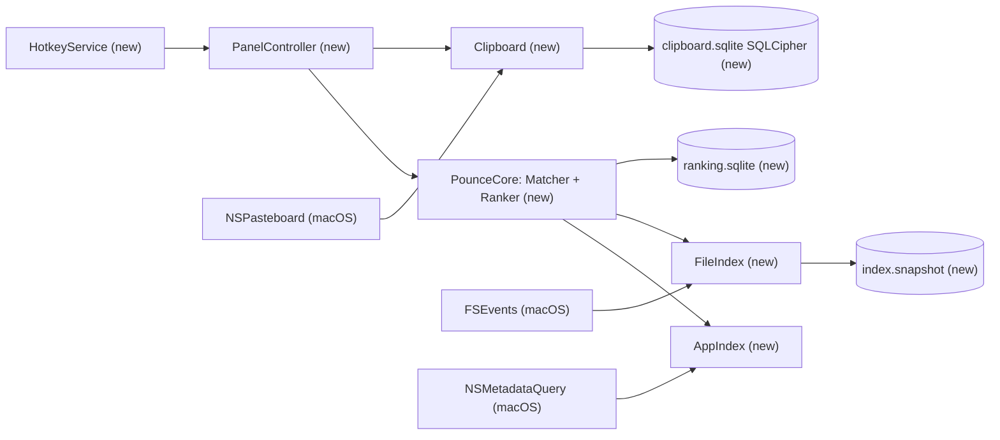
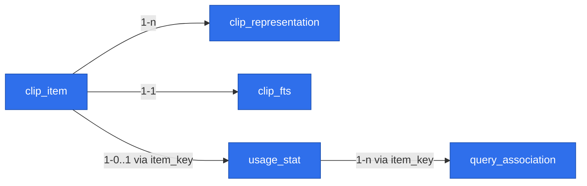

# Pounce — macOS launcher MVP

> Status: **READY FOR REVIEW**. All gate questions resolved (see Decisions); adversarial scope review applied. Language: Polish prose, English identifiers.

## 📝 TLDR
Pounce to otwarto-źródłowy (MIT), natywny launcher dla macOS z trzema funkcjami: wyszukiwanie aplikacji, wyszukiwanie plików/folderów i historia schowka. Dziś te potrzeby pokrywa Spotlight (wolny, ranking po treści, gubi pliki) albo pełny Raycast (rozbudowany, 350–450 MB RAM w wersji 2.0). Pounce (przyszłe zachowanie) otwiera się w <50 ms po ⌘Space, szuka po własnym indeksie nazw w pamięci z rankingiem fzf + frecency, a ⌘⇧V otwiera zaszyfrowaną historię schowka, która wkleja do poprzedniej aplikacji.

## 📝 Decisions (resolved gate questions)
| # | Pytanie | Decyzja |
|---|---|---|
| Q1 | Podział | Jedna specyfikacja; każda faza dostarcza działający produkt i ma **własny branch `feat/` i własne PR** (nigdy jedno PR na całość). Przegląd sugerował 3 osobne specyfikacje; zostajemy przy jednej zgodnie z decyzją właściciela, a fazy zrobiono samodzielnymi. |
| Q2 | Stack | Swift 6, AppKit `NSPanel` + SwiftUI, SwiftPM (jak AudioPin). |
| Q3 | Zasięg plików | Tylko nazwy plików w `~` i `/Applications`, z domyślnymi wykluczeniami. Bez wyszukiwania po treści. |
| Q4 | Enter w schowku | Wkleja do poprzedniej aplikacji przez symulowane ⌘V (Accessibility). Bez uprawnienia: tylko kopiuje. |
| Q5 | Typy i retencja schowka | Tekst, RTF/HTML, obrazki, pliki, URL. 30 dni lub 1000 wpisów. Baza SQLCipher z kluczem w Keychain. |
| Q6 | Skróty | ⌘Space otwiera launcher (użytkownik wyłącza skrót Spotlighta), ⌘⇧V otwiera schowek. Oba do zmiany w ustawieniach. |
| Q7 | Dystrybucja | Open source (MIT). Release DMG z GitHub Actions po tagu + landing na GitHub Pages, jak AudioPin. **Różnica:** stały certyfikat self-signed zamiast ad-hoc (patrz Risks R1). |
| Q8 | Nazwa | **Pounce**, repo `mjozefiak/Pounce`. |

**Założenie:** minimum macOS 26 na Apple silicon, budowane z Xcode 27 SDK. Wymaga potwierdzenia w kroku 0.1, jeśli runner CI tego nie pozwala.

## 📝 Problem Statement
- **Spotlight** układa wyniki według treści i metadanych, a nie nazwy pliku. Dokleja sugestie z sieci i Siri, odpowiada asynchronicznie, foldery wykluczone w prywatności znikają z wyników, a na macOS 26.x są zgłoszenia o plikach w ogóle nieobecnych w wynikach.
- **Raycast** sam porzucił Spotlighta na rzecz własnego indeksera (maj 2026), bo Spotlight „never gave us the speed or consistency we needed”. To potwierdza, że kierunek jest słuszny. Jednocześnie Raycast to produkt z kontem, AI i rozszerzeniami, zbędnymi przy trzech funkcjach.
- **Budżety wydajności**, które definiują sukces:

| Metryka | Cel |
|---|---|
| Otwarcie panelu po skrócie | < 50 ms |
| Zapytanie o aplikacje | < 5 ms |
| Zapytanie o pliki (p95, 1 mln wpisów) | < 30 ms |
| Pamięć w spoczynku (z indeksem ~500 tys. plików) | < 150 MB |
| Pierwszy skan `~` | < 30 s |
| Start z zapisanego indeksu | < 2 s do gotowości |

## 📝 Proposed Solution
Agent bez ikony w Docku (`LSUIElement`), z ikoną w pasku menu. Jeden zbudowany z góry, niewidoczny panel pokazywany skrótem. Jedno pole wyszukiwania, dwa tryby:
- **Tryb wyszukiwania (⌘Space):** wyniki z dwóch źródeł, aplikacji i plików, w sekcjach.
- **Tryb schowka (⌘⇧V):** lista historii z podglądem.

Wspólny rdzeń `PounceCore` (normalizacja, dopasowanie, ranking) obsługuje wszystkie źródła.

**Odrzucone alternatywy:**
- **Tauri:** 80–150 MB i bindingi do każdego natywnego API.
- **Electron:** 150–300 MB i błędy okna typu panel.
- **Spotlight (MDQuery) dla plików:** to właśnie źródło problemu. Spotlight zostaje tylko jako uzupełnienie listy aplikacji.
- **Fork Sol:** kruchy toolchain React Native.
- **App Store:** sandbox wyklucza indeks `~` i wklejanie, a App Review odrzuca `CGEvent.post` (wytyczna 2.4.5).

## 📝 Architecture
SwiftPM, cele (targets):

| Target | Rola | Zależności |
|---|---|---|
| `PounceApp` (executable) | `AppDelegate`, `StatusItemController`, `PanelController` (podklasa `LauncherPanel: NSPanel` z override `canBecomeKey`, ukrywanie w `windowDidResignKey` + `NSHostingView`), `HotkeyService`, `SettingsWindow`, `PermissionsCenter`, `LaunchAtLogin` (`SMAppService.mainApp`) | wszystkie poniżej, [KeyboardShortcuts](https://github.com/sindresorhus/KeyboardShortcuts) (MIT) |
| `PounceCore` | `TextNormalizer` (lowercase, NFD, ręczna mapa `ł→l` i podobnych), `FuzzyMatcher` (port scoringu fzy/fzf-v2), `Ranker` (tiery + frecency + powiązania zapytanie→element), protokół `SearchSource` | — |
| `AppIndex` | `AppScanner` (FileManager, głębokość 2), `AppMetadataWatcher` (`NSMetadataQuery` `kMDItemContentTypeTree == com.apple.application-bundle`, stale działający), `IconCache` (pamięć + PNG na dysku, klucz ścieżka+mtime), `AppLauncher` (`NSWorkspace.openApplication`) | `PounceCore` |
| `FileIndex` | `BulkScanner` (`getattrlistbulk`, równoległe przechodzenie katalogów), `NameStore` (pula nazw, tablica węzłów z indeksem rodzica), `FileEventWatcher` (FSEvents `FileEvents`, `sinceWhen` + UUID urządzenia), `IgnoreRules`, `IndexSnapshot` (zapis atomowy: plik tymczasowy + `rename`) | `PounceCore` |
| `Clipboard` | `PasteboardWatcher` (Timer 0,5 s na `changeCount` na głównym wątku; odczyt i hashowanie treści na kolejce w tle), `CaptureFilter`, `ClipStore` (GRDB + SQLCipher), `KeyStore` (Keychain), `PasteService` (CGEvent ⌘V), `RetentionJob` (wiersze **i** pliki blobów) | `PounceCore`, GRDB (MIT) |
| `Persistence` | Dwie bazy: `ranking.sqlite` (niezaszyfrowana, od fazy 1) i `clipboard.sqlite` (SQLCipher, od fazy 2). Rozdzielone, żeby problem z kluczem nigdy nie kasował rankingu i żeby faza 1 nie wymagała migracji. Wariant GRDB z SQLCipher wybrany w spike'u 0.4. | GRDB |


Panel nie zna źródeł danych. Zadaje zapytanie przez `SearchSource`, więc każdą fazę da się dodać bez zmian w już działających źródłach.

**Przepływ zapytania:**
1. Każde wciśnięcie klawisza anuluje poprzednie zadanie (`Task`).
2. Aplikacje odpowiadają synchronicznie (<5 ms).
3. Pliki liczą wynik równolegle na rdzeniach CPU i zwracają top-N (50).
4. Ranker łączy oba źródła: najpierw tier dopasowania, w jego obrębie frecency i powiązania zapytanie→element.
5. Lista jest wirtualizowana (LazyVStack albo `NSTableView`, jeśli pomiar pokaże zacięcia).

**Ranking (wspólny):**
- **Tier dopasowania:** exact > prefiks > początek słowa lub akronim („vsc”) > podciąg > fuzzy.
- **Modyfikatory w obrębie tieru:**
  - frecency (wykładniczy zanik, półokres 7 dni);
  - bonus za powiązanie zapytanie→element (prefiks zapytania, który wcześniej doprowadził do wyboru tego elementu);
  - dla plików: kara za głębokość ścieżki i bonus za świeży mtime.
- Frecency nigdy nie przenosi elementu do lepszego tieru.

## 📝 Data Model
Katalog `~/Library/Application Support/Pounce/`, wszystkie pliki z uprawnieniami 0600:
- **`clipboard.sqlite`** jest zaszyfrowana SQLCipher.
- **Klucz główny** to 32 losowe bajty w zwykłym (plikowym) login keychainie: `kSecClassGenericPassword`, `service = app.pounce.clipboard`.
  - Domyślna lista ACL ufa aplikacji, która utworzyła wpis. Działa to między wersjami dzięki stałemu wymaganiu podpisu (R1).
  - Keychaina data-protection (`kSecUseDataProtectionKeychain`, `kSecAttrAccessible…`) nie używamy, bo wymaga entitlementu `keychain-access-groups`, a ten profilu provisioningowego, którego certyfikat self-signed nie dostanie.
- **Podklucze** wyprowadzane HKDF-SHA256 z klucza głównego: `info = "sqlcipher"` dla bazy, `info = "blob"` dla plików blobów, `info = "blob-name"` dla nazw blobów.
- **`ranking.sqlite`** jest niezaszyfrowana.

**Encje `clipboard.sqlite`:**

| Encja | Pola | Uwagi |
|---|---|---|
| `clip_item` | `id` PK, `content_hash` UNIQUE (HMAC-SHA256 posortowanych reprezentacji podkluczem `blob-name`, nie goły SHA-256), `kind` (`text`/`rich`/`image`/`file`/`url`), `preview_text`, `source_bundle_id`, `source_app_name`, `created_at`, `last_used_at`, `use_count`, `byte_size` | Duplikat: aktualizacja `last_used_at` i przeniesienie na górę zamiast nowego wiersza. |
| `clip_representation` | `id` PK, `item_id` FK→`clip_item` ON DELETE CASCADE, `uti`, `data` BLOB NULL, `blob_file` NULL, `byte_size` | Powyżej 1 MB treść idzie do pliku `blobs/<losowy UUID>` zaszyfrowanego AES-GCM (CryptoKit) podkluczem `blob`. Kasowanie wiersza (ręczne lub retencja) usuwa też plik. Dodatkowo co dobę działa sweep usuwający pliki bez wiersza. Limit 20 MB na wpis. |
| `clip_fts` | FTS5 (external content) nad `clip_item.preview_text` | Szybkie wyszukiwanie w historii. Fuzzy ranking stosowany na top-200 wynikach FTS i na 1000 ostatnich wpisach. W fallbacku R3 tabela nie powstaje, a wyszukiwanie odbywa się w pamięci po 1000 wpisach. |

**Encje `ranking.sqlite`** (ścieżki plików i prefiksy zapytań; wrażliwość taka jak snapshotu, więc 0600 bez szyfrowania):

| Encja | Pola | Uwagi |
|---|---|---|
| `usage_stat` | `item_key` PK (`app:<bundleID>`, `file:<path>`, `clip:<id>`), `frecency`, `last_used_at`, `use_count` | Ranking wszystkich źródeł. |
| `query_association` | (`query_prefix`, `item_key`) PK, `count`, `last_used_at` | Prefiks znormalizowany do 1–4 znaków. Przycinany razem z retencją. |

Poza bazą:
- **Indeks plików** (`index.snapshot`, binarny, wersjonowany, zstd lub LZFSE): pula nazw, tablica węzłów (`name_id`, `parent_index`, `flags`: katalog/pakiet, `mtime`), lista korzeni, `last_event_id`, UUID urządzenia FSEvents (`FSEventsCopyUUIDForDevice`), flaga `complete`, `schema_version`.
  - **Świadoma decyzja:** plik nie jest szyfrowany, choć nazwy plików bywają wrażliwe. Chronią go uprawnienia 0600 i FileVault, a zawartość da się odtworzyć skanem. Do ponownej oceny po MVP.
  - **Pełny skan wymusza** zmiana `schema_version`, inne UUID urządzenia (przeczyszczona baza zdarzeń albo sformatowany wolumen) albo `complete = false`.
- **Lista aplikacji i cache ikon:** `apps.json` + `icons/` w `Caches/`, odtwarzalne w każdej chwili.
- **Ustawienia:** `UserDefaults` (skróty, korzenie i wykluczenia, retencja, ignorowane aplikacje, uruchamianie przy logowaniu).


Wszystkie encje są nowe (repo startuje od zera). `usage_stat` i `query_association` łączy tylko klucz tekstowy, bez FK, bo pliki i aplikacje nie mają wierszy w bazie. Klucz `clip:<id>` przechodzi między bazami. Osierocone wpisy `clip:*` w `ranking.sqlite` są czyszczone przez `RetentionJob`.

Interaktywny widok HTML grafu pominięto: przy pięciu encjach diagram Mermaid wystarcza.

## 📝 API Contracts
Kontrakty wewnętrzne (brak publicznego API; jedyną stabilną powierzchnią jest format bazy i snapshotu):
```swift
protocol SearchSource: Sendable {
    var id: SourceID { get }                 // .apps, .files, .clipboard
    func search(_ q: NormalizedQuery, limit: Int) async -> [Candidate]
}
struct Candidate { let itemKey: String; let title: String; let subtitle: String?
                   let match: MatchResult /* tier, score, highlight ranges */ }
protocol ResultAction { func perform(_ c: Candidate, context: ActionContext) async throws }
```
- **Akcje aplikacji:** `Enter` otwiera lub aktywuje aplikację, `⌘Enter` pokazuje ją w Finderze.
- **Akcje plików:** `Enter` otwiera domyślną aplikacją, `⌘Enter` pokazuje w Finderze, `⌘C` kopiuje ścieżkę, `⌘⇧C` kopiuje sam plik.
- **Akcje schowka:** `Enter` wkleja, `⌘Enter` tylko kopiuje, `⌘⌫` usuwa wpis.
- **Migracje:** `DatabaseMigrator` z GRDB, migracje tylko dodające nowe struktury. Snapshot indeksu ma pole `schema_version`, a niezgodna wersja oznacza pełny skan, nigdy błąd.

## 📝 UI/UX
- **Panel:**
  - Wymiary około 760×480 pt, wyśrodkowany na ekranie z kursorem.
  - `NSPanel(.nonactivatingPanel)`, `level = .floating`, `collectionBehavior = [.canJoinAllSpaces, .fullScreenAuxiliary]`, `canBecomeKey = true`.
  - Panel chowa się po utracie fokusu i po Esc.
  - Tło: materiał systemowy (vibrancy), tryb jasny i ciemny.
- **Tryb wyszukiwania:**
  - Pusty input pokazuje 8 ostatnio używanych aplikacji i plików według frecency.
  - Przy wpisanym tekście sekcje „Aplikacje” i „Pliki” z podświetleniem dopasowanych znaków.
  - Stopka pokazuje akcje dla zaznaczonego wyniku (⏎ Otwórz, ⌘⏎ Pokaż w Finderze).
- **Tryb schowka:**
  - Lista po lewej z ikoną aplikacji źródłowej i czasem, podgląd po prawej (tekst, obraz, plik).
  - Filtr typu przez `⌘1`–`⌘5`.
- **Stany:**
  - „Indeksuję pliki… 312 tys.”: nieblokujący pasek, wyniki aplikacji działają od razu.
  - „Brak dostępu do schowka”: link do instrukcji, gdy `accessBehavior` nie jest ustawione na zawsze.
  - „Wklejanie wyłączone”: przycisk nadania uprawnienia Accessibility, a Enter działa wtedy jak kopiowanie.
  - „Brak wyników”.
  - „Nagrywanie wstrzymane”: przełącznik w menu paska.
- **Onboarding** dostarczany po kawałku razem z funkcją, której dotyczy (żadna faza nie wydaje funkcji bez jej uprawnień i kontroli). Każdy krok można pominąć:
  1. **Faza 1, skrót.** Pounce czyta `com.apple.symbolichotkeys` (klucz 64, „Show Spotlight search”). Rejestracja przez Carbon nie zgłasza błędu przy konflikcie, więc wykrywanie przez nieudaną rejestrację odpada.
     - Jeśli skrót Spotlighta jest włączony: instrukcja i deep link do ustawień klawiatury, a do czasu jego wyłączenia działa ⌥⌘Space.
     - Skrót można zmienić w mini-ustawieniach z menu paska.
  2. **Faza 2, schowek.** Wyjaśnienie, co jest zapisywane i co pomijane. Prośba o Accessibility do wklejania. Stan `accessBehavior`.
  3. **Faza 3, pliki.** Prośba o Full Disk Access, wyświetlana **przed** pierwszym skanem.
     - Bez Full Disk Access skan pomija `~/Desktop`, `~/Documents`, `~/Downloads` i iCloud Drive, żeby nie wywołać serii promptów TCC.
     - Użytkownik może dodać te katalogi pojedynczo i zaakceptować prompt dla każdego.
- **Dostępność:** pełna obsługa klawiaturą, etykiety VoiceOver dla wierszy (tytuł, typ, ścieżka) i respektowanie „Ogranicz ruch”.
- **Ustawienia:**
  - skróty;
  - uruchamianie przy logowaniu;
  - korzenie i wykluczenia plików;
  - retencja i ignorowane aplikacje (domyślnie Hasła, Pęk kluczy, 1Password, Bitwarden);
  - „Wyczyść historię”;
  - „Zresetuj ranking”.

Prototype: brak zaakceptowanego. Ekrany można później zaprojektować osobno przez `om-ux-design`.

## 📝 Edge Cases & Failure Scenarios
| Sytuacja | Zachowanie |
|---|---|
| ⌘Space nadal zajęte przez Spotlighta | Wykryte z `com.apple.symbolichotkeys` (klucz 64). Pounce rejestruje ⌥⌘Space i pokazuje instrukcję. Po wyłączeniu skrótu Spotlighta przełącza się na ⌘Space przy następnym otwarciu ustawień lub restarcie. |
| Pierwszy skan przerwany (zamknięcie aplikacji, crash) | Snapshot cząstkowy zapisywany co 100 tys. wpisów z `complete = false`. Po restarcie wyniki są dostępne od razu z części, a skan zaczyna się od nowa w tle. Wyszukiwanie nigdy nie czeka na skan. |
| Zapis snapshotu przerwany | Zapis atomowy (plik tymczasowy, potem `rename`), więc poprzedni snapshot zostaje nienaruszony. |
| Duży wpis w schowku (obraz 20 MB) | Odczyt i hashowanie w tle. Główny wątek tylko porównuje `changeCount`. |
| Spotlight wyłączony lub w trakcie indeksowania | Lista aplikacji pochodzi ze skanu katalogów. `NSMetadataQuery` tylko uzupełnia listę. |
| Duplikaty aplikacji, aplikacje pomocnicze w `.app/Contents` | Deduplikacja po bundle ID z preferencją `/Applications`. Ścieżki zagnieżdżone w innym `.app` są odrzucane. |
| Brak Full Disk Access | Chronione katalogi są pomijane domyślnie, więc nie pojawiają się prompty TCC. Ustawienia pokazują, czego brakuje, z opcją dodania katalogu pojedynczo. |
| iCloud Drive (`~/Library/Mobile Documents`) | Wyjątek od wykluczenia `~/Library`: osobny korzeń, aktywny przy Full Disk Access albo po ręcznym dodaniu. |
| FSEvents `MustScanSubDirs` / `RootChanged` / `EventIdsWrapped` / inne UUID urządzenia | Ponowny skan poddrzewa lub całego korzenia w tle, bez przerywania wyszukiwania. |
| Snapshot uszkodzony lub nowa wersja | Pełny skan; stary plik usuwany. |
| Pliki iCloud bez lokalnej kopii, pakiety (`.app`, `.photoslibrary`) | Indeksowane jako pojedynczy element, bez schodzenia do środka pakietu. |
| Firmlinki `/System/Volumes/Data`, wolumeny sieciowe | Wykluczone z korzeni. Wolumeny zewnętrzne nie są indeksowane w MVP. |
| Wpis `ConcealedType`/`TransientType`/`AutoGeneratedType` albo aplikacja z listy ignorowanych | Wpis nie jest zapisywany. |
| Pounce sam zapisuje do schowka (wklejanie) | Zapamiętuje własny `changeCount`, więc wpis nie trafia do historii po raz drugi i tylko podbija `last_used_at`. |
| Użytkownik odmówił dostępu do schowka (pasteboard privacy) | Watcher wykrywa `accessBehavior`, a UI pokazuje stan wyłączony. Bez cichych błędów. |
| Brak Accessibility albo uprawnienie utracone po aktualizacji | `CGPreflightPostEventAccess()` zwraca false, więc Enter tylko kopiuje i pojawia się baner z instrukcją ponownego nadania. |
| Poprzednia aplikacja zamknięta przed wklejeniem | Brak wklejenia, wpis zostaje w schowku i pojawia się komunikat „Skopiowano”. |
| Keychain zablokowany (`errSecInteractionNotAllowed`) lub użytkownik odmówił dostępu | Historia schowka jest wyłączona, a stan widoczny w UI. Ponowna próba po `NSWorkspace.sessionDidBecomeActive` i przy otwarciu trybu schowka. Brak nagrywania bez klucza. Nic nie jest kasowane. Ranking działa dalej (osobna baza). |
| Klucza na pewno nie ma (`errSecItemNotFound`) przy istniejącej `clipboard.sqlite` | To jedyny przypadek resetu: archiwizacja do `clipboard.sqlite.unreadable-<data>`, nowa baza i nowy klucz, komunikat dla użytkownika. Archiwum jest kasowane po 30 dniach. |
| Obraz > 20 MB | Wpis pominięty i zalogowany. |
| Zmiana języka systemu | Lista aplikacji odświeżana przy starcie i po `NSLocale.currentLocaleDidChangeNotification`. |

## 📝 Risks & Impact Review
- **R1: Podpis ad-hoc (jak w AudioPin) kasuje uprawnienia TCC przy każdej aktualizacji.**
  - TCC wiąże zgody Accessibility i Full Disk Access z wymaganiem podpisu (designated requirement). Przy podpisie ad-hoc to wymaganie zależy od hasha pliku, więc każdy nowy build to dla systemu „inna aplikacja”.
  - **Mitygacja:** podpis stałym certyfikatem self-signed „Pounce Release”, trzymanym jako `.p12` w sekretach repo i importowanym w CI do tymczasowego keychaina. Wymaganie podpisu (identifier + certyfikat) zostaje takie samo między wersjami.
  - Gatekeeper i tak zablokuje pierwsze uruchomienie, więc release notes powtarzają instrukcję „Open Anyway” z AudioPin.
  - Przejście na Developer ID w przyszłości jednorazowo unieważni nadane zgody.
  - **Do zweryfikowania:**
    - W kroku 0.3: `codesign -dr -` daje identyczne wymaganie podpisu dla dwóch kolejnych buildów.
    - W kroku 2.5 (ręcznie): aktualizacja z v0.2.0 do v0.2.1 zachowuje Accessibility i dostęp do klucza w Keychain.
- **R2: Prywatność schowka w macOS 27.x.** Apple może włączyć domyślne pytanie o odczyt schowka. Mitygacja: wsparcie `accessBehavior` od pierwszej wersji i onboarding. Wpływ: bez zgody historia nie działa, reszta aplikacji tak.
- **R3: SQLCipher przez SwiftPM.** GRDB obsługuje `usePassphrase`, ale nie ma oficjalnego produktu SwiftPM z SQLCipher (potrzebny fork lub własny pakiet). Może też kolidować z systemowym `libsqlite3`, które ładuje Foundation.
  - Spike w kroku **0.4**, zanim powstanie jakakolwiek baza, więc wybór wariantu GRDB nie wymusi później podmiany zależności ani migracji.
  - **Fallback:** systemowe GRDB plus szyfrowanie AES-GCM kolumn `data` i `preview_text`. Bez `clip_fts`, wyszukiwanie w pamięci po 1000 wpisach (opisane w Data Model).
- **R4: Format bazy i snapshotu** to jedyne trudno odwracalne kontrakty. Migracje są tylko addytywne, a snapshot można zawsze odtworzyć.
- **R5: ⌘Space jest domyślnie skrótem systemu.** Wymaga ręcznej zmiany przez użytkownika. Przejęcie skrótu przez CGEventTap odrzucone, bo wymagałoby uprawnienia Input Monitoring.
- **R6: Pamięć indeksu.** Około 100 B na wpis, więc ~150 MB dla 1,5 mln plików. Domyślne wykluczenia (`node_modules`, `.git`, `~/Library`, cache, `DerivedData`) trzymają typowy `~` w okolicach 300–800 tys. wpisów. Pomiar w kroku 3.6.

## 📋 Phasing
- **Phase 0, szkielet repo i release:** pusta aplikacja w pasku menu, CI testów, release DMG z podpisem self-signed, spike SQLCipher. Wynik: wersja v0.0.x do zainstalowania.
- **Phase 1, panel + wyszukiwanie aplikacji:** samodzielnie używalny launcher aplikacji z wykrywaniem konfliktu ⌘Space i zmianą skrótu. Wynik: v0.1.
- **Phase 2, historia schowka:** zaszyfrowana historia, ⌘⇧V, wklejanie oraz **wszystkie kontrolki bezpieczeństwa w tej samej wersji**: wyczyść historię, lista ignorowanych aplikacji, retencja, banery uprawnień, pauza. Wynik: v0.2.
- **Phase 3, wyszukiwanie plików:** własny indeks + FSEvents, onboarding Full Disk Access przed pierwszym skanem, ustawienia korzeni i wykluczeń. Wynik: v0.3.
- **Phase 4, v1.0:** wspólne okno ustawień (scala mini-ustawienia z faz 1–3), dostępność, landing page, pomiary budżetów. Bez nowych funkcji.

Każda faza jest wydawalna osobno i zawiera kontrolki oraz uprawnienia swojej funkcji. Fazy 2 i 3 nie zależą od siebie, tylko od fazy 1 (panel i `PounceCore`). Każda faza to osobny branch `feat/` i osobne PR.

**Polityka testów:**
- CI blokuje merge tylko na testach jednostkowych (`swift test`).
- Testy UI, testy wymagające Accessibility lub Full Disk Access oraz benchmarki są **lokalne lub ręczne**. Runnery GitHub nie nadają uprawnień TCC, a współdzielone maszyny wirtualne dają niestabilne pomiary. Wyniki tych testów trafiają do opisu PR danej fazy.
- SwiftPM nie obsługuje paczek XCUITest, więc testy UI to cel `PounceUITests` w projekcie Xcode generowanym lokalnie, albo scenariusz ręczny z checklistą.

## 📋 Implementation Plan
**Phase 0: szkielet**
- **0.1** `Package.swift` (cele z Architecture), `Resources/Info.plist` (`LSUIElement`, `app.pounce.Pounce`, `LSMinimumSystemVersion` 26.0), `NSStatusItem` z menu Quit. Test: `swift build`, a test dymny sprawdza wczytanie Info.plist.
- **0.2** `scripts/make-app.sh` i `scripts/make-dmg.sh` (wzorowane na AudioPin) oraz workflow `ci.yml` (`swift test` na PR). Test: CI zielone, DMG się buduje.
- **0.3** Certyfikat self-signed, sekrety `SIGNING_P12`/`SIGNING_P12_PASSWORD`, podpis w `release.yml`, release notes z instrukcją Gatekeepera. Test: tag `v0.0.1` daje Release, a `codesign -dr -` pokazuje identyczne wymaganie podpisu dla dwóch buildów (zachowanie zgód TCC sprawdzane ręcznie w 2.5).
- **0.4** Spike: GRDB z SQLCipher w SwiftPM (fork lub własny pakiet), konflikt z systemowym `libsqlite3`, `usePassphrase` + HKDF. Wynik: wybrany wariant zależności zapisany w `docs/decisions/0001-sqlite.md`, albo fallback R3 i poprawka tej specyfikacji. Test: test jednostkowy, w którym baza otwarta bez klucza zwraca błąd, a z kluczem czyta dane.

**Phase 1: panel + aplikacje**
- **1.1** `TextNormalizer` + `FuzzyMatcher` (tiery, highlight ranges). Test: testy jednostkowe dla „vsc” → Visual Studio Code, „kalk” → Kalkulator, „ł” → „l” i stabilnego porządku tierów.
- **1.2** `LauncherPanel` + `PanelController` + `HotkeyService` (KeyboardShortcuts, ⌘Space, fallback ⌥⌘Space) + puste pole wyszukiwania. Test: jednostkowy stanu kontrolera (pokaż, ukryj, utrata fokusu). Lokalnie: log czasu od skrótu do `orderFront` (< 50 ms).
- **1.2b** Wykrywanie konfliktu ze Spotlightem (`com.apple.symbolichotkeys`, klucz 64), baner z instrukcją, zmiana skrótu w mini-ustawieniach z menu paska. Test: jednostkowy parsera plist na fiksturach (włączony, wyłączony, brak klucza).
- **1.3** `AppScanner` + `AppMetadataWatcher` + deduplikacja + aliasy (`CFBundleName`). Test: testy na katalogu fikstur z `.app`, aplikacjami pomocniczymi i duplikatem.
- **1.4** `IconCache` (lazy, w tle) + lista wyników z klawiaturą. Test: test widoku listy, ikony nie ładują się na wątku głównym (asercja w debug).
- **1.5** `AppLauncher` (`openApplication`, `yieldActivation`) + akcja ⌘Enter. Test: jednostkowy budowania konfiguracji otwarcia. Lokalnie: ręczne otwarcie TextEdit.
- **1.6** `ranking.sqlite` (wariant GRDB z 0.4) + `usage_stat` + `query_association` + `Ranker`. Test: po 3 wyborach „Terminal” dla „te” Terminal jest pierwszy, ale exact match innej aplikacji nadal wygrywa.

**Phase 2: schowek** (całość w jednej wersji v0.2; nic nie jest wydawane bez kroków 2.6–2.7)
- **2.1** `KeyStore` (plikowy login keychain, HKDF, rozróżnienie `errSecItemNotFound` od `errSecInteractionNotAllowed` i odmowy) + otwarcie `clipboard.sqlite`. Test: jednostkowe na mocku Keychain dla każdego kodu błędu. Tylko `ItemNotFound` resetuje bazę.
- **2.2** `PasteboardWatcher` + `CaptureFilter` (typy nspasteboard.org, domyślna lista ignorowanych aplikacji, limity rozmiaru, własny `changeCount`, odczyt w tle). Test: jednostkowe na sztucznym `NSPasteboard(name:)`.
- **2.3** `ClipStore`: zapis reprezentacji, deduplikacja po HMAC, bloby > 1 MB zaszyfrowane w plikach o losowych nazwach, FTS5, kasowanie wiersza razem z plikiem. Test: zapis i odczyt każdego typu, duplikat przesuwa wpis na górę, usunięcie wpisu usuwa plik bloba.
- **2.4** Tryb schowka w panelu (⌘⇧V), lista, podgląd, filtr typu, wyszukiwanie, `⌘⌫` usuwa wpis. Test: jednostkowy modelu widoku. Lokalnie: płynne przewijanie 1000 wpisów (Instruments).
- **2.5** `PasteService` (zapamiętana aplikacja na pierwszym planie, ⌘V przez CGEvent, keycode zależny od układu klawiatury) + fallback „tylko kopiuj” + baner Accessibility. Test: jednostkowy wyboru ścieżki (jest uprawnienie albo go brak). Ręcznie: wklejenie do TextEdit oraz zachowanie zgody po aktualizacji z v0.2.0 do v0.2.1 (R1).
- **2.6** `RetentionJob` (30 dni lub 1000 wpisów, przy starcie i co godzinę; wiersze, pliki blobów, sweep osieroconych plików, wpisy `clip:*` w rankingu). Test: jednostkowe na sztucznym zegarze i katalogu tymczasowym.
- **2.7** Kontrolki bezpieczeństwa w mini-ustawieniach i menu paska: wyczyść historię, edycja listy ignorowanych aplikacji, wybór retencji, pauza nagrywania, stan `accessBehavior`, stan Keychain. Test: jednostkowe przypisania ustawień do filtra i retencji. „Wyczyść historię” zostawia pustą bazę i pusty katalog `blobs/`.

**Phase 3: pliki**
- **3.0** Onboarding Full Disk Access wyświetlany przed pierwszym skanem (wykrywanie przez próbę odczytu chronionej ścieżki, deep link do ustawień) + domyślne pomijanie chronionych katalogów bez tej zgody. Test: jednostkowy wyboru korzeni (jest FDA albo jej brak).
- **3.1** `BulkScanner` (`getattrlistbulk`, równoległość, pomijanie pakietów, wolumenów i firmlinków) + `IgnoreRules`. Test: drzewo fikstur z pakietem, symlinkiem i `node_modules` daje oczekiwaną listę.
- **3.2** `NameStore` + wyszukiwanie równoległe top-N z kryteriami plików (kara za głębokość, mtime). Test: jednostkowe poprawności top-N. Lokalnie: benchmark na syntetycznym 1 mln nazw (p95 < 30 ms na M1). W CI tylko test dymny z luźnym limitem.
- **3.3** Sekcja „Pliki” w panelu + akcje (otwórz, pokaż w Finderze, kopiuj ścieżkę lub plik). Test: test widoku i akcji na plikach tymczasowych.
- **3.4** `FileEventWatcher` (FSEvents, flagi ponownego skanu). Test: integracyjny, gdzie utworzenie, zmiana nazwy i usunięcie pliku w katalogu tymczasowym pojawia się w wynikach w < 2 s.
- **3.5** `IndexSnapshot`: zapis atomowy po skanie, co 100 tys. wpisów w trakcie pierwszego skanu i co 10 min; wczytanie przy starcie; nadrobienie zmian od `last_event_id` z weryfikacją UUID urządzenia. Test: restart z plikiem zmienionym w międzyczasie daje aktualne wyniki bez pełnego skanu; inne UUID, `complete = false` albo uszkodzony plik wymuszają pełny skan.
- **3.6** Pasek postępu indeksowania, ustawienia korzeni i wykluczeń (w tym iCloud Drive), pomiar pamięci na rzeczywistym `~`. Test: jednostkowe `IgnoreRules` z ustawień. Ręcznie: pomiar zapisany w `docs/perf.md`, budżet < 150 MB.

**Phase 4: v1.0**
- **4.1** Wspólne okno ustawień scalające mini-ustawienia z faz 1–3 + uruchamianie przy logowaniu + „Zresetuj ranking”. Test: jednostkowe przypisania ustawień do zachowania.
- **4.2** Ekran powitalny łączący kroki onboardingu z faz 1–3 przy pierwszym uruchomieniu. Test: ręczna checklista przejścia i pominięcia każdego kroku.
- **4.3** VoiceOver, „Ogranicz ruch”, tryb ciemny. Test: audyt Accessibility Inspector bez błędów.
- **4.4** Landing page w `docs/` + `pages.yml` (jak AudioPin), README z instalacją i budowaniem ze źródeł. Test: workflow Pages zielony.
- **4.5** Weryfikacja wszystkich budżetów z Problem Statement, tag `v1.0.0`. Test: wyniki zapisane w `docs/perf.md`.

**Poza zakresem MVP:** wyszukiwanie po treści, wolumeny zewnętrzne, przypinanie wpisów schowka, OCR obrazów, auto-update (Sparkle), Homebrew cask, rozszerzenia i pluginy, synchronizacja między urządzeniami.
