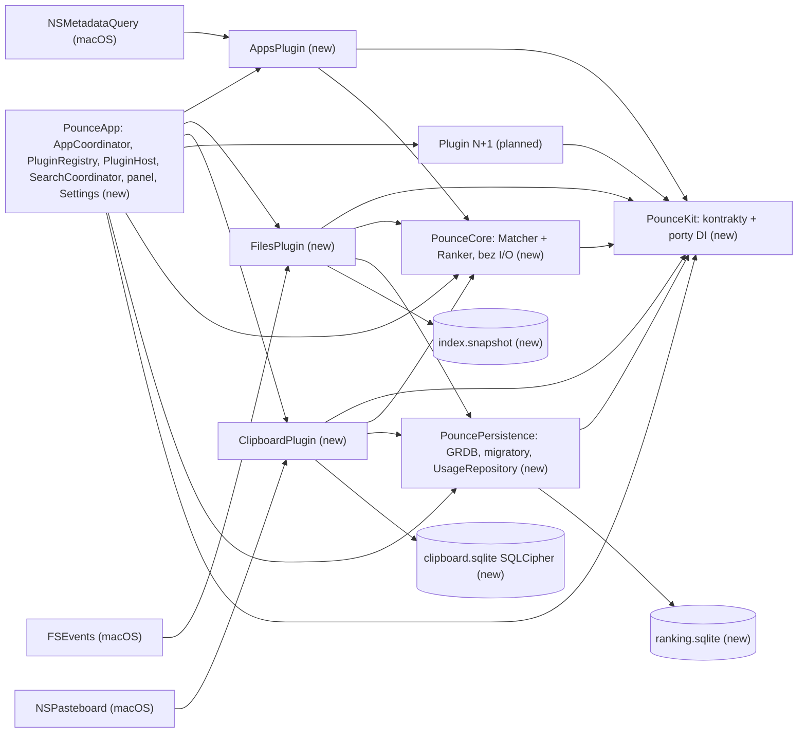
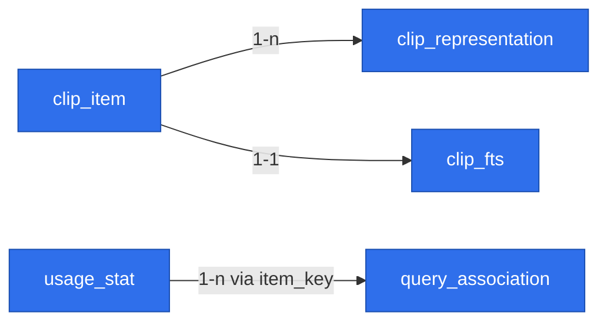

# Pounce — macOS launcher MVP

> Status: **READY FOR REVIEW**. All gate questions resolved (see Decisions); adversarial scope review and the PR #1 specification review applied; Q10 and Q11 confirmed by the owner. Language: Polish prose, English identifiers.

## 📝 TLDR
Pounce to otwarto-źródłowy (MIT), natywny launcher dla macOS z trzema funkcjami: wyszukiwanie aplikacji, wyszukiwanie plików/folderów i historia schowka. Dziś te potrzeby pokrywa Spotlight (wolny, ranking po treści, gubi pliki) albo pełny Raycast (rozbudowany, 350–450 MB RAM w wersji 2.0). Pounce (przyszłe zachowanie) otwiera się w <50 ms po ⌘Space, szuka po własnym indeksie nazw w pamięci z rankingiem fzf + frecency, a ⌘⇧V otwiera zaszyfrowaną historię schowka, która wkleja do poprzedniej aplikacji.

## 📝 Decisions (resolved gate questions)
| # | Pytanie | Decyzja |
|---|---|---|
| Q1 | Podział | Jedna specyfikacja; każda faza dostarcza działający produkt i ma **własny branch `feat/` i własne PR** (nigdy jedno PR na całość). Przegląd sugerował 3 osobne specyfikacje; zostajemy przy jednej zgodnie z decyzją właściciela, a fazy zrobiono samodzielnymi. |
| Q2 | Stack | Swift 6, AppKit `NSPanel` + SwiftUI, SwiftPM (jak AudioPin). |
| Q3 | Zasięg plików | Tylko nazwy plików w `~` i `/Applications`, z domyślnymi wykluczeniami. Bez wyszukiwania po treści. |
| Q4 | Enter w schowku | Wkleja do poprzedniej aplikacji przez symulowane ⌘V (Accessibility). Bez uprawnienia: tylko kopiuje. |
| Q5 | Typy i retencja schowka | Tekst, RTF/HTML, obrazki, pliki, URL. 30 dni lub 1000 wpisów. Baza SQLCipher z kluczem w Keychain. |
| Q6 | Skróty | ⌘Space otwiera launcher (użytkownik wyłącza skrót Spotlighta), ⌘⇧V otwiera schowek. Oba do zmiany w ustawieniach. |
| Q7 | Dystrybucja | Open source (MIT). Release DMG z GitHub Actions po tagu + landing na GitHub Pages, jak AudioPin. **Różnica:** stały certyfikat self-signed zamiast ad-hoc (patrz Risks R1). |
| Q8 | Nazwa | **Pounce**, repo `mjozefiak/Pounce`. |
| Q9 | Rozszerzalność | Każda funkcja to **wewnętrzny plugin kompilowany razem z aplikacją**: osobny target SwiftPM zgodny z protokołem `PouncePlugin` z `PounceKit`, rejestrowany jedną linią w `PluginRegistry`. Pluginy pisze tylko właściciel, więc nie ma ładowania w runtime, sandboxa ani publicznego API. Wyszukiwanie aplikacji, plików i schowek to pierwsze trzy pluginy (patrz Model pluginów). |
| Q10 | Skrót domyślny i jego zmiana | Domyślnie ⌘Space, a gdy zajmuje go Spotlight, ⌃⌥Space. ⌥⌘Space odpada, bo domyślnie otwiera okno wyszukiwania Findera (`com.apple.symbolichotkeys`, klucz 65). Przy pierwszym uruchomieniu krok „Skrót” pokazuje nagrywarkę wypełnioną skrótem domyślnym: użytkownik go akceptuje albo nagrywa własny. Później zmienia go w Ustawienia → Ogólne. Skrót wybrany przez użytkownika ma pierwszeństwo przed automatycznym przełączaniem ⌃⌥Space → ⌘Space. |
| Q11 | Język interfejsu | Angielski jako bazowy plus polski przez String Catalog (`Localizable.xcstrings`, `defaultLocalization: "en"`). Polskie etykiety w tej specyfikacji to wersja `pl`. Język wybiera system (preferowane języki lub język aplikacji w Ustawieniach systemowych), bez własnego przełącznika w Pounce. |

**Założenie:** minimum macOS 26 na Apple silicon, budowane z Xcode 27 SDK. Wymaga potwierdzenia w kroku 0.1, jeśli runner CI tego nie pozwala.

## 📝 Problem Statement
- **Spotlight** układa wyniki według treści i metadanych, a nie nazwy pliku. Dokleja sugestie z sieci i Siri, odpowiada asynchronicznie, foldery wykluczone w prywatności znikają z wyników, a na macOS 26.x są zgłoszenia o plikach w ogóle nieobecnych w wynikach.
- **Raycast** sam porzucił Spotlighta na rzecz własnego indeksera (maj 2026), bo Spotlight „never gave us the speed or consistency we needed”. To potwierdza, że kierunek jest słuszny. Jednocześnie Raycast to produkt z kontem, AI i rozszerzeniami, zbędnymi przy trzech funkcjach.
- **Budżety wydajności**, które definiują sukces:

| Metryka | Cel |
|---|---|
| Otwarcie panelu po skrócie | < 50 ms |
| Zapytanie o aplikacje | < 5 ms |
| Zapytanie o pliki (p95, 1 mln wpisów) | < 30 ms |
| Pamięć w spoczynku (z indeksem ~500 tys. plików) | < 150 MB |
| Pierwszy skan `~` | < 30 s |
| Start z zapisanego indeksu | < 2 s do gotowości |

## 📝 Proposed Solution
Agent bez ikony w Docku (`LSUIElement`), z ikoną w pasku menu. Jeden zbudowany z góry, niewidoczny panel pokazywany skrótem. Jedno pole wyszukiwania, dwa tryby:
- **Tryb wyszukiwania (⌘Space):** wyniki z dwóch źródeł, aplikacji i plików, w sekcjach.
- **Tryb schowka (⌘⇧V):** lista historii z podglądem.

Każda funkcja jest pluginem kompilowanym razem z aplikacją (Q9). Powłoka aplikacji zna tylko kontrakty z `PounceKit`, a wspólny rdzeń `PounceCore` (normalizacja, dopasowanie, ranking) obsługuje wszystkie źródła.

**Odrzucone alternatywy:**
- **Tauri:** 80–150 MB i bindingi do każdego natywnego API.
- **Electron:** 150–300 MB i błędy okna typu panel.
- **Spotlight (MDQuery) dla plików:** to właśnie źródło problemu. Spotlight zostaje tylko jako uzupełnienie listy aplikacji.
- **Fork Sol:** kruchy toolchain React Native.
- **App Store:** sandbox wyklucza indeks `~` i wklejanie, a App Review odrzuca `CGEvent.post` (wytyczna 2.4.5).

## 📝 Architecture
SwiftPM, cele (targets). Zależności płyną w jedną stronę: pluginy → `PouncePersistence`/`PounceCore` → `PounceKit`. `PounceKit` i `PounceCore` nie znają żadnego pluginu. Pluginy nie importują siebie nawzajem ani `PounceApp`, co pilnuje sam graf SwiftPM. `PounceApp` jest jedynym miejscem, które składa całość (composition root).

| Target | Rola | Zależności |
|---|---|---|
| `PounceKit` | Same kontrakty, bez implementacji: `PouncePlugin`, `PluginManifest`, `PluginContext`, `SearchSource`, `Candidate`, `MatchResult`, `ResultAction`, `PanelMode`, `PluginCommand`, `OnboardingStep`, `Permission` oraz porty DI (`KeychainClient`, `PasteboardClient`, `EventPoster`, `WorkspaceClient`, `UsageRecorder`, `PermissionsReader`). Wszystkie typy przekraczające granice aktorów są `Sendable`. | Foundation, SwiftUI |
| `PounceCore` | Czysta logika bez I/O: `TextNormalizer` (lowercase, NFD, ręczna mapa `ł→l` i podobnych), `FuzzyMatcher` (port scoringu fzy/fzf-v2), `Ranker` (tiery + frecency + powiązania zapytanie→element; statystyki dostaje jako argument, sam nie czyta bazy) | `PounceKit` |
| `PouncePersistence` | GRDB w wariancie wybranym w spike'u 0.4: fabryka baz z osobnym `DatabaseMigrator` dla każdego właściciela, `UsageRepository` nad `ranking.sqlite` (implementacja `UsageRecorder`), pomocnik zapisu atomowego (plik tymczasowy + `rename`) | `PounceKit`, GRDB (MIT) |
| `AppsPlugin` | `AppScanner` (FileManager, głębokość 2), `AppMetadataWatcher` (`NSMetadataQuery` `kMDItemContentTypeTree == com.apple.application-bundle`, stale działający), `IconCache` (pamięć + PNG na dysku, klucz ścieżka+mtime), `AppLauncher` (`NSWorkspace.openApplication`) | `PounceKit`, `PounceCore` |
| `FilesPlugin` | `BulkScanner` (`getattrlistbulk`, równoległe przechodzenie katalogów), `FileIndex` (`actor`, właściciel `NameStore`: pula nazw, tablica węzłów z indeksem rodzica), `FileEventWatcher` (FSEvents `FileEvents`, `sinceWhen` + UUID urządzenia), `IgnoreRules`, `IndexSnapshot` | `PounceKit`, `PounceCore`, `PouncePersistence` |
| `ClipboardPlugin` | `PasteboardWatcher` (pętla 0,5 s na `changeCount` na `MainActor`; odczyt i hashowanie treści w tle), `CaptureFilter`, `ClipStore` (GRDB + SQLCipher), `KeyStore` (Keychain), `PasteService` (CGEvent ⌘V), `RetentionJob` (wiersze **i** pliki blobów), tryb panelu schowka (lista + podgląd) | `PounceKit`, `PounceCore`, `PouncePersistence` |
| `PounceApp` (executable) | Composition root: `AppCoordinator` (tworzy i posiada kontrolery okien), `PluginRegistry` (lista pluginów), `PluginHost` (cykl życia, włączanie i wyłączanie, izolacja błędów), `SearchCoordinator` (rozesłanie zapytania do źródeł), `StatusItemController`, `PanelController` + `LauncherPanel: NSPanel` + `NSHostingView`, `HotkeyService` (rejestruje komendy pluginów), scena `Settings`, `OnboardingController`, `PermissionsCenter`, `LaunchAtLogin` (`SMAppService.mainApp`), implementacje portów DI | wszystkie powyżej, [KeyboardShortcuts](https://github.com/sindresorhus/KeyboardShortcuts) (MIT) |

**Bazy danych:** `ranking.sqlite` (niezaszyfrowana, od fazy 1, należy do `PounceApp` i jest udostępniana pluginom przez `UsageRecorder`) oraz `clipboard.sqlite` (SQLCipher, od fazy 2, prywatna dla `ClipboardPlugin`). Są rozdzielone, żeby problem z kluczem nigdy nie kasował rankingu i żeby faza 1 nie wymagała migracji. Do `ranking.sqlite` nie trafia nic ze schowka (patrz Data Model).


Powłoka (`PounceApp`) zna tylko kontrakty z `PounceKit`. Funkcję N+1 dodaje się jako nowy target i jedną linię w `PluginRegistry`, bez zmian w `PounceKit`, `PounceCore` ani w już działających pluginach.

### Model pluginów
Kontrakt jest w API Contracts. Zasady:
- **Wkład pluginu:** źródła wyszukiwania (`searchSources`), akcje dla wyniku (`actions(for:)` na źródle), komendy z globalnym skrótem (`commands`, np. ⌘⇧V otwiera tryb schowka), własne tryby panelu (`panelModes`, np. lista + podgląd schowka), panel ustawień (`settingsPane()`), kroki onboardingu (`onboardingSteps`) i wymagane uprawnienia (`requiredPermissions`). Każdy wkład ma pustą wartość domyślną w rozszerzeniu protokołu, więc mały plugin implementuje tylko to, czego potrzebuje.
- **Rejestracja:** `PounceApp/PluginRegistry.swift` zawiera `static let all: [any PouncePlugin.Type] = [AppsPlugin.self, FilesPlugin.self, ClipboardPlugin.self]`. Nowy plugin to nowy target w `Package.swift`, zależność `PounceApp` od niego i jedna linia w tej liście.
- **Kolejność:** `manifest.order` ustala kolejność sekcji w wynikach i paneli w ustawieniach. Użytkownik może zmienić kolejność sekcji w ustawieniach (panel Funkcje).
- **Cykl życia:** `PluginHost` tworzy plugin z `PluginContext`, wywołuje `activate()` (start obserwatorów, otwarcie baz, migracje), a przy wyłączeniu lub zakończeniu aplikacji `deactivate()` (zatrzymanie obserwatorów, zamknięcie baz; idempotentne). Stany: `disabled`, `activating`, `active`, `failed(Error)`.
- **Izolacja błędów:**
  - Wyjątek z `activate()` przełącza plugin w `failed`, a stan i komunikat widać w ustawieniach (panel Funkcje). Pozostałe pluginy działają dalej.
  - `SearchCoordinator` odpytuje źródła w `TaskGroup` z budżetem czasu na źródło (domyślnie 150 ms). Błąd albo przekroczenie budżetu usuwa tylko sekcję tego źródła i trafia do logu.
  - Komenda, akcja lub tryb pluginu w stanie `failed` albo `disabled` nie jest rejestrowana ani pokazywana.
  - **Granica izolacji:** pluginy działają w tym samym procesie, więc trap (`fatalError`, `try!`, wymuszone rozpakowanie `nil`) kończy całą aplikację. Kod pluginów nie używa tych konstrukcji poza testami (R7).
- **Włączanie i wyłączanie:** przełącznik na plugin w ustawieniach (`plugins.<id>.enabled`, domyślnie `manifest.defaultEnabled`). Wyłączenie odwołuje skróty, zatrzymuje obserwatory (wyłączony schowek nie odpytuje `NSPasteboard`) i ukrywa sekcje. Dane zostają do czasu użycia przycisku „Usuń dane” (`eraseData()`).
- **Dane pluginu:** każdy plugin ma własny katalog `Application Support/Pounce/Plugins/<id>/` (0700), własne bazy i migrator, ustawienia z prefiksem `plugins.<id>.` i klucze rankingu `<id>:<klucz>`. Nie ma kluczy obcych ani odczytów między danymi różnych pluginów.

### Współbieżność (Swift 6)
- **Tryb języka:** `swift-tools-version: 6.2`, tryb Swift 6 (ścisła kontrola współbieżności) we wszystkich targetach. `PounceApp` ma `.defaultIsolation(MainActor.self)`. `PounceKit`, `PounceCore`, `PouncePersistence` i pluginy zostają `nonisolated`, a izolację deklarują jawnie.
- **`MainActor`:** panel, widoki SwiftUI, model stanu panelu (`@Observable`), `PluginHost`, `HotkeyService`, protokół `PouncePlugin` (wkład UI) oraz pętla `PasteboardWatcher` porównująca `changeCount`.
- **Aktory:** `FileIndex` jest `actor` i jedynym właścicielem `NameStore`. Zmiany z FSEvents stosuje partiami i po każdej partii publikuje niezmienny, `Sendable` snapshot. Wyszukiwanie czyta bieżący snapshot bez blokad, więc nigdy nie widzi połowy partii (zamiana referencji, RCU). `ClipStore` i `UsageRepository` korzystają z `DatabasePool`/`DatabaseQueue` z GRDB, które same serializują zapisy.
- **Anulowanie:** każde wciśnięcie klawisza anuluje poprzednie zadanie. Równoległe przeszukiwanie plików (`TaskGroup` po fragmentach tablicy węzłów) sprawdza `Task.checkCancellation()` co 10 tys. węzłów.
- **Obserwatory:** FSEvents, `NSMetadataQuery` i zmiany schowka są wystawiane jako `AsyncStream` z buforem `.bufferingNewest`, żeby wolny konsument nie blokował źródła zdarzeń.
- **Testy:** testy `FileIndex` i `PluginHost` uruchamiane także z `swift test --sanitize=thread`.

### Obserwowalność
- `os.Logger` z `subsystem = app.pounce` i `category = <id pluginu>`. Treść schowka, ścieżki plików i zapytania zawsze z `privacy: .private`.
- `os_signpost` dla budżetów z Problem Statement: skrót → `orderFront`, zapytanie na każde źródło, skan, wczytanie snapshotu. Pomiary w krokach 1.2, 3.2 i 4.5 korzystają z tych sygnałów.
- Brak telemetrii i raportów sieciowych.

### Zapytanie i ranking
**Przepływ zapytania:**
1. Każde wciśnięcie klawisza anuluje poprzednie zadanie (`Task`).
2. `SearchCoordinator` rozsyła zapytanie do aktywnych źródeł równolegle, każde z budżetem czasu.
3. Aplikacje odpowiadają w <5 ms. Pliki liczą wynik równolegle na rdzeniach CPU i zwracają top-N (50).
4. Ranker sortuje wyniki **w obrębie sekcji**: najpierw tier dopasowania, potem frecency, powiązania zapytanie→element i sygnał źródła (`boost`). Kolejność sekcji wynika z `manifest.order`.
5. Lista jest wirtualizowana (LazyVStack albo `NSTableView`, jeśli pomiar pokaże zacięcia).

**Ranking (wspólny):**
- **Tier dopasowania:** exact > prefiks > początek słowa lub akronim („vsc”) > podciąg > fuzzy.
- **Modyfikatory w obrębie tieru:**
  - frecency (wykładniczy zanik, półokres 7 dni);
  - bonus za powiązanie zapytanie→element (prefiks zapytania, który wcześniej doprowadził do wyboru tego elementu);
  - sygnał źródła `Candidate.boost`, np. w `FilesPlugin` kara za głębokość ścieżki i bonus za świeży mtime.
- Frecency nigdy nie przenosi elementu do lepszego tieru.

## 📝 Data Model
Katalog `~/Library/Application Support/Pounce/`, wszystkie pliki z uprawnieniami 0600. W katalogu głównym leży tylko `ranking.sqlite`. Dane pluginów leżą w `Plugins/<id>/` (0700): `Plugins/clipboard/` (`clipboard.sqlite`, `blobs/`) i `Plugins/files/` (`index.snapshot`).
- **`clipboard.sqlite`** jest zaszyfrowana SQLCipher.
- **Klucz główny** to 32 losowe bajty w zwykłym (plikowym) login keychainie: `kSecClassGenericPassword`, `service = app.pounce.clipboard`.
  - Domyślna lista ACL ufa aplikacji, która utworzyła wpis. Działa to między wersjami dzięki stałemu wymaganiu podpisu (R1).
  - Keychaina data-protection (`kSecUseDataProtectionKeychain`, `kSecAttrAccessible…`) nie używamy, bo wymaga entitlementu `keychain-access-groups`, a ten profilu provisioningowego, którego certyfikat self-signed nie dostanie.
- **Podklucze** wyprowadzane HKDF-SHA256 z klucza głównego: `info = "sqlcipher"` dla bazy, `info = "blob"` dla plików blobów, `info = "content-hash"` dla HMAC w `content_hash`. Nazwy blobów to losowe UUID, więc nie potrzebują klucza.
- **`ranking.sqlite`** jest niezaszyfrowana.

**Encje `clipboard.sqlite`:**

| Encja | Pola | Uwagi |
|---|---|---|
| `clip_item` | `id` PK, `content_hash` UNIQUE (HMAC-SHA256 posortowanych reprezentacji podkluczem `content-hash`, nie goły SHA-256), `kind` (`text`/`rich`/`image`/`file`/`url`), `preview_text`, `source_bundle_id`, `source_app_name`, `created_at`, `last_used_at`, `use_count`, `byte_size` | Duplikat: aktualizacja `last_used_at` i przeniesienie na górę zamiast nowego wiersza. `use_count` i `last_used_at` są jedynym źródłem frecency dla schowka. |
| `clip_representation` | `id` PK, `item_id` FK→`clip_item` ON DELETE CASCADE, `uti`, `data` BLOB NULL, `blob_file` NULL, `byte_size` | Powyżej 1 MB treść idzie do pliku `blobs/<losowy UUID>` zaszyfrowanego AES-GCM (CryptoKit) podkluczem `blob`. Kasowanie wiersza (ręczne lub retencja) usuwa też plik. Dodatkowo co dobę działa sweep usuwający pliki bez wiersza. Limit 20 MB na wpis. |
| `clip_fts` | FTS5 (external content) nad `clip_item.preview_text` | Szybkie wyszukiwanie w historii. Fuzzy ranking stosowany na top-200 wynikach FTS i na 1000 ostatnich wpisach. W fallbacku R3 tabela nie powstaje, a wyszukiwanie odbywa się w pamięci po 1000 wpisach. |

**Encje `ranking.sqlite`** (ścieżki plików, bundle ID i prefiksy zapytań; wrażliwość taka jak snapshotu, więc 0600 bez szyfrowania). Nic ze schowka tu nie trafia: ani identyfikatory wpisów, ani prefiksy zapytań wpisanych w trybie schowka.

| Encja | Pola | Uwagi |
|---|---|---|
| `usage_stat` | `item_key` PK w formacie `<id pluginu>:<klucz>` (`apps:<bundleID>`, `files:<path>`), `frecency`, `last_used_at`, `use_count` | Ranking źródeł, które zapisują przez `UsageRecorder`. Format klucza to kontrakt (R4). |
| `query_association` | (`query_prefix`, `item_key`) PK, `count`, `last_used_at` | Prefiks znormalizowany do 1–4 znaków. Wpisy starsze niż 90 dni usuwane przy starcie. |

Poza bazą:
- **Indeks plików** (`index.snapshot`, binarny, wersjonowany, zstd lub LZFSE): pula nazw, tablica węzłów (`name_id`, `parent_index`, `flags`: katalog/pakiet, `mtime`), lista korzeni, `last_event_id`, UUID urządzenia FSEvents (`FSEventsCopyUUIDForDevice`), flaga `complete`, `schema_version`.
  - **Świadoma decyzja:** plik nie jest szyfrowany, choć nazwy plików bywają wrażliwe. Chronią go uprawnienia 0600 i FileVault, a zawartość da się odtworzyć skanem. Do ponownej oceny po MVP.
  - **Pełny skan wymusza** zmiana `schema_version`, inne UUID urządzenia (przeczyszczona baza zdarzeń albo sformatowany wolumen) albo `complete = false`.
- **Lista aplikacji i cache ikon:** `apps.json` + `icons/` w `Caches/`, odtwarzalne w każdej chwili.
- **Ustawienia:** `UserDefaults` z przestrzeniami nazw: `app.*` (skrót główny, uruchamianie przy logowaniu, rozmiar tekstu, kolejność sekcji) i `plugins.<id>.*` (`enabled` oraz ustawienia pluginu, np. korzenie i wykluczenia, retencja, ignorowane aplikacje).


Wszystkie encje są nowe (repo startuje od zera). `usage_stat` i `query_association` łączy tylko klucz tekstowy, bez FK, bo pliki i aplikacje nie mają wierszy w bazie. Między `clipboard.sqlite` a `ranking.sqlite` nie ma żadnego powiązania, więc retencja schowka nie dotyka rankingu, a do niezaszyfrowanej bazy nie wycieka nic ze schowka.

Interaktywny widok HTML grafu pominięto: przy pięciu encjach diagram Mermaid wystarcza.

## 📝 API Contracts
Kontrakty wewnętrzne w `PounceKit`. Nie ma publicznego API. Stabilne powierzchnie to format baz, snapshotu, kluczy `<id pluginu>:<klucz>` i ścieżek `Plugins/<id>/`.
```swift
struct PluginManifest: Sendable {
    let id: PluginID                  // "apps", "files", "clipboard"; stały, bo jest w kluczach i ścieżkach
    let displayName: LocalizedStringResource
    let symbolName: String            // SF Symbol sekcji i panelu ustawień
    let order: Int                    // kolejność sekcji i paneli
    let defaultEnabled: Bool
}

@MainActor
protocol PouncePlugin: AnyObject {
    static var manifest: PluginManifest { get }
    init(context: PluginContext)
    func activate() async throws                      // obserwatory, bazy, migracje
    func deactivate() async                           // idempotentne
    var searchSources: [any SearchSource] { get }     // domyślnie []
    var commands: [PluginCommand] { get }             // globalne skróty i pozycje menu paska; domyślnie []
    var panelModes: [PanelMode] { get }               // własny widok trybu panelu; domyślnie []
    var onboardingSteps: [OnboardingStep] { get }     // domyślnie []
    var requiredPermissions: Set<Permission> { get }  // .accessibility, .fullDiskAccess, .pasteboard; domyślnie []
    func settingsPane() -> AnyView?                   // domyślnie nil
    func eraseData() async throws                     // „Usuń dane”; domyślnie usuwa Plugins/<id>/
}

struct PluginContext: Sendable {
    let storageDirectory: URL                         // Application Support/Pounce/Plugins/<id>/
    let settings: PluginSettings                      // UserDefaults, prefiks plugins.<id>.
    let usage: any UsageRecorder                      // ranking.sqlite, klucze <id>:<klucz>
    let logger: Logger                                // subsystem app.pounce, category <id>
    let keychain: any KeychainClient
    let pasteboard: any PasteboardClient
    let events: any EventPoster                       // CGEvent ⌘V
    let workspace: any WorkspaceClient                // NSWorkspace: otwieranie, Finder, frontmostApplication
    let permissions: any PermissionsReader
    let clock: any Clock<Duration>
}

protocol SearchSource: Sendable {
    var id: SourceID { get }
    func search(_ q: NormalizedQuery, limit: Int) async throws -> [Candidate]   // reaguje na anulowanie Task
    func actions(for c: Candidate) -> [ResultAction]                           // pierwsza = Enter, druga = ⌘Enter
}
struct Candidate: Sendable, Hashable {
    let itemKey: ItemKey                              // "<id pluginu>:<klucz>"
    let title: String; let subtitle: String?
    let icon: IconRef                                 // ścieżka pliku, bundle ID albo SF Symbol
    let match: MatchResult                            // Sendable: tier, score, highlight ranges
    let boost: Double                                 // sygnał źródła w obrębie tieru
}
struct ResultAction: Sendable, Identifiable {
    let id: String; let title: LocalizedStringResource
    let symbolName: String; let shortcut: KeyShortcut?
    let perform: @Sendable (ActionContext) async throws -> Void
}
struct ActionContext: Sendable { let previousApp: pid_t?; let panel: any PanelPresenter }
```
Stopka panelu i obsługa skrótów akcji są generowane z `actions(for:)`, więc powłoka nie zna akcji żadnego pluginu.
- **Akcje aplikacji:** `Enter` otwiera lub aktywuje aplikację, `⌘Enter` pokazuje ją w Finderze.
- **Akcje plików:** `Enter` otwiera domyślną aplikacją, `⌘Enter` pokazuje w Finderze, `⌘C` kopiuje ścieżkę (tylko gdy w polu wyszukiwania nic nie jest zaznaczone), `⌘⇧C` kopiuje sam plik.
- **Akcje schowka:** `Enter` wkleja, `⌘Enter` tylko kopiuje, `⌃X` usuwa wpis. `⌘⌫` zostaje standardowym „usuń do początku linii” w polu wyszukiwania.
- **Migracje:** osobny `DatabaseMigrator` z GRDB dla każdej bazy (`ranking.sqlite` w `PouncePersistence`, bazy pluginów w ich targetach), migracje tylko dodające nowe struktury. Snapshot indeksu ma pole `schema_version`, a niezgodna wersja oznacza pełny skan, nigdy błąd.

## 📝 UI/UX
Cel: Pounce ma wyglądać i działać jak część systemu (HIG dla macOS 26, Liquid Glass). Poniższe wartości są domyślne. Zmiana wymaga powodu wpisanego w PR danej fazy.

### Panel (zachowanie)
- **Konstrukcja:** `LauncherPanel: NSPanel` tworzony raz przy starcie i potem tylko pokazywany lub chowany.
  - `styleMask = [.borderless, .nonactivatingPanel, .fullSizeContentView]` przekazany **w `init`**. Zmiana `.nonactivatingPanel` po utworzeniu nie aktualizuje okna w window serverze.
  - Override `canBecomeKey → true` i `canBecomeMain → false`.
  - `isFloatingPanel = true`, `level = .floating`, `collectionBehavior = [.canJoinAllSpaces, .fullScreenAuxiliary, .transient, .ignoresCycle]` (bez Mission Control i bez ⌘\`).
  - `becomesKeyOnlyIfNeeded = false`, `hidesOnDeactivate = false` (aplikacja nigdy nie staje się aktywna), `isReleasedWhenClosed = false`, `isMovableByWindowBackground = false`.
  - `backgroundColor = .clear`, `isOpaque = false`, `hasShadow = true`, `animationBehavior = .none` (własna animacja, patrz Wygląd).
- **Pokazanie:** `makeKeyAndOrderFront` **bez** `NSApp.activate`. Poprzednia aplikacja zostaje aktywna (`frontmostApplication` się nie zmienia), co upraszcza wklejanie. Ponowny skrót przy widocznym panelu go chowa.
- **Położenie:** ekran z kursorem (`NSEvent.mouseLocation`), w obrębie `visibleFrame` (pasek menu, notch, Dock). Poziomo na środku, górna krawędź na 1/4 wysokości `visibleFrame` od góry, jak Spotlight. Pozycja liczona przy każdym pokazaniu i po `NSApplication.didChangeScreenParametersNotification`. Panelu nie da się przesunąć.
- **Rozmiar:** szerokość 760 pt. Wysokość dopasowana do treści: samo pole 56 pt, z wynikami do 480 pt. Tryb schowka zawsze 480 pt.
- **Ukrywanie:** `Esc` (pierwsze czyści zapytanie, drugie zamyka), `⌘W`, `windowDidResignKey`, `NSWorkspace.activeSpaceDidChangeNotification`, wykonanie akcji. Okna otwierane z panelu (Ustawienia, alert uprawnień, ekran powitalny) najpierw jawnie chowają panel, a dopiero potem się pokazują.
- **Test ręczny (checklista w PR fazy 1):** pokazanie nad aplikacją pełnoekranową, na drugim ekranie, po zmianie Space, przy ukrytym i widocznym Docku oraz z notchem. Fokus po `Esc` zostaje w poprzedniej aplikacji. Jeśli panel nie pokazuje się nad aplikacją pełnoekranową, poziom podnosimy do `.statusBar` i zapisujemy to w PR.

### Wygląd natywny
- **Materiał:** `NSGlassEffectView` (macOS 26+) jako `contentView` panelu, `cornerRadius = 16`, z `NSHostingView` jako jej `contentView`. Wewnątrz brak własnych teł i drugiej warstwy szkła. Zaznaczenie wiersza to zwykły zaokrąglony prostokąt, nie szkło. Ustawienia „Ogranicz przezroczystość” i „Zwiększ kontrast” obsługuje sam materiał systemowy.
- **Typografia:** systemowy krój (SF Pro) wyłącznie przez style tekstowe, bez stałych rozmiarów:
  - pole wyszukiwania `.title2`;
  - tytuł wiersza `.body`, podtytuł (ścieżka, aplikacja źródłowa) `.subheadline` + `.secondary`;
  - nagłówek sekcji `.caption` `.semibold` + `.secondary`;
  - stopka `.caption`;
  - liczby z `monospacedDigit()`, ścieżki obcinane w środku (`truncationMode(.middle)`).
- **Kolory:** tylko semantyczne (`.primary`, `.secondary`, `Color.accentColor`, `NSColor.selectedContentBackgroundColor` dla zaznaczenia z białym tekstem). Żadnych kolorów zapisanych na sztywno. Tryb jasny i ciemny, akcent i kolor zaznaczenia użytkownika działają automatycznie.
- **Podświetlenie dopasowania:** pogrubienie i kolor akcentu, nigdy sam kolor („Rozróżniaj bez użycia koloru”).
- **SF Symbols** (renderowanie `.hierarchical`):
  - pole: `magnifyingglass`;
  - sekcje z `manifest.symbolName`: `square.grid.2x2` (Aplikacje), `doc` (Pliki), `doc.on.clipboard` (Schowek);
  - stany: `hand.raised` (brak uprawnień), `lock` (Keychain zablokowany), `pause.circle` (nagrywanie wstrzymane), `exclamationmark.triangle` (plugin w stanie `failed`);
  - stopka: klawisze jako tekst w kapsułce (`⏎`, `⌘⏎`), nie jako obrazki.
- **Metryki:** wiersz 40 pt, ikona 28×28 pt (ikony aplikacji i plików z `NSWorkspace`), marginesy 12 pt, zaokrąglenie zaznaczenia 8 pt, siatka 4 pt.
- **Animacja:** pojawienie się i zniknięcie jako zanikanie 120 ms, bez skalowania i przesuwania. Przy „Ogranicz ruch” brak animacji.

### Klawiatura
Pole wyszukiwania ma fokus przez cały czas. Strzałki i skróty obsługuje `onKeyPress` na polu, a skróty z ⌘ obsługuje `performKeyEquivalent` panelu. Pierwszeństwo: kompozycja IME, potem edycja tekstu w polu, a na końcu akcje.

| Klawisz | Działanie |
|---|---|
| ↑ / ↓, ⌃P / ⌃N | Poprzedni lub następny wynik, przez granice sekcji |
| ⏎ | Pierwsza akcja wyniku. Podczas kompozycji IME (np. japoński) tylko zatwierdza tekst. |
| ⌘⏎ | Druga akcja (Pokaż w Finderze albo Tylko kopiuj) |
| ⌘C / ⌘⇧C | Kopiuj ścieżkę albo plik. Jeśli w polu jest zaznaczony tekst, zwykłe kopiowanie tekstu. |
| ⌃X | Usuń wpis schowka |
| ⌘1–⌘5 | Filtr typu w trybie schowka |
| Esc / ⌘W | Wyczyść zapytanie, a przy pustym zamknij panel |
| ⌘, | Ustawienia (panel się chowa) |

### Tryby i stany
- **Tryb wyszukiwania:**
  - Pusty input pokazuje 8 ostatnio używanych elementów według frecency.
  - Przy wpisanym tekście sekcje pluginów (najpierw „Aplikacje”, potem „Pliki”) z podświetleniem dopasowanych znaków.
  - Stopka pokazuje akcje zaznaczonego wyniku z `actions(for:)` (⏎ Otwórz, ⌘⏎ Pokaż w Finderze).
- **Tryb schowka** (`PanelMode` z `ClipboardPlugin`):
  - Lista po lewej z ikoną aplikacji źródłowej i czasem, podgląd po prawej (tekst, obraz, plik).
  - Filtr typu przez `⌘1`–`⌘5`.
- **Stany:**
  - „Indeksuję pliki… 312 tys.”: nieblokujący pasek, wyniki aplikacji działają od razu.
  - „Brak dostępu do schowka”: link do instrukcji, gdy `accessBehavior` nie jest ustawione na zawsze.
  - „Wklejanie wyłączone”: przycisk nadania uprawnienia Accessibility, a Enter działa wtedy jak kopiowanie.
  - „Brak wyników”.
  - „Nagrywanie wstrzymane”: przełącznik w menu paska.
  - „Funkcja niedostępna”: sekcja pluginu w stanie `failed`, z linkiem do ustawień.
- **Onboarding** dostarczany po kawałku razem z funkcją, której dotyczy (`onboardingSteps` pluginu; żadna faza nie wydaje funkcji bez jej uprawnień i kontroli). Każdy krok można pominąć:
  1. **Faza 1, skrót.** Pounce czyta `com.apple.symbolichotkeys`: klucz 64 („Show Spotlight search”) i 65 („Show Finder search window”). Rejestracja przez Carbon nie zgłasza błędu przy konflikcie, więc wykrywanie przez nieudaną rejestrację odpada.
     - Krok „Skrót” przy pierwszym uruchomieniu: `KeyboardShortcuts.Recorder` wypełniony skrótem domyślnym (⌘Space albo ⌃⌥Space, gdy ⌘Space zajmuje Spotlight), przyciski „Użyj tego skrótu” i „Pomiń”. Pominięcie zostawia skrót domyślny (Q10).
     - Jeśli skrót Spotlighta jest włączony: dodatkowo instrukcja i deep link do ustawień klawiatury, żeby zwolnić ⌘Space.
     - Skrót można później zmienić w Ustawieniach (panel Ogólne). Ten krok jest częścią fazy 1, a nie dopiero ekranu powitalnego z kroku 4.2.
  2. **Faza 2, schowek.** Wyjaśnienie, co jest zapisywane i co pomijane. Prośba o Accessibility do wklejania. Stan `accessBehavior`.
  3. **Faza 3, pliki.** Prośba o Full Disk Access, wyświetlana **przed** pierwszym skanem.
     - Bez Full Disk Access skan pomija `~/Desktop`, `~/Documents`, `~/Downloads` i iCloud Drive, żeby nie wywołać serii promptów TCC.
     - Użytkownik może dodać te katalogi pojedynczo i zaakceptować prompt dla każdego.

### Dostępność
Każda faza spełnia te kryteria dla swoich ekranów. Faza 4 to audyt całości, a nie pierwsze wdrożenie.
- **VoiceOver:**
  - Lista wyników to element z rolą listy (`accessibilityElement(children: .contain)`). Wiersz ma etykietę (tytuł), wartość (typ, ścieżka albo aplikacja źródłowa) i cechę `.isSelected`.
  - Fokus zostaje w polu, więc zmiana zaznaczenia strzałkami jest ogłaszana (`AccessibilityNotification.Announcement`) tytułem i typem wyniku.
  - Liczba wyników jest ogłaszana po 500 ms bez pisania.
- **Ustawienia systemowe:**
  - „Ogranicz ruch”: brak animacji.
  - „Ogranicz przezroczystość” i „Zwiększ kontrast”: nieprzezroczyste tło materiału oraz wyraźniejsza ramka zaznaczenia (`colorSchemeContrast`).
  - „Rozróżniaj bez użycia koloru”: dopasowanie zawsze pogrubione.
- **Rozmiar tekstu:** macOS nie ma Dynamic Type, więc Ustawienia → Ogólne → „Rozmiar tekstu” (S, M, L, XL) ustawia `.dynamicTypeSize` dla panelu. Przy XL tytuły się nie obcinają, a wiersz rośnie.
- **Pełny dostęp z klawiatury:** każdą kontrolkę ustawień i onboardingu da się osiągnąć Tabem.
- **Test fazy:** audyt Accessibility Inspector bez błędów oraz ręczne przejście VoiceOverem przez nowe ekrany, z wynikiem w opisie PR.

### Pasek menu i Ustawienia
- **Ikona w pasku menu:** `NSStatusItem` z obrazem szablonowym (template SF Symbol, dopasowuje się do jasnego i ciemnego paska). Menu:
  - „Otwórz Pounce” z aktualnym skrótem;
  - pozycje z `commands` włączonych pluginów (np. „Historia schowka ⌘⇧V”, „Wstrzymaj nagrywanie schowka”);
  - „Ustawienia… ⌘,”, „O Pounce”, „Zakończ Pounce ⌘Q”, oddzielone separatorami.
- **Jedno okno ustawień od fazy 1:** scena SwiftUI `Settings`, bez osobnych mini-ustawień.
  - `TabView` z panelami w pasku narzędzi i ikonami SF Symbols; zawartość jako `Form` z `.formStyle(.grouped)`; szerokość 600 pt, wysokość dopasowana do panelu.
  - Aplikacja jest `LSUIElement`, więc otwarcie ustawień wywołuje `NSApp.activate()` i akcję `openSettings`, a okno wraca na wierzch przy każdym kolejnym otwarciu.
  - Skróty nagrywa `KeyboardShortcuts.Recorder`.
- **Panele:**
  - **Ogólne:** skrót główny, uruchamianie przy logowaniu, rozmiar tekstu.
  - **Funkcje:** lista pluginów z przełącznikiem, stanem (`active`, `failed` z komunikatem), kolejnością sekcji i przyciskiem „Usuń dane”.
  - **Panel każdego pluginu** z `settingsPane()`:
    - Pliki: korzenie i wykluczenia;
    - Schowek: retencja, ignorowane aplikacje (domyślnie Hasła, Pęk kluczy, 1Password, Bitwarden), „Wyczyść historię”, pauza.
  - **Uprawnienia:** stan Accessibility, Full Disk Access, dostępu do schowka i Keychain, z przyciskami do ustawień systemu.
  - **Zaawansowane:** „Zresetuj ranking”.

Prototype: brak zaakceptowanego. Ekrany można później zaprojektować osobno przez `om-ux-design`.

## 📝 Edge Cases & Failure Scenarios
| Sytuacja | Zachowanie |
|---|---|
| ⌘Space nadal zajęte przez Spotlighta | Wykryte z `com.apple.symbolichotkeys` (klucz 64). Pounce rejestruje ⌃⌥Space (Q10) i pokazuje instrukcję. ⌥⌘Space nie jest używane, bo to klucz 65 (okno wyszukiwania Findera). Po wyłączeniu skrótu Spotlighta przełącza się na ⌘Space przy następnym otwarciu ustawień lub restarcie, ale tylko gdy użytkownik nie wybrał własnego skrótu (`app.hotkey.userDefined`). |
| Zapasowy skrót też zajęty (inna aplikacja, której nie widać w `symbolichotkeys`) | Nie da się tego wykryć. Baner w onboardingu i panel Ogólne pozwalają nagrać inny skrót. Skrót otwiera się też z menu paska. |
| W Chrome, Slacku i Dokumentach Google ⌘⇧V to „wklej bez formatowania” | Świadoma decyzja (Q6): globalny skrót wygrywa. Onboarding schowka o tym mówi, a skrót można zmienić w panelu Schowek. |
| Pierwszy skan przerwany (zamknięcie aplikacji, crash) | Snapshot cząstkowy zapisywany co 100 tys. wpisów z `complete = false`. Po restarcie wyniki są dostępne od razu z części, a skan zaczyna się od nowa w tle. Wyszukiwanie nigdy nie czeka na skan. |
| Zapis snapshotu przerwany | Zapis atomowy (plik tymczasowy, potem `rename`), więc poprzedni snapshot zostaje nienaruszony. |
| Duży wpis w schowku (obraz 20 MB) | Odczyt i hashowanie w tle. Główny wątek tylko porównuje `changeCount`. |
| Spotlight wyłączony lub w trakcie indeksowania | Lista aplikacji pochodzi ze skanu katalogów. `NSMetadataQuery` tylko uzupełnia listę. |
| Duplikaty aplikacji, aplikacje pomocnicze w `.app/Contents` | Deduplikacja po bundle ID z preferencją `/Applications`. Ścieżki zagnieżdżone w innym `.app` są odrzucane. |
| Brak Full Disk Access | Chronione katalogi są pomijane domyślnie, więc nie pojawiają się prompty TCC. Ustawienia pokazują, czego brakuje, z opcją dodania katalogu pojedynczo. |
| iCloud Drive (`~/Library/Mobile Documents`) | Wyjątek od wykluczenia `~/Library`: osobny korzeń, aktywny przy Full Disk Access albo po ręcznym dodaniu. |
| FSEvents `MustScanSubDirs` / `RootChanged` / `EventIdsWrapped` / inne UUID urządzenia | Ponowny skan poddrzewa lub całego korzenia w tle, bez przerywania wyszukiwania. |
| Snapshot uszkodzony lub nowa wersja | Pełny skan; stary plik usuwany. |
| Pliki iCloud bez lokalnej kopii, pakiety (`.app`, `.photoslibrary`) | Indeksowane jako pojedynczy element, bez schodzenia do środka pakietu. |
| Firmlinki `/System/Volumes/Data`, wolumeny sieciowe | Wykluczone z korzeni. Wolumeny zewnętrzne nie są indeksowane w MVP. |
| Wpis `ConcealedType`/`TransientType`/`AutoGeneratedType` albo aplikacja z listy ignorowanych | Wpis nie jest zapisywany. |
| Schowek zmienił się ponownie w trakcie odczytu w tle | Po odczycie `changeCount` jest porównywany jeszcze raz. Przy różnicy wynik jest odrzucany, a obsłużony zostaje nowszy stan. Bezpieczeństwo odczytu `NSPasteboard` poza wątkiem głównym sprawdzamy w kroku 2.2. Jeśli się nie potwierdzi, odczyt jest na `MainActor`, a w tle zostaje tylko hashowanie. |
| Pounce sam zapisuje do schowka (wklejanie) | Zapamiętuje własny `changeCount`, więc wpis nie trafia do historii po raz drugi i tylko podbija `last_used_at`. |
| Użytkownik odmówił dostępu do schowka (pasteboard privacy) | Watcher wykrywa `accessBehavior`, a UI pokazuje stan wyłączony. Bez cichych błędów. |
| Brak Accessibility albo uprawnienie utracone po aktualizacji | `CGPreflightPostEventAccess()` zwraca false, więc Enter tylko kopiuje i pojawia się baner z instrukcją ponownego nadania. |
| Poprzednia aplikacja zamknięta przed wklejeniem | Brak wklejenia, wpis zostaje w schowku i pojawia się komunikat „Skopiowano”. |
| Secure Event Input włączony (pole hasła, „Secure Keyboard Entry” w Terminalu) | `IsSecureEventInputEnabled()` zwraca true, więc ⌘V przez CGEvent nie dotrze do celu. Brak wklejenia, wpis zostaje w schowku i pojawia się komunikat „Skopiowano”. |
| Kompozycja IME w polu wyszukiwania | Enter zatwierdza tekst i nie uruchamia akcji. Zapytanie liczone jest dopiero z zatwierdzonego tekstu. |
| Panel nad aplikacją pełnoekranową, zmiana Space, odłączenie ekranu | Panel pokazuje się na bieżącym Space nad aplikacją pełnoekranową (`.fullScreenAuxiliary`). Zmiana Space go chowa. Zmiana konfiguracji ekranów przelicza pozycję przy następnym pokazaniu. |
| `activate()` pluginu rzuca błąd (np. uszkodzona baza) | Plugin przechodzi w `failed` i znikają jego skróty i sekcje. Ustawienia (panel Funkcje) pokazują komunikat, a reszta aplikacji działa. |
| Źródło wyszukiwania przekracza budżet albo rzuca błąd | Sekcja tego źródła jest pomijana w tej odpowiedzi i trafia do logu. Pozostałe sekcje pokazują się bez czekania. |
| Użytkownik wyłącza plugin | `deactivate()` zatrzymuje obserwatory i odwołuje skróty. Dane zostają do „Usuń dane”. Ponowne włączenie wywołuje `activate()` bez restartu. |
| Keychain zablokowany (`errSecInteractionNotAllowed`) lub użytkownik odmówił dostępu | Historia schowka jest wyłączona, a stan widoczny w UI. Ponowna próba po `NSWorkspace.sessionDidBecomeActive` i przy otwarciu trybu schowka. Brak nagrywania bez klucza. Nic nie jest kasowane. Ranking działa dalej (osobna baza). |
| Klucza na pewno nie ma (`errSecItemNotFound`) przy istniejącej `clipboard.sqlite` | To jedyny przypadek resetu: archiwizacja do `clipboard.sqlite.unreadable-<data>`, nowa baza i nowy klucz, komunikat dla użytkownika. Archiwum jest kasowane po 30 dniach. |
| Obraz > 20 MB | Wpis pominięty i zalogowany. |
| Zmiana języka systemu | Lista aplikacji odświeżana przy starcie i po `NSLocale.currentLocaleDidChangeNotification`. |

## 📝 Risks & Impact Review
- **R1: Podpis ad-hoc (jak w AudioPin) kasuje uprawnienia TCC przy każdej aktualizacji.**
  - TCC wiąże zgody Accessibility i Full Disk Access z wymaganiem podpisu (designated requirement). Przy podpisie ad-hoc to wymaganie zależy od hasha pliku, więc każdy nowy build to dla systemu „inna aplikacja”.
  - **Mitygacja:** podpis stałym certyfikatem self-signed „Pounce Release”, trzymanym jako `.p12` w sekretach repo i importowanym w CI do tymczasowego keychaina. Wymaganie podpisu (identifier + certyfikat) zostaje takie samo między wersjami.
  - Gatekeeper i tak zablokuje pierwsze uruchomienie, więc release notes powtarzają instrukcję „Open Anyway” z AudioPin.
  - Przejście na Developer ID w przyszłości jednorazowo unieważni nadane zgody.
  - **Do zweryfikowania:**
    - W kroku 0.3: `codesign -dr -` daje identyczne wymaganie podpisu dla dwóch kolejnych buildów.
    - W kroku 2.5 (ręcznie): aktualizacja z v0.2.0 do v0.2.1 zachowuje Accessibility i dostęp do klucza w Keychain.
- **R2: Prywatność schowka w macOS 27.x.** Apple może włączyć domyślne pytanie o odczyt schowka. Mitygacja: wsparcie `accessBehavior` od pierwszej wersji i onboarding. Wpływ: bez zgody historia nie działa, reszta aplikacji tak.
- **R3: SQLCipher przez SwiftPM.** GRDB obsługuje `usePassphrase`, ale nie ma oficjalnego produktu SwiftPM z SQLCipher (potrzebny fork lub własny pakiet). Może też kolidować z systemowym `libsqlite3`, które ładuje Foundation.
  - Spike w kroku **0.4**, zanim powstanie jakakolwiek baza, więc wybór wariantu GRDB nie wymusi później podmiany zależności ani migracji.
  - **Fallback:** systemowe GRDB plus szyfrowanie AES-GCM kolumn `data` i `preview_text`. Bez `clip_fts`, wyszukiwanie w pamięci po 1000 wpisach (opisane w Data Model).
- **R4: Format baz, snapshotu, kluczy rankingu (`<id pluginu>:<klucz>`) i ścieżek `Plugins/<id>/`** to jedyne trudno odwracalne kontrakty. Ustalamy je przed v0.1. Migracje są tylko addytywne, a snapshot można zawsze odtworzyć.
- **R5: ⌘Space jest domyślnie skrótem systemu.** Wymaga ręcznej zmiany przez użytkownika. Przejęcie skrótu przez CGEventTap odrzucone, bo wymagałoby uprawnienia Input Monitoring.
- **R6: Pamięć indeksu.** Około 100 B na wpis, więc ~150 MB dla 1,5 mln plików. Domyślne wykluczenia (`node_modules`, `.git`, `~/Library`, cache, `DerivedData`) trzymają typowy `~` w okolicach 300–800 tys. wpisów. Pomiar w kroku 3.6.
- **R7: Pluginy w jednym procesie.** Izolacja obejmuje błędy rzucane (`throws`) i przekroczenie budżetu czasu, ale nie trapy. `fatalError`, `try!` albo wymuszone rozpakowanie `nil` w jednym pluginie kończy całą aplikację.
  - **Mitygacja:** te konstrukcje są zabronione w kodzie pluginów poza testami (sprawdzane w review). `activate()` i `search` zwracają błędy zamiast przerywać.
  - Izolacja procesowa (XPC) jest poza MVP, bo pluginy pisze tylko właściciel (Q9).
- **R8: Kontrakt `PounceKit` jest jedynym miejscem wspólnym dla wszystkich pluginów.** Każda zmiana protokołu dotyka wszystkich targetów. Zmiany są tylko addytywne, nowe wkłady dostają wartość domyślną w rozszerzeniu protokołu, a `PluginID` i format kluczy nie zmieniają się po v0.1.

## 📋 Phasing
- **Phase 0, szkielet repo i release:** pusta aplikacja w pasku menu, `PounceKit` z kontraktem pluginów, `PluginRegistry` i `PluginHost` (jeszcze bez pluginów), CI testów, release DMG z podpisem self-signed, spike SQLCipher. Wynik: wersja v0.0.x do zainstalowania.
- **Phase 1, panel + wyszukiwanie aplikacji:** samodzielnie używalny launcher aplikacji (`AppsPlugin`, pierwszy plugin) z wykrywaniem konfliktu ⌘Space, oknem Ustawień (Ogólne, Funkcje) i zmianą skrótu. Wynik: v0.1.
- **Phase 2, historia schowka (`ClipboardPlugin`):** zaszyfrowana historia, ⌘⇧V, wklejanie oraz **wszystkie kontrolki bezpieczeństwa w tej samej wersji**: wyczyść historię, lista ignorowanych aplikacji, retencja, banery uprawnień, pauza. Wynik: v0.2.
- **Phase 3, wyszukiwanie plików (`FilesPlugin`):** własny indeks + FSEvents, onboarding Full Disk Access przed pierwszym skanem, ustawienia korzeni i wykluczeń. Wynik: v0.3.
- **Phase 4, v1.0:** panel Uprawnienia, ekran powitalny, audyt dostępności całości, landing page, pomiary budżetów. Bez nowych funkcji.

Każda faza jest wydawalna osobno i zawiera kontrolki oraz uprawnienia swojej funkcji. Fazy 2 i 3 nie zależą od siebie, tylko od fazy 1 (panel, `PounceKit`, `PounceCore`). Każda dodaje jeden target i jedną linię w `PluginRegistry`, bez zmian w `PounceKit` i `PounceCore` poza addytywnymi (R8). Każda faza to osobny branch `feat/` i osobne PR.

**Polityka testów:**
- CI blokuje merge tylko na testach jednostkowych (`swift test`). Testy `FileIndex` i `PluginHost` uruchamiane są także z `--sanitize=thread`.
- Testy UI, testy wymagające Accessibility lub Full Disk Access oraz benchmarki są **lokalne lub ręczne**. Runnery GitHub nie nadają uprawnień TCC, a współdzielone maszyny wirtualne dają niestabilne pomiary. Wyniki tych testów trafiają do opisu PR danej fazy.
- SwiftPM nie obsługuje paczek XCUITest, więc testy UI to cel `PounceUITests` w projekcie Xcode generowanym lokalnie, albo scenariusz ręczny z checklistą.

## 📋 Implementation Plan
**Phase 0: szkielet**
- **0.1** `Package.swift` (`swift-tools-version: 6.2`; cele `PounceKit`, `PounceCore`, `PouncePersistence`, `PounceApp` z Architecture, `PounceApp` z `.defaultIsolation(MainActor.self)`), `Resources/Info.plist` (`LSUIElement`, `app.pounce.Pounce`, `LSMinimumSystemVersion` 26.0), `NSStatusItem` z obrazem szablonowym i menu Quit, `Localizable.xcstrings` (`en` + `pl`). Test: `swift build`, a test dymny sprawdza wczytanie Info.plist.
- **0.1b** `PounceKit` (protokoły z API Contracts i domyślne wkłady), `PluginRegistry` (pusta lista), `PluginHost` (cykl życia, stany, włączanie i wyłączanie, budżet czasu źródeł), `AppCoordinator`. Test: jednostkowe na pluginach testowych: włączony plugin dostaje `activate()`, wyłączony `deactivate()`; plugin rzucający w `activate()` jest `failed`, a drugi działa; źródło przekraczające budżet nie blokuje drugiego; wyłączony plugin nie ma zarejestrowanych komend.
- **0.2** `scripts/make-app.sh` i `scripts/make-dmg.sh` (wzorowane na AudioPin) oraz workflow `ci.yml` (`swift test` na PR). Test: CI zielone, DMG się buduje.
- **0.3** Certyfikat self-signed, sekrety `SIGNING_P12`/`SIGNING_P12_PASSWORD`, podpis w `release.yml`, release notes z instrukcją Gatekeepera. Test: tag `v0.0.1` daje Release, a `codesign -dr -` pokazuje identyczne wymaganie podpisu dla dwóch buildów (zachowanie zgód TCC sprawdzane ręcznie w 2.5).
- **0.4** Spike: GRDB z SQLCipher w SwiftPM (fork lub własny pakiet), konflikt z systemowym `libsqlite3`, `usePassphrase` + HKDF. Wynik: wybrany wariant zależności zapisany w `docs/decisions/0001-sqlite.md`, albo fallback R3 i poprawka tej specyfikacji. Test: test jednostkowy, w którym baza otwarta bez klucza zwraca błąd, a z kluczem czyta dane.

**Phase 1: panel + aplikacje**
- **1.1** `TextNormalizer` + `FuzzyMatcher` (tiery, highlight ranges). Test: testy jednostkowe dla „vsc” → Visual Studio Code, „kalk” → Kalkulator, „ł” → „l” i stabilnego porządku tierów.
- **1.2** `LauncherPanel` (konfiguracja z UI/UX → Panel), `NSGlassEffectView`, `PanelController` + model stanu panelu (`@Observable`, `MainActor`), `HotkeyService` (KeyboardShortcuts, ⌘Space, fallback ⌃⌥Space, komendy z pluginów), puste pole wyszukiwania i obsługa klawiatury z tabeli. Test: jednostkowy modelu stanu bez `NSPanel` (pokaż, ukryj, utrata fokusu, Esc czyści, a potem zamyka). Lokalnie: `os_signpost` od skrótu do `orderFront` (< 50 ms) i checklista z UI/UX → Panel.
- **1.2b** Wykrywanie konfliktu (`com.apple.symbolichotkeys`, klucze 64 i 65), krok „Skrót” przy pierwszym uruchomieniu (nagrywarka z wartością domyślną, Q10), baner z instrukcją, scena `Settings` z panelami Ogólne (skrót, uruchamianie przy logowaniu, rozmiar tekstu) i Funkcje (przełączniki pluginów, stan, „Usuń dane”). Test: jednostkowy parsera plist na fiksturach (włączony, wyłączony, brak klucza, oba klucze zajęte), wyboru skrótu domyślnego (⌘Space wolne lub zajęte, skrót użytkownika ma pierwszeństwo) i przypisania przełącznika do `PluginHost`.
- **1.3** Target `AppsPlugin` (jedna linia w `PluginRegistry`): `AppScanner` + `AppMetadataWatcher` + deduplikacja + aliasy (`CFBundleName`). Test: testy na katalogu fikstur z `.app`, aplikacjami pomocniczymi i duplikatem.
- **1.4** `IconCache` (lazy, w tle) + lista wyników z klawiaturą, wygląd z UI/UX → Wygląd natywny i stopka z `actions(for:)`. Test: test widoku listy, ikony nie ładują się na wątku głównym (asercja w debug). Ręcznie: kryteria z UI/UX → Dostępność dla panelu i listy.
- **1.5** `AppLauncher` (`openApplication`, `yieldActivation`) + akcja ⌘Enter. Test: jednostkowy budowania konfiguracji otwarcia. Lokalnie: ręczne otwarcie TextEdit.
- **1.6** `PouncePersistence`: `ranking.sqlite` (wariant GRDB z 0.4) + `usage_stat` + `query_association` + `UsageRepository` jako `UsageRecorder` + `Ranker` w `PounceCore` (statystyki jako argument). Test: po 3 wyborach „Terminal” dla „te” Terminal jest pierwszy, ale exact match innej aplikacji nadal wygrywa.

**Phase 2: schowek** (całość w jednej wersji v0.2; nic nie jest wydawane bez kroków 2.6–2.7)
- **2.1** Target `ClipboardPlugin` (jedna linia w `PluginRegistry`, komenda ⌘⇧V, tryb panelu) + `KeyStore` (plikowy login keychain przez `KeychainClient`, HKDF, rozróżnienie `errSecItemNotFound` od `errSecInteractionNotAllowed` i odmowy) + otwarcie `clipboard.sqlite`. Test: jednostkowe na mocku Keychain dla każdego kodu błędu. Tylko `ItemNotFound` resetuje bazę.
- **2.2** `PasteboardWatcher` + `CaptureFilter` (typy nspasteboard.org, domyślna lista ignorowanych aplikacji, limity rozmiaru, własny `changeCount`, odczyt w tle). Weryfikacja bezpieczeństwa odczytu `NSPasteboard` poza wątkiem głównym i ponowne porównanie `changeCount` po odczycie. Test: jednostkowe na sztucznym `NSPasteboard(name:)`, w tym zmiana schowka w trakcie odczytu.
- **2.3** `ClipStore`: zapis reprezentacji, deduplikacja po HMAC, bloby > 1 MB zaszyfrowane w plikach o losowych nazwach, FTS5, kasowanie wiersza razem z plikiem. Test: zapis i odczyt każdego typu, duplikat przesuwa wpis na górę, usunięcie wpisu usuwa plik bloba.
- **2.4** Tryb schowka w panelu (`PanelMode`, ⌘⇧V), lista, podgląd, filtr typu, wyszukiwanie, `⌃X` usuwa wpis, frecency z `use_count` i `last_used_at`. Test: jednostkowy modelu widoku. Lokalnie: płynne przewijanie 1000 wpisów (Instruments) i kryteria dostępności dla trybu schowka.
- **2.5** `PasteService` (zapamiętana aplikacja na pierwszym planie, ⌘V przez CGEvent, keycode zależny od układu klawiatury) + fallback „tylko kopiuj” (brak uprawnienia, Secure Event Input) + baner Accessibility. Test: jednostkowy wyboru ścieżki (jest uprawnienie albo go brak). Ręcznie: wklejenie do TextEdit oraz zachowanie zgody po aktualizacji z v0.2.0 do v0.2.1 (R1).
- **2.6** `RetentionJob` (30 dni lub 1000 wpisów, przy starcie i co godzinę; wiersze, pliki blobów, sweep osieroconych plików). Ranking nie wymaga sprzątania, bo nie zawiera nic ze schowka. Test: jednostkowe na sztucznym zegarze i katalogu tymczasowym.
- **2.7** Kontrolki bezpieczeństwa w panelu Schowek (`settingsPane()`) i w menu paska (`commands`): wyczyść historię, edycja listy ignorowanych aplikacji, wybór retencji, pauza nagrywania, stan `accessBehavior`, stan Keychain. Test: jednostkowe przypisania ustawień do filtra i retencji. „Wyczyść historię” zostawia pustą bazę i pusty katalog `blobs/`.

**Phase 3: pliki**
- **3.0** Target `FilesPlugin` (jedna linia w `PluginRegistry`) + onboarding Full Disk Access wyświetlany przed pierwszym skanem (wykrywanie przez próbę odczytu chronionej ścieżki, deep link do ustawień) + domyślne pomijanie chronionych katalogów bez tej zgody. Test: jednostkowy wyboru korzeni (jest FDA albo jej brak).
- **3.1** `BulkScanner` (`getattrlistbulk`, równoległość, pomijanie pakietów, wolumenów i firmlinków) + `IgnoreRules`. Test: drzewo fikstur z pakietem, symlinkiem i `node_modules` daje oczekiwaną listę.
- **3.2** `NameStore` w `actor FileIndex` z publikacją niezmiennych snapshotów + wyszukiwanie równoległe top-N z anulowaniem i `boost` (kara za głębokość, mtime). Test: jednostkowe poprawności top-N; test współbieżny (zmiany z FSEvents w trakcie wyszukiwań) pod `--sanitize=thread`; anulowanie przerywa skan. Lokalnie: benchmark na syntetycznym 1 mln nazw (p95 < 30 ms na M1). W CI tylko test dymny z luźnym limitem.
- **3.3** Sekcja „Pliki” w panelu + akcje (otwórz, pokaż w Finderze, kopiuj ścieżkę lub plik). Test: test widoku i akcji na plikach tymczasowych.
- **3.4** `FileEventWatcher` (FSEvents, flagi ponownego skanu). Test: integracyjny, gdzie utworzenie, zmiana nazwy i usunięcie pliku w katalogu tymczasowym pojawia się w wynikach w < 2 s.
- **3.5** `IndexSnapshot`: zapis atomowy po skanie, co 100 tys. wpisów w trakcie pierwszego skanu i co 10 min; wczytanie przy starcie; nadrobienie zmian od `last_event_id` z weryfikacją UUID urządzenia. Test: restart z plikiem zmienionym w międzyczasie daje aktualne wyniki bez pełnego skanu; inne UUID, `complete = false` albo uszkodzony plik wymuszają pełny skan.
- **3.6** Pasek postępu indeksowania, panel Pliki w ustawieniach (korzenie i wykluczenia, w tym iCloud Drive), pomiar pamięci na rzeczywistym `~`. Test: jednostkowe `IgnoreRules` z ustawień. Ręcznie: pomiar zapisany w `docs/perf.md`, budżet < 150 MB.

**Phase 4: v1.0**
- **4.1** Panele Uprawnienia i Zaawansowane („Zresetuj ranking”) w istniejącym oknie Ustawień. Test: jednostkowe przypisania ustawień do zachowania.
- **4.2** Ekran powitalny łączący `onboardingSteps` włączonych pluginów przy pierwszym uruchomieniu. Test: ręczna checklista przejścia i pominięcia każdego kroku.
- **4.3** Audyt dostępności całości (kryteria z UI/UX → Dostępność, tryb jasny i ciemny, „Zwiększ kontrast”, rozmiar tekstu XL). Test: audyt Accessibility Inspector bez błędów i ręczne przejście VoiceOverem.
- **4.4** Landing page w `docs/` + `pages.yml` (jak AudioPin), README z instalacją i budowaniem ze źródeł. Test: workflow Pages zielony.
- **4.5** Weryfikacja wszystkich budżetów z Problem Statement, tag `v1.0.0`. Test: wyniki zapisane w `docs/perf.md`.

**Poza zakresem MVP:** wyszukiwanie po treści, wolumeny zewnętrzne, przypinanie wpisów schowka, OCR obrazów, auto-update (Sparkle), Homebrew cask, pluginy od osób trzecich lub ładowane w runtime (publiczne API, sandbox, izolacja procesowa), synchronizacja między urządzeniami. Wewnętrzne pluginy kompilowane z aplikacją są w zakresie (Q9).
