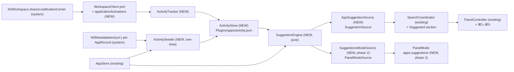
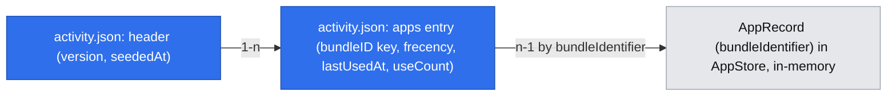

# Sugestie aplikacji (Suggested Apps)

> Status: **gotowy do review (rewizja 3)**: uwagi z obu review PR #10 naniesione, decyzje właściciela zatwierdzone. Proza po polsku, identyfikatory po angielsku (jak spec MVP `.ai/specs/2026-10-31-pounce-launcher-mvp.md`). To funkcja po v1.0, która nie zmienia zakresu MVP.

## 📝 TLDR
Użytkownik chce szybciej uruchamiać aplikacje, których używa najczęściej, także te otwierane poza Pounce: z Docka, przez ⌘Tab, z Findera czy z linków. Dziś pusty input pokazuje sekcję „Recently Used” (8 elementów) liczoną wyłącznie z uruchomień przez Pounce (`ranking.sqlite`). Po zmianie `AppsPlugin` będzie liczyć czas, przez który aplikacje są na pierwszym planie (pierwsze użycie po 5 s, kolejne co 10 min), i jednorazowo uzupełni historię z metadanych Spotlight. Na tej podstawie pokaże **5 sugerowanych aplikacji** w sekcji „Suggested” zaraz pod polem wyszukiwania. Sugestie uruchamia się skrótami ⌘1–⌘5, a opcjonalny globalny skrót otwiera panel z samymi sugestiami.

## 📝 Problem Statement
- Frecency w Pounce widzi tylko uruchomienia przez Pounce. Nowy użytkownik albo ktoś, kto zwykle klika w Dock, ma pustą lub mało trafną sekcję „Recently Used”, więc pusty panel nic mu nie daje.
- Najczęstsza akcja w launcherze to otwarcie jednej z kilku tych samych aplikacji. Dziś wymaga wpisania 1–3 znaków i ⏎.
- Dowód skali problemu jest anegdotyczny: to prośba właściciela produktu. Telemetrii nie mamy i z założenia jej nie zbieramy.

## 📝 Decyzje (odpowiedzi na Open Questions, 2026-11-02)
| # | Pytanie | Decyzja |
|---|---|---|
| Q1 | Źródło danych spoza Pounce | Obserwacja na żywo przez `NSWorkspace` plus jednorazowy zasiew z Spotlight (`kMDItemUsedDates`). Bez nowych uprawnień. Historię Screen Time (Biome, `knowledgeC.db`) odrzucamy, bo wymaga Full Disk Access i ma prywatny, niestabilny format. |
| Q2 | Co jest „użyciem” | Aplikacja nieprzerwanie na pierwszym planie przez co najmniej 5 s. Rewizja 2 doprecyzowuje regułę: dopóki aplikacja zostaje na pierwszym planie, co 10 min liczy się kolejne użycie, żeby aplikacje trzymane z przodu cały dzień nie były niedoszacowane (uwaga z review). Rewizja 3: każde użycie, także pierwsze po aktywacji, liczy się tylko wtedy, gdy użytkownik dotknął klawiatury, myszy lub gładzika w ciągu ostatnich 10 min, więc czas przy pustym biurku, uśpionym ekranie i blokadzie się nie liczy. |
| Q3 | Kontekst czasu | Nie w v1, tylko czyste frecency. |
| Q4 | Uruchomione aplikacje | Pokazywane, z oznaczeniem „Running”. |
| Q5 | Relacja z „Recently Used” | Sekcja „Suggested” (5 aplikacji) nad „Recently Used”, bez duplikatów. |
| Q6 | Skrót | Oba warianty: ⌘1–⌘5 w panelu oraz opcjonalny skrót globalny (domyślnie bez przypisania), który otwiera tryb sugestii. |
| Q7 | Wpływ na ranking wyszukiwania | Brak. Dane trafiają do osobnego magazynu, a `ranking.sqlite` i `Ranker` się nie zmieniają. |
| R1 | Format magazynu (kierunek z review, M4) | Wersjonowany plik JSON zapisywany atomowo przez `AtomicFile`, a nie nowa baza SQLite. Przy setkach wierszy baza dokłada GRDB do `AppsPlugin`, migrator i obsługę uszkodzonej bazy bez żadnej korzyści. Decyzję może odwrócić właściciel w review. |
| D1 | Domyślne zbieranie aktywności (`plugins.apps.suggestions.enabled = true`, `BACKWARD_COMPATIBILITY.md` §3) | Funkcja polega na zbieraniu, więc domyślnie włączone, z wyłącznikiem, czyszczeniem i opisem w Ustawieniach. **Zatwierdzone przez właściciela 2026-11-02** w [komentarzu do PR #10](https://github.com/mjozefiak/Pounce/pull/10#issuecomment-6576047488), razem z zależnością `AppsPlugin → PouncePersistence`. PR fazy 1 linkuje ten komentarz jako zapis zgody wymaganej przez §3. |

## 📝 Proposed Solution
1. **Zbieranie.** `ActivityTracker` w `AppsPlugin` słucha aktywacji aplikacji przez port `WorkspaceClient`. Gdy aplikacja jest na pierwszym planie bez przerwy przez 5 s, zapisuje jedno użycie. Potem, dopóki aplikacja zostaje z przodu, zapisuje kolejne co 10 min. Każde użycie wymaga, żeby użytkownik był aktywny (klawiatura, mysz, gładzik) w ciągu ostatnich 10 min. Szybkie przełączenia nie dodają nic ponad to: od ostatniego użycia danej aplikacji musi minąć co najmniej 10 min.
2. **Zasiew.** `ActivitySeeder` uruchamia się raz, po pierwszym pełnym skanie aplikacji. Dla każdego rekordu `AppStore` czyta `kMDItemUsedDates` przez `NSMetadataItem(url:)`, poza main actor. Daty z ostatnich 90 dni, bez dzisiejszej, dodaje do magazynu według reguły łączenia z sekcji Data Model. Istniejący `AppMetadataWatcher` się nie zmienia.
3. **Liczenie.** `SuggestionEngine` to czysta logika. Liczy frecency z tym samym wykładniczym zanikiem co MVP (półokres 7 dni). Odrzuca aplikacje nieobecne w `AppStore`, samego Pounce i aplikacje ukryte przez użytkownika. Zwraca top 5 z flagą „uruchomiona”.
4. **Prezentacja.** Plugin dostarcza sugestie przez nowy addytywny wkład `PouncePlugin.suggestionSources`. Przy pustym zapytaniu w trybie wyszukiwania shell pokazuje sekcję „Suggested” nad „Recently Used” i nie przepuszcza jej przez `Ranker`. Rzędy mają podpowiedzi ⌘1–⌘5.
5. **Skrót globalny.** `PluginCommand` z `panelMode: "apps.suggestions"` korzysta z istniejącego mechanizmu trybów listy. Nie ma domyślnego skrótu; użytkownik nagrywa go w nowym panelu Ustawienia → Aplikacje.

### Uzasadnienie wobec `CODE_REVIEW.md` §1
- **Funkcja w `AppsPlugin`, nie w nowym targecie.** Sugestie operują na tych samych elementach (`apps:<bundleID>`), tej samej liście `AppStore` i tym samym `AppLauncher`. Osobny `SuggestionsPlugin` musiałby importować `AppsPlugin`, a import między pluginami jest blockerem.
- **`SuggestionSource` w `PounceKit` nie jest typem jednego pluginu.** Kontrakt nie zależy od źródła danych: „kandydaci na pusty panel, uporządkowani przez plugin”. Może z niego skorzystać na przykład `FilesPlugin` do ostatnio otwieranych plików. Shell nie zna konkretnego pluginu, bo sekcja powstaje z dowolnych `suggestionSources`.

### Alternatywy odrzucone
- **Zapis aktywacji do `ranking.sqlite` przez `UsageRecorder`.** To najmniej kodu, ale miesza „czego szukam w Pounce” z „czego używam w systemie” i zmienia ranking wyszukiwania, co jest sprzeczne z Q7. Do tego Reset Ranking kasowałby historię aktywności.
- **Sugestie jako `SearchSource` z pustym zapytaniem.** `AppSearchSource` już odpowiada na puste zapytanie sekcją Recently Used. Drugie znaczenie pustego zapytania wymagałoby rozróżniania źródeł po id w shellu, czyli wiedzy o konkretnym pluginie poza `PluginRegistry`.
- **Zasiew przez istniejący `AppMetadataWatcher`.** Ten watcher przekazuje ścieżki do `spotlightChanged`, który przy każdej zmianie wartości planuje pełne odświeżenie listy (`AppsPlugin.swift:147-160`). Daty użyć zmieniają się przy każdym uruchomieniu aplikacji, więc wywoływałyby rescany i dokładały pracy na main actor. Jednorazowy odczyt `NSMetadataItem(url:)` tego nie robi.
- **Baza SQLite** (patrz R1).

## 📝 Research (rynek)
| Produkt | Co robi | Wniosek dla Pounce |
|---|---|---|
| Spotlight (Siri Suggestions) | Sugestie aplikacji z kontekstu (pora dnia, miejsce, urządzenia), liczone przez model na urządzeniu, nieprzejrzyste | Kontekst czasu poprawia trafność, ale kosztuje (Q3: później). Bierzemy prostotę i przejrzystość: użytkownik wie, skąd się wzięła sugestia. |
| GNOME Shell (`shell-app-usage`) | „Frequent apps” liczone z czasu fokusu z zanikiem | Potwierdza wybór fokusu i ważenia czasem (Q2, heartbeat co 10 min). |
| Windows Start „Most used” | Liczba uruchomień | Słaby sygnał dla aplikacji otwartych cały dzień, stąd liczymy czas fokusu (Q2), a nie same uruchomienia. |
| Alfred | ⌘1–⌘9 uruchamia n-ty wynik, a numer jest widoczny przy rzędzie | Przejmujemy wzorzec ⌘1–⌘5 z widoczną podpowiedzią. |
| Raycast | Sekcja sugestii w root search z użycia samego Raycast, z możliwością ukrycia elementu | Przejmujemy akcję „Ukryj w sugestiach”. Nie przejmujemy ograniczenia do użyć w launcherze. |

Świadomie pomijamy model ML, synchronizację między Macami i sugestie inne niż aplikacje.

## 📝 Architecture
Główny moduł to `AppsPlugin`. Zależności dalej płyną w jedną stronę: `AppsPlugin` dostaje zależność na `PouncePersistence`, tylko dla `AtomicFile`. To dozwolony kierunek (tak samo zależy `FilesPlugin`), ale zmiana grafu w `Package.swift` oznacza `risk-high`. Produkt GRDB nie jest potrzebny.



Wniosek: cała logika i wszystkie dane siedzą w `AppsPlugin`. Shell dostaje tylko ogólny, niezależny od pluginu mechanizm sekcji sugestii i skrótów ⌘n. `ranking.sqlite`, `Ranker`, `UsageRecorder` i `AppMetadataWatcher` się nie zmieniają.

### Komponenty
| Komponent | Target | Odpowiedzialność |
|---|---|---|
| `ActivityTracker` | `AppsPlugin` | Działa na `@MainActor` i subskrybuje `workspace.applicationActivations()`. Po aktywacji aplikacji X planuje sprawdzenie na `max(now + 5 s, lastUsedAt(X) + 10 min)`, więc powrót do X tuż po jej użyciu nie gubi czasu fokusu. Wstrzykiwane są `sleep` (`context.clock`) i czas ścienny `now: @Sendable () -> Date` (jak w `AppSearchSource`), bo `lastUsedAt` i odstęp 10 min wymagają `Date`. Sprawdzenie zapisuje użycie (`ActivityStore.recordUse`), gdy X nadal jest na pierwszym planie (`workspace.frontmostApplication`) i od ostatniego użycia X minęło ≥ 10 min. Każde sprawdzenie, także pierwsze po aktywacji, wymaga dodatkowo `workspace.secondsSinceLastUserInput < 600`. Pierwsze sprawdzenie może się odbyć nawet 10 min po aktywacji (`lastUsedAt + 10 min`), a aplikacja może też aktywować się sama, gdy nikogo nie ma, więc sama aktywacja nie dowodzi obecności użytkownika. Jedyny wyjątek to `nil` (port bez tej informacji): wtedy pierwsze sprawdzenie zapisuje użycie bez warunku bezczynności, a heartbeatu nie ma. Dzięki temu odejście od biurka, uśpiony ekran, blokada i uśpienie Maca nie dodają użyć niezależnie od tego, czy zegar liczy czas uśpienia. Nieudane sprawdzenie bezczynności nie kończy sekwencji: następne odbywa się za 10 min, więc powrót użytkownika wznawia liczenie. Nowa aktywacja anuluje zaplanowane sprawdzenia. Ignoruje aplikacje bez bundle ID oraz własny bundle ID Pounce, wstrzykiwany parametrem `ownBundleIdentifier` (a nie czytany z `Bundle.main`, żeby dało się to testować). Aplikacje inne niż `.regular` odfiltrowuje już port. |
| `ActivitySeeder` | `AppsPlugin` | Działa jednorazowo, gdy w magazynie nie ma `seededAt`, a `plugins.apps.spotlight == true`. Startuje po pierwszym zakończonym `refresh()` listy aplikacji. Dla każdego `AppRecord` (poza main actor, ze sprawdzaniem anulowania co 32 rekordy) czyta `NSMetadataItem(url:)?.value(forAttribute: kMDItemUsedDates)` i bierze daty z ostatnich 90 dni z wyjątkiem dzisiejszej. Dzisiejsze użycia liczy tracker, który startuje razem z zasiewem, więc dzisiejsza data z Spotlight byłaby policzona drugi raz. Każdą datę zamienia na 12:00 lokalnie tego dnia; wszystkie są wcześniejsze niż dziś, więc żadna nie trafia w przyszłość. Czas `now` jest wstrzykiwany jak w trackerze. Całą partię łączy z magazynem w jednym kroku według reguły z Data Model i ustawia `seededAt`. Przerwany zasiew (wyjście z aplikacji, `deactivate()`, „Clear App Activity”) niczego nie zapisuje, więc powtórzy się przy następnym starcie. Gdy Spotlight jest wyłączony, ustawia `seededAt = "skipped"`. Jeśli `NSMetadataItem(url:)` nie zwraca tego atrybutu (do sprawdzenia w kroku 5), korzysta z publicznego C API `MDItemCreateWithURL` / `MDItemCopyAttribute`. |
| `ActivityStore` | `AppsPlugin` | Actor, właściciel `Plugins/apps/activity.json`. Ładuje plik raz w `activate()`, potem trzyma stan w pamięci i publikuje niezmienną kopię (`snapshot`), więc odczyt sugestii nigdy nie dotyka dysku. Zapis jest odroczony: 30 s po ostatniej zmianie oraz natychmiast w `close()`. Zapisuje przez `AtomicFile.write` (0600, katalog 0700). Udostępnia `recordUse`, `merge(seed:)`, `removeAll`, `snapshot`, `close` i `isReadOnly` (plik w nowszej wersji). Przycina wpisy przy wczytaniu i przy każdym zapisie. Czas `now` jest wstrzykiwany (przycinanie 90 dni). |
| `SuggestionEngine` | `AppsPlugin` | Czysta funkcja `(snapshot, apps, hidden, running, now, limit) -> [Suggestion]`. Sortuje po zanikającym frecency malejąco; przy remisie decyduje `lastUsedAt` malejąco, potem nazwa. |
| `AppSuggestionSource` | `AppsPlugin` | Implementuje `SuggestionSource`: zwraca top 5 jako `Candidate` z kluczem `apps:<bundleID>`, ikoną `.file(url)` jak w `AppSearchSource` (ten sam wpis w `IconCache`) i `badge` „Running” dla uruchomionych. Zbiór uruchomionych aplikacji czyta jednym przeskokiem `await MainActor.run { workspace.runningApplicationBundleIDs }` na zapytanie, bo ta właściwość jest `@MainActor`, a `suggestions(limit:)` działa poza nim. Akcje są takie jak w `AppSearchSource`, plus „Hide from Suggestions” (⌃X). |
| `SuggestionsModeSource` (faza 2) | `AppsPlugin` | `PanelModeSource` trybu `apps.suggestions`. Przy pustym inpucie zwraca te same top 5, a przy wpisanym tekście dopasowuje `FuzzyMatcher` wśród top 20 według aktywności. |
| Apps settings pane | `AppsPlugin` | Nowy `settingsPane()` (dziś `AppsPlugin` go nie ma). Zawiera przełącznik „Suggest Apps” z jednozdaniowym opisem, co jest zapisywane; listę ukrytych aplikacji z przyciskiem przywracania; „Clear App Activity…”; istniejące ustawienia `roots` i `spotlight`. W fazie 2 dochodzi rejestrator skrótu `apps.suggestions` (`context.makeShortcutRecorder`). |
| `SearchCoordinator` | `PounceApp` | Przy pustym zapytaniu w trybie wyszukiwania odpytuje `host.activeSuggestionSources` przez `SuggestionSourceAdapter: SearchSource` (wzór `ModeSourceAdapter`), równolegle i z budżetem 150 ms przez `SourceRunner`. Wyniki skleja w kolejności `app.sectionOrder`, potem `manifest.order`, i obcina do 5. Buduje sekcję `.suggested` nad `.recent` i usuwa z „Recently Used” klucze obecne w sugestiach. Żeby „Recently Used” dalej miało do 8 rzędów, `Ranker.recent` dostaje limit `recentLimit + liczba sugestii`, a wynik po deduplikacji jest obcinany do 8. Dla sugestii nie woła `Ranker` ani `usage.stats`. |
| `PanelController` / `LauncherView` | `PounceApp` | ⌘1–⌘5 uruchamia pierwszą akcję n-tego rzędu sekcji `.suggested` (tryb wyszukiwania, pusty input). W fazie 2 to samo dotyczy n-tego rzędu trybu listy bez filtrów. Filtry trybu listy mają pierwszeństwo, więc schowek działa jak dotąd. Podpowiedź „⌘n” wyświetla się po prawej stronie rzędu, a `badge` jako etykieta obok tytułu. |

### Cykl życia
- `activate()` ładuje `ActivityStore`. Gdy `plugins.apps.suggestions.enabled` jest włączone, uruchamia też `ActivityTracker` i (jeśli trzeba) `ActivitySeeder`.
- `deactivate()` (idempotentne) zatrzymuje tracker, anuluje zasiew i woła `ActivityStore.close()`, które zapisuje oczekujące zmiany. Wyłączenie przełącznika robi to samo co `deactivate()` dla trackera i zasiewu, ale magazyn zostaje otwarty, żeby „Clear App Activity” dalej działało.
- `eraseData()` nie musi robić nic dodatkowego, bo host usuwa cały `Plugins/apps/`.

## 📝 Data Model
Nowy plik `~/Library/Application Support/Pounce/Plugins/apps/activity.json`: prywatny dla `AppsPlugin`, zapisywany atomowo przez `AtomicFile` (0600, katalog 0700). Nie jest szyfrowany, tak jak `ranking.sqlite`, który już przechowuje bundle ID i frecency aplikacji. Zawiera tylko bundle ID, liczby i daty, nigdy tytułów okien ani treści.

```json
{
  "version": 1,
  "seededAt": "2026-11-02T09:14:00Z",
  "apps": {
    "com.tinyspeck.slackmacgap": { "frecency": 6.4, "lastUsedAt": 1793612345.0, "useCount": 41 }
  }
}
```

| Pole | Typ | Znaczenie |
|---|---|---|
| `version` | Int | Wersja schematu, dziś `1`. |
| `seededAt` | String? | Data ISO 8601 zakończonego zasiewu, `"skipped"` (Spotlight wyłączony) albo `"cleared"` (użytkownik wyczyścił dane przed zasiewem). Brak pola oznacza, że zasiew jeszcze się nie odbył. |
| `apps[bundleID].frecency` | Double | Wartość frecency na chwilę `lastUsedAt`. |
| `apps[bundleID].lastUsedAt` | Double | Czas ostatniego użycia (Unix s, nigdy z przyszłości). |
| `apps[bundleID].useCount` | Int | Liczba zapisanych użyć. |

**Reguły:**
- **Zapis użycia** (`recordUse(at: d)`): `f' = f·2^(−(T−t)/h) + 2^(−(T−d)/h)`, gdzie `T = max(t, d)`, `t` to `lastUsedAt` wpisu, a `h` to 7 dni. Następnie `lastUsedAt = T`, `useCount += 1`. Ta formuła nie zależy od kolejności, więc ta sama reguła służy tracker'owi (`d = now`) i zasiewowi (daty historyczne łączone z wpisami, które tracker już zapisał). Dla `d = now` daje to samo co `UsageRepository`.
- **Przycinanie:** przy wczytaniu i przy każdym zapisie usuwane są wpisy bez użycia od 90 dni.
- **„Clear App Activity”:** czyści `apps`, anuluje trwający zasiew i zostawia `seededAt`. Jeśli zasiewu jeszcze nie było, ustawia `seededAt = "cleared"`. Dzięki temu Spotlight nie przywraca historii, którą użytkownik właśnie wyczyścił.
- **Plik uszkodzony:** plik istnieje, ale nie da się go zdekodować jako obiektu JSON z liczbą całkowitą `version`, albo przy `version == 1` brakuje wymaganych pól. Wtedy plik jest przenoszony do jednej kopii `activity.json.corrupt` (nadpisującej poprzednią, więc kopie się nie mnożą) i startujemy z pustym magazynem. Dane są odtwarzalne, w przeciwieństwie do schowka. „Erase Data” usuwa też tę kopię.
- **Nowsza wersja** (`version > 1`, czyli downgrade): magazyn przechodzi w tryb tylko do odczytu (`isReadOnly`). Tracker i zasiew nie startują, `recordUse`, `merge(seed:)`, `removeAll` i odroczony zapis nic nie robią, sugestie są puste, a przycisk „Clear App Activity…” jest wyłączony, żeby nie nadpisać nowszego pliku. Panel Aplikacje pokazuje komunikat. Plik zostaje nietknięty (`BACKWARD_COMPATIBILITY.md` §2).



Wpis w `apps` odwołuje się do `AppRecord` tylko logicznie, przez `bundleIdentifier`, bo lista aplikacji żyje w pamięci. Interaktywna wersja grafu: `.ai/data-model/2026-11-01-app-suggestions.html`.

### Ustawienia (nowe klucze, kontrakt z `BACKWARD_COMPATIBILITY.md` §3)
| Klucz | Typ | Domyślnie | Znaczenie |
|---|---|---|---|
| `plugins.apps.suggestions.enabled` | Bool | `true` | Wyłączenie zatrzymuje `ActivityTracker` i zasiew oraz chowa sekcję. Dane zostają do „Clear App Activity”. Domyślne `true` zbiera więcej danych; zgoda właściciela wymagana przez §3 jest w [komentarzu do PR #10](https://github.com/mjozefiak/Pounce/pull/10#issuecomment-6576047488). |
| `plugins.apps.suggestions.hidden` | [String] | `[]` | Bundle ID ukryte w sugestiach. |
| `KeyboardShortcuts_command_apps_suggestions` (faza 2) | KeyboardShortcuts | brak | Globalny skrót trybu sugestii. |

Liczba sugestii (5), próg (5 s), odstęp (10 min) i okno aktywności (10 min) to stałe, nie ustawienia.

Klucze tylko dla DEBUG, które nie są kontraktem §3 (tak jak `plugins.clipboard.qaSeed` i `plugins.files.qaHome`): `plugins.apps.qaActivity` (String `bundleID=uses,…`, wpisuje użycia do pustego magazynu QA przy `activate()`) i `plugins.apps.qaLiveActivity` (Bool, domyślnie `false` w trybie QA: włącza prawdziwy tracker i zasiew). Szczegóły w sekcji QA.

## 📝 API Contracts (addytywne zmiany `PounceKit`, `BACKWARD_COMPATIBILITY.md` §1)
```swift
/// Ranked suggestions for the empty search panel. The shell shows them in order, never re-ranks them
/// and never records them in `ranking.sqlite`.
public protocol SuggestionSource: Sendable {
    var id: SourceID { get }
    /// Runs off the main actor, reacts to cancellation, best first.
    func suggestions(limit: Int) async throws -> [Candidate]
    func actions(for candidate: Candidate) -> [ResultAction]
}
extension SuggestionSource {
    public func actions(for candidate: Candidate) -> [ResultAction] { [] }
}

// PouncePlugin: new requirement + default in the existing extension
var suggestionSources: [any SuggestionSource] { get }
extension PouncePlugin { public var suggestionSources: [any SuggestionSource] { [] } }

// Candidate (struct in Search.swift): new stored property in the struct itself, new init parameter
public let badge: String?          // already localized by the source, e.g. "Running"
public init(..., boost: Double = 0, badge: String? = nil)

// WorkspaceClient: new protocol REQUIREMENTS (dynamic dispatch through `any WorkspaceClient`),
// each with a default in the existing extension, the same pattern as the Phase 2 additions.
func applicationActivations() -> AsyncStream<RunningApplication>   // default: never yields
@MainActor var runningApplicationBundleIDs: Set<String> { get }    // default: []
/// Seconds since the last keyboard, mouse or trackpad input in this login session; nil when unknown.
@MainActor var secondsSinceLastUserInput: TimeInterval? { get }    // default: nil (no heartbeat uses)
```
- Każdy nowy element to wymaganie z domyślną implementacją albo pole z wartością domyślną, więc istniejące pluginy (`FilesPlugin`, `ClipboardPlugin`) kompilują się bez zmian. Muszą to być wymagania protokołu, a nie same metody rozszerzenia. `PluginContext.workspace` ma typ `any WorkspaceClient`, a metodę obecną tylko w rozszerzeniu Swift wywołuje statycznie, więc implementacja na `NSWorkspace` nigdy by się nie uruchomiła.
- **Równość `Candidate`:** zgodność z `Hashable` jest syntetyzowana, więc `badge` wchodzi do `==` i `hash`. Ta sama aplikacja z „Running” i bez niego to dwa różne kandydaty. Shell identyfikuje rzędy po `ResultItem.id` (sekcja plus `itemKey`), a nie po `==`, więc zachowanie się nie zmienia. Regułę trzeba zapisać w `BACKWARD_COMPATIBILITY.md` §1. Pole ma typ `String?` zamiast `LocalizedStringResource?`, bo dziś żaden typ `Hashable` w `PounceKit` nie przechowuje `LocalizedStringResource`.
- `RunningApplication` zostaje bez zmian. Port w `PounceApp/Ports` obserwuje `NSWorkspace.didActivateApplicationNotification` na `NSWorkspace.shared.notificationCenter` (nie na `NotificationCenter.default`) i emituje tylko aplikacje z `activationPolicy == .regular`. Dzięki temu filtr polityki aktywacji żyje w porcie, a nie w kontrakcie.
- `secondsSinceLastUserInput` w porcie to `CGEventSource.secondsSinceLastEventType(.combinedSessionState, eventType: anyInput)`, gdzie `anyInput` to `CGEventType(rawValue: ~0)` rozpakowane przez `guard let` (stała C `kCGAnyInputEventType` nie jest dostępna w Swift; bez force unwrap, a gdy `guard` się nie powiedzie, port zwraca `nil`). To odczyt czasu bezczynności, a nie nasłuch zdarzeń, więc nie powinien wymagać Input Monitoring ani Accessibility; krok 1 potwierdza to lokalnie na aplikacji podpisanej ad hoc bez żadnych uprawnień TCC. Gdyby jednak wymagał uprawnienia, port zwraca `nil`, a tracker liczy tylko pierwsze użycie po aktywacji (bez heartbeatu), czyli zachowanie z rewizji 1.
- **Skróty (`BACKWARD_COMPATIBILITY.md` §5):** w fazie 1 ⌘1–⌘5 dostaje nowe znaczenie w trybie wyszukiwania przy pustym inpucie, a ⌃X („Hide from Suggestions”) zaczyna działać na rzędach sugestii. W fazie 2 ⌘1–⌘9 w trybie listy bez filtrów uruchamia n-ty rząd (dziś ⌘n bez filtrów nic nie robi, `PanelController.swift:200`). Każda faza dopisuje §5 i notę do release notes, a test pilnuje, żeby ⌘1–⌘5 w schowku dalej przełączało filtry.
- `ItemKey` sugestii ma istniejący format `apps:<bundleID>`. ⏎ uruchamia więc aplikację przez `AppLauncher` i zapisuje użycie w `ranking.sqlite` tak jak dziś. To jest uruchomienie przez Pounce, więc Q7 tego nie zmienia.

## 📝 UI/UX
**Pusty panel (tryb wyszukiwania):**
```
┌──────────────────────────────────────────────┐
│ 🔍 Search                                     │
├──────────────────────────────────────────────┤
│ SUGGESTED                                     │
│ [icon] Slack            Running          ⌘1  │
│ [icon] Google Chrome    Running          ⌘2  │
│ [icon] Xcode                             ⌘3  │
│ [icon] Mail                              ⌘4  │
│ [icon] Calendar                          ⌘5  │
│ RECENTLY USED                                 │
│ [icon] report.pdf                             │
│ …                                             │
└──────────────────────────────────────────────┘
```
- Zaznaczenie startuje na pierwszej sugestii, więc ⏎ uruchamia sugestię nr 1. ↑/↓ przechodzą przez granicę sekcji jak dziś.
- Wpisanie znaku zastępuje cały widok zwykłymi wynikami. Sekcja „Suggested” istnieje tylko przy pustym inpucie.
- Stopka akcji zaznaczonej sugestii: ⏎ Open, ⌘⏎ Show in Finder, ⌃X Hide from Suggestions.
- **Tryb sugestii** (faza 2, skrót globalny): ten sam panel z tytułem trybu „Suggested Apps”, lista bez podglądu. Pisanie filtruje top 20, a ⌘1–⌘5 działa na widoczne rzędy.
- **Stany:**
  - Brak danych (świeża instalacja bez Spotlight): sekcja jest ukryta i panel wygląda jak dziś. Tryb sugestii pokazuje pusty widok „Pounce learns which apps you use. Suggestions appear after a few app switches.”
  - Funkcja wyłączona: sekcji nie ma. Komenda trybu zostaje zarejestrowana, bo shell czyta komendy tylko przy zmianie pluginów (`AppCoordinator.pluginsChanged()`), a kontrakt nie ma sygnału „komendy się zmieniły”. Tryb pokazuje wtedy pusty widok „Suggestions are off” z przyciskiem do Ustawień. Hook `commandsChanged` to osobna, późniejsza decyzja.
  - Plik w nowszej wersji: komunikat w panelu Aplikacje, sugestie są wyłączone, a przycisk „Clear App Activity…” jest nieaktywny.
- **Dostępność:** sekcja ma nagłówek dla VoiceOver („Suggested”). Rząd brzmi „Slack, Running, Suggested, Command-1”. `badge` to tekst, nie sam kolor. Rozmiar tekstu (`TextSize`) jest taki sam jak w innych rzędach.
- **Lokalizacja:** nowe stringi trafiają do `Resources/Localizable.xcstrings` z wartościami `en` i `pl`: „Suggested” / „Sugerowane”, „Running” / „Uruchomiona”, „Hide from Suggestions” / „Ukryj w sugestiach”, „Suggest Apps” / „Sugeruj aplikacje”, „Clear App Activity…” / „Wyczyść aktywność aplikacji…”.
- **Przejrzystość:** pod przełącznikiem w panelu Aplikacje i na stronie docelowej (`docs/index.html`, klucze `data-i18n` `en` i `pl`) znajdzie się jedno zdanie: Pounce zapisuje lokalnie, których aplikacji używasz i jak często, żeby je sugerować; nic nie opuszcza Maca.

Prototype: brak zaakceptowanej makiety. Schemat ASCII powyżej to propozycja.

## 📝 QA (`docs/qa.md`)
`PounceApp` nie zna formatu `activity.json`, bo ten plik należy wyłącznie do `AppsPlugin`. Shell tylko zamienia argumenty na klucze ustawień pluginu, a resztę robi plugin. To ten sam wzór co `plugins.clipboard.qaSeed` i `plugins.files.qaHome` (`AppEnvironment.qaFileIndexSettings`), a nie `--qa-record-use`, który pisze do `ranking.sqlite` należącego do shella.
- `--qa-activity <bundleID>[=<uses>]` (powtarzalny, tylko DEBUG): `QAOptions` składa z niego klucz `plugins.apps.qaActivity` (`bundleID=uses,…`). `AppsPlugin.activate()` w buildzie DEBUG wpisuje te użycia do pustego magazynu (z `now` jako datą), zanim panel się otworzy. Podane bundle ID muszą należeć do aplikacji z `roots` fikstury QA, bo `SuggestionEngine` odrzuca aplikacje spoza `AppStore`; `docs/qa.md` to opisze.
- W trybie QA `AppEnvironment` ustawia `plugins.apps.qaLiveActivity = false`, chyba że podano `--qa-activity-live`. Przy `false` `ActivityTracker` i `ActivitySeeder` nie startują, więc prawdziwa aktywność testera nie trafia do magazynu. Poza trybem QA klucza nie ma, a plugin go ignoruje w buildzie release.
- Zrzuty jako dowody: pusty panel z 5 sugestiami (jasny i ciemny motyw), sekcja ukryta przy braku danych, oznaczenie „Running”, ukrycie przez ⌃X, przełącznik wyłączony, a w fazie 2 tryb sugestii i stan „Suggestions are off”.

## 📝 Edge Cases & Failure Scenarios
| Sytuacja | Zachowanie |
|---|---|
| Świeża instalacja, Spotlight bez danych. Zmierzone 2026-11-02 na Macu dewelopera: Calendar i Mail mają `kMDItemUsedDates`, Safari i Xcode mają `null`. | Zasiew jest częściowy. Sekcja pokazuje tyle aplikacji, ile ma dane (0–5). Bez danych sekcja jest ukryta. Po kilku przełączeniach aplikacji sugestie się uzupełniają. |
| Dzisiejsza data w `kMDItemUsedDates` | Zasiew ją pomija, bo dzisiejsze użycia liczy tracker. Nie ma podwójnego liczenia, a `lastUsedAt` nigdy nie trafia w przyszłość. Użycie sprzed instalacji z tego samego dnia przepada; to akceptowalne. |
| Zasiew po tym, jak tracker już zapisał użycia | Reguła łączenia dodaje historyczne użycia z właściwym zanikiem. Nic się nie nadpisuje, a `lastUsedAt` zostaje najnowsze. |
| „Clear App Activity” w trakcie zasiewu | Zasiew zostaje anulowany i niczego nie zapisuje. `seededAt = "cleared"` sprawia, że nie wróci. |
| `plugins.apps.spotlight == false` | Zasiewu nie ma (`seededAt = "skipped"`), działa tylko obserwacja na żywo. Późniejsze włączenie Spotlight nie uruchamia zasiewu ponownie. |
| Aplikacja odinstalowana | Nie ma jej w `AppStore`, więc jest odfiltrowana. Wpis wygasa po 90 dniach. |
| Aplikacja przeniesiona lub zaktualizowana | Kluczem jest bundle ID, więc historia zostaje. |
| Pounce nie działał (wyłączony, przed zalogowaniem) | Użycia z tego czasu się nie liczą. Nie powoduje to żadnej luki w działaniu. |
| Szybkie przełączenia ⌘Tab (< 5 s) | Nie liczą się. Aplikacja zostawiona z przodu przy uśpieniu ekranu w ciągu 5 s może dostać jedno użycie. To akceptowalne. |
| Aplikacja z przodu przez wiele godzin pracy | Dostaje użycie co 10 min, dopóki użytkownik coś robi. Frecency rośnie z czasem aktywnego fokusu, ale nie szybciej niż 6 użyć na godzinę. |
| Użytkownik odchodzi od Maca (bez blokady), aplikacja zostaje z przodu | Po 10 min bez wejścia `secondsSinceLastUserInput ≥ 600`, więc heartbeat nie zapisuje użyć. Noc z niewygaszonym Makiem nie dodaje nic. Po powrocie i pierwszym ruchu myszy liczenie wraca przy najbliższym heartbeacie. |
| Ekran zablokowany albo uśpiony wyświetlacz | Ta sama reguła bezczynności: brak wejścia przez 10 min wyklucza heartbeat, niezależnie od tego, co zwraca `frontmostApplication` przy blokadzie. |
| Uśpienie Maca przy aplikacji na pierwszym planie | Za sam okres snu nic się nie liczy: zaległy heartbeat po wybudzeniu bez wejścia widzi bezczynność ≥ 600 s. Wybudzenie klawiszem albo ruchem myszy zeruje jednak licznik bezczynności, więc najbliższy heartbeat może zapisać jedno użycie. Wtedy użytkownik już siedzi przy Macu, więc to najwyżej jedno użycie i to prawdziwe. Wybór zegara (`ContinuousClock` w `AppEnvironment`) nie ma znaczenia. |
| Pasywne użycie (film, prezentacja, czytanie bez dotykania klawiatury i myszy dłużej niż 10 min) | Heartbeat nie zapisuje użyć, więc takie aplikacje są niedoliczone. To świadomy wybór: lepiej niedoliczyć oglądanie niż doliczyć noc przy pustym biurku. Pierwsze użycie po aktywacji i każda chwila z ruchem myszy dalej się liczą. |
| Port bez informacji o bezczynności (`nil`) | Brak heartbeatu: liczy się tylko pierwsze użycie po aktywacji. Bezpieczne niedoszacowanie zamiast przeszacowania. |
| Plik nie daje się zapisać (pełny dysk, uprawnienia) | Stan w pamięci zostaje, a zapis jest ponawiany przy następnej zmianie. Błąd trafia do logu bez bundle ID. Sugestie działają do końca sesji. |
| Plik uszkodzony | Jedna kopia `activity.json.corrupt` (nadpisywana) i pusty magazyn (definicja w sekcji Data Model). |
| Plik w nowszej wersji (downgrade) | Magazyn tylko do odczytu: brak trackera, zasiewu i zapisu, sugestie wyłączone z komunikatem, „Clear” nieaktywne, plik nietknięty. |
| Źródło sugestii przekracza 150 ms | `SourceRunner` pomija sekcję, reszta panelu działa. Odczyt idzie z pamięci (cel < 5 ms, tak jak budżet zapytania aplikacji w `CODE_REVIEW.md`). |
| `suggestions(limit:)` anulowane albo rzuca błąd | Sekcja znika tylko dla tego zapytania. „Recently Used” i statusy działają (izolacja błędów z `CODE_REVIEW.md` §1). |
| Plugin Apps wyłączony | Nie ma trackera, sekcji ani trybu. |
| „Erase Data” pluginu Apps | Usuwa `Plugins/apps/` razem z `activity.json` (istniejący mechanizm). |
| „Reset Ranking” (Advanced) | Nie dotyka `activity.json`. Opis w Advanced informuje, że historię aktywności czyści się w panelu Aplikacje. |
| Wiele kont użytkowników | Każde konto ma własny katalog Application Support, więc dane nie przechodzą między kontami. |

## 📝 Risks & Impact Review
- **Kontrakty trudne do cofnięcia** (`risk-high` według `SDLC.md`): nowy wkład `suggestionSources`, typ `SuggestionSource`, pole `Candidate.badge`, trzy wymagania `WorkspaceClient`, nowy plik `Plugins/apps/activity.json` z formatem `version: 1`, nowe klucze ustawień oraz nowa krawędź `AppsPlugin → PouncePersistence` w `Package.swift`. Wszystko jest addytywne, a po wydaniu nazwy się nie zmieniają. `BACKWARD_COMPATIBILITY.md` (§1, §2, §3, §5) trzeba uzupełnić w tym samym PR.
- **Prywatność:** Pounce zaczyna zapisywać historię aktywnych aplikacji także wtedy, gdy panel nie jest używany. Domyślnie jest to włączone, bo na tym polega funkcja. Dane zostają lokalnie, bez tytułów okien, z wyłącznikiem, czyszczeniem i opisem w Ustawieniach oraz na stronie docelowej. `BACKWARD_COMPATIBILITY.md` §3 wymaga jawnej zgody właściciela na domyślne ustawienie, które zbiera więcej danych. Właściciel jej udzielił w [komentarzu do PR #10](https://github.com/mjozefiak/Pounce/pull/10#issuecomment-6576047488), a PR fazy 1 ten komentarz linkuje. Czas przy pustym biurku się nie liczy (reguła bezczynności), więc dane odzwierciedlają rzeczywiste użycie.
- **Jakość zasiewu:** `kMDItemUsedDates` ma dzienną dokładność, a LaunchServices aktualizuje je nieregularnie (dowód wyżej). Pierwsze dni mogą więc pokazywać aplikacje systemowe (Calendar, Mail) zamiast faktycznych ulubionych. Łagodzimy to obserwacją na żywo z 7-dniowym półokresem, która szybko przejmuje kolejność. Nie sprawdziliśmy jeszcze, czy `NSMetadataItem(url:)` zwraca ten atrybut; krok 5 to weryfikuje i ma fallback na `MDItem`.
- **Wydajność:** obserwator to jedno powiadomienie na przełączenie aplikacji plus jeden uśpiony `Task`. Pamięć: setki wpisów. Zapis jest odroczony (najwyżej co 30 s). Zasiew to jednorazowy odczyt metadanych kilkuset aplikacji w tle. Budżety z `docs/perf.md` (otwarcie panelu < 50 ms, źródło 150 ms, zapytanie aplikacji < 5 ms, RAM) się nie zmieniają; trzeba dopisać pomiar sugestii i czasu zasiewu.
- **Rollback:** wyłączenie `plugins.apps.suggestions.enabled` chowa funkcję bez nowego wydania. Usunięcie funkcji z kodu zostawia nieużywany `activity.json` (nieszkodliwy; „Erase Data” go usuwa).

## 📋 Phasing
- **Phase 1: sugestie w panelu (jeden PR, `risk-high`, `needs-qa`).** Zbieranie aktywności (port, `ActivityStore`, `ActivityTracker`, `ActivitySeeder`, `SuggestionEngine`) razem z sekcją „Suggested”, ⌘1–⌘5, ukrywaniem, panelem Ustawienia → Aplikacje, wsparciem QA i opisem na stronie docelowej. Śledzenie w tle nie może trafić do wydania bez widocznej korzyści i bez kontroli użytkownika, dlatego tego nie dzielimy.
- **Phase 2: tryb sugestii i skrót globalny (osobny PR).** `PanelMode` `apps.suggestions`, `SuggestionsModeSource`, `PluginCommand` bez domyślnego skrótu, rejestrator w Ustawieniach, ⌘n w trybach listy bez filtrów. Wymaga fazy 1. Poza tym można go wydać osobno albo odłożyć bez szkody dla fazy 1.

Każda faza to osobny branch `feat/` i osobny PR zgodnie z `SDLC.md`. Kroki fazy 1 idą w kolejności, w której każdy zostawia działającą aplikację. Tracker i zasiew włączają się dopiero w kroku 10, razem z sekcją w panelu. Wcześniej istnieją tylko jako przetestowane typy.

## 📋 Implementation Plan

### Phase 1: sugestie w panelu
1. **Port aktywacji i bezczynności.** Dodaj `applicationActivations()`, `runningApplicationBundleIDs` i `secondsSinceLastUserInput` do `WorkspaceClient` jako wymagania protokołu z domyślnymi implementacjami w rozszerzeniu. Implementacja w `PounceApp/Ports` obserwuje `NSWorkspace.shared.notificationCenter` i `runningApplications`, emituje tylko aplikacje `.regular`, a bezczynność czyta z `CGEventSource.secondsSinceLastEventType`. Testy: domyślny stream nie emituje; domyślna bezczynność to `nil`; fake w testach emituje zadaną sekwencję i zadaną bezczynność. Lokalnie: debugowy build podpisany ad hoc bez żadnych uprawnień TCC zwraca rosnącą bezczynność i nie wywołuje promptu systemowego; wynik w opisie PR.
2. **`ActivityStore`.** Dodaj zależność `AppsPlugin` na `PouncePersistence` (tylko `AtomicFile`, bez produktu GRDB). Zaimplementuj plik `activity.json` w `context.storageDirectory`: wczytanie, odroczony zapis, `close()`, reguła łączenia, przycinanie, „Clear” z `seededAt`, uszkodzony plik i nowsza wersja (`isReadOnly`). Czas `now` wstrzykiwany. Testy w katalogu tymczasowym: formuła dla `d = now` zgodna z `UsageRepository`; niezależność od kolejności przy łączeniu; przycinanie przy wczytaniu i przy zapisie; uszkodzony plik daje jedną kopię `activity.json.corrupt`, a drugi uszkodzony plik ją nadpisuje; przy nowszej wersji `recordUse`, `merge`, `removeAll` i zapis nic nie robią, a plik zostaje bajt w bajt; uprawnienia 0600/0700; `close()` zapisuje oczekujące zmiany.
3. **`SuggestionEngine`.** Czysta funkcja z filtrami (Pounce, ukryte, nieznane w `AppStore`), kolejnością, remisami i flagą „running”. Testy jednostkowe z wstrzykiwanym zegarem.
4. **`ActivityTracker`** (jeszcze nieuruchamiany w `activate()`). Próg 5 s, heartbeat co 10 min z warunkiem aktywności użytkownika, minimalny odstęp 10 min, planowanie na `max(now + 5 s, lastUsedAt + 10 min)`, filtr własnego bundle ID (wstrzykiwany) i aplikacji bez bundle ID. `sleep` i `now` są wstrzykiwane. Testy: aktywacja < 5 s się nie liczy; ≥ 5 s liczy się raz; 25 min z przodu przy aktywnym użytkowniku daje 3 użycia; 30 min z przodu bez wejścia po aktywacji daje tylko pierwsze użycie; aktywacja przy bezczynności ≥ 600 s (aplikacja aktywuje się sama) nie daje żadnego użycia; po ponownym wejściu liczenie wraca przy najbliższym heartbeacie; bezczynność `nil` daje pierwsze użycie i wyłącza heartbeat; powrót do X 3 min po jej użyciu daje kolejne użycie 10 min po poprzednim, a nie 13 min; zmiana fokusu przed upływem 5 s anuluje; `stop()` anuluje zaplanowane sprawdzenia. Lokalnie: blokada ekranu i uśpienie Maca na 15 min nie dodają użyć.
5. **`ActivitySeeder`** (jeszcze nieuruchamiany w `activate()`). Czyta `kMDItemUsedDates` przez wstrzykiwany protokół `UsageDatesReader` (implementacja na `NSMetadataItem(url:)`, fallback na `MDItemCopyAttribute`). Startuje po pierwszym zakończonym `refresh()`, pomija dzisiejszą datę, pozostałe zamienia na 12:00 tego dnia, bierze 90 dni i łączy całą partię naraz z ustawieniem `seededAt`. `spotlight == false` daje `skipped`. Testy na fake'u czytnika z wstrzykiwanym `now`: wartości `null`; aplikacje spoza `AppStore`; dzisiejsza data pominięta; wczorajsza zapisana jako 12:00; anulowanie w trakcie (bez zapisu, bez `seededAt`); `seededAt` już ustawione (bez zasiewu). Lokalnie: sprawdzenie, że `NSMetadataItem(url:)` zwraca atrybut dla Calendar i Mail, z wynikiem w opisie PR.
6. **Panel Ustawienia → Aplikacje (sam interfejs).** `settingsPane()` z przełącznikiem „Suggest Apps” (tylko zapis klucza `plugins.apps.suggestions.enabled`, podpięcie w kroku 10), opisem prywatności, „Clear App Activity…” z potwierdzeniem i istniejącymi `roots` / `spotlight`. Lokalizacja `en` i `pl`. Testy: przełącznik zapisuje klucz; „Clear” zostawia pusty magazyn i ustawia `seededAt` zgodnie z regułą; przy pliku w nowszej wersji „Clear” jest nieaktywne, a panel pokazuje komunikat. Lokalnie: zrzuty w jasnym i ciemnym motywie (`docs/qa.md`).
7. **Kontrakt.** `SuggestionSource` z domyślnym `actions(for:)`, `PouncePlugin.suggestionSources` z domyślnym `[]`, `Candidate.badge: String?` (pole struktury i parametr `init` z domyślnym `nil`), `PluginHost.activeSuggestionSources` i `SuggestionSourceAdapter`. Test: plugin bez wkładu nie zmienia wyników (`PounceAppTests`), a istniejące testy przechodzą bez zmian.
8. **`AppSuggestionSource`.** Kandydaci `apps:<bundleID>` z ikoną `.file(url)` i `badge` „Running”. Akcje: Open, Show in Finder, Hide from Suggestions (zapis do `plugins.apps.suggestions.hidden` i `resultsChanged`). Testy: akcje; odfiltrowanie ukrytych; `badge` tylko dla uruchomionych; anulowanie `Task` w trakcie `suggestions(limit:)` kończy się `CancellationError`; nowsza wersja pliku daje pusty wynik bez błędu.
9. **Sekcja w `SearchCoordinator`.** Przy pustym inpucie w trybie wyszukiwania: zapytanie sugestii przez `SuggestionSourceAdapter` i `SourceRunner` (z budżetem); sekcja `.suggested` (najwyżej 5 pozycji, kolejność `app.sectionOrder`, potem `manifest.order`) nad `.recent`; deduplikacja kluczy z dopełnieniem „Recently Used” do 8; brak wywołań `Ranker` i `usage.stats` dla sugestii; brak sekcji przy 0 wynikach. Testy z fake'owym hostem: kolejność sekcji; deduplikacja i dopełnienie do 8; przekroczony budżet albo błąd źródła pomija tylko sugestie.
10. **Włączenie zbierania.** `AppsPlugin.activate()` uruchamia `ActivityTracker` i `ActivitySeeder`, gdy `plugins.apps.suggestions.enabled` jest włączone. Przełącznik i `deactivate()` je zatrzymują, a `deactivate()` dodatkowo zamyka magazyn (cykl życia jak wyżej). Nie startują też przy magazynie tylko do odczytu ani przy `plugins.apps.qaLiveActivity == false` (DEBUG). QA: `QAOptions` zamienia `--qa-activity` i `--qa-activity-live` na klucze `plugins.apps.qaActivity` i `plugins.apps.qaLiveActivity`, a `AppEnvironment` w trybie QA ustawia `qaLiveActivity = false`, jeśli argumentu nie podano (wzór `qaFileIndexSettings`). `AppsPlugin` sam odczytuje oba klucze w DEBUG; `PounceApp` nie dotyka `activity.json`. Testy na fake'u portu: aktywacja → wpis w magazynie → aplikacja w sugestiach; wyłączenie przełącznika zatrzymuje zapis; dwukrotne `deactivate()` jest bezpieczne; `QAOptions` składa klucze z argumentów; `qaActivity` wypełnia pusty magazyn w `activate()`; `qaLiveActivity == false` nie uruchamia trackera.
11. **⌘1–⌘5 i wygląd rzędu.** `PanelController`: ⌘n w trybie wyszukiwania przy pustym inpucie uruchamia pierwszą akcję n-tej sugestii. `LauncherView`: podpowiedź „⌘n”, `badge` i etykiety VoiceOver. Test jednostkowy modelu panelu: mapowanie ⌘n; brak efektu przy wpisanym tekście; ⌘1–⌘5 w schowku dalej przełącza filtry. Lokalnie: zrzuty w jasnym i ciemnym motywie oraz test z VoiceOver.
12. **Lista ukrytych, lokalizacja i dokumentacja.** Przywracanie ukrytych aplikacji w panelu Aplikacje. Opis „Reset Ranking” w `AdvancedPane.swift` informuje, że historię aktywności aplikacji czyści się w panelu Aplikacje (nowy string `en` i `pl`). Nowe stringi `en` i `pl` (`StringCatalogTests`). Do zaktualizowania:
    - `BACKWARD_COMPATIBILITY.md`: §1 (kontrakt, trzy wymagania `WorkspaceClient` i reguła równości `Candidate`), §2 (format `activity.json`, reset do jednej kopii `activity.json.corrupt` przy uszkodzeniu i tryb tylko do odczytu przy nowszej wersji), §3 (klucze `enabled` i `hidden` z linkiem do zgody właściciela; klucze `qaActivity` i `qaLiveActivity` jako DEBUG, poza kontraktem), §5 (⌘1–⌘5 i ⌃X na sugestiach);
    - nota do release notes;
    - wiersz Apps w `AGENTS.md`;
    - przypis w specu MVP przy „Pusty input…”;
    - `docs/perf.md` (pomiar czasu sugestii i zasiewu);
    - `docs/qa.md` (argumenty `--qa-activity…` i scenariusze);
    - `docs/index.html`: zdanie o lokalnym zapisie aktywności, z kluczem `data-i18n` i polskim tłumaczeniem (`pages.yml` sprawdza komplet).

### Phase 2: tryb sugestii i skrót globalny
13. **`SuggestionsModeSource` i `PanelMode` `apps.suggestions`.** Pusty input zwraca top 5, a wpisany tekst dopasowanie `FuzzyMatcher` wśród top 20. Pusty widok przy braku danych. Testy jednostkowe źródła, w tym anulowania.
14. **Komenda i skrót.** `PluginCommand(id: "apps.suggestions", panelMode: …, defaultShortcut: nil)` i rejestrator w panelu Aplikacje. Przy wyłączonej funkcji komenda zostaje, a tryb pokazuje „Suggestions are off” z przyciskiem do Ustawień. Testy: komenda bez domyślnego skrótu nie rejestruje hotkeya; przy wyłączonej funkcji źródło trybu zwraca pusty wynik i pusty widok.
15. **⌘n w trybach listy bez filtrów.** `PanelController`: gdy tryb listy nie ma filtrów, ⌘1–⌘9 uruchamia n-ty rząd. Testy: ⌘1–⌘5 w schowku dalej przełącza filtry; w trybie sugestii uruchamia rząd. Dokumentacja:
    - `BACKWARD_COMPATIBILITY.md`: §3 (klucz skrótu) i §5 (nowe znaczenie ⌘n);
    - nota do release notes;
    - `AGENTS.md`;
    - `docs/qa.md`.

Po każdym kroku obowiązuje bramka walidacji: `swift build`, `swift test`, `swift format lint --strict -r Sources Tests`.
