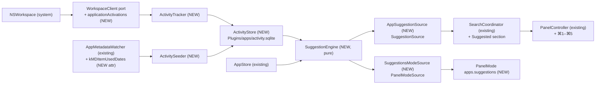
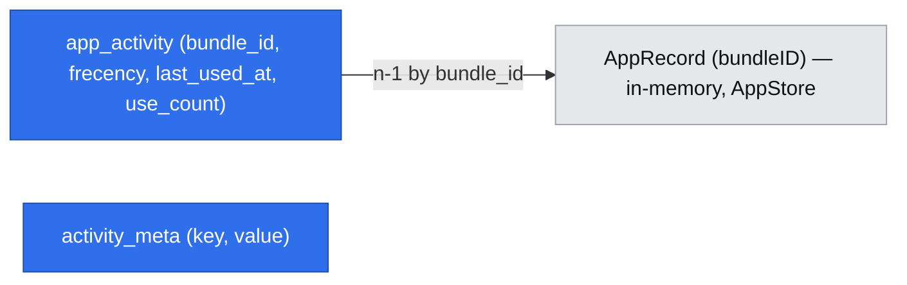

# Sugestie aplikacji (Suggested Apps)

> Status: **gotowy do review**. Proza po polsku, identyfikatory po angielsku (jak spec MVP `.ai/specs/2026-10-31-pounce-launcher-mvp.md`). Funkcja po v1.0, bez zmian w zakresie MVP.

## 📝 TLDR
Użytkownik chce szybciej uruchamiać aplikacje, których używa najczęściej, także tych otwieranych poza Pounce (Dock, ⌘Tab, Finder, linki). Dziś pusty input pokazuje sekcję „Recently Used” (8 elementów), liczoną wyłącznie z uruchomień przez Pounce (`ranking.sqlite`). Proponowane przyszłe zachowanie: `AppsPlugin` obserwuje, które aplikacje są na pierwszym planie (≥ 5 s), zasiewa historię z metadanych Spotlight i pokazuje **5 sugerowanych aplikacji** w sekcji „Suggested” zaraz pod polem wyszukiwania, z ⌘1–⌘5 do natychmiastowego uruchomienia i z opcjonalnym globalnym skrótem otwierającym panel z samymi sugestiami.

## 📝 Problem Statement
- Frecency w Pounce widzi tylko uruchomienia przez Pounce. Nowy użytkownik albo ktoś, kto zwykle klika w Dock, ma pustą lub mało trafną sekcję „Recently Used”, więc pusty panel nie daje wartości.
- Najczęstsza akcja w launcherze to otwarcie jednej z kilku tych samych aplikacji; dziś wymaga wpisania 1–3 znaków i ⏎.
- Dowód skali problemu jest anegdotyczny (prośba właściciela produktu); nie mamy telemetrii i z założenia jej nie zbieramy.

## 📝 Decyzje (odpowiedzi na Open Questions, 2026-11-02)
| # | Pytanie | Decyzja |
|---|---|---|
| Q1 | Źródło danych spoza Pounce | Obserwacja na żywo `NSWorkspace` + jednorazowy zasiew z Spotlight (`kMDItemUsedDates`, `kMDItemLastUsedDate`). Bez nowych uprawnień. Historia Screen Time (Biome / `knowledgeC.db`) odrzucona: Full Disk Access i prywatny, niestabilny format. |
| Q2 | Co jest „użyciem” | Aplikacja na pierwszym planie nieprzerwanie ≥ 5 s. |
| Q3 | Kontekst czasu | Nie w v1; czyste frecency. |
| Q4 | Uruchomione aplikacje | Pokazywane, z oznaczeniem „Running”. |
| Q5 | Relacja z „Recently Used” | Sekcja „Suggested” (5) nad „Recently Used”, bez duplikatów. |
| Q6 | Skrót | Oba: ⌘1–⌘5 w panelu + opcjonalny globalny skrót (domyślnie bez przypisania) otwierający tryb sugestii. |
| Q7 | Wpływ na ranking wyszukiwania | Brak. Osobny magazyn; `ranking.sqlite` i `Ranker` bez zmian. |

## 📝 Proposed Solution
1. **Zbieranie** — `ActivityTracker` w `AppsPlugin` słucha aktywacji aplikacji przez port `WorkspaceClient`. Gdy aplikacja jest na pierwszym planie 5 s bez przerwy, zapisuje jedno użycie (najwyżej jedno na aplikację na 10 min, żeby przeskoki edytor ↔ przeglądarka nie dominowały).
2. **Zasiew** — przy pierwszej aktywacji funkcji `ActivitySeeder` czyta z wyników istniejącego `AppMetadataWatcher` (Spotlight) daty użyć każdej aplikacji z ostatnich 90 dni i wstawia je jako historyczne użycia. Dzięki temu sugestie działają od pierwszego dnia, choć niepełnie (patrz Risks).
3. **Liczenie** — `SuggestionEngine` (czysta logika) liczy frecency z tym samym wykładniczym zanikiem co MVP (półokres 7 dni, `Ranker.decayedFrecency`), odrzuca aplikacje nieobecne w `AppStore`, samego Pounce i ukryte przez użytkownika, zwraca top 5 z flagą „uruchomiona”.
4. **Prezentacja** — nowy addytywny wkład `PouncePlugin.suggestionSources`. Shell przy pustym zapytaniu w trybie wyszukiwania pokazuje sekcję „Suggested” nad „Recently Used”, bez rankowania przez `Ranker`. Rzędy mają podpowiedź ⌘1–⌘5.
5. **Skrót globalny** — `PluginCommand` z `panelMode: "apps.suggestions"` (lista, istniejący mechanizm trybów listy), bez domyślnego skrótu; nagrywany w nowym panelu Ustawienia → Aplikacje.

### Alternatywy odrzucone
- **Zapis aktywacji do `ranking.sqlite` przez `UsageRecorder`** — najmniej kodu, ale miesza „czego szukam w Pounce” z „czego używam w systemie” i zmienia ranking wyszukiwania (sprzeczne z Q7). Reset Ranking kasowałby też historię aktywności.
- **Sugestie jako `SearchSource` z pustym zapytaniem** — `AppSearchSource` już odpowiada na puste zapytanie (Recently Used); drugie znaczenie pustego zapytania wymagałoby rozróżniania źródeł po id w shellu, czyli wiedzy o konkretnym pluginie poza `PluginRegistry`.
- **Czas na pierwszym planie jako waga** — dokładniejsze, ale wymaga zdarzeń końca aktywności (uśpienie, blokada, wylogowanie) i ich obsługi; „≥ 5 s = 1 użycie” daje podobną kolejność top 5 za ułamek złożoności.

## 📝 Research (rynek)
| Produkt | Co robi | Wniosek dla Pounce |
|---|---|---|
| Spotlight (Siri Suggestions) | Sugestie aplikacji z kontekstu (pora, miejsce, urządzenia), model na urządzeniu, nieprzejrzysty | Kontekst czasu daje trafność, ale kosztuje (Q3: później). Bierzemy prostotę i przejrzystość: użytkownik wie, skąd sugestia. |
| GNOME Shell (`shell-app-usage`) | „Frequent apps” liczone z czasu fokusu z zanikiem | Potwierdza wybór fokusu zamiast uruchomień (Q2). |
| Windows Start „Most used” | Liczba uruchomień | Słaby sygnał dla aplikacji otwartych cały dzień — powód odrzucenia (Q2a). |
| Alfred | ⌘1–⌘9 uruchamia n-ty wynik, liczba widoczna przy rzędzie | Przejmujemy wzorzec ⌘1–⌘5 z widoczną podpowiedzią. |
| Raycast | Sekcja sugestii w root search z użycia w samym Raycast, możliwość ukrycia elementu | Przejmujemy akcję „Ukryj w sugestiach”; nie przejmujemy ograniczenia do użyć w launcherze. |

Świadomie pomijamy: model ML, synchronizację między Macami, sugestie inne niż aplikacje (pliki, akcje).

## 📝 Architecture
Główny moduł: `AppsPlugin`. Zależności zostają jednokierunkowe; `AppsPlugin` dostaje nową zależność na `PouncePersistence` (dozwolony kierunek, jak `FilesPlugin`).



Wniosek: cała logika i dane są w `AppsPlugin`; shell dostaje tylko ogólny (niezależny od pluginu) mechanizm sekcji sugestii i skrótów ⌘n. `ranking.sqlite`, `Ranker` i `UsageRecorder` się nie zmieniają.

### Komponenty
| Komponent | Target | Odpowiedzialność |
|---|---|---|
| `ActivityTracker` | `AppsPlugin` | `@MainActor`. Subskrybuje `workspace.applicationActivations()`. Po aktywacji aplikacji X planuje sprawdzenie za 5 s (`Task.sleep`, zegar wstrzykiwany); jeśli X nadal jest na pierwszym planie (`workspace.frontmostApplication`) i od ostatniego użycia X minęło ≥ 10 min, wywołuje `ActivityStore.recordUse`. Ignoruje Pounce (`Bundle.main.bundleIdentifier`) i aplikacje bez bundle ID; aplikacje inne niż `.regular` odfiltrowuje już port. |
| `ActivitySeeder` | `AppsPlugin` | Jednorazowy: gdy `activity_meta.seeded_at` jest puste i `plugins.apps.spotlight == true`, czeka, aż `AppStore` opublikuje pierwszą listę aplikacji **i** zapytanie Spotlight zakończy zbieranie (`NSMetadataQueryDidFinishGathering`). Potem bierze z `AppMetadataWatcher` pary (ścieżka, `kMDItemUsedDates`), mapuje ścieżkę na bundle ID przez `AppStore`, wstawia daty z ostatnich 90 dni (każda data = 1 użycie o 12:00 lokalnie) i dopiero wtedy ustawia `seeded_at`, w jednej transakcji z wstawieniem. Przerwany zasiew (wyjście z aplikacji, błąd) nie ustawia `seeded_at`, więc powtórzy się przy następnym starcie. Gdy Spotlight jest wyłączony, zapisuje `seeded_at = skipped`. |
| `ActivityStore` | `AppsPlugin` | Właściciel `activity.sqlite` (`DatabaseFactory.openQueue`, własny migrator, plain, 0600). Trzyma w pamięci niezmienną kopię tabeli (setki wierszy), więc odczyt sugestii nie dotyka dysku; zapis w tle. `recordUse`, `seed`, `removeAll`, `snapshot`. |
| `SuggestionEngine` | `AppsPlugin` | Czysta funkcja: `(snapshot, apps, hidden, running, now, limit) -> [Suggestion]`. Kolejność: zanikające frecency malejąco, remis → `last_used_at` malejąco → nazwa. |
| `AppSuggestionSource` | `AppsPlugin` | `SuggestionSource`: top 5 jako `Candidate` (`apps:<bundleID>`, ikona `.file(url)` jak w `AppSearchSource`, więc ten sam wpis w `IconCache`; `badge` „Running” dla uruchomionych). Zbiór uruchomionych czyta jednym przeskokiem `await MainActor.run { workspace.runningApplicationBundleIDs }` na zapytanie, bo właściwość jest `@MainActor`, a `suggestions(limit:)` działa poza main actor. Akcje jak `AppSearchSource` + „Hide from Suggestions” (⌃X). |
| `SuggestionsModeSource` | `AppsPlugin` | `PanelModeSource` trybu `apps.suggestions`: pusty input → te same top 5; wpisany tekst → dopasowanie `FuzzyMatcher` wśród top 20 według aktywności. |
| Apps settings pane | `AppsPlugin` | Nowy `settingsPane()` (dziś `AppsPlugin` go nie ma): przełącznik „Suggest Apps”, lista ukrytych z przyciskiem przywrócenia, „Clear App Activity…”, rejestrator skrótu `apps.suggestions` (`context.makeShortcutRecorder`). Istniejące `roots` i `spotlight` mogą trafić do tego panelu w tym samym kroku. |
| `SearchCoordinator` | `PounceApp` | Przy pustym zapytaniu w trybie wyszukiwania odpytuje `host.activeSuggestionSources` (równolegle, budżet 150 ms przez `SourceRunner`), skleja wyniki w kolejności `app.sectionOrder` → `manifest.order`, obcina do 5, buduje sekcję `.suggested` nad `.recent` i usuwa z „Recently Used” klucze obecne w sugestiach. Żeby „Recently Used” dalej miało do 8 rzędów, `Ranker.recent` dostaje limit `recentLimit + liczba sugestii`, a wynik po deduplikacji jest obcinany do 8. Nie woła `Ranker` ani `usage.stats` dla sugestii. |
| `PanelController` / `LauncherView` | `PounceApp` | ⌘1–⌘5: pierwsza akcja n-tego rzędu sekcji `.suggested` (tryb wyszukiwania, pusty input) albo n-tego rzędu trybu listy bez filtrów. Filtry trybu listy mają pierwszeństwo, więc schowek się nie zmienia. Podpowiedź „⌘n” po prawej stronie rzędu, `badge` jako etykieta obok tytułu. |

## 📝 Data Model
Nowa baza `~/Library/Application Support/Pounce/Plugins/apps/activity.sqlite` (plain SQLite, 0600, katalog 0700), prywatna dla `AppsPlugin`, z własnym migratorem (migracja `v1-activity`). Nie jest szyfrowana, tak jak `ranking.sqlite`, który już trzyma bundle ID i frecency aplikacji; zawiera tylko bundle ID, liczby i daty, nigdy tytuły okien ani treść.

| Tabela | Kolumny | Uwagi |
|---|---|---|
| `app_activity` | `bundle_id` TEXT PK, `frecency` REAL NOT NULL (wartość na chwilę `last_used_at`), `last_used_at` REAL NOT NULL (Unix s), `use_count` INTEGER NOT NULL | Zapis użycia: `frecency = decayed(frecency, last_used_at → now) + 1`, ta sama formuła co `UsageRepository`. Przy otwarciu bazy usuwane są wiersze bez użycia od 90 dni. |
| `activity_meta` | `key` TEXT PK, `value` TEXT NOT NULL | Dziś tylko `seeded_at` (data ISO 8601 albo `skipped`). |



`activity_meta` nie ma relacji; `app_activity` odwołuje się do `AppRecord` tylko logicznie (bundle ID), bez klucza obcego, bo lista aplikacji żyje w pamięci. Interaktywna wersja: `.ai/data-model/2026-11-01-app-suggestions.html`.

### Ustawienia (nowe klucze, kontrakt z `BACKWARD_COMPATIBILITY.md` §3)
| Klucz | Typ | Domyślnie | Znaczenie |
|---|---|---|---|
| `plugins.apps.suggestions.enabled` | Bool | `true` | Wyłączenie zatrzymuje `ActivityTracker` i chowa sekcję oraz tryb; dane zostają do „Clear App Activity”. |
| `plugins.apps.suggestions.hidden` | [String] | `[]` | Bundle ID ukryte w sugestiach. |
| `KeyboardShortcuts_command_apps_suggestions` | KeyboardShortcuts | brak | Globalny skrót trybu sugestii. |

Liczba sugestii (5) i próg (5 s) to stałe, nie ustawienia.

## 📝 API Contracts (addytywne zmiany `PounceKit`, `BACKWARD_COMPATIBILITY.md` §1)
```swift
/// Ranked suggestions for the empty search panel. The shell shows them in order, never re-ranks them
/// and never records them in `ranking.sqlite`.
public protocol SuggestionSource: Sendable {
    var id: SourceID { get }
    /// Runs off the main actor, reacts to cancellation, best first.
    func suggestions(limit: Int) async throws -> [Candidate]
    func actions(for candidate: Candidate) -> [ResultAction]
}

// PouncePlugin: new requirement + default in the existing extension
var suggestionSources: [any SuggestionSource] { get }
extension PouncePlugin { public var suggestionSources: [any SuggestionSource] { [] } }

// Candidate (struct in Search.swift): new stored property in the struct itself, new init parameter
public let badge: String?          // already localized by the source, e.g. "Running"
public init(..., boost: Double = 0, badge: String? = nil)

// WorkspaceClient: new protocol REQUIREMENTS (dynamic dispatch through `any WorkspaceClient`),
// each with a default in the existing extension, the same pattern as the Phase 2 additions.
func applicationActivations() -> AsyncStream<RunningApplication>   // default: never yields
@MainActor var runningApplicationBundleIDs: Set<String> { get }    // default: []
```
- Wszystkie nowe elementy to wymagania z domyślną implementacją albo pola z wartością domyślną; istniejące pluginy (`FilesPlugin`, `ClipboardPlugin`) kompilują się bez zmian. Wymagania (nie same metody rozszerzenia) są konieczne: `PluginContext.workspace` to `any WorkspaceClient`, a metoda tylko z rozszerzenia byłaby wywoływana statycznie i implementacja `NSWorkspace` nigdy by nie zadziałała.
- **Równość `Candidate`:** `Hashable` jest syntetyzowane, więc `badge` wchodzi do `==`/`hash`. Ta sama aplikacja z „Running” i bez niego to różni kandydaci; shell porównuje rzędy po `itemKey`, nie po `==`, więc to nie zmienia zachowania. Regułę trzeba zapisać w `BACKWARD_COMPATIBILITY.md` §1. `String?` zamiast `LocalizedStringResource?`, bo w `PounceKit` żaden typ `Hashable` nie przechowuje dziś `LocalizedStringResource`.
- `RunningApplication` zostaje bez zmian: implementacja portu w `PounceApp/Ports` (`NSWorkspace.didActivateApplicationNotification`) emituje tylko aplikacje z `activationPolicy == .regular`, więc filtr polityki żyje w porcie, nie w kontrakcie.
- Shell opakowuje `SuggestionSource` w `SuggestionSourceAdapter: SearchSource` (wzór `ModeSourceAdapter`), żeby `SourceRunner` i obsługa akcji działały bez zmian.
- Nowe zachowanie shella, nie kontrakt pluginów: ⌘1–⌘9 w trybie listy bez filtrów uruchamia n-ty rząd (dziś ⌘n bez filtrów nic nie robi, `PanelController.swift:200`). To zmiana z `BACKWARD_COMPATIBILITY.md` §5 (skróty ⌘1–⌘5 to tam filtry schowka): wymaga noty w release notes i testu, że filtry schowka działają jak dotąd.
- `ItemKey` sugestii to istniejący format `apps:<bundleID>`, więc ⏎ uruchamia aplikację przez `AppLauncher` i zapisuje użycie w `ranking.sqlite` tak jak dziś (to uruchomienie przez Pounce, więc Q7 tego nie zmienia).

## 📝 UI/UX
**Pusty panel (tryb wyszukiwania):**
```
┌──────────────────────────────────────────────┐
│ 🔍 Search                                     │
├──────────────────────────────────────────────┤
│ SUGGESTED                                     │
│ [icon] Slack            Running          ⌘1  │
│ [icon] Google Chrome    Running          ⌘2  │
│ [icon] Xcode                             ⌘3  │
│ [icon] Mail                              ⌘4  │
│ [icon] Calendar                          ⌘5  │
│ RECENTLY USED                                 │
│ [icon] report.pdf                             │
│ …                                             │
└──────────────────────────────────────────────┘
```
- Zaznaczenie startuje na pierwszej sugestii, więc ⏎ uruchamia sugestię nr 1. ↑/↓ przechodzą przez granicę sekcji jak dziś.
- Wpisanie znaku zastępuje cały widok zwykłymi wynikami; sekcja „Suggested” istnieje tylko przy pustym inpucie.
- Stopka akcji zaznaczonej sugestii: ⏎ Open, ⌘⏎ Show in Finder, ⌃X Hide from Suggestions.
- **Tryb sugestii** (skrót globalny): ten sam panel, tytuł trybu „Suggested Apps”, lista bez podglądu; pisanie filtruje top 20, ⌘1–⌘5 działa na widoczne rzędy.
- **Stany:** brak danych (świeża instalacja bez Spotlight) → sekcja ukryta, panel wygląda jak dziś; tryb sugestii pokazuje pusty widok „Pounce learns which apps you use. Suggestions appear after a few app switches.”; funkcja wyłączona → brak sekcji; komenda trybu zostaje zarejestrowana (shell czyta komendy tylko przy zmianie pluginów, `AppCoordinator.pluginsChanged()`, a kontrakt nie ma sygnału „komendy się zmieniły”), ale tryb pokazuje pusty widok „Suggestions are off” z przyciskiem do Ustawień. Dodanie hooka `commandsChanged` do kontraktu to osobna, późniejsza decyzja.
- **Dostępność:** sekcja ma nagłówek dla VoiceOver („Suggested”); rząd czyta „Slack, Running, Suggested, Command-1”; `badge` nie polega tylko na kolorze (tekst); rozmiary tekstu `TextSize` jak w innych rzędach.
- **Lokalizacja:** nowe stringi w `Resources/Localizable.xcstrings` z `en` i `pl` („Suggested” / „Sugerowane”, „Running” / „Uruchomiona”, „Hide from Suggestions” / „Ukryj w sugestiach”, „Suggest Apps” / „Sugeruj aplikacje”, „Clear App Activity…” / „Wyczyść aktywność aplikacji…”).

Prototype: brak zaakceptowanej makiety; schemat ASCII powyżej to propozycja.

## 📝 Edge Cases & Failure Scenarios
| Sytuacja | Zachowanie |
|---|---|
| Świeża instalacja, Spotlight bez danych (zmierzone 2026-11-02 na Macu dewelopera: Calendar i Mail mają `kMDItemUsedDates`, Safari i Xcode — `null`) | Zasiew częściowy. Sekcja pokazuje tyle aplikacji, ile ma dane (0–5); brak danych → sekcja ukryta. Po kilku przełączeniach aplikacji sugestie się uzupełniają. |
| `plugins.apps.spotlight == false` | Brak zasiewu (`seeded_at = skipped`), tylko obserwacja na żywo. Późniejsze włączenie Spotlight nie uruchamia zasiewu ponownie. |
| Aplikacja odinstalowana | Nie ma jej w `AppStore` → odfiltrowana; wiersz wygasa po 90 dniach. |
| Aplikacja przeniesiona lub zaktualizowana | Klucz to bundle ID, więc historia zostaje. |
| Pounce nie działał (wyłączony, przed logowaniem) | Użycia w tym czasie się nie liczą; brak luki w działaniu. |
| Przeskoki ⌘Tab < 5 s | Nie liczą się. Aplikacja zostawiona na pierwszym planie przy uśpieniu ekranu w ciągu 5 s może dostać jedno użycie — akceptowalne. |
| Otwarcie bazy nie powiodło się (dysk, uszkodzenie) | `AppsPlugin` działa dalej (wyszukiwanie aplikacji), sugestie wyłączone, w logu błąd bez bundle ID; sekcja ukryta. Pozostałe sekcje bez zmian (pluginy dzielą proces, nic nie trapuje). Uszkodzona baza: przeniesienie do `activity.sqlite.corrupt-<data>` i nowa pusta (dane da się odbudować, w przeciwieństwie do schowka). |
| Źródło sugestii przekracza 150 ms | `SourceRunner` pomija sekcję, reszta panelu działa. W praktyce odczyt jest z pamięci (cel < 5 ms). |
| Baza z nowszą wersją schematu (downgrade) | Sugestie wyłączone z komunikatem w panelu Aplikacje, bez migracji (`BACKWARD_COMPATIBILITY.md` §2). |
| Plugin Apps wyłączony | Brak trackera, sekcji i trybu. |
| „Erase Data” pluginu Apps | Usuwa `Plugins/apps/` razem z `activity.sqlite` (istniejący mechanizm). |
| „Reset Ranking” (Advanced) | Nie dotyka `activity.sqlite`; opis w Advanced mówi, że historię aktywności czyści się w panelu Aplikacje. |
| Wiele kont użytkowników | Każde ma własny katalog Application Support; dane nie przechodzą między kontami. |

## 📝 Risks & Impact Review
- **Kontrakty trudne do cofnięcia** (`risk-high` według `SDLC.md`): nowy wkład `suggestionSources`, typ `SuggestionSource`, pole `Candidate.badge`, dwa elementy `WorkspaceClient`, nowa baza `Plugins/apps/activity.sqlite` i trzy klucze ustawień. Wszystkie addytywne; po wydaniu nie zmieniają nazw. `BACKWARD_COMPATIBILITY.md` trzeba uzupełnić w tym samym PR.
- **Prywatność:** Pounce zaczyna zapisywać historię aktywnych aplikacji także wtedy, gdy panel nie jest używany. Domyślnie włączone (to sens funkcji), dane tylko lokalnie, bez tytułów okien, z wyłącznikiem i czyszczeniem w Ustawieniach. Opis na landing page i w panelu Aplikacje powinien to wprost powiedzieć. `BACKWARD_COMPATIBILITY.md` §3 wymaga **jawnej zgody właściciela w PR** na domyślne ustawienie, które zbiera więcej danych, więc PR z fazą 1 musi ją zawierać (`risk-high`).
- **Jakość zasiewu:** `kMDItemUsedDates` ma dzienną granulację i jest aktualizowane nieregularnie przez LaunchServices (dowód wyżej). Ryzyko: pierwsze dni pokazują systemowe aplikacje (Calendar, Mail) zamiast faktycznych ulubionych. Łagodzenie: obserwacja na żywo z 7-dniowym półokresem szybko przejmuje kolejność.
- **Wydajność:** obserwator aktywacji to jedno powiadomienie na przełączenie aplikacji plus 5-sekundowy `Task`; pamięć: setki wierszy. Budżety z `docs/perf.md` (panel < 50 ms, źródło 150 ms, RAM) bez zmian; dopisać pomiar sugestii.
- **Rollback:** wyłączenie `plugins.apps.suggestions.enabled` chowa funkcję bez wydania. Usunięcie funkcji w kodzie zostawia nieużywaną bazę w `Plugins/apps/` (nieszkodliwe; „Erase Data” ją usuwa).

## 📋 Phasing
- **Phase 1 — Sugestie w panelu (jeden PR).** Zbieranie aktywności (port, `ActivityStore`, `ActivityTracker`, `ActivitySeeder`, `SuggestionEngine`) razem z sekcją „Suggested”, ⌘1–⌘5, ukrywaniem i panelem Ustawienia → Aplikacje. Śledzenie w tle nie trafia do wydania bez widocznej korzyści i bez kontroli użytkownika, więc nie dzielimy tego na osobne PR.
- **Phase 2 — Tryb sugestii i skrót globalny (osobny PR).** `PanelMode` `apps.suggestions`, `SuggestionsModeSource`, `PluginCommand` bez domyślnego skrótu, rejestrator w Ustawieniach, ⌘n w trybach listy bez filtrów. Wymaga fazy 1; poza tym da się go wydać osobno albo odłożyć bez szkody dla fazy 1.

Każda faza to osobny `feat/` branch i PR zgodnie z `SDLC.md`. Kroki w fazie 1 są w kolejności, w której każdy zostawia działającą aplikację (tracker włącza się dopiero w kroku 10, razem z sekcją w panelu).

## 📋 Implementation Plan

### Phase 1 — Sugestie w panelu
1. **Port aktywacji.** Dodaj `applicationActivations()` i `runningApplicationBundleIDs` do `WorkspaceClient` jako wymagania protokołu z domyślnymi implementacjami w rozszerzeniu; implementacja w `PounceApp/Ports` (emituje tylko aplikacje `.regular`) na `NSWorkspace.didActivateApplicationNotification` i `runningApplications`. Test: domyślny stream nie emituje; fake w testach emituje sekwencję.
2. **`ActivityStore` + migracja `v1-activity`.** `AppsPlugin` zależy od `PouncePersistence`; baza przez `DatabaseFactory.openQueue` w `context.storageDirectory`, tryb 0600; `recordUse`, `seed`, `removeAll`, `snapshot`, przycinanie 90 dni, obsługa uszkodzonej bazy i nowszego schematu. Testy: baza w katalogu tymczasowym, formuła frecency zgodna z `UsageRepository`, przycinanie, archiwizacja uszkodzonego pliku.
3. **`SuggestionEngine`.** Czysta funkcja z filtrami (Pounce, ukryte, nieznane `AppStore`), kolejnością i remisami, flagą „running”. Testy jednostkowe z zegarem wstrzykiwanym.
4. **`ActivityTracker`.** Na razie nie uruchamiany w `activate()`. Próg 5 s, cooldown 10 min, filtr Pounce i aplikacji bez bundle ID (politykę `.regular` filtruje port); zegar i sleep wstrzykiwane. Testy: aktywacja < 5 s nie liczy się, ≥ 5 s liczy się raz, druga w ciągu 10 min nie, zmiana fokusu przed upływem 5 s anuluje.
5. **`ActivitySeeder`.** Na razie nie uruchamiany w `activate()`. `AppMetadataWatcher` pobiera dodatkowo `kMDItemUsedDates`; seeder czeka na pierwszą listę `AppStore` i koniec zbierania Spotlight, mapuje ścieżki na bundle ID, bierze 90 dni, ustawia `seeded_at` w tej samej transakcji; `spotlight == false` → `skipped`. Testy na danych z fake'a watchera: `null`, aplikacje spoza `AppStore`, przerwany zasiew nie ustawia `seeded_at`, start przed publikacją `AppStore` czeka.
6. **Panel Ustawienia → Aplikacje.** `settingsPane()` z „Suggest Apps” (`plugins.apps.suggestions.enabled`), „Clear App Activity…” z potwierdzeniem, istniejące `roots`/`spotlight`. Lokalizacja `en`+`pl`. Test: przełącznik zatrzymuje i wznawia tracker (fake portu); czyszczenie zostawia pustą tabelę. Lokalnie: zrzuty w trybie jasnym i ciemnym (`docs/qa.md`).
7. **Kontrakt.** `SuggestionSource`, `PouncePlugin.suggestionSources` z domyślnym `[]`, `Candidate.badge: String?` (pole struktury, parametr `init` z domyślnym `nil`); `PluginHost.activeSuggestionSources`; `SuggestionSourceAdapter`. Test: plugin bez wkładu nie zmienia wyników (`PounceAppTests`), istniejące testy przechodzą bez zmian.
8. **`AppSuggestionSource`.** Kandydaci `apps:<bundleID>`, `badge` „Running”, akcje (Open, Show in Finder, Hide from Suggestions → `plugins.apps.suggestions.hidden` + `resultsChanged`). Testy jednostkowe akcji i odfiltrowania ukrytych.
9. **Sekcja w `SearchCoordinator`.** Pusty input w trybie wyszukiwania: zapytanie sugestii przez `SuggestionSourceAdapter` i `SourceRunner` (budżet), sekcja `.suggested` (max 5, kolejność `app.sectionOrder` → `manifest.order`) nad `.recent`, deduplikacja kluczy z dopełnieniem „Recently Used” do 8, brak wywołań `Ranker`/`usage.stats` dla sugestii, brak sekcji przy 0 wynikach. Testy z fake'owym hostem: kolejność sekcji, deduplikacja i dopełnienie do 8, przekroczony budżet pomija tylko sugestie.
10. **Włączenie zbierania.** `AppsPlugin.activate()` uruchamia `ActivityTracker` i `ActivitySeeder`, gdy `plugins.apps.suggestions.enabled`; `deactivate()` i wyłączenie przełącznika je zatrzymują. Test na fake'u portu: aktywacja → użycie w bazie → aplikacja w sugestiach.
11. **⌘1–⌘5 i wygląd rzędu.** `PanelController`: ⌘n w trybie wyszukiwania przy pustym inpucie uruchamia pierwszą akcję n-tej sugestii; `LauncherView`: podpowiedź „⌘n”, `badge`, etykiety VoiceOver. Test jednostkowy modelu panelu (mapowanie ⌘n, brak efektu przy wpisanym tekście, filtry trybu listy nienaruszone). Lokalnie: zrzuty jasny/ciemny, VoiceOver.
12. **Lista ukrytych w Ustawieniach + lokalizacja + dokumentacja.** Przywracanie ukrytych aplikacji; nowe stringi `en`+`pl` (`StringCatalogTests`); `BACKWARD_COMPATIBILITY.md` (§1 kontrakt i reguła równości `Candidate`, §2 baza `activity.sqlite`, §3 klucze `enabled` i `hidden` z adnotacją o zgodzie właściciela na domyślne zbieranie); wiersz Apps w `AGENTS.md`; przypis w specu MVP przy „Pusty input…”; `docs/perf.md` (pomiar czasu sugestii).

### Phase 2 — Tryb sugestii i skrót globalny
13. **`SuggestionsModeSource` + `PanelMode` `apps.suggestions`.** Pusty input → top 5, tekst → `FuzzyMatcher` na top 20; pusty widok przy braku danych. Testy jednostkowe źródła.
14. **Komenda i skrót.** `PluginCommand(id: "apps.suggestions", panelMode: …, defaultShortcut: nil)`, rejestrator w panelu Aplikacje; przy wyłączonej funkcji komenda zostaje, a tryb pokazuje „Suggestions are off” z przyciskiem do Ustawień. Test: komenda bez domyślnego skrótu nie rejestruje hotkeya; przy wyłączonej funkcji źródło trybu zwraca pusty wynik i pusty widok.
15. **⌘n w trybach listy bez filtrów.** `PanelController`: przy braku filtrów ⌘1–⌘9 uruchamia n-ty rząd. Test: ⌘1–⌘5 w schowku dalej przełączają filtry; tryb sugestii uruchamia rząd. Dokumentacja: `BACKWARD_COMPATIBILITY.md` (§3 klucz skrótu, §5 nowe znaczenie ⌘n i nota do release notes), `AGENTS.md`, `docs/qa.md` (scenariusze QA z `--qa…`, w tym fake aktywacji).

Bramka walidacji po każdym kroku: `swift build`, `swift test`, `swift format lint --strict -r Sources Tests`.
