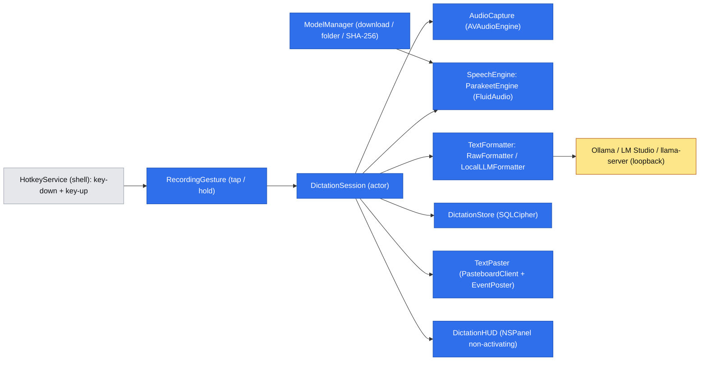

# Dyktowanie głosowe (Voice to Text)

> Status: **projekt** — odpowiedzi na Open Questions przyjęte 2026-11-02, czeka na review. Proza po polsku, identyfikatory po angielsku (jak spec MVP).

## 📝 TLDR
Użytkownik chce dyktować tekst w dowolnej aplikacji, jak w superwhisper, głównie przy pisaniu promptów do LLM (często 2–5 minut mówienia, po polsku z angielskimi terminami). Dziś Pounce nie obsługuje mowy, a dyktowanie systemowe macOS daje jeden blok tekstu z „yyy” i poprawkami w locie. Proponowane przyszłe zachowanie: nowy plugin `DictationPlugin` nagrywa pod globalnym skrótem, transkrybuje **modelem mowy działającym w procesie Pounce** (audio nie opuszcza Maca), **porządkuje** tekst przez **lokalny serwer LLM użytkownika** (Ollama / LM Studio / llama-server, tylko loopback) i wkleja wynik do aplikacji, w której użytkownik pisze. Tekst (surowy i sformatowany) trafia do zaszyfrowanej historii; audio nigdy nie jest zapisywane.

## ✅ Rozstrzygnięte pytania (2026-11-02)

| # | Decyzja |
|---|---|
| Q1 | Jeden spec; formatowanie dla LLM to osobna faza. |
| Q2 | Użytkownikowi obojętne, czy model uruchamia Pounce, czy on sam — ma działać lokalnie i jak najlepiej. Na podstawie badań (sekcja Research): **mowa → tekst w procesie Pounce** (Parakeet Ultra przez FluidAudio, drugi silnik Whisper large-v3-turbo przez WhisperKit; ADR 0003), **formatowanie przez lokalny endpoint zgodny z OpenAI** (Ollama, LM Studio, llama-server; tylko adresy loopback). Wbudowany LLM (mlx-swift-lm) poza zakresem tego specu, możliwy później za tym samym portem. |
| Q3 | Polski i angielski z automatycznym wykrywaniem, także mieszane w zdaniu. |
| Q4 | Tryb „Porządkuj” (interpunkcja, akapity, listy, usunięcie wtrąceń, zastosowanie poprawek w locie; treść, kolejność i język bez zmian) + tryb „Surowy” bez LLM. Przepisywanie w strukturalny prompt i własne tryby — poza zakresem. |
| Q5 | Krótkie naciśnięcie skrótu przełącza nagrywanie, przytrzymanie działa jako push-to-talk; Esc anuluje. |
| Q6 | Wynik wklejany od razu do aplikacji aktywnej w chwili zakończenia nagrania; bez Accessibility — tylko kopia do schowka. |
| Q7 | Zaszyfrowana historia samego tekstu (surowy + sformatowany), nigdy audio. |
| Q8 | Model pobierany w Ustawieniach po zgodzie użytkownika (zweryfikowany SHA-256) albo wskazany folder z modelem pobranym ręcznie. |

## 📝 Problem Statement
- Pisanie długich promptów jest wolne; mówienie jest kilka razy szybsze, ale tylko gdy narzędzie nie gubi polskiego ani angielskich terminów i nie zostawia „ściany tekstu”.
- Dyktowanie systemowe (i surowy Whisper) zostawia wtrącenia, autokorekty mowy („nie, czekaj, chodziło mi o…”) i brak akapitów. Taki tekst jest gorszym promptem niż napisany ręcznie, więc trzeba go poprawiać ręcznie.
- Usługi chmurowe wysyłają audio na serwer. Wymaganie użytkownika: model działa na Macu.
- Pounce ma już prawie wszystkie klocki: globalne skróty z rejestratorem, wklejanie do poprzedniej aplikacji (`EventPoster`, Accessibility, Secure Event Input), szyfrowany magazyn (SQLCipher + Keychain + HKDF), list panel mode z podglądem, ekran Uprawnień i onboarding pluginów.

## 📝 Research (rynek i silniki, stan na 2026-11-02)

**Silniki mowy → tekst (lokalne, licencje zgodne z MIT):**

| Silnik | Polski | Auto-język | Rozmiar | Szybkość | Licencja | Werdykt |
|---|---|---|---|---|---|---|
| Parakeet Ultra (dotrenowany Parakeet TDT v3) przez FluidAudio | tak, WER FLEURS-pl 5,54% (v3: 6,70–7,31%) | tak (per wypowiedź), **bez możliwości przypięcia języka** | ~0,7 GB | ~110–190× czasu rzeczywistego (M4 Pro) | kod Apache-2.0, wagi CC-BY-4.0 | **domyślny** (ADR 0003) |
| WhisperKit 1.1.x (`argmax-oss-swift`), `large-v3-turbo_632MB` | tak, WER FLEURS-pl 5,81% (Q8) | tak, albo **przypięty** `pl`/`en` | ~0,6–1 GB | wolniejszy od Parakeet | MIT | **drugi silnik** z przypiętym językiem, na wypadek „dryfu” Parakeeta do angielskiego (ADR 0003) |
| Apple `DictationTranscriber` (pl_PL) | tak | **nie** (jeden locale) | systemowy | — | system | odrzucony: brak mieszania języków |
| Apple `SpeechTranscriber` | **nie** | — | — | — | — | odrzucony |
| whisper.cpp 1.9.x | tak | tak | jak Whisper | dobra (Metal) | MIT | odrzucony: C++ bez Swift API, brak gotowego xcframework od 1.8 |

**Formatowanie (lokalny LLM):**
- Apple Foundation Models odpada: brak polskiego (16 języków Apple Intelligence) i 4 096 tokenów na wejście+wyjście, a 5 minut po polsku to ~2–2,5 tys. tokenów w każdą stronę.
- Ollama (`localhost:11434`), LM Studio (`localhost:1234`) i llama-server (`127.0.0.1:9931`, nowy domyślny port; dawniej 8080) mają `/v1/chat/completions` i `/v1/models`, więc wystarczy **jeden klient**.
- Docelowy Mac to Mac Studio ze 128 GB, więc mieszczą się modele klasy 30B. Wybór z publicznych benchmarków (ADR 0004): **Qwen3.6-35B-A3B** (MoE, 4-bit, 78–91 tok/s na M3 Ultra, Apache-2.0, „thinking” wyłączany przez `chat_template_kwargs`) jako zalecany; **Bielik-11B-v3.0-Instruct** (Apache-2.0, najlepsze wyniki po polsku: Open PL 65,93, PLCC 71,83) jako „najlepszy polski”; **Qwen3-4B-Instruct-2507** dla słabszych Maców. Pounce **nie wybiera ani nie pobiera** modelu LLM; Ustawienia tylko podpowiadają.
- **Opóźnienie to główne ryzyko:** wąskim gardłem są tokeny wyjściowe — polski kosztuje 2,69 tok/słowo (tokenizer Qwen3) albo 3,22 (Bielik), angielski 1,17. Nawet przy ~85 tok/s przepisanie 900 słów po zakończeniu nagrania trwałoby ~30 s. Stąd projekt formatuje **kawałkami w trakcie nagrywania** (sekcja Architecture).

**Co robią liderzy:**
- **superwhisper** (zamknięty): lokalne modele Whisper, Parakeet i Cohere Transcribe, „tryby” z promptami LLM, słownik własnych słów. Ma znany problem: automatyczne wykrywanie języka czasem daje angielski. Wnioski: Parakeet to rozsądny domyślny wybór, a własny słownik warto zrobić później.
- **VoiceInk** (GPL-3.0, więc tylko inspiracja, zero kodu):
  - silniki whisper.cpp i Parakeet przez FluidAudio;
  - transkrypcja strumieniowa w trakcie nagrania;
  - wklejanie ⌘V przez `CGEvent`;
  - „AI enhancement” przez Ollama albo własny endpoint zgodny z OpenAI. Transkrypcja idzie w znacznikach `<TRANSCRIPT>`, z regułami „nie odpowiadaj na pytania z transkrypcji”, „zachowaj język” i „zwróć tylko tekst”, z przykładami few-shot i z filtrem wycinającym `<think>`.
  
  Przejmujemy ten wzorzec bez kodu, dodając strażnika długości (Edge Cases).
- **Czego nie robimy (złożoność do pominięcia):**
  - konta;
  - modele w chmurze;
  - wiele trybów i promptów;
  - transkrypcja plików audio;
  - reguły per aplikacja („w Slacku inny tryb”);
  - wpisywanie znak po znaku zamiast ⌘V.

## 📝 Proposed Solution
Nowy wewnętrzny plugin `DictationPlugin` (`PluginID` `dictation`, nowy target i jedna linia w `PluginRegistry`). Przepływ:

1. **Skrót naciśnięty:**
   - shell chowa panel Pounce, jeśli jest widoczny (w `AppCoordinator`, bez kontraktu);
   - plugin przejmuje na czas sesji klawisz Esc (krótkotrwały globalny skrót przez shell);
   - startuje `AVAudioEngine` (16 kHz mono, tylko w pamięci);
   - pokazuje mały HUD u dołu aktywnego ekranu: poziom dźwięku, czas, „Esc anuluje”;
   - jeśli model mowy nie jest w pamięci, ładuje go równolegle, a audio czeka w buforze, więc żadne słowo nie ginie.
2. **W trakcie mówienia:**
   - VAD (Silero, w FluidAudio) tnie mowę na segmenty i każdy zamknięty segment od razu idzie do transkrypcji;
   - w trybie „Porządkuj” złożone z segmentów **akapity** (≥ ~40 słów zakończone pauzą ≥ 1,5 s, najwyżej N = 60 słów (ADR 0004), z wymuszonym podziałem na końcu zdania wskazanym przez VAD) od razu trafiają do lokalnego LLM;
   - dzięki temu po zakończeniu zostaje do przetworzenia tylko ostatni kawałek.
3. **Skrót puszczony albo naciśnięty ponownie:**
   - plugin transkrybuje i formatuje ogon nagrania, skleja akapity;
   - wkleja wynik przez schowek i ⌘V do aplikacji aktywnej **w tej chwili** (`WorkspaceClient.frontmostApplication` czytane w momencie końca; użytkownik mógł zmienić okno w trakcie); ten sam pid służy do sprawdzenia „cel zniknął”;
   - poprzednią zawartość schowka przywraca po 1 s (warunki w `TextPaster`);
   - zapisuje wpis w historii **po** wklejeniu, z wynikiem wklejenia;
   - zwalnia Esc.
4. **Esc albo błąd:** nagranie jest odrzucane, nic nie trafia do historii; HUD pokazuje powód.
5. **Wywołanie z menu paska:** zawsze startuje w trybie przełączania (menu nie zna puszczenia klawisza); kończy ponowny wybór w menu, skrót albo ✕ w HUD.

**Alternatywy, które przegrały:**
- **Wszystko przez serwery localhost** (whisper.cpp server do mowy): wymaga od użytkownika dwóch procesów i daje gorsze opóźnienie startu. Mowa jest mała (0,6 GB) i musi być natychmiastowa, więc należy do Pounce.
- **Wbudowany LLM (mlx-swift-lm) już w v1:** nowa, duża zależność (MLX, swift-transformers) o niezweryfikowanym statusie Swift 6, do tego kilka GB modelu w procesie z budżetem 150 MB w spoczynku. Port `TextFormatter` zostawia na to miejsce na później.
- **Jedno formatowanie całości po zakończeniu:** 30–70 s czekania na bazowym M-series, nie do przyjęcia.
- **Wklejanie przez Accessibility API (`AXValue`) zamiast ⌘V:** nie działa w wielu aplikacjach Electron i webowych; ⌘V jest już sprawdzone w schowku.

## 📝 Architecture

Wniosek: cała logika żyje w `DictationPlugin`. Shell dostaje cztery addytywne rozszerzenia kontraktu (fazy naciśnięcia skrótu, uprawnienie mikrofonu, tymczasowe przejęcie Esc, wspólne typy znaczników schowka) oraz opis użycia i entitlement mikrofonu w bundlu. Aplikację na pierwszym planie plugin czyta z istniejącego `WorkspaceClient.frontmostApplication`.

**Wyjątek od zasady „pluginy nie sięgają po globalne obiekty”:** `AVAudioEngine`, `AVCaptureDevice.requestAccess`, `URLSession` i własny `NSPanel` są używane w pluginie, ale każdy za **wewnętrznym** (nie w `PounceKit`) protokołem wstrzykiwanym w inicjalizatorze: `AudioSource` (testy: plik WAV), `MicrophoneAuthorizer`, `HTTPTransport` (testy: `URLProtocol` stub), `HUDPresenter` (testy: rejestrujący stan). Nie dodajemy ich do `PounceKit`, bo potrzebuje ich jeden plugin; trafią tam, gdy pojawi się drugi. Jedyny proces poza Pounce to opcjonalny serwer LLM użytkownika.

**Komponenty `Sources/DictationPlugin/`:**
- `DictationPlugin` — manifest (`id: dictation`, `order` po schowku, `defaultEnabled: false`, bo funkcja wymaga pobrania modelu i mikrofonu), `commands`, `onboardingSteps`, `requiredPermissions = [.microphone, .accessibility]`, `settingsPane()`, `panelModes` (historia, Faza 3), `eraseData()` (klucz w Keychain).
- `RecordingGesture` — czysta maszyna stanów (bez I/O), z pełną tabelą stan × zdarzenie:

  | Stan \ zdarzenie | key-down | key-up | menu | Esc / ✕ |
  |---|---|---|---|---|
  | `idle` | → `pressed` (start) | ignoruj | → `toggle` (start) | ignoruj |
  | `pressed` | ignoruj (autorepeat) | < 300 ms → `toggle`; ≥ 300 ms → `finishing` | → `finishing` | → `idle` (anuluj) |
  | `toggle` | → `stopPressed` | ignoruj | → `finishing` | → `idle` (anuluj) |
  | `stopPressed` | ignoruj | → `finishing` | → `finishing` | → `idle` (anuluj) |
  | `finishing` | ignoruj | ignoruj | ignoruj | ignoruj (tekst już powstaje) |

  Kończenie w `toggle` następuje dopiero przy key-up drugiego naciśnięcia, żeby puszczenie klawisza nie trafiło do nowej sesji.
- `DictationSession` (`actor`) — jedno nagranie: bufor audio, kolejka segmentów, kolejność akapitów, anulowanie przez `Task` cancellation. Naraz istnieje najwyżej jedna sesja.
- `AudioCapture` — `AVAudioEngine` z tapem na wejściu, konwersja do 16 kHz mono `Float32`, poziom RMS dla HUD; wybrane urządzenie wejściowe albo systemowe.
- `SpeechEngine` (protokół) + `ParakeetEngine`:
  - `load(modelFolder:)`, `transcribe(segment:) async throws -> TranscriptSegment`, `unload()`;
  - model zostaje w pamięci przez `keepWarm` (domyślnie 10 min od ostatniego dyktowania), potem jest zwalniany;
  - `WhisperKitEngine` (krok 1.10): Whisper large-v3-turbo z językiem przypiętym do `speechLanguage`; ten sam protokół, ten sam `ModelManager`.
- `Segmenter` — czysta logika: z segmentów VAD składa akapity do formatowania (próg ~40 słów, pauza ≥ 1,5 s, twardy limit N = 60 słów z podziałem na końcu zdania). Ogon po zakończeniu nagrania też jest dzielony tym samym limitem, więc po zatrzymaniu czeka się najwyżej na jeden kawałek ≤ N słów (kolejne kawałki ogona idą równolegle, jeśli serwer na to pozwala, inaczej po kolei). Limit `N` = 60 wynika z rachunku w ADR 0004.
- `TextFormatter` (protokół): `format(chunk:previousContext:) async throws -> String`. Implementacje:
  - `RawFormatter` — tylko złożenie segmentów i spacje;
  - `LocalLLMFormatter` — klient `/v1/chat/completions` (`URLSession`, `stream: false`, `temperature: 0`) z promptem systemowym `CleanupPrompt` (zasoby pluginu, wersjonowany), z transkrypcją w `<transcript>…</transcript>` i z ogonem poprzedniego akapitu jako kontekstem tylko do odczytu;
  - `FormatterGuard` — wycina `<think>…</think>`; jeśli liczba słów wyjścia jest poza 0,6–1,15× wejścia albo zmienił się dominujący język, odrzuca kawałek i wstawia surowy.
- `EndpointProbe` — wykrywa serwery przez `GET /v1/models` na `127.0.0.1:11434`, `:1234`, `:9931` oraz pod adresem z Ustawień.
- `LoopbackPolicy` — czysta funkcja walidująca każdy URL przed żądaniem:
  - `localhost` zamieniany na `127.0.0.1` przez Pounce, bez DNS i `/etc/hosts`;
  - akceptowane tylko dosłowne `127.x.x.x` (forma kropkowa dziesiętna) i `[::1]`;
  - odrzucane adresy `::ffff:` mapowane, liczbowe i ósemkowe formy IP, URL z userinfo (`http://127.0.0.1@evil`) i schematy inne niż `http`;
  - klient LLM używa sesji `.ephemeral` z `connectionProxyDictionary = [:]` (bez proxy, bez `URLCache` na dysku) i blokuje przekierowania w `willPerformHTTPRedirection`;
  - pobieranie modelu idzie osobną sesją, po HTTPS, wyłącznie do hostów z listy: `huggingface.co`, `cdn-lfs.hf.co` i `cdn-lfs-*.hf.co`, `cas-bridge.xethub.hf.co`. Ta sesja (inaczej niż sesja LLM) przyjmuje przekierowania, ale tylko na hosty z listy; każde inne przekierowanie przerywa pobieranie. Listę weryfikuje ręczny test pobierania w kroku 1.3.
- `ModelManager` — katalog wkompilowanych modeli (`ModelCatalog`: id, pliki, przypięta rewizja Hugging Face, SHA-256 każdego pliku, rozmiar, licencja i atrybucja). Pakiet obejmuje **wszystko**, czego silnik potrzebuje: Parakeet (encoder, decoder, joint), słownik/tokenizer i model VAD Silero. Wbudowane pobieranie FluidAudio (`downloadAndLoad`, domyślny katalog modeli) **nigdy nie jest używane**: silnik ładuje modele wyłącznie z folderu wskazanego przez `ModelManager` (sprawdzane w kroku 1.5 z zablokowaną siecią). Skompilowane modele Core ML (`.mlmodelc`) to dane wag, nie kod wykonywalny, więc nie łamią zakazu ładowania kodu w runtime (`CODE_REVIEW.md`).
  `ModelManager`:
  - pobiera przez `URLSession` do `Plugins/dictation/Models/<model-id>.partial/` i weryfikuje sumy;
  - po weryfikacji wykonuje atomowy `rename`;
  - obsługuje wskazany folder (sprawdzenie listy plików i sum, bez kopiowania), wznawianie i anulowanie.
- `TextPaster`:
  - zapisuje tekst jako element schowka z `public.utf8-plain-text` i typem znacznika `PasteboardRepresentation.transientMarkerType` (nowa publiczna stała w `PounceKit` = `org.nspasteboard.TransientType`, którą `CaptureFilter` schowka już pomija; schowek przechodzi na stałą). Dzięki temu dyktowany tekst nie dubluje się w historii schowka;
  - robi ⌘V przez `EventPoster`, z decyzją jak `PasteDecision` w schowku: brak Accessibility, Secure Event Input albo brak celu → tylko kopia, bez przywracania schowka;
  - **przywracanie** poprzedniej zawartości odbywa się tylko wtedy, gdy:
    - dostęp do schowka jest dozwolony (`accessBehavior`; inaczej plugin nie czyta schowka i nie przywraca, żeby nie wywołać monitu macOS);
    - obecne typy schowka nie zawierają **żadnego** typu z `PasteboardRepresentation.markerTypes` (hasło z menedżera haseł, dane tymczasowe). Wtedy plugin w ogóle nie czyta schowka i nie przywraca: przywrócenie podbiłoby `changeCount` i wyłączyło automatyczne czyszczenie hasła przez menedżer haseł;
    - odczyt przed wklejeniem był kompletny: dla **każdego elementu** zbiór odczytanych typów jest równy typom tego elementu (`readContents` po cichu pomija dane nieudane i obiecane, więc liczy się porównanie), a wynik nie ma `exceedsLimit`. `maxBytes` = `CaptureFilter.maximumEntryBytes` (20 MB, liczone dla całego schowka); po przekroczeniu odczyt jest niekompletny. `maxBytes` nie chroni przed leniwymi obietnicami (`data(forType:)` generuje dane przed sprawdzeniem rozmiaru), więc odczyt może krótko zablokować main actor, tak samo jak dziś w `PasteboardWatcher`; krok 1.6 mierzy to na typowych aplikacjach;
    - `changeCount` nie zmienił się od wklejenia.
    
    Przywrócony zapis też dostaje znacznik transient, więc `ClipboardPlugin` nie łapie go ponownie i nie podbija starego wpisu.
- `DictationHUD` — własny `NSPanel` (`.nonactivatingPanel`, poziom `.statusBar`, nigdy nie przejmuje fokusu, ignoruje mysz poza przyciskiem anulowania), SwiftUI w środku. Własne okno pluginu, bo panel launchera shella jest aktywowany skrótem i zasłania pole tekstowe; nie dodajemy kontraktu „overlay”, dopóki potrzebuje go jeden plugin.
- `DictationStore` + `DictationKeyStore` (Faza 3) — patrz Data Model.

**Zmiany w shellu (`PounceApp`):**
- `HotkeyRegistrar` dostaje `setKeyEventHandler(for:_:)`: dla komendy z `onKeyEvent` rejestrator konsumuje **jedną** sekwencję `KeyboardShortcuts.events(for:)` (key-down i key-up w jednym strumieniu) w jednej pętli na main actorze, więc kolejność zdarzeń wynika z samego strumienia; `removeHandler` anuluje tę pętlę (bez osobnego callbacku `onKeyUp`, który mógłby przeciec). Dziś `setHandler` słucha tylko `events(.keyDown, …)` we własnym `Task` (`KeyboardShortcutsRegistrar.swift:35-37`). Dochodzi też tymczasowa rejestracja Esc bez modyfikatorów (Carbon hotkey, połyka klawisz tylko na czas sesji). `KeyboardShortcutsRegistrar` i rejestratory QA/testowe dostają implementację.
- `HotkeyService.syncCommands` i `AppCoordinator`: zdarzenia z tej pętli trafiają do `onKeyEvent` **synchronicznie**, bez owijania w `Task` (dziś `perform` robi `Task { await run() }`, co przy szybkim tapnięciu mogłoby odwrócić kolejność). Przed dostarczeniem `.down` `AppCoordinator` sam chowa panel launchera, jeśli jest widoczny (inaczej ⌘V trafiłoby do pola wyszukiwania panelu). Wywołanie z menu nadal woła `run`.
- `AppCoordinator` po włączeniu pluginu (Ustawienia → Funkcje, dziś tylko `host.setEnabled`) wywołuje `onboarding.showPendingSteps()`, żeby kroki onboardingu włączonego pluginu pokazały się od razu, a nie dopiero przy następnym uruchomieniu (dziś `showPendingSteps()` działa tylko w `start()`, `AppCoordinator.swift:94`).
- `PermissionsReader` obsługuje `.microphone` (`AVCaptureDevice.authorizationStatus(for: .audio)`).
- Ustawienia → Uprawnienia pokazują mikrofon z linkiem `x-apple.systempreferences:com.apple.preference.security?Privacy_Microphone`.
- `Resources/Info.plist`: `NSMicrophoneUsageDescription` (en + pl przez **nowy** katalog `Resources/InfoPlist.xcstrings`; `scripts/make-app.sh` dziś kompiluje tylko `Localizable.xcstrings`, więc krok 1.2 dodaje kompilację drugiego katalogu, a `StringCatalogTests` sprawdza oba); `Resources/Pounce.entitlements`: `com.apple.security.device.audio-input` (wymagane przy hardened runtime).
- `scripts/make-app.sh` kopiuje zasoby FluidAudio, jeśli je ma (jak bundle KeyboardShortcuts).
- `THIRD_PARTY_NOTICES.txt`: FluidAudio (Apache-2.0); atrybucja wag Parakeet (CC-BY-4.0) w Ustawieniach przy modelu i w notkach.

**Zależności:**
- Nowa: **FluidAudio** (Apache-2.0, `from:` z dokładnym pinem jak KeyboardShortcuts) w `DictationPlugin`. Powód: natywny Swift 6, Parakeet Ultra + VAD + strumieniowanie, najlepszy wynik dla polskiego wśród szybkich modeli.
- Nowa (krok 1.10): **WhisperKit** (MIT, dokładny pin) w `DictationPlugin`. Powód: jedyny szybki silnik z przypinanym językiem, zabezpieczenie przed dryfem Parakeeta (ADR 0003).
- `DictationPlugin` zależy też od `PouncePersistence` i produktu GRDB (jak `ClipboardPlugin`).
- Brak nowych zależności dla LLM (`URLSession`).

**Pamięć i budżety (nowe wiersze w `docs/perf.md`):**

| Budżet | Cel |
|---|---|
| Od naciśnięcia skrótu do startu nagrywania i widocznego HUD | < 150 ms (model nie musi być w pamięci; audio idzie do bufora) |
| Załadowanie modelu Parakeet (zimny start) | < 3 s, w tle, bez utraty audio |
| Tekst surowy gotowy po zakończeniu 5-minutowego nagrania | < 2 s |
| Tekst sformatowany gotowy po zakończeniu, przy ogonie ≤ 60 słów (Qwen3.6-35B-A3B 4-bit, M-series Max/Ultra) | < 3 s. Rachunek: 60 słów × 2,69 tok ≈ 160 tok przy 78–91 tok/s ≈ 1,8–2,1 s + ~0,2 s prefill (ADR 0004). Na bazowym M-series z modelem 4B: < 8 s |
| Pamięć w spoczynku (model zwolniony) | bez zmian: < 150 MB dla całej aplikacji |
| Pamięć w trakcie dyktowania | budżet osobny, mierzony w kroku 1.9 (oczekiwane ~0,8–1,2 GB) |

## 📝 Data Model
Trzy magazyny w `Application Support/Pounce/Plugins/dictation/` (katalog 0700, pliki 0600), wszystkie prywatne dla pluginu.

1. **`Models/<model-id>/`** — pliki modelu mowy (Faza 1). Odtwarzalne (ponowne pobranie), więc nie są chronionym formatem; chroniona jest tylko ścieżka katalogu pluginu (R4). Folder wskazany przez użytkownika nie jest kopiowany; jego ścieżka siedzi w ustawieniach.
2. **`dictation.sqlite`** — SQLCipher (Faza 3), własny `DatabaseMigrator` (migracja `v1-history`), otwierany przez `DatabaseFactory.openQueue` z `DatabaseKey`.
3. **Klucz** — element Keychain `service = app.pounce.dictation` (ten sam schemat co schowek: losowy klucz główny 256 bit, HKDF-SHA256, `info = sqlcipher`). Logika `KeyStore`/`HistoryOpener` zostaje **przeniesiona** z `ClipboardPlugin` do `PouncePersistence` jako `MasterKeyStore(service:)` i `EncryptedDatabaseOpener`, z niezmienionym zachowaniem dla schowka (krok 3.1); pluginy nie mogą importować się nawzajem, a kopia logiki kluczy to gorszy wybór. Tylko `errSecItemNotFound` może zresetować bazę (archiwum `dictation.sqlite.unreadable-<data>`, 30 dni); każdy inny błąd Keychain wyłącza historię bez kasowania.

**Tabela `dictation_entry`:**

| Kolumna | Typ | Znaczenie |
|---|---|---|
| `id` | INTEGER PK | |
| `created_at` | REAL (epoch) | koniec nagrania |
| `duration_ms` | INTEGER | długość mowy |
| `raw_text` | TEXT NOT NULL | transkrypcja przed formatowaniem |
| `formatted_text` | TEXT NULL | wynik „Porządkuj”; NULL w trybie surowym albo gdy formatowanie w całości zawiodło |
| `format_mode` | TEXT | `raw` / `clean` |
| `format_status` | TEXT | `none` / `ok` / `partial` (część kawałków surowa) / `failed` |
| `detected_languages` | TEXT | np. `pl,en` |
| `speech_model_id` | TEXT | np. `parakeet-ultra` |
| `formatter_model` | TEXT NULL | nazwa modelu zgłoszona przez endpoint |
| `target_bundle_id` | TEXT NULL | gdzie wklejono; NULL przy samej kopii |
| `paste_result` | TEXT | `pasted` / `copied` / `failed` |

Wirtualna tabela **`dictation_fts`** (FTS5, `content=dictation_entry`, kolumny `raw_text`, `formatted_text`) służy do wyszukiwania w historii; migracja `v1-history` tworzy też wyzwalacze `AFTER INSERT/UPDATE/DELETE` synchronizujące indeks (jak w `clipboard.sqlite`).

**Retencja:** `RetentionJob` usuwa wpisy starsze niż `plugins.dictation.retentionDays` (domyślnie 30) i ponad `plugins.dictation.maximumEntries` (domyślnie 500); przy usunięciu robi `VACUUM` co najwyżej raz dziennie.

**Wrażliwe dane:** treść dyktowania nigdy nie trafia do logów (tylko długości i czasy), do `ranking.sqlite` (plugin nie wywołuje `PluginContext.usage`) ani do schowka systemowego na dłużej niż do przywrócenia. Audio istnieje wyłącznie w pamięci sesji; bufory Pounce są zwalniane po transkrypcji segmentu (nie obiecujemy zerowania, bo FluidAudio i Core ML mogą trzymać własne kopie).

Graf modelu danych pominięty: `dictation_entry` i jej indeks FTS nie mają relacji z żadną istniejącą encją (osobna baza, jak `clipboard.sqlite`), więc diagram byłby trywialny.

## 📝 API Contracts (addytywne zmiany `PounceKit`, `BACKWARD_COMPATIBILITY.md` §1)
- `Permission.microphone` — nowy przypadek enuma (`CaseIterable`; wszystkie `switch` w drzewie aktualizowane w tym samym PR).
- `PluginCommand.onKeyEvent: (@MainActor @Sendable (KeyPhase) -> Void)?` z `enum KeyPhase { case down, up }` — gdy ustawione, skrót dostarcza oba zdarzenia synchronicznie i w kolejności zamiast wołać `run`; menu dalej woła `run`. Domyślnie `nil`, nowy parametr inicjalizatora z wartością domyślną; dotychczasowe komendy działają bez zmian.
- `PluginContext.claimEscapeKey: @MainActor @Sendable (_ onEscape: @escaping @MainActor @Sendable () -> Void) -> EscapeKeyClaim` — shell rejestruje tymczasowy globalny skrót Esc i zwraca uchwyt z `release()`; naraz może istnieć jedno przejęcie (kolejne zwraca uchwyt pusty). Domyślnie uchwyt pusty, bez rejestracji (Esc wtedy nie działa, zostaje ✕ i ponowne naciśnięcie skrótu). Uchwyt ma `isActive: Bool` — czy Esc rzeczywiście jest przejęty (pusty uchwyt i nieudana rejestracja dają `false`), żeby HUD wiedział, czy pokazać „Esc anuluje”, czy „✕ anuluje”.
- `PasteboardRepresentation.transientMarkerType` (`org.nspasteboard.TransientType`) i `PasteboardRepresentation.markerTypes` (cały dzisiejszy zbiór `CaptureFilter.markerTypes`: Concealed, Transient, AutoGenerated i znaczniki menedżerów haseł) — publiczne stałe współdzielone przez schowek i dyktowanie; `CaptureFilter` przechodzi na nie bez zmiany zachowania.
- Wszystkie zmiany są addytywne i mają wartości domyślne. Aplikację docelową plugin czyta z istniejącego `WorkspaceClient.frontmostApplication`.

**Komendy pluginu:**
- `dictation.record` — „Dyktuj”, domyślny skrót **⌃⌥D** (zmienialny), w menu paska.
- `dictation.pasteLastRaw` — „Wklej surową wersję ostatniego dyktowania”, bez domyślnego skrótu, w menu.
- `dictation.history` — tryb listy „Historia dyktowania” (Faza 3), bez domyślnego skrótu.

**Klucze ustawień (`plugins.dictation.*`, nowa chroniona przestrzeń od wydania):**

| Klucz | Typ | Domyślnie |
|---|---|---|
| `enabled` | Bool | false |
| `speechModel` | String | `parakeet-ultra` (albo `whisper-large-v3-turbo`) |
| `speechLanguage` | `pl`/`en` | `pl`; używane tylko przez Whisper |
| `speechModelFolder` | String? | brak (= pobrany model) |
| `inputDevice` | String? (UID) | brak (= systemowe) |
| `keepWarmMinutes` | Int | 10 |
| `formatMode` | `raw`/`clean` | `raw`; `clean` zapisywane wyłącznie po wyraźnym wyborze użytkownika (wykrycie serwera nigdy nie przełącza trybu samo) |
| `formatterEndpoint` | String (URL) | brak (= autodetekcja) |
| `formatterModel` | String? | brak (= pierwszy z `/v1/models`) |
| `restoreClipboard` | Bool | true |
| `historyEnabled` | Bool | true |
| `retentionDays` | Int | 30 |
| `maximumEntries` | Int | 500 |

KeyboardShortcuts: `KeyboardShortcuts_command_dictation_record`.

**Kontrakt endpointu LLM:**
- `POST {endpoint}/v1/chat/completions` z ciałem `{model, temperature: 0, stream: false, messages: [system: CleanupPrompt, user: "<previous>…</previous><transcript>…</transcript>"]}`;
- odpowiedź `choices[0].message.content`;
- timeout proporcjonalny do wejścia: `5 s + słowa × 0,1 s × 2` (17 s dla 60 słów; ADR 0004);
- `temperature: 0`, `chat_template_kwargs: {"enable_thinking": false}` (Qwen3.5/3.6 nie obsługują już `/no_think`; serwer, który pole ignoruje, i tak przechodzi przez wycinanie `<think>`), `max_tokens` = słowa × 4 + 64;
- bez klucza API (opcjonalny nagłówek `Authorization` dla llama-server `--api-key`, trzymany w Keychain — poza v1, chyba że QA kroku 2.4 pokaże potrzebę).

## 📝 UI/UX
- **HUD:** pigułka 220×44 pt u dołu ekranu z kursorem. Stany:
  - „Nagrywanie” — czerwona kropka, wskaźnik poziomu, czas, tryb (Surowy/Porządkuj);
  - „Ładowanie modelu…” — nagrywanie już trwa;
  - „Kończenie…” — spinner, liczba akapitów w kolejce;
  - „Wklejono” — znika po 0,8 s;
  - „Skopiowano – zezwól na Dostępność, aby wklejać”;
  - „Sformatowanie niedostępne – wklejono surowy tekst”;
  - błąd mikrofonu.
  
  Esc i przycisk ✕ anulują. Bez dźwięków w v1; tylko „Zmniejsz ruch” wyłącza animację poziomu.
- **Ustawienia → Dyktowanie:**
  - (plugin włącza się w Ustawienia → Funkcje, jak każdy inny; panel Dyktowania istnieje tylko dla aktywnego pluginu);
  - rejestrator skrótu (`makeShortcutRecorder`) z opisem „naciśnij, aby przełączyć; przytrzymaj, aby mówić”;
  - **Model mowy:** karta modelu (rozmiar, licencja, atrybucja), „Pobierz (≈ 0,6 GB z huggingface.co)” z postępem i anulowaniem, „Wskaż folder…”, „Usuń model”;
  - mikrofon (lista urządzeń, wskaźnik poziomu „Test”);
  - **Formatowanie:** tryb, status endpointu („Znaleziono Ollama na localhost:11434 – model bielik…”), pole adresu z walidacją loopback, wybór modelu z `/v1/models`, przycisk „Wypróbuj na przykładzie”, podpowiedź „Zalecany model: Qwen3.6-35B-A3B (4-bit); najlepszy polski: Bielik-11B-v3.0-Instruct; słabszy Mac: Qwen3-4B-Instruct-2507”;
  - **Prywatność:** przywracanie schowka, historia, retencja, „Wyczyść historię”.
- **Onboarding (`dictation.setup`)**, gdy plugin włączony:
  1. mikrofon — prośba o dostęp dopiero po kliknięciu, zgodnie z zasadą „Pounce nigdy nie pyta sam”;
  2. pobranie modelu albo folder;
  3. Accessibility (ten sam stan co w schowku);
  4. opcjonalnie wykrycie lokalnego LLM.
  
  Każdy krok można pominąć.
- **Historia (Faza 3):** list mode jak schowek: lista z datą i pierwszym zdaniem, podgląd z przełącznikiem Sformatowany/Surowy, ⏎ wkleja sformatowany, ⌘⏎ surowy, ⌃X usuwa; filtry ⌘1 Wszystkie, ⌘2 Sformatowane, ⌘3 Surowe.
- **Dostępność:** HUD ma `accessibilityLabel` ze stanem i ogłasza zmiany (`NSAccessibility.post(.announcementRequested)`) przy start/stop/wklejono; kontrast i XL jak reszta aplikacji. Lokalizacja: wszystkie nowe klucze w `Localizable.xcstrings` en + pl.

## 📝 Edge Cases & Failure Scenarios

| Sytuacja | Zachowanie |
|---|---|
| Brak modelu przy naciśnięciu skrótu | HUD „Pobierz model w Ustawieniach” + przycisk otwierający Ustawienia; nic nie jest nagrywane. |
| Mikrofon odmówiony / brak urządzenia / urządzenie odłączone w trakcie | Nagranie przerwane, dotychczasowy tekst transkrybowany i wklejony (odłączenie) albo komunikat z linkiem do Uprawnień (odmowa). |
| Pobieranie przerwane / zła suma SHA-256 / brak miejsca | Folder `.partial` zostaje do wznowienia; zła suma → usunięcie i komunikat; brak miejsca sprawdzany przed startem (rozmiar + 10%). |
| Wskazany folder zniknął (odmontowany dysk) | Status „Model niedostępny” w Ustawieniach i HUD; brak cichego pobierania. |
| Ładowanie modelu się nie udało (Core ML, za mało pamięci) | `activate()` nie rzuca (plugin działa); dyktowanie pokazuje błąd; log bez treści. |
| Endpoint LLM wyłączony / timeout / błąd HTTP | Kawałek wstawiany surowy, `format_status = partial/failed`, HUD informuje; brak ponowień w trakcie sesji poza jednym retry przy błędzie połączenia. |
| LLM „odpowiada” na dyktowany prompt zamiast go formatować | `CleanupPrompt` (reguły + few-shot) + `FormatterGuard` (stosunek długości, język); odrzucony kawałek → surowy. Surowa wersja zawsze dostępna: `dictation.pasteLastRaw` i historia. |
| Model z trybem thinking (Qwen3.x, Gemma 4 z pustym blokiem myśli) | Wycinanie `<think>`; jeśli po wycięciu pusto → surowy. |
| Adres endpointu spoza loopback | Odrzucony w walidacji Ustawień; klient i tak sprawdza host przed każdym żądaniem. |
| Użytkownik zmienił aplikację w trakcie nagrania | Wklejenie do aplikacji aktywnej w chwili końca. |
| Pole docelowe to pole hasła (Secure Event Input) | Tylko kopia, komunikat; wpis w historii z `paste_result = copied`. |
| Brak Accessibility | Tylko kopia do schowka, bez przywracania poprzedniej zawartości. |
| Użytkownik skopiował coś w trakcie przywracania schowka | `changeCount` się zmienił → nie przywracamy. |
| Skrót naciśnięty, gdy otwarty jest panel Pounce | `AppCoordinator` chowa panel przed dostarczeniem `.down`, wynik idzie do aplikacji pod spodem. |
| Inna aplikacja trzyma już Esc jako globalny skrót | Rejestracja się nie udaje (`EscapeKeyClaim.isActive == false`) → anulowanie tylko przez ✕ w HUD; HUD pokazuje „✕ anuluje” zamiast „Esc anuluje”. |
| Mikrofon `notDetermined` przy naciśnięciu skrótu | Naciśnięcie to działanie użytkownika, więc plugin prosi o dostęp (`MicrophoneAuthorizer`); nagrywanie startuje dopiero po zgodzie, a HUD w tym czasie pokazuje „Zezwól na mikrofon”. Odmowa → komunikat z linkiem do Uprawnień; nic nie jest nagrywane. |
| Na końcu nagrania na pierwszym planie jest Pounce (Ustawienia, „Wypróbuj”) | Tylko kopia do schowka i podgląd wyniku w Ustawieniach; brak ⌘V. |
| Push-to-talk: modyfikatory skrótu (⌃⌥) wciąż wciśnięte przy wklejaniu | `TextPaster` czeka do 500 ms, aż `CGEventSource.flagsState(.hidSystemState)` nie pokazuje modyfikatorów; po czasie i tak wkleja (`postPaste` ustawia własne flagi ⌘). Sprawdzane w kroku 1.6. |
| Schowek zawierał typy, których nie da się wiernie odtworzyć | Brak przywracania; zawartość schowka po dyktowaniu to dyktowany tekst (jak w superwhisper). |
| Bardzo długie nagranie (> 15 min) | Twardy limit 20 min; od 18 min HUD pokazuje odliczanie, potem automatyczne zakończenie. |
| Cisza / sam szum | Brak segmentów VAD → komunikat „Nic nie usłyszano”, brak wpisu. |
| Drugie naciśnięcie w czasie „Kończenie…” | Ignorowane; nowa sesja dopiero po wklejeniu. |
| Klucz Keychain niedostępny (inny błąd niż brak) | Historia wyłączona z komunikatem; dyktowanie działa dalej. |
| Uśpienie Maca w trakcie nagrania | Silnik audio zatrzymany → jak odłączenie urządzenia. |

## 📝 Risks & Impact Review
- **Obietnica „nic nie idzie przez sieć” (decyzja produktowa, zatwierdzona w Q8):**
  - FAQ na stronie mówi dziś „No… no update check”;
  - pobieranie modelu z huggingface.co to pierwsze połączenie sieciowe Pounce, wyłącznie na wyraźne kliknięcie;
  - endpoint LLM jest tylko loopback;
  - w Fazie 1 aktualizujemy `docs/index.html` (en + pl): „Pounce łączy się z siecią tylko wtedy, gdy sam pobierasz model mowy; audio i tekst nigdy nie opuszczają Maca”.
- **Kontrakt `PounceKit`:** cztery zmiany addytywne z wartościami domyślnymi; PR kroku 1.1 jest `risk-high` zgodnie z §1 i idzie osobno, przed resztą Fazy 1.
- **Polityka sieci i ładowania kodu:**
  - `CODE_REVIEW.md` traktuje każde połączenie sieciowe jako blocker, chyba że wprowadza je spec. Ten spec wprowadza dokładnie dwa: pobieranie modelu (HTTPS, tylko hosty z listy `huggingface.co` / `*.hf.co` z sekcji `LoopbackPolicy`, na kliknięcie) oraz klienta LLM (tylko loopback).
  - Krok 1.8 aktualizuje `CODE_REVIEW.md` i `AGENTS.md`: oba wyjątki zostają nazwane, a pliki `.mlmodelc` uznane za dane, nie kod.
  - Logi serwera LLM użytkownika (Ollama, LM Studio) mogą zapisywać prompty jawnym tekstem; Ustawienia mówią o tym przy włączaniu formatowania.
- **Entitlement i `Info.plist`:**
  - dodanie `com.apple.security.device.audio-input` zmienia podpisane entitlements, ale nie designated requirement (identyfikator + certyfikat);
  - PR wydania musi pokazać `codesign -dr -` zgodne z poprzednim wydaniem i ręcznie potwierdzić, że Accessibility, Full Disk Access i Keychain przetrwały aktualizację (§4).
- **Przeniesienie `KeyStore`/`HistoryOpener` do `PouncePersistence`:**
  - dotyka chronionego schematu kluczy schowka (§2);
  - zachowanie musi być bajt w bajt identyczne (ten sam `service`, `account = "master-key"`, `info`, ACL);
  - `EncryptedDatabaseOpener` dostaje jako parametry nazwę archiwum i opcjonalny katalog blobów (używany tylko przez schowek);
  - krok 3.1 to osobny PR `risk-high`, przed historią dyktowania;
  - test: baza schowka utworzona przed refaktorem otwiera się po nim.
  
  Wycofanie: revert jednego kroku.
- **Nowa zależność FluidAudio:**
  - wersja 0.x, szybkie zmiany API — pin dokładnej wersji;
  - API schowane za `SpeechEngine`, więc wymiana na WhisperKit to jeden plik;
  - licencja wag CC-BY-4.0 wymaga atrybucji (notki + karta modelu).
- **Pamięć:** ~1 GB w trakcie dyktowania przekracza obecny budżet aplikacji; świadomie oddzielony budżet „w trakcie”, model zwalniany po `keepWarmMinutes`. `MallocLargeCache=0` w `Info.plist` zostaje.
- **Jakość formatowania zależy od modelu użytkownika:** Pounce nie gwarantuje wyniku; strażnik i surowa wersja ograniczają szkodę. Zestaw tekstów (PL, EN, mieszane, z podyktowanymi pytaniami i poleceniami) trafia do repo jako test regresji promptu (krok 2.5).
- **Prompt formatujący jako zachowanie widoczne dla użytkownika:** wersjonowany (`CleanupPrompt.version`, widoczny w logach diagnostycznych, nie w bazie); zmiana promptu = notka w wydaniu (§5).
- **Odwracalność:**
  - wyłączenie pluginu zatrzymuje wszystko;
  - „Erase Data” usuwa `Plugins/dictation/` (modele, bazę) i element Keychain;
  - klucze ustawień zostają do ponownego włączenia;
  - żadna zmiana nie dotyka `ranking.sqlite` ani danych innych pluginów, z wyjątkiem refaktoru kluczy (powyżej).
- **Poza zakresem:**
  - wbudowany LLM (mlx-swift-lm) — osobny spec;
  - własne tryby i prompty;
  - słownik własnych słów;
  - tekst na żywo w trakcie mówienia;
  - transkrypcja plików;
  - reguły per aplikacja;
  - modele i usługi w chmurze;

## 📋 Phasing
- **Faza 0 — Decyzje z publicznych benchmarków (zamiast spike'ów, zrobione):**
  - **0.1:** silnik mowy — `docs/decisions/0003-speech-engine.md`: Parakeet Ultra domyślnie, Whisper large-v3-turbo z przypiętym językiem jako drugi silnik;
  - **0.2:** formatowanie — `docs/decisions/0004-dictation-formatting.md`: zalecane modele, `N` = 60 słów, budżet ogona < 3 s, parametry zapytania.
- **Faza 1 — Dyktowanie surowe (samodzielnie użyteczne):** kontrakt, plugin, model (pobieranie / folder), nagrywanie z gestem tap/hold, transkrypcja w trakcie (Parakeet Ultra, drugi silnik Whisper), HUD, wklejanie, Ustawienia, onboarding, Uprawnienia, strona WWW.
- **Faza 2 — Formatowanie dla LLM:** klient endpointu, autodetekcja, kawałkowanie w trakcie nagrania, prompt, strażnik, tryb „Porządkuj”, komenda „Wklej surową wersję ostatniego dyktowania”.
- **Faza 3 — Historia:** przeniesienie logiki kluczy do `PouncePersistence`, zaszyfrowana baza, retencja, list mode historii, Erase Data.

Każda faza to osobna gałąź `feat/` i osobny PR do `main`.

## 📋 Implementation Plan

### Faza 0 — Decyzje (zrobione)
- **0.1 Silnik mowy** — `docs/decisions/0003-speech-engine.md`. Użytkownik zdecydował o wyborze z publicznych benchmarków zamiast nagrań. Pomiary na własnym głosie (WER, częstość „dryfu” do angielskiego) robi dogfooding w QA kroków 1.9 i 1.10, a wynik dopisujemy do ADR.
- **0.2 Formatowanie** — `docs/decisions/0004-dictation-formatting.md`. Kontrole techniczne, które miały być częścią spike'ów (ładowanie bez sieci, strict concurrency, hardened runtime, czas odczytu schowka, modyfikatory, pamięć), są w testach kroków 1.2–1.9.

### Faza 1 — Dyktowanie surowe
- **1.1 Kontrakt (osobny PR, `risk-high`).**
  - Zmiany: `Permission.microphone`, `PluginCommand.onKeyEvent` + `KeyPhase`, `PluginContext.claimEscapeKey` + `EscapeKeyClaim` (z `isActive`), `PasteboardRepresentation.transientMarkerType` + `markerTypes`, wszystkie z wartościami domyślnymi.
  - Implementacje w shellu: `PermissionsReader`, `HotkeyRegistrar` (jedna sekwencja zdarzeń down/up, tymczasowy Esc), synchroniczne dostarczanie faz i chowanie panelu w `AppCoordinator`, `showPendingSteps()` po włączeniu pluginu. `CaptureFilter` schowka przechodzi na wspólne stałe. Uprawnienia pokazują mikrofon tylko, gdy wymaga go włączony plugin.
  - Test:
    - `PounceKitTests`: domyślne wartości;
    - `PounceAppTests`: rejestrator testowy emituje `.down` i `.up` w jednym strumieniu, także w tym samym przebiegu pętli zdarzeń, a `onKeyEvent` dostaje je w kolejności; `removeHandler` kończy pętlę (brak zdarzeń po usunięciu); komenda bez `onKeyEvent` dalej woła `run`; widoczny panel jest chowany przed `.down`; drugie przejęcie Esc zwraca uchwyt z `isActive == false`; `release()` wyrejestrowuje; włączenie pluginu z krokiem onboardingu wywołuje `showPendingSteps()`; mapowanie statusu mikrofonu;
    - `ClipboardPluginTests`: wszystkie znaczniki z `PounceKit` są pomijane jak dotąd.
- **1.2 Szkielet pluginu.**
  - Target `DictationPlugin` + `DictationPluginTests`, zależność FluidAudio (pin), rejestracja w `PluginRegistry`, manifest z `defaultEnabled: false`.
  - `Info.plist` (`NSMicrophoneUsageDescription` en/pl w nowym `InfoPlist.xcstrings`), entitlement audio-input, `make-app.sh` (zasoby FluidAudio i kompilacja `InfoPlist.xcstrings`), notki licencyjne.
  - Test: `swift build` ze strict concurrency, test rejestru pluginów, `StringCatalogTests`, `codesign -d --entitlements -` na zbudowanej aplikacji; aplikacja podpisana ad-hoc z hardened runtime ładuje FluidAudio i startuje.
- **1.3 `ModelCatalog` + `ModelManager`.**
  - Pobieranie z wznawianiem i SHA-256, atomowe przeniesienie, wskazany folder, usuwanie, sprawdzenie miejsca.
  - Test: jednostkowy z `URLProtocol` stubem (dobra suma, zła suma, przerwanie, wznowienie, brak miejsca, przekierowanie poza listę hostów) i tymczasowymi katalogami; ręcznie jedno prawdziwe pobranie Parakeet Ultra (pełna lista plików z VAD i tokenizerem, rzeczywiste hosty przekierowań).
- **1.4 `RecordingGesture`.**
  - Czysta maszyna stanów tap/hold/menu/Esc z wstrzykiwanym zegarem.
  - Test: każda komórka tabeli stan × zdarzenie (w tym autorepeat key-down, menu w każdym stanie, Esc w każdym stanie, zdarzenia w `finishing`).
- **1.5 `AudioCapture` + `SpeechEngine`/`ParakeetEngine` + `DictationSession`.**
  - Bufor podczas ładowania modelu, segmenty VAD transkrybowane w trakcie, sklejanie, `keepWarm`/unload, limit 20 min.
  - Test: `DictationSession` z fałszywym `SpeechEngine` i źródłem audio z pliku (kolejność segmentów, anulowanie, cisza, limit); test integracyjny z prawdziwym modelem tylko lokalnie (jak benchmarki, domyślnie wyłączony), także przy zablokowanej sieci: FluidAudio niczego nie pobiera samo.
- **1.6 `TextPaster`.**
  - Znacznik transient, ⌘V przez `EventPoster`, warunkowe przywracanie schowka (dostęp, kompletny odczyt, `changeCount`), decyzje kopiuj/wklej.
  - Test: nazwany pasteboard + `EventPoster` testowy. Przypadki:
    - wklejono;
    - brak Accessibility;
    - Secure Event Input;
    - cel zniknął;
    - zmieniony `changeCount`;
    - niekompletny odczyt (odczytane typy ≠ `types()`) → brak przywracania;
    - schowek zawiera `ConcealedType` albo inny znacznik → brak odczytu i brak przywracania;
    - dostęp niedozwolony → brak odczytu;
    - przywrócony zapis ma znacznik transient.
- **1.7 `DictationHUD`.**
  - Stany, dostępność, „Zmniejsz ruch”.
  - Test: testy modelu widoku stanów; QA ręczne ze zrzutami (jasny/ciemny) w PR.
- **1.8 Ustawienia + onboarding + strona WWW.**
  - Panel Dyktowania (model, mikrofon, skrót), krok `dictation.setup`, aktualizacja FAQ `docs/index.html` (en + pl, `data-i18n`), `docs/perf.md` (nowe wiersze), `AGENTS.md`, `CODE_REVIEW.md` (wyjątki sieciowe, `.mlmodelc` jako dane) i `BACKWARD_COMPATIBILITY.md` (nowy plugin, klucze, entitlement), `docs/qa.md` (zgoda na mikrofon ginie przy każdym przebudowaniu podpisanym ad-hoc).
  - Test: `StringCatalogTests`, workflow `pages.yml`, QA ręczne z `--qa…` (izolowane ustawienia; mikrofon wymaga ręcznego testu).
- **1.9 Pomiary.**
  - Budżety z sekcji Architecture zmierzone i wpisane do `docs/perf.md` (w tym pamięć w trakcie dyktowania); ręczne przejście VoiceOverem.
  - Dogfooding: kilka dni dyktowania po polsku z angielskimi terminami; liczba wypowiedzi, w których Parakeet przeszedł na angielski, dopisana do ADR 0003.
  - Test: tabela w PR.
- **1.10 `WhisperKitEngine`.**
  - Zależność WhisperKit (pin), wpis `whisper-large-v3-turbo` w `ModelCatalog`, ustawienia `speechModel` i `speechLanguage`, wybór silnika w panelu Dyktowania.
  - Język zawsze przypięty (bez auto-wykrywania); segmenty VAD zamiast okien 30 s; odrzucanie powtórzonych fraz (zapętlenie Whispera) w wyniku segmentu.
  - Test: `DictationSession` z fałszywym silnikiem dalej przechodzi; test jednostkowy filtra powtórzeń; lokalny test integracyjny (domyślnie wyłączony) na tym samym nagraniu co Parakeet; QA ręczne przełączenia silnika.

### Faza 2 — Formatowanie dla LLM
- **2.1 `EndpointProbe` + `LoopbackPolicy`.**
  - Test: stub `URLProtocol` dla trzech portów.
  - Odrzucane przez `LoopbackPolicy`:
    - `example.com`, `192.168.x`, `0.0.0.0`;
    - `[::ffff:127.0.0.1]`;
    - `http://2130706433`, `http://0177.0.0.1`;
    - `http://127.0.0.1@evil.com`;
    - `https` do hosta spoza loopback.
  - `localhost` mapowany na `127.0.0.1` bez DNS.
  - Przekierowanie z serwera stubu zablokowane.
  - Sesja bez proxy i bez cache na dysku.
- **2.2 `LocalLLMFormatter` + `CleanupPrompt` + `FormatterGuard`.**
  - Test: stub odpowiedzi (poprawna, z `<think>`, za długa, za krótka, inny język, timeout, HTTP 500) → oczekiwany wynik albo surowy kawałek; prompt-snapshot test.
- **2.3 `Segmenter` i formatowanie w trakcie nagrania.**
  - Kolejka kawałków w `DictationSession`, kontekst poprzedniego akapitu, kolejność wyniku niezależna od kolejności odpowiedzi.
  - Test: fałszywy formatter z losowymi opóźnieniami → poprawna kolejność; anulowanie w trakcie formatowania.
- **2.4 Ustawienia i HUD dla formatowania.**
  - Tryb, status endpointu, wybór modelu, „Wypróbuj”, komunikaty częściowego formatowania, komenda `dictation.pasteLastRaw` (ostatni surowy tekst tylko w pamięci).
  - Test: modele widoków; QA ręczne z Ollama.
- **2.5 Test regresji promptu.**
  - Zestaw tekstów w `Tests/DictationPluginTests/Fixtures/cleanup/` (PL, EN, mieszane; surowe transkrypcje z „yyy”, autokorektami, wyliczeniami oraz podyktowanymi pytaniami i poleceniami, na które model nie może odpowiadać) uruchamiany lokalnie przeciw endpointowi (domyślnie wyłączony, jak benchmarki), wynik w PR przy zmianie promptu.
  - Sprawdzenie, czy Ollama przez `/v1/chat/completions` honoruje `chat_template_kwargs`; jeśli nie, notatka w ADR 0004.

### Faza 3 — Historia
- **3.1 Przeniesienie logiki kluczy.**
  - `MasterKeyStore(service:)` i `EncryptedDatabaseOpener` w `PouncePersistence`; `ClipboardPlugin` przechodzi na nie bez zmiany zachowania.
  - Test: istniejące testy schowka bez zmian + nowy test „baza schowka z poprzedniego wydania otwiera się po refaktorze”.
- **3.2 `DictationStore`.**
  - Migracja `v1-history`, FTS5, zapis po każdej sesji, `RetentionJob`.
  - Test: migracja na pustej bazie, wyszukiwanie FTS, retencja (dni i liczba), błąd Keychain → historia wyłączona bez kasowania, `errSecItemNotFound` → archiwum.
- **3.3 List mode „Historia dyktowania”.**
  - Podgląd sformatowany/surowy, ⏎/⌘⏎/⌃X, filtry.
  - Test: `PanelModeSource` (kolejność, filtry, akcje); QA ręczne ze zrzutami.
- **3.4 Prywatność i Erase Data.**
  - Ustawienia historii, „Wyczyść historię”, `eraseData()` usuwa element Keychain.
  - `BACKWARD_COMPATIBILITY.md` §2: nowy wiersz `Plugins/dictation/dictation.sqlite` (SQLCipher, `dictation_entry`, `dictation_fts`), element Keychain `service = app.pounce.dictation` oraz dopuszczony reset `dictation.sqlite.unreadable-<data>` przy `errSecItemNotFound` (dziś §2 dopuszcza go tylko dla schowka); §3: klucze `plugins.dictation.*`.
  - Test: `eraseData` z `InMemoryKeychainClient`; QA ręczne.
