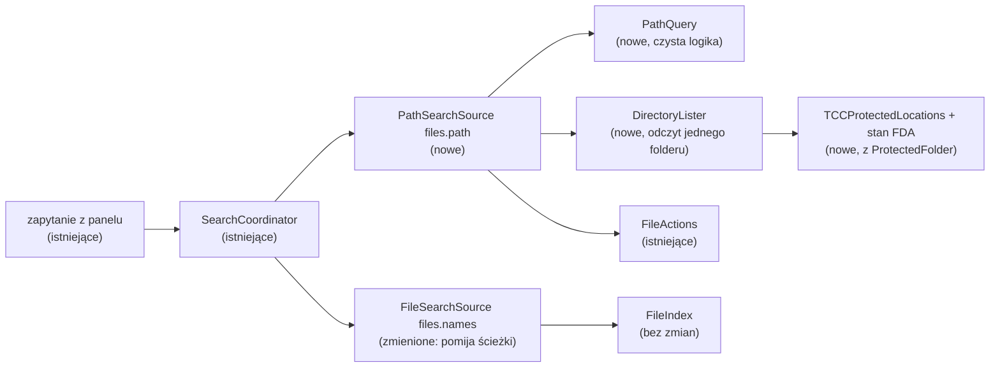
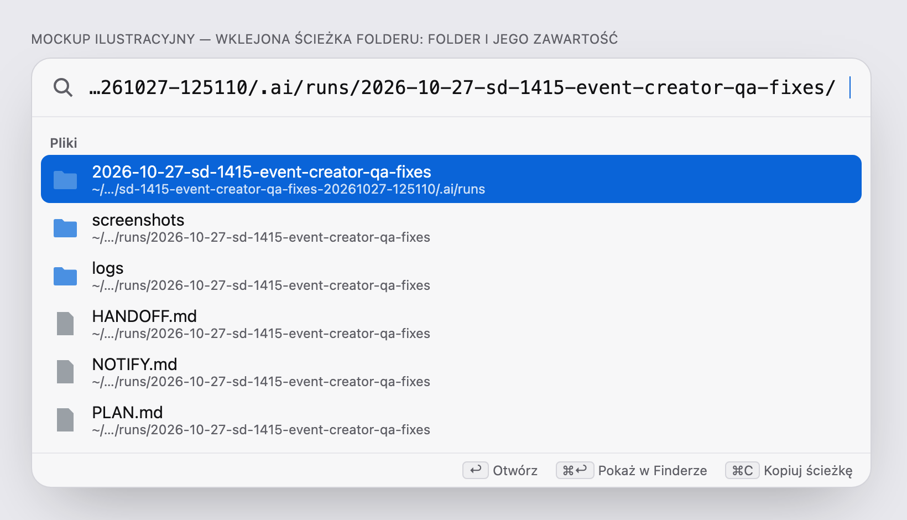
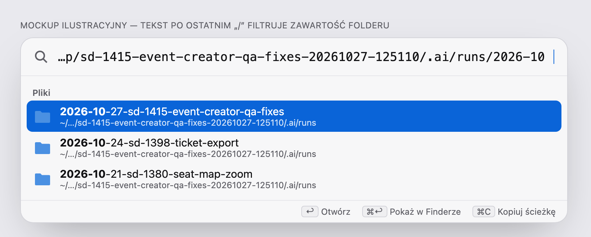
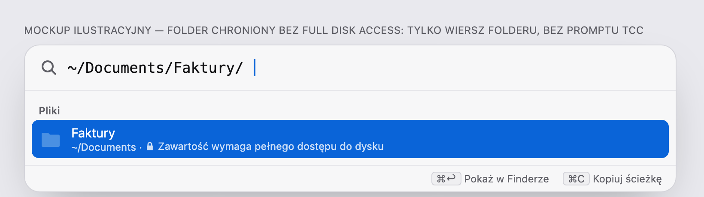

# Wyszukiwanie po ścieżce (path mode)

> Status: **projekt** — Open Questions rozstrzygnięte autonomicznymi domyślnymi (sekcja niżej), czeka na review. Proza po polsku, identyfikatory po angielsku (jak spec MVP).

## 📝 TLDR
Użytkownik wkleja do Pounce pełną ścieżkę folderu, który na pewno istnieje (np. `~/Projects/Stage24/ng-stage24/.ai/tmp/…/.ai/runs/2026-10-27-sd-1415-event-creator-qa-fixes/`), i nie dostaje żadnego wyniku. Dziś wyszukiwanie plików dopasowuje zapytanie tylko do **nazwy** pojedynczego elementu w indeksie, a foldery zaczynające się od kropki w ogóle do indeksu nie trafiają. Proponowane przyszłe zachowanie: zapytanie zaczynające się od `/` albo `~` przełącza `FilesPlugin` w **tryb ścieżki** — Pounce czyta wskazany folder prosto z dysku (bez indeksu), pokazuje sam folder i jego zawartość, a tekst po ostatnim `/` filtruje listę. Zmiana zostaje w `FilesPlugin`: bez zmian kontraktu `PounceKit`, ustawień, indeksu i danych.

## 📝 Problem Statement
Diagnoza zgłoszonego przypadku (sprawdzona w kodzie i na dysku; ścieżka istnieje):

1. **Foldery ukryte nie są indeksowane.** `IgnoreRules.excludes` (`Sources/FilesPlugin/IgnoreRules.swift`) odrzuca każdy element o nazwie zaczynającej się od `.`, dopóki `plugins.files.includeHidden` jest `false` (domyślnie). Zgłoszona ścieżka przechodzi przez `.ai` **dwa razy**, więc skaner nie wchodzi ani do niej, ani do niczego pod nią. Nawet zapytanie po samej nazwie `2026-10-27-sd-1415-event-creator-qa-fixes` nic nie znajdzie.
2. **Pełna ścieżka nigdy nie pasuje do nazwy.** `FileSearch` porównuje zapytanie z nazwą jednego węzła (`NameStore.name`), a `ByteMatcher.match` od razu odrzuca zapytanie dłuższe od nazwy (`q <= n`). Zapytanie `/Users/…/runs/…/` ma ponad 150 znaków, więc nie przejdzie dla żadnego pliku, także po włączeniu ukrytych.

Skutek dla użytkownika: Pounce wygląda na zepsuty („na pewno tam jest, a nie ma nic”), bo ani nie pokazuje wyniku, ani nie mówi dlaczego. Ścieżki trafiają do schowka z terminala, logów, raportów agentów i PR-ów, więc wklejenie ścieżki to naturalny sposób na „otwórz mi to”. Spotlight też tego nie obsługuje; Alfred tak (patrz Research).

Włączenie ukrytych w indeksie nie rozwiązuje problemu (punkt 2) i kosztuje: `.git`, `.venv`, `.next`, `.ai/tmp` z całymi worktree potrafią podwoić indeks (budżet pamięci 150 MB, `docs/perf.md`).

## 📝 Proposed Solution
**Tryb ścieżki w `FilesPlugin`:** nowe źródło `PathSearchSource` (`files.path`) obok `FileSearchSource` (`files.names`).

- **Wyzwalacz:** zapytanie (`NormalizedQuery.raw` po obcięciu spacji na początku i końcu — `raw` nie jest obcinane przez `TextNormalizer`) zaczyna się od `/`, `~/` albo jest równe `~`. Wtedy `FileSearchSource` zwraca pustą listę, a `PathSearchSource` odpowiada; dla każdego innego zapytania jest odwrotnie.
- **Podział:** `PathQuery` dzieli zapytanie na **folder** (wszystko do ostatniego `/`, z rozwiniętym `~`, ustandaryzowane) i **filtr** (tekst po ostatnim `/`). `~/Projects/ng-st` → folder `~/Projects`, filtr `ng-st`; `…/runs/2026-10-27-sd-1415-event-creator-qa-fixes/` → folder to cała ścieżka, filtr pusty.
- **Źródło prawdy to dysk, nie indeks.** Folder jest czytany na żywo, jeden poziom, przy każdym zapytaniu (z małym cache na ostatni folder). Dzięki temu działają foldery ukryte, wykluczone (`node_modules`, `DerivedData`) i spoza korzeni indeksu (`/opt`, `/Volumes/…`), a wynik zawsze odpowiada stanowi dysku.
- **Wyniki:**
  1. pierwszy wiersz to sam folder (gdy filtr jest pusty) albo — gdy filtr dokładnie odpowiada istniejącemu elementowi — ten element;
  2. potem zawartość folderu dopasowana do filtra przez istniejący `FuzzyMatcher` (te same tiery co wszędzie); przy pustym filtrze — foldery przed plikami, alfabetycznie (szczegóły kolejności w Architecture → Ranking).
  Akcje są te same co w wynikach plików (`FileActions`: Return otwiera, ⌘Return pokazuje w Finderze, ⌘C kopiuje ścieżkę, ⌘⇧C kopiuje plik), więc historia użycia `files:<ścieżka>` w `ranking.sqlite` działa bez zmian.
- **Ukryte w trybie ścieżki:** foldery wpisane w ścieżce nigdy nie są filtrowane (użytkownik podał je jawnie). Ukryte elementy *wewnątrz* listowanego folderu są pokazywane, gdy włączono `includeHidden` albo filtr zaczyna się od `.` (jak w powłoce).

**Poza zakresem, osobny spec później:** Tab/⇧Tab do wchodzenia w foldery i wychodzenia z nich (wymaga addytywnego pola `Candidate.completion` w `PounceKit`, obsługi klawiszy w powłoce i wpisu w `BACKWARD_COMPATIBILITY.md` §5). Tryb ścieżki działa bez tego: wystarczy dopisać `/` i nazwę.

**Odrzucone alternatywy:**
- **Domyślnie indeksować ukryte:** nie naprawia dopasowania pełnej ścieżki, zwiększa indeks i zmienia domyślne zachowanie chronione w `BACKWARD_COMPATIBILITY.md` §3.
- **Dopasowanie do pełnej ścieżki w indeksie** (fragmenty typu `stage24/runs`): sensowne, ale to osobna zdolność z innym kosztem (ścieżki nie są przechowywane jako tekst, `NameStore` trzyma ~80 B na wpis, a matcher musiałby iść po przodkach) i nie pomaga dla folderów spoza indeksu. Poza zakresem (A1).
- **Otwieranie ścieżki tylko akcją „Go to Folder”** bez listy: prostsze, ale nie pozwala zobaczyć ani wybrać pliku w środku, a o to chodzi w zgłoszeniu.

## ✅ Resolved assumptions (autonomous defaults)

| # | Pytanie | Przyjęta odpowiedź | Uzasadnienie |
|---|---|---|---|
| A1 | Czy w tym samym specu robić dopasowanie fragmentów ścieżek w indeksie (`stage24/runs`) albo zmianę domyślnego indeksowania ukrytych? | **Nie** — jeden spec = tryb ścieżki. Fragmenty ścieżek w indeksie i domyślne ukryte to osobne decyzje na później. | Każda z tych zdolności działa bez pozostałych; tryb ścieżki sam naprawia zgłoszony przypadek bez zmiany indeksu ani ustawień. |
| A2 | Co włącza tryb ścieżki? | Zapytanie zaczynające się od `/`, `~/` albo równe `~`. Ścieżki względne (bez wiodącego `/`) — nie. | Jednoznaczne, nie koliduje z nazwami aplikacji ani plików (nazwa nie zawiera `/`); tak samo robi Alfred. |
| A3 | Skąd lista: indeks czy dysk? | Dysk, jeden poziom, czytany na żywo poza main actorem. | Indeks celowo pomija ukryte i wykluczone foldery — dokładnie te z problemu; odczyt jednego folderu mieści się w budżecie. |
| A4 | Czy reguły wykluczeń indeksu (`node_modules`, `~/Library`, wzorce użytkownika) działają w trybie ścieżki? | **Nie.** Ukryte elementy wewnątrz folderu tylko gdy `includeHidden` albo filtr zaczyna się od `.`. | Użytkownik wpisał ścieżkę jawnie; wykluczenia istnieją dla rozmiaru indeksu, nie dla prywatności. Łatwe do odwrócenia. |
| A5 | Miejsca chronione TCC bez Full Disk Access? | **Nie czytamy ich zawartości** (żadnych promptów TCC): Biurko, Dokumenty, Pobrane, iCloud Drive, inne woluminy (`/Volumes/*` poza woluminem startowym — dyski wymienne i sieciowe) oraz `~/Library/Containers` i `~/Library/Group Containers` (dane innych aplikacji). Pokazujemy tylko wiersz folderu z podpisem „Zawartość wymaga pełnego dostępu do dysku” i akcją „Pokaż w Finderze”. Z FDA — czytamy. | Spec MVP gwarantuje brak promptów TCC; Finder ma własny dostęp, więc użytkownik i tak dojdzie do plików. |
| A6 | Tab/⇧Tab do wchodzenia w foldery? | **Nie w tym specu** — osobny spec później. | Zmienia kontrakt `PounceKit` (addytywnie), obsługę klawiszy w powłoce i chronione zachowanie klawiszy (§5); działa niezależnie od trybu ścieżki, więc może mieć własną decyzję. |
| A7 | Co, gdy folder z zapytania nie istnieje? | Bez wyników z trybu ścieżki; gdy istnieje rodzic, filtr działa w rodzicu (np. literówka w ostatnim segmencie). | Najmniej powierzchni; zwykła pusta lista jak przy braku dopasowań. Brak osobnego komunikatu (wymagałby statusu per zapytanie, którego kontrakt nie ma). |
| A8 | Duże foldery? | Czytamy maksymalnie 20 000 wpisów i oddajemy limit źródła (50, `SearchCoordinator.sourceLimit`); powłoka pokazuje 20 na sekcję (`sectionLimit`), więc resztę zawęża filtr. | Mieści się w budżecie 150 ms i w pamięci; bez nowej powierzchni UI (np. „pokaż więcej”). |
| A9 | Czy tryb ścieżki zasila skojarzenia zapytań (`query_association`)? | **Nie** — akcje z trybu ścieżki zapisują użycie bez prefiksu zapytania (`queryPrefix: nil`); frecency elementu działa jak zwykle. | Każde zapytanie-ścieżka ma ten sam 4-znakowy prefiks (`/use`, `~/pr`), więc skojarzenia mieszałyby niezwiązane foldery w całym rankingu plików. |

## 📝 Research
- **Alfred** (zamknięty): „File Navigation” — wpisanie `/` lub `~` przełącza w przeglądanie folderów listowanych z dysku, nie z indeksu; Tab uzupełnia ścieżkę. To główny wzorzec tego specu; uzupełnianie Tab zostaje na osobny spec (A6).
- **Raycast** (zamknięty): „Search Files” szuka po nazwach w swoim indeksie; przeglądanie folderów jest w osobnym widoku „Browse”/rozszerzeniach. Wniosek: nie budujemy osobnego trybu panelu — jedno pole i sekcja Pliki wystarczą.
- **Spotlight:** nie interpretuje ścieżek w zapytaniu; „Go to Folder” (⌘⇧G) to funkcja Findera. Finder ma uzupełnianie Tab — użytkownicy macOS znają ten gest.
- **Powłoki i fzf:** ukryte pliki pokazywane dopiero, gdy wzorzec zaczyna się od kropki — przyjęte w A4.

Czego nie kopiujemy: osobnego „trybu przeglądarki plików” z podglądem (Alfred, Raycast) — to nowa powierzchnia UI bez dowodu potrzeby.

## 📝 Architecture

Zmiana zostaje w `FilesPlugin`; indeks, skaner i snapshot się nie zmieniają.

- **`PathQuery`** (nowy, czysty, bez I/O): `static func parse(_ raw: String, home: String) -> PathQuery?` → `folder: String`, `filter: String` (surowy), `normalizedFilter: String`. Używa `query.raw`, bo system plików rozróżnia wielkość liter na woluminach case-sensitive, a `normalized` jest małymi literami. Rozwija `~` przez `PathText.expand` z `home` pluginu (w QA: `plugins.files.qaHome`).
- **`DirectoryLister`** (nowy): czyta jeden folder — `getattrlistbulk` przez wydzieloną z `BulkScanner` funkcję czytającą jeden katalog (nazwa, typ, flaga `UF_HIDDEN`, czas modyfikacji), żeby nie mieć drugiej implementacji odczytu. Nie wchodzi głębiej, nie podąża za dowiązaniami poza samym folderem z zapytania. Zwraca `.listed([Entry])`, `.protected` (miejsce chronione, brak FDA — **bez próby odczytu**), `.denied` (`EPERM`/`EACCES`, np. `~/Library/Mail` bez FDA), `.missing`.
- **`TCCProtectedLocations`** (nowy, czysty): jedna lista miejsc, których bez FDA nie wolno otworzyć — ścieżki `ProtectedFolder`, `/Volumes/*` poza woluminem startowym, `~/Library/Containers`, `~/Library/Group Containers` — z funkcją `requiresFullDiskAccess(_ path:, home:) -> Bool` dla folderu i wszystkiego pod nim. Ścieżka jest najpierw ustandaryzowana i rozwiązana z dowiązań, żeby dowiązanie do `~/Documents` nie omijało ochrony. Cache: ostatni folder + jego `mtime`, żeby kolejne litery filtra nie czytały dysku ponownie.
- **`PathSearchSource`** (nowy `SearchSource`, `files.path`): wywołuje `PathQuery` i `DirectoryLister` na `Task` poza main actorem, dopasowuje filtr `FuzzyMatcher`em do `NormalizedText(name)`, buduje `Candidate` tak jak `FileSearchSource.candidate` (item key `files:<ścieżka>`, podpis = folder nadrzędny z `~`, ikona elementu). Dla `.protected` i `.denied` zwraca tylko wiersz folderu z podpisem o braku dostępu.
- **`FileSearchSource`:** na początku `search` zwraca `[]`, gdy `PathQuery.parse` rozpoznaje ścieżkę.
- **`FilesPlugin.searchSources`:** `[FileSearchSource, PathSearchSource]`. Sekcje są per źródło (`<plugin>:<source>`, `SearchCoordinator`), ale oba źródła nigdy nie odpowiadają na to samo zapytanie, więc użytkownik widzi jedną sekcję Pliki. `app.sectionOrder` trzyma identyfikatory pluginów, więc się nie zmienia.
- **Ranking:** powłoka sortuje sekcję przez `Ranker.rank` — tier, potem `match.score + boost + log2(1 + frecency) + skojarzenie`, potem tytuł. Kolejność trybu ścieżki jest zakodowana tak, żeby przetrwała to sortowanie:
  - wiersz folderu z zapytania: tier `.exact`, score 1 — zawsze pierwszy;
  - pusty filtr: dzieci w tierze `.prefix` (`FuzzyMatcher` zwraca `nil` dla pustego zapytania, więc `MatchResult` ustawia źródło), score 0,6 dla folderów i 0,5 dla plików; równe score sortuje tytuł, więc alfabetycznie. Frecency może podnieść często używany element w obrębie tieru — to zamierzone (jak wszędzie w Pounce);
  - z filtrem: `MatchResult` z `FuzzyMatcher` na nazwie, bez dodatkowego `boost` za folder.
  Akcje trybu ścieżki zapisują użycie z `queryPrefix: nil` (A9) — `FileActions` dostaje parametr `recordsQueryPrefix: Bool` (domyślnie `true`, więc wyniki z indeksu działają jak dziś).

## 📝 API Contracts
- **Bez zmian kontraktów:** żadnych nowych typów w `PounceKit`, kluczy ustawień, migracji ani zmian `index.snapshot`. Nowy `SourceID` `files.path` jest wewnętrzny dla pluginu.
- **Item key:** wyniki trybu ścieżki używają istniejącego `files:<absolute path>` — ta sama historia użycia co z indeksu.

## 📝 UI/UX
Brak nowych ekranów. Zmienia się tylko zawartość sekcji Pliki dla zapytań-ścieżek.

| Stan | Co widzi użytkownik |
|---|---|
| Ścieżka folderu z `/` na końcu | Wiersz folderu (zaznaczony), pod nim zawartość: foldery, potem pliki, alfabetycznie; do 20 wierszy, dalej zawęża filtr. |
| Ścieżka + początek nazwy (`…/runs/2026-10`) | Zawartość `runs` dopasowana do `2026-10`, najlepsze dopasowanie zaznaczone. |
| Pełna ścieżka pliku | Ten plik jako pierwszy wynik; Return go otwiera. |
| Miejsce chronione bez FDA (A5) | Tylko wiersz folderu, podpis „Zawartość wymaga pełnego dostępu do dysku”; ⌘Return pokazuje go w Finderze. |
| Brak uprawnień (`EPERM`) | Tylko wiersz folderu, podpis „Brak dostępu do zawartości”. |
| Ścieżka nie istnieje | Brak wyników z trybu ścieżki (jak dziś przy braku dopasowań). |

Dostępność: wiersze mają te same etykiety VoiceOver co wyniki plików (nazwa + folder). Podpisy o braku dostępu idą przez String Catalog (`en` + `pl`).

Propozycja wizualna (ilustracyjna, nie zaakceptowany projekt; źródła HTML obok PNG):

## 📝 Edge Cases & Failure Scenarios
- **Wielkość liter:** folder czytany ze ścieżki surowej; gdy nie istnieje, a wolumin jest case-insensitive, system i tak go znajdzie. Filtr dopasowany bez wielkości liter (`FuzzyMatcher`).
- **Spacje i znaki specjalne w ścieżce:** obcinane są tylko spacje na początku i końcu całego zapytania; spacje w środku są częścią ścieżki. Cudzysłowy wokół wklejonej ścieżki (`'…'`, `"…"`) są zdejmowane, a `\ ` zamieniane na spację (ścieżki kopiowane z terminala).
- **Dowiązania symboliczne:** folder z zapytania może być dowiązaniem (jest rozwiązywany jak w Finderze); elementy w środku pokazywane z typem celu, bez wchodzenia głębiej.
- **Wolny wolumin (sieć, uśpiony dysk):** odczyt przekracza budżet 150 ms → `PluginHost` odrzuca wynik źródła, reszta panelu działa. Odczyt jest anulowany przy następnym znaku (`Task` sprawdza anulowanie co 1 000 wpisów).
- **Folder z > 20 000 wpisów:** czytane jest pierwsze 20 000 (A8); filtr zawęża w tej puli. Zapisane w `docs/perf.md` jako znane ograniczenie.
- **Element usunięty między odczytem a akcją:** `FileActions.requireExisting()` zwraca `FileActionError.missing` jak dziś.
- **„Ostatnio używane” przy pustym zapytaniu:** `FileSearchSource` pokazuje tylko elementy obecne w indeksie (`snapshot.locate`), więc plik otwarty z trybu ścieżki w ukrytym lub wykluczonym folderze nie pojawi się na tej liście, mimo że jego użycie jest zapisane. Znane ograniczenie, zapisane w `docs/qa.md`; zmiana listy „ostatnio używanych” to osobna decyzja.
- **QA i testy:** w trybie `--qa…` `home` pluginu wskazuje fikcyjny folder, więc `~` rozwija się do fixture; testy używają tymczasowych katalogów.
- **Prywatność:** zapytania-ścieżki nie są logowane (jak zawartość schowka); `os_log` tylko z liczbą wpisów i czasem, `privacy: .public` wyłącznie dla liczb.

## 📝 Risks & Impact Review
- **TCC:** największe ryzyko to przypadkowy prompt. Ochrona: `DirectoryLister` sprawdza `TCCProtectedLocations` i stan FDA **przed** odczytem; test jednostkowy dla każdego miejsca z listy, jego podfolderów i dowiązania prowadzącego do niego. Lista nie jest dowodem kompletności (Apple dodaje kategorie TCC między wersjami macOS), więc QA ręcznie sprawdza też `~/Pictures/Photos Library.photoslibrary`, `/Volumes/<pendrive>` i `~/Library/Containers/<app>` bez FDA; każde nowe miejsce z promptem dopisujemy do listy.
- **Ranking:** kolejność trybu ścieżki zależy od tierów i score opisanych w Architecture; test przez prawdziwy `Ranker` (z frecency) pilnuje, że wiersz folderu zostaje pierwszy, a foldery idą przed plikami przy braku historii.
- **Wydajność:** odczyt jednego folderu to jedno `open` + kilka `getattrlistbulk`; budżet p95 < 20 ms dla folderu z 1 000 wpisów (nowy wiersz w `docs/perf.md`).
- **Brak zmian danych:** żadnej migracji, snapshotu ani ustawień — wycofanie fazy 1 to usunięcie źródła z `searchSources`.

## 📋 Phasing
Jedna faza, jeden branch `feat/` i jedno PR: wklejenie albo wpisanie ścieżki pokazuje folder i jego zawartość, z filtrem po ostatnim segmencie. Sama naprawia zgłoszony przypadek. Tab/⇧Tab — osobny spec (A6).

## 📋 Implementation Plan
1. **`PathQuery`** w `Sources/FilesPlugin/PathQuery.swift`: obcięcie `raw`, wyzwalacz (A2), podział na folder i filtr, rozwinięcie `~`, zdjęcie cudzysłowów i `\ `. Testy w `Tests/FilesPluginTests/PathQueryTests.swift` (m.in. zgłoszona ścieżka, `~`, `~/`, `/`, końcowy `/`, ścieżka względna → `nil`, spacje w środku, spacje na końcu).
2. **`TCCProtectedLocations`** (czysty): lista z A5 i `requiresFullDiskAccess`. Testy dla każdego miejsca, podfolderu, woluminu startowego (nie chroniony) i ścieżki niestandaryzowanej (`~/Documents/../Documents`).
3. **Odczyt jednego folderu:** wydzielić z `BulkScanner` funkcję czytającą jeden katalog i zbudować na niej `DirectoryLister` (stany `.listed/.protected/.denied/.missing`, limit 20 000, cache ostatniego folderu po `mtime`, anulowanie). `BulkScanner` używa tej samej funkcji — jego testy muszą przejść bez zmian. Testy na tymczasowych katalogach: ukryte, dowiązania (także dowiązanie do miejsca chronionego), brak uprawnień (`chmod 000`), miejsce chronione bez FDA nie jest otwierane (port do sprawdzenia, że nie było odczytu).
4. **`PathSearchSource`** (`files.path`), zmiana `FileSearchSource` (zwraca `[]` dla ścieżek), `FileActions.recordsQueryPrefix`; rejestracja w `FilesPlugin.searchSources`. Testy: kolejność przez prawdziwy `Ranker` z frecency (wiersz folderu pierwszy, foldery przed plikami bez historii), filtr, ukryte wg A4, wiersz dla `.protected`/`.denied`, `FileSearchSource` milczy dla ścieżek, item key `files:<ścieżka>`, zapis użycia bez prefiksu zapytania (A9).
5. **Teksty i dokumentacja:** dwa podpisy w `Resources/Localizable.xcstrings` (`en` + `pl`, `StringCatalogTests`), wiersz budżetu w `docs/perf.md`, wiersz „File search plugin” w `AGENTS.md` (tryb ścieżki), opis w `docs/qa.md`. QA: debug app z `--qa…`, ścieżka do fixture z folderem `.ai/runs/…`, zrzuty w trybie jasnym i ciemnym.
