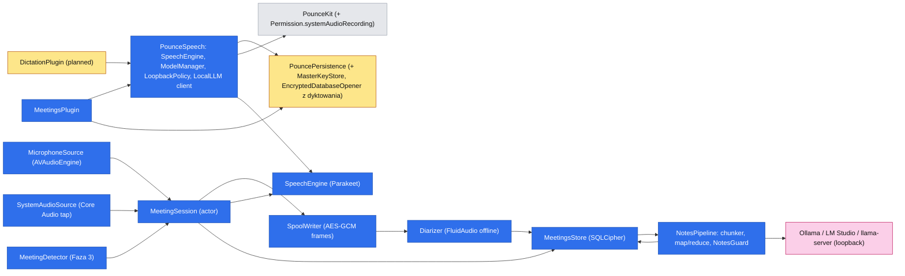
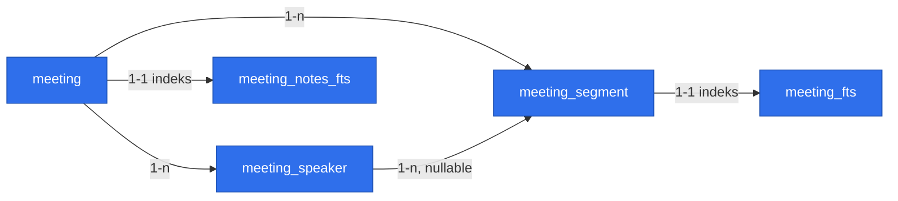

# Transkrypcja spotkań i notatki (Meeting Notes)

> Status: **projekt** — odpowiedzi na Open Questions przyjęte 2026-11-03, czeka na review. Proza po polsku, identyfikatory po angielsku (jak spec MVP i spec dyktowania). Spec **zależy od** `2026-11-01-voice-dictation.md` (Fazy 1–3, patrz Phasing); nic z niego nie istnieje jeszcze w kodzie.

## 📝 TLDR
Użytkownik chce nagrywać spotkania (online i na żywo, po polsku z angielskimi terminami) i dostawać transkrypcję z podziałem na mówców oraz uporządkowane notatki (podsumowanie, decyzje, zadania, otwarte pytania), bez wysyłania audio ani tekstu poza Maca. Dziś Pounce nie obsługuje mowy, a spec dyktowania nie jest zaimplementowany. Proponowane przyszłe zachowanie: nowy plugin `MeetingsPlugin` nagrywa mikrofon i dźwięk systemowy pod skrótem (lub po podpowiedzi o wykrytym spotkaniu), transkrybuje **lokalnym modelem mowy w trakcie spotkania**, po jego końcu rozpoznaje mówców **lokalną diaryzacją**, a notatki robi **lokalnym serwerem LLM użytkownika** (loopback), kawałkami, z weryfikacją cytatów. Wynik trafia do zaszyfrowanej biblioteki i może być skopiowany lub zapisany jako Markdown.

## ✅ Rozstrzygnięte pytania (2026-11-03)

| # | Decyzja | Skutek dla projektu |
|---|---|---|
| Q1 | Jeden spec, fazy: transkrypt, potem notatki. | Fazy 1 i 2; Faza 3 (podpowiedź) wydzielona, bo ma osobne ryzyko prywatności. |
| Q2 | Mikrofon + dźwięk systemowy. | Core Audio process tap, nowe uprawnienie „Nagrywanie dźwięku systemu”, dwa tory audio. |
| Q3 | Pełna diaryzacja („Mówca 1, 2, …”), nie tylko Ja/Inni. | Offline diaryzacja po spotkaniu na zapisanym audio; Ja/Inni zostaje jako awaryjny zapas. |
| Q4 | Osobny `MeetingsPlugin` + wspólny target po Fazach 1–2 dyktowania. | Nowy target `PounceSpeech` (Faza 0), zmiana reguły zależności w `AGENTS.md`. |
| Q5 | Zaszyfrowana biblioteka + „Kopiuj Markdown” i „Zapisz .md”. | `meetings.sqlite` (SQLCipher), list mode, okno spotkania. |
| Q6 | Ręcznie **oraz** podpowiedź po wykryciu spotkania. | Faza 3: wykrywanie użycia mikrofonu przez inne aplikacje (domyślnie wyłączone, opt-in). |
| Q7 | Tymczasowy plik audio, kasowany po udanym przetworzeniu. | Zaszyfrowany spool na dysku, odzyskiwanie po awarii; to też warunek offline diaryzacji. |
| Q8 | Jeden stały szablon notatek. | Bez wyboru szablonów i własnych promptów (poza zakresem). |

**Założenia przyjęte bez pytania** (zgodne z dyktowaniem; do zmiany na życzenie): polski i angielski z autodetekcją, także w jednym zdaniu; model mowy pobierany po zgodzie albo ze wskazanego folderu; LLM wyłącznie przez lokalny endpoint zgodny z OpenAI na loopback; bez chmury, kont i wbudowanego LLM; spotkanie do 3 godzin; brak wklejania do innych aplikacji (więc brak Accessibility).

## 📝 Problem Statement
- Notowanie podczas spotkania odciąga uwagę; po spotkaniu decyzje i zadania szybko się zacierają.
- Narzędzia w chmurze (Otter, Fireflies) wysyłają audio na serwer, co przy rozmowach klienckich jest niedopuszczalne. Lokalne (MacWhisper, superwhisper) dają głównie transkrypt; lokalne z notatkami (Meetily, Hyprnote) wysyłają całość do jednego wywołania LLM albo wymagają zewnętrznego API, a polski jest ich słabą stroną (stan na 2026-11-03, wg opisów projektów, nie przeglądu kodu).
- Godzinne spotkanie to ~9 tys. słów (~24 tys. tokenów po polsku), czyli więcej niż domyślne okno kontekstu wielu lokalnych modeli. Samo „wklej transkrypt do LLM” zawiedzie po cichu (obcięcie).
- Pounce (po dyktowaniu) będzie miał silnik mowy, klienta lokalnego LLM, zaszyfrowany magazyn, list mode z podglądem i onboarding pluginów, więc spotkania to nowe zastosowanie tych klocków plus trzy nowe problemy: dwa źródła dźwięku, godziny zamiast minut i rozpoznawanie mówców.

## 📝 Research (stan na 2026-11-03)

**Dźwięk systemowy (wg Apple i opisów społeczności; do potwierdzenia w kroku 1.5):**
- Core Audio process tap (`CATapDescription` + `AudioHardwareCreateProcessTap` + agregat HAL), macOS 14.2+, a Pounce celuje w macOS 26. Wymaga klucza `NSAudioCaptureUsageDescription`; pierwszy start nagrywania wywołuje monit „System Audio Recording” ([Apple: Capturing system audio with Core Audio taps](https://developer.apple.com/documentation/coreaudio/capturing-system-audio-with-core-audio-taps.md)).
- **Brak publicznego API do sprawdzenia ani poproszenia o to uprawnienie**, a przy odmowie API zwracają sukces z buforami samych zer ([AudioCap](https://github.com/insidegui/AudioCap), [opis problemu](https://dev.to/nickdelv/2000-buffers-of-nothing-3i8)). To rzutuje na UX: nie da się pokazać stanu w Uprawnieniach, potrzebny jest test dźwiękiem (sekcja Architecture).
- ScreenCaptureKit odrzucony: wymaga szerszego uprawnienia „Nagrywanie ekranu”, które użytkownik słusznie odbiera jako zbyt szerokie dla samego dźwięku.

**Diaryzacja ([FluidAudio](https://docs.fluidinference.com/diarization/offline-pipeline.md), dane producenta, niezależnie niezweryfikowane):**

| Tryb | DER | Szybkość | Uwagi |
|---|---|---|---|
| Offline (pyannote CoreML, segmentacja + klastrowanie VBx) | ~15% (AMI) | ~122× czasu rzeczywistego | najdokładniejszy, wymaga całego nagrania → **wymusza audio na dysku (Q7)** |
| Streaming | 26,2% (pasma 5 s) | ~223× | etykiety na żywo, gorsza jakość |
| Sortformer | 31,7% (AMI SDM) | tylko streaming | maks. 4 mówców; gorszy przy 5+ osobach |

Wniosek: **offline po spotkaniu**; etykiety nie są potrzebne na żywo (transkrypt na żywo nie jest w zakresie). Jakość dla polskiego jest nieznana (modele trenowane głównie na angielskim), więc ocenę robi dogfooding (krok 1.13).

**Notatki z długich spotkań:** [Hyprnote](https://github.com/LopeWale/hyprnote) i Meetily podają cały transkrypt + szablon do jednego wywołania zewnętrznego lub lokalnego LLM; z dostępnych opisów nie wynika, czy kawałkują długie nagrania. Przejmujemy ideę „szablon + kontekst spotkania”, ale **kawałkujemy (map → reduce)** i **weryfikujemy cytaty** — tego nie widać w tych projektach.

**Wykrywanie spotkania:** `kAudioDevicePropertyDeviceIsRunningSomewhere` mówi tylko, że ktoś używa mikrofonu, i bywa zawodne dla urządzeń Bluetooth ([wątek Apple](https://developer.apple.com/forums/thread/741026)). Do poznania *która* aplikacja używa wejścia służą obiekty procesów Core Audio (`kAudioHardwarePropertyProcessObjectList`, `kAudioProcessPropertyIsRunningInput`, `…BundleID`; macOS 14.2+) — **do potwierdzenia w kroku 3.1**, bo wyszukiwanie nie zwróciło dokumentacji tych właściwości.

**Czego nie robimy (złożoność do pominięcia):** transkrypt na żywo w oknie, boty dołączające do spotkania, integracje z kalendarzem, konta i synchronizacja, wiele szablonów, własne prompty, transkrypcja istniejących plików audio, wideo, automatyczne wysyłanie notatek.

## 📝 Proposed Solution
Nowy wewnętrzny plugin `MeetingsPlugin` (`PluginID` `meetings`, nowy target, jedna linia w `PluginRegistry`). Przepływ:

1. **Start** (skrót ⌃⌥M, menu paska albo „Nagrywaj” z podpowiedzi, Faza 3): HUD (pigułka z czasem i poziomami obu torów), blokada uśpienia systemu na czas nagrania, utworzenie wpisu `meeting` w stanie `recording`.
2. **W trakcie:** dwa tory (`mic`, `system`) trafiają jednocześnie do (a) **zaszyfrowanego pliku tymczasowego** (spool) i (b) VAD + silnika mowy. Segmenty tekstu z czasami zapisują się do bazy **na bieżąco**, więc awaria traci co najwyżej ostatnie sekundy. Transkrypcji nie widać na żywo.
3. **Stop** (skrót, menu, ✕ w HUD, „Zakończ” w podpowiedzi końca spotkania): domknięcie ogona transkrypcji, **offline diaryzacja** z pliku tymczasowego, przypisanie mówców do segmentów, status `ready` (transkrypt gotowy), **kasowanie audio**.
4. **Notatki** (Faza 2): w tle, kawałkami przez lokalny LLM, status widoczny w bibliotece; użytkownik nie czeka przy HUD.
5. **Biblioteka:** list mode „Spotkania” (podgląd notatek lub transkryptu) oraz małe okno spotkania (transkrypt z czasami, zmiana nazw mówców, tytuł, usuwanie).

**Alternatywy, które przegrały:**
- **Tryb w `DictationPlugin`** (Q4 b): jeden model i mniej kodu, ale plugin dyktowania zyskałby bibliotekę, diaryzację, dwa źródła dźwięku i długie sesje; wyłączenie dyktowania wyłączałoby spotkania.
- **Kopia kodu** (Q4 c): szybciej, ale dwie implementacje klienta LLM i `LoopbackPolicy` (kod bezpieczeństwa) do utrzymania.
- **Diaryzacja strumieniowa / Sortformer:** etykiety na żywo nie są potrzebne, a DER jest dwukrotnie gorszy; offline daje lepszy wynik za cenę audio na dysku, które i tak wybrał Q7.
- **ScreenCaptureKit do dźwięku:** szersze uprawnienie niż potrzeba (Research).
- **Jedno wywołanie LLM na cały transkrypt:** zawodzi po cichu przy małym oknie kontekstu (Research); kawałkowanie to obowiązkowa część projektu, nie optymalizacja.
- **Domyślne wykrywanie spotkań włączone:** monitorowanie, które aplikacje używają mikrofonu, to wrażliwa funkcja; domyślnie wyłączona i tylko po zgodzie w onboardingu.

## 📝 Architecture

Wniosek: spotkania nie wymagają zmiany `PounceApp` poza rejestracją i kontraktem uprawnień; cała logika siedzi w `MeetingsPlugin`, a współdzielony kod w nowej warstwie `PounceSpeech`, od której zależą oba pluginy (dyktowanie jest planowane, nie istnieje). **Reguła zależności z `AGENTS.md` zyskuje jedną warstwę:** `plugins → PounceSpeech → PouncePersistence / PounceCore → PounceKit`; `PounceSpeech` nie importuje żadnego pluginu, a pluginy dalej nie importują siebie. To zmiana architektury wymagająca zgody właściciela (Risks).

**Wyjątek od „pluginy nie sięgają po globalne obiekty”** (wzór ze specu dyktowania): `AVAudioEngine`, Core Audio (tap, agregat), `URLSession`, własny `NSPanel`/`NSWindow` i nasłuch procesów audio są używane w pluginie, ale każde za **wewnętrznym** protokołem wstrzykiwanym w inicjalizatorze: `AudioSource` (testy: plik WAV), `ProcessAudioObserver` (testy: skryptowe zdarzenia), `HUDPresenter`, `HTTPTransport` (testy: `URLProtocol`), `SleepAssertion` (testy: rejestrujący). Do `PounceKit` nie trafiają, bo korzysta z nich jeden plugin.

**Komponenty `PounceSpeech` (przeniesione z planu dyktowania, bez zmiany zachowania):** `SpeechEngine` + `ParakeetEngine` (i `WhisperKitEngine`, jeśli dyktowanie je wdroży), `ModelCatalog` + `ModelManager` (katalog modeli w **`Application Support/Pounce/Models/<model-id>/`**, wspólny dla pluginów, żeby 0,7 GB nie pobierać dwa razy), `LoopbackPolicy`, `HTTPTransport`, klient `/v1/chat/completions` z `EndpointProbe`, `MicrophoneAuthorizer`.

**Komponenty `Sources/MeetingsPlugin/`:**
- `MeetingsPlugin` — manifest (`id: meetings`, `order` po dyktowaniu, `defaultEnabled: false`), `commands`, `onboardingSteps`, `requiredPermissions = [.microphone, .systemAudioRecording]`, `settingsPane()`, `panelModes` (biblioteka), `eraseData()`.
- `MicrophoneSource` — `AVAudioEngine`, konwersja do 16 kHz mono; opcjonalnie voice processing (usuwanie echa; patrz Edge Cases). `SystemAudioSource` — globalny tap wszystkich procesów **z wyłączeniem procesu Pounce**, agregat HAL, konwersja do 16 kHz mono, odtworzenie tapu przy zmianie domyślnego wyjścia (słuchawki Bluetooth), wypełnianie luk ciszą, żeby oś czasu nie dryfowała. Oba tory dostają znacznik czasu z jednego zegara (host time) i są wyrównane do wspólnego początku.
- `SystemAudioSelfTest` — jedyny sposób sprawdzenia uprawnienia (Research): na żądanie (onboarding, Ustawienia → „Test”) tworzy tap **bez** wykluczenia Pounce, odtwarza własny krótki sygnał i sprawdza, czy bufory nie są zerowe. Wynik: „działa” / „brak dźwięku – sprawdź uprawnienie”.
- `MeetingSession` (`actor`) — jedno nagranie: oba tory, VAD (FluidAudio) → `SpeechEngine` (jedna instancja modelu, żądania serializowane przez aktora), zapis segmentów, spool, limity (3 h, miejsce na dysku), blokada uśpienia (`SleepAssertion`). Naraz najwyżej jedna sesja; stan: `idle → recording → finishing → processing → ready`.
- `SpoolWriter` / `SpoolReader` — plik tymczasowy `Plugins/meetings/Spool/<uuid>/{mic,system}.spool` (katalog 0700, pliki 0600, wyłączone z Time Machine i Spotlight). Format: ramki ~1 MB, każda zapieczętowana **`AES.GCM` z CryptoKit** (ten sam prymityw co blob schowka), podklucz HKDF `info = spool` z klucza głównego pluginu; nonce = losowy prefiks sesji + licznik ramki, indeks ramki jako authenticated data (wykrywa przestawienie i obcięcie w środku). Odczyt sekwencyjny; ucięty ogon po awarii daje czytelne ramki do ostatniej pełnej. Audio 16 kHz/16-bit ≈ 115 MB/h na tor, czyli ≤ ~700 MB dla 3 godzin dwóch torów; start odmawia przy mniej niż 1,5 GB wolnego miejsca.
- `Diarizer` (protokół) + `FluidDiarizer` — offline pipeline FluidAudio, uruchamiany **osobno na każdym torze** (mikrofon zbiera wszystkich w pokoju, system zbiera uczestników zdalnych). `SpeakerAssigner` (czysta logika): łączy klastry obu torów w jedną listę mówców, przypisuje segmentom mówców po największym nakładaniu czasu, a „Ja” nadaje dominującemu mówcy toru mikrofonu. **Strażnik pamięci:** jeśli wejście przekracza budżet pamięci diaryzacji (mierzony w kroku 1.7), diaryzacja jest pomijana, a etykiety spadają do „Ja / Inni” według toru (Q3 a jako zapas) z informacją w oknie spotkania.
- `EchoSuppressor` (czysta logika) — gdy użytkownik słucha przez głośniki, mikrofon łapie głos rozmówców i ten sam tekst pojawia się na obu torach. Reguła: segment mikrofonu nakładający się w czasie na segment systemu i podobny tekstowo (znormalizowana odległość ≥ próg) jest odrzucany jako echo; wygrywa tor systemowy. Pierwsza linia obrony to voice processing na wejściu, `EchoSuppressor` łapie resztę.
- `MeetingsStore` + `MeetingKeyStore` (SQLCipher, patrz Data Model), `RetentionJob`, `RecoveryJob` (stany `recording` po awarii → `incomplete`, ponowne przetworzenie ze spoolu).
- `MarkdownExporter` — czysta funkcja `Meeting → String` (tytuł, data, uczestnicy, notatki, transkrypt z czasami).
- `MeetingHUD` — `NSPanel` (`.nonactivatingPanel`), pigułka: czerwona kropka, czas, dwa wskaźniki poziomu (Ja / system), przycisk „Zakończ”; w pierwszych sekundach linia „Poinformuj uczestników, że nagrywasz” (wyłączana w Ustawieniach). Stany błędów: brak dźwięku systemowego przez pierwsze 20 s („Sprawdź uprawnienie nagrywania dźwięku systemu”), mało miejsca, urządzenie odłączone.
- `MeetingWindow` — małe okno SwiftUI: transkrypt (czas, mówca, tekst), zmiana nazwy mówcy i tytułu (zmiana nazwy oznacza notatki jako nieaktualne), „Kopiuj Markdown”, „Zapisz .md…”, „Regeneruj notatki”, usuń.
- **Faza 2:** `TranscriptChunker`, `NotesPipeline`, `NotesGuard`, `NotesPrompt` (zasób wersjonowany) — patrz niżej.
- **Faza 3:** `MeetingDetector` (`ProcessAudioObserver` + `SuggestionPolicy`) — patrz niżej.

**Notatki (Faza 2):**
1. `TranscriptChunker` dzieli transkrypt po granicach wypowiedzi na kawałki ≤ `notesChunkTokens` (domyślnie 3 000 tokenów wejścia, liczone heurystyką z ADR 0004: 2,69 tok/słowo po polsku, 1,17 po angielsku), z kilkoma wypowiedziami nakładki. Mały kawałek mieści się nawet w oknie 8 k, więc działa na słabszym modelu.
2. **Map:** każdy kawałek → lista punktów (podsumowanie, decyzje, zadania z osobą i terminem tylko jeśli padły wprost, pytania), a każdy punkt ma **cytat z transkryptu z czasem**. Wejście w `<transcript>…</transcript>` (jak w dyktowaniu), `temperature: 0`.
3. **Reduce:** złożenie punktów w stały szablon (Podsumowanie · Decyzje · Zadania · Otwarte pytania · Uczestnicy). Gdy suma map nie mieści się w budżecie, dodatkowy poziom reduce (rekurencyjnie).
4. `NotesGuard` odrzuca punkty, których cytatu nie ma w transkrypcie (porównanie rozmyte po normalizacji z `TextNormalizer`), wycina `<think>…</think>`, sprawdza dominujący język; odrzucone punkty są liczone i pokazane („3 punkty bez pokrycia w nagraniu pominięto”). To główna obrona przed zmyślonymi zadaniami i terminami.
5. **Kanarek kontekstu:** przed pierwszym użyciem endpointu (i w „Wypróbuj” w Ustawieniach) plugin wysyła krótki test z markerem na początku i końcu długiego wejścia i sprawdza, czy model go zwrócił; jeśli nie, kontekst jest obcinany (np. domyślne `num_ctx` w Ollama) i Ustawienia podpowiadają zwiększenie kontekstu albo zmniejszenie `notesChunkTokens`. Bez tego cichy błąd psułby notatki bez ostrzeżenia.
6. Transkrypt spotkania jest **niezaufaną treścią** (ktoś może powiedzieć „zignoruj poprzednie instrukcje”): wynik LLM jest tylko wyświetlany jako tekst, plugin nie wykonuje żadnych akcji na jego podstawie, a `NotesGuard` ogranicza szkodę.

**Wykrywanie spotkań (Faza 3):**
- `ProcessAudioObserver` nasłuchuje obiektów procesów Core Audio (zdarzeniowo, bez odpytywania) i zgłasza „proces X (bundle ID) używa wejścia audio”. Proces Pounce jest pomijany (dyktowanie i nagrywanie spotkania nie wywołują podpowiedzi).
- `SuggestionPolicy` (czysta maszyna stanów): podpowiedź tylko gdy (a) włączono `suggestMeetings`, (b) aplikacja z listy znanych (Zoom, Teams, Slack, FaceTime, Webex, Discord; użytkownik może dodać własne) albo przeglądarka z mikrofonem ≥ 10 s ciągle, (c) Pounce nie nagrywa, (d) aplikacja nie jest wyciszona przez „Nie pytaj dla tej aplikacji”, (e) jedna podpowiedź na sesję użycia mikrofonu.
- Podpowiedź to nieaktywujący HUD „Wygląda na spotkanie w {aplikacja}. Nagrywać? ⏎ / Esc” (znika po 15 s). **Nigdy nie startuje nagrywania sama.** Gdy użycie mikrofonu przez tę aplikację kończy się, a oba tory milczą ≥ 60 s, HUD pyta „Zakończyć nagranie?” (też bez automatu).
- Przetwarzana jest wyłącznie metadana „proces + bundle ID + czy używa wejścia”; nic nie jest logowane ani zapisywane poza listą wyciszonych aplikacji.

**Zmiany w shellu (`PounceApp`):** minimalne. `PermissionsReader` obsługuje `.systemAudioRecording` (stan nieokreślony, bo nie da się go odczytać; patrz API Contracts); Ustawienia → Uprawnienia pokazują wiersz z linkiem do panelu prywatności i przyciskiem „Test”; `Info.plist` dostaje `NSAudioCaptureUsageDescription` (en + pl przez `Resources/InfoPlist.xcstrings` ze specu dyktowania); `make-app.sh` bez nowych kroków (zasoby FluidAudio już kopiowane).

**Zależności:**
- `FluidAudio` (planowana w dyktowaniu, Apache-2.0) — przechodzi do `PounceSpeech`; `MeetingsPlugin` dodaje produkt FluidAudio bezpośrednio dla `FluidDiarizer` (jak `ClipboardPlugin` ma GRDB).
- **Modele diaryzacji** (segmentacja + embedding mówców) — nowe wagi; **licencje i atrybucja weryfikowane w ADR 0005 przed jakimkolwiek wdrożeniem** (nie zakładamy zgodności z MIT/CC-BY na podstawie założeń).
- Brak nowych pakietów dla LLM, kryptografii (CryptoKit) i audio (AVFoundation/Core Audio).

**Budżety (nowe wiersze w `docs/perf.md`; liczby oparte na danych producenta i ADR 0004, do zmierzenia w krokach 1.13 i 2.5):**

| Budżet | Cel |
|---|---|
| Od skrótu do widocznego HUD i startu obu torów | < 300 ms (tap i agregat są cięższe niż mikrofon) |
| Transkrypcja w trakcie (oba tory, model rezydentny) | nadąża z czasem rzeczywistym przy zajętości jednego rdzenia < 15% średnio |
| Ogon transkrypcji po „Stop” | < 3 s |
| Diaryzacja po „Stop” (1 h, dwa tory; ~122× RT wg producenta) | ≈ 30–60 s; 3 h ≈ 3 min; mierzone |
| Pamięć w trakcie spotkania (model mowy + bufory) | < 1,5 GB; diaryzacja ma osobny, mierzony limit |
| Pamięć w spoczynku | bez zmian: < 150 MB (model i diaryzator zwalniane) |
| Notatki z 1 h spotkania (≈ 8 kawałków + reduce; Qwen3.6-35B-A3B, M-series Max/Ultra) | ≈ 1,5–2 min w tle; bazowy M-series z modelem 4B: ≤ 8 min |
| Dysk na spotkanie 3 h | ≤ ~700 MB spoolu, kasowane po przetworzeniu |

## 📝 Data Model
Magazyny w `Application Support/Pounce/Plugins/meetings/` (katalog 0700, pliki 0600), prywatne dla pluginu; modele mowy i diaryzacji w `Application Support/Pounce/Models/` (współdzielone, odtwarzalne, nie są chronionym formatem).

1. **`meetings.sqlite`** — SQLCipher, własny `DatabaseMigrator` (migracja `v1-meetings`), otwierany przez `EncryptedDatabaseOpener` z `PouncePersistence` (po przeniesieniu z `ClipboardPlugin`, krok 3.1 dyktowania). Klucz: `MasterKeyStore(service: "app.pounce.meetings")`, HKDF `info = sqlcipher` / `spool`. Tylko `errSecItemNotFound` może zresetować bazę (archiwum 30 dni); każdy inny błąd Keychain wyłącza bibliotekę bez kasowania, a nagrywanie nie startuje (nie ma gdzie zapisać).
2. **`Spool/<meeting-uuid>/`** — zaszyfrowane audio tymczasowe (Architecture). Nie jest chronionym formatem (nie ma obietnicy trwałości), ale chroniona jest ścieżka katalogu (R4) i reguła kasowania.

**Tabele:**

| Tabela | Kolumny |
|---|---|
| `meeting` | `id` INTEGER PK · `uuid` TEXT UNIQUE (nazwa katalogu spoolu) · `started_at` REAL · `ended_at` REAL NULL · `duration_ms` INTEGER · `title` TEXT NULL · `source_bundle_id` TEXT NULL (aplikacja z podpowiedzi) · `status` TEXT (`recording`/`processing`/`ready`/`incomplete`/`failed`) · `speaker_mode` TEXT (`diarized`/`channels`/`none`) · `languages` TEXT · `speech_model_id` TEXT · `diarization_model_id` TEXT NULL · `audio_state` TEXT (`spool`/`deleted`) · `notes_markdown` TEXT NULL · `notes_status` TEXT (`none`/`running`/`ok`/`partial`/`failed`/`stale`) · `notes_prompt_version` TEXT NULL · `notes_model` TEXT NULL · `notes_dropped_count` INTEGER · `notes_generated_at` REAL NULL |
| `meeting_speaker` | `id` PK · `meeting_id` FK → `meeting` ON DELETE CASCADE · `label` TEXT (np. „Mówca 2”, nazwa nadana przez użytkownika) · `is_self` INTEGER · `source_channel` TEXT (`mic`/`system`) |
| `meeting_segment` | `id` PK · `meeting_id` FK → `meeting` ON DELETE CASCADE · `channel` TEXT (`mic`/`system`) · `start_ms` INTEGER · `end_ms` INTEGER · `speaker_id` FK → `meeting_speaker` NULL (do czasu diaryzacji) · `text` TEXT |
| `meeting_fts` | FTS5 (`content=meeting_segment`, kolumna `text`); wyzwalacze `AFTER INSERT/UPDATE/DELETE` jak w `clipboard.sqlite` |
| `meeting_notes_fts` | FTS5 (`content=meeting`, kolumny `title`, `notes_markdown`) z własnymi wyzwalaczami; tworzona w `v1-meetings`, żeby nie dodawać migracji w Fazie 2 (kolumny `notes_*` też są w `v1-meetings`, additive-only; w Fazie 1 używa ich tylko `stale` po zmianie nazwy mówcy, a generator notatek dochodzi w Fazie 2) |

Wszystkie encje są nowe i prywatne dla pluginu (osobna baza); żadna nie ma relacji z istniejącą encją (`ranking.sqlite`, `clipboard.sqlite`), więc węzłów istniejących nie dodajemy.

**Retencja:** `RetentionJob` usuwa spotkania starsze niż `plugins.meetings.retentionDays` (domyślnie **180**, 0 = nigdy) — pełna rozmowa jest wrażliwsza niż notatka, ale wartość biznesowa jest dłuższa niż 30 dni schowka; `VACUUM` najwyżej raz dziennie. **Spool:** kasowany natychmiast po statusie `ready`; spotkanie `incomplete` zachowuje spool do `orphanAudioDays` (7), potem jest kasowany i spotkanie zostaje z samym transkryptem.

**Wrażliwe dane:** transkrypt i notatki (to rozmowy innych ludzi) nigdy nie trafiają do logów (tylko liczby i czasy), do `ranking.sqlite` (plugin nie woła `PluginContext.usage`), ani do schowka poza jawną akcją „Kopiuj”. Audio istnieje w pamięci sesji i w zaszyfrowanym spoolu; po kasowaniu nie obiecujemy zerowania bloków na dysku (SSD, APFS), więc ochroną jest szyfrowanie spoolu, nie nadpisanie.

## 📝 API Contracts (addytywne zmiany `PounceKit`, `BACKWARD_COMPATIBILITY.md` §1)
- `Permission.systemAudioRecording` — nowy przypadek enuma (`CaseIterable`; wszystkie `switch` w drzewie w tym samym PR). Ponieważ stanu uprawnienia **nie da się odczytać**, `PermissionsReader` zwraca dla niego stan „nieokreślony”; jeśli dzisiejszy typ stanu nie ma takiego przypadku, dodajemy go addytywnie z wartością domyślną. Wiersz w Uprawnieniach pokazuje link `x-apple.systempreferences:com.apple.preference.security?Privacy_AudioCapture` (identyfikator panelu do potwierdzenia w kroku 1.1) i przycisk „Test”.
- `Permission.microphone` pochodzi ze specu dyktowania (krok 1.1 tamtego planu); ten spec go nie dodaje.
- Brak innych zmian `PounceKit`. Skrót start/stop jest zwykłym `run` (bez faz key-down/up), a HUD i okno są własnością pluginu.

**Komendy pluginu:**
- `meetings.record` — „Nagrywaj spotkanie / Zakończ nagrywanie”, domyślny skrót **⌃⌥M** (zmienialny), w menu paska.
- `meetings.library` — tryb listy „Spotkania”, bez domyślnego skrótu.

**Klucze ustawień (`plugins.meetings.*`, nowa chroniona przestrzeń od wydania):**

| Klucz | Typ | Domyślnie |
|---|---|---|
| `enabled` | Bool | false |
| `speechModel` / `speechModelFolder` | String / String? | jak w dyktowaniu |
| `inputDevice` | String? (UID) | systemowe |
| `voiceProcessing` | Bool | true (usuwanie echa) |
| `diarization` | Bool | true |
| `consentReminder` | Bool | true |
| `notesEnabled` | Bool | false, zapisywane tylko po wyraźnym wyborze (jak `formatMode`) |
| `notesEndpoint` / `notesModel` | String? | autodetekcja / pierwszy z `/v1/models` |
| `notesChunkTokens` | Int | 3000 |
| `suggestMeetings` | Bool | false |
| `suggestMutedBundleIDs` / `suggestExtraBundleIDs` | [String] | puste |
| `retentionDays` / `orphanAudioDays` | Int | 180 / 7 |

KeyboardShortcuts: `KeyboardShortcuts_command_meetings_record`.

**Kontrakt endpointu LLM:** jak w dyktowaniu (`POST {endpoint}/v1/chat/completions`, `temperature: 0`, `stream: false`, `chat_template_kwargs: {"enable_thinking": false}`, `LoopbackPolicy` przed każdym żądaniem). Różnice: timeout proporcjonalny do kawałka (`10 s + słowa × 0,1 s × 2`), `max_tokens` dla map 700, dla reduce 1 500; prompt systemowy `NotesPrompt` (wersjonowany).

## 📝 UI/UX
- **HUD nagrywania:** pigułka z czerwoną kropką, czasem, dwoma wskaźnikami (Ja / System) i „Zakończ”; stany: ładowanie modelu (nagrywanie trwa), brak dźwięku systemowego, mało miejsca, urządzenie odłączone, „Przetwarzanie: rozpoznawanie mówców…”. Animacja poziomu wyłączana przez „Zmniejsz ruch”. Bez dźwięków.
- **Biblioteka (list mode):** wiersz = tytuł (lub „Spotkanie 3 lis, 14:05”), data, czas, aplikacja, znaczek statusu notatek; podgląd = notatki, a bez nich transkrypt; ⏎ kopiuje Markdown, ⌘O otwiera okno spotkania, ⌘R regeneruje notatki, ⌃X usuwa; filtry ⌘1 Wszystkie, ⌘2 Z notatkami, ⌘3 Wymagają uwagi (`incomplete`/`failed`/`stale`).
- **Okno spotkania:** transkrypt z czasem i nazwą mówcy, kolorowe pasma mówców; zmiana nazwy mówcy w miejscu (podpowiedź „zmieni nazwy też w notatkach po regeneracji”); gdy `speaker_mode = channels`, baner „Rozpoznanie mówców niedostępne – podział na Ja / Inni”.
- **Ustawienia → Spotkania:** rejestrator skrótu; **dźwięk** (urządzenie wejściowe, usuwanie echa, „Test dźwięku systemowego”); **modele** (mowa i diaryzacja: karta z rozmiarem, licencją i atrybucją, pobierz / wskaż folder / usuń); **notatki** (endpoint, model, „Wypróbuj”, wynik kanarka kontekstu, podpowiedzi modeli jak w dyktowaniu); **podpowiedzi spotkań** (przełącznik, lista wyciszonych); **prywatność** (przypomnienie o zgodzie, retencja, „Wyczyść bibliotekę”, „Usuń nagrania tymczasowe”).
- **Onboarding (`meetings.setup`)**, gdy plugin włączony: (1) mikrofon, (2) dźwięk systemowy z testem sygnałem (prośba o dostęp dopiero po kliknięciu), (3) pobranie modeli, (4) opcjonalnie lokalny LLM, (5) opcjonalnie podpowiedzi spotkań — z jasnym opisem, że Pounce sprawdza tylko *która aplikacja używa mikrofonu*. Każdy krok można pominąć.
- **Dostępność:** HUD i okno mają etykiety ze stanem i ogłaszają start/stop (`NSAccessibility` announcement); kontrast i XL jak reszta aplikacji; cała lista i okno obsługiwane klawiaturą. Lokalizacja: wszystkie klucze w `Localizable.xcstrings` en + pl.

## 📝 Edge Cases & Failure Scenarios

| Sytuacja | Zachowanie |
|---|---|
| Brak modelu mowy przy starcie | HUD „Pobierz model w Ustawieniach”; nic nie jest nagrywane. |
| Mikrofon odmówiony / brak urządzenia | Komunikat z linkiem do Uprawnień; jeśli odpada tylko mikrofon, a dźwięk systemowy działa, nagranie można kontynuować samym torem systemowym (decyzja w HUD). |
| Uprawnienie dźwięku systemowego odmówione (bufory zerowe) | HUD po 20 s ciszy toru systemowego: „Brak dźwięku systemowego – sprawdź uprawnienie” + link i test; nagrywanie mikrofonu trwa. Cisza przy świadomej ciszy po drugiej stronie daje fałszywy alarm, dlatego komunikat jest podpowiedzią, nie błędem. |
| Zmiana urządzenia wyjściowego w trakcie (słuchawki BT) | Tap odtwarzany; luka wypełniona ciszą; oś czasu zachowana. |
| Echo z głośników (podwójny tekst na obu torach) | Voice processing + `EchoSuppressor`; ustawienie `voiceProcessing` można wyłączyć, bo bywa, że przycisza dźwięk innych aplikacji (do zmierzenia w kroku 1.13). |
| Mało miejsca na dysku | Odmowa startu przy < 1,5 GB; w trakcie < 300 MB: nagranie kończy się łagodnie, zapis transkryptu i próba przetworzenia tego, co jest. |
| Awaria lub zamknięcie Pounce w trakcie nagrania | Segmenty już w bazie; po starcie `RecoveryJob` oznacza `incomplete` i oferuje „Dokończ” (diaryzacja ze spoolu); spool kasowany po 7 dniach. |
| Uśpienie Maca / zamknięcie klapy | Blokada uśpienia na czas nagrania (`SleepAssertion`); wymuszone uśpienie = jak odłączenie urządzenia. |
| Przekroczenie 3 h | Od 2 h 50 min odliczanie w HUD, potem automatyczne zakończenie i przetwarzanie. |
| Diaryzacja przekracza budżet pamięci albo zawodzi | `speaker_mode = channels`, etykiety Ja / Inni, transkrypt nadal dostępny; log bez treści. |
| Model diaryzacji zły dla języka (błędne scalenie lub rozdzielenie mówców) | Użytkownik zmienia nazwy mówców w oknie; scalanie mówców ręcznie poza zakresem, opisane w Risks. |
| Endpoint LLM wyłączony / timeout / błąd HTTP | Kawałki bez wyniku → `notes_status = partial/failed`, transkrypt nietknięty, przycisk „Regeneruj”; jeden retry przy błędzie połączenia. |
| Kontekst modelu mniejszy niż kawałek (ciche obcięcie) | Kanarek w „Wypróbuj” i przed pierwszym użyciem; ostrzeżenie z radą; kawałki mniejsze po zmianie `notesChunkTokens`. |
| LLM zmyśla zadanie lub termin | Brak cytatu w transkrypcie → punkt odrzucony i policzony; użytkownik widzi liczbę pominiętych punktów. |
| Treść spotkania zawiera instrukcje do modelu | Traktowane jak dane; wynik tylko wyświetlany, żadnych akcji (Architecture, pkt 6). |
| Zmiana nazwy mówcy po wygenerowaniu notatek | `notes_status = stale`, znaczek w liście; notatki nie są przepisywane po cichu. |
| `diarization = false` w Ustawieniach (`speaker_mode = none`) | Transkrypt bez etykiet mówców, tylko tor (Ja / System) jako podpowiedź; można później uruchomić diaryzację z okna spotkania, dopóki istnieje spool. |
| Cisza / brak mowy | Spotkanie < 15 s bez segmentów jest odrzucane z komunikatem „Nic nie usłyszano”, bez wpisu. |
| Pounce nagrywa, a użytkownik dyktuje (`DictationPlugin`) | Dyktowanie dalej działa (osobna sesja audio); jeśli macOS nie pozwala dzielić urządzenia, dyktowanie dostaje komunikat „Trwa nagrywanie spotkania”. Do sprawdzenia w kroku 1.10. |
| Podpowiedź spotkania w trakcie dyktowania Pounce | Pomijana (własny proces). |
| Uprawnienie dźwięku systemowego cofnięte po aktualizacji | Test w Ustawieniach / HUD po 20 s; instrukcje w Uprawnieniach. |
| Klucz Keychain niedostępny (inny błąd niż brak) | Biblioteka wyłączona z komunikatem, nagrywanie nie startuje, nic nie jest kasowane. |
| Klucz Keychain skasowany (`errSecItemNotFound`) | Baza archiwizowana na 30 dni i tworzona od nowa; spool nieodczytalny, więc kasowany. |

## 📝 Risks & Impact Review
- **Zależność od niewdrożonego specu (kolejność, nie wada):** spotkania nie ruszają przed Fazami 1–2 dyktowania (silnik, `ModelManager`, klient LLM) i krokiem 3.1 (klucze w `PouncePersistence`). Opóźnienie dyktowania opóźnia Fazę 0 tego specu. Zmniejszamy ryzyko, definiując w Fazie 0 tylko *przeniesienie* gotowego kodu, nie nowy projekt.
- **Zmiana reguły zależności w `AGENTS.md` (decyzja produktowa/architektoniczna, wymaga zgody właściciela):** nowa warstwa `PounceSpeech` między pluginami a `PouncePersistence`. Alternatywą bez nowej warstwy jest kopia kodu (Q4 c), odrzucona dla kodu bezpieczeństwa (`LoopbackPolicy`). Faza 0 zmienia też spec dyktowania (katalog modeli `Models/` zamiast `Plugins/dictation/Models/`); wprowadzamy to **przed** wydaniem dyktowania, więc nie ma migracji u użytkowników. Jeśli dyktowanie wyjdzie wcześniej, krok 0.2 przenosi katalog modeli atomowo.
- **Nowe uprawnienie i obietnica prywatności:** „Nagrywanie dźwięku systemu” to wrażliwe uprawnienie (cały dźwięk systemu, nie tylko aplikacji spotkania). Onboarding i Ustawienia mówią to wprost, a tap wyklucza własny proces. Strona WWW i FAQ (dziś: „nic nie idzie przez sieć”) są aktualizowane razem z dyktowaniem; ten spec dodaje zdanie o dźwięku systemowym i o tym, że rozmowy innych osób są przetwarzane lokalnie.
- **Nagrywanie innych osób (prawne/etyczne, nie reguła repozytorium):** nagrywanie rozmów bywa regulowane (zgoda, RODO przy rozmowach zawodowych). Pounce nie udziela porady prawnej; udostępnia `consentReminder` (domyślnie włączone) i nie ukrywa nagrywania (HUD jest zawsze widoczny). Decyzja o zgodzie uczestników należy do użytkownika.
- **Audio na dysku (skutek Q7 b):** nagrania cudzych głosów leżą do ~700 MB na dysku do czasu przetworzenia. Łagodzenie: szyfrowanie ramek, kasowanie zaraz po `ready`, wyłączenie z Time Machine/Spotlight, 7 dni limitu dla przerwanych. Rezydualne ryzyko: bloki SSD po usunięciu, kopia z innego mechanizmu systemowego; opisane w Ustawieniach.
- **Wykrywanie spotkań (Q6 b):** funkcja widzi, które aplikacje używają mikrofonu. Domyślnie wyłączona, opt-in w onboardingu, dane tylko w pamięci, bez logowania, nigdy nie startuje nagrywania sama. Do zatwierdzenia przez właściciela jako ekspozycja prywatności; Faza 3 jest osobnym PR, który można pominąć bez wpływu na resztę.
- **Kontrakt `PounceKit`:** jedna zmiana addytywna (`Permission.systemAudioRecording` + ewentualny stan nieokreślony); osobny PR `risk-high` zgodnie z §1.
- **Dane i migracje (`BACKWARD_COMPATIBILITY.md` §2):** nowa baza `meetings.sqlite`, nowy element Keychain `app.pounce.meetings`, nowy katalog `Plugins/meetings/`, nowy katalog `Models/`, nowe klucze `plugins.meetings.*` — wszystkie nowe, więc bez migracji istniejących danych; od wydania chronione. `BACKWARD_COMPATIBILITY.md` dostaje wiersze w tym samym PR co baza (krok 1.3).
- **Polityka sieci:** brak nowych połączeń ponad dyktowanie (pobieranie modeli z listy hostów, klient LLM tylko loopback); `CODE_REVIEW.md` aktualizowane w dyktowaniu. Pobieranie modeli diaryzacji idzie tą samą ścieżką `ModelManager`.
- **Modele diaryzacji — licencja i jakość dla polskiego:** niepotwierdzone. ADR 0005 (krok 0.1) sprawdza licencje wag i atrybucję przed pracą; jakość dla polskiego mierzy dogfooding (1.13). Awaryjnie Q3 a (Ja / Inni) działa bez żadnego modelu diaryzacji.
- **Uprawnienie bez API odczytu:** nie da się wiarygodnie pokazać stanu w Uprawnieniach; jedyny test to sygnał własny (stąd `SystemAudioSelfTest`). Wiersz jest informacyjny, a nie stanowy.
- **Pamięć diaryzacji dla 3 h:** pełne nagranie dwóch torów jako `Float32` to ~1,4 GB; jeśli offline pipeline wymaga całości w pamięci, budżet bywa przekroczony. Mierzone w kroku 1.7; zapas: diaryzacja torów po kolei lub spadek do Ja / Inni.
- **Jakość notatek zależy od modelu użytkownika:** `NotesGuard` i cytaty ograniczają zmyślenia, nie eliminują błędów streszczenia; nie obiecujemy dokładności. Zestaw regresyjny (PL, EN, mieszane, wypowiedzi z poleceniami do modelu) trafia do repo (krok 2.5). Zmiana promptu = notka w wydaniu (§5).
- **Odwracalność:** wyłączenie pluginu zatrzymuje nagrywanie i podpowiedzi; „Erase Data” usuwa `Plugins/meetings/` (bazę, spool) i element Keychain; modele we wspólnym `Models/` zostają, dopóki żaden plugin ich nie używa (użytkownik kasuje je w Ustawieniach); revert PR danej fazy wystarcza, bo nowe dane są prywatne dla pluginu.
- **Poza zakresem:** transkrypt na żywo, boty w spotkaniach, kalendarz, wiele szablonów i własne prompty, import plików audio, ręczne scalanie/dzielenie mówców, automatyczny eksport do folderu, synchronizacja, modele w chmurze.

## 📋 Phasing
- **Faza 0 — Wspólna warstwa (blokowana przez dyktowanie 1–2 i 3.1; osobny PR `risk-high`):** ADR 0005, `PounceSpeech`, zmiana reguły zależności, wspólny katalog modeli. Bez zmiany zachowania dyktowania.
- **Faza 1 — Transkrypt spotkań (samodzielnie użyteczna):** uprawnienie, plugin, dwa tory, spool, transkrypcja w trakcie, diaryzacja, biblioteka, okno, eksport Markdown, Ustawienia i onboarding, odzyskiwanie po awarii.
- **Faza 2 — Notatki:** kawałkowanie, map → reduce, `NotesGuard`, kanarek kontekstu, „Regeneruj”, zestaw regresyjny.
- **Faza 3 — Podpowiedź spotkania (opt-in):** wykrywanie użycia mikrofonu, polityka podpowiedzi, HUD podpowiedzi i końca spotkania.

**Bramka startowa:** praca nad Fazą 0 zaczyna się dopiero po zmergowaniu w dyktowaniu kroków 1.1–2.x (silnik, `ModelManager`, klient LLM, `Permission.microphone`) i 3.1 (`MasterKeyStore`, `EncryptedDatabaseOpener`). Przed tym żadna faza tego specu nie jest wdrażalna; do tego czasu spec pozostaje projektem.

**PR-y:** Faza 0 to jeden PR; Faza 1 to dwa PR-y (kontrakt 1.1 `risk-high`, potem reszta 1.2–1.13); Fazy 2 i 3 po jednym. Przed krokiem 1.10 wtyczka jest `defaultEnabled: false` i nie ma komendy, więc kroki 1.2–1.9 nie zmieniają nic dla użytkownika (funkcja „ciemna”); od 1.10 cała ścieżka nagrania działa.

**Wydzielenie:** Faza 3 (podpowiedź spotkania) nie zależy od Fazy 2 i ma osobne ryzyko prywatności. Jeśli właściciel woli, można ją przenieść do osobnego specu bez zmiany Faz 0–2 (zostaje tylko komenda ręczna).

**Stany:** sesja w pamięci `idle → recording → finishing → processing → ready` odpowiada kolumnie `meeting.status` tak: `recording` = `recording`; `finishing` i `processing` = `processing`; `ready` = `ready`; przerwanie awarią = `incomplete`; nieodwracalny błąd = `failed`. `idle` nie ma wiersza w bazie.

Każda faza to osobna gałąź `feat/` i osobny PR do `main`.

## 📋 Implementation Plan

### Faza 0 — Wspólna warstwa
- **0.1 ADR 0005 (tylko dokumenty)** — `docs/decisions/0005-meetings-audio-and-diarization.md`: wybór diaryzacji (offline, FluidAudio), **licencje i atrybucja wag**, decyzja o `PounceSpeech`, wspólny `Models/`, budżety. Aktualizacja specu dyktowania (katalog modeli). Test: przegląd; brak kodu.
- **0.2 `PounceSpeech`** — nowy target z kodem przeniesionym z `DictationPlugin` (`SpeechEngine`, `ParakeetEngine`, `ModelCatalog`/`ModelManager`, `LoopbackPolicy`, `HTTPTransport`, klient LLM + `EndpointProbe`, `MicrophoneAuthorizer`); `DictationPlugin` zależy od niego. Katalog modeli → `Models/`: jeśli dyktowanie nie jest jeszcze wydane, to zmiana ścieżki w kodzie i specu; jeśli jest wydane, dodatkowo atomowe przeniesienie istniejących instalacji (oba warianty z testem). `AGENTS.md` (reguła zależności, tabela routingu), `CODE_REVIEW.md`. Test: wszystkie testy dyktowania zielone bez zmian; testy przeniesione razem z kodem; model w starej ścieżce zostaje znaleziony i przeniesiony; graf SwiftPM nie pozwala `PounceSpeech` importować pluginu.

### Faza 1 — Transkrypt
- **1.1 Kontrakt (osobny PR, `risk-high`)** — `Permission.systemAudioRecording`, stan nieokreślony w `PermissionsReader`, wiersz w Uprawnieniach (link z identyfikatorem panelu jako wartość tymczasowa, potwierdzana w 1.5; „Test” jako szkielet), `NSAudioCaptureUsageDescription` en/pl. Test: `PounceKitTests` (domyślne), `PounceAppTests` (mapowanie, wiersz tylko gdy plugin wymaga), `StringCatalogTests`.
- **1.2 Szkielet pluginu** — target `MeetingsPlugin` + testy, rejestracja, manifest. Test: `swift build` ze strict concurrency, test rejestru.
- **1.3 `MeetingsStore` + klucz** — `v1-meetings` (w tym `meeting_notes_fts` i kolumny `notes_*`), FTS, `RetentionJob`, `MeetingKeyStore` na `MasterKeyStore`, `eraseData()` (katalog pluginu + element Keychain); wiersze w `BACKWARD_COMPATIBILITY.md`. Test: migracja, wyzwalacze obu indeksów FTS, kaskady, retencja, reguły resetu klucza (`errSecItemNotFound` vs inny błąd), `eraseData()` usuwa dane i klucz.
- **1.4 Spool** — `SpoolWriter`/`SpoolReader`. Test: pętla zapis→odczyt, manipulacja bajtem i przestawienie ramek wykryte, ucięty ogon odczytuje pełne ramki, prawa 0600/0700, odmowa przy braku miejsca.
- **1.5 Źródła audio** — `AudioSource`, `MicrophoneSource`, `SystemAudioSource` (tap, wykluczenie własnego procesu, zmiana urządzenia, wypełnianie luk), `SystemAudioSelfTest`, wyrównanie osi czasu. Test: źródło z pliku WAV; testy jednostkowe konwersji i wyrównania; **ręczne QA**: odmowa uprawnienia daje zera, słuchawki BT, potwierdzenie API i identyfikatora panelu prywatności.
- **1.6 `MeetingSession`** — dwa tory → VAD → `SpeechEngine`, zapis przyrostowy, spool, limity (3 h z odliczaniem od 2 h 50 min, miejsce na dysku), `SleepAssertion`, `EchoSuppressor`, odrzucenie spotkania < 15 s bez mowy, kontynuacja samym torem systemowym po utracie mikrofonu, zwolnienie modelu mowy po `keepWarm`. Test: fixture PL/EN/mieszane (kolejność, brak duplikatów echa), przerwanie w połowie → segmenty w bazie, limity miejsca i czasu, krótkie nagranie bez wpisu, utrata toru, wyłączenie pluginu w trakcie kończy sesję bez utraty tekstu, model zwalniany po czasie.
- **1.7 Diaryzacja** — `Diarizer`/`FluidDiarizer`, `SpeakerAssigner`, strażnik pamięci i spadek do Ja / Inni, modele w katalogu `ModelManager` (SHA-256), ładowanie bez sieci. Diaryzator jest zwalniany zaraz po użyciu. Test: `SpeakerAssigner` czysto (nakładanie, „Ja”); spadek przy przekroczeniu budżetu; zwolnienie po użyciu; benchmark 1 h (wyłączony domyślnie) z wynikiem w PR.
- **1.8 Odzyskiwanie** — `RecoveryJob`, „Dokończ”, czyszczenie spoolu po 7 dniach. Test: symulacja awarii (sesja w `recording`), dokończenie ze spoolu, wygasanie.
- **1.9 `MarkdownExporter` + okno spotkania** — transkrypt, zmiana nazw mówców, tytuł, kopiuj / zapisz `.md`, usuń. Test: golden pliki eksportu, zmiana nazwy ustawia `notes_status = stale`.
- **1.10 HUD i komendy** — `MeetingHUD`, `meetings.record` (⌃⌥M), menu paska, przypomnienie o zgodzie, sprawdzenie konfliktu domyślnego skrótu ⌃⌥M z istniejącymi skrótami (shell i dyktowanie), zamknięcie aplikacji w trakcie nagrania (zapis i stan `incomplete`), współistnienie z dyktowaniem. Test: maszyna stanów sesji z rejestrującym `HUDPresenter`, test konfliktu skrótów; ręcznie: współbieżne dyktowanie i nagrywanie.
- **1.11 Biblioteka** — list mode „Spotkania”, filtry, akcje, podgląd. Test: wyniki i filtry, akcje, brak zapisu do `ranking.sqlite`.
- **1.12 Ustawienia, onboarding, strona WWW** — pane Spotkania, `meetings.setup`, wiersz w Uprawnieniach z działającym testem, akcje prywatności („Wyczyść bibliotekę”, „Usuń nagrania tymczasowe”), `docs/index.html` (en + pl, w tym zdanie o dźwięku systemowym), `docs/perf.md`, tabela routingu w `AGENTS.md`. Test: `StringCatalogTests`, `pages.yml` (klucze en + pl), akcje prywatności usuwają dane i spool, przegląd dostępności.
- **1.13 QA i dogfooding** — realne spotkania w Zoom / Meet / Teams, głośniki bez słuchawek (echo), słuchawki BT, 3 h soak (pamięć w trakcie i w spoczynku po zwolnieniu modeli, dysk, CPU), jakość diaryzacji dla polskiego; wyniki do `docs/perf.md` i ADR 0005. Dowody: zrzuty HUD, okna, Ustawień w trybie jasnym i ciemnym.

### Faza 2 — Notatki
- **2.1 `TranscriptChunker` + `NotesPrompt`** — kawałkowanie po wypowiedziach z nakładką, szacowanie tokenów PL/EN, zasób promptu z wersją. Test: granice, nakładka, kawałek nigdy większy niż budżet, wersja promptu.
- **2.2 `NotesPipeline`** — map → reduce (rekurencyjny), postęp, anulowanie, wyniki częściowe, timeouty, jeden retry. Test: `URLProtocol` stub (sukces, timeout, błąd HTTP w jednym kawałku → `partial`, dodatkowy poziom reduce).
- **2.3 `NotesGuard` + kanarek kontekstu** — weryfikacja cytatów, `<think>`, język, licznik pominiętych; kanarek i komunikaty. Test: korpus regresyjny (zmyślone zadanie odrzucone, prawdziwe zostaje, instrukcje w transkrypcie nie zmieniają wyniku poza tekstem), kanarek wykrywa obcięcie.
- **2.4 Integracja** — automatyczne notatki po `ready` (gdy `notesEnabled`), status w bibliotece, „Regeneruj”, `stale` po zmianie nazwy mówcy, Ustawienia notatek. Test: przepływ końcowy ze stubem, brak endpointu → transkrypt nietknięty.
- **2.5 Zestaw regresyjny i pomiary** — teksty PL / EN / mieszane do repo, czasy na Macu docelowym, wartości `notesChunkTokens` i budżetu w `docs/perf.md`. Dowód: wyniki w PR.

### Faza 3 — Podpowiedź spotkania
- **3.1 `MeetingDetector`** — `ProcessAudioObserver` na obiektach procesów Core Audio (potwierdzenie właściwości API), `SuggestionPolicy`. Test: polityka czysto z skryptowanymi zdarzeniami (próg 10 s, wyciszenie aplikacji, jedna podpowiedź na sesję mikrofonu, pominięcie własnego procesu); ręcznie: Zoom, Teams, FaceTime, Meet w przeglądarce.
- **3.2 Podpowiedź i koniec spotkania** — HUD podpowiedzi (⏎ / Esc, znika po 15 s), „Nie pytaj dla tej aplikacji”, pytanie o zakończenie po 60 s ciszy, krok onboardingu opt-in, opis w Ustawieniach i na stronie. Test: nic nie startuje bez potwierdzenia, wyciszenie trwałe, wyłączenie ustawienia zatrzymuje nasłuch.
