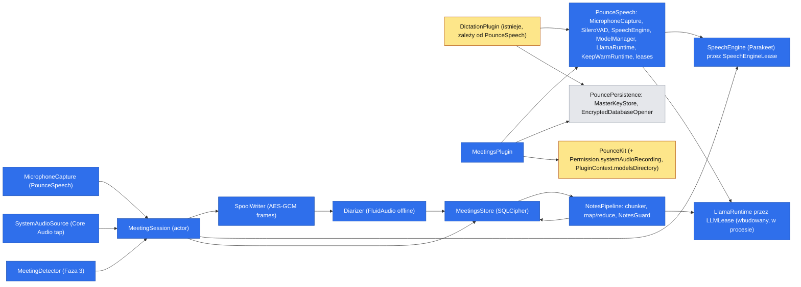
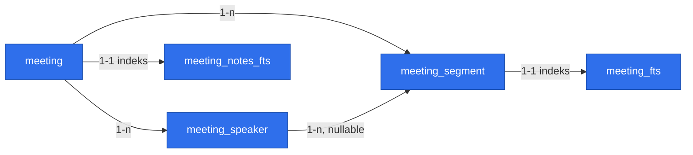

# Transkrypcja spotkań i notatki (Meeting Notes)
> Status: **projekt** — uzgodniony z `main` 2026-11-03, po wdrożeniu dyktowania (Fazy 1–4). Czeka na zgodę właściciela na nową warstwę `PounceSpeech` (Risks). Proza po polsku, identyfikatory po angielsku (jak spec MVP i spec dyktowania).
## 📝 TLDR
Użytkownik chce nagrywać spotkania (online i na żywo, po polsku z angielskimi terminami) i dostawać transkrypcję z podziałem na mówców oraz uporządkowane notatki (podsumowanie, decyzje, zadania, otwarte pytania), bez wysyłania audio ani tekstu poza Maca. Dziś Pounce ma dyktowanie (`DictationPlugin`: model mowy, wbudowany LLM, zaszyfrowana historia), ale nie ma nagrywania dźwięku systemowego, diaryzacji ani notatek z długich nagrań. Proponowane przyszłe zachowanie: nowy plugin `MeetingsPlugin` nagrywa mikrofon i dźwięk systemowy pod skrótem (lub po podpowiedzi o wykrytym spotkaniu), transkrybuje **lokalnym modelem mowy w trakcie spotkania**, po jego końcu rozpoznaje mówców **lokalną diaryzacją**, a notatki robi **wbudowanym w Pounce modelem językowym** (ten sam tryb „Built-in” co w dyktowaniu), kawałkami i z weryfikacją cytatów. Wspólny kod z dyktowaniem trafia do nowego targetu `PounceSpeech`. Wynik ląduje w zaszyfrowanej bibliotece i można go skopiować lub zapisać jako Markdown.
## ✅ Rozstrzygnięte pytania

| # | Decyzja | Skutek dla projektu |
|---|---|---|
| Q1 | Jeden spec, fazy: transkrypt, potem notatki. | Fazy 1 i 2; Faza 3 (podpowiedź) zostaje w tym specu jako osobny PR. |
| Q2 | Mikrofon + dźwięk systemowy. | Core Audio process tap, nowe uprawnienie „Nagrywanie dźwięku systemu”, dwa tory audio. |
| Q3 | Pełna diaryzacja („Mówca 1, 2, …”), nie tylko Ja/Inni. | Offline diaryzacja po spotkaniu na zapisanym audio; Ja/Inni zostaje jako awaryjny zapas. |
| Q4 | Osobny `MeetingsPlugin` + wspólny target `PounceSpeech`. | Dyktowanie jest już wdrożone, więc `PounceSpeech` powstaje przez **mechaniczne wyciągnięcie** kodu z `DictationPlugin` (Faza 0). |
| Q5 | Zaszyfrowana biblioteka + „Kopiuj Markdown” i „Zapisz .md”. | `meetings.sqlite` (SQLCipher), list mode, okno spotkania. |
| Q6 | Ręcznie **oraz** podpowiedź po wykryciu spotkania. | Faza 3: wykrywanie użycia mikrofonu przez inne aplikacje (domyślnie wyłączone, opt-in). |
| Q7 | Tymczasowy plik audio, kasowany po udanym przetworzeniu. | Zaszyfrowany spool na dysku, odzyskiwanie po awarii; warunek offline diaryzacji. |
| Q8 | Jeden stały szablon notatek. | Bez wyboru szablonów i własnych promptów. |
| Q9 | Notatki **tylko** przez wbudowany LLM (tryb „Built-in” z dyktowania). | Bez zewnętrznego serwera: brak `EndpointProbe`, `LoopbackPolicy`, potwierdzania endpointu, kanarka kontekstu i nowych połączeń sieciowych. |
| Q10 | Modele przenoszone do wspólnego `Models/`. | Jednorazowa atomowa migracja z `Plugins/dictation/`; nowy `PluginContext.modelsDirectory`. |
| Q11 | Osobne klucze ustawień modelu mowy dla spotkań. | `plugins.meetings.speech*`; bez migracji chronionych kluczy dyktowania; dzierżawa modelu rozstrzyga współbieżność. |
| Q12 | Retencja domyślnie 90 dni, z możliwością zmiany. | Wybór: 7 / 30 / 90 / 180 / 365 dni / bez limitu. |
| Q13 | Przed refaktorem wydanego kodu krótki spike z go/no-go (krok 0.0). | Licencje i jakość wag diaryzacji, pamięć 3 h, tap dźwięku systemu pod hardened runtime; wynik no-go zatrzymuje projekt bez kosztu refaktoru. |
| Q14 | `contextLength` jest częścią klucza dzierżawy LLM. | Dyktowanie zostaje na 4096; notatki ładują ten sam model z 8192 po zwolnieniu przez dyktowanie (nie dwie kopie naraz). |
| Q15 | Zakaz nieszyfrowanego audio na dysku. | Diaryzator czyta strumień ze spoolu (`AudioSampleSource`); jeśli API nie pozwala, tablica w pamięci w ramach budżetu; bez plaintext WAV. |
| Q16 | PR-y `risk-high` bez drugiej osoby: wyjątek maintainera zapisany w PR. | Właściciel zatwierdza jawnie w PR, a niezależny review agentowy i ręczne QA z dowodami zastępują drugą osobę (SDLC dopuszcza taki wyjątek). |

**Założenia przyjęte bez pytania** (do zmiany na życzenie): polski i angielski z autodetekcją, także w jednym zdaniu; model mowy pobierany po zgodzie albo ze wskazanego folderu; bez chmury i kont; spotkanie do 3 godzin; brak wklejania do innych aplikacji (więc brak Accessibility).

## 📝 Stan wyjściowy (`main`, 2026-11-03)
- **Istnieje:** `DictationPlugin` (Fazy 1–4) z `MicrophoneCapture`, `SileroVAD`, `ParakeetEngine`/`WhisperKitEngine`, `ModelManager` (modele w `Plugins/dictation/Models/`, GGUF w `Plugins/dictation/llm/`), `LlamaRuntime` na llama.cpp (kontekst 4096 na sztywno), `KeepWarmRuntime`, `LLMModelCatalog`; `Permission.microphone`; `MasterKeyStore` i `EncryptedDatabaseOpener` w `PouncePersistence`; `Resources/InfoPlist.xcstrings`; entitlement `audio-input`; ADR 0003–0005. Prawie wszystkie typy dyktowania są `internal`.
- **Nie istnieje:** uprawnienie dźwięku systemowego, wspólny katalog modeli, jakikolwiek kod spotkań, diaryzacji i notatek.
- **Nie ma otwartych zależności od niewdrożonych prac:** blokuje tylko zmergowanie tego specu i zgoda właściciela na `PounceSpeech`.
## 📝 Problem Statement
- Notowanie podczas spotkania odciąga uwagę; po spotkaniu decyzje i zadania szybko się zacierają.
- Narzędzia w chmurze (Otter, Fireflies) wysyłają audio na serwer, co przy rozmowach klienckich jest niedopuszczalne. Lokalne (MacWhisper, superwhisper) dają głównie transkrypt; lokalne z notatkami (Meetily, Hyprnote) wysyłają całość do jednego wywołania LLM albo wymagają zewnętrznego API, a polski jest ich słabą stroną (stan na 2026-11-03, wg opisów projektów, nie przeglądu kodu).
- Godzinne spotkanie to ~9 tys. słów (~24 tys. tokenów po polsku), czyli więcej niż domyślne okno kontekstu wielu lokalnych modeli. Samo „wklej transkrypt do LLM” zawiedzie po cichu (obcięcie).
- Pounce ma już silnik mowy, wbudowany LLM, zaszyfrowany magazyn, list mode z podglądem i onboarding pluginów, więc spotkania to nowe zastosowanie tych klocków plus trzy nowe problemy: dwa źródła dźwięku, godziny zamiast minut i rozpoznawanie mówców.
## 📝 Research (stan na 2026-11-03)

**Dźwięk systemowy (wg Apple i opisów społeczności; do potwierdzenia w kroku 1.4):**
- Core Audio process tap (`CATapDescription` + `AudioHardwareCreateProcessTap` + agregat HAL), macOS 14.2+, a Pounce celuje w macOS 26. Wymaga klucza `NSAudioCaptureUsageDescription`; pierwszy start nagrywania wywołuje monit „System Audio Recording” ([Apple: Capturing system audio with Core Audio taps](https://developer.apple.com/documentation/coreaudio/capturing-system-audio-with-core-audio-taps.md)).
- **Brak publicznego API do sprawdzenia ani poproszenia o to uprawnienie**, a przy odmowie API zwracają sukces z buforami samych zer ([AudioCap](https://github.com/insidegui/AudioCap), [opis problemu](https://dev.to/nickdelv/2000-buffers-of-nothing-3i8)). To rzutuje na UX: nie da się pokazać stanu w Uprawnieniach, potrzebny jest test dźwiękiem (sekcja Architecture).
- ScreenCaptureKit odrzucony: wymaga szerszego uprawnienia „Nagrywanie ekranu”, które użytkownik słusznie odbiera jako zbyt szerokie dla samego dźwięku.

**Diaryzacja ([FluidAudio](https://docs.fluidinference.com/diarization/offline-pipeline.md), dane producenta, niezależnie niezweryfikowane):**

| Tryb | DER | Szybkość | Uwagi |
|---|---|---|---|
| Offline (pyannote CoreML, segmentacja + klastrowanie VBx) | ~15% (AMI) | ~122× czasu rzeczywistego | najdokładniejszy, wymaga całego nagrania → **wymusza audio na dysku (Q7)** |
| Streaming | 26,2% (pasma 5 s) | ~223× | etykiety na żywo, gorsza jakość |
| Sortformer | 31,7% (AMI SDM) | tylko streaming | maks. 4 mówców; gorszy przy 5+ osobach |

Wniosek: **offline po spotkaniu**; etykiety nie są potrzebne na żywo (transkrypt na żywo nie jest w zakresie). Jakość dla polskiego jest nieznana (modele trenowane głównie na angielskim), więc ocenę robi dogfooding (krok 1.12).

**Notatki z długich spotkań:** [Hyprnote](https://github.com/LopeWale/hyprnote) i Meetily podają cały transkrypt + szablon do jednego wywołania zewnętrznego lub lokalnego LLM; z dostępnych opisów nie wynika, czy kawałkują długie nagrania. Przejmujemy ideę „szablon + kontekst spotkania”, ale **kawałkujemy (map → reduce)** i **weryfikujemy cytaty** — tego nie widać w tych projektach.

**Wykrywanie spotkania:** `kAudioDevicePropertyDeviceIsRunningSomewhere` mówi tylko, że ktoś używa mikrofonu, i bywa zawodne dla urządzeń Bluetooth ([wątek Apple](https://developer.apple.com/forums/thread/741026)). Do poznania *która* aplikacja używa wejścia służą obiekty procesów Core Audio (`kAudioHardwarePropertyProcessObjectList`, `kAudioProcessPropertyIsRunningInput`, `…BundleID`; macOS 14.2+) — **do potwierdzenia w kroku 3.1**, bo wyszukiwanie nie zwróciło dokumentacji tych właściwości.

**Czego nie robimy (złożoność do pominięcia):** transkrypt na żywo w oknie, boty dołączające do spotkania, integracje z kalendarzem, konta i synchronizacja, wiele szablonów, własne prompty, transkrypcja istniejących plików audio, wideo, automatyczne wysyłanie notatek.
## 📝 Proposed Solution
Nowy wewnętrzny plugin `MeetingsPlugin` (`PluginID` `meetings`, nowy target, jedna linia w `PluginRegistry`). Przepływ:

1. **Start** (skrót ⌃⌥M, menu paska albo „Nagrywaj” z podpowiedzi, Faza 3): HUD (pigułka z czasem i poziomami obu torów), blokada uśpienia systemu na czas nagrania, utworzenie wpisu `meeting` w stanie `recording`.
2. **W trakcie:** dwa tory (`mic`, `system`) trafiają jednocześnie do (a) **zaszyfrowanego pliku tymczasowego** (spool) i (b) VAD + silnika mowy. Segmenty tekstu z czasami zapisują się do bazy **na bieżąco**, więc awaria traci co najwyżej ostatnie sekundy. Transkrypcji nie widać na żywo.
3. **Stop** (skrót, menu, ✕ w HUD, „Zakończ” w podpowiedzi końca spotkania): domknięcie ogona transkrypcji, **offline diaryzacja** z pliku tymczasowego, przypisanie mówców do segmentów, status `ready` (transkrypt gotowy), **kasowanie audio**.
4. **Notatki** (Faza 2): w tle, kawałkami przez wbudowany LLM (llama.cpp w procesie Pounce), status widoczny w bibliotece; użytkownik nie czeka przy HUD.
5. **Biblioteka:** list mode „Spotkania” (podgląd notatek lub transkryptu) oraz małe okno spotkania (transkrypt z czasami, zmiana nazw mówców, tytuł, usuwanie).

**Alternatywy, które przegrały:**
- **Tryb w `DictationPlugin`** (Q4 b): jeden model i mniej kodu, ale plugin dyktowania zyskałby bibliotekę, diaryzację, dwa źródła dźwięku i długie sesje; wyłączenie dyktowania wyłączałoby spotkania.
- **Kopia kodu** (Q4 c): szybciej na starcie, ale dwie kopie `ModelManager` (kod pobierania z sumami SHA-256 i listą hostów) i `LlamaRuntime` (parser plików GGUF w procesie) do utrzymania i łatania.
- **Notatki przez zewnętrzny serwer LLM na loopback** (Q9): wymagałby `EndpointProbe`, potwierdzania endpointu i kanarka kontekstu; wbudowany tryb ma wszystko, czego trzeba, i nie dodaje powierzchni sieciowej.
- **Diaryzacja strumieniowa / Sortformer:** etykiety na żywo nie są potrzebne, a DER jest dwukrotnie gorszy; offline daje lepszy wynik za cenę audio na dysku, które i tak wybrał Q7.
- **ScreenCaptureKit do dźwięku:** szersze uprawnienie niż potrzeba (Research).
- **Jedno wywołanie LLM na cały transkrypt:** zawodzi po cichu przy małym oknie kontekstu (Research); kawałkowanie to obowiązkowa część projektu, nie optymalizacja.
- **Domyślne wykrywanie spotkań włączone:** monitorowanie, które aplikacje używają mikrofonu, to wrażliwa funkcja; domyślnie wyłączona i tylko po zgodzie w onboardingu.
## 📝 Architecture

Wniosek: spotkania dodają jeden plugin i dwa addytywne rozszerzenia `PounceKit`; dyktowanie dostaje wyłącznie mechaniczną zmianę (część kodu przechodzi do `PounceSpeech`, modele do `Models/`). **Reguła zależności z `AGENTS.md` zyskuje jedną warstwę:** `plugins → PounceSpeech`, a `PounceSpeech` nie zależy od żadnego targetu repozytorium (audyt kodu: potrzebuje tylko Foundation, AVFoundation, FluidAudio, WhisperKit i xcframeworka `llama`); pluginy dalej nie importują siebie ani `PounceApp`. To zmiana architektury wymagająca zgody właściciela (Risks).

**Wyjątek od „pluginy nie sięgają po globalne obiekty”** (jak w dyktowaniu): `AVAudioEngine`, Core Audio (tap, agregat), własny `NSPanel`/`NSWindow` i nasłuch procesów audio są używane w pluginie, ale każde za **wewnętrznym** protokołem wstrzykiwanym w inicjalizatorze: `AudioInput` (z `PounceSpeech`; testy: plik WAV), `ProcessAudioObserver` (testy: skryptowe zdarzenia), `HUDPresenter` (testy: rejestrujący) i `SleepAssertion` (testy: rejestrujący) leżą w `MeetingsPlugin`, bo używa ich tylko ten plugin. Do `PounceKit` żaden nie trafia.

**Komponenty `PounceSpeech`.** Przeniesione z `DictationPlugin` bez zmiany zachowania (wszystkie typy stają się `public`): `AudioPorts` (`AudioInput`, `MicrophoneAuthorizer`, `SpeechEngine`, `VoiceActivityDetector`, `TranscriptSegment`, `SampleStore`), `MicrophoneCapture`, `ParakeetEngine` + `SileroVAD` + `LazyVAD`, `WhisperKitEngine` + `SwitchingEngine` + `RepetitionFilter`, `ModelCatalog` (typy `ModelFile`/`ModelSource`/`ModelPackage`, wpisy mowy i VAD, `isAllowedDownloadHost`), `ModelManager` (kategoria loggera wstrzykiwana), `ModelDownloader`, `LLMModelCatalog`, `LlamaRuntime` + `LLMRuntime` + `KeepWarmRuntime`. Trzy zmiany przy przenoszeniu: (a) neutralny `ChatMessage{role,content}` zastępuje `CleanupPrompt.Message` w `LLMRuntime.generate`; (b) `LlamaRuntime(contextLength:)` z domyślnym 4096 (dyktowanie bez zmian), notatki użyją 8192; (c) addytywne `generateResult(...)` zwraca tekst i flagę „przerwano limitem tokenów” (potrzebna notatkom, dyktowanie dalej woła `generate`). Do `PounceSpeech` dochodzą dwa nowe elementy: `SpeechEngineLease` i `LLMLease` (niżej). **Zostaje w `DictationPlugin`:** `LoopbackPolicy`, `LoopbackTransport`, `EndpointProbe`, `TextFormatter` (`RawFormatter`, `LocalLLMFormatter`), `BuiltInFormatter`, `FormatterGuard`, `CleanupPrompt`, `Segmenter`, `DictationSession`, kontroler, HUD, ustawienia, historia. Pętla VAD → silnik z `DictationSession` jest kopiowana w `MeetingSession` (atrapy z `DictationPluginTests/Support.swift` potrzebne w obu targetach testowych są kopiowane, nie współdzielone; `@testable import` dla testów), nie wyciągana (ryzyko regresji dyktowania > koszt ~100 linii; ujednolicenie jako osobny, późniejszy refaktor).

**Układ modeli (`Application Support/Pounce/Models/`, 0700/0600):** `speech/<package-id>/` (Parakeet, Whisper; Silero VAD w środku pakietu pod `vad/…`; pakiety diaryzacji obok), `llm/<package-id>/` (GGUF), katalogi `<id>.partial` obok. Dyktowanie dziś używa `Plugins/dictation/Models/` i `Plugins/dictation/llm/`; Faza 0 przenosi je jednorazowo i atomowo.

**Dzierżawy modeli (współbieżność dyktowania i spotkań).** `SpeechEngineLease` i `LLMLease` są procesowymi singletonami w `PounceSpeech`:
- klucz dzierżawy mowy to `(model-id, folder)`, a LLM `(model-id, contextLength)` (dyktowanie 4096, notatki 8192); ten sam klucz jest współdzielony (licznik; `keepWarm` liczy się od zwolnienia ostatniej dzierżawy), więc dyktowanie i spotkania na tym samym modelu mowy dzielą jedną kopię w pamięci; LLM z innym kontekstem jest ładowany ponownie dopiero po zwolnieniu przez drugiego użytkownika (nigdy dwie kopie naraz), z jednym wyjątkiem: prośba `interactive` (dyktowanie) o **ten sam plik modelu** z innym `contextLength` zabiera model dzierżawie `background` (notatki): trwające generowanie jest anulowane między tokenami, dzierżawa notatek jest oddawana (`ModelLeaseError.yielded`), model jest ładowany ponownie z kontekstem 4096, a notatki biorą nową dzierżawę po zwolnieniu przez dyktowanie i powtarzają przerwane zapytanie (to nie jest błąd ani ponowienie, a limit czasu generowania stoi w tym czasie; po zwolnieniu dzierżawy przez dyktowanie notatki czekają 15 s (okno łaski), żeby nie wypierać modelu między dwoma dyktowaniami; czas oczekiwania całego zadania sumuje się do `busyLimit`, a jedno zapytanie poddaje się po 20 przejęciach); inny plik modelu nadal daje `busy`;
- naraz załadowany jest najwyżej jeden silnik mowy i jeden model LLM (budżet pamięci: 0,7 GB mowy, 3–19 GB LLM); model rozgrzany **bez aktywnej dzierżawy** jest zwalniany natychmiast i zastępowany, więc nie blokuje startu; prośba o inny klucz przy **aktywnej** dzierżawie dostaje `busy` (spotkanie pokazuje „Inny model mowy jest w użyciu”, notatki czekają z komunikatem „Czeka na model”);
- żądania idą jedną kolejką z priorytetem `interactive` (dyktowanie) przed `background` (segmenty spotkania, notatki); trwające generowanie `background` jest **anulowane między tokenami** przy żądaniu `interactive` i ponawiane po nim, więc budżet ogona dyktowania (< 3 s) nie zależy od spotkania ani od notatek;
- kolejka `background` mowy ma limit 60 s niezakończonego audio; powyżej segmenty czekają w spoolu i są dotranskrybowane po końcu spotkania (status `processing`). Transkrypcji CoreML nie da się anulować, więc segment spotkania ma twardy limit 15 s (podział w `MeetingSession`), a najgorsze opóźnienie ogona dyktowania to czas jednego takiego segmentu (rząd 0,1–0,2 s przy ~100× czasu rzeczywistego; do zmierzenia w 0.4). Wszystkie wywołania `load`/`unload` silnika, także z `DictationController`, idą przez dzierżawę;
- `ModelManager` jest aktorem na katalog: `PounceSpeech` trzyma rejestr jednej instancji na katalog (`Models/speech`, `Models/llm`), bo dwie instancje nad tym samym katalogiem uszkodziłyby wspólny `<id>.partial` i operację `removeItem` + `moveItem`.
- Wybór modelu jest osobny (`plugins.dictation.speech*` i `plugins.meetings.speech*`), ale oba mają ten sam domyślny `parakeet-ultra`, więc `busy` zdarza się tylko, gdy użytkownik świadomie wybrał różne modele i używa obu naraz.

**Komponenty `Sources/MeetingsPlugin/`:**
- `MeetingsPlugin` — manifest (`id: meetings`, `order` po dyktowaniu, `defaultEnabled: false`), `commands`, `onboardingSteps`, `requiredPermissions = [.microphone, .systemAudioRecording]`, `settingsPane()`, `panelModes` (biblioteka), `eraseData()`.
- Mikrofon to `MicrophoneCapture` z `PounceSpeech` (w spotkaniach opcjonalnie z voice processing; patrz Edge Cases). `SystemAudioSource` (własność pluginu) — globalny tap wszystkich procesów **z wyłączeniem procesu Pounce**, agregat HAL, konwersja do 16 kHz mono, odtworzenie tapu przy zmianie domyślnego wyjścia (słuchawki Bluetooth), wypełnianie luk ciszą, żeby oś czasu nie dryfowała. Oba tory dostają znacznik czasu z jednego zegara (host time) i są wyrównane do wspólnego początku.
- `SystemAudioSelfTest` — jedyny sposób sprawdzenia uprawnienia (Research): na żądanie (onboarding, Ustawienia → „Test”) tworzy tap **bez** wykluczenia Pounce, odtwarza własny krótki sygnał (~300 ms, zapowiedziany przyciskiem „Odtwórz sygnał testowy”, bez ukrytych dźwięków) i sprawdza, czy bufory nie są zerowe. Wynik: „działa” / „brak dźwięku – sprawdź uprawnienie”.
- `MeetingSession` (`actor`) — jedno nagranie: oba tory, VAD (`SileroVAD` z `PounceSpeech`, jedna instancja na tor) → `SpeechEngine` przez `SpeechEngineLease`, zapis segmentów, spool, limity (3 h, miejsce na dysku), blokada uśpienia (`SleepAssertion`). Naraz najwyżej jedna sesja; stan: `idle → recording → finishing → processing → ready`.
- `SpoolWriter` / `SpoolReader` — plik tymczasowy `Plugins/meetings/Spool/<uuid>/{mic,system}.spool` (katalog 0700, pliki 0600, wyłączone z Time Machine i Spotlight). Format: nagłówek (magic `PNCSPOOL` + wersja formatu 1), potem ramki po 2 s audio (~64 KB), każda zapieczętowana **`AES.GCM` z CryptoKit** (ten sam prymityw co blob schowka), **osobny podklucz na plik**: HKDF-SHA256 z klucza głównego pluginu przez istniejące `MasterKeys.derived(info:)` (bez soli; rozróżnienie w `info = "spool/<uuid spotkania>/<tor>"`, bez nowego API); nonce 96 bit = 4 B zer ‖ 8 B licznika ramki (big-endian, od 0); przy kluczu osobnym dla każdego pliku licznik wystarcza, więc dwa pliki nigdy nie dzielą pary (klucz, nonce), a w jednym pliku nonce się nie powtarza; numer i długość ramki jako authenticated data (wykrywa przestawienie i obcięcie w środku), a ramka końcowa z flagą „koniec” odróżnia zamknięcie czyste od obciętego. Awaria gubi więc najwyżej ostatnie ~2 s. Plik jest tworzony wyłącznie z flagą wyłączności i **nigdy nie jest otwierany ponownie do zapisu** (zapis po awarii powtórzyłby parę klucz–nonce; spotkanie `incomplete` nie wznawia nagrywania). Nagłówek (w tym uuid i tor), numer, długość i flaga „koniec” ramki są w AAD. `fsync` po każdej ramce (~co 2 s). Katalog spoolu ma `isExcludedFromBackup = true` i plik `.metadata_never_index`. Odczyt sekwencyjny; ucięty ogon po awarii daje czytelne ramki do ostatniej pełnej. Audio 16 kHz/16-bit ≈ 115 MB/h na tor, czyli ≤ ~700 MB dla 3 godzin dwóch torów; start odmawia przy mniej niż 1,5 GB wolnego miejsca.
- `Diarizer` (protokół) + `FluidDiarizer` — offline pipeline FluidAudio (`OfflineDiarizerManager`), uruchamiany **osobno na każdym torze** i karmiony **strumieniem z `SpoolReader`** przez `AudioSampleSource` (zakaz nieszyfrowanego WAV na dysku; jeśli API nie da się strumieniować, tablica w pamięci w ramach budżetu pamięci diaryzacji); modele ładowane wyłącznie z folderu `ModelManager` (`OfflineDiarizerModels.load(from:)` lub tryb offline; test z zablokowaną siecią, bo domyślnie biblioteka pobiera i po błędzie kasuje cache). FluidAudio w wersji 0.18.2 ma diaryzację jako cechę opt-in, więc `Package.swift` dostaje `traits: ["Diarizer"]` (zmiana grafu, rozmiar binarki mierzony w spike 0.0).  (mikrofon zbiera wszystkich w pokoju, system zbiera uczestników zdalnych). `SpeakerAssigner` (czysta logika): łączy klastry obu torów w jedną listę mówców, przypisuje segmentom mówców po największym nakładaniu czasu, a „Ja” nadaje dominującemu mówcy toru mikrofonu **tylko gdy tor systemowy zawiera mowę** (spotkanie online); w spotkaniu na żywo (cisza na torze systemowym) mówcy z mikrofonu dostają „Mówca N”, a „Ja” ustawia użytkownik akcją „To ja” w oknie spotkania. **Strażnik pamięci:** jeśli wejście przekracza budżet pamięci diaryzacji (mierzony w kroku 1.6), diaryzacja jest pomijana, a etykiety spadają do „Ja / Inni” według toru (Q3 a jako zapas) z informacją w oknie spotkania.
- `EchoSuppressor` (czysta logika) — gdy użytkownik słucha przez głośniki, mikrofon łapie głos rozmówców i ten sam tekst pojawia się na obu torach. Reguła: segment mikrofonu nakładający się w czasie na segment systemu i podobny tekstowo (znormalizowana odległość ≥ próg) jest odrzucany jako echo; wygrywa tor systemowy. Podstawą jest `EchoSuppressor`; voice processing na wejściu jest opcjonalną dodatkową warstwą (domyślnie wyłączoną do pomiaru w kroku 1.12).
- `MeetingsStore` + `MeetingKeyStore` na istniejących `MasterKeyStore` i `EncryptedDatabaseOpener` (SQLCipher, patrz Data Model), `RetentionJob`, `RecoveryJob`: przy aktywacji spotkanie w stanie `recording` po awarii → `incomplete`; spotkanie w stanie `processing` ze spoolem wznawia finalizację (diaryzacja, przypisanie mówców, kasowanie audio); `failed` ustawia tylko brak możliwości dokończenia: spool nieczytelny (zły klucz, uszkodzenie) i zero zapisanych segmentów, albo baza niezapisywalna. Przy `failed` zostaje to, co jest w bazie.
- `MarkdownExporter` — czysta funkcja `Meeting → String` (tytuł, data, uczestnicy, notatki, transkrypt z czasami).
- `MeetingHUD` — `NSPanel` (`.nonactivatingPanel`), pigułka: czerwona kropka, czas, dwa wskaźniki poziomu (Ja / system), przycisk „Zakończ”; w pierwszych sekundach linia „Poinformuj uczestników, że nagrywasz” (wyłączana w Ustawieniach). Stany błędów: brak dźwięku systemowego przez pierwsze 20 s („Sprawdź uprawnienie nagrywania dźwięku systemu”), mało miejsca, urządzenie odłączone.
- `MeetingWindow` — małe okno SwiftUI: transkrypt (czas, mówca, tekst), zmiana nazwy mówcy i tytułu (zmiana nazwy oznacza notatki jako nieaktualne), „Kopiuj Markdown”, „Zapisz .md…”, „Regeneruj notatki”, usuń.
- **Faza 2:** `TranscriptChunker`, `NotesPipeline` (przez `LLMLease`), `NotesGuard`, `NotesPrompt` (zasób wersjonowany) — patrz niżej.
- **Faza 3:** `MeetingDetector` (`ProcessAudioObserver` + `SuggestionPolicy`) — patrz niżej.
- `SleepAssertion` i `HUDPresenter` (protokoły wewnętrzne pluginu; HUD spotkania ma wygląd jak `DictationHUDPanel`, własna implementacja bez wspólnego kodu).

**Notatki (Faza 2):**
1. `TranscriptChunker` dzieli transkrypt po granicach wypowiedzi na kawałki ≤ `notesChunkTokens` (domyślnie 3 000 tokenów wejścia, liczone heurystyką z ADR 0004: 2,69 tok/słowo po polsku, 1,17 po angielsku), z kilkoma wypowiedziami nakładki. Kontekst notatek to 8192 tokeny (`LlamaRuntime(contextLength: 8192)`): prompt ≤ ~900 tokenów + kawałek 3 000 + odpowiedź map 700 mieści się z zapasem.
2. **Map:** każdy kawałek → lista punktów (podsumowanie, decyzje, zadania z osobą i terminem tylko jeśli padły wprost, pytania), a każdy punkt dostaje od kodu identyfikator (`p1`, `p2`, …) i ma **cytat z transkryptu z czasem**. Wejście w `<transcript>…</transcript>` (jak w dyktowaniu), próbkowanie zachłanne (jak w ADR 0005), modele bez trybu „thinking” z `LLMModelCatalog`.
3. **Reduce:** model dostaje listę zweryfikowanych punktów (id + treść) i zwraca **tylko strukturę**: dla każdej sekcji szablonu (Decyzje · Zadania · Otwarte pytania · Uczestnicy) uporządkowaną i zdeduplikowaną listę identyfikatorów punktów oraz osobno jednoakapitowe Podsumowanie. Treść punktów w gotowych notatkach pochodzi z samych punktów (składa je kod), nie z wolnego tekstu modelu. Wejście reduce ma budżet `notesReduceInputTokens` (4 500); gdy suma map go przekracza, dodatkowy poziom reduce (rekurencyjnie).
4. `NotesGuard` odrzuca punkty, których cytatu nie ma w transkrypcie (porównanie po normalizacji z `TextNormalizer`, z dopasowaniem przedrostków ≥ 5 znaków dla polskiej fleksji), a dla zadania dodatkowo wymaga, żeby wskazana osoba (w cytacie albo jako mówca cytowanej wypowiedzi) i termin (data, dzień tygodnia) występowały w cytacie; w przeciwnym razie zadanie trafia do notatek bez osoby lub terminu, nie z domysłu, wycina `<think>…</think>`, sprawdza dominujący język; odrzucone punkty są liczone i pokazane („3 punkty bez pokrycia w nagraniu pominięto”). `NotesGuard` działa **dwa razy**: na punktach po map (jak wyżej) i na wyniku reduce: identyfikatory spoza listy są odrzucane, a Podsumowanie nie może zawierać imion, liczb, dat ani nazw własnych, których nie ma w zweryfikowanych punktach (sprawdzenie tokenów); naruszenie = Podsumowanie zastąpione złożeniem pierwszych zdań punktów. Tekst modelu jest escapowany (obrazy, linki, HTML i znaczniki wymuszające ładowanie zasobów są usuwane), a widok notatek i eksport nie ładują nic z sieci. To główna obrona przed zmyślonymi zadaniami i terminami oraz wyciekiem przez treść Markdown.
5. **Kontekst i limity:** Pounce sam ustawia kontekst (8192), a `LlamaError.promptTooLong` jest jawnym błędem, więc nie ma cichego obcięcia. Kawałek, który się nie mieści, jest dzielony na połowy i ponawiany raz. Odpowiedź przerwana limitem tokenów (`generateResult`) jest traktowana jak błąd kawałka (jeden retry z podwojonym limitem, potem `partial`), nigdy jak gotowy wynik.
6. Transkrypt spotkania jest **niezaufaną treścią** (ktoś może powiedzieć „zignoruj poprzednie instrukcje”): wynik LLM jest tylko wyświetlany jako tekst, plugin nie wykonuje żadnych akcji na jego podstawie, a `NotesGuard` ogranicza szkodę.
**Wykrywanie spotkań (Faza 3):**
- `ProcessAudioObserver` nasłuchuje obiektów procesów Core Audio (zdarzeniowo, bez odpytywania) i zgłasza „proces X (bundle ID) używa wejścia audio”. Proces Pounce jest pomijany (dyktowanie i nagrywanie spotkania nie wywołują podpowiedzi).
- `SuggestionPolicy` (czysta maszyna stanów): podpowiedź tylko gdy (a) włączono `suggestMeetings`, (b) aplikacja z listy znanych (Zoom, Teams, Slack, FaceTime, Webex, Discord; użytkownik może dodać własne); przeglądarki wyłącznie jeśli użytkownik sam dodał je do listy (użycie mikrofonu przez stronę daje fałszywe alarmy), przy użyciu mikrofonu ≥ 10 s ciągle, (c) Pounce nie nagrywa, (d) aplikacja nie jest wyciszona przez „Nie pytaj dla tej aplikacji”, (e) jedna podpowiedź na sesję użycia mikrofonu.
- Podpowiedź to nieaktywujący HUD „Wygląda na spotkanie w {aplikacja}” z **klikalnymi przyciskami** „Nagrywaj”, „Nie teraz” i „Nie pytaj dla tej aplikacji” (znika po 15 s). Pounce **nie przejmuje globalnie ⏎ ani Esc**, więc nie kradnie klawiszy aplikacji, w której użytkownik pisze; w czasie wyświetlania działa zwykły skrót nagrywania. HUD ma `sharingType = .none` (nie pojawia się w udostępnianiu ekranu), a treść to tylko nazwa aplikacji. **Nigdy nie startuje nagrywania sama.** Gdy użycie mikrofonu przez tę aplikację kończy się, a oba tory milczą ≥ 60 s, HUD pyta „Zakończyć nagranie?” (też bez automatu).
- Przetwarzana jest wyłącznie metadana „proces + bundle ID + czy używa wejścia”; nic nie jest logowane, a zapisywane są wyłącznie listy aplikacji wybrane przez użytkownika (`suggestMutedBundleIDs`, `suggestExtraBundleIDs`) oraz `meeting.source_bundle_id` spotkania rozpoczętego z podpowiedzi.
**Zmiany w shellu (`PounceApp`):**
- `PermissionsReader` obsługuje `.systemAudioRecording` (stan `.notDetermined`, bo nie da się go odczytać; patrz API Contracts); Ustawienia → Uprawnienia pokazują wiersz z linkiem do panelu prywatności i przyciskiem „Test”.
- `AppEnvironment` tworzy `<dataRoot>/Models/` (0700), przekazuje go jako `PluginContext.modelsDirectory` i przy starcie, **przed aktywacją pluginów**, uruchamia `ModelsMigration` (niezależnie od tego, czy dyktowanie jest włączone). Migracja działa tylko na `dataRoot` bieżącego środowiska, więc tryb QA (`--qa…`, własny `dataRoot`) migruje i tworzy `Models/` w swoim katalogu. Gdy źródło i cel są oba niepuste, nic nie jest scalane ani kasowane (log, plugin używa celu); powrót do starszej wersji aplikacji po migracji oznacza ponowne pobranie modeli (odtwarzalne).
- `Info.plist` dostaje `NSAudioCaptureUsageDescription` (en + pl w `Resources/InfoPlist.xcstrings`); w tym samym PR co rejestracja pluginu zmienia się też `NSMicrophoneUsageDescription` (dziś: tylko podczas dyktowania, nigdy zapisywane) oraz tekst w `PermissionsPane` i `Localizable.xcstrings`, bo spotkania zapisują audio mikrofonu w zaszyfrowanym spoolu; wpis do `PluginRegistry` dla `MeetingsPlugin` dopiero w PR z komendą nagrywania.

**Zależności:**
- `FluidAudio`, `WhisperKit` i xcframework `llama` przechodzą z `DictationPlugin` do `PounceSpeech` (zmiana `Package.swift` i komentarzy „used by DictationPlugin only”); `MeetingsPlugin` dodaje produkt FluidAudio także bezpośrednio dla `FluidDiarizer`.
- **Modele diaryzacji** (segmentacja + embedding mówców) — nowe wagi; **licencje i atrybucja weryfikowane w ADR 0007 przed jakimkolwiek wdrożeniem** (nie zakładamy zgody z MIT/CC-BY na podstawie założeń).
- Brak nowych pakietów (CryptoKit, AVFoundation, Core Audio są systemowe).

**Budżety (nowe wiersze w `docs/perf.md`; liczby ze specu dyktowania, ADR 0005 i danych producenta, do zmierzenia w krokach 1.12 i 2.5):**

| Budżet | Cel |
|---|---|
| Od skrótu do widocznego HUD i startu obu torów | < 300 ms (tap i agregat są cięższe niż mikrofon) |
| Transkrypcja w trakcie (oba tory, model rezydentny) | nadąża z czasem rzeczywistym przy zajętości jednego rdzenia < 15% średnio |
| Ogon transkrypcji po „Stop” | < 3 s |
| Diaryzacja po „Stop” (1 h, dwa tory; ~122× RT wg producenta) | ≈ 30–60 s; 3 h ≈ 3 min; mierzone |
| Pamięć w trakcie spotkania (model mowy + bufory) | < 1,5 GB; diaryzacja ma osobny, mierzony limit |
| Pamięć w spoczynku | bez zmian: < 150 MB (modele zwalniane) |
| Notatki z 1 h spotkania (≈ 8 kawałków + reduce, wbudowany Qwen3-30B-A3B lub 4B, M4 Max wg ADR 0005: prefill ~1 000 tok/s, decode ~95–115 tok/s) | ≈ 1–2 min w tle; słabszy Mac: do zmierzenia (cel ≤ 8 min) |
| Pamięć w trakcie notatek | model LLM 3–19 GB (wybór użytkownika, filtr `available(physicalMemory:)`), zwalniany po zadaniu |
| Dysk na spotkanie 3 h | ≤ ~700 MB spoolu, kasowane po przetworzeniu |

## 📝 Data Model
Magazyny w `Application Support/Pounce/Plugins/meetings/` (katalog 0700, pliki 0600), prywatne dla pluginu, oraz wspólny katalog modeli `Application Support/Pounce/Models/` (`speech/`, `llm/`; odtwarzalne; 0700/0600). **Ścieżka `Models/` jest chroniona od wydania** i dostaje wiersz w `BACKWARD_COMPATIBILITY.md` §2 (krok 0.1); jest wyjątkiem od zasady „dane pluginu w `Plugins/<id>/`”. „Erase Data” żadnego pluginu go nie usuwa (modele mogą używać inne funkcje); usuwa je tylko „Usuń model” w Ustawieniach, i tylko gdy żadna dzierżawa ich nie trzyma. Dla dyktowania to zmiana: dziś Erase Data kasuje jego modele, po Fazie 0 zostają (notka w wydaniu).

1. **`meetings.sqlite`** — SQLCipher, własny `DatabaseMigrator` (migracja `v1-meetings`), otwierany przez istniejący `EncryptedDatabaseOpener` z `PouncePersistence`. Klucz: `MasterKeyStore(service: "app.pounce.meetings")`, HKDF `info = sqlcipher` / `spool`. Tylko `errSecItemNotFound` może zresetować bazę (archiwum 30 dni); każdy inny błąd Keychain wyłącza bibliotekę bez kasowania, a nagrywanie nie startuje (nie ma gdzie zapisać).
2. **`Spool/<meeting-uuid>/`** — zaszyfrowane audio tymczasowe (Architecture). Nie jest chronionym formatem (nie ma obietnicy trwałości), ale chroniona jest ścieżka katalogu (R4) i reguła kasowania.

**Tabele:**

| Tabela | Kolumny |
|---|---|
| `meeting` | `id` INTEGER PK · `uuid` TEXT UNIQUE (nazwa katalogu spoolu) · `started_at` REAL · `ended_at` REAL NULL · `duration_ms` INTEGER · `title` TEXT NULL · `source_bundle_id` TEXT NULL (aplikacja z podpowiedzi, zapisywana tylko gdy użytkownik rozpoczął nagranie z podpowiedzi; w przeciwnym razie NULL) · `status` TEXT (`recording`/`processing`/`ready`/`incomplete`/`failed`) · `speaker_mode` TEXT (`diarized`/`channels`/`none`) · `languages` TEXT · `speech_model_id` TEXT · `diarization_model_id` TEXT NULL · `audio_state` TEXT (`spool`/`deleted`) · `notes_markdown` TEXT NULL · `notes_status` TEXT (`none`/`running`/`ok`/`partial`/`failed`/`stale`) · `notes_prompt_version` TEXT NULL · `notes_model` TEXT NULL · `notes_dropped_count` INTEGER · `notes_generated_at` REAL NULL |
| `meeting_speaker` | `id` PK · `meeting_id` FK → `meeting` ON DELETE CASCADE · `label` TEXT (np. „Mówca 2”, nazwa nadana przez użytkownika) · `is_self` INTEGER · `source_channel` TEXT (`mic`/`system`) |
| `meeting_segment` | `id` PK · `meeting_id` FK → `meeting` ON DELETE CASCADE · `channel` TEXT (`mic`/`system`) · `start_ms` INTEGER · `end_ms` INTEGER · `speaker_id` FK → `meeting_speaker` NULL (do czasu diaryzacji) · `text` TEXT |
| `meeting_fts` | FTS5 (`content=meeting_segment`, kolumna `text`, tokenizer `unicode61 remove_diacritics 2`, żeby „zolc” znajdowało „żółć”; test w kroku 1.2); wyzwalacze `AFTER INSERT/UPDATE/DELETE` jak w `clipboard.sqlite` |
| `meeting_notes_fts` | FTS5 (`content=meeting`, kolumny `title`, `notes_markdown`) z własnymi wyzwalaczami (`AFTER UPDATE OF title, notes_markdown`, żeby zmiana innych kolumn nie przebudowywała indeksu); tworzona w `v1-meetings`, żeby nie dodawać migracji w Fazie 2 (kolumny `notes_*` też są w `v1-meetings`, additive-only; w Fazie 1 używa ich tylko `stale` po zmianie nazwy mówcy, a generator notatek dochodzi w Fazie 2) |

Wszystkie encje są nowe i prywatne dla pluginu (osobna baza); żadna nie ma relacji z istniejącą encją (`ranking.sqlite`, `clipboard.sqlite`), więc węzłów istniejących nie dodajemy.

**Retencja:** `RetentionJob` usuwa spotkania starsze niż `plugins.meetings.retentionDays` (domyślnie **90**; wybór w Ustawieniach: 7 / 30 / 90 / 180 / 365 dni / bez limitu, czyli 0) — pełna rozmowa jest wrażliwsza niż notatka, więc dłużej niż 30 dni schowka, ale krócej niż pół roku; `VACUUM` najwyżej raz dziennie. **Spool:** kasowany natychmiast po statusie `ready`; spotkanie `incomplete` zachowuje spool do `orphanAudioDays` (7), potem jest kasowany i spotkanie zostaje z samym transkryptem.

**Wrażliwe dane:** transkrypt i notatki (to rozmowy innych ludzi) nigdy nie trafiają do logów (tylko liczby i czasy), do `ranking.sqlite` (plugin nie woła `PluginContext.usage`), ani do schowka poza jawną akcją „Kopiuj”. Audio istnieje w pamięci sesji i w zaszyfrowanym spoolu; po kasowaniu nie obiecujemy zerowania bloków na dysku (SSD, APFS), więc ochroną jest szyfrowanie spoolu, nie nadpisanie.

## 📝 API Contracts (addytywne zmiany `PounceKit`, `BACKWARD_COMPATIBILITY.md` §1)
- `Permission.systemAudioRecording` — nowy przypadek enuma (`CaseIterable`; wszystkie `switch` w drzewie w tym samym PR). Ponieważ stanu uprawnienia **nie da się odczytać**, `PermissionsReader` zwraca dla niego istniejący `PermissionStatus.notDetermined` (bez nowego przypadku stanu). Wiersz w Uprawnieniach pokazuje link `x-apple.systempreferences:com.apple.preference.security?Privacy_AudioCapture` (identyfikator panelu do potwierdzenia w kroku 1.1) i przycisk „Test”.
- `PluginContext.modelsDirectory: URL` — `Application Support/Pounce/Models/`, tworzony przez hosta (0700). Parametr inicjalizatora `modelsDirectory: URL? = nil` z domyślną wartością `storageDirectory/Models`, więc istniejące konteksty (testy) działają bez zmian.
- `Permission.microphone`, `MasterKeyStore` i `EncryptedDatabaseOpener` już istnieją (dyktowanie); ten spec ich nie zmienia. Skrót start/stop jest zwykłym `run` (bez faz key-down/up), a HUD i okno są własnością pluginu.

**Komendy pluginu:**
- `meetings.record` — „Nagrywaj spotkanie / Zakończ nagrywanie”, domyślny skrót **⌃⌥M** (zmienialny), w menu paska.
- `meetings.library` — tryb listy „Spotkania”, bez domyślnego skrótu.

**Klucze ustawień (`plugins.meetings.*`, nowa chroniona przestrzeń od wydania):**

| Klucz | Typ | Domyślnie |
|---|---|---|
| `enabled` | Bool | false |
| `speechModel` / `speechLanguage` / `speechModelFolder` | String / `pl`/`en` / String? | `parakeet-ultra` / `pl` / brak (osobne od `plugins.dictation.*`, te same semantyka) |
| `inputDevice` | String? (UID) | systemowe |
| `voiceProcessing` | Bool | false do wyniku pomiaru w kroku 1.12 (usuwanie echa przez system bywa, że przycisza inne aplikacje); potem decyzja o domyślnej wartości |
| `diarization` | Bool | true |
| `consentReminder` | Bool | true |
| `notesEnabled` | Bool | false, zapisywane tylko po wyraźnym wyborze |
| `builtInLLMModel` | String (id z `LLMModelCatalog`) | domyślny dla pamięci Maca (`LLMModelCatalog.available`) |
| `notesChunkTokens` / `notesReduceInputTokens` | Int | 3000 / 4500 |
| `suggestMeetings` | Bool | false |
| `suggestMutedBundleIDs` / `suggestExtraBundleIDs` | [String] | puste |
| `retentionDays` / `orphanAudioDays` | Int | 90 / 7 |

KeyboardShortcuts: `KeyboardShortcuts_command_meetings_record`.

**Kontrakt wbudowanego LLM dla notatek:** `LlamaRuntime(contextLength: 8192)` przez `LLMLease`; `generateResult(messages:maxTokens:)` z `maxTokens` 700 dla map i 1 500 dla reduce; próbkowanie zachłanne, szablon czatu modelu, anulowanie między tokenami (jak w ADR 0005); prompt systemowy `NotesPrompt` (wersjonowany). Pliki modeli pochodzą wyłącznie z `LLMModelCatalog` (przypięta rewizja i SHA-256, bez plików wskazanych przez użytkownika).

## 📝 UI/UX
- **HUD nagrywania:** pigułka w stylu HUD dyktowania z czerwoną kropką, czasem, dwoma wskaźnikami (Ja / System) i „Zakończ”; stany: ładowanie modelu (nagrywanie trwa), brak dźwięku systemowego, mało miejsca, urządzenie odłączone, „Przetwarzanie: rozpoznawanie mówców…”. Animacja poziomu wyłączana przez „Zmniejsz ruch”. Bez dźwięków.
- **Biblioteka (list mode):** pole wyszukiwania Pounce szuka tu w `meeting_fts` i `meeting_notes_fts` (transkrypt, tytuł, notatki). Wiersz = tytuł (lub „Spotkanie 3 lis, 14:05”), data, czas, aplikacja, znaczek statusu notatek; podgląd = notatki, a bez nich transkrypt; ⏎ kopiuje Markdown, ⌘O otwiera okno spotkania, ⌘R regeneruje notatki, ⌃X usuwa; filtry ⌘1 Wszystkie, ⌘2 Z notatkami, ⌘3 Wymagają uwagi (`incomplete`/`failed`/`stale`).
- **Okno spotkania:** transkrypt z czasem i nazwą mówcy, kolorowe pasma mówców; zmiana nazwy mówcy w miejscu (podpowiedź „zmieni nazwy też w notatkach po regeneracji”) i akcja „To ja” (ustawia mówcę jako Ja, np. w spotkaniu na żywo); gdy `speaker_mode = channels`, baner „Rozpoznanie mówców niedostępne – podział na Ja / Inni”.
- **Ustawienia → Spotkania:** rejestrator skrótu; **dźwięk** (urządzenie wejściowe, usuwanie echa, „Test dźwięku systemowego”); **modele** (mowa i diaryzacja: karta z rozmiarem, licencją i atrybucją, pobierz / wskaż folder / usuń; „Usuń model” mówi, że model jest współdzielony z innymi funkcjami Pounce i zostanie pobrany ponownie przy następnym użyciu, i jest zablokowane, dopóki trwa dyktowanie lub spotkanie); **notatki** (przełącznik, karta modelu wbudowanego z listy `LLMModelCatalog` filtrowanej pamięcią Maca, rozmiar, pobierz / usuń, „Wypróbuj na przykładzie”); **podpowiedzi spotkań** (przełącznik, lista wyciszonych); **prywatność** (przypomnienie o zgodzie, retencja, „Wyczyść bibliotekę”, „Usuń nagrania tymczasowe”).
- **Onboarding (`meetings.setup`)**, gdy plugin włączony: (1) mikrofon, (2) dźwięk systemowy z testem sygnałem (prośba o dostęp dopiero po kliknięciu), (3) pobranie modeli, (4) opcjonalnie model notatek (wbudowany, pobierany po kliknięciu), (5) opcjonalnie podpowiedzi spotkań — z jasnym opisem, że Pounce sprawdza tylko *która aplikacja używa mikrofonu*. Każdy krok można pominąć.
- **Dostępność:** HUD i okno mają etykiety ze stanem i ogłaszają start/stop (`NSAccessibility` announcement); kontrast i XL jak reszta aplikacji; cała lista i okno obsługiwane klawiaturą. Lokalizacja: wszystkie klucze w `Localizable.xcstrings` en + pl.

## 📝 Edge Cases & Failure Scenarios

| Sytuacja | Zachowanie |
|---|---|
| Brak modelu mowy przy starcie | HUD „Pobierz model w Ustawieniach”; nic nie jest nagrywane. |
| Mikrofon odmówiony / brak urządzenia | Komunikat z linkiem do Uprawnień; jeśli odpada tylko mikrofon, a dźwięk systemowy działa, nagranie można kontynuować samym torem systemowym (decyzja w HUD). |
| Uprawnienie dźwięku systemowego odmówione (bufory zerowe) | HUD po 20 s ciszy toru systemowego: „Brak dźwięku systemowego – sprawdź uprawnienie” + link i test; nagrywanie mikrofonu trwa. Cisza przy świadomej ciszy po drugiej stronie daje fałszywy alarm, dlatego komunikat jest podpowiedzią, nie błędem. |
| Zmiana urządzenia wyjściowego w trakcie (słuchawki BT) | Tap odtwarzany; luka wypełniona ciszą; oś czasu zachowana. |
| Echo z głośników (podwójny tekst na obu torach) | `EchoSuppressor` zawsze; voice processing (`voiceProcessing`, domyślnie wyłączony do pomiaru w kroku 1.12) jako dodatkowa warstwa, bo bywa, że przycisza dźwięk innych aplikacji (do zmierzenia w kroku 1.12). |
| Mało miejsca na dysku | Odmowa startu przy < 1,5 GB; w trakcie < 300 MB: nagranie kończy się łagodnie, zapis transkryptu i próba przetworzenia tego, co jest. |
| Awaria lub zamknięcie Pounce w trakcie nagrania | Segmenty już w bazie; po starcie `RecoveryJob` oznacza `incomplete` (nagrywanie przerwane) albo wznawia `processing` (awaria w trakcie diaryzacji) i oferuje „Dokończ”; spool kasowany po 7 dniach. |
| Uśpienie Maca / zamknięcie klapy | Blokada uśpienia na czas nagrania (`SleepAssertion`); wymuszone uśpienie = jak odłączenie urządzenia. |
| Przekroczenie 3 h | Od 2 h 50 min odliczanie w HUD, potem automatyczne zakończenie i przetwarzanie. |
| Diaryzacja przekracza budżet pamięci albo zawodzi | `speaker_mode = channels`, etykiety Ja / Inni, transkrypt nadal dostępny; log bez treści. |
| Model diaryzacji zły dla języka (błędne scalenie lub rozdzielenie mówców) | Użytkownik zmienia nazwy mówców w oknie; scalanie mówców ręcznie poza zakresem, opisane w Risks. |
| Model notatek nie pobrany lub niewybrany | `notes_status = none`; w bibliotece przycisk „Pobierz model notatek” (otwiera Ustawienia); transkrypt nietknięty. |
| Błąd ładowania lub generowania modelu, limit czasu | Kawałki bez wyniku → `notes_status = partial/failed`, transkrypt nietknięty, przycisk „Regeneruj”; jeden retry kawałka. |
| Prompt przekracza kontekst (`promptTooLong`) albo odpowiedź ucięta limitem tokenów | Kawałek dzielony na połowy i ponawiany raz (limit tokenów: retry z podwojonym limitem); potem `partial`. Kontekst ustawia Pounce, więc nie ma cichego obcięcia. |
| Dyktowanie w trakcie generowania notatek | Dyktowanie (`interactive`) wygrywa z notatkami (`background`) na tym samym pliku modelu, także gdy `contextLength` różni się (4096 / 8192): generowanie jest anulowane między tokenami, model przeładowany pod kluczem dyktowania (jedna kopia w pamięci), a notatki po zwolnieniu dzierżawy przez dyktowanie ładują go znowu i powtarzają przerwane zapytanie. Jeśli dyktowanie używa innego pliku modelu LLM, dostaje `busy` (surowy tekst), a notatki czekają z komunikatem „Czeka na model”. |
| Za mało pamięci RAM dla zapisanego modelu notatek | Lista modeli jest filtrowana (`available(physicalMemory:)`); zapisany wybór spoza listy → domyślny dostępny, z informacją. |
| LLM zmyśla zadanie lub termin | Brak cytatu w transkrypcie → punkt odrzucony i policzony; użytkownik widzi liczbę pominiętych punktów. |
| Treść spotkania zawiera instrukcje do modelu | Traktowane jak dane; wynik tylko wyświetlany, żadnych akcji (Architecture, pkt 6). |
| Zmiana nazwy mówcy po wygenerowaniu notatek | `notes_status = stale` (gdy `notes_markdown IS NOT NULL` albo trwa pierwsze generowanie, `notes_status = running`), znaczek w liście; notatki nie są przepisywane po cichu. Zmiana w trakcie generowania: zadanie zapisuje tekst jako `stale` i jest ponawiane z nowymi nazwami. |
| `diarization = false` w Ustawieniach (`speaker_mode = none`) | Transkrypt bez etykiet mówców, tylko tor (Ja / System) jako podpowiedź; audio jest kasowane jak zawsze po `ready`, więc diaryzacji nie da się dodać później (zmiana ustawienia dotyczy kolejnych spotkań). |
| Cisza / brak mowy | Spotkanie < 15 s bez segmentów jest odrzucane z komunikatem „Nic nie usłyszano”, bez wpisu. |
| Pounce nagrywa, a użytkownik dyktuje (`DictationPlugin`) | Dyktowanie działa, gdy oba używają tego samego modelu mowy (domyślnie tak): dzierżawa współdzielona, dyktowanie ma priorytet w kolejce. Przy różnych modelach (np. Parakeet i Whisper) dyktowanie dostaje `busy` z komunikatem „Inny model mowy jest w użyciu”. Jeśli macOS nie pozwala dzielić urządzenia wejściowego, dyktowanie dostaje „Trwa nagrywanie spotkania”. Zmiana modelu w Ustawieniach w trakcie spotkania obowiązuje po jego końcu. Do sprawdzenia w kroku 1.10. |
| Podpowiedź spotkania w trakcie dyktowania Pounce | Pomijana (własny proces). |
| Uprawnienie dźwięku systemowego cofnięte po aktualizacji | Test w Ustawieniach / HUD po 20 s; instrukcje w Uprawnieniach. |
| Klucz Keychain niedostępny (inny błąd niż brak) | Biblioteka wyłączona z komunikatem, nagrywanie nie startuje, nic nie jest kasowane. |
| Klucz Keychain skasowany (`errSecItemNotFound`) | Baza archiwizowana na 30 dni i tworzona od nowa; spool nieodczytalny, więc kasowany. |

## 📝 Risks & Impact Review
- **Refaktor wydanego kodu dyktowania (Faza 0, `risk-high`):** ~1,2 tys. linii przechodzi do `PounceSpeech` bez zmiany zachowania, a ~580 wymaga małego odsprzężenia (`ChatMessage`, `contextLength`, logger). Siatką bezpieczeństwa są istniejące testy dyktowania (~4,5 tys. linii; część przenosi się razem z kodem) i testy z prawdziwym modelem (wyłączone domyślnie, uruchamiane ręcznie przed merge). Ryzyko ukryte: praktycznie wszystkie typy są dziś `internal`, więc przejście na `public` dotyka całego API modułu. Wycofanie: revert PR-a (po migracji modeli revert musi zachować wsteczne przeniesienie katalogów albo użytkownik pobiera modele ponownie; modele są odtwarzalne).
- **Zmiana reguły zależności w `AGENTS.md` (decyzja architektoniczna, wymaga zgody właściciela):** nowa warstwa `PounceSpeech` obok `PouncePersistence`/`PounceCore`. Alternatywy: kopia kodu (Q4 c) albo tryb w `DictationPlugin` (Q4 b); odrzucone w Proposed Solution. Dyktowanie zależy od tej warstwy niezależnie od spotkań, więc to także decyzja o dyktowaniu.
- **Migracja `Models/` (chroniona ścieżka, `BACKWARD_COMPATIBILITY.md` §2):** `Plugins/dictation/Models/` → `Models/speech/` i `Plugins/dictation/llm/` → `Models/llm/`. Atomowy `rename` na tym samym wolumenie, idempotentny, uruchamiany przez hosta przy starcie przed aktywacją pluginów (także gdy dyktowanie jest wyłączone); przy istniejącym celu źródło zostaje nietknięte i jest logowane. Zmiana zachowania dyktowania: „Erase Data” przestaje kasować modele (opisane w UI i notce wydania).
- **Kontrakt `PounceKit` (§1):** dwie zmiany addytywne z wartościami domyślnymi (`Permission.systemAudioRecording`, `PluginContext.modelsDirectory`); każda w PR-ze `risk-high`.
- **Nowe uprawnienie i obietnica prywatności:** „Nagrywanie dźwięku systemu” to wrażliwe uprawnienie (cały dźwięk systemu, nie tylko aplikacji spotkania). Onboarding i Ustawienia mówią to wprost, a tap wyklucza własny proces. FAQ na stronie (dziś: sieć tylko przy pobieraniu modelu) dostaje zdanie o dźwięku systemowym i o tym, że rozmowy innych osób są przetwarzane lokalnie.
- **Polityka sieci:** spec nie dodaje żadnego połączenia: modele diaryzacji i LLM pobiera ten sam `ModelManager` z listy hostów, a notatki nie używają serwera (Q9).
- **Nagrywanie innych osób (prawne/etyczne, nie reguła repozytorium):** nagrywanie rozmów bywa regulowane (zgoda, RODO przy rozmowach zawodowych). Pounce nie udziela porady prawnej; udostępnia `consentReminder` (domyślnie włączone) i nie ukrywa nagrywania (HUD jest zawsze widoczny). Decyzja o zgodzie uczestników należy do użytkownika.
- **Audio na dysku (skutek Q7):** nagrania cudzych głosów leżą do ~700 MB na dysku do czasu przetworzenia. Łagodzenie: szyfrowanie ramek, kasowanie zaraz po `ready`, wyłączenie z Time Machine/Spotlight, 7 dni limitu dla przerwanych. Rezydualne ryzyko: bloki SSD po usunięciu; opisane w Ustawieniach.
- **Wykrywanie spotkań (Q6):** funkcja widzi, które aplikacje używają mikrofonu. Domyślnie wyłączona, opt-in w onboardingu, dane tylko w pamięci (poza listami wybranymi przez użytkownika i `source_bundle_id` spotkania z podpowiedzi), nigdy nie startuje nagrywania sama. Faza 3 zaczyna od weryfikacji API i można ją porzucić bez wpływu na resztę; nadal wymaga akceptacji właściciela jako ekspozycja prywatności.
- **Pamięć:** w trakcie notatek rezyduje wybrany model LLM (3–19 GB); `LLMLease` zwalnia go po zadaniu, a lista modeli jest filtrowana pamięcią Maca. Budżet „w spoczynku < 150 MB” pozostaje.
- **Wbudowany LLM i niezaufane pliki:** spotkania używają wyłącznie katalogu GGUF z przypiętymi sumami (decyzja ADR 0005), więc nie powiększają powierzchni parsera GGUF w procesie.
- **Dane i migracje (`BACKWARD_COMPATIBILITY.md` §2, §3, §5):** nowa baza `meetings.sqlite`, nowy element Keychain `app.pounce.meetings`, katalog `Plugins/meetings/`, katalog `Models/` (z migracją), klucze `plugins.meetings.*` (domyślna retencja 90 dni to domyślne ustawienie wpływające na prywatność: wymaga jawnej zgody właściciela w PR-ze), skrót ⌃⌥M (§5). Wiersze: `Models/` w kroku 0.1, baza i spool w kroku 1.2.
- **Modele diaryzacji — licencja i jakość dla polskiego:** niepotwierdzone. ADR 0007 sprawdza licencje wag i atrybucję przed pracą; jakość dla polskiego mierzy dogfooding (1.12). Awaryjnie Ja / Inni działa bez modelu diaryzacji.
- **Uprawnienie bez API odczytu:** nie da się wiarygodnie pokazać stanu w Uprawnieniach; jedyny test to sygnał własny (`SystemAudioSelfTest`).
- **Pamięć diaryzacji dla 3 h:** pełne nagranie dwóch torów jako `Float32` to ~1,4 GB; jeśli offline pipeline wymaga całości w pamięci, budżet bywa przekroczony. Mierzone w kroku 1.6; zapas: diaryzacja torów po kolei lub spadek do Ja / Inni.
- **Jakość notatek zależy od wybranego modelu:** `NotesGuard` i cytaty ograniczają zmyślenia, nie eliminują błędów streszczenia; nie obiecujemy dokładności. Zestaw regresyjny (PL, EN, mieszane, wypowiedzi z poleceniami do modelu) trafia do repo (krok 2.5). Zmiana promptu = notka w wydaniu (§5).
- **Odwracalność:** wyłączenie pluginu zatrzymuje nagrywanie i podpowiedzi; „Erase Data” usuwa `Plugins/meetings/` (bazę, spool) i element Keychain; modele w `Models/` zostają (kasuje je „Usuń model”); revert PR-a danej fazy wystarcza, bo nowe dane są prywatne dla pluginu (wyjątek: Faza 0, patrz wyżej).
- **Poza zakresem:** transkrypt na żywo, boty w spotkaniach, kalendarz, wiele szablonów i własne prompty, import plików audio, ręczne scalanie/dzielenie mówców, automatyczny eksport do folderu, synchronizacja, modele w chmurze, notatki przez zewnętrzny serwer LLM, ujednolicenie pętli VAD z `DictationSession`.

## 📋 Phasing
- **Faza 0 — Spike i wspólna warstwa (refaktor dyktowania, bez nowych funkcji):** 0.0 spike z go/no-go, ADR 0006, `PluginContext.modelsDirectory` i migracja katalogów, wyciągnięcie `PounceSpeech`, dzierżawy modeli. Dyktowanie zachowuje się jak dziś (poza tym, że Erase Data nie kasuje modeli).
- **Faza 1 — Transkrypt spotkań (samodzielnie użyteczna):** uprawnienie, plugin, dwa tory, spool, transkrypcja w trakcie, diaryzacja, biblioteka, okno, eksport Markdown, Ustawienia i onboarding, odzyskiwanie po awarii.
- **Faza 2 — Notatki:** kawałkowanie, map → reduce na wbudowanym LLM, `NotesGuard`, „Regeneruj”, zestaw regresyjny.
- **Faza 3 — Podpowiedź spotkania (opt-in):** wykrywanie użycia mikrofonu, polityka podpowiedzi, HUD podpowiedzi i końca spotkania.

**Bramki startowe:** nie ma zależności od niewdrożonych prac ani bramek wstrzymujących na zgodę właściciela (patrz „Tryb realizacji”). Faza 1 po Fazie 0; Faza 2 po Fazie 1; Faza 3 po Fazie 1 (nie zależy od Fazy 2) i może zostać wydzielona do osobnego specu bez zmian w Fazach 0–2.

**PR-y:** Faza 0 to pięć PR-ów (0.0 spike: wyniki w ADR 0007, bez kodu produkcyjnego; 0.1 dokumenty; 0.2 kontrakt i migracja `risk-high`; 0.3 wyciągnięcie `risk-high`; 0.4 dzierżawy i rejestr `ModelManager`). Faza 1 to sześć PR-ów: (a) kontrakt 1.1 `risk-high`; (b) szkielet bez rejestracji, magazyn, spool 1.2–1.3; (c1) źródła audio i sesja 1.4–1.5; (c2) diaryzacja i odzyskiwanie 1.6–1.7; (d1) okno spotkania i Ustawienia 1.8–1.9; (d2) HUD, komenda, biblioteka, rejestracja w `PluginRegistry`, strona i teksty uprawnień 1.10–1.11 (zbiera też dowody QA z 1.12). Fazy 2 i 3 po jednym PR-ze (wszystkie stackowane, patrz „Tryb realizacji”). **Wtyczka jest rejestrowana dopiero w (d2)**, więc wcześniejsze PR-y nie zmieniają nic dla użytkownika (żaden przełącznik w Ustawienia → Funkcje).

**Bramka `risk-high` (Q16):** PR-y 0.2, 0.3, 1.1 (i 0.4, jeśli dotyka współbieżności dyktowania) idą z jawnym wyjątkiem maintainera zapisanym w PR (zamiast drugiej osoby), z niezależnym review agentowym i ręcznym QA z dowodami; `qa-approved` nadal przyznaje człowiek.

**Stany:** sesja w pamięci `idle → recording → finishing → processing → ready` odpowiada kolumnie `meeting.status` tak: `recording` = `recording`; `finishing` i `processing` = `processing`; `ready` = `ready`; przerwanie awarią = `incomplete`; nieodwracalny błąd = `failed`. `idle` nie ma wiersza w bazie.

Każda faza (a w Fazie 0 i 1 każdy wymieniony PR) to osobna gałąź `feat/` i osobny PR do `main`.

## 📋 Tryb realizacji (decyzja właściciela, 2026-11-03)
- **Ciągła realizacja od Fazy 0 do końca Fazy 3, bez przystanków między fazami i bez czekania na testy właściciela.** Właściciel testuje ręcznie dopiero na końcu. Po każdej fazie agent robi własne QA: bramka walidacji, build debug (`CONFIGURATION=debug scripts/make-app.sh`), uruchomienie z `--qa…`, zrzuty ekranu tam, gdzie da się je zrobić bez uprawnień systemowych. Rzeczy zależne od sprzętu lub uprawnień (mikrofon, dźwięk systemu, Accessibility, Full Disk Access, prawdziwe Zoom/Meet/Teams, głośniki i Bluetooth, soak 3 h, jakość diaryzacji dla polskiego) agent opisuje jako **plan testów ręcznych dla właściciela**, nie udaje, że je wykonał.
- **Zgody udzielone z góry:** nowa warstwa `PounceSpeech` i zmiana reguły w `AGENTS.md` (Q4); zmiana Erase Data dyktowania (modele zostają, §Risks); retencja 90 dni (Q12); wyjątek maintainera dla PR-ów `risk-high` (Q16); Faza 3 w tym specu (Q1, Q6).
- **Spike 0.0 bez zatrzymania — reguły decyzyjne:** licencja wag diaryzacji niezgodna z licencją projektu → diaryzacja wyłączona, zostaje Ja / Inni (reszta idzie dalej); tap nie działa pod podpisem ad-hoc z hardened runtime → Faza 1 bez toru systemowego (źródło za flagą), ⚠ w raporcie; pamięć diaryzacji 3 h ponad budżet → strumień lub limit długości diaryzacji; właściwości procesów Core Audio niedostępne lub zawodne → Faza 3 pominięta. Każde takie ⚠ trafia do ADR 0007 i raportu końcowego.
- **PR-y bez merge'a i bez czekania:** agent nie merguje. Kolejne PR-y są **stackowane**: baza każdego to gałąź poprzedniego PR-a (dopóki ten spec nie jest zmergowany, pierwszą bazą jest `feat/spec-meeting-notes`). Kolejność merge'a właściciela = kolejność utworzenia; po merge'u rodzica GitHub przekierowuje dziecko na `main`.
- **Przerwanie tylko przy blokadzie nie do obejścia** (brak uprawnień `gh`, awaria środowiska, niedostępne narzędzie): agent kontynuuje niezależne kroki, a blokadę zapisuje w raporcie. Każdy PR przechodzi niezależny review agentowy (świeży kontekst) przed otwarciem; ustalenia High i Medium są poprawiane przed kontynuacją.
- **Raport końcowy:** lista PR-ów w kolejności merge'a, wszystkie ⚠ decyzje, wyniki własnego QA i **plan testów ręcznych dla właściciela** (zapisany w `docs/qa.md` i w opisie ostatniego PR-a).

## 📋 Implementation Plan

### Faza 0 — Spike i wspólna warstwa
- **0.0 Spike z go/no-go (Q13; PR z wynikami w ADR 0007, kod jednorazowy poza produkcją)** — (1) licencje i atrybucja wag diaryzacji (zgodne z MIT/Apache/CC-BY projektu?); (2) jakość na dwóch nagraniach polskich spotkań (jedno online, jedno na żywo) oceniona przez właściciela; (3) pamięć i czas offline diaryzacji dla 3 h (strumień przez `AudioSampleSource` vs tablica) oraz wpływ `traits: ["Diarizer"]` na rozmiar binarki dyktowania; (4) tap dźwięku systemu pod hardened runtime i podpisem ad-hoc (czy potrzebny dodatkowy entitlement, jak wygląda monit i odmowa), identyfikator panelu prywatności; (5) czy `kAudioProcessPropertyIsRunningInput` działa (informacyjnie dla Fazy 3); (6) czy ładowanie modeli diaryzacji działa bez sieci. Kryteria no-go: licencja niezgodna, jakość polskiego nie do zaakceptowania **bez** możliwości zapasu Ja / Inni (zapas istnieje, więc to nie blokuje całości), tap niedziałający w podpisanej aplikacji (wtedy Faza 1 powstaje bez toru systemowego za flagą, a ⚠ trafia do ADR 0007 i raportu końcowego). Test: raport z pomiarami w ADR 0007; decyzja wg reguł z sekcji „Tryb realizacji”, zapisana w ADR 0007.
- **0.1 Dokumenty (PR docs-only; zgoda właściciela udzielona z góry)** — `docs/decisions/0006-shared-speech-layer.md` (powód `PounceSpeech`, układ `Models/`, migracja, dzierżawy z kluczem `contextLength`, rejestr `ModelManager`, odrzucone alternatywy); `AGENTS.md` (reguła `plugins → PounceSpeech`, wiersze w tabeli routingu i targetów); `BACKWARD_COMPATIBILITY.md` §1 (`PluginContext.modelsDirectory`), §2 (wiersz `Models/` z układem `speech/` i `llm/`, poprawka zdania „na korzeniu tylko `ranking.sqlite`”), §3 (zdanie „modele w `Plugins/dictation/llm/` znikają z Erase Data” zastąpione nową regułą); `CODE_REVIEW.md` §1 (plugin może importować `PounceSpeech`, nigdy innego pluginu). Test: przegląd; brak kodu.
- **0.2 Kontrakt i migracja (`risk-high`)** — `PluginContext.modelsDirectory` (z wartością domyślną), `AppEnvironment` tworzy `Models/` (0700), `ModelsMigration` w `PounceApp` (rename `Plugins/dictation/Models` → `Models/speech` i `Plugins/dictation/llm` → `Models/llm`; idempotentna; przy istniejącym celu źródło nietknięte; katalogi `.partial` jadą razem), `DictationPlugin` przechodzi na `modelsDirectory`, Erase Data nie kasuje modeli (opis w UI i notka wydania); testy `LLMModelCatalogTests` i `PluginAndSettingsTests` przechodzą na jawnie podawane katalogi (domyślna wartość `modelsDirectory` nie może maskować braku podpięcia). Test: `PounceKitTests` (domyślna wartość), `PounceAppTests` (migracja: oba katalogi, `.partial`, ponowne uruchomienie, cel istnieje, brak źródła, brak uprawnień, źródło i cel niepuste: nic nie kasowane), `DictationPluginTests` (modele znajdowane w nowej lokalizacji), ręcznie: aktualizacja z poprzedniego wydania z pobranym modelem.
- **0.3 Wyciągnięcie `PounceSpeech` (`risk-high`, mechaniczne)** — nowy target `PounceSpeech` + `PounceSpeechTests`; przeniesienie typów z sekcji Architecture (przejście na `public`, `ChatMessage`, `LlamaRuntime(contextLength:)`, `generateResult`, wstrzykiwany logger); `Package.swift`: FluidAudio, WhisperKit i `llama` przechodzą do `PounceSpeech`, `DictationPlugin` zależy od `PounceSpeech`, komentarze poprawione; przeniesienie testów (`ModelManagerTests`, `LlamaRuntimeTests`, `LLMModelCatalogTests`, `WhisperTests`, `RealModelTests` i potrzebne atrapy). Test: wszystkie testy dyktowania zielone bez zmian oczekiwań; testy przeniesione razem z kodem; `PounceSpeech` nie importuje żadnego targetu repozytorium ani pluginu (kontrola grafu SwiftPM); `swift build` ze strict concurrency; testy z prawdziwym modelem uruchomione ręcznie (wynik w PR); `codesign`/start aplikacji z hardened runtime ładuje FluidAudio, WhisperKit i llama.
- **0.4 Dzierżawy modeli i rejestr `ModelManager`** — `SpeechEngineLease` i `LLMLease` (klucz LLM z `contextLength`) w `PounceSpeech`, rejestr jednej instancji `ModelManager` na katalog, `DictationPlugin` korzysta z nich zamiast własnych instancji (także `DictationController` przy `unload()`); zachowanie dla jednego użytkownika bez zmian. CI: testy dzierżaw pod `--sanitize=thread`. Test (dodatkowo): dwa równoległe pobrania/usunięcia tego samego modelu przez dwóch klientów nie uszkadzają pakietu, zmiana `contextLength` ładuje ten sam model ponownie dopiero po zwolnieniu,  współdzielenie klucza, eksmisja modelu rozgrzanego bez aktywnej dzierżawy, `busy` tylko przy aktywnej dzierżawie innego klucza, zwolnienie po `keepWarm`, priorytet `interactive` przed `background`, anulowanie generowania `background` między tokenami i jego wznowienie, limit 60 s kolejki mowy; testy dyktowania zielone.

### Faza 1 — Transkrypt
- **1.1 Kontrakt (osobny PR, `risk-high`)** — `Permission.systemAudioRecording`, `.notDetermined` w `PermissionsReader`, wiersz w Uprawnieniach z tekstem „Nie można sprawdzić” zamiast „Brak zgody” (link z identyfikatorem panelu ze spike 0.0; „Test” jako szkielet), `NSAudioCaptureUsageDescription` en/pl; entitlement dla tapu tylko jeśli spike 0.0 go wykazał, i wtedy `codesign -dr -` zgodne z poprzednim wydaniem (BC §4). Test: `PounceKitTests` (domyślne), `PounceAppTests` (mapowanie; `.notDetermined` nie blokuje włączenia pluginu ani kroku onboardingu i nie jest pokazywane jako odmowa; wiersz tylko gdy plugin wymaga), `StringCatalogTests`.
- **1.2 Szkielet i magazyn** — target `MeetingsPlugin` + testy (**bez** wpisu w `PluginRegistry`, rejestracja w 1.10), manifest (`defaultEnabled: false`); `MeetingsStore` + `v1-meetings` (w tym `meeting_notes_fts` i kolumny `notes_*`), FTS, `RetentionJob`, `MeetingKeyStore` na `MasterKeyStore`, `eraseData()` (katalog pluginu + element Keychain); wiersze bazy i spoolu w `BACKWARD_COMPATIBILITY.md` §2 (`meetings.sqlite.unreadable-<data>`, `info = spool`). Test: `swift build` ze strict concurrency, migracja, wyzwalacze obu indeksów FTS, kaskady, retencja, reguły resetu klucza (`errSecItemNotFound` vs inny błąd), `eraseData()` usuwa dane i klucz.
- **1.3 Spool** — `SpoolWriter`/`SpoolReader` (podklucz przez `MasterKeys.derived(info: "spool/<uuid>/<tor>")`, nagłówek z magic i wersją, ramki 2 s, ramka końcowa, tworzenie wyłączne bez ponownego otwarcia do zapisu, AAD z nagłówkiem, `fsync` po ramce, wykluczenie z Time Machine i Spotlight). Test: zmiana nagłówka i próba ponownego otwarcia do zapisu odrzucone, atrybuty wykluczenia obecne, obcięcie w środku ramki vs brak ramki końcowej rozróżnione, pętla zapis→odczyt, różne podklucze dla `mic` i `system`, brak powtórzonego nonce w obu plikach (asercja na wszystkich ramkach), manipulacja bajtem i przestawienie ramek wykryte, ucięty ogon odczytuje pełne ramki, prawa 0600/0700, odmowa przy braku miejsca.
- **1.4 Źródła audio** — `SystemAudioSource` (mikrofon to `MicrophoneCapture` z `PounceSpeech`): tap, wykluczenie własnego procesu, zmiana urządzenia, wypełnianie luk, `SystemAudioSelfTest`, wyrównanie osi czasu. Test: źródło z pliku WAV; testy jednostkowe konwersji i wyrównania; **ręczne QA**: odmowa uprawnienia daje zera, słuchawki BT, potwierdzenie API i identyfikatora panelu prywatności.
- **1.5 `MeetingSession`** — dwa tory → `SileroVAD` (instancja na tor, segmenty tnione do 15 s) → `SpeechEngine` przez `SpeechEngineLease`, zapis przyrostowy, spool, limity (3 h z odliczaniem od 2 h 50 min, miejsce na dysku), `SleepAssertion`, `EchoSuppressor`, odrzucenie spotkania < 15 s bez mowy, kontynuacja samym torem systemowym po utracie mikrofonu. Test: fixture PL/EN/mieszane (kolejność, brak duplikatów echa), przerwanie w połowie → segmenty w bazie, limity miejsca i czasu, krótkie nagranie bez wpisu, utrata toru, wyłączenie pluginu w trakcie kończy sesję bez utraty tekstu, model zwalniany po czasie, przepełniona kolejka `background` odkłada segmenty do spoolu i dotranskrybowuje je po końcu spotkania. DEBUG-only opcje QA (`QAOptions`, `--qa…`): źródła audio z plików WAV, izolowany Keychain i katalog spoolu (`docs/qa.md`).
- **1.6 Diaryzacja** — `Diarizer`/`FluidDiarizer` (strumień z `SpoolReader`, `traits: ["Diarizer"]` w `Package.swift`), `SpeakerAssigner` (reguła „Ja” zależna od mowy na torze systemowym, akcja „To ja”), strażnik pamięci i spadek do Ja / Inni; wpisy modeli diaryzacji (SHA-256) dochodzą do `ModelCatalog` w `PounceSpeech` w tym samym PR; wpisy w `THIRD_PARTY_NOTICES.txt` i oknie About (atrybucja wag); ADR 0007 uzupełniany o wybrany format spoolu i budżety (licencje i pomiary już z kroku 0.0); ładowanie bez sieci (test z zablokowaną siecią); do czasu panelu modeli (1.9) QA używa folderu wskazanego opcją `--qa…`. Diaryzator jest zwalniany zaraz po użyciu. Test: `SpeakerAssigner` czysto (nakładanie, „Ja”); spadek przy przekroczeniu budżetu; zwolnienie po użyciu; benchmark 1 h (wyłączony domyślnie) z wynikiem w PR.
- **1.7 Odzyskiwanie** — `RecoveryJob` (`recording` → `incomplete`, wznowienie `processing`, reguły `failed`), „Dokończ”, czyszczenie spoolu po 7 dniach. Test: symulacja awarii (sesja w `recording`), awaria w `processing` wznowiona, spool nieczytelny bez segmentów → `failed`, wygasanie.
- **1.8 `MarkdownExporter` + okno spotkania** — transkrypt, zmiana nazw mówców, tytuł, kopiuj / zapisz `.md`, usuń. Test: golden pliki eksportu (tekst modelu escapowany), zmiana nazwy ustawia `stale` tylko gdy `notes_markdown IS NOT NULL`.
- **1.9 Ustawienia, onboarding, akcje prywatności** — pane Spotkania z kartami modeli (pobierz / wskaż folder / usuń; „Usuń model” zablokowane przy aktywnej dzierżawie), `meetings.setup`, wiersz w Uprawnieniach z działającym testem, wybór retencji, akcje prywatności („Wyczyść bibliotekę”, „Usuń nagrania tymczasowe”). Test: `StringCatalogTests`, akcje prywatności usuwają dane i spool, blokada usuwania modelu, przegląd dostępności.
- **1.10 HUD, komendy i rejestracja** — `MeetingHUD` (styl HUD dyktowania), `meetings.record` (⌃⌥M), **wpis w `PluginRegistry` (od tego PR-a przełącznik „Spotkania” jest widoczny w Ustawieniach)**, zmiana `NSMicrophoneUsageDescription` i tekstu w `PermissionsPane` (en + pl), menu paska, przypomnienie o zgodzie, sprawdzenie konfliktu domyślnego skrótu ⌃⌥M z istniejącymi skrótami (shell i dyktowanie) i wiersz w `BACKWARD_COMPATIBILITY.md` §5, zamknięcie aplikacji w trakcie nagrania (zapis i stan `incomplete`), współistnienie z dyktowaniem (zachowania z Edge Cases). Test: maszyna stanów sesji z rejestrującym `HUDPresenter`, test konfliktu skrótów; ręcznie: współbieżne dyktowanie i nagrywanie, w tym różne modele mowy.
- **1.11 Biblioteka i dokumentacja** — list mode „Spotkania”, filtry, akcje, podgląd; `docs/index.html` (en + pl, w tym zdanie o dźwięku systemowym), `docs/perf.md`, tabela routingu w `AGENTS.md`. Test: wyniki i filtry, akcje, brak zapisu do `ranking.sqlite`, `pages.yml` (klucze en + pl).
- **1.12 QA i dogfooding** — realne spotkania w Zoom / Meet / Teams (przy buildach ad-hoc zgoda na dźwięk systemu ginie po przebudowie, więc QA powtarza ją i zapisuje to w `docs/qa.md`), głośniki bez słuchawek (echo), słuchawki BT, 3 h soak (pamięć w trakcie i w spoczynku po zwolnieniu modeli, dysk, CPU), jakość diaryzacji dla polskiego; wyniki do `docs/perf.md` i ADR 0007. Dowody: zrzuty HUD, okna, Ustawień w trybie jasnym i ciemnym.

### Faza 2 — Notatki
- **2.1 `TranscriptChunker` + `NotesPrompt`** — kawałkowanie po wypowiedziach z nakładką, szacowanie tokenów PL/EN, zasób promptu z wersją. Test: granice, nakładka, kawałek nigdy większy niż budżet, wersja promptu.
- **2.2 `NotesPipeline`** — map → reduce (rekurencyjny) na `LLMLease` z `LlamaRuntime(contextLength: 8192)`, `generateResult`, postęp, anulowanie (także przez priorytet dyktowania), wyniki częściowe, timeouty, jeden retry, `promptTooLong` i limit tokenów, oczekiwanie na model przy `busy`. Test: atrapa `LLMRuntime` (sukces, błąd w jednym kawałku → `partial`, `promptTooLong` → podział, limit tokenów → retry, dodatkowy poziom reduce, anulowanie przez `interactive` i wznowienie).
- **2.3 `NotesGuard`** — weryfikacja cytatów, osoby i terminu, drugie przejście po reduce, `<think>`, język, licznik pominiętych, escapowanie Markdown. Test: korpus regresyjny (reduce z obcym identyfikatorem odrzucony, Podsumowanie z wymyśloną nazwą lub datą zastąpione, Markdown z obrazem i linkiem wyczyszczony, widok bez żadnych żądań sieciowych, zmyślone zadanie odrzucone, prawdziwe zostaje, zadanie z osobą lub terminem spoza cytatu bez tej osoby lub terminu, odmiana polska („w piątek” / „piątku”) dopasowana, instrukcje w transkrypcie nie zmieniają wyniku poza tekstem).
- **2.4 Integracja i Ustawienia notatek** — automatyczne notatki po `ready` (gdy `notesEnabled`), status w bibliotece, „Regeneruj”, `stale` po zmianie nazwy mówcy, karta modelu wbudowanego (lista `LLMModelCatalog` filtrowana pamięcią, pobieranie, „Wypróbuj na przykładzie”). Test: przepływ końcowy z atrapą, brak modelu → transkrypt nietknięty i przycisk pobrania, zapisany model poza listą pamięci → domyślny.
- **2.5 Zestaw regresyjny i pomiary** — teksty PL / EN / mieszane do repo (uruchamiane ręcznie na prawdziwym modelu, domyślnie wyłączone), czasy na Macu docelowym i słabszym, pamięć kontekstu 8192, wartości `notesChunkTokens` i budżetu w `docs/perf.md`. Dowód: wyniki w PR.

**Stan realizacji Fazy 2 (różnice względem opisu wyżej):** (1) „Czeka na model” i postęp („Pisanie notatek 2 z 8”) to stan w pamięci (`NotesBoard`), nie wartość `notes_status`; w bazie zadanie jest `running`. (2) Nieudane lub anulowane generowanie nie kasuje wcześniejszego tekstu notatek: anulowanie przywraca poprzedni status, błąd ustawia `failed` i zostawia tekst (podgląd mówi, że pochodzi z wcześniejszego uruchomienia). (3) Notatki zostawione jako `running` po awarii procesu stają się `failed` przy otwarciu biblioteki (`NotesRecovery`) i nie są uruchamiane same. (4) „Regeneruj” działa także przy wyłączonym `notesEnabled` (to jawne działanie użytkownika); przełącznik decyduje tylko o notatkach automatycznych. (5) HUD nagrywania nie zmienia się: status notatek widać w bibliotece i w oknie spotkania. (6) Model notatek leży w `Models/llm/`, wspólnym z dyktowaniem (jedna kopia pliku). (7) Pomiary z kroku 2.5 nie zostały wykonane (potrzebują modelu i Maca docelowego); `docs/perf.md` ma procedurę i checklistę, a `RealNotesTests` jest domyślnie wyłączony. (8) Po przeglądzie kroków 2.4–2.5: dyktowanie wywłaszcza notatki także przy innym `contextLength` (patrz „Dzierżawy modeli”); częściowy wynik nie zastępuje kompletnych notatek (status `failed`, tekst zostaje, podgląd mówi, że pochodzi z wcześniejszego uruchomienia); zmiana nazwy mówcy w trakcie pierwszego generowania ustawia `stale` (warunek: `notes_markdown IS NOT NULL` **lub** `notes_status = running`), zadanie zapisuje wtedy tekst jako `stale` i jest ponawiane po zakończeniu, a „Regeneruj” w trakcie zadania jest zapamiętane i wykonane zaraz po nim; znaczek „Potrzebny model notatek” dostają tylko spotkania, które stały się gotowe w tej sesji przy włączonych notatkach i braku modelu (stan w pamięci, restart go zapomina), a po pobraniu modelu stare spotkania **nie** są przetwarzane automatycznie (można je „Regenerować”); zwolnienie biblioteki (`close()`, `erase()`) anuluje trwające zadanie i porzuca kolejkę; spotkanie, które staje się gotowe po `deactivate()`, zostaje bez notatek (`none`) i nie jest nadrabiane przy następnej aktywacji; `shutDown()` czeka na zadanie co najwyżej 5 s (ładowania modelu nie da się przerwać) i nie blokuje wyłączenia wtyczki; eksport Markdown dodaje zastrzeżenie także do notatek `partial` i `failed`; opis notatek w Ustawieniach i na stronie nie obiecuje już „sprawdzenia z nagraniem”, tylko że każdy punkt musi cytować nagranie, a notatki nadal mogą zawierać błędy.

### Faza 3 — Podpowiedź spotkania
- **Status weryfikacji API (3.1): dostępność API niezweryfikowana przez agenta; zweryfikować punktem „Meetings detection” w `docs/qa.md`.** Kod jest gotowy i kompiluje się, ale żaden test nie dotyka Core Audio. `CoreAudioProcessObserver` zgłasza `.unavailable` (a podpowiedzi wyłączają się same, bez skutku dla Faz 0–2), gdy lista obiektów procesów nie daje się odczytać albo żaden proces nie odpowiada na `kAudioProcessPropertyIsRunningInput`. Wiarygodność dla Zoom / Teams / FaceTime / Meet w przeglądarce i dla słuchawek Bluetooth pozostaje do sprawdzenia ręcznie; wynik negatywny wpisać do ADR 0007 (punkt 5) i porzucić Fazę 3.
- **3.1 `MeetingDetector`** — najpierw weryfikacja, że właściwości procesów Core Audio (`kAudioProcessPropertyIsRunningInput`, bundle ID) są dostępne i wiarygodne także dla urządzeń Bluetooth; wynik negatywny kończy Fazę 3 bez skutków dla Faz 0–2 i jest zapisywany w specu. Potem `ProcessAudioObserver` na obiektach procesów Core Audio, `SuggestionPolicy`. Test: polityka czysto z skryptowanymi zdarzeniami (próg 10 s, wyciszenie aplikacji, jedna podpowiedź na sesję mikrofonu, pominięcie własnego procesu); ręcznie: Zoom, Teams, FaceTime, Meet w przeglądarce.
- **3.2 Podpowiedź i koniec spotkania** — HUD podpowiedzi z klikalnymi przyciskami (bez globalnego ⏎/Esc, `sharingType = .none`, znika po 15 s), „Nie pytaj dla tej aplikacji”, pytanie o zakończenie po 60 s ciszy, krok onboardingu opt-in, opis w Ustawieniach i na stronie. Test: brak rejestracji globalnych klawiszy, nic nie startuje bez potwierdzenia, wyciszenie trwałe, wyłączenie ustawienia zatrzymuje nasłuch.
