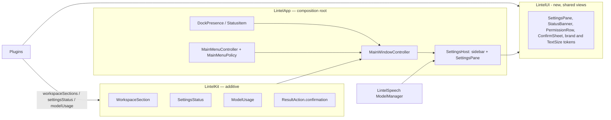

# Lintel main window and redesigned Settings

> Status: **design**, written 2026-11-04 on top of `feat/lintel-rebrand` (PR #49). Design accepted by the owner on 2026-11-04. Companion spec: `.ai/specs/2026-11-04-notes-workspace.md`. Decision record: `docs/decisions/0008-main-window-and-notes-library.md`. Prose in English, identifiers in English, UI strings English + Polish.

## 📝 TLDR

Today a click on Lintel's Dock icon opens Settings, because Settings is the only window the app has. This spec gives Lintel a **main window** that the Dock icon, the menu bar item and ⌘, open. The window hosts **sections** that plugins contribute (the Notes section comes from the companion spec) and a fully redesigned **Settings** mode: a grouped sidebar, a status banner at the top of every pane, one shared `PermissionRow`, one **Models** pane instead of model cards in every plugin pane, and one **Permissions** pane. The launcher panel stays as it is, except that ⌃X on a destructive row now asks first.

## ✅ Resolved decisions

Taken with the owner on 2026-11-04 (answers recorded in `.ai/prototypes/lintel-app/index.html`, section 8). Items that differ from the author's recommendation are marked.

| # | Decision | Consequence |
|---|---|---|
| D1 | The Dock icon opens the main window, not Settings. Settings is a mode of the same window (gear, ⌘,). | `DockPresence.ReopenAction.openSettings` becomes `.openMainWindow`. |
| D2 | One window, many sections; "more interesting things" are added as sections later. | A new additive contribution `workspaceSections` (ADR 0008). Only one section (Notes) exists at first. |
| D3 | Settings: sidebar groups Lintel (General, Features, Permissions), Search (Apps, Files, Clipboard), Voice (Dictation, Meetings), Models, Advanced. | Replaces the `NSTabViewController` toolbar. Plugin membership comes from `PluginManifest.settingsGroup`, never from plugin ids in the shell. |
| D4 | Every pane: status banner → Basics → collapsed Advanced → Data. Footer = one short sentence. | `SettingsPane` + `StatusBanner` components. |
| D5 | Permissions only through one `PermissionRow`; plugin panes show a banner, never their own permission row. | Removes the microphone rows from the Dictation and Meetings panes. |
| D6 | **Models pane owns download, remove and storage; plugin panes keep only the choice** ("Parakeet Ultra · not installed · Get it in Models"). | Removes `SpeechModelCard`, `MeetingsModelCard`, `BuiltInModelRows`. |
| D7 | Disabled plugins stay in the sidebar (dimmed, "Off") with a "Turn on" banner. | The sidebar is static; no tab jumps. |
| D8 | No "Erase all Lintel data" in Advanced. Per-plugin Erase stays in each pane's Data section. | Not designed, not built. |
| D9 | **⌃X in the launcher panel confirms too** (inline: press ⌃X again, Esc cancels). Differs from the recommendation (launcher speed). | Behaviour change in the Clipboard, Dictation and Meetings list modes; `BACKWARD_COMPATIBILITY.md` §5 note and tests. |
| D10 | `.uxproof/` (stale: Pounce paths, brand "pending") is refreshed in the first PR, visibly in the diff. | Step 0.1. |
| D11 | "Hide content" (⌘⇧H) is manual and session-only. | Belongs to the Notes section (companion spec); the shell only provides the window-level command and the blur modifier. |

## 📝 Problem Statement

Evidence is the audit in `.ai/prototypes/lintel-app/index.html` (section 1), made from the code of every pane and a debug build run in QA mode. Facts, not usage data (Lintel has no telemetry):

- **No home.** Settings is the only window. Notes and dictation history are reachable only as panel list modes.
- **Three copies of one thing.** The same speech model card (size, licence, Download, Choose Folder…) appears in Dictation and again in Meetings; microphone state is shown in Permissions, Dictation and Meetings, each with its own button.
- **Panes that do not answer "is it ready?"** Meetings is one scroll of about 1600 px; what blocks recording sits in the middle. Footers run 3–5 lines (the existing guard `no-long-footer` flags them).
- **Toolbar that does not scale.** 9–10 tabs, appearing and disappearing with plugins.
- **Hard-coded status colours and fonts** in views (`.orange`, `.green`, `.red`, `.callout`), which ignore the brand tokens and Text Size.
- **No main menu, on purpose so far.** `Sources/LintelApp` builds no `NSApp.mainMenu` (only the status item's menu; `ShellWindow` says a global menu was avoided so ⌘Q cannot fire while the launcher panel has focus). A real editing window needs ⌘, and an Edit menu (⌘C/⌘V/⌘Z in text fields), so the menu is installed only while the main window is key (Proposed Solution).

## 📝 Proposed Solution

One `MainWindowController` (AppKit window, SwiftUI content) with two modes:

1. **Workspace mode:** the left column and the content belong to the active **section**; a plugin contributes a section through `workspaceSections`. Today there is one: Notes.
2. **Settings mode:** the left column becomes the settings sidebar with a "‹ back" row; the content is a pane.

Alternatives considered:

- *Keep the toolbar tabs and only restyle:* rejected; the problem is structure (scale, duplication, no home), not paint.
- *A SwiftUI `Settings` scene plus a separate `WindowGroup`:* rejected. An agent app (`LSUIElement`) that switches its activation policy at runtime cannot rely on `showSettingsWindow:` from AppKit (documented in `SettingsWindowController`); two scenes also make "gear in the same window" impossible.
- *A section switcher (tabs/rail) from day one:* rejected for now. With one section it is dead UI; the contract allows a switcher to appear when a second section is registered (design needed then, listed in Not doing).

## 📝 Architecture



**`LintelUI` (new SwiftPM target, SwiftUI only, no I/O, ADR 0008 decision 8):** `LintelBrand`, `BrandPalette`, `TextSize` (tokens and modifier), `SettingsPane` (template), `StatusBanner`, `PermissionRow` (state passed in), `ConfirmSheet`, `ModelChoiceRow` ("Parakeet Ultra · not installed · Get it in Models") and the environment value `settingsHostStyle` (`.legacyWindow` / `.mainWindow`, default `.legacyWindow`; see Phasing). It imports `LintelKit` and `LintelCore` only, never a plugin or `LintelApp`; plugins and `LintelApp` may import it. It is in-tree only, not a protected contract. Nothing else moves into it (`StatusDerivation`, sidebar and Models stay in `LintelApp`). Why: the plugin panes (Apps, Files, Clipboard, Dictation, Meetings, Notes) are built in plugin targets, which cannot import `LintelApp`; without it D4, D5 and the colour/text rules could not hold there.

Existing: `LintelPlugin.settingsPane()` stays the way a plugin supplies pane content, so no plugin is forced to change. New: the four additive contributions below, each with an empty default. Takeaway: plugins describe *what* (sections, status, which models they use); the shell owns *where and how it looks*.

### Contract additions in `LintelKit` (additive, ADR 0008)

```swift
// Every type below has an explicit `public init` with defaults for optional fields (a memberwise init is internal).
public struct WorkspaceSection: Identifiable, Sendable {
    public let id: String                 // stable, e.g. "notes"
    public let title: LocalizedStringResource
    public let symbolName: String
    public let order: Int
    public let makeView: @MainActor @Sendable () -> AnyView                  // left column + content; the section owns its status bar, the shell owns the title bar
    public let handleRoute: @MainActor @Sendable (WorkspaceRoute) -> Bool    // init default { _ in false }; e.g. kind "openNote", id = note key
    public let willHide: @MainActor @Sendable () async -> Void               // init default {}; flush before a mode switch or window close
    public let handleClose: @MainActor @Sendable () -> Bool                  // init default { false }; ⌘W in Workspace mode: true = the section closed a tab, else the window closes after willHide
    public let menuItems: [CommandInfo]                                      // init default []; window commands (new note, palette, hide content)
}
public struct WorkspaceRoute: Sendable { public let kind: String; public let id: String }
public struct SettingsStatus: Sendable {  // the banner of a plugin's pane
    public enum Level: Sendable { case ok, attention, error, neutral }
    public let level: Level
    public let title: LocalizedStringResource
    public let detail: LocalizedStringResource?
    public let fix: SettingsStatusAction?  // at most one action
}
public struct SettingsStatusAction: Sendable {
    public enum Destination: Sendable {
        case models(packageID: String?)        // opens the Models pane, scrolled to the row when known
        case systemSettings(Permission)        // deep link, as PermissionRow does today
    }                                          // no `.custom`: the shell owns navigation; add a case only when one is needed
    public let title: LocalizedStringResource
    public let destination: Destination
}
public struct ModelKind: RawRepresentable, Hashable, Sendable   // .speech .llm .diarization (open set)
public struct ModelUsage: Sendable {
    public let packageID: String; public let kind: ModelKind; public let role: LocalizedStringResource
    public let isRequired: Bool; public let isSelected: Bool
    public let chooseFolder: (@MainActor @Sendable (URL?) -> Void)?       // the plugin writes its own folder key
}
public struct SettingsGroup: RawRepresentable, Hashable, Sendable        // .lintel .search .voice (open set)
public struct CommandInfo: Sendable { public let title: LocalizedStringResource; public let shortcut: KeyShortcut?; public let run: @MainActor @Sendable () -> Void }
public struct ActionConfirmation: Sendable { public let prompt: LocalizedStringResource }

// Declared as REQUIREMENTS in the @MainActor protocol body (so an override is reached through
// `any LintelPlugin`, see BC section 1) and given defaults in the extension:
//   var workspaceSections: [WorkspaceSection] { get }   default []
//   var settingsStatus: SettingsStatus? { get }          default nil: the shell derives ok/attention/error/neutral
//   var modelUsage: [ModelUsage] { get }                 default []
// PluginManifest: `canBeDisabled: Bool = true` and `settingsGroup: SettingsGroup = .lintel` (Apps/Files/Clipboard declare .search, Dictation/Meetings .voice).
// Permission gets `isReadable: Bool` (additive, default true; false for `.systemAudioRecording`, whose state cannot be read).
// PluginContext gets `availableCommands: @MainActor @Sendable () -> [CommandInfo]` (default `[]`) for the Notes palette and
// `openModels: @MainActor @Sendable (_ packageID: String?) -> Void` (default `{ _ in }`): opens the Models pane (D6 moved downloads there).
// ResultAction gets a stored `public let confirmation: ActionConfirmation?` and a new init parameter
// `confirmation: ActionConfirmation? = nil` placed BEFORE the trailing `perform` closure, so existing
// trailing-closure call sites compile unchanged.
```

**`settingsPane()` rule (BC §1):** it may be called while the plugin is inactive or `failed`; it must not open stores or start work and reads only settings, so a disabled plugin's pane can be drawn dimmed (`set-off`, `set-error`). Today `AppCoordinator.pluginPanes` skips inactive plugins; step 1.1 changes that and adds one test per plugin: build the pane while inactive and record zero keychain and file calls (in-memory ports).

**`canBeDisabled`:** `PluginHost.isEnabled` returns `true` and `setEnabled(false)` is a no-op when `canBeDisabled == false` (a stored `false` from `defaults write` is ignored); tested.

A plugin whose banner needs a model passes `.models(packageID:)`; the shell owns navigation, so a plugin never reaches into the window. A `modelUsage.packageID` that is not in the catalog is ignored by the Models pane and logged once (a package id is not sensitive).

`PluginManifest.canBeDisabled` and `settingsGroup` are used by the Features pane and the sidebar; `canBeDisabled` is also used by the companion spec.

### Code layout (`LintelApp`, plus `Sources/LintelUI/` for the shared views)

Dependency direction: `Window` -> `Settings/Host` -> `Settings/{Sidebar,Panes,Models}` -> `LintelUI`; `LintelUI` and the pure types depend on nothing in `Window`. Pure types (`MainMenuPolicy`, `SettingsSidebarModel`, `StatusDerivation`) hold the logic; views hold none. A file has one responsibility and stays under about 400 lines.

```
Sources/LintelApp/
  Window/     MainWindowController (one NSWindow, min 880x560, default 1180x720, frame autosave, QA arg), MainWindowRouter (routes, openNote, Dock/menu/⌘,),
              MainWindowState (mode/section/pane restore), MainMenuController (installs/removes), MainMenuPolicy (pure: window role -> MenuSpec?)
  Settings/
    Host/        SettingsHost
    Sidebar/     SettingsSidebarModel (pure grouping from manifests), SettingsSidebar
    Panes/       General, Features, Permissions, Advanced (each a SettingsPane); plugin panes (Apps ... Notes) stay in their plugin targets
    Components/  StatusDerivation (pure)
    Models/      ModelsPane, ModelRow, ModelsPaneModel over an injected ModelInventory protocol (tests never touch ModelManagers.shared)
Sources/LintelUI/  Brand/ (LintelBrand, BrandPalette, moved from LintelApp; LintelMark stays), TextSize, Components/ (SettingsPane, StatusBanner, PermissionRow, ConfirmSheet, ModelChoiceRow), Environment (settingsHostStyle)
Tests/LintelAppTests/{Window,Settings,Models}/ and Tests/LintelUITests/   mirror the folders
```

- `MainWindowController`: opens on Dock reopen, "Open Notes" (the `notes.open` command of the companion spec), ⌘, (Settings mode), `--qa-window`; all of it behind the release gate of ADR 0008 until 6.3. Built once and reused.
- `MainMenu`: the shell avoids a global main menu (`ShellWindow`: ⌘Q must not fire while the launcher panel has focus). **The menu is installed while `NSApp.isActive` and the key window is the main window, a sheet attached to it, its child windows or popovers, or an open or save panel it presented; it is removed when the launcher panel, a HUD or About becomes key, or the app resigns active.** (Otherwise ⌘V, ⌘Z and ⌘A would stop working in `ConfirmSheet`, Save .md and Choose Folder panels.) It has Settings… ⌘, , an Edit menu and a Window menu; **no Quit, no Hide, no Close item**: `ShellWindow` keeps handling ⌘W (in Workspace mode it asks the section's `handleClose` first, then closes the window), so it cannot fire twice. Logic is the pure `MainMenuPolicy.menu(for keyWindowRole:) -> MenuSpec?`, tested with a table of window roles; real key-window behaviour is a manual QA item.
- `SettingsHost`: the sidebar from D3 and the `SettingsPane` template (banner, Basics, Advanced `DisclosureGroup`, Data). `StatusBanner` (levels from `status.*` tokens, one primary action, announced as one unit; the sidebar attention dot and Notes state dots carry text in their accessibility labels, for example "Needs attention"), `PermissionRow` (the only permission view), `ModelRow` + `ModelsPane` (size, "used by" chips from `modelUsage`, Download / Remove / progress, "Choose Folder…" per usage as the D6 storage action, listed through one `[any ModelCatalogProviding]` array, one line per kind), `PermissionsPane` (one row per `Permission`, "needed for" from `requiredPermissions`, dimmed when its feature is off).
- Settings keys added: `app.mainWindow.mode` (`workspace`/`settings`), `app.mainWindow.section` (String), `app.mainWindow.settingsPane` (String). Window geometry is AppKit frame autosave (outside `SettingsStore`; not a protected key). No existing key changes.
- Diagnostics: one log line without content for an unknown package id or a section that fails to build (`Logger(subsystem: "com.lintelapp", category: "window")`, codes only).
- Budgets (to be measured, `docs/perf.md`): main window visible within 200 ms of a Dock click; pane switch under 100 ms; Models pane first paint under 150 ms with downloads running.
- Copy rules: every count string uses String Catalog plural variations; a test asserts each key with `%lld` has `pl` `one`, `few`, `many` and `other`. Dates and durations use `Date.FormatStyle` and `Duration.UnitsFormatStyle`, never concatenation. The window title is always "Lintel".

## 📝 Data Model

None. No database or migration. `UserDefaults` keys above (additive, BC §3).

## 📝 UI/UX

Prototype: `.ai/prototypes/lintel-app/index.html` (design v2, accepted by the owner on 2026-11-04; acceptance was given verbally in the session and recorded here; verification covered 3 of 48 screens visually, see the prototype's "Evidence limits"). Screens this spec implements: `set-general`, `set-features`, `set-permissions`, `set-apps`, `set-files`, `set-clipboard`, `set-dictation`, `set-meetings`, `set-models`, `set-advanced`, `set-off`, `set-error`, `set-loading`, `shell-menu`, `shell-menu-rec`, `shell-welcome-*`, `shell-panel-confirm`, `dlg-*` (confirmations for Clear/Erase in panes); `shell-hud-meeting`, `-processing`, `-error` and `-suggest` are **unchanged** HUDs (no work here).

Rules (from `.uxproof/conventions.md`, updated in step 0.1):

- Colour only through `LintelBrand` (a source-scanning test (2.3) replaces the `.uxproof` raw-colour guard); status only through `StatusBanner`; text only through `TextSize` tokens; **no glass in the window** (system fills), glass stays on the panel, HUDs and menu.
- Copy: sentences about 15 words, buttons are verbs, errors say what happened and what to do; every string has `en` and `pl` (`StringCatalogTests`).
- Reduce Motion respected; full keyboard path (sidebar, banner action, rows, Advanced disclosure); state changes announced; checked at S…XL.
- At XL the window keeps its minimum width; panes scroll, the sidebar never truncates a group label (the prototype shows tabs truncating in Notes at XL; handled in the companion spec).

**Deviations from the prototype** (decided here; the prototype is updated in step 0.2):

| Prototype | Decision |
|---|---|
| `shell-menu-rec` shows "Stop Recording" | Later: `PluginCommand` has a static title; a dynamic `menuState` is a contract change not worth this release. |
| `shell-welcome-denied` | Later: onboarding has no denied state; Permissions pane and banner cover it. |
| `set-dictation` "Language: Automatic" | Dropped: only `pl` and `en` exist. |
| `set-off` / `set-error` dimmed real controls | Built, through the `settingsPane()` inactive rule above. |
| Models banner "1 model is needed" | Built from `ModelUsage.isRequired` / `isSelected`. |
| Meetings permission "2 things to do" | Built; a permission whose state cannot be read (system audio) counts as neutral, see 2.2. |
| Settings sidebar has no Notes pane | Added: the Notes pane sits in group Lintel after Features (it has settings and a Data section). |

## 📝 Edge Cases & Failure Scenarios

| Case | Behaviour |
|---|---|
| Plugin `failed` (for example Keychain error) | Pane shows an `error` banner with "Try again"; controls dimmed; nothing deleted (existing rule). |
| Permission denied after the first ask | Banner shows `attention` with "Open System Settings"; `PermissionRow` says "Not allowed". |
| Plugin off | Sidebar item dimmed with "Off"; pane shows a neutral banner "Turn on"; options dimmed, not hidden. |
| Model download fails or is cancelled | `ModelRow` shows the error and "Try again"; partial files stay where `ModelManager` keeps them. |
| Model removal while in use (notes running) | Refused with the existing message (`ModelManager` remove refused while leased). |
| Window opened in QA mode | Ordered front without activating the app (as `SettingsWindowController.activatesApp = false` does today). |
| `app.showInDock` off | The window still opens from the menu bar item and ⌘, ; no Dock-click path. |
| A saved frame from an older layout | The autosave name is new (`MainWindow`), so no old frame applies; a frame outside every screen is reset to centered. |
| ⌃X confirmation with the panel losing focus, a list reload, a selection change, or 5 s of waiting | Pending confirmation is cancelled; nothing is deleted. |
| ⌘, while a sheet is open or while a model download or removal runs | The window comes forward in Settings mode; the sheet and the running operation are untouched. |
| Dock click while only the launcher panel is visible | Counts as no visible window: the main window opens. |

## 📝 Risks & Impact Review

| Risk | Who bears it | Mitigation |
|---|---|---|
| **R-A1: protected plugin contract changes** (`LintelPlugin`, `ResultAction`, `PluginManifest`) | Every plugin target | All additions are additive with defaults (`BACKWARD_COMPATIBILITY.md` §1); `risk-high`; every in-tree plugin compiles unchanged in the contract PR (step 1.1). ADR 0008. |
| **R-A2: ⌃X behaviour change in the launcher** | Anyone with the muscle memory (Clipboard, Dictation, Meetings modes) | Owner decision D9, against the recommendation. One extra keypress; inline, Esc cancels; documented in BC §5; per-mode tests. Reversible by one flag in `ResultAction.confirmation`. |
| R-A3: a main menu makes ⌘Q, ⌘H or ⌘, fire while the launcher panel has focus (the reason `ShellWindow` avoids one) | Anyone using the launcher | The menu exists only while the main window is key, has no Quit or Hide, and is removed on resign. Tests: the pure `MainMenuPolicy` table (panel/HUD/About give no menu; window, its sheet, panels and popovers give the menu; no Quit/Hide/Close); real key-window checks are manual QA; ⌘W still closes via `ShellWindow` exactly once. |
| R-A4: Settings rewrite regresses a pane (a setting no longer reachable) | Existing users | Panes are migrated one by one (Phases 4–5) with the old controller alive until the last one moves; a test lists every `SettingsKeys` entry and its owning pane; no key renamed. |
| R-A5: new `app → LintelSpeech` edge (Models pane) and new target `LintelUI` | Package graph | Allowed (`LintelApp` is the composition root); `LintelSpeechTests` keep asserting that `LintelSpeech` depends on no repository target; a package-graph test asserts `LintelUI` imports no plugin and not `LintelApp` (1.6). |
| R-A6: Polish strings drift | PL users | `StringCatalogTests` plus the plural-forms test; each PR lists new keys. |
| R-A7: a release ships half the Settings rewrite | Users | The release gate of ADR 0008: the window is DEBUG-only until 6.3 and every pane PR is releasable in the old window (Phasing), so any tag is safe. |

Rollback: the old `SettingsWindowController` is deleted, with the gate, only in the last step (6.3); until then a revert of a single pane PR restores it. No data changes anywhere, so rollback never touches user data.

## 📝 Not doing

A section switcher (until a second section exists), "Erase all Lintel data" (D8), in-app language switch, custom window chrome or glass in the window, any new setting beyond the three window keys.

## 📋 Phasing

Step 6.2 (⌃X confirmation) is its own PR and depends on 1.1 (the `ResultAction.confirmation` field) only; it carries no contract change itself. Release rule: ADR 0008, "Release gate" (terms **window enabled** / **Notes enabled**). Release users keep today's *window* until 6.3; pane bodies change in place as each pane PR merges, so every pane PR must be releasable inside `SettingsWindowController` too (screenshots of the pane in both hosts). The host tells a pane where it is drawn through the SwiftUI environment value `settingsHostStyle` (`.legacyWindow` / `.mainWindow`, default `.legacyWindow`), declared in `LintelUI`, not in `LintelKit`. `SettingsWindowController` leaves the default; the main window sets `.mainWindow`. Panes hide the model cards and permission rows only for `.mainWindow`. 6.3 deletes the `.legacyWindow` branches; the value stays (always `.mainWindow`) and is removed in a later cleanup PR.

Each phase ships on its own `feat/` branch and PR; `risk-high` follows the SDLC definition (contract, store, migrations, Keychain): Phase 1 and 6.2 here.

- **Phase 0:** contract refresh and decision record.
- **Phase 1:** contract + window shell (Dock, menu bar, ⌘, , main menu), hosting the existing panes unchanged.
- **Phase 2:** Settings sidebar, `SettingsPane`, `StatusBanner`.
- **Phase 3:** Permissions and Models panes, `ConfirmSheet`; remove the duplicated permission and model UI.
- **Phase 4:** General, Features, Apps, Files, Clipboard onto the template.
- **Phase 5:** Dictation and Meetings onto the template.
- **Phase 6:** Welcome final page, panel ⌃X confirmation, cleanup and docs (`SettingsWindowController` deleted at 6.3).

## 📋 Implementation Plan

### Phase 0: contract refresh

- **0.1** Add `.uxproof/` to git for the first time (it is untracked today): the first commit is the stale copy, the second the refresh, so the diff shows it. Refresh (`contract.json`, `components.json`, `tokens.json`, `conventions.md`, `guards.json`): Lintel paths, approved `brand.*` tokens (`brand.accent` #267C6C / #6BBDAB, `brand.accent.text` #036152 / #6BBDAB), archetypes `workspace-window` and `settings-pane` (banner → Basics → Advanced → Data), guard for raw status colours updated to `LintelBrand`. Test: `swift build` unaffected; guards parse (JSON valid). Docs-only PR, says so. The `no-long-footer` and raw-colour guards are also implemented as Swift source-scanning tests in `LintelAppTests` (2.3, below), so CI can run them.
- **0.2** Add `.ai/prototypes/lintel-app/` (design v2) to the repository and update its header, README and section 8 to "accepted 2026-11-04, 48 screens", removing the reference to the missing `index-v1-notes-columns.html`; apply the deviation tables of both specs. Docs-only.

### Phase 1: contract and window shell

- **1.1** `LintelKit`: add `WorkspaceSection` (+ `WorkspaceRoute`), `SettingsStatus`, `ModelUsage`/`ModelKind`, `SettingsGroup`, `CommandInfo`, `ActionConfirmation`, `Permission.isReadable`, `PluginContext.availableCommands` and `openModels`, `SettingsStatusAction`, the `LintelPlugin` defaults, `ResultAction.confirmation` (default nil), `PluginManifest.canBeDisabled` and `settingsGroup`, all with explicit public inits; `PluginHost` enforces `canBeDisabled`; `AppCoordinator` builds panes for inactive plugins **only for the main window**; the old controller keeps skipping inactive plugins until 6.3. Tests: `LintelKitTests` assert every default is empty and every in-tree plugin compiles unchanged; `canBeDisabled == false` ignores a stored `false`; a pane built while inactive records zero keychain and file calls, per plugin. Update `BACKWARD_COMPATIBILITY.md` §1 (what was added) and AGENTS.md "Plugin contracts".
- **1.2** `MainWindowController` + window state keys (`app.mainWindow.mode|section|settingsPane`, declared in `SettingsKeys`; added to BC §3 in this step), frame autosave, QA argument `--qa-window workspace|settings`. **Rule: no registered sections means Settings mode**; a stored mode `workspace`, or an unknown section or pane id, restores to the first available section, else to Settings → General. Tests: restoration from in-memory settings including the fallbacks; frame fallback when off-screen (injected screen list).
- **1.3** Host the existing Settings panes inside the window's Settings mode unchanged (temporary adapter over the current `SettingsWindowController` panes). Tests: every pane id reachable, `--qa-settings <pane>` still works. Screenshots light/dark.
- **1.4** `MainMenuController` + pure `MainMenuPolicy` (see Code layout). Tests: the policy table of window roles (exact items and key equivalents, no Quit/Hide/Close); ⌘W once; a section whose `handleClose` returns true keeps the window open. Manual QA (real key windows): ⌘, and ⌘C in a text field; `app.showInDock` toggled with the window open keeps ⌘C/⌘V working.
- **1.5** `DockPresence.reopenAction` → `.openMainWindow`, `MainWindowRouter` sends Dock, ⌘, and "Settings…" to the window only while the window is enabled (`#if DEBUG`), else to `SettingsWindowController` as today (opens Settings mode while no section exists, so the window is never empty); the status item's "Settings…" follows the same route. `PluginContext.openModels` is wired by `MainWindowRouter` with the same gate: while the window is not enabled it opens `SettingsWindowController` on the pane of the plugin whose `modelUsage` lists `packageID` (for `nil`, the calling plugin's pane, which still shows the model card, `.legacyWindow`); `openNote` follows the gate too. Tests: `DockPresenceTests` updated, including `hasVisibleWindows` with only the launcher panel visible; with the window not enabled `openModels("parakeet-…")` selects the Dictation pane in the old controller, with it enabled the Models pane and the row.
- **1.6** `LintelUI` target: move `LintelBrand`, `BrandPalette` and `TextSize` from `LintelApp` into it, `LintelApp` imports it, no behaviour change; add the `settingsHostStyle` environment key. Tests: existing `BrandTests` and `BrandContrastTests` pass unchanged (moved to `LintelUITests`); a package-graph test reads `Package.swift` and the `LintelUI` sources and asserts it imports only `LintelKit` and `LintelCore`. Update AGENTS.md (dependency line `plugins → LintelUI / LintelSpeech / LintelPersistence / LintelCore → LintelKit`, Package manifest row, Brand row) in this step.

### Phase 2: sidebar and template

- **2.1** `SettingsSidebar` + `SettingsSidebarModel` with the five groups, dimmed "Off" items, a per-item attention dot with an accessibility label; plugin pane order from `manifest.order`, group from `manifest.settingsGroup`. Tests: grouping and ordering come only from manifests; the ordered list of focusable ids (the model of the focus order); real keyboard traversal and VoiceOver are manual QA items with a checklist in the PR.
- **2.2** `StatusBanner` (in `LintelUI`) + `SettingsStatus` plumbing (`StatusDerivation`, pure; default: failed → error, missing required **readable** permission → attention, an unreadable permission → neutral, off → neutral, else ok). Tests: derivation table including the unreadable row; accessibility label is one string; contrast pairs added to `BrandContrastTests`.
- **2.3** `SettingsPane` template and `StatusBanner`/`PermissionRow`/`ConfirmSheet` in `LintelUI` (banner, Basics, `DisclosureGroup` Advanced, Data) and the one-sentence footer helper. Tests: source-scanning tests (`no-long-footer`, no raw status colours) cover `Sources/LintelUI/`, `Sources/LintelApp/Settings/` and the view files of every plugin pane already moved onto the template (a list that grows with each pane PR and is complete at 5.3).
- **2.4** `SettingsKeysCoverageTests`: every key declared in `SettingsKeys` and in each plugin's settings type is owned by exactly one pane (a table in the test; `plugins.notes.*` belong to Notes' pane, the inspector toggles included), so no setting becomes unreachable (R-A4).

### Phase 3: Permissions and Models

- **3.1** `PermissionRow` (`LintelUI`) as the only permission view; `PermissionsPane` ("needed for" from `requiredPermissions`). Tests: one row per `Permission`; state text per `PermissionStatus`.
- **3.2** `ModelsPane` + `ModelRow` + `ModelsPaneModel` over the `ModelInventory` port (the real one wraps `ModelManagers.shared`); "used by" from `modelUsage` (Dictation and Meetings declare theirs in this step). Tests: install/remove/progress with a fake inventory; remove refused while leased; "1 model is needed" derived from `isRequired`/`isSelected`; "Choose Folder…" calls the usage's `chooseFolder`.
- **3.3** Remove microphone rows and model cards from Dictation and Meetings panes; replace with the one-line summary + banner action; every `openSettings` call that leads to a model download moves to `openModels` (Meetings: `MeetingsPlugin.swift`, `MeetingsPlugin+Library.swift`, the record flow; routing per 1.5). The old controller draws panes with `settingsHostStyle = .legacyWindow` and keeps today's rows (Phasing). Tests: a pane rendered with `.legacyWindow` still contains the model card and permission rows (release parity); a source-scanning test that no `.mainWindow` branch references `SpeechModelCard`, `MeetingsModelCard`, `BuiltInModelRows`, `MicrophoneRows` or `MeetingsMicrophoneRows`; a second one lists every `openSettings` call and fails on one that leads to a model download.
- **3.4** Confirmation sheets for Clear/Erase in panes (`ConfirmSheet` from `LintelUI`, Cancel is the default button; used by 5.3). Tests: copy and default button.

### Phase 4: shell and search panes

- **4.1** General and Features (Notes appears here as an "Always on" chip from `canBeDisabled`; the Notes Data actions live in NotesPlugin's own pane, group `.lintel` after Features, companion spec 4.7).
- **4.2** Apps. **4.3** Files (banner "Indexing hasn't started": Start Indexing, Allow Full Disk Access). **4.4** Clipboard. Each: status, Basics, Advanced, Data; strings en+pl; screenshots light/dark, S and XL, EN and PL.

### Phase 5: voice panes

- **5.1** Dictation (banner for the model, Basics shortcut/model summary/language/cleanup, Advanced input device/restore clipboard, History).
- **5.2** Meetings (banner "2 things to do" with "Fix Next", Basics, Advanced echo/suggestions/test, Privacy and data). Tests: banner counts match missing permission + model.
- **5.3** Confirmation copy of Clear Library, Clear History and Erase Data in Meetings and Dictation says that edited copies kept in Notes stay until deleted there (companion spec, "Retention"); the Notes sentence is shown only when the Notes plugin is registered; uses `ConfirmSheet` from 3.4; strings en+pl, test on the sheet copy.

### Phase 6: finish

- **6.1** Welcome: final "You're set" page pointing at the window (shown only while the window is enabled); `OnboardingController` test.
- **6.2** **Its own PR, labelled `risk-high`** (a user-visible behaviour change, independent of the window; depends on 1.1 only): `ResultAction.confirmation` handled by the shell (`PanelModel`): inline "Press ⌃X again", Esc, blur, list reload or selection change cancels the pending state, and it expires after 5 seconds; Clipboard, Dictation, Meetings delete actions opt in. Tests per mode; BC §5 note; the AGENTS.md rows that say "without a confirmation" are updated.
- **6.3** Remove the gate, `SettingsWindowController`, the adapter and the `.legacyWindow` branches; update `docs/qa.md` (`--qa-window`), AGENTS.md rows, `Resources/Localizable.xcstrings` check, full validation gate + TSan.

Evidence for each UI PR: screenshots of the running app (light and dark, S and XL, EN and PL) per `docs/qa.md`, plus an explicit "Not verified" list.
