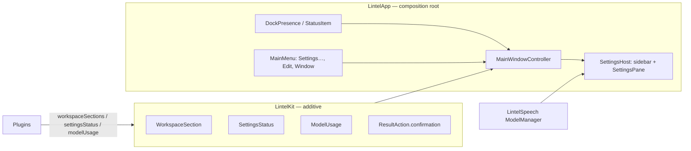

# Lintel main window and redesigned Settings

> Status: **design**, written 2026-11-04 on top of `feat/lintel-rebrand` (PR #49). Design accepted by the owner on 2026-11-04. Companion spec: `.ai/specs/2026-11-04-notes-workspace.md`. Decision record: `docs/decisions/0008-main-window-and-notes-library.md`. Prose in English, identifiers in English, UI strings English + Polish.

## 📝 TLDR

Today a click on Lintel's Dock icon opens Settings, because Settings is the only window the app has. This spec gives Lintel a **main window** that the Dock icon, the menu bar item and ⌘, open. The window hosts **sections** that plugins contribute (the Notes section comes from the companion spec) and a fully redesigned **Settings** mode: a grouped sidebar, a status banner at the top of every pane, one shared `PermissionRow`, one **Models** pane instead of model cards in every plugin pane, and one **Permissions** pane. The launcher panel stays as it is, except that ⌃X on a destructive row now asks first.

## ✅ Resolved decisions

Taken with the owner on 2026-11-04 (answers recorded in `.ai/prototypes/lintel-app/index.html`, section 8). Items that differ from the author's recommendation are marked.

| # | Decision | Consequence |
|---|---|---|
| D1 | The Dock icon opens the main window, not Settings. Settings is a mode of the same window (gear, ⌘,). | `DockPresence.ReopenAction.openSettings` becomes `.openMainWindow`. |
| D2 | One window, many sections; "more interesting things" are added as sections later. | A new additive contribution `workspaceSections` (ADR 0008). Only one section (Notes) exists at first. |
| D3 | Settings: sidebar groups Lintel (General, Features, Permissions), Search (Apps, Files, Clipboard), Voice (Dictation, Meetings), Models, Advanced. | Replaces the `NSTabViewController` toolbar. |
| D4 | Every pane: status banner → Basics → collapsed Advanced → Data. Footer = one short sentence. | `SettingsPane` + `StatusBanner` components. |
| D5 | Permissions only through one `PermissionRow`; plugin panes show a banner, never their own permission row. | Removes the microphone rows from the Dictation and Meetings panes. |
| D6 | **Models pane owns download, remove and storage; plugin panes keep only the choice** ("Parakeet Ultra · not installed · Get it in Models"). | Removes `SpeechModelCard`, `MeetingsModelCard`, `BuiltInModelRows`. |
| D7 | Disabled plugins stay in the sidebar (dimmed, "Off") with a "Turn on" banner. | The sidebar is static; no tab jumps. |
| D8 | No "Erase all Lintel data" in Advanced. Per-plugin Erase stays in each pane's Data section. | Not designed, not built. |
| D9 | **⌃X in the launcher panel confirms too** (inline: press ⌃X again, Esc cancels). Differs from the recommendation (launcher speed). | Behaviour change in the Clipboard, Dictation and Meetings list modes; `BACKWARD_COMPATIBILITY.md` §5 note and tests. |
| D10 | `.uxproof/` (stale: Pounce paths, brand "pending") is refreshed in the first PR, visibly in the diff. | Step 0.1. |
| D11 | "Hide content" (⌘⇧H) is manual and session-only. | Belongs to the Notes section (companion spec); the shell only provides the window-level command and the blur modifier. |

## 📝 Problem Statement

Evidence is the audit in `.ai/prototypes/lintel-app/index.html` (section 1), made from the code of every pane and a debug build run in QA mode. Facts, not usage data (Lintel has no telemetry):

- **No home.** Settings is the only window. Notes and dictation history are reachable only as panel list modes.
- **Three copies of one thing.** The same speech model card (size, licence, Download, Choose Folder…) appears in Dictation and again in Meetings; microphone state is shown in Permissions, Dictation and Meetings, each with its own button.
- **Panes that do not answer "is it ready?"** Meetings is one scroll of about 1600 px; what blocks recording sits in the middle. Footers run 3–5 lines (the existing guard `no-long-footer` flags them).
- **Toolbar that does not scale.** 9–10 tabs, appearing and disappearing with plugins.
- **Hard-coded status colours and fonts** in views (`.orange`, `.green`, `.red`, `.callout`), which ignore the brand tokens and Text Size.
- **No main menu, on purpose so far.** `Sources/LintelApp` builds no `NSApp.mainMenu` (only the status item's menu; `ShellWindow` says a global menu was avoided so ⌘Q cannot fire while the launcher panel has focus). A real editing window needs ⌘, and an Edit menu (⌘C/⌘V/⌘Z in text fields), so the menu is installed only while the main window is key (Proposed Solution).

## 📝 Proposed Solution

One `MainWindowController` (AppKit window, SwiftUI content) with two modes:

1. **Workspace mode:** the left column and the content belong to the active **section**; a plugin contributes a section through `workspaceSections`. Today there is one: Notes.
2. **Settings mode:** the left column becomes the settings sidebar with a "‹ back" row; the content is a pane.

Alternatives considered:

- *Keep the toolbar tabs and only restyle:* rejected; the problem is structure (scale, duplication, no home), not paint.
- *A SwiftUI `Settings` scene plus a separate `WindowGroup`:* rejected. An agent app (`LSUIElement`) that switches its activation policy at runtime cannot rely on `showSettingsWindow:` from AppKit (documented in `SettingsWindowController`); two scenes also make "gear in the same window" impossible.
- *A section switcher (tabs/rail) from day one:* rejected for now. With one section it is dead UI; the contract allows a switcher to appear when a second section is registered (design needed then, listed in Not doing).

## 📝 Architecture



Existing: `LintelPlugin.settingsPane()` stays the way a plugin supplies pane content, so no plugin is forced to change. New: the four additive contributions below, each with an empty default. Takeaway: plugins describe *what* (sections, status, which models they use); the shell owns *where and how it looks*.

### Contract additions in `LintelKit` (additive, ADR 0008)

```swift
public struct WorkspaceSection: Identifiable, Sendable {
    public let id: String                 // stable, e.g. "notes"
    public let title: LocalizedStringResource
    public let symbolName: String
    public let order: Int
    public let makeView: @MainActor @Sendable () -> AnyView   // left column + content; the shell provides the chrome
}
public struct SettingsStatus: Sendable {  // the banner of a plugin's pane
    public enum Level: Sendable { case ok, attention, error, neutral }
    public let level: Level
    public let title: LocalizedStringResource
    public let detail: LocalizedStringResource?
    public let fix: SettingsStatusAction?  // at most one action
}
public struct SettingsStatusAction: Sendable {
    public enum Destination: Sendable {
        case models(packageID: String?)        // opens the Models pane, scrolled to the row when known
        case systemSettings(Permission)        // deep link, as PermissionRow does today
        case custom(@MainActor @Sendable () -> Void)
    }
    public let title: LocalizedStringResource
    public let destination: Destination
}
public struct ModelUsage: Sendable { public let packageID: String; public let role: LocalizedStringResource }
public struct ActionConfirmation: Sendable { public let prompt: LocalizedStringResource }

// Declared as REQUIREMENTS in the @MainActor protocol body (so an override is reached through
// `any LintelPlugin`, see BC section 1) and given defaults in the extension:
//   var workspaceSections: [WorkspaceSection] { get }   default []
//   var settingsStatus: SettingsStatus? { get }          default nil: the shell derives ok/attention/error/neutral
//   var modelUsage: [ModelUsage] { get }                 default []
// ResultAction gets a stored `public let confirmation: ActionConfirmation?` and a new init parameter
// `confirmation: ActionConfirmation? = nil` placed BEFORE the trailing `perform` closure, so existing
// trailing-closure call sites compile unchanged.
```

A plugin whose banner needs a model passes `.models(packageID:)`; the shell owns navigation, so a plugin never reaches into the window. A `modelUsage.packageID` that is not in the catalog is ignored by the Models pane and logged once (a package id is not sensitive).

`PluginManifest` also gets `canBeDisabled: Bool = true` (used by the companion spec; defined here because the Features pane renders it).

### Shell components (all in `LintelApp`)

- `MainWindowController`: one `NSWindow` (min 880×560, default 1180×720), frame autosaved, remembers mode and section. Opens on Dock reopen, menu "Open Notes", ⌘, (Settings mode), `--qa-window`.
- `MainMenu`: the shell deliberately avoids a global main menu (`ShellWindow` documents why: its Quit ⌘Q would also fire while the launcher panel has focus). So the menu is **installed only while the main window is key and removed when it resigns** (`NSApp.mainMenu` is `nil` otherwise, as today). It contains Settings… ⌘, , an Edit menu (the standard undo/redo/cut/copy/paste/select all/find, needed by any text field) and a Window menu; it contains **no Quit and no Hide** (Quit stays in the status item menu and the Dock menu), and no Close item (`ShellWindow` keeps handling ⌘W, so it cannot fire twice).
- `SettingsHost` / `SettingsSidebar` / `SettingsPane`: the sidebar from D3; `SettingsPane` template (banner, Basics, Advanced `DisclosureGroup`, Data).
- `StatusBanner` (levels from `status.*` tokens, one primary action, announced to VoiceOver as one unit), `PermissionRow` (existing, becomes the only permission view), `ModelRow` + `ModelsPane` (size, "used by" chips from `modelUsage`, Download / Remove / progress, folder choice behind "Choose Folder…"), `PermissionsPane` (one row per `Permission`, "needed for" from plugins' `requiredPermissions`, dimmed when its feature is off).
- Settings keys added: `app.mainWindow.mode` (`workspace`/`settings`), `app.mainWindow.section` (String), `app.mainWindow.settingsPane` (String). Window geometry is AppKit frame autosave (stored by AppKit in the defaults domain under its own `NSWindow Frame` key, outside `SettingsStore`; not a protected key). No existing key changes.

## 📝 Data Model

None. No database or migration. `UserDefaults` keys above (additive, BC §3).

## 📝 UI/UX

Prototype: `.ai/prototypes/lintel-app/index.html` (design v2, accepted by the owner on 2026-11-04; acceptance was given verbally in the session and recorded here; verification covered 3 of 48 screens visually, see the prototype's "Evidence limits"). Screens this spec implements: `set-general`, `set-features`, `set-permissions`, `set-apps`, `set-files`, `set-clipboard`, `set-dictation`, `set-meetings`, `set-models`, `set-advanced`, `set-off`, `set-error`, `set-loading`, `shell-menu`, `shell-menu-rec`, `shell-welcome-*`, `shell-panel-confirm`, `dlg-*` (confirmations for Clear/Erase in panes).

Rules (from `.uxproof/conventions.md`, updated in step 0.1):

- Colour only through `LintelBrand`; status only through `StatusBanner`; text only through `TextSize` tokens; **no glass in the window** (system fills), glass stays on the panel, HUDs and menu.
- Copy: sentences about 15 words, buttons are verbs, errors say what happened and what to do; every string has `en` and `pl` (`StringCatalogTests`).
- Reduce Motion respected; full keyboard path (sidebar, banner action, rows, Advanced disclosure); state changes announced; checked at S…XL.
- At XL the window keeps its minimum width; panes scroll, the sidebar never truncates a group label (the prototype shows tabs truncating in Notes at XL; handled in the companion spec).

## 📝 Edge Cases & Failure Scenarios

| Case | Behaviour |
|---|---|
| Plugin `failed` (for example Keychain error) | Pane shows an `error` banner with "Try again"; controls dimmed; nothing deleted (existing rule). |
| Permission denied after the first ask | Banner shows `attention` with "Open System Settings"; `PermissionRow` says "Not allowed". |
| Plugin off | Sidebar item dimmed with "Off"; pane shows a neutral banner "Turn on"; options dimmed, not hidden. |
| Model download fails or is cancelled | `ModelRow` shows the error and "Try again"; partial files stay where `ModelManager` keeps them. |
| Model removal while in use (notes running) | Refused with the existing message (`ModelManager` remove refused while leased). |
| Window opened in QA mode | Ordered front without activating the app (as `SettingsWindowController.activatesApp = false` does today). |
| `app.showInDock` off | The window still opens from the menu bar item and ⌘, ; no Dock-click path. |
| A saved frame from an older layout | The autosave name is new (`MainWindow`), so no old frame applies; a frame outside every screen is reset to centered. |
| ⌃X confirmation with the panel losing focus, a list reload, a selection change, or 5 s of waiting | Pending confirmation is cancelled; nothing is deleted. |
| ⌘, while a sheet is open or while a model download or removal runs | The window comes forward in Settings mode; the sheet and the running operation are untouched. |
| Dock click while only the launcher panel is visible | Counts as no visible window: the main window opens. |
| `app.showInDock` turned off with the window open | The menu is still installed while the window is key; the window keeps working until closed. |
| `modelUsage.packageID` not in the catalog | Ignored by the Models pane, one log line without content. |

## 📝 Risks & Impact Review

| Risk | Who bears it | Mitigation |
|---|---|---|
| **R-A1: protected plugin contract changes** (`LintelPlugin`, `ResultAction`, `PluginManifest`) | Every plugin target | All additions are additive with defaults (`BACKWARD_COMPATIBILITY.md` §1); `risk-high`; every in-tree plugin compiles unchanged in the contract PR (step 1.1). ADR 0008. |
| **R-A2: ⌃X behaviour change in the launcher** | Anyone with the muscle memory (Clipboard, Dictation, Meetings modes) | Owner decision D9, against the recommendation. One extra keypress; inline, Esc cancels; documented in BC §5; per-mode tests. Reversible by one flag in `ResultAction.confirmation`. |
| R-A3: a main menu makes ⌘Q, ⌘H or ⌘, fire while the launcher panel has focus (the reason `ShellWindow` avoids one) | Anyone using the launcher | The menu exists only while the main window is key, has no Quit or Hide, and is removed on resign. Tests: with the panel key `NSApp.mainMenu` is `nil`; with the window key the item set and key equivalents are exactly the intended ones; ⌘W still closes via `ShellWindow` exactly once. |
| R-A4: Settings rewrite regresses a pane (a setting no longer reachable) | Existing users | Panes are migrated one by one (Phases 4–5) with the old controller alive until the last one moves; a test lists every `SettingsKeys` entry and its owning pane; no key renamed. |
| R-A5: new `app → LintelSpeech` dependency edge (Models pane) | Package graph | Allowed (`LintelApp` is the composition root); `LintelSpeechTests` keep asserting that `LintelSpeech` depends on no repository target. |
| R-A6: Polish strings drift | PL users | `StringCatalogTests`; each PR lists new keys. |

Rollback: the old `SettingsWindowController` is deleted only in the last step (6.4); until then a revert of a single pane PR restores it. No data changes anywhere, so rollback never touches user data.

## 📝 Not doing

A section switcher (until a second section exists), "Erase all Lintel data" (D8), in-app language switch, custom window chrome or glass in the window, any new setting beyond the three window keys.

## 📋 Phasing

Step 6.2 (⌃X confirmation) is deliberately its own PR and may merge independently of the window (it does not depend on it); the rest forms one stack.

Each phase ships on its own `feat/` branch and PR; the stack is `risk-high` (contract) only in Phase 1.

- **Phase 0:** contract refresh and decision record.
- **Phase 1:** contract + window shell (Dock, menu bar, ⌘, , main menu), hosting the existing panes unchanged.
- **Phase 2:** Settings sidebar, `SettingsPane`, `StatusBanner`.
- **Phase 3:** Permissions and Models panes; remove the duplicated permission and model UI.
- **Phase 4:** General, Features, Apps, Files, Clipboard onto the template.
- **Phase 5:** Dictation and Meetings onto the template.
- **Phase 6:** Welcome final page, panel ⌃X confirmation, cleanup and docs.

## 📋 Implementation Plan

### Phase 0: contract refresh

- **0.1** Refresh `.uxproof/` (`contract.json`, `components.json`, `tokens.json`, `conventions.md`, `guards.json`): Lintel paths, approved `brand.*` tokens (`brand.accent` #267C6C / #6BBDAB, `brand.accent.text` #036152 / #6BBDAB), archetypes `workspace-window` and `settings-pane` (banner → Basics → Advanced → Data), guard for raw status colours updated to `LintelBrand`. Test: `swift build` unaffected; guards parse (JSON valid). Docs-only PR, says so.
- **0.2** Add `.ai/prototypes/lintel-app/` (design v2) to the repository. Docs-only.

### Phase 1: contract and window shell

- **1.1** `LintelKit`: add `WorkspaceSection`, `SettingsStatus`, `ModelUsage`, `ActionConfirmation`, the `LintelPlugin` defaults, `ResultAction.confirmation` (default nil), `PluginManifest.canBeDisabled`. Tests: `LintelKitTests` assert every default is empty and every in-tree plugin compiles unchanged. Update `BACKWARD_COMPATIBILITY.md` §1 (what was added) and AGENTS.md "Plugin contracts".
- **1.2** `MainWindowController` + window state keys (`app.mainWindow.mode|section|settingsPane`, declared in `SettingsKeys`; added to BC §3 in this step), frame autosave, QA argument `--qa-window workspace|settings`. **Rule: no registered sections means Settings mode**; a stored mode `workspace`, or an unknown section or pane id, restores to the first available section, else to Settings → General. Tests: restoration from in-memory settings including the fallbacks; frame fallback when off-screen (injected screen list).
- **1.3** Host the existing Settings panes inside the window's Settings mode unchanged (temporary adapter over the current `SettingsWindowController` panes). Tests: every pane id reachable, `--qa-settings <pane>` still works. Screenshots light/dark.
- **1.4** `MainMenu` installed on window key and removed on resign (see Architecture). Tests: panel key → `mainMenu == nil`; window key → exact items and key equivalents (no Quit/Hide/Close); ⌘W once. Manual QA: ⌘, and ⌘C in a text field; `app.showInDock` toggled with the window open keeps ⌘C/⌘V working.
- **1.5** `DockPresence.reopenAction` → `.openMainWindow` (opens Settings mode while no section exists, so the window is never empty); the status item menu gains "Open Notes" (hidden while no section exists; "Settings…" already exists and now opens the window). Tests: `DockPresenceTests` updated, including `hasVisibleWindows` with only the launcher panel visible.

### Phase 2: sidebar and template

- **2.1** `SettingsSidebar` with the five groups, dimmed "Off" items, a per-item attention dot; plugin pane order from `manifest.order`. Tests: grouping and ordering from plugin manifests; the ordered list of focusable ids (the model of the focus order); real keyboard traversal and VoiceOver are manual QA items with a checklist in the PR.
- **2.2** `StatusBanner` + `SettingsStatus` plumbing (default derivation: failed → error, missing required permission → attention, off → neutral, else ok). Tests: derivation table; accessibility label is one string; contrast pairs added to `BrandContrastTests`.
- **2.4** `SettingsKeysCoverageTests`: every key declared in `SettingsKeys` and in each plugin's settings type is owned by exactly one pane (a table in the test), so no setting becomes unreachable (R-A4).
- **2.3** `SettingsPane` template (banner, Basics, `DisclosureGroup` Advanced, Data) and the one-sentence footer helper. Test: guard `no-long-footer` has no hit in `Settings/`.

### Phase 3: Permissions and Models

- **3.1** `PermissionRow` as the only permission view; `PermissionsPane` ("needed for" from `requiredPermissions`). Tests: one row per `Permission`; state text per `PermissionStatus`.
- **3.2** `ModelsPane` + `ModelRow` over `ModelManagers.shared`; "used by" from `modelUsage` (Dictation and Meetings declare theirs in this step). Tests: install/remove/progress with a fake manager; remove refused while leased.
- **3.3** Remove microphone rows and model cards from Dictation and Meetings panes; replace with the one-line summary + banner action. Tests: a source-scanning test that no pane view references `SpeechModelCard`, `MeetingsModelCard`, `BuiltInModelRows`, `MicrophoneRows` or `MeetingsMicrophoneRows` (all verified to exist today).

### Phase 4: shell and search panes

- **4.1** General and Features (Notes appears here as "Always on" once the companion spec lands; `canBeDisabled` renders the chip).
- **4.2** Apps. **4.3** Files (banner "Indexing hasn't started": Start Indexing, Allow Full Disk Access). **4.4** Clipboard. Each: status, Basics, Advanced, Data; strings en+pl; screenshots light/dark, S and XL, EN and PL.

### Phase 5: voice panes

- **5.1** Dictation (banner for the model, Basics shortcut/model summary/language/cleanup, Advanced input device/restore clipboard, History).
- **5.3** Confirmation copy of Clear Library, Clear History and Erase Data in Meetings and Dictation says that edited copies kept in Notes stay until deleted there (companion spec, "Detaching"); strings en+pl, test on the sheet copy.
- **5.2** Meetings (banner "2 things to do" with "Fix Next", Basics, Advanced echo/suggestions/test, Privacy and data). Tests: banner counts match missing permission + model.

### Phase 6: finish

- **6.1** Welcome: final "You're set" page pointing at the window; `OnboardingController` test.
- **6.2** **Its own PR, labelled `risk-high`** (a user-visible behaviour change plus the `ResultAction` contract, independent of the window): `ResultAction.confirmation` handled by the shell (`PanelModel`): inline "Press ⌃X again", Esc, blur, list reload or selection change cancels the pending state, and it expires after 5 seconds; Clipboard, Dictation, Meetings delete actions opt in. Tests per mode; BC §5 note; the AGENTS.md rows that say "without a confirmation" are updated.
- **6.3** Confirmation sheets for Clear/Erase in panes (`ConfirmSheet`, Cancel is the default button). Tests: copy and default button.
- **6.4** Delete `SettingsWindowController` and the adapter; update `docs/qa.md` (`--qa-window`), AGENTS.md rows, `Resources/Localizable.xcstrings` check, full validation gate + TSan.

Evidence for each UI PR: screenshots of the running app (light and dark, S and XL, EN and PL) per `docs/qa.md`, plus an explicit "Not verified" list.
