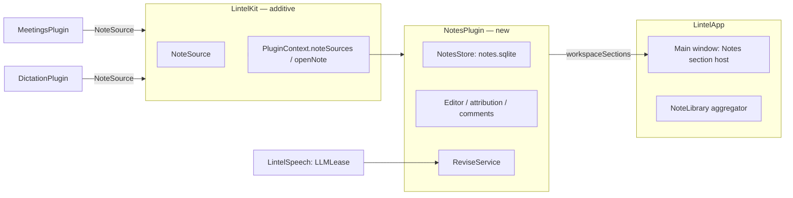

# Notes workspace: NotesPlugin, editor, comments, history, agent revisions

> Status: **design**, written 2026-11-04 on top of `feat/lintel-rebrand` (PR #49). Design accepted by the owner on 2026-11-04. Needs the window shell from `.ai/specs/2026-11-04-lintel-main-window.md` (Phase 1) before its UI phases. Decision record: `docs/decisions/0008-main-window-and-notes-library.md`. Prose in English, identifiers in English, UI strings English + Polish.

## 📝 TLDR

Meeting notes and dictation history exist today but only as panel list modes and a small per-meeting window; they cannot be edited, commented on or searched together, and nothing records who wrote what. This spec adds a **Notes section** to the main window (explorer tree, tabs, an editable Markdown document, an inspector with Comments / History / Details) backed by a new always-on **`NotesPlugin`**. Notes are of three kinds: recorded **meetings**, recorded **dictations** (both stay in their owners' encrypted databases and are read through a new additive contract), and **manual** notes created in Notes itself. Edits, comments and revisions (each tagged `stt`, `agent` or `human`) live in the new encrypted `notes.sqlite`. A local model can revise only the blocks you commented on.

## ✅ Resolved decisions

Taken with the owner on 2026-11-04. Items that differ from the author's recommendation are marked.

| # | Decision | Consequence |
|---|---|---|
| N1 | Notes is an **editor**, not a viewer: edit, comments, history by author. | New data model, spec + ADR. |
| N2 | Layout of the accepted design: explorer (left), tabs + document (centre), inspector (right), status bar. Dense, dark-first, Orca-like. | Prototype v2. |
| N3 | Explorer grouping: **by time**, option **by source**. No folders in v1. | `plugins.notes.grouping`. |
| N4 | The agent is the **local built-in model**, working on **commented blocks only**. | Reuses `LLMLease`; no network, no external agent. |
| N5 | The document is **read-only while the agent writes**; the agent never overwrites a block you edited. | Edit lock; skip-with-report rule. |
| N6 | **Everything in one release** (edit, comments, agent): one feature, shipped as **stacked small PRs**, hidden until the stack is complete. Differs from the recommendation (read-only first). | Phase 7 flips visibility. Highest risk: editor, migrations and agent unverified in isolation, so each PR carries its own tests and screenshots, and Phase 0 is a go/no-go spike. |
| N7 | **Notes is always available**, even with Meetings and Dictation off; manual notes are allowed; recording is switched in Settings. | `NotesPlugin` is `defaultEnabled: true`, `canBeDisabled: false`. |
| N8 | Manual notes live in a **new `NotesPlugin`** with its own encrypted `notes.sqlite`. | New target, registered in `PluginRegistry`. |
| N9 | Recorded content **stays with its owners**; Notes reads it through the contract. No migration of `meetings.sqlite` / `dictation.sqlite`. | `NoteSource` contribution. |
| N10 | Your edits to agent-written notes are **revisions in `notes.sqlite`**; the agent's original stays untouched in the source. | Overlay model (below). |
| N11 | The Notes reader **replaces the small meeting window**. | `MeetingWindowController` is removed in Phase 7. |
| N12 | "Hide content" (⌘⇧H): manual, session-only. | Blur modifier; no key. |
| N13 | The launcher panel stays; its "Open" action opens the main window on that note. | `PluginContext.openNote`. |

## 📝 Problem Statement

- **No overview or shared search.** Meetings and dictation are separate libraries; the only reader is a 640×560 window per meeting.
- **Notes cannot be corrected.** An AI-written summary with a wrong date can only be regenerated, never fixed, and nothing records a correction.
- **No provenance.** A reader cannot tell speech recognition output from model output from the user's own text. Today the product guarantees that every notes point was checked against the recording ("Meeting notes", Phase 2); once people edit, that guarantee needs to stay honest.
- **No place for a note without a recording.** The owner wants notes without recording; no plugin owns that.

## 📝 Proposed Solution

**Overlay model.** A recorded note is owned by its source plugin (text, transcript, speakers, audio state). `NotesPlugin` keeps an *overlay* per note key (`meetings:42`): the first time the user edits, comments or asks the agent, Notes creates a document row seeded with the source's current text, then records every later change as a revision. Manual notes are documents with no source. The explorer lists the union of sources and manual notes; an overlay replaces the source text of the same key.

Alternatives considered:

- *Move everything into `notes.sqlite`:* rejected (N9). It would migrate encrypted data across plugin keys and break "Keychain error never resets" ownership.
- *Write edits back into `meetings.sqlite` (`notes_markdown`):* rejected (N10). Meetings would have to understand human text and could no longer vouch for quotes.
- *A shell-owned store:* rejected (N8). `LintelApp` has no database and must not know plugin data except through contracts.
- *Plain-text source editor + preview only:* kept as the **fallback** if the Phase 0 spike fails on inline rendering.

## 📝 Architecture



Existing: Meetings/Dictation libraries, `LLMLease`, `MasterKeyStore`, `EncryptedDatabaseOpener`. New: `NotesPlugin` (target, tests, one line in `PluginRegistry`), `NoteSource`, two `PluginContext` members. Planned (companion spec): `workspaceSections`. Plugins still never import each other: `NotesPlugin` sees other plugins only as `any NoteSource` values the shell hands it.

### Contract additions in `LintelKit` (additive, ADR 0008)

```swift
public struct NoteKey: Hashable, Sendable, Codable {           // "<plugin id>:<id>", e.g. "meetings:42", "notes:<uuid>"
    public let rawValue: String
    public init(pluginID: PluginID, id: String)                 // the only way to build one
    public var pluginID: PluginID { get }
}
public enum NoteKind: String, Sendable, Codable { case meeting, dictation, manual }
public enum NoteState: Sendable, Equatable { case ready, writing(done: Int, of: Int), interrupted, failed, needsModel }
public enum NoteMatch: String, Sendable { case title, notes, transcript, dictation, manual }   // where a query matched

public struct NoteSummary: Sendable, Identifiable, Equatable {
    public var id: NoteKey; public var kind: NoteKind
    public var title: String?; public var startedAt: Date; public var durationMs: Int?
    public var sourceApp: String?; public var state: NoteState
    public var snippet: String?; public var matched: NoteMatch?      // plain text; the shell highlights, sources never return markup
}
public struct NoteBlockProvenance: Sendable, Equatable {            // what lets the UI draw a quote chip
    public var blockIndex: Int                                       // index of the Markdown block in `markdown`
    public var quoteTimesMs: [Int]                                   // recording times of the verified quotes (the existing notes points carry [mm:ss])
}
public struct NoteLayer: Sendable, Equatable {
    public enum Author: String, Sendable { case stt, agent }
    public var author: Author; public var markdown: String
    public var provenance: [NoteBlockProvenance]                     // empty for `stt` layers and for sources that cannot say
}
public struct NoteContent: Sendable { public var summary: NoteSummary; public var layers: [NoteLayer]; public var speakers: [String] }
public struct NoteSourceAction: Identifiable, Sendable {             // finish transcript, regenerate, open Models…
    public let id: String; public let title: LocalizedStringResource; public let symbolName: String
    public let isDestructive: Bool
    public let perform: @Sendable () async throws -> Void
}

public protocol NoteSource: Sendable {
    func list(matching: NormalizedQuery?, limit: Int) async throws -> [NoteSummary]
    /// nil means the note is GONE; a thrown error means "unknown" (source off, failed, locked). Notes relies on this difference.
    func content(for key: NoteKey) async throws -> NoteContent?
    func delete(_ key: NoteKey) async throws
    func actions(for key: NoteKey) -> [NoteSourceAction]
    /// One stream per call, so the aggregator and any other observer never share a consumer.
    func makeChanges() -> AsyncStream<Void>
}
// Declared as requirements in the @MainActor LintelPlugin body with a default (BC section 1):
//   var noteSources: [any NoteSource] { get }   default []
// PluginContext gains stored closures with defaults in its public init, like the existing ones:
//   noteSources: @MainActor @Sendable () -> [any NoteSource]  = { [] }
//   openNote:    @MainActor @Sendable (NoteKey) -> Void       = { _ in }
// PluginManifest.canBeDisabled (Bool = true) is introduced by the main-window spec, step 1.1.
```

`NoteSource` types carry plain `String` (the existing rule: model and speaker text is escaped or shown verbatim, never rendered as markup, extended below to Markdown). No source ever returns attributed or HTML content.

### NotesPlugin

- Manifest `notes`, `order: 5`, `defaultEnabled: true`, `canBeDisabled: false`. `PluginID` `notes` and the key format are protected from the release that ships it.
- `requiredPermissions` none. `commands`: `notes.open` (menu "Open Notes"), `notes.new` (⌘N inside the window; no global shortcut). `searchSources` none, so the launcher panel budget (< 50 ms) is untouched. `settingsPane()` none (view options live in the inspector's Details tab).
- `NotesKeyStore` = `MasterKeyStore(service: com.lintelapp.notes)`, HKDF `sqlcipher`; `NotesLibrary` opens through `EncryptedDatabaseOpener` (only `errSecItemNotFound` archives to `notes.sqlite.unreadable-<date>` for 30 days; any other Keychain error disables editing, commenting and new notes, deletes nothing, and the sources stay listed read-only).
- `eraseData()` removes the Keychain item and `Plugins/notes/`; it never touches the sources.

### Components inside NotesPlugin

- `NoteLibrary` (`@MainActor`): merges `NoteSource.list` results (per-source budget 150 ms, like `SearchCoordinator`) with manual notes and overlay metadata; groups by time or source; merges FTS hits.
- `NoteDocumentModel`: current text = head revision, or the source's layers when no overlay exists; edit lock; autosave.
- `BlockAttribution` (pure): computes the per-block author when a revision is *written* (block-level diff against its parent) and stores it in `blocks_json`; reading never recomputes it, so pruning cannot change it. Drives the gutter (`AI`, `You`, `STT`); tested on fixtures.
- `NoteEditor`: TextKit 2 (`NSTextView` over `NSTextContentStorage`) hosted in SwiftUI; Markdown subset: headings 1-3, paragraphs, bullet/numbered/task lists, bold, italic, strike, inline code, tables, links (rendered inert, see Risks). Parsing uses Foundation `AttributedString(markdown:)` with block presentation intents (no new dependency; verified in Phase 0).
- `CommentStore` and anchor resolution (quote-based re-anchoring).
- `ReviseService` (`@MainActor` glue): builds the revision prompt, runs it through `LLMLease` at `background` priority (same lease and keep-warm rules as the notes pipeline), applies the result through `ReviseGuard`.
- `ProposalService`: "write a new version" for a note that has human edits (below).

### Search

One query fans out to every source (`list(matching:)`) and to `note_fts`; results merge by key (overlay head text wins over source text); folded like the meeting index (`ł`, `đ`, `ø`) via `LintelCore.TextNormalizer`. Each hit says where it matched (title, notes, transcript, dictation, manual note).

## 📝 Data Model

`notes.sqlite` (SQLCipher, mode 0600, `Plugins/notes/`, migrator `v1-notes`, additive only):

| Table | Columns | Notes |
|---|---|---|
| `note_doc` | `id` INTEGER PK, `key` TEXT UNIQUE NOT NULL, `kind` TEXT NOT NULL CHECK in (`meeting`,`dictation`,`manual`), `title_override` TEXT NULL, `head_revision_id` INTEGER NOT NULL, `created_at`, `updated_at`, `source_state` TEXT NULL CHECK in (`present`,`detached`) | One row per manual note (`key` = `notes:<uuid>`, `source_state` NULL, `kind = manual`) and per overlaid recorded note (`key` = the source key). A CHECK/trigger ties the key prefix to `kind`. `head_revision_id` has no FK (circular); it is written in the **same transaction** that inserts the revision and is advanced only with compare-and-set (below). |
| `note_revision` | `id` PK, `doc_id` FK **ON DELETE CASCADE**, `seq` INTEGER, **UNIQUE(`doc_id`,`seq`)**, `author` TEXT CHECK in (`stt`,`agent`,`human`), `state` TEXT CHECK in (`applied`,`proposed`,`discarded`), `created_at`, `summary` TEXT, `body_markdown` TEXT (full snapshot), `blocks_json` TEXT (per-block author and provenance **persisted at write time**), `meta_json` TEXT (model id, prompt version, comment ids) | Authorship per block is stored, not recomputed, so pruning never changes it. Human edits coalesce into one revision per edit session (5 min idle). Cap 200 per document; prune `discarded` first, then the oldest `human` snapshots, **never** the first `stt`/`agent` revision and **never** a revision a comment anchors to. A `proposed` revision not applied within 14 days becomes `discarded`. |
| `note_comment` | `id` PK, `doc_id` FK **ON DELETE CASCADE**, `thread_id` INTEGER, `author` TEXT CHECK in (`human`,`agent`), `created_at`, `body` TEXT, `anchor_revision_id` FK, `anchor_start` and `anchor_end` INTEGER (UTF-16 offsets, CHECK `anchor_end >= anchor_start`), `anchor_quote` TEXT, `anchor_prefix` TEXT, `anchor_suffix` TEXT (32 characters of context each), `status` TEXT CHECK in (`open`,`resolved`), `resolved_at` | Re-anchoring finds `anchor_quote` in the head and, when several matches exist, picks the one with matching prefix/suffix nearest the original offset; no match leaves the comment visible as "text changed". |
| `note_fts` | FTS5 over title and head body, read through a view that folds `ł`, `đ`, `ø` (the `meeting_fts` approach). **Only the head of applied revisions is indexed** (never `proposed` or `discarded`); rows are refreshed in the transaction that moves the head. | A frozen-SQL test pins the view like the meetings one. |

Sensitive data: titles, bodies, comments and prompts are other people's words. Never logged, never in `ranking.sqlite`, never leave the Mac. The agent prompt and the model output are not stored beyond the resulting revision and `meta_json` (model id, prompt version).

Retention: manual notes and any overlay with a `human` revision are **never auto-deleted** (they are the user's writing). Unedited recorded notes have no overlay and follow their source's retention. **Detaching** is defined narrowly: only when the source is *active* and `content(for:)` returns `nil` (gone). A thrown error, an inactive or failed source, or absence from a capped `list(limit:)` never detaches (a nil from `content(for:)` means gone, an error means unknown). A detached overlay stays, badged "Recording removed"; Delete removes it, and the explorer menu offers "Delete all edited copies of removed recordings…" with a confirmation. Overlays hold copies of source text, so the confirmation sheets of **Clear Library**, **Erase Data** and shortened retention in Meetings and Dictation say that edited copies in Notes stay until deleted there (strings added in the main-window spec's pane steps). Recording ids come from AUTOINCREMENT, so a key is never reused after deletion. A crash between the source delete and the overlay delete leaves a detached overlay, which the user can delete.

Settings keys (`plugins.notes.*`, protected namespace from the release that ships the plugin; `plugins.notes.enabled` is host-owned and always true): `plugins.notes.grouping` (`time`/`source`, default `time`), `plugins.notes.showAuthorBars`, `plugins.notes.showQuotes`, `plugins.notes.showComments`, `plugins.notes.wrapLines` (Bool, default true). Added to BC §3.

Migrations ship with a test that opens a database at the previous schema with rows and migrates it; the first release has `v1-notes` only.

## 📝 API Contracts

Beyond `NoteSource` above:

- **Edit lock:** while a `ReviseService` run or a source regenerate is active for a key, `NoteDocumentModel.isReadOnly == true`; the UI shows the strip "Agent is writing notes · read-only until it finishes · Cancel". Cancel is always available and stops the run between tokens (existing `LLMLease` behaviour). A `background` run can be preempted by dictation and retried (AGENTS.md); the lock therefore has a **10 minute timeout** after which the run is cancelled and the document unlocked.
- **Compare-and-set:** a run captures `base_head_id` when it starts and applies with `UPDATE … SET head_revision_id = :new WHERE head_revision_id = :base` in the transaction that inserts its revision. If the head moved (autosave, a source regenerate started elsewhere, for example the panel's ⌘R), the run is discarded and reported: "The note changed while the agent was working. Nothing was changed." The same compare-and-set protects human autosave against an applied proposal.
- **Not before the source is ready:** an overlay is seeded, and edits and comments are accepted, only when `NoteSummary.state == .ready` (or `failed`/`needsModel` with existing text). While a meeting is `processing` or notes are `writing`, the document is read-only, so an overlay can never shadow notes that arrive later.
- **LLM lease key:** the revise run uses the **same key as the notes pipeline** (`LlamaRuntime(contextLength: 8192)`, same model), so it never meets `ModelLeaseError.busy` against it; against dictation it is preempted like any `background` job.
- **Revise rule (N4, N5):** input = the blocks that carry at least one open comment, each comment's text, the surrounding two blocks as read-only context, and `ReviseNotesPrompt` (versioned: `ReviseNotesPrompt.version`, snapshot-tested; a change bumps the version and is a user-visible behaviour change, BC §5). Output = replacement Markdown for each commented block only, **with the same block type and count** as the block it replaces (no blank lines, headings or table rows added). `ReviseGuard` strips bidi and zero-width control characters from the output and rejects the whole run or a block when: a block outside the commented set changed; a commented block was edited by a human after its comment's `anchor_revision_id` (it is **skipped and reported**: "You edited this block, so it was not changed"); the output contains images, HTML, or links the input did not have; the output is empty or longer than 3× the input. Accepted blocks form one `agent` revision (`summary`: "Revised N blocks from comments"); the comments are marked resolved by the agent with a short comment ("Revised").
- **Regenerate (source action):** without any `human` revision the source regenerates and the new agent text becomes a normal `agent` revision. With human revisions it is stored as a `proposed` revision shown in Compare with "Apply" (replaces the body; your edits stay in History) and "Discard". Never applied silently.
- **Verification invariant:** the product's promise "every note point was checked against the recording" holds only for **untouched agent blocks** that still carry their source quote chips. Chips are drawn from `NoteLayer.provenance` (the verified quote times the source supplies); "untouched" means the block's text **equals** the source layer's block text (a comparison, not the last-changer attribution, so edit-and-revert and split/merge cases cannot show a wrong badge). A block revised by the agent or edited or added by a human is marked (author gutter; chip text "revised, not checked against the recording" / "added by you") and loses the quote chips unless its text is unchanged. This is shown, not hidden.
- **Delete:** Notes calls `NoteSource.delete` first; only on success does it delete the overlay (so a failed source delete never orphans user edits the other way round). Always behind a confirmation sheet in the window; active meetings are refused (existing rule).
- **Export:** Copy Markdown and Save .md use the head text. Source layers go through the existing `MarkdownExporter.cleaned`; **human text does not** (that cleaner collapses runs of spaces and would damage code spans, indentation and table alignment): it gets only the bidi/control-character strip.
- **Open from the panel:** `PluginContext.openNote(NoteKey)` shows the main window on the Notes section with the note open in a tab.

## 📝 UI/UX

Prototype: `.ai/prototypes/lintel-app/index.html` (design v2, accepted by the owner on 2026-11-04; recorded verbally in the session). Screens this spec implements: `lib-meeting`, `lib-comment`, `lib-history`, `lib-transcript`, `lib-dictation`, `lib-dictation-original`, `lib-tree-source`, `lib-details`, `lib-search`, `lib-palette`, `lib-noresults`, `lib-empty`, `lib-off`, `lib-locked`, `lib-loading`, `lib-regen`, `lib-saveerror`, `lib-interrupted`, `lib-needsmodel`, `lib-hidden`, `dlg-delete-meeting`, `dlg-delete-dictation`.

**Deviations from the accepted prototype** (to be drawn in the first Notes UI PR and shown to the owner):

1. `lib-locked`: when only `notes.sqlite` is locked, sources stay listed read-only with a strip, not an empty library.
2. Regenerate on a note with human edits produces a *proposed* revision (new Compare mode with Apply/Discard); the prototype's Details tab shows only the action.
3. A "Recording removed" badge and a revised-block chip ("not checked against the recording") are not in the prototype.
4. A pending-proposal indicator on the tab and in the inspector History.

Behaviour: autosave on idle and on blur (no "dirty" mark; one history entry per edit session); ⌘N new note; ⌘P command palette (go to note, record, settings, hide content); ⌘⌥M comment on selection; ⌘⌫ delete with confirmation; ⌘⇧C copy Markdown; ⌘⇧H hide content (session-only blur, list titles included). Full keyboard path, VoiceOver labels per block with its author ("AI", "You", "STT" announced as words), Reduce Motion respected, S…XL checked. At XL the centre column is narrow: tabs truncate and the inspector can be collapsed (design in the first UI PR).

Copy rules as in the main-window spec; all strings in English and Polish.

## 📝 Edge Cases & Failure Scenarios

| Case | What happens |
|---|---|
| Keychain error opening `notes.sqlite` | Editing, comments, new note disabled; sources readable; strip "Lintel can't read the key to your notes. Nothing was deleted."; no reset. |
| `errSecItemNotFound` with an existing database | Archive to `notes.sqlite.unreadable-<date>` (30 days), start a new database; the strip says so once. |
| Source plugin off or failed | Its notes are not listed; overlays for those keys are kept and appear again when the source returns; no deletion. |
| App quits while the agent writes | Run cancelled by `deactivate()`; document unchanged; no half revision. |
| Model missing | Revise and Regenerate show "Notes need a model" with "Open Models" (existing `NotesBoard.needsModel` path); nothing changes. |
| Model output fails the guard | No change, message "The agent's answer couldn't be used. Nothing was changed." with "Try again"; the comments stay open. |
| Anchor text deleted by the user | Comment shown as "text changed" in the inspector; can be resolved or re-anchored by selecting new text. |
| Two windows/tabs on one note | One document model per key; the second tab shows the same state. |
| Huge note (above 200 000 characters) | Opens read-only with a notice; editor not loaded (budget below). |
| Save .md fails | Strip with "Try again" and "Choose another place…"; the document is unaffected. |
| Retention deletes a source note with an overlay | Overlay detached, badge "Recording removed"; user text kept. |
| Both sources and Notes empty | `lib-empty`: New note, Record, Go to a note. |

## 📝 Risks & Impact Review

| Risk | Who bears it | Mitigation |
|---|---|---|
| **R-B1: editor feasibility** (TextKit 2 inline Markdown with tables, gutter attribution and comment highlights; TextKit 2 has no `NSTextTable`) | Schedule, quality | Phase 0 spike with a go/no-go. Fallback: monospaced Markdown source editor with a rendered preview tab; the data model and every other phase are unchanged. |
| **R-B2: scope chosen "everything at once"** (N6) | Schedule, review load | Stacked PRs, each releasable behind the hidden flag, each with tests and screenshots; Phase 7 is the only user-visible switch. If Phase 0 or Phase 4 slips, the owner can still cut agent and comments (Phases 5-6) without rework. An independent reviewer suggested three shippable parts (contract/sources/read-only workspace; store, editing, history; comments and agent); the plan keeps that boundary: Phases 1-3, then 4, then 5-6, and the plugin and its protected names reach users only at step 7.1. |
| **R-B3: protected surfaces change** (`LintelKit`, new store, new Keychain item, new settings namespace) | Every plugin target, user data | Additive only (BC §§1-3); `v1-notes` migration test; contract PR compiles all plugins unchanged; ADR 0008; PRs `risk-high` with the owner's maintainer exception recorded (SDLC). |
| **R-B4: human text next to AI text weakens the verification promise** | Trust | Author gutter on every block, quote chips only on untouched agent blocks, "revised, not checked" chip; stated in the UI and in this spec. |
| **R-B5: prompt injection through other people's words** (transcripts, titles, comments feed the revise prompt) | User | The revise output can only replace commented blocks, keeps block type and count, passes `ReviseGuard` (no links/images/HTML, control characters stripped), runs offline with no tools, and is shown in History with Restore. Residual risk (also documented for `NotesComposer`): words inside a commented block can still steer the model's wording; the user sees the result and can restore. |
| **R-B6: untrusted Markdown** (agent or pasted text) | User | Images never load; links are inert (shown, copyable, not clickable) in v1; no HTML; same rule as the existing library preview. |
| **R-B7: private text on screen** (the window is visible when sharing) | User | Hide content (N12); no persistence of the toggle; no content in the Dock tile or notifications. |
| **R-B8: memory and latency** | Everyone | Budgets below, unmeasured until benchmarks run (as with the meeting budgets). |
| **R-B9: retention vs. user writing** | User | Edited notes are never auto-deleted; recorded unedited ones keep the source's retention. Owner confirms this default in the PR (it is a deliberate asymmetry, and "keeps more data longer" is a privacy default that needs explicit approval per BC §3). |

Rollback: the plugin and contract are additive. Disabling is not offered (`canBeDisabled: false`), so rollback is a revert of the stack; `notes.sqlite` stays on disk, unread, and an older build ignores it. No source data is modified by this feature, so nothing needs undoing there.

## 📝 Performance budgets (to be measured, none measured yet)

Open a note of 20 000 characters < 150 ms to first paint; typing latency < 16 ms per keystroke for notes up to 50 000 characters; list of 1000 summaries < 200 ms; window search fan-out within the 150 ms per-source budget; `notes.sqlite` writes off the main thread; the launcher panel keeps its < 50 ms show budget (NotesPlugin adds no search source). Results go to `docs/perf.md`.

## 📝 Not doing

User-defined folders, sharing and multi-user authorship, external agents or any network call for notes, rich media (images, attachments), real-time collaboration, automatic redaction, a plugin API for third parties, notes templates, export formats other than Markdown, per-note encryption keys, automatic screen-share detection.

## 📋 Phasing

Everything ships as stacked PRs; users see nothing until Phase 7. **`NotesPlugin` is registered in `PluginRegistry` only in DEBUG builds or with `--qa-notes` until step 7.1**, so a release tag before then creates no Keychain item, no `notes.sqlite`, no `plugins.notes.*` key and no Features row: the protected names reach users at 7.1. The store is opened lazily on first need, never in `activate()`, and no store code exists before Phase 4.

- **Phase 0:** spike and go/no-go (editor, Markdown, attribution).
- **Phase 1:** contract and plugin skeleton (no UI).
- **Phase 2:** Meetings and Dictation as note sources.
- **Phase 3:** Notes workspace, read-only.
- **Phase 4:** editing, revisions, attribution, history and compare, manual notes.
- **Phase 5:** comments.
- **Phase 6:** agent revision and proposals.
- **Phase 7:** palette, hide content, small-window removal, docs, visibility.

## 📋 Implementation Plan

### Phase 0: spike (ADR 0008 addendum, no production code)

- **0.1** Editor spike on a throwaway branch: TextKit 2 rendering of Foundation-parsed Markdown including a table, a per-block gutter, comment highlights and a selection popover; measure typing latency at 50 000 characters. Output: an addendum to ADR 0008 with measurements and **go / fallback**.
- **0.2** Verify `AttributedString(markdown:)` handles the subset (tables, task lists) and round-trips body text unchanged for the Meetings `MarkdownExporter` output; list gaps. Go/no-go recorded in the same addendum.
- **0.3** Prototype `BlockAttribution` on revision fixtures (pure Swift test, no UI). Fixtures and expected output: (a) edit one paragraph, expect only its block `human`; (b) add a block, expect `human` on the new block only; (c) edit then revert, expect the original author back and "untouched" true; (d) split and merge blocks, expect `human` on the new blocks. Gate: all four pass.

### Phase 1: contract and plugin skeleton

- **1.1** `LintelKit`: `NoteKey` (public init), `NoteKind`, `NoteState`, `NoteMatch`, `NoteSummary`, `NoteBlockProvenance`, `NoteLayer`, `NoteContent`, `NoteSourceAction`, `NoteSource`, the `LintelPlugin.noteSources` requirement with default, `PluginContext.noteSources` and `openNote` with defaults in the public init. Tests: defaults empty; an override is reached through `any LintelPlugin`; every plugin compiles unchanged; `NoteKey` round-trips. BC §1 (every touched type listed) and AGENTS.md updated.
- **1.2** `Sources/NotesPlugin` + `Tests/NotesPluginTests` targets (`Package.swift`; GRDB product and `LintelSpeech` are added in Phase 4 when they are first used), manifest `notes` (`canBeDisabled: false`, from the main-window spec step 1.1), `notesSection` stub through `workspaceSections`; registered in `PluginRegistry` **only `#if DEBUG` or with `--qa-notes`**. Tests: the registry excludes `NotesPlugin` in a release configuration (source-scanning test on the `#if`), manifest values, no file or Keychain access on activation (in-memory ports record zero calls).

### Phase 2: sources

- **2.1** `MeetingNoteSource` in `MeetingsPlugin` over `MeetingsStore.libraryEntries`, `MeetingPreviewBuilder` data and `NotesBoard` state; actions: finish, regenerate, open Models. `delete` through the existing `deleteMeeting` with the spool. Tests: parity with the list mode's filters/ordering; active meetings refused; no transcript text logged.
- **2.2** `DictationNoteSource` over `DictationHistory` (cleaned = agent layer, raw = stt layer). Tests as above.
- **2.3** Add the `openNote` wiring to `meetings.library` / `dictation.history` **without changing today's ⌘O**: Meetings keeps opening `MeetingWindowController` until step 3.2 makes the shell handle `openNote` (and step 7.3 removes the window); a Dictation "Open in Lintel" action is added at 3.2. Tests: with the default no-op handler ⌘O still opens the window; with a handler the key goes to it.

### Phase 3: workspace, read-only (needs main-window Phase 1)

- **3.1** `NoteLibrary` aggregator (per-source budget, grouping by time/source, state badges). Tests with scripted sources: budget cut, merge by key, grouping, ordering; TSan for the aggregator.
- **3.2** Explorer, tab bar, path bar, status bar, `NotesSection` registered through `workspaceSections` (DEBUG / `--qa-notes` only); the shell implements `PluginContext.openNote` (shows the window on Notes with the note in a tab); Meetings' ⌘O and a new Dictation "Open in Lintel" action switch to it. Tests: `openNote` selects the key and opens one tab per key.
- **3.3** Read-only document: meeting notes (blocks, tables, quote chips jumping to the transcript), transcript, dictation cleaned/original; Copy Markdown and Save .md.
- **3.4** Search across sources and `note_fts`; no-results; palette not yet. Tests: folding, merge precedence.
- **3.5** States: empty, loading, interrupted, needs-model, regenerating, save-error, locked (with deviation 1), recording-off. Screenshot set light/dark, S/XL, EN/PL.

### Phase 4: store and editing

- **4.0** `NotesKeyStore` (`MasterKeyStore(service: com.lintelapp.notes)`, HKDF `sqlcipher`), `NotesLibrary` open through `EncryptedDatabaseOpener` (lazy, on first need; only `errSecItemNotFound` archives, any other Keychain error disables editing and deletes nothing), migration `v1-notes` (schema above, folding view, constraints), `NotesSettings` keys declared once, `eraseData()`; GRDB and `LintelSpeech` added to the target. Tests: key policy with `InMemoryKeychainClient`; migration from an empty and from a populated database; every CHECK and cascade; `UNIQUE(doc_id, seq)`; frozen-SQL FTS folding test (`ł`, `đ`, `ø`); mode 0700/0600; no open without the key.

- **4.1** `NoteEditor` per the Phase 0 decision (inline or fallback), format bar, undo (⌘Z) and the Edit menu wiring.
- **4.2** Revisions: coalescing, snapshots plus `blocks_json`, the pruning rules (discarded first; never the first agent/stt revision; never a comment-anchored one), compare-and-set head update, autosave on idle/blur, 14-day expiry of `proposed`. Tests: coalescing windows, pruning rules, a fault-injection hook in `NotesStore` that fails the transaction mid-write and leaves the previous head, concurrent writers (TSan).
- **4.3** `BlockAttribution` in the gutter, author legend and a Details toggle; chips rules from "Verification invariant". Tests on fixtures.
- **4.4** Manual notes: ⌘N, explorer "+", `notes:<uuid>` keys, title editing.
- **4.5** History pane + Compare (inline diff) + Restore (a restore is a new `human` revision, never a rewrite). Tests: restore keeps the chain.
- **4.6** Delete with confirmation sheets (`dlg-delete-*`); overlay deletion ordering. Tests: source failure leaves the overlay.

### Phase 5: comments

- **5.1** `note_comment` store, anchors, quote re-anchoring. Tests: anchors survive edits before them; deleted anchor text → "text changed".
- **5.2** Comment popover, inspector Comments pane (threads, reply, resolve, filter), editor highlights, ⌘⌥M.
- **5.3** Resolved/open counts feed the "Revise with N comments" button state. Accessibility: each thread announced with its quote.

### Phase 6: agent

- **6.1** `ReviseNotesPrompt` (versioned) + snapshot tests; `ReviseGuard` with the rules above. Tests: a guard table (outside block changed, human-edited block skipped, link/image/HTML rejected, empty/oversized output).
- **6.2** `ReviseService` through `LLMLease` (background priority, cancellation, no logging of prompts or answers); edit lock + strip; "Ask agent" on a single thread. Tests with a scripted `LLMRuntime`: cancellation leaves the document unchanged; quit cancels.
- **6.3** Proposed revisions for Regenerate on edited notes: Compare with Apply/Discard, tab and History indicators. Tests: Apply creates an `applied` revision, Discard keeps history.
- **6.4** Regression corpus `Tests/NotesPluginTests/Fixtures/revise/` with an offline snapshot test; `RealReviseTests` (real model, off by default, `LINTEL_REVISE_LLM_MODEL`, never in CI), budgets in `docs/perf.md` marked "not yet measured".

### Phase 7: finish and visibility

- **7.1** Command palette (⌘P), "Hide content" blur (⌘⇧H, session-only), tab-bar and inspector behaviour at XL; remove the DEBUG/`--qa-notes` guard so the Notes section is registered in every build. This is the one user-visible switch.
- **7.2** Notes row in Features ("Always on"), Welcome mentions Notes (main-window spec step 6.1 content).
- **7.3** Remove `MeetingWindowController`, `MeetingWindowView`, `MeetingWindowModel` and the saved window frames; Meetings tests updated.
- **7.4** Docs: AGENTS.md (new Notes plugin row, Meetings/Dictation rows), `BACKWARD_COMPATIBILITY.md` (§2 store `notes.sqlite`, §3 keys, §5 shortcuts ⌘N/⌘P/⌘⌥M/⌘⇧H and the revise prompt), `docs/qa.md` (`--qa-notes`, fixture seeding), `docs/perf.md`; `Localizable.xcstrings` check; full gate + TSan; screenshots of every Notes state.

Evidence for every PR in the stack: screenshots of the running app (light and dark, S and XL, EN and PL) per `docs/qa.md`, an explicit "Not verified" list, and the `risk-high` maintainer-exception note where the contract or a store changes.
