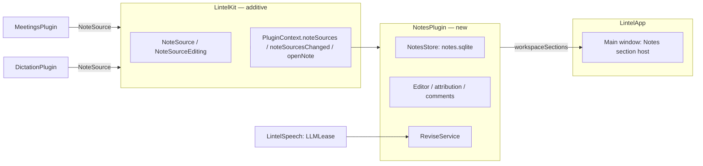

# Notes workspace: NotesPlugin, editor, comments, history, agent revisions

> Status: **design**, written 2026-11-04 on top of `feat/lintel-rebrand` (PR #49). Design accepted by the owner on 2026-11-04. Needs the window shell from `.ai/specs/2026-11-04-lintel-main-window.md` (Phase 1) before its UI phases; B 1.2 needs A 1.1 (contract) and A 1.6 (`LintelUI`); step 7.1 also waits for A 6.3 (ADR 0008, Release gate). Decision record: `docs/decisions/0008-main-window-and-notes-library.md`. Prose in English, identifiers in English, UI strings English + Polish.

## 📝 TLDR

Meeting notes and dictation history exist today but only as panel list modes and a small per-meeting window; they cannot be edited, commented on or searched together, and nothing records who wrote what. This spec adds a **Notes section** to the main window (explorer tree, tabs, an editable Markdown document, an inspector with Comments / History / Details) backed by a new always-on **`NotesPlugin`**. Notes are of three kinds: recorded **meetings**, recorded **dictations** (both stay in their owners' encrypted databases and are read through a new additive contract), and **manual** notes created in Notes itself. Edits, comments and revisions (each tagged `stt`, `agent` or `human`) live in the new encrypted `notes.sqlite`. A local model can revise only the blocks you commented on.

## ✅ Resolved decisions

Taken with the owner on 2026-11-04. Items that differ from the author's recommendation are marked.

| # | Decision | Consequence |
|---|---|---|
| N1 | Notes is an **editor**, not a viewer: edit, comments, history by author. | New data model, spec + ADR. |
| N2 | Layout of the accepted design: explorer (left), tabs + document (centre), inspector (right), status bar. Dense, dark-first, Orca-like. | Prototype v2. |
| N3 | Explorer grouping: **by time**, option **by source**. No folders in v1. | `plugins.notes.grouping`. |
| N4 | The agent is the **local built-in model**, working on **commented blocks only**. | Reuses `LLMLease`; no network, no external agent. |
| N5 | The document is **read-only while the agent writes**; the agent never overwrites a block you edited. | Edit lock; skip-with-report rule. |
| N6 | **Everything in one release** (edit, comments, agent): one feature, shipped as **stacked small PRs**, hidden until the stack is complete. Differs from the recommendation (read-only first). | Phase 7 flips visibility. Highest risk: editor, migrations and agent unverified in isolation, so each PR carries its own tests and screenshots, and Phase 0 is a go/no-go spike. |
| N7 | **Notes is always available**, even with Meetings and Dictation off; manual notes are allowed; recording is switched in Settings. | `NotesPlugin` is `defaultEnabled: true`, `canBeDisabled: false`. |
| N8 | Manual notes live in a **new `NotesPlugin`** with its own encrypted `notes.sqlite`. | New target, registered in `PluginRegistry`. |
| N9 | Recorded content **stays with its owners**; Notes reads it through the contract. No migration of `meetings.sqlite` / `dictation.sqlite`. | `NoteSource` contribution. |
| N10 | Your edits to agent-written notes are **revisions in `notes.sqlite`**; the agent's original stays untouched in the source. | Overlay model (below). |
| N11 | The Notes reader **replaces the small meeting window**. | `MeetingWindowController` is removed in Phase 7. |
| N12 | "Hide content" (⌘⇧H): manual, session-only. | Blur modifier; no key. |
| N13 | The launcher panel stays; its "Open" action opens the main window on that note. | `PluginContext.openNote`. |

## 📝 Problem Statement

- **No overview or shared search.** Meetings and dictation are separate libraries; the only reader is a 640×560 window per meeting.
- **Notes cannot be corrected.** An AI-written summary with a wrong date can only be regenerated, never fixed, and nothing records a correction.
- **No provenance.** A reader cannot tell speech recognition output from model output from the user's own text. Today the product guarantees that every notes point was checked against the recording ("Meeting notes", Phase 2); once people edit, that guarantee needs to stay honest.
- **No place for a note without a recording.** The owner wants notes without recording; no plugin owns that.

## 📝 Proposed Solution

**Overlay model, per layer.** A recorded note is owned by its source plugin (text, transcript, speakers, audio state) and has **layers** (meetings: `notes`, `transcript`; dictation: `cleaned`, `original`). `NotesPlugin` keeps an *overlay* per `(note key, layer)`: the first time the user edits or comments on a layer (or asks the agent about it), Notes creates a document row seeded with that layer's current text only, then records every later change as a revision. Each layer is overlaid independently; **a layer without an overlay always shows the source's current text**, so editing the transcript never shadows notes that arrive later. Manual notes are one document, layer `body`. The explorer lists the union of sources and manual notes. Transcripts are segments (`meeting_segment`), not prose: the transcript layer is seeded as Markdown with one block per segment, and speaker id, start time and segment reference ride in `blocks_json`, so speakers, timestamps and quote-chip jump targets survive editing (the owner wants to review and correct transcripts, with history of who changed what).

Alternatives considered:

- *Move everything into `notes.sqlite`:* rejected (N9). It would migrate encrypted data across plugin keys and break "Keychain error never resets" ownership.
- *Write edits back into `meetings.sqlite` (`notes_markdown`):* rejected (N10). Meetings would have to understand human text and could no longer vouch for quotes.
- *A shell-owned store:* rejected (N8). `LintelApp` has no database and must not know plugin data except through contracts.
- *Plain-text source editor + preview only:* kept as the **fallback** if the Phase 0 spike fails on inline rendering.

## 📝 Architecture



Existing: Meetings/Dictation libraries, `LLMLease`, `MasterKeyStore`, `EncryptedDatabaseOpener`. New: `NotesPlugin` (target, tests, one line in `PluginRegistry`), `NoteSource`, three `PluginContext` members. Companion spec: `workspaceSections`. Plugins still never import each other: `NotesPlugin` sees other plugins only as `any NoteSource` values (active plugins only) the shell hands it.

### Contract additions in `LintelKit` (additive, ADR 0008)

```swift
public struct NoteKey: Hashable, Sendable, Codable {           // "<plugin id>:<id>"; STABLE across Erase Data and key resets (meetings: `meeting.uuid`; dictation: store id + row id, see Retention)
    public let rawValue: String                                 // "meetings:<meeting.uuid>", "dictation:<store id>/<row id>", "notes:<uuid>"
    public init(pluginID: PluginID, id: String)                 // the only way to build one
    public var pluginID: PluginID { get }
}
// Open sets (RawRepresentable structs with static constants; consumers handle unknown values; new values are additive, BC section 1):
public struct NoteKind: RawRepresentable, Hashable, Sendable, Codable   // .meeting .dictation .manual
public struct NoteAuthor: RawRepresentable, Hashable, Sendable, Codable  // .stt .agent .human (revisions and layers)
// Closed set, frozen when 1.1 merges (it mirrors source status columns):
public enum NoteState: Sendable, Equatable {
    case ready, recording, processing, writing(done: Int, of: Int), partial, stale, interrupted, failed, needsModel
}

public struct NoteSummary: Sendable, Identifiable, Equatable {
    public var id: NoteKey; public var kind: NoteKind
    public var title: String?; public var startedAt: Date; public var durationMs: Int?
    public var sourceApp: String?                                    // secondary label, only when the source knows it
    public var state: NoteState
    public var matches: [NoteLayerMatch]; public var titleMatched: Bool   // every matched layer; plain text, the shell highlights, sources never return markup
    public init(...)                                                 // every public type here has an explicit public init with defaults for optional fields
}
public struct NoteLayerMatch: Sendable, Equatable { public var layerID: String; public var snippet: String }
public struct NoteBlockProvenance: Sendable, Equatable {            // what lets the UI draw a quote chip
    public var blockIndex: Int                                       // index of the block as split by LintelCore.MarkdownBlocks.split
    public var quoteTimesMs: [Int]
}
public struct NoteLayer: Sendable, Equatable, Identifiable {
    public var id: String                                            // "notes", "transcript", "cleaned", "original"
    public var author: NoteAuthor; public var markdown: String
    public var provenance: [NoteBlockProvenance]                     // empty for `stt` layers and for sources that cannot say
    public var version: String                                       // changes only when THIS layer's markdown or provenance changes (e.g. SHA-256 of both); speaker names are not part of it
}
public struct NoteDetail: Sendable, Equatable { public var label: LocalizedStringResource; public var value: String }  // Language, Speech model, Audio state...
public struct NoteContent: Sendable {
    public var summary: NoteSummary; public var layers: [NoteLayer]; public var speakers: [String]
    public var details: [NoteDetail]
}
public struct NoteCursor: Sendable, Hashable { public let token: String; public init(token: String) }   // opaque to Notes
public struct NotePage: Sendable { public var items: [NoteSummary]; public var next: NoteCursor?; public var total: Int }
public struct NoteSourceAction: Identifiable, Sendable {             // finish transcript, regenerate, open Models...
    public let id: String; public let title: LocalizedStringResource; public let symbolName: String
    public let isDestructive: Bool
    public let perform: @Sendable () async throws -> Void
    public init(...)
}

public protocol NoteSource: Sendable {
    var pluginID: PluginID { get }
    func list(matching: NormalizedQuery?, after: NoteCursor?, limit: Int) async throws -> NotePage
    /// `exists`, `content` and `list` throw `NotesError.sourceUnavailable` whenever the owner's store is not open (switched off, Keychain locked or denied, failed, not yet opened); only an open store may report absence.
    /// Batch for the detach sweep: the subset of `keys` that still exist. A thrown error means "unknown".
    func exists(_ keys: [NoteKey]) async throws -> Set<NoteKey>
    /// nil means the note is GONE; a thrown error means "unknown" (source off, failed, locked). Notes relies on this difference.
    func content(for key: NoteKey) async throws -> NoteContent?
    func delete(_ key: NoteKey) async throws
    func actions(for key: NoteKey) -> [NoteSourceAction]
    /// One stream per call (`.bufferingNewest(1)`), finished on `deactivate()`.
    func makeChanges() -> AsyncStream<Void>
}
/// Optional capability (found with `as?`): the edits that today live in MeetingWindowModel and must stay in the owner.
public protocol NoteSourceEditing: NoteSource {
    func renameTitle(_ key: NoteKey, to: String) async throws
    func renameSpeaker(_ key: NoteKey, speakerID: String, to: String) async throws
    func markSelf(_ key: NoteKey, speakerID: String) async throws       // sets notes `stale`, as today
}
// Requirements in the @MainActor LintelPlugin body with a default (BC section 1):
//   var noteSources: [any NoteSource] { get }   default []
// PluginContext gains stored closures with defaults in its public init, like the existing ones:
//   noteSources:        @MainActor @Sendable () -> [any NoteSource]            = { [] }    // ACTIVE plugins only, each carries its `pluginID`
//   noteSourcesChanged: @Sendable () -> AsyncStream<Void>                      = { AsyncStream { $0.finish() } }
//   openNote:           @MainActor @Sendable (NoteKey) -> Bool                 = { _ in false }  // true only when a section handled it
// PasteboardClient gains the REQUIREMENT `@MainActor @discardableResult func write(_ items: [PasteboardItem], options: PasteboardWriteOptions) -> Int`
//   with an extension default that calls `write(_:)` (so all in-tree conformers compile unchanged and an override is reached through `any PasteboardClient`);
//   `public struct PasteboardWriteOptions: OptionSet, Sendable { public static let currentHostOnly }`; `SystemPasteboardClient` (LintelApp) implements it with `prepareForNewContents(with: .currentHostOnly)`.
// PluginManifest.canBeDisabled (Bool = true) is introduced by the main-window spec, step 1.1.
```

**Seeding is allowed** in states `.ready`, `.partial`, `.stale`, `.failed`, `.needsModel` (with text for that layer); never in `.recording`, `.processing`, `.writing`, `.interrupted`-with-no-text. Source mapping (steps 2.1/2.2, one parity test per row): meeting `recording` to `.recording`, `processing` to `.processing`, `incomplete` to `.interrupted`, `failed` to `.failed`; for a `ready` meeting, notes `none`/`ok` to `.ready`, `partial` to `.partial`, `stale` to `.stale`, `running` to `.writing`, `failed` to `.failed`, awaiting model to `.needsModel` (the meeting status wins over the notes status except `ready`); dictation `format_status` `none`/`ok` to `.ready`, `partial` to `.partial`, `failed` to `.failed` (it has no running state).

`NoteSource` types carry plain `String` (the existing rule: model and speaker text is escaped or shown verbatim, never rendered as markup, extended below to Markdown). No source ever returns attributed or HTML content.

### NotesPlugin

- Manifest `notes`, `order: 5`, `defaultEnabled: true`, `canBeDisabled: false`. `PluginID` `notes` and the key format are protected from the release that ships it.
- `requiredPermissions` none. `commands`: `notes.open` (menu "Open Notes"); New Note (⌘N) is a `CommandInfo` menu item of the Notes section, window-only. `searchSources` none, so the launcher panel budget (< 50 ms) is untouched. `settingsPane()` (group `.lintel`, after Features, on the D4 template, built from `LintelUI`): Basics = Notes model (picker over the installed `LLMModelCatalog` models; default = the first installed one, else the catalog default, one rule also for the settings key; download is in Models) and the inspector's Details toggles; Data = Export All Notes…, Erase Notes Data… (`ConfirmSheet`). **Export All Notes** writes a folder chosen in a save panel: one `.md` per document head (manual notes and overlaid layers; recorded layers without an overlay are not exported, they stay in their source) and `manifest.json` (schema version 1; per file: key, kind, layer, created/updated, authors per block, open comments with their quotes). Human text gets only the bidi/control-character strip, source layers `MarkdownExporter.cleaned`; it is written to a temporary folder next to the destination and renamed into place. It is the rollback path (see Rollback). The pane is drawn by the shell's banner and `SettingsHost`; Notes' pane has no banner of its own and reads text size through `lintelTextSize`. `modelUsage`: the model chosen by `plugins.notes.builtInLLMModel`; "Open Models" uses `PluginContext.openModels` (A 1.1).
- `NotesKeyStore` = `MasterKeyStore(service: com.lintelapp.notes)`, HKDF `sqlcipher`; `NotesLibrary` opens through `EncryptedDatabaseOpener` (only `errSecItemNotFound` archives to `notes.sqlite.unreadable-<date>` for 30 days; any other Keychain error disables editing, commenting and new notes, deletes nothing, and the sources stay listed read-only).
- `eraseData()` removes the Keychain item and `Plugins/notes/`; it never touches the sources. It is reachable from the pane above.
- Typed `NotesError` with stable codes (`keyUnavailable`, `schemaNewer`, `casConflict`, `guardRejected(rule)`, `lockTimeout`, `sourceUnavailable(pluginID)`, `migrationFailed(step)`), logged only (see Diagnostics).

### Code layout (NotesPlugin)

Dependency direction inside the target: `UI` -> `Document` / `Library` / `Comments` / `Agent` -> `Storage`; `Attribution` and `Agent/ReviseGuard` are pure. Views hold no store calls. A file has one responsibility and stays under about 400 lines.

```
Sources/NotesPlugin/
  NotesPlugin.swift, NotesSettings.swift        facade, manifest, every plugins.notes.* key declared once
  Storage/    NotesStore (+Revisions, +Comments, +Search), NotesKeyStore, NotesLibraryOpener, Migrations, NotesFullTextFolding
  Library/    NoteLibrary (merge only), NoteGrouping (enum + pure function: time | source=plugin), SourceFanOut (150 ms budget, cursor paging)
  Document/   NoteDocumentModel (UI state only), NoteDocumentRegistry (one per key+layer), RevisionWriter (saving, coalescing, compare-and-set, proposals),
              EditLock (state machine), OverlaySeeder, SourceReconciler (per-layer version, detach sweep)
  Attribution/ BlockAttribution (pure; uses LintelCore.MarkdownBlocks)
  Comments/   CommentStore, AnchorResolver
  Agent/      ReviseNotesPrompt, ReviseGuard (+rules), ReviseService
  UI/         Explorer, Tabs, Editor (NoteEditor), Inspector, Palette, States   (imports LintelUI for tokens and shared components)
Tests/NotesPluginTests/  same folders, plus Support/ (scripted NoteSource, scripted LLMRuntime, fault-injecting store, recording Logger, injected clock) and Fixtures/{attribution,revise}/
Sources/MeetingsPlugin/Storage/MeetingNoteSource.swift, Sources/DictationPlugin/DictationNoteSource.swift   (not Meetings' `Notes/`, which holds the LLM notes)
Sources/LintelCore/MarkdownBlocks.swift   pure split(_:) shared by NotesComposer provenance (Meetings) and BlockAttribution
```

Components: `NoteLibrary` merges `NoteSource.list` pages (per-source budget 150 ms, like `SearchCoordinator`) with manual notes and overlay metadata and merges FTS hits. `NoteDocumentModel` shows the head revision, or the source layer when no overlay exists. `BlockAttribution` is content-addressed (see API Contracts) and stores its result in `blocks_json` at write time. `NoteEditor` is TextKit 2 (`NSTextView` over `NSTextContentStorage`) hosted in SwiftUI; Markdown subset: headings 1-3, paragraphs, bullet/numbered/task lists, bold, italic, strike, inline code, tables, links (inert, see Risks); parsing uses Foundation `AttributedString(markdown:)` with block presentation intents (no new dependency; verified in Phase 0). `ReviseService` (`@MainActor` glue) builds the prompt, runs it through `LLMLease` at `background` priority and applies the result through `ReviseGuard`; a proposal is a revision with `state = proposed`, written by `RevisionWriter` (no separate service).

### Search

One query fans out to every source (`list(matching:)`) and to `note_fts`; results merge by key. **Drop the `matches` whose `layerID` has an overlay, and the hit when nothing remains and the title did not match; for those layers only `note_fts` decides** (a deleted word never matches through the source, and snippets never show removed text). Queries are folded with `NotesFullTextFolding`, a table identical to the frozen view (`ł`, `đ`, `ø` only; `TextNormalizer` folds more letters, so it is not used here), tested the way Meetings' `FullTextFolding` is. Each hit says which layers matched.

## 📝 Data Model

`notes.sqlite` (SQLCipher, mode 0600, `Plugins/notes/`, migrator `v1-notes`, additive only). **Once `v1-notes` merges, any schema change is a new migration, even before release** (GRDB skips a migration by name, so editing it in place would drift DEBUG databases). An unknown newer migration makes Notes read-only with a strip; nothing is migrated.

| Table | Columns | Notes |
|---|---|---|
| `note_doc` | `id` INTEGER PK, `key` TEXT NOT NULL, `layer` TEXT NOT NULL (`notes`, `transcript`, `cleaned`, `original`, `body`), **UNIQUE(`key`,`layer`)**, `kind` TEXT NOT NULL, `source_plugin_id` TEXT NOT NULL (`notes` for manual), `title_override` TEXT NULL (manual notes only), `head_revision_id` INTEGER NOT NULL, `created_at`, `updated_at`, `source_state` TEXT NULL CHECK in (`present`,`detached`), `source_started_at_ms` INTEGER NULL (`Int64((startedAt.timeIntervalSince1970 * 1000).rounded())`), `source_version_seen` TEXT NULL (the `NoteLayer.version` of this row's layer) | One row per manual note (`key` = `notes:<uuid>`, layer `body`) and per overlaid layer of a recorded note. **No CHECK on `kind`, `layer` or the key prefix**: they are validated in Swift, so a third source is not a table rebuild; CHECKs stay only on closed internal states. An overlay is **detached** (never re-attached) when the source's `startedAt`, rounded the same way, differs from `source_started_at_ms`. `head_revision_id` has no FK (circular); it is written in the **same transaction** that inserts the revision and advances only with compare-and-set. |
| `note_revision` | `id` PK, `doc_id` FK **ON DELETE CASCADE**, `seq` INTEGER, **UNIQUE(`doc_id`,`seq`)**, `author` TEXT NOT NULL (open set, no CHECK), `state` TEXT CHECK in (`applied`,`proposed`,`discarded`), `created_at`, `summary` TEXT, `body_markdown` TEXT (full snapshot), `blocks_json` TEXT (per-block author, segment refs and provenance **persisted at write time**), `meta_json` TEXT (model id, prompt version, comment ids, `restored_from`) | Authorship per block is stored, not recomputed. Writes inside one edit session **amend** that session's `human` revision **until it is referenced** (see Saving). Cap 200 per document; prune `discarded` first, then the oldest unreferenced `human` snapshots, **never** the first `stt`/`agent` revision; a comment anchored to a pruned revision is **re-anchored to the nearest kept revision first**. A `proposed` revision stays until Apply or Discard. |
| `note_comment` | `id` PK, `doc_id` FK **ON DELETE CASCADE**, `thread_id` INTEGER, `author` TEXT NOT NULL (open set), `created_at`, `body` TEXT, `anchor_revision_id` FK, `anchor_start` and `anchor_end` INTEGER (UTF-16 offsets, CHECK `anchor_end >= anchor_start`), `anchor_block_hash` TEXT (SHA-256 of the joined text of the blocks the range touches, at comment time; Revise treats them as one commented unit and skips it when the hash differs), `anchor_quote` TEXT, `anchor_prefix` TEXT, `anchor_suffix` TEXT (32 characters of context each), `status` TEXT CHECK in (`open`,`resolved`), `resolved_at` | Re-anchoring finds `anchor_quote` in the head and, when several matches exist, picks the one with matching prefix/suffix nearest the original offset; no match leaves the comment visible as "text changed". |
| `note_fts` | FTS5 over title and head body, read through a view that folds `ł`, `đ`, `ø` (the `meeting_fts` approach). **Only the head of applied revisions is indexed**; rows (and `blocks_json`) are refreshed in the transaction of every head move and every amend. | A frozen-SQL test pins the view like the meetings one. |

Sensitive data: titles, bodies, comments and prompts are other people's words. Never logged, never in `ranking.sqlite`, never leave the Mac. The agent prompt and the model output are not stored beyond the resulting revision and `meta_json` (model id, prompt version).

Retention: manual notes and any overlay with a `human` revision are **never auto-deleted** (they are the user's writing). **An overlay with no `human` revision (an `agent` revision written by Revise counts as user writing, like `human`) and no open comment is deleted with its source** (detach means delete); seeding copies only the layer being edited. Unedited recorded notes have no overlay and follow their source's retention. **Detaching** is defined narrowly: the sweep calls `NoteSource.exists(keys)` in one batch, and only when `pluginID` is present in the **active** source map and `exists` omits the key does it detach. A thrown error, an inactive or failed source, or absence from a paged `list` never detaches. A detached overlay with user text stays, badged "Recording removed"; Delete removes it. Overlays hold copies of source text, so the confirmation sheets of **Clear Library**, **Erase Data** and shortened retention in Meetings and Dictation say that edited copies in Notes stay until deleted there (strings added in the main-window spec's pane steps). **Keys are stable across Erase Data and key resets:** meetings use `meeting.uuid`; dictation uses `store_id` = lowercase hex of the first 8 bytes of `MasterKeys.derived(info: "note-identity")`, computed in `DictationHistory.open` from the keys the opener passes to `openStore`, held in memory, never written to `dictation.sqlite` (a new `info` is additive, no schema change), plus the row id. It changes whenever the Keychain item is recreated (Erase Data, `errSecItemNotFound`); a `dictation.sqlite` deleted or restored while the key stays keeps the id, and the `startedAt` check detaches those overlays. A crash between the source delete and the overlay delete leaves a detached overlay, which the user can delete. **VACUUM** at most daily, as in Meetings and Dictation.

Settings keys (`plugins.notes.*`, protected namespace from the release that ships the plugin; `plugins.notes.enabled` is host-owned and always true): `plugins.notes.grouping` (`time`/`source`, default `time`), `plugins.notes.showAuthorBars`, `plugins.notes.showQuotes`, `plugins.notes.showComments`, `plugins.notes.wrapLines` (Bool, default true), `plugins.notes.builtInLLMModel` (String, an `LLMModelCatalog` id; default: the first installed model, else the catalog default). Added to BC §3 (step 7.4; the key list is declared once in `NotesSettings`).

Migrations ship with a test that opens a database at the previous schema with rows and migrates it; the first release has `v1-notes` only.

## 📝 API Contracts

Beyond `NoteSource` above:

### Saving

The editor buffer is written at most 1 s after the last keystroke, and handed synchronously to `RevisionWriter` on blur, tab close, mode switch, window close, `deactivate()` and before any lock is taken (the write itself runs off the main thread; window close and quit await it through `willHide` and `deactivate()`), so a crash loses at most 1 s of typing. Writes inside one edit session amend that session's `human` revision **until it is referenced**: creating a comment, flushing for Revise or Apply, Restore and a source reconciliation each close the session (the next keystroke starts a new `human` revision; one also starts after 5 min idle, a history granularity). A revision referenced by `anchor_revision_id`, `base_head_id` or `meta_json.restored_from` is never amended.

**Seeding is pinned to what the editor shows.** The editor keeps the `NoteLayer` snapshot it rendered (text and `version`). The first keystroke freezes it: the view never reloads that layer from the source afterwards. The first write inserts the seed revision from the snapshot's text with `source_version_seen` = the rendered layer's `version`, then the human revision, in one transaction. A later source change goes through reconciliation and becomes a `proposed` revision.

**One writer:** all head-moving writes for a `(key, layer)` (autosave, Restore, Apply, Revise, the reconciler) go through the single `RevisionWriter` that `NoteDocumentRegistry` hands out; it flushes the buffer before any other write, so a human revision exists before the reconciler chooses between `agent` and `proposed`. A compare-and-set loss is then a defect path: the human text is stored as a `proposed` revision (never discarded, never auto-applied), `casConflict` is logged, and the UI says "Your edits were kept as a proposal" with Compare.

### Edit lock and revise run (state machine)

`idle -> flushing -> waitingForModel -> generating -> validating -> applying -> idle`, with ends `cancelled`, `timedOut`, `rejected`, `conflict`. One run per document; "Ask agent" on a thread is queued while a run is active. The editor is read-only from `generating` to the end ("Agent is writing notes - read-only until it finishes - Cancel"; Cancel always available, stops between tokens); during `flushing` and `waitingForModel` it stays editable; on lease acquisition, in one main-actor step, the run flushes, captures `base_head_id` and enters `generating`. The **10 minute timeout counts only `generating`**. A source regenerate does **not** lock the document: its result arrives only through reconciliation (an `agent` revision without `human`, else a proposal). Applying clears the editor undo stack; History offers Restore for the run. Tests: every edge with an injected clock (`PluginContext.clock`).

- **Compare-and-set:** a run captures `base_head_id` after flushing and applies with `UPDATE ... SET head_revision_id = :new WHERE head_revision_id = :base` in the transaction that inserts its revision. If the head moved, the run ends `conflict`: "The note changed while the agent was working. Nothing was changed."
- **Source reconciliation:** each overlaid layer stores `source_version_seen`. On open, and on a `makeChanges()` event for the documents open in `NoteDocumentRegistry` only (every other overlay is reconciled when opened; nothing is missed because `source_version_seen` is persisted), Notes compares it with the `version` of the **same layer** (a change to the other layer never matters; a new layer text equal to the head text only updates `source_version_seen`): changed with no `human` revision means a revision authored as the layer's `author` (`agent`, or `stt` for `transcript`/`original`) is appended; changed with any `human` revision means a `proposed` revision is created; `source_version_seen` is updated in the same transaction. A source rewrite (panel's ⌘R, speaker rename then regenerate, "Finish transcript", notes arriving after `failed`) is never a silent overwrite and never hidden. Tests in 4.2 and 6.3. Pending proposals are never auto-discarded. The detach sweep runs on source activation and at most every 10 minutes, with `exists` batched by 500 keys.
- **Not before the source is ready:** seeding and the states that allow it are listed under the contract. While a meeting is `recording`/`processing` or notes are `writing`, a layer without overlay is read-only (it cannot be seeded); a layer that already has an overlay stays editable.
- **LLM lease key:** `LLMLease.Key(modelID: plugins.notes.builtInLLMModel, contextLength: 8192)`, the same key as Meetings' `NotesPipeline`, so both share one resident model. On `busy` (another model file, or the 15 s `backgroundGrace` after dictation) or `yielded` the run waits and polls like `NotesLease` and shows "Waiting for the model" in the lock strip. Without a model: "Notes need a model" with "Open Models". Tests with a scripted lease returning `busy` and then `yielded`.
- **Revise rule (N4, N5):** input = the blocks that carry at least one open comment, each comment's text, the surrounding two blocks as read-only context, and `ReviseNotesPrompt` (versioned, snapshot-tested; a change bumps the version and is a user-visible behaviour change, BC §5). Output = replacement Markdown for each commented block only, **with the same block type and count**. `ReviseGuard` strips bidi and zero-width control characters and rejects the whole run or a block when: a block outside the commented set changed; a commented block was edited by a human after its comment (its text no longer matches `anchor_block_hash`, **skipped and reported**: "You edited this block, so it was not changed"); the output contains images, HTML or links the input did not have; the output is empty or longer than 3x the input. Accepted blocks form one `agent` revision ("Revised N blocks from comments"); the agent resolves the comments with a short "Revised".
- **Regenerate (source action):** without any `human` revision the new agent text becomes a normal `agent` revision. With human revisions it is a `proposed` revision shown in Compare with "Apply" (replaces the body; edits stay in History) and "Discard". Never applied silently.
- **Attribution and verification invariant:** attribution is **content-addressed**: a block's author is the author of the earliest revision in the chain with an identical block text, so edit-and-revert gives the original author back; Restore records `meta_json.restored_from` and keeps authors. Block splitting is `LintelCore.MarkdownBlocks.split(_:)`, shared with `NotesComposer`. The promise "every note point was checked against the recording" holds only for **untouched agent blocks**: chip eligibility = equality with the block of the **seed `agent` revision stored in `notes.sqlite` with its provenance**, never with the live source (which changes on regenerate). A block revised by the agent or edited or added by a human is marked ("revised, not checked against the recording" / "added by you") and loses the chips unless its text equals the seeded block. Shown, not hidden.
- **Delete:** Notes calls `NoteSource.delete` first; only on success does it delete the overlays of that key. Always behind a confirmation sheet; active meetings are refused. Title renames of recorded notes go to `NoteSourceEditing.renameTitle`; `title_override` is for manual notes only.
- **Export:** Copy Markdown and Save .md use the head text. Source layers go through `MarkdownExporter.cleaned`; **human text does not** (that cleaner turns tabs and control characters into spaces, which would damage code blocks and indentation): it gets only the bidi/control-character strip.
- **Open from the panel:** `PluginContext.openNote(NoteKey) -> Bool` asks the shell to route to the Notes section (`WorkspaceRoute`, main-window spec 1.1); it returns `true` only when a registered section handled it, and Meetings falls back to `MeetingWindowController` otherwise (tested with the default `openNote` handler).

### Editor and pasteboard privacy

Every copy from Notes (Copy Markdown, ⌘C in the editor and the transcript) writes `PasteboardRepresentation.transientMarkerType` and `concealedMarkerType` through `PluginContext.pasteboard.write(_:options:)` with `PasteboardWriteOptions.currentHostOnly` (additive on `PasteboardClient`; the default implementation ignores the option and calls `write(_:)`), so Lintel's clipboard history skips it and Universal Clipboard does not carry it. `NoteEditor` overrides `writeSelection(to:types:)` and `copy(_:)` to go through that port. `NoteEditor` sets `writingToolsBehavior = .none` and disables text Services providers (no selected text goes to Private Cloud Compute); spelling and grammar stay on-device. Tests: the editor configuration matches; a named-pasteboard test checks that Copy Markdown and ⌘C in the editor and in the transcript carry both markers.

### Diagnostics

Logs use `Logger(subsystem: "com.lintelapp", category: "notes")` with `NotesError` codes, counts and durations only (`privacy: .public`), keys hashed, never titles or text. No counters, no diagnostics button. Test: a seeded run with sensitive fixtures produces logs without the fixture strings (recording `Logger` port).

## 📝 UI/UX

Prototype: `.ai/prototypes/lintel-app/index.html` (design v2, accepted by the owner on 2026-11-04; recorded verbally in the session). Screens this spec implements: `lib-meeting`, `lib-comment`, `lib-history`, `lib-transcript`, `lib-dictation`, `lib-dictation-original`, `lib-tree-source`, `lib-details`, `lib-search`, `lib-palette`, `lib-noresults`, `lib-empty`, `lib-off`, `lib-locked`, `lib-loading`, `lib-regen`, `lib-saveerror`, `lib-interrupted`, `lib-needsmodel`, `lib-hidden`, `dlg-delete-meeting`, `dlg-delete-dictation`.

**Deviations from the accepted prototype** (drawn in the first Notes UI PR and shown to the owner). **Built additions:** `lib-locked` keeps sources listed read-only with a strip when only `notes.sqlite` is locked; Regenerate on an edited note makes a *proposed* revision (Compare with Apply/Discard); the "Recording removed" badge and the "not checked against the recording" chip; a pending-proposal dot on the tab and in History; `lib-off` lists overlays with a `human` revision read-only, badged "<Plugin> is off" (the prototype shows "0 notes"). Others:

| # | Deviation | Status |
|---|---|---|
| 1 | Notes UI lives in `NotesPlugin/UI/`, not `LintelApp/Notes/`; the models port is `ModelInventory` in `LintelApp` (A), not `LintelKit`. | built |
| 2 | "By source" grouping = by plugin (Meetings, Dictation, Notes); the app (Zoom, Teams...) is a secondary label only when known (`source_bundle_id` is written only for suggestion-started meetings). | built |
| 3 | Details tab shows what the source supplies in `NoteContent.details`; "Kept until" is computed by Notes ("Kept by Notes (edited)" once a `human` revision exists). Language "Automatic" is dropped (only `pl`/`en` exist). | built |
| 4 | Compare "Inline / Side by side": inline only. History filter chips All/AI/You, explorer filter button, path-bar Outline button, transcript Find ⌘F, tab "edited" dot. | later |
| 5 | ⌘K command button in the tab bar. | dropped (⌘P is the palette) |
| 6 | `notes.open` ("Open Notes") is owned by the Notes plugin. Tab spinner shows with the pending-proposal dot. | built |
| 7 | Comment on selection is **⌘⇧M**, not the prototype's ⌘⌥M (that is Window → Minimize All); the prototype is updated in step 0.2. | built |

Behaviour: autosave per "Saving" (no "dirty" mark; one history entry per edit session); ⌘N new note; ⌘P command palette (go to note, record, settings, hide content; other plugins' commands through `PluginContext.availableCommands`); **⌘⇧M** comment on selection (⌥⌘M is Window → Minimize All); ⌘⌫ deletes the note **only while the explorer has focus** (in the editor it stays `deleteToBeginningOfLine:`); ⌘W closes the current tab and the window when the last tab goes (`ShellWindow` calls the section's `handleClose`, then closes the window; A 1.1); ⌘⇧C copy Markdown; ⌘⇧H hide content (session-only blur, list titles included; the window title is always "Lintel" and, while hidden, tab titles and the path bar are masked; tested). Full keyboard path, VoiceOver labels per block with its author ("AI", "You", "STT" announced as words), explorer state dots carry text ("Writing notes 2 of 5"), Reduce Motion respected, S…XL checked, with sizes read only through the `lintelTextSize` environment value that the Notes section host sets from `app.textSize` (A, `LintelUI`). At XL the centre column is narrow: tabs truncate and the inspector can be collapsed (design in the first UI PR). The Notes section owns the status bar; the shell owns the title bar.

Copy rules as in the main-window spec; all strings in English and Polish; every `%lld` key has the four Polish plural forms (test, as in A). Dates and durations use `Date.FormatStyle` / `Duration.UnitsFormatStyle`.

## 📝 Edge Cases & Failure Scenarios

| Case | What happens |
|---|---|
| Keychain error opening `notes.sqlite` | Editing, comments, new note disabled; sources readable; strip "Lintel can't read the key to your notes. Nothing was deleted."; no reset. |
| `errSecItemNotFound` with an existing database | Archive to `notes.sqlite.unreadable-<date>` (30 days), start a new database; the strip says so once. |
| Source plugin off or failed | Its unedited notes are not listed; overlays with a `human` revision stay listed read-only, badged "<Plugin> is off"; no deletion. |
| App quits while the agent writes | Editor buffer flushed, run cancelled by `deactivate()`; document unchanged; no half revision. |
| Model missing | Revise and Regenerate show "Notes need a model" with "Open Models" (existing `NotesBoard.needsModel` path); nothing changes. |
| Model output fails the guard | No change, message "The agent's answer couldn't be used. Nothing was changed." with "Try again"; the comments stay open. |
| Anchor text deleted by the user | Comment shown as "text changed" in the inspector; can be resolved or re-anchored by selecting new text. |
| Same note open twice (tab and a palette/route open) | `NoteDocumentRegistry` keeps one model per key and layer; both views show the same state. |
| Layer between 50 000 and 200 000 characters | Opens editable in plain-text mode (no inline rendering, no gutter until idle). |
| Layer above 200 000 characters (a 3-hour transcript) | Opens read-only with a notice and an "Export" action; editor not loaded (budget below). |
| Erase Data on a source, then a new recording | New `meeting.uuid` / store id: a new key; the old overlay stays detached. |
| Typed text, then Revise / quit / tab close | Flushed first (Saving); nothing typed is lost. |
| Save .md fails | Strip with "Try again" and "Choose another place…"; the document is unaffected. |
| Both sources and Notes empty | `lib-empty`: New note, Record, Go to a note. |

## 📝 Risks & Impact Review

| Risk | Who bears it | Mitigation |
|---|---|---|
| **R-B1: editor feasibility** (TextKit 2 inline Markdown with tables, gutter attribution and comment highlights; TextKit 2 has no `NSTextTable`) | Schedule, quality | Phase 0 spike with a go/no-go. Fallback: monospaced Markdown source editor with a rendered preview tab; the data model and every other phase are unchanged. |
| **R-B2: scope chosen "everything at once"** (N6) | Schedule, review load | Stacked PRs, each with tests and screenshots, gated by ADR 0008 until 7.1; the owner can still cut agent and comments (Phases 5-6) without rework. |
| **R-B3: protected surfaces change** (`LintelKit`, new store, new Keychain item, new settings namespace) | Every plugin target, user data | Additive only (BC §§1-3; `NoteKind`/`NoteAuthor` are open structs, so new values are additive); `v1-notes` migration test; contract PR compiles all plugins unchanged; ADR 0008; `risk-high` per the SDLC definition, with the owner's maintainer exception recorded. |
| **R-B4: human text next to AI text weakens the verification promise** | Trust | Author gutter on every block, quote chips only on untouched agent blocks, "revised, not checked" chip; stated in the UI and in this spec. |
| **R-B5: prompt injection through other people's words** (transcripts, titles, comments feed the revise prompt) | User | The revise output can only replace commented blocks, keeps block type and count, passes `ReviseGuard` (no links/images/HTML, control characters stripped), runs offline with no tools, and is shown in History with Restore. Residual risk (also documented for `NotesComposer`): words inside a commented block can still steer the model's wording; the user sees the result and can restore. |
| **R-B6: untrusted Markdown** (agent or pasted text) | User | Images never load; links are inert (shown, copyable, not clickable) in v1; no HTML; same rule as the existing library preview. |
| **R-B7: private text on screen** (the window is visible when sharing) | User | Hide content (N12); no persistence of the toggle; no content in the Dock tile or notifications. |
| **R-B8: memory and latency** | Everyone | Budgets below, unmeasured until benchmarks run (as with the meeting budgets). |
| **R-B9: retention vs. user writing** | User | Edited notes are never auto-deleted; recorded unedited ones keep the source's retention. Owner confirms this default in the PR (it is a deliberate asymmetry, and "keeps more data longer" is a privacy default that needs explicit approval per BC §3). |
| **R-B10: stale or reused keys attach edits to the wrong recording** | User data | Stable keys (meeting uuid, dictation store id), detached never re-attached, tests in 2.1/2.2/4.2. |

Rollback: the plugin and contract are additive. Disabling is not offered (`canBeDisabled: false`), so rollback is a revert of the stack; `notes.sqlite` stays on disk, unread, and an older build ignores it. **Export All Notes before reverting**: the file is encrypted with a login-keychain key and is not portable to another Mac or user unless the keychain moves with it (for example Migration Assistant). Source stores need no undoing: the feature adds no schema to them.

## 📝 Performance budgets (to be measured, none measured yet)

Open a note of 20 000 characters < 150 ms to first paint; typing latency < 16 ms per keystroke for notes up to 50 000 characters; list of 1000 summaries < 200 ms; window search fan-out within the 150 ms per-source budget; `notes.sqlite` writes off the main thread; the launcher panel keeps its < 50 ms show budget (NotesPlugin adds no search source). Per-document size budget: 200 snapshots of 200 000 characters would be about 40 MB, so the cap pruning applies; compress only if `docs/perf.md` shows a per-document size above budget. Results go to `docs/perf.md`.

## 📝 Not doing

User-defined folders, sharing and multi-user authorship, external agents or any network call for notes, rich media (images, attachments), real-time collaboration, automatic redaction, a plugin API for third parties, notes templates, export formats other than Markdown, a bulk "delete all edited copies of removed recordings", per-note encryption keys, automatic screen-share detection.

## 📋 Phasing

Everything ships as stacked PRs and users see nothing until Phase 7: release rule in ADR 0008, "Release gate". `NotesPlugin` is registered in `PluginRegistry` only `#if DEBUG` until step 7.1, so no Keychain item, `notes.sqlite`, `plugins.notes.*` key or settings pane reaches users before it. The store opens lazily on first need, never in `activate()`, and no store code exists before Phase 4. `openNote` returns `false` without a handling section and Meetings keeps its window (step 2.3). Step 7.1 (Notes enabled) and 7.3 merge only after A 6.3 (window enabled in every build), ADR 0008.

- **Phase 0:** spike and go/no-go (editor, Markdown, attribution).
- **Phase 1:** contract and plugin skeleton (no UI).
- **Phase 2:** Meetings and Dictation as note sources.
- **Phase 3:** Notes workspace, read-only.
- **Phase 4:** store, editing, revisions, attribution, history and compare, manual notes, data section.
- **Phase 5:** comments.
- **Phase 6:** agent revision and proposals.
- **Phase 7:** palette, hide content, small-window removal, docs, visibility.

## 📋 Implementation Plan

### Phase 0: spike (ADR 0008 addendum, no production code)

- **0.1** Editor spike on a throwaway branch: TextKit 2 rendering of Foundation-parsed Markdown including a table, a per-block gutter, comment highlights and a selection popover; measure typing latency at 50 000 characters. Output: an addendum to ADR 0008 with measurements and **go / fallback**.
- **0.2** Verify `AttributedString(markdown:)` handles the subset (tables, task lists) and round-trips body text unchanged for the Meetings `MarkdownExporter` output; list gaps. Go/no-go in the same addendum.
- **0.3** Prototype `BlockAttribution` (content-addressed) on revision fixtures (pure Swift test, no UI): (a) edit one paragraph, only its block `human`; (b) add a block, `human` on the new block only; (c) edit then revert, the original author back and "untouched" true; (d) split and merge, `human` on the new blocks; (e) **meeting layers:** edit the transcript layer while notes are `none`, then notes arrive and regenerate: the notes layer shows the new text (not shadowed), the transcript overlay keeps its speakers and timestamps, and regenerating notes while the transcript has a `human` revision creates no transcript revision or proposal; finishing the transcript while notes have a `human` revision creates no notes proposal. Gate: all pass.

### Phase 1: contract and plugin skeleton

- **1.1** `LintelKit`: `NoteKey` (public init), `NoteKind`/`NoteAuthor` (open structs), `NoteState`, `NoteSummary`, `NoteLayerMatch`, `NoteBlockProvenance`, `NoteLayer`, `NoteDetail`, `NoteContent`, `NoteCursor`, `NotePage`, `NoteSourceAction`, `NoteSource`, `NoteSourceEditing`, the `LintelPlugin.noteSources` requirement with default, `PluginContext.noteSources` (`[any NoteSource]`) / `noteSourcesChanged` / `openNote` with defaults in the public init, `PasteboardWriteOptions` and the `PasteboardClient.write(_:options:)` requirement with default (`SystemPasteboardClient` implements it); every public type has an explicit `public init`. Tests: defaults empty; an override is reached through `any LintelPlugin`; every plugin compiles unchanged; `NoteKey` round-trips; unknown `NoteKind` raw values decode; an override of `write(_:options:)` is reached through `any PasteboardClient` and every conformer compiles unchanged. BC §1 (every touched type listed, "new NoteKind/Author values are additive") and AGENTS.md updated.
- **1.2** `Sources/NotesPlugin` + `Tests/NotesPluginTests` targets (`Package.swift`, added to `DependencyRuleTests.repositoryTargets`; deps `LintelKit`, `LintelCore` (1.3) and `LintelUI` (A 1.6); GRDB, `LintelPersistence` and `LintelSpeech` are added in 4.0), manifest `notes` (`canBeDisabled: false`, main-window spec step 1.1), a `notesSection` stub through `workspaceSections`; registered in `PluginRegistry` **only `#if DEBUG`** (`--qa-notes` seeds fixtures in DEBUG). Tests: the registry excludes `NotesPlugin` in a release configuration (source-scanning test on the `#if`), manifest values, no file or Keychain access on activation.
- **1.3** `LintelCore.MarkdownBlocks.split(_:)` (pure) with tests; used from 2.1 and 4.3.

### Phase 2: sources

- **2.1** `MeetingNoteSource` in `MeetingsPlugin` over `MeetingsStore.libraryEntries` (extended to return `uuid`), `MeetingPreviewBuilder` data and `NotesBoard` state; keys `meetings:<uuid>`; layers `notes` and `transcript`; `exists`, cursor paging, `details`, per-layer `version`; `NoteSourceEditing` (rename title, rename speaker, mark self: the logic moved out of `MeetingWindowModel`); actions: finish, regenerate, open Models; `delete` through `deleteMeeting` with the spool; `NotesComposer` provenance uses `MarkdownBlocks.split`. Tests: parity with the list mode's filters/ordering; one parity test per state-mapping row; active meetings refused; no transcript text logged; keys stay unique after the library is erased and a meeting is recorded.
- **2.2** `DictationNoteSource` over `DictationHistory` (layers `cleaned` = agent, `original` = stt), `exists`, paging, `store_id` as in Retention (no schema change), keys `dictation:<store id>/<id>`. Tests as above, plus: the id is stable across launches and changes after Erase Data; history switched off and Keychain-locked each throw from `exists` and the sweep detaches nothing (also in 2.1 for Meetings).
- **2.3** Add the `openNote` wiring to `meetings.library` / `dictation.history` **without changing today's ⌘O**: Meetings keeps opening `MeetingWindowController` until the shell handles the route (step 3.2); `openNote` returns `Bool`. Tests: with the default handler (`false`) ⌘O still opens the window; with a handler returning `true` the key goes to it.

### Phase 3: workspace, read-only (needs main-window Phase 1)

- **3.1** `NoteLibrary` aggregator (per-source budget, cursor paging, grouping by time or plugin, state badges, `noteSourcesChanged` handling). Tests with scripted sources: budget cut, merge by key, grouping, ordering, a source set that changes; TSan.
- **3.2** Explorer, tab bar, path bar, status bar, `NotesSection` registered through `workspaceSections` (DEBUG only), handling `WorkspaceRoute` `openNote`; Meetings' ⌘O switches to it when handled; a Dictation "Open in Lintel" action is added in 7.1 (`#if DEBUG` before). Tests: a route selects the key and opens one tab per key; unhandled route returns `false`.
- **3.3** Read-only document: meeting notes (blocks, tables, quote chips jumping to the transcript), transcript, dictation cleaned/original; Copy Markdown (with pasteboard markers) and Save .md.
- **3.4** Search across sources (`list(matching:)`), no-results; palette not yet. Tests: source merge and paging. (`note_fts` and folding move to 4.0.)
- **3.5** States: empty, loading, interrupted, needs-model, regenerating, save-error, locked, recording-off. Screenshot set light/dark, S/XL, EN/PL.

### Phase 4: store and editing

- **4.0** `NotesKeyStore`, `NotesLibraryOpener` (lazy; only `errSecItemNotFound` archives, any other Keychain error disables editing and deletes nothing), migration `v1-notes` (schema above, `note_fts` with `NotesFullTextFolding` view), newer-schema read-only rule, `NotesSettings`, `eraseData()`, `NotesError` + `Logger`; GRDB, `LintelPersistence` and `LintelSpeech` added. Tests: key policy with `InMemoryKeychainClient`; migration from empty and populated databases; every CHECK and cascade; `UNIQUE(doc_id, seq)` and `UNIQUE(key, layer)`; frozen-SQL FTS folding test (`ł`, `đ`, `ø`; a query for "strasse" is not over-folded); source hits dropped for overlaid layers; mode 0700/0600; no open without the key; logs without fixture strings.
- **4.1** `NoteEditor` per the Phase 0 decision (UI built on `LintelUI` tokens), format bar, undo and Edit menu wiring; `writingToolsBehavior = .none`, Services off; copy writes transient + concealed markers. Tests: editor configuration; named-pasteboard markers.
- **4.2** `RevisionWriter` and `OverlaySeeder`: per-layer seeding (allowed states, `source_started_at_ms`, pinned to the rendered snapshot), Saving rules (1 s, flush points, amend until referenced, one writer, proposal on compare-and-set loss), pruning (re-anchor first), `SourceReconciler` (per-layer `version`, detach sweep through `exists`). Tests: regenerating notes while the transcript has a `human` revision creates no transcript revision or proposal, and the reverse (both directions); 1000 overlays and 50 change events call `content(for:)` only for open documents; coalescing; amend stops once a comment references the revision; dirty buffer then a source change gives a proposal; dirty buffer then Restore restores after the flush; pruning; fault-injection mid-write leaves the previous head; concurrent writers (TSan); dirty buffer then Revise; quit with a dirty buffer (injected `deactivate`); 1 s crash window; erase source, new row with same integer id, overlay stays detached (store id changed); deleted `dictation.sqlite` with the key kept: overlays detach by `startedAt`; source regenerates through its own path: agent revision without `human`, proposal with `human`, never silent; a source `startedAt` with a sub-millisecond fraction round-trips without detaching and a different millisecond detaches; a source change between render and first keystroke, and between keystroke and first write, each give seed = rendered text plus a pending proposal, no keystroke lost.
- **4.3** `BlockAttribution` in the gutter, author legend, Details toggle; chip rules from the contract; accessibility text for dots. Tests on the 0.3 fixtures.
- **4.4** Manual notes: ⌘N, explorer "+", `notes:<uuid>` keys, title editing (`title_override`).
- **4.5** History pane + Compare (inline diff) + Restore (a new `human` revision with `restored_from`, authors kept). Tests: restore keeps the chain.
- **4.6** Delete with confirmation sheets (`dlg-delete-*`); source-first ordering; title renames routed to `NoteSourceEditing`. Tests: source failure leaves the overlay.
- **4.7** Notes' settings pane (A 4.1): model picker, Details toggles, "Export All Notes...", "Erase Notes Data..."; retention rules (overlay without `human` revision and without open comment deleted with its source; daily VACUUM). Tests for each rule; export folder and `manifest.json` content; the picker defaults.

### Phase 5: comments

- **5.1** `note_comment` store, anchors, quote re-anchoring. Tests: anchors survive edits before them; deleted anchor text gives "text changed".
- **5.2** Comment popover, inspector Comments pane (threads, reply, resolve, filter), editor highlights, ⌘⇧M.
- **5.3** Open counts feed the "Revise with N comments" button (plural forms). Accessibility: each thread announced with its quote.

### Phase 6: agent

- **6.1** `ReviseNotesPrompt` (versioned) + snapshot tests; `ReviseGuard` with the rules above. Tests: a guard table (outside block changed, human-edited block skipped, comment then edit the same block in the same session then Revise skipped and reported, link/image/HTML rejected, empty/oversized output).
- **6.2** `ReviseService` + `EditLock` state machine through `LLMLease` (key from `plugins.notes.builtInLLMModel`, `busy`/`yielded` wait and poll, timeout in `generating` only, cancellation, no logging of prompts or answers); lock strip; "Ask agent" queueing. Tests: every transition edge with an injected clock; scripted lease `busy` then `yielded`; cancellation leaves the document unchanged; quit cancels.
- **6.3** Proposed revisions for Regenerate and source rewrites on edited notes: Compare with Apply/Discard, tab and History indicators. Tests: Apply creates an `applied` revision, Discard keeps history, an overlay plus a source regenerate through its own path gives a proposal that stays pending; a transcript with a `human` revision is untouched by a notes regenerate.
- **6.4** Regression corpus `Tests/NotesPluginTests/Fixtures/revise/` with an offline snapshot test; `RealReviseTests` (real model, off by default, `LINTEL_REVISE_LLM_MODEL`, never in CI), budgets in `docs/perf.md` marked "not yet measured".

### Phase 7: finish and visibility

- **7.1** Command palette (⌘P), "Hide content" blur (⌘⇧H, session-only, masked titles), tab-bar and inspector behaviour at XL; remove the `#if DEBUG` guard so the Notes section is registered in every build, and the `#if DEBUG` around the Notes sentence in the Meetings and Dictation confirmation sheets (A 5.3). The one user-visible switch.
- **7.2** Welcome mentions Notes (main-window spec step 6.1 content; the Features chip is A 4.1).
- **7.3** Remove `MeetingWindowController`, `MeetingWindowView`, `MeetingWindowModel` and the saved window frames; Meetings tests updated. **Precondition:** a parity checklist test lists every `MeetingWindowModel` user action (rename speaker, mark self, rename title, finish with accepting the gap, follow notes, copy Markdown with markers) and the Notes control that replaces it; 7.3 merges only when all rows are green.
- **7.4** Docs: AGENTS.md (new Notes plugin row, Meetings/Dictation rows), `BACKWARD_COMPATIBILITY.md` (§2 store `notes.sqlite`, §3 keys including `plugins.notes.builtInLLMModel`, §5 shortcuts ⌘N/⌘P/⌘⇧M/⌘⇧H and the revise prompt), `docs/qa.md` (`--qa-notes` fixture seeding), `docs/perf.md`; `Localizable.xcstrings` check; full gate + TSan; screenshots of every Notes state.

Evidence for every PR in the stack: screenshots of the running app (light and dark, S and XL, EN and PL) per `docs/qa.md`, an explicit "Not verified" list, and the `risk-high` maintainer-exception note where the contract or a store changes.

## 📝 Open items for the owner

- **L1-39 (N9/N10/R-B9):** edited copies outlive the source's privacy controls (Clear Library, Erase Data, shorter retention, panel ⌃X). Tradeoff: keeping the user's writing versus Erase Data and retention as privacy controls. Recommended: keep N10 as decided; every such confirmation says "N edited copies in Notes are kept" (already in A 5.3 copy) and offers an "Also delete edited copies" checkbox, off by default. Deleting overlays by default would reverse N10.
- **L1-40 (N7 with N6):** with `canBeDisabled: false` a data-loss bug in the editor after 7.1 needs a new build. Tradeoff: always-available Notes versus an emergency switch. Recommended: a hidden, documented `plugins.notes.readOnly` key (read-only editor, export still allowed); it does not reverse N7 but is a new protected key and needs your approval.
