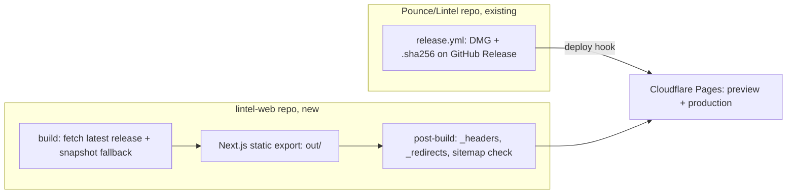

# Lintel landing page (lintelapp.com)

> Status: **accepted by the owner on 2026-11-06 (spec and prototype v5.1)**; implementation starts in `lintel-web`. Accepted prototype: `.ai/prototypes/lintel-landing/` (open `index.html`; frozen copy `index-accepted-v5.1.html`; evidence and decisions in its `README.md` and `SHAPE.md`). Product context: PR #56 (Notes workspace) and `.ai/specs/2026-11-04-notes-workspace.md`, `.ai/specs/2026-11-03-meeting-notes.md`, measured numbers in `docs/perf.md`. Prose in English, identifiers in English, page copy English + Polish. Implementation happens in a **separate repo `lintel-web`** (private until launch); this spec lives here because the design and the claims it makes belong to the product.

## 📝 TLDR

Lintel has no public home that matches the product: the only page is the old Pounce launcher landing on GitHub Pages (`docs/index.html`). This spec **proposes** a marketing site at `lintelapp.com` (EN + PL) that leads with the main feature (meeting recording, transcripts with speakers and the editable Notes workspace), shows the supporting features (launcher, clipboard, file search, dictation) and has one conversion: download the DMG. It is a Next.js static export hosted on Cloudflare Pages, with Lighthouse 100 in every category, SEO that is technically complete (and honest about what search engines will and will not reward), and interactive demos that are prerendered in their final state and never shift the layout.

## ✅ Decisions (owner, 2026-11-06)

| # | Decision | Consequence |
|---|---|---|
| D1 | Brand Lintel approved; domain `lintelapp.com`; EN + PL | Routes `/en/`, `/pl/`, reciprocal `hreflang`, canonical on `lintelapp.com`. |
| D2 | Next.js static export in a separate repo `lintel-web` (plugin catalog later) | No Swift toolchain in its CI; the catalog can be added as new routes. |
| D3 | The main feature is Notes and meetings; launcher, clipboard, files and dictation are supporting | Hero is the Notes window; the launcher panel sits in "A few keystrokes faster". |
| D4 | v1 uses local models only; other models (including cloud) are planned and always opt-in | Copy says "local first, your call"; it never says "nothing is ever uploaded". The plan appears only in the FAQ and the privacy section. |
| D5 | The only CTA is the DMG download | No waitlist, pricing, account or newsletter. |
| D6 | Launch date unknown, after PR #56 | Build flag `SITE_LIVE` (below). |
| D7 (Q1) | **Cloudflare Pages** | `_headers` and `_redirects`, preview deploys, free plan (500 builds per month). Pricing check and the Workers note are in Risks. |
| D8 (Q2) | Early preview deploy with `noindex`; at launch attach the domain and flip `SITE_LIVE`; remove the old landing in a separate PR here after launch | Phase 3. |
| D9 (Q3) | Version, size and SHA-256 are read from the latest GitHub release **at build time** | No runtime API calls; a release triggers a rebuild. |
| D10 (Q4) | **No analytics script, no cookies** | Privacy claims stay clean; no consent banner; success is read from host metrics and release download counts. |

## 📝 Problem Statement

- **Evidence (known):** the repository's only public page describes a different product (launcher "Pounce"); meeting notes and the Notes workspace (PR #56) have no public description; every claim that matters here (editable notes, authorship, local models, encryption) can only be judged by using the product.
- **Obstacle (inferred):** a Mac user comparing meeting-notes tools cannot verify "editable, checked against the recording, local" from screenshots, and a video proves less than a working replica. The page has to let the visitor try the core loop (comment a block, ask the agent to revise it, see what it changed and what it refused to change) in under 30 seconds.
- **Not evidenced:** no analytics, interviews or competitor measurements exist. Success signals below are proposals, not findings.

## 📝 Research (market leaders, 2026-11-06)

What open-source and developer-tool sites do that this page should copy or skip. Sources: the two sites the owner named (e2e.com, openmercatocloud.com, inspected in a browser) and general knowledge of tools in this category; no traffic data.

- **Copy:** one sentence of positioning, one primary button, a product replica above the fold instead of a stock screenshot, install section with the exact system requirement, plain-text sections and numbers instead of card grids, no cookie banner when nothing is tracked.
- **Skip:** pricing and plans (D5), logos of other tools (no endorsements), newsletter capture, blog and changelog on day one, testimonials we cannot source, video backgrounds.
- **Reality check on SEO:** a new domain ranks on branded queries first. FAQPage structured data no longer produces rich results for ordinary sites (Google limited them to well-known government and health sites in 2023), so FAQ markup is kept for other consumers but is not counted as a ranking feature. SoftwareApplication data has no ratings to show, so no rich result is promised. The enterprise-level part is correctness, consistency and speed (below), not magic.

## 📝 Proposed Solution

One long page per locale, ten sections (the `land-*` IDs of the prototype): nav, hero with an interactive Notes window, stats, manifesto, three numbered features (Record, Correct, Dictate), "A few keystrokes faster" (launcher, files, clipboard), privacy, install, FAQ, footer. Static content is server-rendered by Next.js; demos are client islands that hydrate when they get near the viewport, and every island is prerendered into its **final state** inside a box of reserved size.

Alternatives considered:

- *Astro or plain HTML* (less JavaScript, easier 100): rejected by D2, but kept as the **fallback if the Phase 0 spike cannot reach Lighthouse 100** with Next.js and one hydrated island.
- *Screenshots or video instead of replicas:* rejected; they prove nothing about editability and cost weight and translation work (two locales).
- *Embedding the real app UI:* impossible (native SwiftUI); the replica is deliberately HTML and says so in a caption.
- *Edge functions for language detection and release data:* rejected; static output keeps the site cacheable and keeps `no runtime calls` (D9). Language is chosen by the visitor through a link.

## 📝 Architecture



Takeaway: the only coupling to the app repo is the release asset contract and one deploy-hook step; the site never calls GitHub from the browser.

**Repo layout (`lintel-web`).**

```
app/[locale]/              layout.tsx, page.tsx (the one page), not-found.tsx, legal/page.tsx
components/                Nav, Footer, Section primitives, Button, LangSwitch, Theme
components/demos/          NotesWindow, RecordDemo, DictateDemo, LauncherPanel, FilesTile, ClipboardTile, HeroField, LazyIsland
content/{en,pl}.ts         typed messages (same `Messages` type; a test fails if a key is missing in either)
content/demo/*.ts          fictional demo data (notes, transcript, clips, files)
content/claims.ts          every marketing claim -> source (spec/PR/ADR) + status
lib/release.ts             build-time release data + snapshot
lib/ranker.ts              TS replica of the launcher tiers (visual only)
lib/field/                 pure row/mask builders for the hero canvas
scripts/                   post-build headers/CSP hashing, OG fallback, release snapshot
docs/decisions/            ADRs (stack and budgets, hosting, CSP)
```

**Rendering rules.** `output: 'export'`, `trailingSlash: true`, App Router with a `[locale]` segment and `generateStaticParams` for `en` and `pl`. No middleware, no API routes, no runtime image optimizer. Server components by default; `"use client"` only inside `components/demos/` and the theme and language controls. Each demo island renders its final state on the server; on the client it hydrates when within about one screen of the viewport (`LazyIsland`), then resets to its idle state (still off-screen) and plays when about half visible. The hero Notes window is above the fold, so it hydrates on idle after the first paint; its prerendered state and its hydrated state have identical dimensions.

**Size reservation contract.** Every demo declares fixed heights per breakpoint in CSS (no content-driven height). Content inside is pre-rendered at full size and revealed with opacity or transform only. A Playwright test records the bounding box of each demo in every state and fails on any change.

**Build flags (environment variables).**

| Variable | Default | Effect |
|---|---|---|
| `SITE_URL` | `https://lintelapp.com` | Canonical, sitemap, OG URLs, JSON-LD. |
| `SITE_LIVE` | unset | Unset: `noindex,nofollow` meta, `X-Robots-Tag: noindex` in `_headers`, `Disallow: /` in robots, no sitemap. Set to `1`: indexable. Set only on the production build after launch. |
| `GITHUB_REPO` | owner decision at launch | Source of releases and the star link (today `mjozefiak/Pounce`; the prototype placeholder `lintel-app/lintel` is not real). |
| `GITHUB_TOKEN` | read-only token | Lifts the unauthenticated API limit during builds; never exposed to the client. |
| `NOTARIZED` | unset | When unset the install section shows the first-launch Gatekeeper note (the release is self-signed and not notarized, `docs/signing.md`). |

## 📝 Data Model

No database. Three typed build-time structures:

- `ReleaseInfo { version, publishedAt, dmgUrl, dmgSizeBytes, sha256 }` from `lib/release.ts` (the minimum OS and architecture are **not** read from the release: they are facts in `content/facts.ts`, "macOS 26" and "Apple silicon", sourced from `AGENTS.md` and `Resources/Info.plist`): GitHub `releases/latest` (not draft, not prerelease), the asset ending in `.dmg` and the asset ending in `.dmg.sha256` (today `Pounce.dmg` and `Pounce.dmg.sha256`, `release.yml`; the pattern, not the name, is the contract). A committed `release.snapshot.json` is used when the API fails or the checksum asset is missing; the build then warns and the install section omits the SHA line instead of printing a stale value.
- `Fact { id, value, unit, source, measuredOn }` for numbers on the page (`16 ms`, `7 ms`, `36 MB`, `3 h`, `90 days`). Source is a path in this repo (`docs/perf.md`, specs). `measuredOn` is shown in the Phase 3 audit; a fact without a source fails the build.
- `Claim { id, textKey, source, status: 'shipped' | 'planned' | 'assumption' }` for every marketing sentence that promises behavior. A `planned` or `assumption` claim cannot render outside the FAQ or privacy sections (test). The launch gate (Phase 3.1) requires every claim to be `shipped`.

## 📝 API Contracts

Build-time only; there are no endpoints.

- **GitHub Releases (read):** `GET /repos/{owner}/{repo}/releases/latest`. Failure modes in Edge Cases.
- **Deploy hook (write, from the app repo; companion change C1, not part of the lintel-web delivery):** the app's `release.yml` gets a final step that POSTs to the Cloudflare Pages deploy hook stored as secret `LINTEL_WEB_DEPLOY_HOOK` after the release is published. Failure of the hook must not fail the release (log and continue); `workflow_dispatch` on `lintel-web` is the manual path.
- **Release asset contract:** a release publishes exactly one `*.dmg` and one `*.dmg.sha256` (SHA-256 hex followed by a filename, as `shasum -a 256` prints). Changing this is a breaking change for the site and is noted in the app repo's `BACKWARD_COMPATIBILITY.md` when this spec ships.

## 📝 SEO and discoverability

All of the following is verified by automated tests in CI (Phase 1), not by inspection.

- **Language and URLs:** `/en/`, `/pl/`, one canonical per page, self-referencing; reciprocal `hreflang` (`en`, `pl`, `x-default` → `/en/`); `<html lang>`; `/` redirects to `/en/` with a 302 (no locale detection; the visitor switches with a real `<a href>`). `www` redirects to the apex at the Cloudflare level. One H1 per page, a landmark structure, descriptive titles and meta descriptions per locale.
- **Structured data (JSON-LD, typed with `schema-dts`):** `Organization`, `WebSite`, `SoftwareApplication` (`operatingSystem: macOS 26`, `processorRequirements: Apple silicon`, `offers.price: 0`, `license: MIT`, `downloadUrl`, `softwareVersion` from `ReleaseInfo`; no ratings), `FAQPage`, `BreadcrumbList`. The category value is checked with Google's Rich Results Test and the current schema.org vocabulary before launch; the `FAQPage` markup does not produce a Google rich result and is not counted on.
- **Crawl files:** `sitemap.xml` with `xhtml:link` alternates for both locales, `robots.txt` (allow when `SITE_LIVE`, disallow otherwise), `manifest.webmanifest`, favicons (SVG plus 180 px touch icon), `theme-color` per color scheme, `/.well-known/security.txt`.
- **Social:** Open Graph and Twitter card per locale, a 1200×630 image per locale generated at build (Next file convention; the fallback is a Playwright render of a template), `og:locale` and alternates.
- **Performance as SEO:** the budgets below.
- **Not done:** keyword stuffing pages, doorway pages, auto-generated comparison pages, hidden text, paid or third-party link schemes.

## 📝 Performance, security and accessibility budgets

**Performance (lab, Lighthouse mobile and desktop, median of 5 runs in CI).** Target 100 in all four categories. Gate: Accessibility, Best Practices and SEO must be exactly 1.0; Performance must be at least 0.99 (lab noise). Budgets proposed here and **fixed by the Phase 0 spike**: LCP ≤ 1.2 s on the mobile profile, CLS 0, TBT ≤ 50 ms, first-load JavaScript ≤ 110 KB gzip including React and Next (islands load after first paint and stay under 45 KB gzip each, lazily), HTML ≤ 80 KB gzip per locale, no webfonts (system stack, SF Pro on Macs), no raster images in the page (only OG and icons), no third-party requests. The hero canvas draws about 1.5 ms per frame in the prototype (unmeasured on low-end CPUs, to be profiled in 2.2), runs only while the pointer moves or a ripple plays, and pauses when the tab or the hero is off-screen.

**Security headers (`_headers`, generated by `scripts/headers`).**

- `Content-Security-Policy: default-src 'self'; script-src 'self' 'sha256-…'; style-src 'self'; img-src 'self' data:; font-src 'self'; connect-src 'self'; object-src 'none'; base-uri 'none'; form-action 'none'; frame-ancestors 'none'`. The script hashes are computed from the inline scripts that Next.js and the theme bootstrap emit (inference: a static export inlines a few bootstrap scripts; to be confirmed in Phase 0, including the `_headers` line-length and rule limits on Cloudflare Pages). **No inline `style` attributes anywhere** (the prototype has many; the port replaces them with classes and CSS custom properties), enforced by a build test. JSON-LD blocks are data, not executable scripts.
- `Strict-Transport-Security: max-age=31536000; includeSubDomains` (**no preload**: preload is hard to reverse), `X-Content-Type-Options: nosniff`, `Referrer-Policy: strict-origin-when-cross-origin`, `Permissions-Policy` denying camera, microphone and geolocation, `Cross-Origin-Opener-Policy: same-origin`.
- Cache: HTML `public, max-age=0, must-revalidate`; `/_next/static/*` immutable for a year.

**Accessibility (WCAG 2.2 AA, axe in CI plus the manual checks below).** Contrast measured on every token pair (the prototype already needed fixes for secondary text on selected rows). Keyboard reach for every demo control. **2.2.2 Pause, Stop, Hide:** an autoplaying demo that runs more than five seconds has a visible "Skip to result" and "Replay" control. `prefers-reduced-motion` skips straight to the final state and disables the scan-line animation; `forced-colors` has outlines instead of glass. Live regions announce demo results ("1 block revised, 1 skipped"). Page-wide shortcuts (⌘Space, ⌘⇧V, ⌘⇧H) work only while focus is inside the demo they belong to, so they never hijack the browser; they use modifiers, so 2.1.4 does not apply.

## 📝 UI/UX

Prototype: `.ai/prototypes/lintel-landing/index-accepted-v5.1.html`. Accepted by the owner on 2026-11-06 together with this spec (stated in the conversation; not recorded elsewhere). Scope: the whole page, EN and PL, light and dark, desktop and mobile.

| Section (`data-screen`) | Contents | Must hold in the port |
|---|---|---|
| `land-nav` | Floating rounded bar, links centred, language, theme, Download | Language switch is a real link; no layout shift on sticky. |
| `land-hero` + `land-notes-window` | Headline, lead, CTA, scan-line field, interactive Notes window | The window is a replica of the app's styles (`lintel-app` prototype), three notes, comment popover, Revise with lock, "skipped: you edited this block", History with Compare, Hide content. |
| `land-stats` | Four fact tiles | Every number has a `Fact` with source and date. |
| `land-manifesto` | Words lit by scroll (CSS `animation-timeline: view()`) | Falls back to fully lit text without support or with reduced motion; both states pass contrast. |
| `land-record`, `land-trust`, `land-dictate` | Numbered features with demos | Autoplay when about half visible, once; fixed box; Replay and Skip. |
| `land-around` | Launcher panel, perf facts, files tile, clipboard tile | The ranking is a visual replica of the tiers (exact, prefix, word start, substring, fuzzy) and says so; no claim of identical results. |
| `land-privacy`, `land-install`, `land-faq`, `land-footer` | Local-first statement, three steps, Gatekeeper note (flag), eight FAQ items | Copy follows D4; install shows version, size, SHA from `ReleaseInfo`. |
| `legal` (new) | Privacy notice and third-party notices | Says plainly: no cookies, no analytics, the host processes request logs; text supplied by the owner (launch gate). |

States to implement per demo: idle, playing, done, skipped, reduced-motion, no-JS (prerendered final), narrow (320 to 390 px) and the Polish strings (longest labels). Copy lives in `content/{en,pl}.ts`; adding a key to one locale without the other fails CI.

## 📝 Edge Cases & Failure Scenarios

- **GitHub API fails, rate-limits or returns a draft/prerelease:** build uses `release.snapshot.json`, logs a warning, and the preview shows a "snapshot" badge only when not `SITE_LIVE`; the production build fails if the snapshot is older than the last tag by more than one release (check in 3.2).
- **Release without the checksum asset:** install section hides the SHA line and links to the release notes; build warns.
- **JavaScript disabled or hydration fails:** the prerendered final states remain readable; controls that need JS are rendered as non-interactive text (no dead buttons).
- **`animation-timeline` unsupported (older Safari, Firefox):** manifesto text is fully lit; tested in the three engines in Phase 2.6.
- **Reduced motion, forced colors, narrow Polish layout:** covered by Playwright projects.
- **Visitor pastes into or types in a demo:** all demo text is rendered with text nodes, never as HTML; user-typed comments never leave the page.
- **Shortcut conflicts:** inside the Notes window ⌘⇧H toggles Hide content (browsers use it for Home); the handler calls `preventDefault` only while focus is inside the demo.
- **Gatekeeper first launch:** until `NOTARIZED` is set the install section explains "right-click, Open"; the page must not claim the app is verified by Apple.
- **Deploy hook fails after a release:** the site keeps the previous version; the next manual run fixes it; the install section shows the version it was built with, so the mismatch is visible.
- **Language links on a missing page:** `404` is localized and links both home pages.

## 📝 Risks & Impact Review

- **Next.js plus React hydration may not reach Lighthouse 100** on mobile (React and Next are a fixed JavaScript cost the prototype does not pay). Mitigation: Phase 0 spike with go/no-go; fallback Astro (decision by the owner, not silently).
- **Claims can drift from the product.** The page promises behavior of features still in flight (PR #56 phases; meeting notes steps; model names in the prototype such as "Qwen3 4B" and "Parakeet Ultra"). Mitigation: `claims.ts` registry, the Phase 3.1 gate, and no launch before PR #56's visibility commits and the Meetings registration have shipped.
- **Cloudflare is steering new projects to Workers Static Assets; Pages stays supported** (secondary sources, no removal date found). The build output (`out/`, `_headers`, `_redirects`) is portable to either, so the cost of moving later is small; Phase 0.5 re-checks the official recommendation and records it in ADR 0002.
- **Pricing (secondary sources, verify at Phase 0.5):** Cloudflare Pages Free covers this site (500 builds per month, 1 concurrent build, bandwidth reported as unlimited); the alternative Railway Hobby would cost at least 5 USD per month plus ops.
- **CSP hash maintenance:** a framework upgrade changes inline scripts; the post-build step recomputes hashes and a test fails if any inline script is uncovered.
- **Replica fidelity:** the HTML window can diverge from the app UI after redesigns; it is tied to the `lintel-app` prototype version and listed in the app repo's UI-change checklist (3.4).
- **Trust risk of "local first":** when other models ship (including cloud), the privacy copy and the FAQ must change the same day; recorded in `claims.ts` as `planned`.
- **Irreversible choices avoided:** no HSTS preload, no permanent 301 from `/`, no analytics, no cookies.
- **Who bears the impact:** the owner (domain and brand), visitors (honesty of claims), and the app repo (release workflow gains one step; a changed asset name breaks the site build).

## 📋 Phasing

Each phase is independently shippable to the preview deployment; only Phase 3 makes anything public and indexable.

- **Phase 0: bootstrap and spike** (go/no-go on stack and budgets).
- **Phase 1: static shell, content and SEO** (no demo JavaScript; Lighthouse 100 must already hold).
- **Phase 2: interactive demos** (each demo ships with its prerendered state and its size test).
- **Phase 3: launch** (claims audit, domain, `SITE_LIVE`, post-launch checks). Companion changes C1 (release hook) and C2 (retire the old landing) are tracked separately in the app repo.

Precondition for Phase 1: owner acceptance of the prototype (**given 2026-11-06**). Precondition for Phase 3: PR #56's visibility commits and the Meetings plugin registration have shipped, or the owner explicitly accepts a launch without them.

## 📋 Implementation Plan

Source doc for each `om-auto-create-pr` run: this file. Validation gate for `lintel-web`, configured in Phase 0: `pnpm lint`, `pnpm typecheck`, `pnpm test`, `pnpm build`, `pnpm test:e2e`, `pnpm lhci`.

### Phase 0: bootstrap and spike (new repo `lintel-web`)

- 0.1 Create the repo (owner action), license MIT, README, `.ai/agentic.config.json` through `om-setup-agent-pipeline`, issue labels. *Test:* the pipeline's own check passes on an empty PR.
- 0.2 Next.js skeleton: static export, `[locale]` routing, strict TypeScript, ESLint, Prettier, Vitest, Playwright. *Test:* `pnpm build` produces `out/en/index.html` and `out/pl/index.html`.
- 0.3 **Spike:** hero text, one idle-hydrated island with a canvas, system fonts, token CSS. Measure Lighthouse (mobile and desktop, 5 runs), first-load JS, LCP, TBT. Write ADR 0001 (stack and budgets) with the numbers. **Go/no-go:** below 0.98 Performance means the owner chooses between trimming islands and the Astro fallback. *Test:* numbers are reproducible with `pnpm lhci`.
- 0.4 CI: lint, typecheck, test, build, Playwright smoke, `lhci` with the gate above, axe, branch protection. *Test:* a deliberately failing contrast change turns CI red.
- 0.5 Cloudflare Pages project connected to the repo; preview deploys; confirm Pages versus Workers Static Assets and the `_headers` limits from the official docs; ADR 0002. *Test:* a preview URL serves `X-Robots-Tag: noindex`.

### Phase 1: static shell, content, SEO

- 1.1 Tokens and global styles from the `lintel-brand` prototype (dark first, light via `prefers-color-scheme` and a toggle; the theme bootstrap is a hashed inline script, no flash). *Test:* contrast test over every token pair.
- 1.2 Content model: `Messages` type, `content/en.ts`, `content/pl.ts`, `facts.ts`, `claims.ts`, parity test. *Test:* removing a Polish key fails CI; a fact without a source fails the build.
- 1.3 Layout and primitives: Nav (floating bar), Footer, Button, LangSwitch (real links), Theme. *Test:* axe clean; keyboard order test.
- 1.4 Sections as server components with prerendered final-state demo placeholders of the right size. *Test:* Playwright asserts the reserved box sizes at 320, 390, 768, 1440 px in both locales.
- 1.5 `lib/release.ts` with snapshot fallback and fixtures. *Test:* unit tests for success, API failure, missing checksum, draft and prerelease.
- 1.6 SEO: metadata, JSON-LD, sitemap, robots, manifest, icons, security.txt, localized 404, `SITE_LIVE` gating. *Test:* hreflang reciprocity, canonical self-reference, JSON-LD parses and matches `schema-dts` (structured data is best-effort hygiene: syntactic validity gates Phase 1, rich-result eligibility does not), sitemap URLs exist in `out/`, unset `SITE_LIVE` emits noindex everywhere.
- 1.7 `scripts/headers`: `_headers`, `_redirects`, CSP hashes, cache rules. *Test:* every inline script in `out/` is covered; no inline `style` attributes; header file parses within Cloudflare limits.
- 1.8 OG images per locale. *Test:* both files exist at 1200×630 and are referenced by the pages.
- 1.9 Legal page with **placeholder text** and the third-party notices link; the real text is a Phase 3.1 gate item. *Test:* page exists in both locales and is linked from the footer.
- **Exit:** Lighthouse 100 in all four categories, mobile and desktop, on the preview URL.

### Phase 2: interactive demos

- 2.1 `LazyIsland`, in-view hook, reduced-motion hook, Skip and Replay control, size-reservation CSS contract. *Test:* island renders final state without JS; hydration does not change the box size.
- 2.2 `HeroField` and `lib/field/` (seeded row builder, ring mask, pointer lens, ripple, visibility pause). *Test:* pure builder unit tests; frame-time budget measured on a throttled CPU; reduced motion draws one static frame.
- 2.3 `NotesWindow` with a reducer for select note, add comment, Revise (lock, revise, skip edited, report), History with Compare, Hide content. *Test:* reducer tests for the skip rule and the lock; Playwright flow comment → Revise → History.
- 2.4 `RecordDemo` and `DictateDemo` on a shared timeline hook with cancel and skip. *Test:* the box size is constant in every state; skip reaches the final state; language switch keeps the state.
- 2.5 `LauncherPanel`, `FilesTile`, `ClipboardTile` with `lib/ranker.ts` replicating the tier order. *Test:* tier-order table tests (exact > prefix > word start > substring > fuzzy, frecency never crosses tiers is out of scope); tile heights equal across tab changes.
- 2.6 Mobile layouts and cross-engine pass (Chromium, WebKit, Firefox), forced colors, Polish at 320 px. *Test:* no horizontal overflow at any width; CLS 0 observer in Playwright.
- 2.7 Accessibility pass: pause controls, live regions, scoped shortcuts, focus management of the comment popover. *Test:* axe and keyboard-only Playwright script for every demo.
- **Exit:** Lighthouse still 100/100/100/100; first-load JS within the Phase 0 budget.

### Phase 3: launch

- 3.1 Claims audit: every `Claim` is `shipped`; stats re-measured or softened (`docs/perf.md` numbers come from one Mac); model names confirmed or removed; telemetry statement confirmed; `NOTARIZED` value set; legal text supplied. *Gate:* the audit file is committed and reviewed by the owner.
- 3.2 Domain and cutover: attach `lintelapp.com`, `www` redirect, set `SITE_LIVE=1` for production, submit the sitemap to Search Console and Bing Webmaster Tools (owner action), run Rich Results Test and URL inspection. *Test:* production serves indexable headers, canonical and hreflang; the preview still serves noindex. The production build fails when the release snapshot is older than the last tag by more than one release.
- 3.3 Post-launch checks (a week after): Search Console coverage, Core Web Vitals field data when available, broken-link check, a fresh release rebuilds the site end to end.

### Companion changes in the app repo (separate tickets and PRs; they do not block Phases 0 to 2)

- **C1 Release hook and asset contract.** `release.yml` gets a final step that calls `LINTEL_WEB_DEPLOY_HOOK` (failure logged, never fails the release); the contract "one `*.dmg` and one `*.dmg.sha256` per release" is written into `BACKWARD_COMPATIBILITY.md`. *Test:* a dry-run release triggers a preview rebuild. Needed before Phase 3.2, and only for automation: until then `workflow_dispatch` on `lintel-web` rebuilds by hand.
- **C2 Retire the old landing.** After Phase 3.2 is live: remove `docs/index.html` and `.github/workflows/pages.yml`, switch GitHub Pages off, update the "Landing page" row of `AGENTS.md` to point to `lintel-web`, and add "update the landing replica" to the UI-change checklist. *Test:* CI here stays green.

## 🔗 Dependencies and owners

| Item | Owner | Status | Blocks |
|---|---|---|---|
| Create repo `lintel-web` | owner | **created 2026-11-06 (private)** | none |
| Prototype acceptance | owner | **accepted 2026-11-06** | none |
| Cloudflare account, Pages project, deploy hook secret | owner | not started | Phase 0.5, C1 |
| Domain `lintelapp.com` registered, DNS in Cloudflare | owner | not confirmed | Phase 3.2 |
| Canonical GitHub repository name (`GITHUB_REPO`) | owner | undecided (today `mjozefiak/Pounce`) | Phase 1.5, 3.1 |
| PR #56 visibility commits and Meetings registration (spec step 1.10) | app team | in progress, not shipped | Phase 3 (or an explicit owner exception) |
| Legal text (privacy notice) | owner | not written | Phase 3.1 |
| C1 and C2 | app repo | not started | Phase 3.2 and after launch |

## ⚠️ Launch gates (not design blockers, tracked)

Notarization status and the Gatekeeper copy; the "no telemetry" statement; the canonical GitHub repository name; model names shown in the demos; whether `Pounce.dmg` becomes `Lintel.dmg` (the site reads by pattern, so either works); legal text; re-measured performance facts; the headline ("Talk. Lintel remembers." is a placeholder).

## 📝 Not doing

Plugin catalog, docs site, blog, changelog page, comparison pages, pricing, newsletter, waitlist, account, analytics, cookie banner, A/B testing, edge functions, locale auto-detection, HSTS preload, real product screenshots or video, paid-search or link schemes.

## 📝 Resolved assumptions (owner can override)

A1 Node LTS and pnpm, latest stable Next.js pinned exactly at bootstrap (verify current docs for static export, i18n and OG generation in 0.3). A2 `/` answers with a 302 to `/en/`. A3 System font stack only. A4 CSS Modules with CSS custom properties; no CSS-in-JS runtime. A5 Vitest, Playwright, `@axe-core/playwright`, Lighthouse CI. A6 Previews are protected by `noindex` only (no Cloudflare Access). A7 The site and the app are both MIT; the site's demo data is fictional and says so in captions. A8 The spec lives in this repo and the implementation in `lintel-web`.
