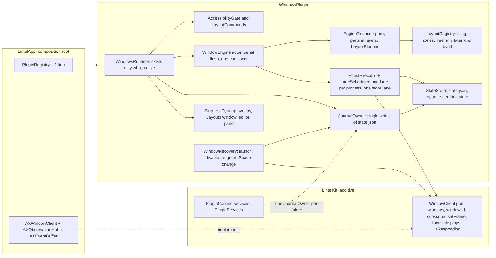

# Window management: workspaces with tiling and zone-grid layouts

> Status: **implemented on PR #68** (Phases 1 to 4, registered, off by default); this document was written as the design on 2026-11-09 and is kept in step with what was built (rev 6, after two independent architecture reviews: strategies are open and own their state, configuration and commands; the engine runs effects on per-process lanes behind one injected clock; `JournalOwner` is the single writer of `state.json`). Originally written on top of `main` (main window, ADR 0008, PR #52) and of the Notes workspace (PR #56, open; not a dependency of this spec). Prose in English, identifiers in English, UI strings English + Polish. Written autonomously, then revised on 2026-11-09 after the owner's answers (rev 2: layout library with editor, per-workspace and per-display assignment, menu bar workspace strip; rev 3: independent UX and architecture review folded in; rev 4: owner decisions on the open questions, 2026-11-09). Every remaining default is listed under "Resolved assumptions" for override.

## 📝 TLDR

Lintel is a launcher; today it cannot arrange the windows it opens. This spec proposes a new, opt-in plugin, **Window Management** (`windows`), that adds **workspaces** (virtual desktops in the AeroSpace sense: nine named groups of windows, one visible per display, switched with a shortcut) and gives each workspace one of two **layouts**: **tiling** (an i3/AeroSpace-style tree: windows fill the screen, no overlap) or **zones** (PowerToys FancyZones-style: windows snapped into zones, by shortcut or by Shift-dragging). Zone layouts come from a **layout library** (templates plus the user's own grid layouts, created and edited in a visual editor; Canvas layouts come later) and are **assigned per workspace and per display**. A **menu bar strip** of numbered boxes shows which workspace is active. It uses the Accessibility API only (no SIP changes, no private Space APIs) and is **implemented on PR #68**; this document describes the design as built.

## ✅ Resolved assumptions (autonomous defaults)

Open Questions were resolved without a human, picking the most reversible option. The one ⚠ item (Q3) was confirmed by the owner on 2026-11-09; the items marked **Owner** are the owner's own decisions.

| # | Question | Default chosen | Why |
|---|---|---|---|
| Q1 | Shell feature or plugin? | A compile-time plugin `WindowsPlugin` (`PluginID` `windows`), disabled by default, registered in `PluginRegistry` | Architecture law in `AGENTS.md`: every feature is a plugin; disabled by default means no behaviour change for current users |
| Q2 | How are "virtual desktops" implemented? | **Emulated, as AeroSpace does:** windows of a hidden workspace are moved to a screen corner (their frames are remembered); native macOS Spaces are not touched | Public API only, no SIP change, no animation; the alternatives (private CGS Space calls, minimising, hiding apps) are rejected below |
| Q3 | Private symbol `_AXUIElementGetWindow` (window id from an `AXUIElement`) | **Owner decision 2026-11-09: yes, with safeguards.** Resolved with `dlsym` at runtime and checked at start-up; if it is missing or wrong the plugin goes to the `failed` state with a clear banner; no fallback in v1 | Every comparable tool depends on it and Accessibility has no public equivalent; it is an undocumented symbol Apple can change, so the failure mode is a disabled feature, never a crash or parked windows |
| Q4 | Bundled scope? | One spec, three independently shippable phases: (1) workspaces and window engine, (2) tiling, (3) zones with the stock templates, assignment and snapping, (4) the layout library with its editors. Phase 1 alone is useful (workspaces with the windows left where they are) | Each part works without the next; one design avoids two specs that must agree on the shared engine |
| Q5 | Is the layout a global or a per-workspace choice? | Per workspace, one of three kinds: **Auto-tile**, **Zones** or **Free** (no arrangement; windows stay where the user puts them). Default kind is Auto-tile (setting), switchable per workspace and with a command; the state of each kind is kept when switching | Matches "two ways of arranging windows on such a desktop" and gives a safe way out per workspace; keeping every state makes switching non-destructive |
| Q6 | Which windows are managed? | Standard windows of regular apps on the current macOS Space. Dialogs, sheets, panels, minimised and native-fullscreen windows are left alone. A user-editable "Floating apps" list (default: Lintel itself, System Settings, Calculator) is never tiled or placed. **Owner decision:** Auto-tile arranges windows only on workspaces whose kind is Auto-tile, Zones only on Zones workspaces, Free never | Smallest rule that avoids fighting the system; reversible through the list and the per-workspace kind |
| Q7 | Tiling features in v1 | Split containers (horizontal/vertical) with weights, focus, move, resize, join-with, toggle orientation, toggle floating, balance. **No accordion, no per-app rules** | Smallest scope that still gives an AeroSpace-like tree |
| Q8 | Zone layouts in v1 | **Owner decision 2026-11-09:** a layout library of **grid** layouts with stock templates and one visual editor (divide, merge, drag dividers), import/export. **Canvas layouts and their editor are deferred to a later spec**; the file format reserves the `canvas` style so adding it is additive. Multi-zone span while dragging is also deferred | Keeps the editor work to one editor; FancyZones' Canvas is the less used style |
| Q9 | Multiple displays | One visible workspace per display, workspaces are global (focusing a workspace that is visible on another display moves focus there); commands act on the display of the focused window. No per-display workspace pinning (a workspace is not tied to a display), but **zone layouts are assigned per workspace × display** (owner decision) | AeroSpace's workspace model; FancyZones' per-monitor layout assignment |
| Q10 | Default shortcuts | **Owner decision: the AeroSpace defaults, configurable.** ⌥1–9 go to workspace, ⌥⇧1–9 move the focused window, ⌥H/J/K/L focus (left/down/up/right), ⌥⇧H/J/K/L move, ⌥/ cycles the layout kind, ⌥- and ⌥= resize, ⌥Tab goes back to the previous workspace. All others unbound. **Workspaces are only the numbers 1–9: AeroSpace's letter workspaces (⌥A…Z) do not exist here.** The modifier of each family is changeable in one row in Settings. All are normal `PluginCommand`s; a default is registered in the phase that implements its command; nothing is registered while the plugin is off. **Safeguard:** ⌥ plus a letter types a character on some layouts (on a Polish layout ⌥L is ł), and a global ⌥L would swallow it. When the plugin is first enabled, the welcome step checks the active input source for each bound key with ⌥; if any of them types a letter, it names them and offers ⌃⌥ for the whole family (one click), and the pane keeps a warning until resolved | AeroSpace users expect these keys; the check turns the one known collision into a visible, one-click choice instead of silently breaking typing. `DefaultShortcutTests` is updated with the plugin, and the full table goes into `BACKWARD_COMPATIBILITY.md` §5 |
| Q11 | Wording | **Owner decision: Workspaces** (Polish: "Obszary robocze"), not "Desktops" or "Spaces" | "Spaces" and "Desktops" already mean the macOS feature; the main window's "Workspace" mode is a different thing, so the word is used only inside Window Management |
| Q12 | Persistence across restarts | `Plugins/windows/state.json` keeps workspace membership, trees, zone placement and the home frames of hidden windows (no titles); reconciled with the live windows on launch | Needed anyway for crash recovery (see Edge Cases), so reuse it |
| Q13 | Window switcher in the launcher | Phase 1 adds a search source that lists workspaces and windows (Return: go to it, ⌘Return: bring it to this workspace). Results are never ranked or recorded in `ranking.sqlite` | The launcher is the natural place; recording titles would put sensitive text in a database |
| Q14 | A main-window section for this plugin? | No. Settings pane only; the layout editor opens from it in its own window | The main window's sections are for content; avoids touching the shell |
| Q15 | Zone drag-to-snap | Included (Phase 3): hold Shift while dragging a window to show the zones; releasing snaps the window | It is the defining behaviour of FancyZones; it needs only Accessibility |
| Q16 | Where is the "which workspace am I on" widget? | **Owner decision (image 2026-11-09):** a status item in the menu bar drawing a strip of numbered boxes with the active one highlighted; owned by the plugin, on by default while the plugin is on, can be turned off. Drawn as a monochrome template image (active box filled, others outlined), showing all configured workspaces by default so box positions never move under the cursor (setting: occupied only). Clicking a box switches to it. The workspace HUD stays as a second, optional cue | Matches the reference the owner attached; AeroSpace itself ships no widget (people use SketchyBar) |
| Q17 | Per-workspace configuration beyond the layout kind | **Owner decision:** each workspace may override the inner/outer gaps, the root orientation of the tiling tree, its layout kind and, per display, its zone layout. Unset means the global default | The owner wants configuration "per desktop" |
| Q18 | Layout library management | Create, duplicate, rename, edit, delete, import and export (one JSON file, from the UI), optional quick-switch shortcut per layout. Stock templates are read-only; "Duplicate" makes an editable copy. Deleting a layout in use falls back to the default layout on every assignment that used it, after a confirmation that names how many assignments change | FancyZones keeps layouts in an editable JSON file and offers a hotkey per custom layout; here it is a UI feature with explicit safety |
| Q19 | Defaults for a display with no assignment | The layout assigned to the workspace on another display is not reused; the default layout is chosen per display orientation (landscape, portrait), as FancyZones does, and is `Columns 2` for landscape, `Rows 2` for portrait | Needed for hot-plugged displays; reversible in Settings |
| Q20 | User-facing names of the layout kinds | **Auto-tile** (code: `tiling`), **Zones** (`zones`) and **Free** (`free`); "grid" is only a layout style inside Zones. Polish names to be agreed in the string catalog step | "Tiling" is jargon; "grid" was overloaded |
| Q21 | Default number of workspaces | 4 (1–9; nine is a fixed upper bound of the design) | Matches the owner's reference image and keeps the strip narrow |
| Q22 | Reviewer suggestions on scope | **Owner decisions:** per-workspace overrides (layout kind, gaps, root orientation) and the nine layout slots **stay**; Canvas layouts and their editor are **deferred** (Q8) | The owner asked for per-desktop configuration; Canvas was the largest optional part |

## 📝 Problem Statement

Evidence is the owner's request (2026-11-09) and the market: AeroSpace, Amethyst, yabai, Rectangle and PowerToys FancyZones each cover a part of it, and Lintel's users already keep a hotkey-driven launcher open all day. Facts about the codebase, checked on `main`:

- Lintel has **no window API**: `LintelKit` ports are `EventPoster`, `WorkspaceClient` (launch and activation), `PermissionsReader` and others; nothing reads or moves another app's windows. `Permission.accessibility` already exists and is used for pasting.
- The plugin contract, per-command shortcuts, onboarding steps, search sources, settings banners and `eraseData()` already cover everything a window-management feature needs from the shell; no shell change is required beyond registering the plugin and one port.
- The FancyZones documentation (read 2026-11-09, page updated 2026-10-14) shows the model the owner wants to match: layouts are created, edited and saved in an editor (a Grid style edited by dividing, merging and dragging dividers, and a Canvas style of free, overlapping zones), assigned per monitor, with defaults per monitor orientation, an optional hotkey per custom layout, and a JSON file that can be shared. It does **not** state per-virtual-desktop assignment, template names or a delete/duplicate action; the per-workspace assignment here is therefore new design, not parity.
- macOS gives no public way to create or switch Spaces, and Mission Control's Spaces animate and cannot be bound to a window group that an app controls.

## 📝 Proposed Solution

A `WindowsPlugin` target with a pure core (layout maths, workspace model, reconciliation) and thin adapters (a new `WindowClient` port implemented in `LintelApp` over the Accessibility API).

**Workspaces.** Up to nine workspaces (setting `workspaceCount`, 1–9, default 4; nine is a fixed upper bound of the design: numbered commands, the strip and the assignment matrix assume it). A window belongs to exactly one. Each display shows one workspace. Switching hides the windows of the old workspace by moving them to the bottom-right corner of the display (the offset that macOS still accepts is established in step 1.1) and restores the remembered frames of the new one. No animation, no private API except Q3.

**Tiling layout.** The workspace is a tree: the root is a horizontal or vertical container whose children are windows or nested containers; every child has a weight. A new window is inserted after the focused window in its container. Frames come from a pure function `TilingLayout.frames(tree, area, gaps)`. Gaps (inner, outer) are settings.

**Zone layouts.** A *layout* is a named set of zones. In this spec every layout is a **grid** layout: column and row track weights plus zones that are rectangles of cells (zones are made by dividing a zone and merging adjacent ones, so they always tile the display). It is resolution independent and has "space around zones" (a gap). The file format keeps a `style` field with the reserved value `canvas` (free, overlapping zones) so a later spec can add it without a migration. Each window is assigned to one zone; several windows in one zone stack (the focused one on top). A new window goes to the zone where the previous window of that app was last placed if that zone is empty or its layout still has it, otherwise the first empty zone, otherwise the zone of the focused window. Windows move between zones with shortcuts or by Shift-dragging, which shows the zones over the display and snaps on release.

**Layout library and editor.** The Layouts window lists the stock templates (read-only: Focus, Columns 2, Columns 3, Rows 2, Grid 2×2, Priority 25/50/25) and the user's layouts. *New layout* opens the grid editor as a modal window of the Layouts window, previewing on the chosen display. The editor: click a zone to divide it (Shift-click divides the other way), drag a divider to move it, select several zones and *Merge*, set the space around zones; keyboard: Tab moves between zones and dividers, S divides, arrows move a divider by 1%, Delete on a divider merges its neighbours. It shows a live preview over the real display, supports Undo and Redo (⌘Z, ⇧⌘Z), saves with *Save* (⌘S) and discards with *Cancel* (Esc); unsaved changes ask first, and the editor closes (after that question) if the plugin is switched off. A layout can be duplicated, renamed, deleted, exported and imported as a `.lintellayouts` JSON file, and bound to one of nine **layout slots** (a slot is a stable command, `windows.zones.layout.1…9`, with its own shortcut; nine is a stated limit). Stock templates cannot be edited; *Duplicate* makes an editable copy.

**Assignment.** The zone layout used by a workspace is chosen **per workspace and per display**: The Layouts window has a matrix: one row per workspace, one column per connected display (headed by the display's name and an *Identify* button that flashes a number on that screen), and in each cell a picker whose label always shows the layout in effect ("Columns 2 · default" when the cell is empty, so nothing is invisible). A layout card also has *Apply to…* (a workspace and a display picker). The matrix is keyboard operable: arrows move between cells, Space opens the picker. An empty cell uses the default for the display's orientation (Q19). Displays are keyed by their stable display UUID, so a laptop that returns to the same monitor finds its layouts again.

**Per-workspace tiling configuration.** For each workspace the user can override the gaps, the root orientation of the tiling tree and the layout kind (Auto-tile, Zones or Free); the global defaults are used where nothing is set. The pane shows one summary line per workspace ("Workspace 3: Zones · Coding on Studio Display") with an *Edit* action, so the effective configuration is always readable.

**Workspace strip (menu bar).** A status item owned by the plugin draws one rounded box per workspace with its number as a **monochrome template image** (it follows the menu bar's light, dark and tinted looks): the active workspace is filled, the others are outlined, a workspace visible on another display has a small notch mark instead of a colour. By default it shows all configured workspaces (4 by default), so positions are stable; a setting shows only the occupied ones. Clicking a box switches to that workspace; a right-click (or ⌃-click) opens a menu (workspace list with window counts, layout of the current workspace, *Restore all windows*, Settings). The workspace HUD (a brief on-screen number after a switch) stays as an optional second cue.

**Alternatives considered**

- *Real macOS Spaces through private CGS calls (yabai):* rejected; needs SIP partly disabled for the useful parts and breaks on macOS updates.
- *Minimise or hide the app to hide a workspace:* rejected; minimise animates and fills the Dock, `NSRunningApplication.hide()` hides an app, not a window, so two workspaces cannot share an app.
- *A configuration file with a command language (AeroSpace's TOML):* rejected for v1; Lintel configures through Settings and per-command shortcuts.
- *One spec each for workspaces, tiling and zones:* rejected; they share the window engine, and phasing keeps each shippable.
- *Opening the strip's menu on left click (the usual menu bar convention):* rejected for the strip, because the owner's reference is a strip of directly clickable boxes; the Lintel status menu keeps the usual left-click menu.
- *A widget as a floating always-on-top bar:* rejected as the default; the owner's reference is a menu bar strip, which needs no window management of its own. A floating bar can be a later addition.
- *Hard-coding the stock templates only (no editor):* rejected by the owner; a layout library with an editor is in scope.

## 📝 Architecture



Takeaway: the shell gains one port implementation and one registry line; every other new part, including the strip and the editors, is inside the new plugin, and the layout logic has no dependency on AppKit so it is testable with plain values. The engine is a reducer behind a serial event flow; effects run on lanes, so one hung app delays only itself. The strip is an `NSStatusItem` created by the plugin (the plugin already owns its HUD panel in the dictation precedent); no `StatusItemController` change is needed.

- **Dependencies** follow the rule in `AGENTS.md`: `WindowsPlugin` → `LintelKit`, `LintelCore` (the shared `withDeadline` helper), `LintelPersistence` (for `AtomicFile`) and `LintelUI` (shared settings views and brand tokens); it imports no other plugin and not `LintelApp`.
- **Shared services.** `PluginContext.services` (`PluginServices`, an additive port; the host implements it in `LintelApp`, a context without a host gets an unshared default) holds typed per-plugin values (`PluginServiceKey`: `Value`, `make(context:)`, `teardown(_:)`), made on first use outside any lock and torn down when the host quits; the journal owner is one. The host also bounds every `activate()` (20 s).
- **Naming.** `PluginContext.workspace` already is the `WorkspaceClient` (launching and activating apps) and `WorkspaceSection` is a main-window concept, so code names for the new concept are `VirtualWorkspace…` (UI text still says "Workspaces", Q11).
- **`WindowClient` (new port in `LintelKit`, additive, `PluginContext.windows`, default reports no windows and no displays; adding a defaulted parameter to the memberwise `PluginContext` init is additive like the earlier ones):** `availability` (`.available` or `.unsupported(reason)`, read by `activate()` through `checkAvailability() async`, which a real client runs off the cooperative pool; `activate()` throws on `.unsupported` so the host marks the plugin `failed`), `windows() -> [WindowInfo]` (the windows of the current native Space), `window(id:) -> WindowInfo?` (one window read on its own, so an event costs one read), `focusedWindow()`, `setFrame(_:for:)`, `focus(_:)`, `displays() -> [DisplayInfo]` (id, display UUID from `CGDisplayCreateUUIDFromDisplayID`, `visibleFrame`, orientation), `processStart(of:)`, `isResponding(pid:)` (tells a hung app from a window on another Space), and `subscribe() async -> AsyncStream<WindowEvent>` (starts observing and returns the stream once observing has started; `events` has no side effect; events are created, destroyed, moved, resized, focused, app launched/terminated, displays changed, Space changed and `resync`, which means events were lost). `WindowInfo` = `WindowID` (pid + window number), bundle id, title (memory only), frame, role/subrole flags, `isMinimized`, `isFullscreen`. Every new member has a default, so an existing client keeps working. Tests use an in-memory fake.
- **`AXWindowClient` (in `LintelApp/Ports/`)** follows the same no-trap rule as plugin code (a crash here takes down the whole process): the `dlsym` result is checked for nil, and at `start()` the function is called once on a known window and its answer compared with `CGWindowList`; any mismatch makes `availability` `.unsupported`. It observes every regular app with `AXObserver` (created, destroyed, moved, resized, focused window) from `subscribe()` until the stream ends, sets a per-app messaging timeout (0.25 s) so a hung app cannot block the engine, and serialises the reads and writes of one app on that app's queue.
- **Concurrency model (Swift 6 strict).** `WindowClient`, `WindowEvent`, `WindowInfo` and `DisplayInfo` are `Sendable` value types. `AXWindowClient` owns one dedicated thread with a run loop on which every `AXObserver` source is installed, and one serial queue per process, because an `AXUIElement` is valid only on the queue that made it. Inside the engine the effects of the reducer run on **lanes** (`LaneScheduler`): one serial lane per process for frame changes and focus, one lane for the journal and the stored state. Lanes of different apps run in parallel and the reducer never waits for a lane, so a hung app delays only the later work for that app. Each finished frame change is fed back as an input; a result whose generation is no longer the newest for its window is dropped. A user command (`send`) returns when its work ran or after a bound (2 s on the engine's injected clock, the waiter is dropped when it fires), and at once after `stop()`; `restoreAllWindows` is unbounded in the engine and bounded by its callers (5 s in the runtime, which then reports what is still parked; the whole stop within 5 s). Observer callbacks only hand events to the stream.
- **The event stream is bounded and coalesced once.** The client's stream has one bound (`bufferingNewest`) and merges nothing; when it overflows it queues a `resync` behind the lost events, so a lost `destroyed` or `focused` is recovered by looking at every window again. The engine owns the one coalescer (`EventCoalescer`, keyed by `(WindowID, kind)`, flushed on a 16–50 ms tick by one serial flush loop, so inputs reach the reducer in the order the events were taken), and it subscribes before it takes its first snapshot so no change in between is lost. An Electron app or an animating window cannot flood the engine. The engine records the *expected frame* of every window it has set, starts its echo window when the change is actually sent, and drops echoes (our own `setFrame` coming back as `moved`/`resized`) that match it within a small tolerance for a short time.
- **`WindowEngine` is a reducer plus effects.** The engine actor applies one pure function `reduce(state, input) -> (state, [Effect])` for every input (a window event, a command, a display change, a Space change, a permission change, a finished frame change); effects (`setFrame`, `focus`, journal write, HUD, strip redraw) are executed afterwards by the `EffectExecutor` on lanes and never decide anything. The reducer is split into parts that form layers (a pure `LayoutPlanner`, layout, parking, windows, results, commands), each calling only the ones above it. Every reflow carries a generation number; a stale request is dropped when its turn on the lane comes and a stale result is dropped by the reducer, so two reflows can never interleave on one window. It reads back the frame after a set: a window that refuses the size (its minimum is larger than its tile) is marked "stubborn" and centred in its tile instead of being retried. The engine's time and tick come from one injected clock. This design is what makes the engine testable with a scripted fake client and a virtual clock.
- **Watchdog and safe mode.** If the engine issues more than a fixed number of `setFrame` calls per second for more than 2 s (a fight with an app, a loop), it freezes, restores every window, shows a banner and counts the trip. A window that is re-hidden more than three times is marked "unmanaged until focused". Two launches in a row that ended with parked windows start the plugin switched off (hidden setting `plugins.windows.safeMode`) with a banner that explains why.
- **Strategy pattern for layouts.** Auto-tile, Zones and Free (and later canvas, accordion or BSP) are strategies behind one type-erased protocol, `LayoutStrategy`, found by kind in a `LayoutRegistry`. `LayoutKind` is an open identifier (`tiling`, `zones`, `free` are the standard ones). A strategy owns its kind's state (an opaque value per workspace), its configuration (built from the settings and stored data by `makeConfig`, e.g. the layout library and assignments for Zones) and the commands it understands (`LayoutCommand`: an id and a payload; the engine's command type has one generic `layout` case and names no verb). It brings its state up to date with the live windows and returns the frame of each (`arrange`), edits its state for a command (`perform`), forgets a gone window, offers snap targets and encodes and decodes its state. The reducer, the engine and the store know no kind: per-kind state is stored as opaque JSON under the kind's name, and a kind this build does not know is kept and written back unchanged. The strategy also declares what the rest of the plugin shows and stores for its kind: its **options** (`LayoutOption`: a number of points or a choice, with a default, an optional global setting key and a per-workspace override; Auto-tile's gaps and first split are options like any other, and a workspace override is a flat record of the kind plus the option values, read back by the strategy from `LayoutInput.resolved`), its **commands** (`LayoutCommandSpec`: id, title, symbol, optional shortcut family, the engine command to run; an id the plugin owns is refused), its name and summary, and optional **capabilities**, each a small protocol returned from a typed accessor with a `nil` default: the layout library (which layout is in effect), snap targets (each target carries the command that snaps, which the plugin sends for the dragged window) and rows for settings that are not options (built from a narrow context, not the pane model). The pane, the settings model, the command catalogue, the snap hint and the toggle cycle read the registry and name no kind; the registry is built once and injected, and one `LayoutConfig(settings:registry:)` builds the defaults for the engine and the pane. A kind named like a `state.json` key, or whose option ids repeat an earlier one's (or `kind`), is left out. A new strategy is one new type and one line in the registry, with no change in the engine, the pane, the settings, the command catalogue or snapping. What is shared and not open: the directional verbs (`layout.focus`, `layout.move`), *Toggle floating* and the numbered workspace commands, and the closed `ShortcutFamily` list (a new kind's commands are bound one by one, or join an existing family). What is Zones-owned and not generic: the layout library with its Layouts window, matrix, grid editor and layout slots (they work on `GridLayout`; `LayoutsModel` builds `ZonesConfig`), and the `defaultZoneLayout.*` settings; another kind can join the library only by returning a `GridLayout` id. Editors use the same reducer idea with an undo stack.
- **Local diagnostics.** There is no telemetry, so the owner could never learn that the watchdog tripped. Settings → Data has *Copy diagnostics*: counters only (Accessibility timeouts, stubborn windows, echoes dropped, watchdog trips, recovery results), no titles, no bundle ids.
- **Recovery runs outside the plugin lifecycle.** `PluginHost` only calls enabled plugins, so a crash followed by a launch with the plugin disabled would never restore parked windows. The contract therefore gets one more additive, defaulted member, `static func recoverAtLaunch(context: PluginContext) async -> RecoveryOutcome` (`.done` or `.deferred`), which `PluginHost` runs once per launch for every registered plugin type, enabled or not, as a bounded step (5 s) in parallel with the activation of the other plugins, so launch is never blocked. `WindowsPlugin` implements it as "read the journal, restore every parked window", per app in parallel. If Accessibility is not trusted at launch it returns `.deferred`, the journal is kept, and the host retries on app activation and on a permission change. `deactivate()` and `eraseData()` also restore first; the 5 s bound limits how long they wait, not how much is restored: on a timeout the unrestored entries stay in the journal and the next launch or the retry finishes the job. A successful recovery shows the restore HUD ("N windows restored"). One `JournalOwner` per storage folder (taken from `PluginContext.services`, so there is no process-wide global) holds the only `StateStore`: either the running engine owns the journal (with a lease) or one recovery pass does, never both; the engine hands it back only after it has really stopped, and a stale lease changes nothing. The lease is taken before a start does anything and the wait is bounded (a start that finds the journal still held fails with *Still stopping* and Try Again); *Erase Data* waits for the journal and refuses, keeping `Plugins/windows/`, while any window may still be parked (including with Accessibility off); *Restore all windows* with no running plugin says the windows are still being put back.
- **Follow focus.** When a window of a hidden workspace becomes the focused window (⌘Tab, a Dock click, Lintel's own switcher), the engine switches to its workspace. When a hidden window moves on screen by itself (an app restoring its position), the engine hides it again unless it is focused.
- **Menu bar room.** macOS drops status items that do not fit (the notch, many items); the strip then may not be visible. The strip's width is bounded (at most nine boxes, 18 pt each; four by default). The pane checks whether the item's window is on screen and, when it is not, shows an attention banner that says the menu bar has no room (feasibility verified in step 1.10); the HUD, the window switcher and the Lintel status menu remain as cues.
- **Stage Manager and Mission Control settings.** Stage Manager moves windows itself and must be off; the pane's banner says so when the `com.apple.WindowManager` preference (`GloballyEnabled`) reports it on. "Displays have separate Spaces" (`com.apple.spaces`, `spans-displays`) decides whether each display has its own menu bar and Space, which the per-display workspace model assumes. The key names and the value the plugin requires are inferences to be verified in the spike (step 1.1); the banner then warns accordingly.
- **Native Spaces.** Accessibility lists only the windows on the current native Space, so the plugin manages those. Windows parked on a Space the user then leaves cannot be restored from another Space: the engine reconciles the journal on every Space change and restores entries as their windows become visible again, "Restore all windows" reports how many it could not reach, and the welcome step recommends keeping managed windows on one Space.
- **Status item.** A plugin-owned `NSStatusItem` has no precedent in the repository (`StatusItemController` is the only one; the dictation precedent is a panel). It is created in `activate()` and removed in `deactivate()`. Per-box clicks are mapped from the click position on the single status button, and each box is an `NSAccessibilityElement` child of that button; both are verified in step 1.10, with a fallback of one status item per box (at most nine) if either does not work.
- **Performance budgets (to be measured, `docs/perf.md`):** switching workspaces with 20 windows < 100 ms on Apple silicon; a tiling reflow after one window event < 30 ms; Shift-drag overlay appears < 50 ms; the strip redraws < 16 ms after a switch; opening the layout editor < 200 ms. Benchmarks are off by default like the other ones.

## 📝 Data Model

No database. Layouts and state are small, non-secret JSON files in `Plugins/windows/` (0700 directory, 0600 files), written with `AtomicFile`, versioned, one `.corrupt` copy on a parse failure, read-only for a newer version (the `ActivityStore` pattern).

`state.json` (v1), rebuilt from the live windows when absent:

```text
version: 1
workspaces[1...9]: { order: [windowID], <kind>: <opaque state of that layout kind> }   // per-kind state under the kind's name (tiling: Node, zones: { displayKey -> { windowID -> zoneID } }, any later kind); the layout kind itself is a setting, not stored here
Node = window(windowID, weight) | container(orientation, weight, children: [Node])
hidden: [{ windowID, processStart, homeFrame }]   // written through and fsynced BEFORE the first window is parked
```

`WindowID` is `pid` + window number; it is valid only while that window exists, and pids and window numbers are reused after a reboot, so every entry also stores the owning process's start time (`processStart`) and is validated against it: an entry whose process start time or window no longer matches is dropped and never moved. The `hidden` journal is the one part that is written through (write, fsync, rename) before a window is parked and after every change; the rest of `state.json` may be written deferred (the `ActivityStore` pattern). **No window titles, no bundle ids and no content are stored.**

`layouts.json` (v1): the user's layout library. `assignments.json` (v1): which layout each workspace uses on each display. They are separate files, so a corrupt assignment can never archive the user's library, and each has its own `.corrupt` copy. Stock templates are compiled in and not written. Each reader accepts older versions through a per-version migration function (the seam exists from v1) and reads a newer version read-only.

```text
version: 1
layouts[]: { id, name, style: "grid" (reserved: "canvas"), spacing, hotkeyID?,
             grid?:   { columns: [weight], rows: [weight], zones: [{ id, colStart, colEnd, rowStart, rowEnd }] } }
```

```text
// assignments.json
version: 1
assignments[]: { workspace: 1...9, displayKey: <display UUID> | "landscape" | "portrait", layoutID }
```

Validation on load and before save: grid zones cover every cell exactly once; a layout with an unknown style is kept untouched and not offered for assignment (so a file from a newer version survives); ids are unique; a stock id in `assignments` is always valid; an assignment to a missing layout falls back to the default (Q19) and is reported in the pane. The `displayKey` is the display UUID, kept only in this local file, never logged; two identical monitors without serial numbers can share a UUID, in which case they are told apart by their position order and the pane says so. Import accepts a `.lintellayouts` file of `layouts[]` only (never assignments, never quick-switch slots), validates it as above plus: at most 256 layouts and 1 MB in the file, at most 64 zones and 32 tracks per layout, finite numbers only (no NaN or infinity), names at most 64 characters without control or bidirectional-override characters, a `version` not newer than the one the app knows; it regenerates ids that collide and shows a summary before it adds anything. Import uses the same validator as loading (one code path, not a second parser). Layout names are user data and never go through string-catalog lookup. The `.lintellayouts` type is declared in `Info.plist` (step 4.4).

Settings keys (protected contract once shipped): `plugins.windows.workspaceCount`, `.defaultKind` (`tiling`, `zones` or `free`), `.defaultZoneLayout.landscape`, `.defaultZoneLayout.portrait` (layout ids), `.gap.inner`, `.gap.outer`, `.floatingApps` (bundle ids), `.followFocus`, `.showHUD`, `.workspaces` (one versioned JSON value holding the per-workspace overrides: layout kind `tiling`/`zones`/`free`, inner and outer gap, root orientation; 4 fields × 9 workspaces as one key instead of 36 protected keys), `.strip.enabled`, `.strip.mode` (`all` or `occupied`), and the hidden `.safeMode`, `.parkedLaunches` (launches in a row that ended with parked windows) and `.snapHintShown` (the one-time snap hint). A DEBUG-only QA key exists in debug builds and is not part of the contract. Every key is declared once in `WindowsSettings` and a test checks that no key is written anywhere else. The layout kind lives only in settings. Zone-layout assignments are in `assignments.json`, not in settings, because they are keyed by display.

## 📝 API Contracts

`PluginManifest`: id `windows`, order 60, `defaultEnabled: false`, `settingsGroup: .lintel`, `requiredPermissions: [.accessibility]`, no new `Permission` case (no Screen Recording: titles come from Accessibility). Commands (`PluginCommand`, ids `windows.<name>`): `workspace.1…9`, `workspace.next/previous/back`, `moveToWorkspace.1…9`, `focus.left/right/up/down`, `move.left/right/up/down` (tiling: swap or move into the neighbouring container; grid: move to the neighbouring zone), `resize.grow/shrink` (tiling), `join.left/right/up/down`, `toggleOrientation`, `toggleFloating`, `balance`, `toggleLayout` (cycles Auto-tile, Zones, Free over the kinds that make sense for the workspace), `zones.nextLayout`, `zones.zone.1…9`, `zones.layout.1…9` (nine stable "layout slot" commands; the pane binds each slot to a layout, so deleting a layout never leaves an orphaned shortcut and the command list never changes at run time), `restoreAllWindows`. Every command except `restoreAllWindows` is `showsInMenu: false` (the default is `true` and would put about 60 entries into the Lintel menu; a test asserts it); `restoreAllWindows` is shown in the menu like `meetings.record`, with no `StatusItemController` change. No palette hiding flag was added: no producer of the palette reads one, so the numbered families are hidden only from the menu (`showsInMenu: false`) and the palette lists what a plugin declares. Only the defaults in Q10 are bound (the AeroSpace set, with ⌥Tab bound to `workspace.back`); the numbered families are edited as one row each in Settings (a modifier recorder with the digits fixed), which needs one more additive, defaulted `PluginContext` member to set a command's shortcut programmatically. The search source is `windows.windows` with item keys `windows:<windowID>`; it never calls `PluginContext.usage`. `eraseData()` restores all windows first, then deletes `Plugins/windows/`. Contract additions (all additive, defaulted, listed in `BACKWARD_COMPATIBILITY.md` §1): `WindowClient` and its types, `PluginContext.windows`, `static func recoverAtLaunch(context:) -> RecoveryOutcome`, the programmatic shortcut setter and the palette-hiding flag.

## 📝 UI/UX

- **Naming.** The two layout kinds are **Auto-tile** and **Zones** everywhere in the UI (Q20); "workspace" is used as in Q11; the follow-focus option is "Jump to a window's workspace".
- **Welcome step** (`onboardingSteps`): what the feature does in one sentence per layout kind, the Accessibility request (through the shared `PermissionRow`), the shortcut-safety check from Q10 (a one-click offer of ⌃⌥ when a default ⌥ key types a letter on the active layout), and the recovery sentence ("Windows of other workspaces are parked in a screen corner. If something goes wrong, Lintel puts them back when it starts, or use *Restore all windows* in the menu bar"). One Space is recommended for managed windows. A one-time HUD hint teaches Shift-drag the first time a Zones layout is active ("Hold ⇧ while dragging to snap").
- **Without Accessibility.** The plugin is on but not trusted: the shortcuts stay registered and each press shows a HUD with a button ("Allow Accessibility to switch workspaces"), the Features row and the Permissions pane show the shared permission state, and nothing is moved. A silent no-op never happens.
- **Settings → Window Management** is one pane on the `SettingsPane` template, kept short: **Basics** (number of workspaces, default layout kind Auto-tile, Zones or Free, gaps, show the menu bar strip, a *Layouts…* row that opens the Layouts window and summarises it: "6 layouts · Zones on 2 workspaces"), **Advanced** (collapsed: floating apps, "Jump to a window's workspace", workspace HUD, strip mode, the per-workspace summary lines with *Edit*, shortcuts as grouped rows with every family as one modifier row (default ⌥, the AeroSpace set) and a visible warning while a default ⌥ key types a letter on the active layout), **Data** (*Restore all windows*, *Reset state*, *Copy diagnostics*). The library, the assignment matrix and the editors live in the separate **Layouts window**, not in the pane.
- **Banner states** (the shell's `StatusBanner` and `status.*` tokens, one primary action, priority error before attention before ok): error — *Windows are parked* while Accessibility is revoked or the plugin failed (primary action *Restore Windows*, `.plugin(id:)`), plugin `failed` because the window id function is unavailable (the *Update Lintel* hint is drawn by the plugin's own pane, because the shell's banner for a failed plugin offers no such text; no action that cannot work); attention — Accessibility not granted (the shell's *Allow Accessibility*), Stage Manager on (*Open System Settings*), "Displays have separate Spaces" in the wrong state, the strip has no room in the menu bar; ok — "Ready · 4 workspaces".
- **Restore feedback.** *Restore all windows* always ends with the restore HUD: "12 windows restored" or "9 restored, 3 on another Space" with the reason; the command also exists as a launcher result and in the menu bar menu while the plugin is on, and a recovery at launch shows the same HUD. A parked-windows banner needs the plugin to be on, so recovery with the plugin off relies on `recoverAtLaunch` (Architecture).
- **Destructive actions** all use `.destructiveConfirmation` with "This can't be undone.": Delete layout (names the number of assignments that fall back), Reset state (restores all windows first, then starts over: the stored membership and layouts and the layout assignments are cleared, the running engine forgets its own membership and layout states and gives every window to the workspace shown on its display; the journal of parked windows is never forgotten), Import (shows the summary first). *Restore all windows* needs no confirmation but gives the feedback above.
- **Workspace strip:** see Proposed Solution; each box is an accessibility element ("Workspace 3, 4 windows, current") of the status button, the right-click menu is the guaranteed alternative for VoiceOver, a switch is announced, and the active state is shown by fill versus outline, never by colour alone.
- **Layout editors:** a modal window of the Layouts window with a live preview over the chosen display (a borderless panel, the same mechanism as the snap overlay) and a sidebar with the layout name, space around zones and the zone list. The zone list is also the accessible representation of the preview: each zone reads as "Zone 2, x 25%, y 0%, width 50%, height 100%" and has numeric fields, so every operation has a keyboard and VoiceOver path. Undo and Redo, Save (⌘S) and Cancel (Esc) are wired to the Edit menu the same way other plugin windows get it (checked in step 4.3).
- **Workspace HUD:** a small non-activating panel (about 600 ms) with the workspace number and window count after a switch, built from the same glass component as the dictation and meeting HUDs (`sharingType = .none`), respecting Reduce Motion and Reduce Transparency.
- **Snap overlay:** a borderless panel per display drawing the zones while Shift is held during a window drag; the zone under the cursor is highlighted; release snaps. It does not take focus. Zone numbers sit on a small opaque pill so they meet contrast on every wallpaper and in both appearances.
- **Accessibility:** every control has a label; the HUD, the strip and the overlay announce the workspace or zone number to VoiceOver; both editors are operable from the keyboard and by VoiceOver through the zone list; every new screen is checked at the smallest and largest text size, in light and dark, in English and Polish (the QA evidence required by `.uxproof/conventions.md`); all strings are in `Localizable.xcstrings` in English and Polish (`StringCatalogTests`).

Proposal mockups (illustrative statics, not an accepted design): the Settings pane `assets/window-management/mockup-01-settings-pane.png` and the snap overlay with the HUD `assets/window-management/mockup-02-zone-snap-overlay.png` (HTML sources beside them). The (grid) layout editor and the strip are mocked up in `assets/window-management/mockup-03-layout-editor.png` and `mockup-04-workspace-strip.png`; the strip mockup follows the reference image the owner supplied. Mockup 05 shows the Layouts window with the assignment matrix and 06 (banner states, welcome step, restore HUD) were added in rev 3, and mockups 01, 03 and 04 were redrawn with the brand tokens. No version is accepted, so there is no `Prototype:` line.

## 📝 Edge Cases & Failure Scenarios

| Situation | Behaviour |
|---|---|
| **Lintel crashes or is killed while windows are parked** (the worst case) | The `hidden` journal in `state.json` is non-empty exactly while windows are parked (there is no separate flag). On the next launch, before anything else, parked windows are restored (even when the plugin is then found disabled). Until Lintel runs again they stay parked; this is the same limit AeroSpace has and is stated in the welcome step |
| Accessibility revoked while windows are parked | The engine stops moving anything; the banner says windows are parked and returns on re-grant, when restore runs automatically |
| Plugin disabled, app quits, or *Restore all windows* | Every hidden window is restored to its remembered frame, clamped to a connected display |
| An app is slow or hung | Per-app 0.25 s Accessibility timeout; that app's windows are skipped for this pass and retried on the next event; others are not delayed. A read that fails is "unknown", never "closed": a snapshot taken while the app does not answer names it `unreachable` (from the read that failed, not a second probe; a window whose attributes cannot be read is `unreadable`) and the engine keeps its windows (parked or not), looking again after 5 s and then with a doubling wait up to 60 s (only for a process it holds a window of, also after a park that timed out), until the app answers and no longer lists one; the next event from a window of an app that did not answer re-reconciles parking |
| A window refuses to be resized | Marked stubborn, centred in its tile or zone, never retried in a loop |
| An app re-centres or un-hides its window | Re-hidden if its workspace is hidden and it is not focused; if focused, its workspace is shown (follow focus) |
| Display added, removed, sleep/wake, resolution change | Reflow from `visibleFrame` (menu bar and Dock are excluded); workspaces on a removed display join the main display; parked windows are re-parked in the new corner |
| New window while the workspace is full (zones) | Stacks in the focused zone; tiling splits the focused tile |
| A layout is deleted while assigned | Confirmation names the number of assignments; they fall back to the display's default layout; windows are re-placed by the first-empty-zone rule |
| A display's resolution or scale changes | Zones are fractions, so they are recomputed from the new usable area; windows keep their zone, and stubborn windows are re-centred |
| A display is unplugged and plugged back | Assignments are keyed by display UUID and apply again; until then its workspaces use the display they moved to, with that display's assignment or default |
| Importing a layout file that is oversized, malformed or has overlapping grid zones | Rejected with a message naming the problem; nothing is added and no existing layout is changed |
| Closing the editor with unsaved changes | Asks to save or discard; a crash loses only unsaved edits, never the saved library (atomic writes) |
| Menu bar full or notch hides the strip | The strip may be invisible; the pane shows an attention banner when it detects that; the HUD, the switcher and the Lintel status menu still work |
| App quits or window closes | Removed from its tree or zone; siblings take the space; an empty container is dropped |
| Native fullscreen, minimised, sheets, dialogs, panels | Ignored; a window leaving fullscreen is managed again |
| Windows on other native Spaces | Not visible to Accessibility, so not managed. Windows parked on a Space the user then leaves stay parked until that Space is shown again; the engine restores journal entries as they become visible, and *Restore all windows* says how many it could not reach |
| Lintel crashes and the next launch has the plugin disabled | `recoverAtLaunch` runs for every registered plugin before activation and restores the parked windows from the journal |
| Journal entry for a window that no longer matches (reboot, pid reuse) | Dropped; a window is moved only when its pid, window number and process start time all match |
| Accessibility is granted again after a revoke | The plugin polls `PermissionsReader` on app activation and every 2 s while windows are parked, then restores |
| Stage Manager on | Banner of level attention; the feature still runs but is documented as unsupported |
| An enabled default shortcut types a character with the current keyboard layout (for example ⌥L on a Polish layout) | The welcome step and the pane warn, name the keys and offer ⌃⌥ for the family; until resolved the key is still registered and the warning stays. Switching the input source later re-runs the check |
| A workspace is set to Free | Windows on it are neither arranged nor placed; they can still be moved between workspaces and are parked and restored like all others |
| `_AXUIElementGetWindow` missing after a macOS update | Plugin enters `failed` (no crash, no partial state); banner points to updating Lintel |
| An app emits hundreds of move events (Electron, animation) | Coalesced per window and tick, echoes of our own frames dropped, newest kept; the watchdog freezes the engine if it still loops |
| Accessibility is not trusted at launch while windows are parked | `recoverAtLaunch` returns `.deferred`; the journal is kept; retried on app activation and on a permission change |
| Restore is partial (a hung app, another Space) | The remaining entries stay in the journal; the HUD says how many are left and why |
| Corrupt or newer `state.json` | Archived once as `.corrupt` / read-only; the plugin starts from the live windows |
| Two plugins or the shell want the same shortcut | A user-chosen shortcut always wins (`BACKWARD_COMPATIBILITY.md` §5); defaults are checked by `DefaultShortcutTests` |

Privacy: the journal holds window ids, process start times and frames only. Window titles live in memory for the search source only, are never logged (the `windows` logger category writes counts and ids, not titles or bundle ids of the user's windows), never reach `ranking.sqlite`, and are not stored in `state.json`.

## 📝 Risks & Impact Review

- **Hard to reverse once shipped:** the `plugins.windows.*` settings keys, the `Plugins/windows/` layout, the `windows` plugin id and the shortcut defaults (`BACKWARD_COMPATIBILITY.md` §1, §2, §3, §5 each gain an entry in the implementation PR). Mitigation: disabled by default, additive contract only, versioned state files, per-workspace settings in one versioned value instead of many keys.
- **Platform risk (Q3, accepted by the owner):** a private symbol and the Accessibility behaviour of third-party apps can change with any macOS release; the failure mode is a disabled feature with a banner, not data loss.
- **User-visible risk:** windows parked offscreen if Lintel dies. Mitigations above; the recovery on launch is a release-blocking test.
- **Product direction calls, not rule violations:** Auto-tile arranging every standard window on Auto-tile workspaces once enabled (per-workspace Free and the Floating apps list are the escape hatches), and ⌥-based global shortcuts, which collide with typing on layouts where ⌥ plus a letter types a character (mitigated by the check in Q10).
- **Hard to reverse once shipped (added in rev 2):** the `layouts.json` and `assignments.json` schemas and the `.lintellayouts` import/export format, because users will share files. Both carry a `version`, only additive changes are allowed, and newer files are read-only.
- **Size:** with Canvas deferred, Phase 4 is the grid editor, the library and import/export. Per-workspace overrides and layout slots stay by the owner's decision.
- **Cost:** a long-lived AX observer per app and an event stream; budgeted and measured (Architecture).

## 📋 Phasing

1. **Workspaces and window engine:** port, `AXWindowClient`, workspace model, hide/restore, crash recovery, follow focus, HUD, strip, shortcuts, window switcher, Settings pane (basics), onboarding, diagnostics. Windows keep their frames; no layout yet. Shippable on its own.
2. **Tiling:** tree, layout maths, focus/move/resize/join/toggle commands, gaps.
3. **Zones:** the stock templates, assignment per workspace and display (a layout picker per cell), placement, shortcuts, Shift-drag snapping, `toggleLayout`. Shippable on its own.
4. **Layout library and grid editor:** custom grid layouts, the editor, duplicate/rename/delete, import/export, layout slots. Requires Phase 3. Canvas layouts are a later spec.

## 📋 Implementation Plan

Each step leaves the app building and the plugin off by default. Validation gate for every step: `swift build`, `swift test`, `swift format lint --strict -r Sources Tests`; the engine tests run under `--sanitize=thread` in CI (step 1.6 adds the `WindowEngineTests` filter to `.github/workflows/ci.yml`).

### Phase 1: workspaces and window engine

- 1.1 **Spike (no production code):** on the owner's Mac, measure how far a window can be parked with `AXUIElementSetAttributeValue(kAXPositionAttribute)` on macOS 26 and 27, the cost of 20 `setFrame` calls, and confirm `_AXUIElementGetWindow` via `dlsym`. Also record the smallest visible sliver macOS leaves, the order that moves a window across displays reliably (size, position, size), Accessibility latency against a hung app, and the real keys behind Stage Manager and "Displays have separate Spaces". Record the result in the next free ADR number (`docs/decisions/`; check open PRs first, since `0007` is already used twice and `0009` may be taken) and the choices of Q2 and Q3. Test: none; the ADR is the deliverable.
- 1.2 **Contract:** add `WindowID`, `WindowInfo`, `DisplayInfo`, `WindowEvent`, `WindowClient` (with `availability`), `PluginContext.windows` (default: no windows) and the defaulted `recoverAtLaunch(context:)` to `LintelKit`; `PluginHost` calls `recoverAtLaunch` for every registered type before activation; update `BACKWARD_COMPATIBILITY.md` §1. Test: `LintelKitTests` that a default context compiles and reports empty; a `PluginHost` test that a disabled plugin's `recoverAtLaunch` still runs once.
- 1.3 **Plugin skeleton:** target `WindowsPlugin` and `WindowsPluginTests`, manifest, `WindowsSettings` (every key declared once), `Package.swift`, `StringCatalogTests` entries. **Not registered in `PluginRegistry` yet** (that is step 1.11, so no empty "Window Management" toggle ever reaches users). Test: manifest and defaults test.
- 1.4 **Workspace model (pure):** workspaces, membership, per-display visible workspace, back-and-forth. Test: model tests on plain values.
- 1.5 **`StateStore`:** `state.json` read/write, versioning, `.corrupt` copy, the write-through hidden-window journal with `processStart`. Test: round trip, corrupt and newer-version files, a kill between journal write and park (journal first), a stale `processStart`, temporary directories.
- 1.6 **`WindowEngine` (reducer, effects, coalescer, watchdog) against a scriptable fake client:** hide/restore, follow focus, re-hide cap, stubborn windows, echo suppression, generations, event storms, display change, watchdog trip. The fake can script latency, reordering, refusals and echoes. Test: reducer tests on plain values, fake-client scenario tests for each row of Edge Cases that the fake can reproduce, under TSan (CI step added here). Rows only a real Mac can show (frame rounding, real hung apps, real hot-plug) are listed as manual items in `docs/qa.md`.
- 1.7 **Crash recovery:** `recoverAtLaunch`, restore on disable, quit (5 s wait, partial restore keeps the rest in the journal) and *Restore all windows*, the restore HUD, reconcile on Space change, re-grant polling, the host-level bounded step that retries a `.deferred` result. Test: a journal with parked windows and a fake client ends with every window on screen, also when the plugin is disabled; a Space change restores newly visible entries.
- 1.8a **Window id lookup and self-check:** checked `dlsym` of the window id function, start-up self-check against `CGWindowList`, `availability`. Test: unit tests with an injected resolver (missing symbol, wrong answer).
- 1.8b **AX observation:** the dedicated AX thread and run loop, observers per app, the coalescer feeding the bounded stream, per-app timeouts. Test: protocol-level tests with the fake; real Accessibility is a local/manual item in the PR body (`docs/qa.md`).
- 1.8c **Batched `setFrame` and wiring:** per-process serial queues, `AXWindowClient` construction in `AppEnvironment`/`AppCoordinator` and `PluginContext(windows:)`. Test: ordering test per process, a context-wiring test in `LintelAppTests`.
- 1.9 **Commands, HUD, window switcher:** workspace and move commands with the Q10 defaults (⌥1–9, ⌥⇧1–9, ⌥Tab), the keyboard-layout check that feeds the welcome step and the pane warning (UCKeyTranslate-style lookup of what each bound key types with ⌥, verified in the step), `WorkspaceHUDPanel`, `windows.windows` search source (never records usage), every command `showsInMenu: false` except `restoreAllWindows`, the palette check. Test: source and command tests, a test that only `restoreAllWindows` is in the menu, HUD state tests.
- 1.10 **Workspace strip** (first verifies the single-button click mapping and the accessibility children, else one item per box): `WorkspaceStripController` (template image, click to switch, right-click menu, accessibility elements, all/occupied setting, redraw on model change, the "no room" check), `plugins.windows.strip.*` settings. The fallback to one status item per box is taken when either the click mapping or the accessibility children cannot be made to work in the first commit of this step; that criterion is recorded in the step's PR. Test: pure `StripModel` (which boxes, which is active, which is outlined) tested on plain values; click-to-index mapping test; the item itself is a manual QA item with screenshots.
- 1.11 **Settings pane, onboarding, diagnostics:** banner states and priority, Basics, Advanced, Data (*Restore all windows*, *Reset state* restoring first, *Copy diagnostics*), the welcome step with the no-Accessibility behaviour, `eraseData()`. Test: pane model tests, banner priority table, string catalog parity, `InactiveSettingsPaneTests` (the pane must not start work while inactive).
- 1.12 **Docs, QA and registration (last):** `AGENTS.md` task-routing row, `docs/perf.md` rows, `docs/qa.md` scenarios (including the manual rows from 1.6), `--qa` fake window client, screenshots in light and dark at the smallest and largest text size in English and Polish; then the `PluginRegistry` line and `Package.swift` dependency, the `DefaultShortcutTests` registered-ids update and `BACKWARD_COMPATIBILITY.md` §5. Test: the updated default-shortcut tests; QA evidence as PR evidence. Registering last means no empty "Window Management" toggle reaches users before the feature works.

### Phase 2: tiling

- 2.1 **`TilingTree` and `TilingLayout.frames` (pure):** insert, remove, weights, gaps. Test: golden frames for nested trees and gaps.
- 2.2 **Directional navigation (pure):** focus and move by direction in a tree. Test: table-driven cases.
- 2.3 **Resize, join, toggle orientation, balance (pure).** Test: weight invariants (sum, minimum share).
- 2.4 **Engine integration:** new/closed windows, tiling per workspace, floating toggle and floating apps. Test: fake-client scenario tests.
- 2.5 **Commands and Settings (gaps, default layout) and per-workspace overrides:** the `.workspaces` JSON value (gaps and root orientation, versioned) with the global default as fallback, the per-workspace summary lines with *Edit* in Advanced. Test: command table, settings and override-resolution tests.

### Phase 3: zones with the stock templates

- 3.1 **`GridLayout` (pure):** tracks, cells, zones, spacing, the compiled-in stock templates (Focus, Columns 2, Columns 3, Rows 2, Grid 2×2, Priority 25/50/25), frames from a usable area. Test: golden frames per template; validation rules.
- 3.2 **Assignment and `assignments.json`:** workspace × display matrix over stock layouts, display-UUID keys (duplicate-UUID fallback), defaults per orientation (Q19), resolution and hot-plug handling, versioning, `.corrupt` copy. Test: assignment resolution tables, display-change scenarios with the fake client, corrupt and newer files.
- 3.3 **Placement:** zone assignment, stacking, the new-window rule, move to neighbour zone, `zones.zone.1…9`. Test: scenario tests.
- 3.4 **`toggleLayout` (default ⌥/) and conversion** between Auto-tile, Zones and Free with every state kept; per-workspace layout kind (Free arranges nothing). Test: round trip leaves both states unchanged; `DefaultShortcutTests` updated for the new default.
- 3.5a **Drag state machine (pure):** the overlay is wanted only when a managed window's AX moved events arrive while the left button is down and Shift is held (so text selection and Finder drags are ignored); snap on release. Test: state machine tests with scripted events.
- 3.5b **Overlay and monitors:** per-display overlay using the assigned layout, the global mouse and flags monitors (first checks which one needs which permission, and that monitors cannot consume events), the one-time hint HUD. Test: manual QA item with screenshots.
- 3.6 **Layouts window (stock layouts):** the assignment matrix with effective-layout labels, *Identify*, *Apply to…*, keyboard operation, per-workspace layout kind. Test: pane model tests, matrix keyboard table, string catalog parity.
- 3.7 **Polish pass:** accessibility audit of the overlay, perf measurements in `docs/perf.md`. Test: budget benchmarks (off by default), results in the PR body.

### Phase 4: layout library and grid editor

- 4.1a **`LayoutRepository`:** create, duplicate, rename, delete (assignments fall back to the display default, with the count shown), stable ids, `layouts.json` versioning and migration seam, unknown styles kept untouched. Test: round trips, corrupt and newer files, delete-in-use, a layout with an unknown style survives a save.
- 4.1b **`LayoutImporter` and export:** `.lintellayouts` with the shared validator from the Data Model. Test: hostile files (NaN, oversized, control characters, newer version), colliding ids, summary before add.
- 4.2 **Grid editor:** divide, merge, move divider, spacing, preview panel, undo/redo stack, keyboard and VoiceOver operation through the zone list, unsaved-changes prompt, ⌘Z, ⇧⌘Z, ⌘S and Esc on the editor's own buttons (the main menu is installed only for the main window, so the editor has no Edit menu entries). Test: editor model tests (pure state machine for divide/merge/move, undo), keyboard table; the window is a manual QA item with screenshots.
- 4.3 **Layouts window (library):** library list with previews, New/Duplicate/Rename/Edit/Delete/Import/Export, layout slots (`windows.zones.layout.1…9` each bound to a layout), *Apply to…*. Test: pane model tests, slot binding and unbinding, string catalog parity.
- 4.4 **Polish pass:** declare the `.lintellayouts` type in `Info.plist` and add the open handler in `LintelApp` that routes a double-clicked file to the importer (a new, additive path), accessibility audit of the editor, opening budget in `docs/perf.md`, `BACKWARD_COMPATIBILITY.md` entries for `layouts.json` and the import format. Test: Info.plist type declaration test, open-handler routing test, budget benchmarks (off by default).

## 📝 Not doing

Accordion layout, Canvas layouts and their editor, multi-zone span while dragging, per-workspace names or icons in the strip, a floating always-on-top workspace bar, syncing layouts between Macs, per-app placement rules, a scripting CLI or IPC, a text config language, window borders or animations, controlling or listing native Spaces, per-display workspace pinning, window rules by title, and a main-window section. Each can be a later spec; none changes the contracts above.
