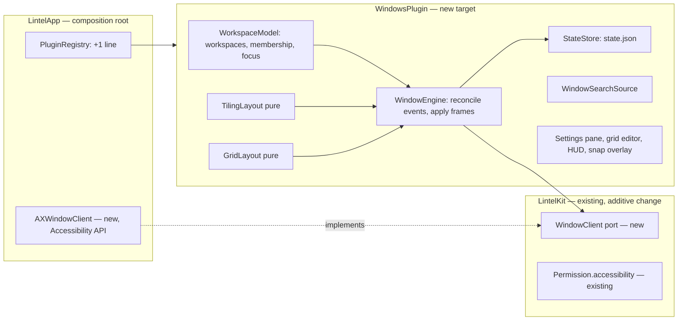

# Window management: workspaces with tiling and zone-grid layouts

> Status: **design**, written 2026-11-09 on top of `main` (main window, ADR 0008, PR #52) and of the Notes workspace (PR #56, open; not a dependency of this spec). Prose in English, identifiers in English, UI strings English + Polish. Written autonomously: every default is listed under "Resolved assumptions" for override.

## 📝 TLDR

Lintel is a launcher; today it cannot arrange the windows it opens. This spec proposes a new, opt-in plugin, **Window Management** (`windows`), that adds **workspaces** (virtual desktops in the AeroSpace sense: nine named groups of windows, one visible per display, switched with a shortcut) and gives each workspace one of two **layouts**: **tiling** (an i3/AeroSpace-style tree: windows fill the screen, no overlap) or **grid** (PowerToys FancyZones-style: fixed zones, windows snapped into them, by shortcut or by Shift-dragging). It uses the Accessibility API only (no SIP changes, no private Space APIs) and is **proposed, not built**: nothing here exists yet.

## ✅ Resolved assumptions (autonomous defaults)

Open Questions were resolved without a human, picking the most reversible option. Anything marked ⚠ must be confirmed before implementation starts.

| # | Question | Default chosen | Why |
|---|---|---|---|
| Q1 | Shell feature or plugin? | A compile-time plugin `WindowsPlugin` (`PluginID` `windows`), disabled by default, registered in `PluginRegistry` | Architecture law in `AGENTS.md`: every feature is a plugin; disabled by default means no behaviour change for current users |
| Q2 | How are "virtual desktops" implemented? | **Emulated, as AeroSpace does:** windows of a hidden workspace are moved to a screen corner (their frames are remembered); native macOS Spaces are not touched | Public API only, no SIP change, no animation; the alternatives (private CGS Space calls, minimising, hiding apps) are rejected below |
| Q3 | ⚠ Private symbol `_AXUIElementGetWindow` (window id from an `AXUIElement`) | Used, resolved with `dlsym` at runtime; if it is missing the plugin goes to the `failed` state with a clear banner; no fallback in v1 | Every comparable tool depends on it and Accessibility has no public equivalent; but it is an undocumented symbol Apple can change, which an owner should accept knowingly. ⚠ NEEDS HUMAN CONFIRMATION |
| Q4 | Bundled scope? | One spec, three independently shippable phases: (1) workspaces and window engine, (2) tiling, (3) grid. Phase 1 alone is useful (workspaces with the windows left where they are) | Each part works without the next; one design avoids two specs that must agree on the shared engine |
| Q5 | Is the layout a global or a per-workspace choice? | Per workspace (`tiling` or `grid`), default `tiling`, switchable with a command; both states of a workspace are kept when switching | Matches "two ways of arranging windows on such a desktop"; keeping both makes the switch non-destructive |
| Q6 | Which windows are managed? | Standard windows of regular apps on the current macOS Space. Dialogs, sheets, panels, minimised and native-fullscreen windows are left alone. A user-editable "Floating apps" list (default: Lintel itself, System Settings, Calculator) is never tiled or placed | Smallest rule that avoids fighting the system; reversible through the list |
| Q7 | Tiling features in v1 | Split containers (horizontal/vertical) with weights, focus, move, resize, join-with, toggle orientation, toggle floating, balance. **No accordion, no per-app rules** | Smallest scope that still gives an AeroSpace-like tree |
| Q8 | Grid features in v1 | Stock templates (Columns 2 and 3, Rows 2, Grid 2×2, Priority 25/50/25) plus a custom layout editor (tracks, merge cells). **No free-form canvas zones, no multi-zone span** | Covers the common PowerToys use; the rest is deferred |
| Q9 | Multiple displays | One visible workspace per display, workspaces are global (focusing a workspace that is visible on another display moves focus there); commands act on the display of the focused window. No per-display workspace pinning | AeroSpace's model without its configuration surface |
| Q10 | Default shortcuts | ⌃⌥1–9 go to workspace, ⌃⌥⇧1–9 move the focused window, ⌃⌥←↑↓→ focus, ⌃⌥⇧←↑↓→ move, ⌃⌥T toggles tiling/grid. All others unbound. All are normal `PluginCommand`s with the existing per-command recorder. Nothing is registered while the plugin is off | ⌥ alone types Polish letters (⌥A = ą), so AeroSpace's plain-⌥ bindings are unusable here; ⌃⌥Space is the launcher's fallback, hence ⌃⌥T; `DefaultShortcutTests` must still pass |
| Q11 | Wording | The UI says **Workspaces**, not "Desktops" or "Spaces" (Polish: "Obszary robocze") | "Spaces" and "Desktops" already mean the macOS feature |
| Q12 | Persistence across restarts | `Plugins/windows/state.json` keeps workspace membership, trees, grid placement and the home frames of hidden windows (no titles); reconciled with the live windows on launch | Needed anyway for crash recovery (see Edge Cases), so reuse it |
| Q13 | Window switcher in the launcher | Phase 1 adds a search source that lists workspaces and windows (Return: go to it, ⌘Return: bring it to this workspace). Results are never ranked or recorded in `ranking.sqlite` | The launcher is the natural place; recording titles would put sensitive text in a database |
| Q14 | A main-window section for this plugin? | No. Settings pane only | The main window's sections are for content; avoids touching the shell |
| Q15 | Grid drag-to-snap | Included (Phase 3): hold Shift while dragging a window to show the zones; releasing snaps the window | It is the defining behaviour of FancyZones; it needs only Accessibility |

## 📝 Problem Statement

Evidence is the owner's request (2026-11-09) and the market: AeroSpace, Amethyst, yabai, Rectangle and PowerToys FancyZones each cover a part of it, and Lintel's users already keep a hotkey-driven launcher open all day. Facts about the codebase, checked on `main`:

- Lintel has **no window API**: `LintelKit` ports are `EventPoster`, `WorkspaceClient` (launch and activation), `PermissionsReader` and others; nothing reads or moves another app's windows. `Permission.accessibility` already exists and is used for pasting.
- The plugin contract, per-command shortcuts, onboarding steps, search sources, settings banners and `eraseData()` already cover everything a window-management feature needs from the shell; no shell change is required beyond registering the plugin and one port.
- macOS gives no public way to create or switch Spaces, and Mission Control's Spaces animate and cannot be bound to a window group that an app controls.

## 📝 Proposed Solution

A `WindowsPlugin` target with a pure core (layout maths, workspace model, reconciliation) and thin adapters (a new `WindowClient` port implemented in `LintelApp` over the Accessibility API).

**Workspaces.** Nine workspaces (setting `workspaceCount`, 1–9). A window belongs to exactly one. Each display shows one workspace. Switching hides the windows of the old workspace by moving them to the bottom-right corner of the display (the offset that macOS still accepts is established in step 1.1) and restores the remembered frames of the new one. No animation, no private API except Q3.

**Tiling layout.** The workspace is a tree: the root is a horizontal or vertical container whose children are windows or nested containers; every child has a weight. A new window is inserted after the focused window in its container. Frames come from a pure function `TilingLayout.frames(tree, area, gaps)`. Gaps (inner, outer) are settings.

**Grid layout.** A grid layout is column and row track weights plus zones (rectangles of cells). Each window is assigned to a zone; several windows in one zone stack (the focused one on top). A new window goes to the first empty zone, otherwise into the zone of the focused window. Windows move between zones with shortcuts or by Shift-dragging, which shows the zones over the display and snaps on release.

**Alternatives considered**

- *Real macOS Spaces through private CGS calls (yabai):* rejected; needs SIP partly disabled for the useful parts and breaks on macOS updates.
- *Minimise or hide the app to hide a workspace:* rejected; minimise animates and fills the Dock, `NSRunningApplication.hide()` hides an app, not a window, so two workspaces cannot share an app.
- *A configuration file with a command language (AeroSpace's TOML):* rejected for v1; Lintel configures through Settings and per-command shortcuts.
- *One spec each for workspaces, tiling and grid:* rejected; they share the window engine, and phasing keeps each shippable.

## 📝 Architecture



Takeaway: the shell gains one port implementation and one registry line; every other new part is inside the new plugin, and the layout logic has no dependency on AppKit so it is testable with plain values.

- **Dependencies** follow the rule in `AGENTS.md`: `WindowsPlugin` → `LintelKit` (and `LintelPersistence` for `AtomicFile`); it imports no other plugin and not `LintelApp`.
- **`WindowClient` (new port in `LintelKit`, additive, `PluginContext.windows`, default reports no windows and no displays):** `windows() -> [WindowInfo]`, `focusedWindow()`, `setFrame(_:for:)`, `focus(_:)`, `displays() -> [DisplayInfo]` (id, `visibleFrame`), and `events: AsyncStream<WindowEvent>` (created, destroyed, moved, resized, focused, app launched/terminated, displays changed, Space changed). `WindowInfo` = `WindowID` (pid + window number), bundle id, title (memory only), frame, role/subrole flags, `isMinimized`, `isFullscreen`. Tests use an in-memory fake.
- **`AXWindowClient` (in `LintelApp/Ports/`)** observes every regular app with `AXObserver` (created, destroyed, moved, resized, focused window), sets a per-app messaging timeout (0.25 s) so a hung app cannot block the engine, and batches `setFrame` calls per app, in parallel across apps.
- **`WindowEngine`** is an actor that turns events into model changes and model changes into `setFrame` calls. It reads back the frame after a set: a window that refuses the size (its minimum is larger than its tile) is marked "stubborn" and centred in its tile instead of being retried.
- **Follow focus.** When a window of a hidden workspace becomes the focused window (⌘Tab, a Dock click, Lintel's own switcher), the engine switches to its workspace. When a hidden window moves on screen by itself (an app restoring its position), the engine hides it again unless it is focused.
- **Stage Manager and Mission Control settings.** Stage Manager moves windows itself and must be off; the pane's banner says so when `com.apple.WindowManager` reports it on. The plugin manages only the current native Space's windows, because Accessibility does not list windows on other Spaces.
- **Performance budgets (to be measured, `docs/perf.md`):** switching workspaces with 20 windows < 100 ms on Apple silicon; a tiling reflow after one window event < 30 ms; Shift-drag overlay appears < 50 ms. Benchmarks are off by default like the other ones.

## 📝 Data Model

No database. Layouts and state are small, non-secret JSON files in `Plugins/windows/` (0700 directory, 0600 files), written with `AtomicFile`, versioned, one `.corrupt` copy on a parse failure, read-only for a newer version (the `ActivityStore` pattern).

`state.json` (v1), rebuilt from the live windows when absent:

```text
version: 1
workspaces[1...9]: { layout: "tiling" | "grid", gridLayoutID, tiling: Node, grid: { windowID -> zoneID }, order: [windowID] }
Node = window(windowID, weight) | container(orientation, weight, children: [Node])
hidden: [{ windowID, homeFrame }]      // frames to restore after a crash
```

`WindowID` is `pid` + window number; it is valid only while that window exists, so on launch every entry whose window no longer exists is dropped. **No window titles, no bundle ids and no content are stored.**

`layouts.json` (v1): the user's grid layouts: `id`, `name`, `columns: [weight]`, `rows: [weight]`, `zones: [{ id, colStart, colEnd, rowStart, rowEnd }]`. The stock templates are compiled in and not written.

Settings keys (protected contract once shipped): `plugins.windows.workspaceCount`, `.defaultLayout`, `.gap.inner`, `.gap.outer`, `.floatingApps` (bundle ids), `.followFocus`, `.showHUD`, `.workspace.<n>.layout`, `.workspace.<n>.gridLayout`.

## 📝 API Contracts

`PluginManifest`: id `windows`, order 60, `defaultEnabled: false`, `settingsGroup: .lintel`, `requiredPermissions: [.accessibility]`, no new `Permission` case (no Screen Recording: titles come from Accessibility). Commands (`PluginCommand`, ids `windows.<name>`): `workspace.1…9`, `workspace.next/previous/back`, `moveToWorkspace.1…9`, `focus.left/right/up/down`, `move.left/right/up/down` (tiling: swap or move into the neighbouring container; grid: move to the neighbouring zone), `resize.grow/shrink` (tiling), `join.left/right/up/down`, `toggleOrientation`, `toggleFloating`, `balance`, `toggleLayout`, `grid.nextLayout`, `grid.zone.1…9`, `restoreAllWindows`. Only the defaults in Q10 are bound. The search source is `windows.windows` with item keys `windows:<windowID>`; it never calls `PluginContext.usage`. A `PluginContext.eraseData()` implementation restores all windows first, then deletes `Plugins/windows/`.

## 📝 UI/UX

- **Welcome step** (`onboardingSteps`): what the feature does, the Accessibility request, and one sentence about recovery ("Windows of other workspaces are parked in a screen corner. *Restore all windows* in the menu bar gets them back").
- **Settings → Window Management** (banner, Basics, collapsed Advanced, Data, as D4 of the main window spec): the banner covers Accessibility missing, Stage Manager on, the plugin `failed` (missing symbol), and a hidden-windows warning when permission is revoked. Basics: number of workspaces, default layout, gaps, workspace HUD on/off. Floating apps list. Shortcuts: grouped list with the existing recorders, numbered ones in one collapsible group. Layouts: stock templates with a preview and the custom grid editor (set rows and columns, drag dividers, merge cells, name). Data: *Restore all windows*, *Reset state*.
- **Workspace HUD:** a small non-activating panel (about 600 ms) with the workspace number and window count after a switch, like the dictation HUD (`sharingType = .none`).
- **Snap overlay:** a borderless panel per display drawing the zones while Shift is held during a window drag; the zone under the cursor is highlighted; release snaps. It does not take focus.
- **Menu bar:** the existing status item menu gets *Restore all windows* while the plugin is on (additive, listed in Phase 1).
- **Accessibility:** every control has a label; the HUD and the overlay announce the workspace or zone number to VoiceOver; the grid editor is operable from the keyboard (arrow keys move a divider by 1%, Return merges the selected cells); all strings are in `Localizable.xcstrings` in English and Polish (`StringCatalogTests`).

Mockups of the Settings pane, the grid editor, the snap overlay and the HUD (illustrative statics, not an accepted design): `.ai/specs/assets/window-management/`. No version is accepted, so there is no `Prototype:` line.

## 📝 Edge Cases & Failure Scenarios

| Situation | Behaviour |
|---|---|
| **Lintel crashes or is killed while windows are parked** (the worst case) | `state.json` holds every hidden window's home frame and an "unclean" flag set while any window is hidden. On the next launch, before anything else, parked windows are restored (even when the plugin is then found disabled). Until Lintel runs again they stay parked; this is the same limit AeroSpace has and is stated in the welcome step |
| Accessibility revoked while windows are parked | The engine stops moving anything; the banner says windows are parked and returns on re-grant, when restore runs automatically |
| Plugin disabled, app quits, or *Restore all windows* | Every hidden window is restored to its remembered frame, clamped to a connected display |
| An app is slow or hung | Per-app 0.25 s Accessibility timeout; that app's windows are skipped for this pass and retried on the next event; others are not delayed |
| A window refuses to be resized | Marked stubborn, centred in its tile or zone, never retried in a loop |
| An app re-centres or un-hides its window | Re-hidden if its workspace is hidden and it is not focused; if focused, its workspace is shown (follow focus) |
| Display added, removed, sleep/wake, resolution change | Reflow from `visibleFrame` (menu bar and Dock are excluded); workspaces on a removed display join the main display; parked windows are re-parked in the new corner |
| New window while the workspace is full (grid) | Stacks in the focused zone; tiling splits the focused tile |
| App quits or window closes | Removed from its tree or zone; siblings take the space; an empty container is dropped |
| Native fullscreen, minimised, sheets, dialogs, panels | Ignored; a window leaving fullscreen is managed again |
| Windows on other native Spaces | Not visible to Accessibility, so not managed; the pane explains it |
| Stage Manager on | Banner of level attention; the feature still runs but is documented as unsupported |
| `_AXUIElementGetWindow` missing after a macOS update | Plugin enters `failed` (no crash, no partial state); banner points to updating Lintel |
| Corrupt or newer `state.json` | Archived once as `.corrupt` / read-only; the plugin starts from the live windows |
| Two plugins or the shell want the same shortcut | A user-chosen shortcut always wins (`BACKWARD_COMPATIBILITY.md` §5); defaults are checked by `DefaultShortcutTests` |

Privacy: window titles live in memory for the search source only, are never logged (the `windows` logger category writes counts and ids, not titles or bundle ids of the user's windows), never reach `ranking.sqlite`, and are not stored in `state.json`.

## 📝 Risks & Impact Review

- **Hard to reverse once shipped:** the `plugins.windows.*` settings keys, the `Plugins/windows/` layout, the `windows` plugin id and the shortcut defaults (`BACKWARD_COMPATIBILITY.md` §1, §2, §3, §5 each gain an entry in the implementation PR). Mitigation: disabled by default, additive contract only, versioned state files.
- **Platform risk (Q3):** a private symbol and the Accessibility behaviour of third-party apps can change with any macOS release; the failure mode is a disabled feature with a banner, not data loss. Owner decision, flagged ⚠.
- **User-visible risk:** windows parked offscreen if Lintel dies. Mitigations above; the recovery on launch is a release-blocking test.
- **Product direction calls, not rule violations:** tiling auto-managing every window by default once enabled (a user can exclude apps), and global ⌃⌥ digit shortcuts.
- **Cost:** a long-lived AX observer per app and an event stream; budgeted and measured (Architecture).

## 📋 Phasing

1. **Workspaces and window engine:** port, `AXWindowClient`, workspace model, hide/restore, crash recovery, follow focus, HUD, shortcuts, window switcher, Settings pane (basics), onboarding. Windows keep their frames; no layout yet. Shippable on its own.
2. **Tiling:** tree, layout maths, focus/move/resize/join/toggle commands, gaps.
3. **Grid:** templates, zones, placement, shortcuts, layout editor, Shift-drag snapping, `toggleLayout`.

## 📋 Implementation Plan

Each step leaves the app building and the plugin off by default. Validation gate for every step: `swift build`, `swift test`, `swift format lint --strict -r Sources Tests`; the engine tests run under `--sanitize=thread` in CI.

### Phase 1: workspaces and window engine

- 1.1 **Spike (no production code):** on the owner's Mac, measure how far a window can be parked with `AXUIElementSetAttributeValue(kAXPositionAttribute)` on macOS 26 and 27, the cost of 20 `setFrame` calls, and confirm `_AXUIElementGetWindow` via `dlsym`. Record the result in `docs/decisions/0009-window-management.md` (the ADR also records the choice in Q2 and Q3). Test: none; the ADR is the deliverable.
- 1.2 **Contract:** add `WindowID`, `WindowInfo`, `DisplayInfo`, `WindowEvent`, `WindowClient` and `PluginContext.windows` (default: no windows) to `LintelKit`; update `BACKWARD_COMPATIBILITY.md` §1. Test: `LintelKitTests` that a default context compiles and reports empty.
- 1.3 **Plugin skeleton:** target `WindowsPlugin` and `WindowsPluginTests`, manifest, `WindowsSettings` (every key declared once), registration in `PluginRegistry` and `Package.swift`, `StringCatalogTests` entries. Test: manifest and defaults test; `DefaultShortcutTests` stays green.
- 1.4 **Workspace model (pure):** workspaces, membership, per-display visible workspace, back-and-forth. Test: model tests on plain values.
- 1.5 **`StateStore`:** `state.json` read/write, versioning, `.corrupt` copy, hidden-window journal. Test: round trip, corrupt and newer-version files, temporary directories.
- 1.6 **`WindowEngine` against a fake client:** hide/restore, follow focus, re-hide, stubborn windows, display change. Test: fake-client tests for each row of Edge Cases, under TSan.
- 1.7 **Crash recovery:** journal checked first on launch, restore on disable, quit and *Restore all windows*. Test: a journal with parked windows and a fake client ends with every window on screen.
- 1.8 **`AXWindowClient` in `LintelApp`:** observers, timeouts, `dlsym` lookup, `failed` on a missing symbol. Test: protocol-level tests with the fake; real Accessibility is a local/manual item in the PR body (`docs/qa.md`).
- 1.9 **Commands, HUD, window switcher:** workspace and move commands with Q10 defaults, `WorkspaceHUDPanel`, `windows.windows` search source (never records usage). Test: source and command tests; HUD state tests.
- 1.10 **Settings pane and onboarding:** banner, basics, floating apps, shortcuts, Data (*Restore all windows*, *Reset state*), status item entry, `eraseData()`. Test: pane model tests, string catalog parity.
- 1.11 **Docs and QA:** `AGENTS.md` task-routing row, `docs/perf.md` rows, `docs/qa.md` scenario, `--qa` fake window client for screenshots. Test: QA run with screenshots in light and dark as PR evidence.

### Phase 2: tiling

- 2.1 **`TilingTree` and `TilingLayout.frames` (pure):** insert, remove, weights, gaps. Test: golden frames for nested trees and gaps.
- 2.2 **Directional navigation (pure):** focus and move by direction in a tree. Test: table-driven cases.
- 2.3 **Resize, join, toggle orientation, balance (pure).** Test: weight invariants (sum, minimum share).
- 2.4 **Engine integration:** new/closed windows, tiling per workspace, floating toggle and floating apps. Test: fake-client scenario tests.
- 2.5 **Commands and Settings (gaps, default layout).** Test: command table and settings tests.

### Phase 3: grid

- 3.1 **`GridLayout` (pure):** tracks, zones, stock templates, frames. Test: golden frames per template.
- 3.2 **Placement:** zone assignment, stacking, first-empty rule, move to neighbour zone. Test: scenario tests.
- 3.3 **`toggleLayout` and conversion** between tiling and grid with both states kept. Test: round trip leaves both states unchanged.
- 3.4 **Layout editor and `layouts.json`:** tracks, merge, validation (no overlap, no gaps in zones). Test: validation and persistence tests; keyboard operation test.
- 3.5 **Shift-drag snapping:** global mouse/flags monitor (Accessibility only), per-display overlay, snap on release. Test: drag state machine tests; overlay is a manual QA item with screenshots.
- 3.6 **Polish pass:** accessibility audit of the new screens, perf measurements in `docs/perf.md`. Test: budget benchmarks (off by default), results in the PR body.

## 📝 Not doing

Accordion layout, free-form canvas zones, multi-zone span, per-app placement rules, a scripting CLI or IPC, a text config language, window borders or animations, controlling or listing native Spaces, per-display workspace pinning, window rules by title, and a main-window section. Each can be a later spec; none changes the contracts above.
