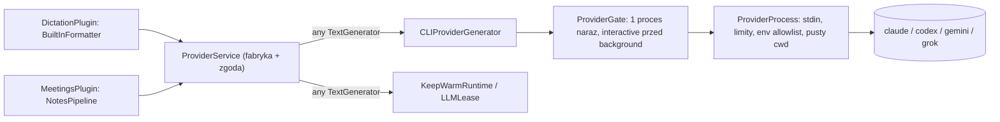

# Zewnętrzni dostawcy AI (subskrypcje Claude Code, Codex, Grok…) jako alternatywa dla wbudowanego LLM

> Status: **odświeżenie pilne (MEET-X.1, decyzja właściciela 2026-11-19 nr 1), nadal nie implementować przed odświeżeniem.** Decyzja: dostawcy domyślnie wyłączeni, transkrypt idzie do dostawcy dopiero po włączeniu przez użytkownika, z tekstem zgody dla uczestników. Nazwy `Pounce*`, ADR 0008 zajęty; odświeżenie w MEET-X.1 (`.ai/specs/backlog/2026-11-13-epic-meeting-notes-beyond-claude.md`, decyzje: `.ai/specs/backlog/2026-11-13-backlog-overview.md`, sekcja „Decyzje właściciela (2026-11-19)”).

## 📝 TLDR

Dziś każda funkcja AI w Pounce (formatowanie dyktowania, a wkrótce notatki ze spotkań) działa na wbudowanym modelu llama.cpp (3–19 GB) albo, w dyktowaniu, na serwerze na loopbacku. Na słabszym Macu albo bez miejsca na model te funkcje są niedostępne. Dodajemy opcjonalny **port „zewnętrzny dostawca”**: Pounce uruchamia jako podproces CLI, które użytkownik już ma i za które już płaci (Claude Code, Codex, potem Gemini CLI i Grok Build), na jego własnym logowaniu, a użytkownik wybiera model dostępny w swojej subskrypcji. Jest to świadome, jawne wyjątki od zasady „tekst nie opuszcza Maca”: wymaga zgody per dostawca i funkcja, jest oznaczone przy wyniku i domyślnie wyłączone.

## Rozstrzygnięte decyzje (bramka Open Questions)

| # | Decyzja | Konsekwencja w projekcie |
|---|---|---|
| Q1 | Integracja przez **CLI jako podproces** na logowaniu użytkownika. Klucze API poza zakresem. | Pounce nigdy nie czyta, nie kopiuje ani nie przechowuje poświadczeń dostawców; tylko uruchamia binarkę. |
| Q2 | Dostawca dla **wszystkiego, co dziś używa `LLMRuntime` (przez węższy `TextGenerator`)**: formatowanie dyktowania i notatki ze spotkań. | Jeden port w jednym nowym targecie, dwóch konsumentów. Dyktowanie ma twardy próg opóźnienia (Faza 0, bramka pomiarowa). |
| Q3 | Zgoda **raz** na dostawcę i funkcję, plus widoczny znacznik „wysłano do: X (model)” przy wyniku. | Zgoda jest egzekwowana w kodzie (fabryka runtime), nie tylko w UI. |
| Q4 | **Katalog + własny identyfikator + „Wypróbuj”.** | Brak odpytywania CLI o listę modeli. |
| Q5 | Błąd + „Regeneruj”; powrót do modelu wbudowanego jako przełącznik, domyślnie wyłączony. | Dyktowanie przy błędzie wkleja surowy tekst (jak dziś). |
| Prawo | **Claude Code w v1 na ryzyko właściciela** (po lekturze `code.claude.com/docs/en/legal-and-compliance`, 2026-11-10), z warunkami z sekcji Risks; OpenAI i Google do sprawdzenia w kroku 0.1. | Adapter Claude izolowany w jednym deskryptorze; Pounce nie filtruje zmiennych uwierzytelniania; nazwy dostawców tylko jako zwykły tekst. |
| Zakres | **Faza 2 (notatki) zostaje w tym specu** jako osobny PR. | Wejście dopiero po `NotesPipeline`; Faza 1 niezależna. |

## 📝 Problem Statement

- Wbudowany LLM wymaga 3–19 GB dysku i pamięci; na Macu z 8–16 GB RAM jakość i szybkość są słabe, a notatki z godzinnego spotkania (kilka kawałków map → reduce) trwają długo.
- Wielu użytkowników ma już subskrypcję (Claude Pro/Max, ChatGPT, SuperGrok) i wolałoby użyć jej niż pobierać model.
- Spec spotkań (Q9) odrzucił zewnętrzne serwery LLM tylko dlatego, że wymagałyby `EndpointProbe` i nowej powierzchni sieciowej; zgoda użytkownika na chmurę nie była wtedy rozważana. Teraz jest to wyraźna prośba produktowa.

## 📝 Proposed Solution

Nowy target **`PounceProviders`** (ADR 0008) z implementacją nowego, węższego portu **`TextGenerator`** opartą na podprocesie CLI. `LLMRuntime` wymaga `load(modelAt:)`, `unload()` i `isLoaded` (`Sources/PounceSpeech/LlamaRuntime.swift:42-52`), które CLI nie ma jak spełnić sensownie, więc `TextGenerator` (`contextLength`, `generate`, `generateResult`) trafia do `PounceSpeech` jako **addytywny** protokół, a `LLMRuntime` go rozszerza. Konsumenci (nowy `ProviderFormatter` w dyktowaniu, `NotesPipeline` w spotkaniach) biorą `any TextGenerator` i nie wiedzą, czy stoi za nim llama.cpp, czy CLI. Istniejący `BuiltInFormatter` zostaje bez zmian (bierze konkretny `KeepWarmRuntime`). Wspólne ustawienia (model, ścieżka binarki, fallback) są globalne (`app.ai.*`), a zgoda i wybór dostawcy należą do pluginu; całość konfiguruje się w nowym panelu **Ustawienia → Dostawcy AI**; każda funkcja wybiera źródło: wbudowany / (dyktowanie: mój serwer) / dostawca.

**Rozważone i odrzucone:**
- *Klucze API w Keychain* (Q1): rozliczane za token, nie z subskrypcji, nie spełnia celu.
- *Odczyt tokenów OAuth z plików CLI i własne wywołania HTTP:* wprost zabronione regulaminem Anthropic dla subskrypcji konsumenckich i kruche; Pounce nie dotyka poświadczeń.
- *SDK agentowe (Claude Agent SDK, Codex SDK) wbudowane w aplikację:* ciężka zależność, a regulaminy dla subskrypcji są tam niejednoznaczne.
- *Odpytywanie CLI o listę modeli* (Q4): żadne CLI nie daje listy modeli z planu użytkownika.

## Research

Sprawdzone lokalnie (Claude Code 2.1.322, Codex CLI 0.153.2, Gemini CLI) i w sieci (stan 2026-11-10; informacje z sieci to źródła wtórne, do weryfikacji w Fazie 0):

- **Claude Code:** `claude -p` (tryb nieinteraktywny), `--model` (aliasy i pełne ID), `--output-format json`, `--system-prompt`, `--tools ""` (wyłącza wszystkie narzędzia), `--no-session-persistence`, `--disable-slash-commands`, `--strict-mcp-config`, `--setting-sources`, `claude auth status`. **`--bare` odpada:** wg własnego opisu CLI czyta uwierzytelnianie wyłącznie z `ANTHROPIC_API_KEY`/`apiKeyHelper` i nigdy z OAuth/Keychain, więc z subskrypcją nie działa. Izolację trzeba zbudować pojedynczymi flagami.
- **Codex CLI:** `codex exec` czyta prompt ze stdin (`-`), `-m`, `-s read-only`, `--ephemeral`, `--ignore-user-config` (auth nadal z `CODEX_HOME`), `--ignore-rules`, `--skip-git-repo-check`, `-o <plik>` (ostatnia wiadomość), `--json`, `--output-schema`, `codex login status`. **Ryzyko:** sandbox `read-only` dalej pozwala agentowi *czytać* pliki przez powłokę; trzeba znaleźć wyłączenie narzędzia powłoki (`--disable`/`-c`) i udowodnić je testem kanarkowym (poniżej).
- **Gemini CLI:** `gemini -p`, `-m`; logowanie Google. Kandydat na Fazę 3.
- **Grok Build (`grok -p`):** istnieje oficjalne CLI xAI (beta od maja 2026), ale źródła się różnią co do planów z dostępem, nazwy zmiennej klucza i tego, czy tryb headless rozlicza się z subskrypcji, czy z klucza API. **Nie obiecujemy Groka w v1;** Faza 3 zaczyna się od weryfikacji u źródła.
- **Regulamin (kluczowe ryzyko):** Anthropic zabrania używania tokenów OAuth subskrypcji Free/Pro/Max w produktach i narzędziach firm trzecich (doprecyzowane 2026-02-19). Źródła zgadzają się, że własne logowanie w oficjalnym Claude Code to wzorzec dozwolony, ale nie znalazłem źródła potwierdzającego wprost, że wywołanie `claude -p` z cudzej aplikacji jest w porządku. Pounce nie widzi ani nie przenosi tokenu (CLI robi to samo co w terminalu użytkownika), lecz to szara strefa → **bramka prawna w Fazie 0** (decyzja właściciela po lekturze `code.claude.com/docs/en/legal-and-compliance`).
- **Rynek:** Raycast AI, Msty, Zed, Cursor stawiają na własne klucze (BYOK) albo własną subskrypcję; wywoływanie zainstalowanych CLI to wzorzec z edytorów i narzędzi agentowych (np. adaptery ACP). Przejmujemy ideę „deskryptor dostawcy + test połączenia”; pomijamy ich zarządzanie kontami i rozliczeniami.

## 📝 Architecture



**Graf zależności (AGENTS.md):** `PounceProviders` zależy od `PounceSpeech` (tylko po `TextGenerator`, `ChatMessage`, `GenerationResult`) i `PounceKit` (`SettingsStore`); niczego innego z repozytorium i żadnego pluginu. Pluginy mogą go importować, nie importują siebie nawzajem. `PounceApp` jest jedynym miejscem budującym panel ustawień. Test grafu SwiftPM, analogiczny do `PounceSpeechTests`, pilnuje tego. `PounceSpeech` dostaje tylko addytywny protokół `TextGenerator`.

**Komponenty `PounceProviders`:**
- `ProviderDescriptor` (dane + czyste funkcje): `id` (`claude`, `codex`, …), nazwa, nazwy binarek, `authStatusArguments`, `arguments(model:systemPrompt:) -> [String]` (jedyne miejsce, gdzie powstaje lista argumentów), `parseOutput`, katalog modeli, zakres wspieranych wersji. Czysty i w pełni testowalny bez procesu.
- `ProviderLocator`: szuka binarki w stałej liście (`~/.local/bin`, `/opt/homebrew/bin`, `/usr/local/bin`, `~/.codex/packages/standalone/current/bin`) lub w ścieżce wskazanej w Ustawieniach („Wskaż plik”, np. dla instalacji z `nvm`; bez automatycznego skanowania katalogów wersji). **Model zagrożeń:** złośliwe oprogramowanie z uprawnieniami tego samego użytkownika mogłoby i tak czytać tokeny CLI, więc nie bronimy się przed podmianą binarki przez nie (okno między walidacją a `exec` jest znane i zaakceptowane); bronimy się przed błędną konfiguracją (plik zapisywalny przez grupę/innych). **Nie** polega na `PATH` aplikacji GUI ani na funkcjach powłoki (na Macu autora `claude` jest funkcją zsh, a prawdziwa binarka leży w `~/.local/bin`). Walidacja: zwykły plik wykonywalny, właściciel to użytkownik lub root, brak zapisu dla grupy/innych; potem `--version`.
- `ProviderProcess`: `Process` z potokiem stdin (cała treść użytkownika idzie **stdin**, nigdy argumentami, bo argv jest widoczny w `ps`), limit stdout 1 MB, stderr odrzucany (nie logujemy, bo może zawierać fragmenty), osobna grupa procesów, limit czasu, anulowanie: SIGTERM, po 2 s SIGKILL grupy. Katalog roboczy: nowy pusty katalog `0700` w `caches`, usuwany po wywołaniu. **Środowisko z listy dozwolonych:** `HOME`, `PATH` (stały, bez katalogów użytkownika poza lokalizacją binarki), `LANG`, `TMPDIR`, `CLAUDE_CONFIG_DIR`, `CODEX_HOME`, zmienne proxy **oraz zmienne uwierzytelniania dostawców (`ANTHROPIC_API_KEY`, `OPENAI_API_KEY`…) bez zmian, jeśli występują w środowisku Pounce**: warunki Anthropic zabraniają „removing, disabling or restricting” wbudowanych metod uwierzytelniania, więc Pounce ich nie filtruje. Zamiast tego `ProviderStatus` wykrywa taką zmienną i panel ostrzega: „CLI może rozliczać za token zamiast z subskrypcji”.
- `ProviderGate` (proces-wide singleton jak `LLMLease.shared`): jedno wywołanie naraz na dostawcę (limity subskrypcji), kolejka z priorytetem `interactive` przed `background`, anulowanie wywołania `background` na rzecz `interactive` i jego ponowienie (ta sama semantyka co `LLMLease`).
- `CLIProviderGenerator: TextGenerator`: `contextLength` stałe 8192 (zgodne z założeniami kawałkowania notatek, `notesChunkTokens` bez zmian); składa wiadomości (`ChatMessage`) w prompt, woła `ProviderGate`/`ProviderProcess`, zwraca `GenerationResult`. `maxTokens` jest wskazówką w prompcie (żadne z CLI nie ma limitu tokenów); flaga „przerwano limitem” to `false`, chyba że deskryptor potrafi ją odczytać z odpowiedzi (Faza 0).
- **Brak pułapek (AGENTS.md, ryzyko R7):** cały kod `PounceProviders` poza testami bez `fatalError`, `try!` i force unwrap; błędy `Process`, potoków i systemu plików są zwracane jako `throws`/stan `ProviderStatus`.
- `ProviderService`: tworzony przez plugin z `PluginContext.settings` (klucze pluginu) i `PluginContext.hostSettings` (patrz niżej); `generator(for: ProviderFeature) -> (any TextGenerator)?` zwraca `nil` bez ważnej zgody, bez zalogowania lub przy niezgodnej wersji CLI. **To jedyne wejście do podprocesów.**
- `ProviderStatus`: `notInstalled` · `notSignedIn` · `incompatibleVersion` · `ready` (z `claude auth status`/`codex login status`, bez wyświetlania ani zapisywania adresu e-mail konta).

**Co się zmienia w istniejącym kodzie (minimalnie, addytywnie):**
- `DictationPlugin`: `LLMSource` dostaje wartość `.provider`; nowy `ProviderFormatter: TextFormatter` nad `any TextGenerator` (te same `CleanupPrompt`, `Segmenter`, `FormatterGuard` co `BuiltInFormatter`, wspólna logika kawałków wyciągnięta bez zmiany zachowania wbudowanego; `prepare()` nic nie ładuje); nowe `FallbackReason`: `.providerUnavailable`, `.notAuthorized`. **Widoczność:** przy tych powodach HUD pokazuje krótki komunikat „Dostawca niedostępny, wklejono surowy tekst” / „Zgoda cofnięta” (dziś powody wyłącznie do logów), z etykietą VoiceOver; stan `incompatibleVersion` wyświetla w HUD „Zaktualizuj CLI/Pounce”. Fallback do modelu wbudowanego (Q5) dotyczy też dyktowania i jest w Fazie 1. Nieznana wartość `llmSource` w starszym buildzie wraca do domyślnej (`.server`), więc brak zmiany łamiącej.
- `MeetingsPlugin` (Faza 2 specu spotkań, jeszcze niezbudowana): `NotesPipeline` przyjmuje `any TextGenerator` zamiast zakładać `LLMLease`; nowe ustawienie `plugins.meetings.notesSource`. Brak nowej kolumny w bazie: znacznik trafia do istniejącego `meeting.notes_model` w formacie `cli:<provider>/<model>` (wbudowane modele mają dotychczasowe ID z `LLMModelCatalog`, więc prefiks `cli:` jest jednoznaczny).
- `PounceKit`: jedna **addytywna** zmiana (z wartością domyślną, ryzyko R8): `PluginContext.hostSettings` — tylko do odczytu widok `SettingsStore` ograniczony do prefiksu `app.ai.` (`PluginSettings` jest sztywno prefiksowane `plugins.<id>.`, `Sources/PounceKit/PluginContext.swift:16-20`, więc inaczej wspólne klucze byłyby nieosiągalne). Zgody i wybór dostawcy per funkcja zostają w kluczach pluginu, żeby plugin był właścicielem swojej zgody.
- `PounceSpeech`: addytywny protokół `TextGenerator` (patrz Proposed Solution); `LlamaRuntime`/`KeepWarmRuntime` bez zmiany zachowania.

## 📝 Data Model

Nie ma nowej bazy ani tabeli. Wszystko to ustawienia (chroniony kontrakt kluczy, `BACKWARD_COMPATIBILITY.md`, wiersz do dodania):

| Klucz | Typ | Domyślnie | Uwagi |
|---|---|---|---|
| `app.ai.model.<providerID>` | String | pierwszy z katalogu | alias lub własny ID (walidowany `^[A-Za-z0-9._:\-]{1,64}$`, nigdy interpolowany do powłoki) |
| `app.ai.path.<providerID>` | String? | brak | tylko gdy użytkownik wskazał binarkę ręcznie |
| `plugins.<id>.providerConsent` | String `"<providerID>\|<ISO8601>\|v<n>"` | brak | zgoda należy do pluginu (`dictation`, `meetings`); zmiana tekstu zgody podnosi `v<n>` i unieważnia zapis; zmiana dostawcy wymaga nowej zgody |
| `app.ai.fallbackToBuiltIn` | Bool | false | Q5; globalny, czytany przez `hostSettings` |
| `plugins.dictation.llmSource` | + wartość `provider` | bez zmiany | |
| `plugins.dictation.provider` / `plugins.meetings.notesProvider` | String (`providerID`) | brak | który dostawca obsługuje funkcję |
| `plugins.meetings.notesSource` | `builtIn`/`provider` | `builtIn` | |

**Dane wrażliwe:** treść dyktowania i transkrypty trafiają do dostawcy wyłącznie przez stdin; Pounce ich nie loguje, nie zapisuje do `ranking.sqlite` ani do schowka (reguły dyktowania i spotkań obowiązują bez zmian). Pounce nie przechowuje żadnych poświadczeń ani adresu e-mail konta. Wyniki zapisane w zaszyfrowanych bibliotekach zachowują dotychczasowe szyfrowanie; dostawca widzi tekst, ale nie ma dostępu do biblioteki.

## API Contracts

Brak publicznego API. Wewnętrzne kontrakty:

```swift
public protocol ProviderDescriptorType: Sendable { /* patrz Architecture */ }
public enum ProviderFeature: String, Sendable { case dictation, meetings }
public struct ProviderService: Sendable {
    public init(settings: any SettingsStore, gate: ProviderGate = .shared, locator: ProviderLocator = .live)
    public func status(of provider: ProviderID) async -> ProviderStatus
    public func generator(for feature: ProviderFeature) async -> (any TextGenerator)?   // nil bez zgody/logowania
    public func tryOut(provider: ProviderID, model: String) async -> TryOutResult  // jedno krótkie wywołanie
}
```

**Argumenty CLI (twarde, testowane w golden testach `ProviderDescriptor`):**
- *Claude:* `claude -p --model <m> --output-format json --tools "" --no-session-persistence --disable-slash-commands --strict-mcp-config --setting-sources "" --system-prompt <statyczny prompt>`; treść użytkownika na stdin. Statyczny prompt systemowy w argv jest dopuszczalny (to nasz tekst, nie dane użytkownika).
- *Codex:* `codex exec --ephemeral --ignore-user-config --ignore-rules --skip-git-repo-check -s read-only -C <pusty katalog> -m <m> -o <plik w katalogu> -` plus wyłączenie narzędzia powłoki znalezione w Fazie 0; instrukcje i treść razem na stdin w blokach `<instructions>` / `<transcript>` (brak flagi promptu systemowego).
- Kod odmawia startu, jeśli deskryptor dostawcy nie przeszedł testu kanarkowego wyłączonych narzędzi (flaga `toolsDisabledVerified` w deskryptorze ustawiona dopiero po teście z Fazy 0).

## 📝 UI/UX

- **Ustawienia → Dostawcy AI** (nowy panel w `PounceApp`): wiersz na dostawcę ze stanem (`Nie zainstalowano` · `Zaloguj się w terminalu: claude auth login` z przyciskiem „Kopiuj polecenie” · `Wymaga aktualizacji CLI` · `Gotowy`), wybór modelu (menu z katalogu + „Własny identyfikator…”), „Wypróbuj” (wynik: działa / model niedostępny na tym koncie / limit / brak sieci), „Wskaż plik…” dla niestandardowej ścieżki, przełącznik zgody dla każdej funkcji, przełącznik „Wróć do modelu wbudowanego przy błędzie”.
- **Okno zgody** (przy pierwszym włączeniu danej funkcji): „Pounce będzie wysyłać {rozpoznany tekst dyktowania | transkrypty spotkań} do {Anthropic | OpenAI | …} przez Twoje CLI {nazwa}. Tekst opuszcza tego Maca i podlega zasadom tego dostawcy i Twojej subskrypcji. Audio nigdy nie jest wysyłane.” Przyciski „Włącz” / „Anuluj”; domyślne „Anuluj”. Zgodę można cofnąć w tym samym panelu; cofnięcie działa od następnego wywołania.
- **Wybór źródła w panelach funkcji:** w Dyktowanie → Formatowanie obok „Wbudowany (Pounce)” i „Mój serwer” pojawia się „Dostawca AI”; w Spotkania → Notatki analogicznie. Pozycja jest nieaktywna z wyjaśnieniem, gdy dostawca nie jest gotowy.
- **Znaczniki:** w bibliotece spotkań wynik z dostawcy ma ikonę chmury i podpis „Claude · sonnet” (z `notes_model`); HUD dyktowania pokazuje małą ikonę chmury podczas formatowania przez dostawcę. Każda ikona ma etykietę VoiceOver („Przetwarzane przez dostawcę zewnętrznego”) i nie opiera się na samym kolorze.
- Lokalizacja: nowe klucze w `Localizable.xcstrings` (`en` + `pl`, wymuszone testem), a teksty prywatności na stronie `docs/index.html` i w README muszą zostać zmienione z „nic nie opuszcza Maca” na „domyślnie nic nie opuszcza Maca; zewnętrzni dostawcy tylko za Twoją zgodą”.

## 📝 Edge Cases & Failure Scenarios

| Sytuacja | Zachowanie |
|---|---|
| CLI nie zainstalowane / wylogowane | Stan w panelu; `generator(for:)` zwraca `nil`; dyktowanie wkleja surowy tekst (`.notConfigured`), notatki `failed` + „Regeneruj”. |
| Wersja CLI poza wspieranym zakresem | Nowsza: próbujemy i przy błędzie flag (`unknown option`, kod ≠ 0 w < 1 s) przechodzimy w `incompatibleVersion` z komunikatem „Zaktualizuj Pounce”; starsza: „Zaktualizuj CLI”. |
| Limit subskrypcji / 429 / brak sieci | Wywołanie kończy się błędem; dyktowanie: surowy tekst; notatki: kawałek bez wyniku → `partial`/`failed` + „Regeneruj”; po włączeniu fallbacku i pobranym modelu: ponowienie na wbudowanym i znacznik końcowy to model wbudowany. |
| Czas odpowiedzi (cold start CLI to sekundy) | Dyktowanie: istniejący budżet `5 s + 0,2 s/słowo` na kawałek; przekroczenie → surowy tekst (`.timedOut`). Notatki: 120 s na kawałek, jeden retry. Pomiar w Fazie 0 decyduje, czy dyktowanie przez dostawcę jest w ogóle sensowne (bramka poniżej). |
| Wstrzyknięcie promptu w transkrypcie lub dyktowaniu | Narzędzia wyłączone (`--tools ""` itd.), pusty cwd, a wynik jest tylko wyświetlany jako tekst; `NotesGuard`/`FormatterGuard` odrzucają treść bez cytatu/zgodną z wzorcem. Test kanarkowy w Fazie 0 dowodzi, że dostawca nie potrafi odczytać pliku spoza katalogu. |
| CLI używa klucza API ze środowiska zamiast subskrypcji | Zmiennych nie usuwamy (patrz `ProviderProcess`); panel Dostawcy AI pokazuje ostrzeżenie o rozliczaniu za token, gdy zmienna jest ustawiona w środowisku Pounce, a `status` odczytuje rodzaj uwierzytelnienia z `auth status`, jeśli CLI go podaje. |
| Dyktowanie w trakcie notatek | `ProviderGate` priorytet `interactive`: wywołanie notatek jest anulowane i ponawiane (jak w `LLMLease`). |
| Zagubiony proces po zamknięciu Pounce | Grupa procesów zabijana przy `applicationWillTerminate` i przy anulowaniu; katalog roboczy sprzątany przy starcie (stary prefiks `provider-*`). |
| Aktualizacja Pounce bez zmiany zgody | Zgoda ważna dopóki `v<n>` zgodne; zmiana tekstu zgody wymaga ponownej zgody (funkcja wraca do `nil` do tego czasu). |
| Brak miejsca / uprawnień do katalogu roboczego | Wywołanie nie startuje, błąd jak „CLI niedostępne”. |

## 📝 Risks & Impact Review

- **Regulamin Anthropic (wysokie, ryzyko przyjęte przez właściciela 2026-11-10):** strona `legal-and-compliance` dopuszcza zalogowanie użytkownika własną subskrypcją w niezmodyfikowanym Claude Code, zabrania zbierania/pośredniczenia w poświadczeniach i wymaga Commercial Terms dla „running Claude Code in your products”; czy darmowa aplikacja OSS wywołująca `claude -p` to ten drugi przypadek, nie jest rozstrzygnięte. Decyzja: **Claude Code wchodzi w v1** pod warunkami: binarka uruchamiana bez modyfikacji, Pounce nie dotyka poświadczeń ani sesji, nie filtruje metod uwierzytelniania, nazwa i logo Claude/Anthropic pojawiają się tylko jako zwykły tekst („Claude Code”), a UI mówi wprost, że to Twoja subskrypcja i Twoje CLI. Mitygacja: adapter Claude izolowany w jednym `ProviderDescriptor` i wyłączany flagą kompilacji bez wpływu na resztę; jeśli Anthropic zażąda zaprzestania lub zmieni warunki, wydanie bez Claude nie wymaga zmian architektury. Opcjonalnie równolegle zapytać Anthropic na piśmie.
- **Prywatność produktu (wysokie):** łamie obietnicę lokalności. Mitygacje: domyślnie wyłączone, zgoda egzekwowana w kodzie, znaczniki, usuwanie kluczy API z env, brak logowania treści, aktualizacja tekstów na stronie i w README, wiersz w `docs/decisions/0008`.
- **Wyciek lokalnych plików i wykonanie kodu przez agenta (wysokie):** CLI to agenty z dostępem do plików i powłoki, a przekazanie `HOME`/`CLAUDE_CONFIG_DIR` ładuje konfigurację użytkownika, w tym **hooki** (dowolne polecenia, których `--tools ""` nie wyłącza), serwery MCP i `CLAUDE.md`. Mitygacja: narzędzia wyłączone flagami, pusty cwd, a w Fazie 0 znaleziona konfiguracja, która wyłącza hooki/MCP/wtyczki/pliki pamięci **zachowując** logowanie (np. `--settings` z wyłączonymi hookami razem z `--setting-sources ""`; własny pusty `CLAUDE_CONFIG_DIR` odpada, jeśli gubi logowanie z Keychain). Test kanarkowy obejmuje trzy rzeczy: odczyt pliku spoza cwd, wykonanie polecenia i **uruchomienie testowego hooka zapisującego plik-znacznik**; dostawca bez dowodu wszystkich trzech nie jest wydawany.
- **Kruchość CLI (średnie):** flagi i formaty zmieniają się co tydzień. Mitygacja: argumenty zbudowane w jednym czystym miejscu z golden testami, zakres wspieranych wersji, stan `incompatibleVersion`, ręczny test z prawdziwymi CLI przed wydaniem.
- **Opóźnienie dyktowania (średnie):** start CLI to sekundy. Mitygacja: bramka pomiarowa; jeśli p95 > 8 s na kawałek, funkcja dyktowania dostaje komunikat „wolne” w UI albo jest wycięta z v1 (zostają notatki), bez zmiany architektury.
- **Kontrakty:** brak zmiany w `PounceKit`; nowe klucze ustawień addytywne; nowa wartość `llmSource` bezpieczna dla starszych buildów. **Rollback:** przełączenie źródła z powrotem na „Wbudowany”; usunięcie targetu nie wpływa na dane.

## 📋 Phasing

- **Faza 0 — Spike i bramki** (bez wydawanego kodu): ADR 0008, bramka prawna, pomiary i test kanarkowy.
- **Faza 1 — Port + Claude Code + Codex + dyktowanie:** nowy target, panel ustawień, zgoda, `ProviderFormatter`.
- **Faza 2 — Notatki ze spotkań:** po zbudowaniu `NotesPipeline` (spec spotkań, krok 2.2), znacznik, fallback.
- **Faza 3 — Kolejni dostawcy:** Gemini CLI, Grok Build po weryfikacji u źródła; kolejny dostawca to nowy `ProviderDescriptor`, bez zmian architektury.

## 📋 Implementation Plan

Zasady wspólne: jedna gałąź `feat/` i jeden PR na fazę; bramka `swift build` → `swift test` → `swift format lint --strict -r Sources Tests`; aplikacja po każdym kroku działa bez zmian dla użytkownika, który nie włączył dostawcy.

### Faza 0 — Spike i bramki

- **0.1 Bramka prawna** — rozstrzygnięta dla Anthropic (decyzja właściciela: Claude w v1 na własne ryzyko, warunki w Risks). Do wykonania: przeczytać aktualne warunki OpenAI (Codex) i Google (Gemini CLI) dla wywoływania CLI z aplikacji lokalnej; zapisać wnioski i decyzję w ADR 0008. Wynik: lista dostawców dopuszczonych do Fazy 1. *Test:* brak (decyzja dokumentowana).
- **0.2 Pomiary i flagi** — dla `claude -p` i `codex exec` zmierzyć zimny start i czas odpowiedzi dla 20, 60 i 600 słów; potwierdzić listę argumentów, parsowanie wyjścia, czy limit tokenów da się wykryć, brak `system-prompt` w Codex. Wynik: tabela w `docs/perf.md` i decyzja o bramce dyktowania (p95 ≤ 8 s na kawałek).
- **0.3 Test kanarkowy izolacji** — z prawdziwym CLI i testową konfiguracją użytkownika zawierającą hook zapisujący plik-znacznik oraz `CLAUDE.md` z instrukcją: (a) prompt każący odczytać plik-kanarek spoza cwd, (b) prompt każący wykonać polecenie, (c) hook nie może się uruchomić, `CLAUDE.md`/MCP nie mogą zostać załadowane, a logowanie ma nadal działać. Wynik: dokładny zestaw flag izolacji dla każdego dostawcy albo decyzja „dostawca niewydawany”. Skrypt testu trafia do `scripts/` (ręczny, powtarzany przy każdej zmianie wersji CLI).
- **0.4 ADR 0008** — `docs/decisions/0008-external-providers.md` z wynikami 0.1–0.3. (Wiersze w `BACKWARD_COMPATIBILITY.md` i `AGENTS.md` dochodzą razem z kodem w kroku 1.1, żeby dokumenty nie wyprzedzały implementacji.)

### Faza 1 — Port, Claude Code, Codex, dyktowanie

- **1.1 Szkielet targetu i kontrakty** — `PounceProviders` + `PounceProvidersTests` w `Package.swift` (zależność od `PounceSpeech`, `PounceKit`), strict concurrency; addytywny `TextGenerator` w `PounceSpeech` (`LLMRuntime` go rozszerza); addytywne `PluginContext.hostSettings` w `PounceKit` z wartością domyślną; wiersz w `BACKWARD_COMPATIBILITY.md` (klucze `app.ai.*`, `providerConsent`) i `AGENTS.md` (nowy target, routing). *Test:* `swift build`, test grafu (brak zależności od pluginów i `PounceApp`), `PounceKitTests` (domyślne `hostSettings`, widok ogranicza się do `app.ai.`), istniejące testy `LlamaRuntime`/dyktowania zielone.
- **1.2 `ProviderDescriptor` i katalogi** — deskryptory Claude i Codex, katalog modeli, walidacja własnego ID, budowanie argumentów, parsowanie wyjścia. *Test:* golden testy argumentów (brak danych użytkownika w argv, obecność flag izolacji, odrzucenie ID z metaznakami), parsowanie próbek wyjścia (sukces, błąd, `is_error`, pusty wynik).
- **1.3 `ProviderLocator`** — lista katalogów, ścieżka ręczna, walidacja pliku (właściciel, prawa), `--version`. *Test:* w katalogach tymczasowych: binarka zapisywalna przez innych odrzucona, dowiązanie symboliczne poza dozwolone ścieżki, brak pliku.
- **1.4 `ProviderProcess`** — stdin, limity wyjścia, czas, anulowanie, grupa procesów, pusty cwd, env allowlist (bez usuwania zmiennych uwierzytelniania). *Test:* z fałszywą binarką (skrypt testowy): przekroczenie limitu wyjścia, timeout, anulowanie zabija dzieci, `ANTHROPIC_API_KEY` ustawiony w środowisku testu dociera bez zmian, a detekcja ostrzeżenia działa, zmienne spoza allowlisty nie docierają, treść nie trafia do argv (sprawdzenie przez echo argv), katalog sprzątany.
- **1.5 `ProviderGate`** — jeden proces naraz na dostawcę, priorytet `interactive` przed `background`, anulowanie `background`. *Test:* kolejność i anulowanie z atrapą; **zmiana `.github/workflows/ci.yml`:** dodać `ProviderGateTests` do listy `--sanitize=thread` (obok `LLMLeaseTests`).
- **1.6 `ProviderService` i zgoda** — status, `generator(for:)` z egzekwowaniem zgody i `toolsDisabledVerified`, `tryOut`. *Test:* brak zgody/zgoda starej wersji → `nil`; cofnięcie zgody działa od następnego wywołania; `CLIProviderGenerator` jako `TextGenerator` (atrapa procesu).
- **1.7 Dyktowanie** — `LLMSource.provider`, `ProviderFormatter`, nowe `FallbackReason` z komunikatami HUD, ikona chmury, fallback do modelu wbudowanego (`app.ai.fallbackToBuiltIn`). *Test:* sukces, błąd, timeout i brak zgody dają surowy tekst z właściwym komunikatem; z fallbackiem i zainstalowanym modelem wynik pochodzi z wbudowanego; zgoda cofnięta w trakcie sesji; `FormatterGuard` i `Segmenter` te same co dla wbudowanego; dotychczasowe testy dyktowania zielone.
- **1.8 Panel „Dostawcy AI” i okno zgody** — SwiftUI w `PounceApp/Settings`, lokalizacja `en`+`pl`, VoiceOver, QA przez `--qa…` z fałszywą binarką. *Test:* `StringCatalogTests`, model widoku (stany, „Wypróbuj”), zrzuty w jasnym i ciemnym trybie jako dowód PR.
- **1.9 Teksty prywatności** — README, `docs/index.html` (oba języki; workflow Pages wymusza klucze), `THIRD_PARTY_NOTICES` bez zmian. *Test:* `pages.yml`.
- **1.10 Pomiary i ręczny test** — z prawdziwym Claude Code i Codex: dyktowanie, „Wypróbuj”, wylogowanie w trakcie, brak sieci; wyniki w PR i w `docs/perf.md`.

### Faza 2 — Notatki ze spotkań (osobny PR; wejście dopiero gdy istnieje `NotesPipeline`, krok 2.2 specu spotkań)

Ta faza jest osobnym PR-em, niezależnie wdrażalnym od Fazy 1 (rozstrzygnięte: zostaje w tym specu); Faza 1 nie zależy od niej, a wejście wymaga istnienia `NotesPipeline`.

- **2.1 `NotesPipeline` na `any TextGenerator`** — wstrzyknięcie generatora zamiast `LLMLease` (jeśli 2.2 specu spotkań już to robi, krok jest tylko testem). *Test:* ta sama atrapa dla obu źródeł.
- **2.2 Źródło i znacznik** — `notesSource`, `notes_model = cli:<provider>/<model>`, ikona i podpis w bibliotece, eksport Markdown bez zmian. *Test:* golden eksportu, filtr „Wymagają uwagi”, zgoda per `meetings`.
- **2.3 Fallback w notatkach** — ten sam przełącznik co w dyktowaniu: ponowienie na wbudowanym, gdy zainstalowany; znacznik końcowy poprawny. *Test:* błąd dostawcy bez fallbacku → `failed`/`partial`; z fallbackiem → wynik wbudowany; anulowanie przez dyktowanie.
- **2.4 Pomiary i zestaw regresyjny** — notatki z godzinnego transkryptu przez Claude/Codex (ręcznie, domyślnie wyłączone), czas i liczba wywołań w PR i `docs/perf.md`.

### Faza 3 — Kolejni dostawcy

- **3.1 Weryfikacja Grok Build i Gemini CLI** — plany z dostępem, rozliczanie w trybie headless, flagi izolacji, test kanarkowy, regulamin. Wynik: lista dopuszczonych.
- **3.2 Deskryptory** — po jednym kroku i PR-ze na dostawcę, z golden testami i testem kanarkowym; bez zmian w `ProviderService`.

## Poza zakresem

Klucze API, logowanie przez przeglądarkę w Pounce, własne wywołania HTTP do dostawców, SDK agentowe, wysyłanie audio, strumieniowanie wyników, własne prompty użytkownika, rozliczanie zużycia i wyświetlanie limitów subskrypcji, dostawcy uruchamiani przez zdalny proxy.
