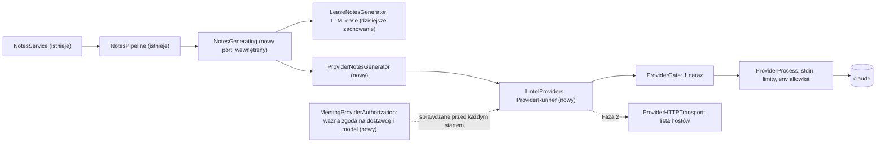

# Zewnętrzni dostawcy AI dla notatek ze spotkań (Claude Code, potem klucz API)

> Status: **odświeżony 2026-11-19, implementacja po akceptacji właściciela.** Story MEET-X.1 (`.ai/specs/backlog/2026-11-13-epic-meeting-notes-beyond-claude.md`), decyzje właściciela z 2026-11-19 (PR #104). Ten dokument zastępuje wersję z 2026-11-10 w całości. PR ze specem jest tylko projektem: nie zmienia kodu. Wartości domyślne Q2, Q6, Q7, Q8, Q10 i Q11 (sekcja „Open Questions”) **nie są rozstrzygnięte**: każdą potwierdza właściciel najpóźniej przed PR, którego dotyczy.

## 📝 TLDR

Dziś notatki ze spotkań pisze wyłącznie wbudowany model llama.cpp (`NotesPipeline` przez `LLMLease`). Na spotkaniach właściciela daje on słabsze notatki niż Claude, a na słabszym Macu jest wolny albo niedostępny. Proponujemy opcjonalne, **domyślnie wyłączone** źródło notatek: Lintel uruchamia zainstalowane u użytkownika **Claude Code CLI** jako podproces, na jego własnym logowaniu, i przekazuje mu transkrypt spotkania, dla którego powstają notatki. Zaraz po tym (Faza 2) dochodzi drugi kanał: własny klucz API (BYOK).

Momentem decyzji jest **wybór dostawcy i modelu w ustawieniach**: jedno świadome okno zgody mówi, że transkrypty wszystkich spotkań, z imionami mówców, będą trafiać do dostawcy. Od tej chwili każde spotkanie idzie do wybranego dostawcy, dopóki użytkownik nie wróci na model lokalny. Zgoda jest zapisana i **sprawdzana w kodzie przed każdym uruchomieniem procesu** (i przed każdym żądaniem sieciowym w Fazie 2). Każde spotkanie, którego notatki napisał dostawca, ma znacznik „wysłano do: Claude · model”. Dyktowanie jest poza v1, a kontekst dyktowania (epik DICT) nie trafia do dostawcy nigdy.

## Decyzje wiążące

| Źródło | Decyzja | Skutek w tym specu |
|---|---|---|
| Właściciel 2026-11-19, decyzja 1 | Zewnętrzni dostawcy: tak, pilnie, domyślnie wyłączeni; transkrypt idzie do dostawcy dopiero po włączeniu przez użytkownika. | MEET-X.1 nie jest już warunkowa. Bramka M-Q14 / MEET-0.2 nie obowiązuje. |
| Właściciel 2026-11-19 (ostateczne, przez orkiestratora) | **Jedna zgoda przy wyborze dostawcy i modelu w ustawieniach**; potem każde spotkanie idzie do dostawcy, aż do powrotu na model lokalny. **Bez flagi per spotkanie**, bez przełącznika „każde nowe spotkanie”, bez potwierdzenia „uczestnicy wiedzą”. | Nadpisuje MEET-X.1 AC2 („wysyłka włączana per spotkanie”) i rekomendacje K2, Q1, Q9 z review specu. |
| Właściciel 2026-11-19 (ostateczne) | **Tekst informacji dla uczestników bez zmian**: nie wspomina o chmurze ani o sędzim Fable. | `MeetingConsentText` się nie zmienia. Nadpisuje rekomendację W1 z review. Ryzyko zapisane w Risks jako przyjęte. |
| Właściciel 2026-11-19 (ostateczne) | Imiona mówców idą do dostawcy; okno zgody mówi to wprost. | Lista „Co opuszcza Maca”, treść okna zgody. |
| Właściciel 2026-11-19 (ostateczne) | Zgoda nadal egzekwowana w kodzie przed każdym procesem; znacznik „wysłano do: Claude · model” na poziomie spotkania zostaje. | `MeetingProviderAuthorization`, macierz „0 procesów”, kolumny pochodzenia. |
| Właściciel 2026-11-19 (ostateczne) | v1 = **Claude Code CLI na subskrypcji użytkownika**. Klucz API (BYOK) to **druga faza zaraz po v1**. | Faza 1 = CLI, Faza 2 = BYOK, z tą samą bramką zgody. |
| Właściciel 2026-11-10 | Ryzyko regulaminowe wywoływania `claude -p` z aplikacji przyjęte, pod warunkami z sekcji Risks. | Bez zmian. |
| Właściciel 2026-11-19, decyzja 3 | Notatka to podsumowanie (ustalenia, decyzje, zadania), **bez timestampów**. Timestampy zostają w transkrypcie. | Ścieżka dostawcy nie dodaje do notatki żadnego czasu. Patrz „Co opuszcza Maca”. |
| Właściciel 2026-11-19, decyzja 4 | **Żadnych oznaczeń AI/człowiek** w notatkach, także per blok. | Znacznik dostawcy to informacja o prywatności na poziomie spotkania, nie autorstwo bloku. `NoteBlockProvenance` bez zmian. |
| Właściciel 2026-11-19, decyzja 2 | Fable ocenia notatki ze wszystkich spotkań właściciela. | To harness (`scripts/meeting-eval`), nie produkt. Zgoda w aplikacji nie obejmuje harnessu, a uchylenie M-Q5 nie włącza niczego w aplikacji. Wspólna może być wiedza (flagi, wyniki kanarka), nie kod. |
| Epik DICT, nie-cel | Kontekst dyktowania nie opuszcza Maca. | Dyktowanie poza v1; Faza 4 ma własny test „żaden kontekst DICT”. |

## ❓ Open Questions

Pytania z review specu (2026-11-19) i z drugiego review (Q11). **Rozstrzygnięte przez właściciela (2026-11-19) są tylko Q1, Q3, Q4, Q5 i Q9.** Q2, Q6, Q7, Q8, Q10 i Q11 to wartości **domyślne, do potwierdzenia przez właściciela**, a nie decyzje: spec jest spójny przy tych wartościach, zmiana którejkolwiek przed implementacją jest tania, a w dalszych sekcjach każde miejsce, które z nich korzysta, jest oznaczone „domyślne”. Najpóźniej: Q10 przed PR 1, Q11 przed PR 4 (zmienia migrację), Q8 przed PR 5a, Q6 przed PR 6, Q7 przed PR 7, Q2 przed Fazą 4.

| # | Pytanie | Odpowiedź | Stan |
|---|---|---|---|
| Q1 | Bramka wysyłki: zgoda per funkcja czy także flaga per spotkanie? | **Jedna zgoda przy wyborze dostawcy i modelu. Bez flagi per spotkanie.** | **rozstrzygnięte przez właściciela** |
| Q2 | Dyktowanie przez dostawcę w v1? | **Nie.** Osobna faza po decyzji właściciela. Kontekst DICT nigdy. | domyślne, do potwierdzenia przez właściciela |
| Q3 | Dostawcy w v1? | **Tylko Claude Code CLI.** | **rozstrzygnięte przez właściciela** |
| Q4 | CLI subskrypcji czy klucz API? | **CLI w v1, klucz API (BYOK) jako Faza 2 zaraz po v1.** | **rozstrzygnięte przez właściciela** |
| Q5 | Imiona mówców (nadane ręcznie, `selfName`) w wysyłanym transkrypcie? | **Tak**, powiedziane wprost w oknie zgody. | **rozstrzygnięte przez właściciela** |
| Q6 | Informacja o dostawcy w eksporcie Markdown i kopii ⌘⇧C? | **Tak, jedna linia w stopce** („Transkrypt przetworzył: Claude (Anthropic)”), nic per blok. | domyślne, do potwierdzenia przez właściciela (styk z decyzją 4, patrz Risks) |
| Q7 | Powrót do modelu wbudowanego przy błędzie dostawcy? | **Wyłączony.** Kierunek wyłącznie dostawca → wbudowany. | domyślne, do potwierdzenia przez właściciela |
| Q8 | Ten sam pipeline (kawałki 3000 tokenów, `NotesGuard`, `NotesComposer`) dla dostawcy? | **Tak w v1.** Zmiana kawałkowania dopiero po ocenie sędzią Fable. | domyślne, do potwierdzenia przez właściciela |
| Q9 | Wymagać potwierdzenia „uczestnicy wiedzą” per spotkanie? | **Nie.** Tekst dla uczestników zostaje bez zmian. | **rozstrzygnięte przez właściciela** |
| Q10 | Numer ADR? | **Nadawany przy merge** (pierwszy wolny; 0010 trzyma DICT). Plik `docs/decisions/00NN-external-providers.md`. | domyślne, do potwierdzenia przez właściciela |
| Q11 | Czy Lintel ma zapisywać **każdą** wysyłkę (dziennik wysyłek), skoro znacznik opisuje tylko obecne notatki i nie widzi wysyłek częściowych (zadanie przerwane, nieudane, zastąpione fallbackiem albo notatki później przepisane lokalnie)? | **Nie w v1:** znacznik opisuje tekst, który jest w `notes_markdown`; ograniczenie nazwane w Data Model, UI/UX i Risks. Rozważane alternatywy: (A) trwała kolumna `NULL` „transkrypt wysłano do” ustawiana w tej samej transakcji co `beginNotes`, zanim wystartuje pierwszy proces z treścią, i znikająca tylko z wierszem spotkania; (B) dziennik wysyłek, nowa tabela (spotkanie, dostawca, model, czas, liczba kawałków), też addytywna. | domyślne, do potwierdzenia przez właściciela |

Alternatywa do Q5, rozważona i odrzucona: pseudonimy („S1”, „S2”) w wysyłce i podmiana imion lokalnie. Odrzucona, bo imiona padają też w treści wypowiedzi (których nie da się wiarygodnie zamaskować), a notatka bez imion gubi właścicieli zadań; pseudonimy dawałyby fałszywe poczucie anonimowości.

## 📝 Problem Statement

- Wbudowany model wymaga 3–19 GB dysku i pamięci. Notatki z godzinnego spotkania to kilka wywołań MAP i REDUCE, co na Macu z 8–16 GB trwa długo, a jakość bywa niewystarczająca do pracy.
- Właściciel i część użytkowników ma subskrypcję Claude i zainstalowane Claude Code. Woleliby świadomie użyć jej dla spotkań, które nie są poufne.
- Lintel obiecuje dziś „nic nie jest wysyłane” (reguły repozytorium, napisy w aplikacji, strona). Każde wyjście danych musi więc być jawne, odwracalne jednym ruchem, widoczne przy spotkaniu i niemożliwe do uruchomienia bez świadomej zgody: ani przez automatyczne kolejkowanie notatek, ani przez „Regenerate Notes”, ani przez stary zapis w ustawieniach.

## 📝 Proposed Solution

1. Nowy target **`LintelProviders`**: uruchamianie CLI dostawcy jako podprocesu (treść tylko przez stdin), z deskryptorem dostawcy, lokalizatorem binarki, limitem procesów i **autoryzacją sprawdzaną w samym targecie przed każdym uruchomieniem**. Nic go nie woła, dopóki plugin go nie podłączy.
2. W `MeetingsPlugin`: wewnętrzny port generowania notatek nad dzisiejszym `NotesLease` (refaktoryzacja bez zmiany zachowania), a potem druga implementacja portu przez `LintelProviders`.
3. Jedna bramka: zgoda zapisana w ustawieniach pluginu (`plugins.meetings.*`), związana z konkretnym dostawcą i modelem, sprawdzana przed każdym procesem.
4. Addytywne kolumny pochodzenia (`notes_provider`, `notes_provider_model`) dla znacznika na poziomie spotkania. Znaczenie `notes_model` się nie zmienia.
5. Faza 2: drugi kanał do tego samego odbiorcy, czyli klucz API w Pęku kluczy i transport HTTPS z zamkniętą listą hostów.

**Rozważone i odrzucone:**
- *Dyktowanie jako pierwszy konsument* (wersja z 2026-11-10): niesie najwięcej ryzyka (opóźnienie, kontekst DICT, zmiana `LintelKit`) i nie jest tym, co właściciel zamówił jako pilne.
- *Flaga wysyłki per spotkanie, przełącznik „każde nowe spotkanie”, potwierdzenie „uczestnicy wiedzą”, wariant zdania dla uczestników* (rekomendacje review K2, W1, Q9): odrzucone decyzją właściciela z 2026-11-19. Decyzja zapada raz, przy wyborze dostawcy; kto ma poufne spotkanie, wraca na model lokalny, zanim spotkanie przejdzie w `ready` (najprościej przed nagraniem), albo przed „Regenerate Notes”. Skutek uboczny jest nazwany w oknie zgody i w Risks.
- *Znacznik bez migracji*: sprawdzone i odrzucone. Znacznik musi być trwały per spotkanie i przeżyć zmianę ustawień, więc nie może pochodzić z `plugins.meetings.*`. `notes_model` ma zamknięte znaczenie w BC §5. Sufiks w `notes_prompt_version` (`TEXT`) mógłby unieść format promptu, ale nie nazwę modelu, i mieszałby dwa znaczenia w jednym polu. Dwie kolumny `NULL` to najmniejsza uczciwa zmiana.
- *Zapis znacznika w `notes_model` jako `cli:<provider>/<model>`*: zmienia znaczenie chronionej kolumny (`BACKWARD_COMPATIBILITY.md` §5: „`notes_model` is an `LLMModelCatalog` id”).
- *Wspólne ustawienia `app.ai.*` i `PluginContext.hostSettings`*: zbędna zmiana chronionego `LintelKit` przy jednym konsumencie. Model i ścieżkę trzyma plugin; wybór modelu per funkcja jest zresztą lepszy niż globalny.
- *Nowy protokół `TextGenerator` w `LintelSpeech`*: w v1 port jest wewnętrzny dla `MeetingsPlugin`, więc `LintelSpeech` się nie zmienia.
- *Odczyt tokenów OAuth z plików CLI i własne wywołania HTTP na subskrypcji*: zabronione regulaminem Anthropic i kruche. Lintel nie dotyka poświadczeń CLI.
- *SDK agentowe w aplikacji*: ciężka zależność, niejasny regulamin dla subskrypcji.
- *Codex, Gemini, Grok w v1*: niegotowe (patrz Research), Faza 3.

## Research

Stan wiedzy z 2026-11-10 (Claude Code 2.1.322, sprawdzone lokalnie) i z review z 2026-11-19. **Wszystkie flagi wymagają ponownej weryfikacji w spike'u (PR 1)**, bo CLI zmienia się co tydzień.

- **Claude Code:** `claude -p` (tryb nieinteraktywny, prompt ze stdin), `--model`, `--output-format json`, `--system-prompt`, `--tools ""`, `--no-session-persistence`, `--disable-slash-commands`, `--strict-mcp-config`, `--setting-sources ""`, `claude auth status`. `--bare` odpada: czyta uwierzytelnianie tylko z klucza API, więc nie działa z subskrypcją.
- **Zapis sesji na dysku (wniosek z review, niepotwierdzony testem):** bez `--no-session-persistence` Claude Code zapisuje sesje w katalogu konfiguracji (`projects/*.jsonl`), czyli jawną kopię transkryptu i odpowiedzi.
- **TCC (wniosek z review, niepotwierdzony testem):** proces uruchomiony przez aplikację jest na macOS przypisany do niej jako „responsible process”. Lintel może mieć Full Disk Access, Accessibility i mikrofon, więc agent CLI z działającym narzędziem albo hookiem czytałby chronione miejsca z uprawnieniami Lintela.
- **Hooki i konfiguracja użytkownika:** przekazanie `HOME`/`CLAUDE_CONFIG_DIR` ładuje hooki (dowolne polecenia), serwery MCP i `CLAUDE.md`. `--tools ""` nie wyłącza hooków. Pusty własny katalog konfiguracji odpada, jeśli gubi logowanie z Pęku kluczy.
- **Codex CLI:** brak flagi promptu systemowego, wyłączenie powłoki niepotwierdzone, `-o <plik>` zapisuje odpowiedź jako jawny plik, warunki OpenAI nieprzeczytane. Niegotowy.
- **Gemini CLI, Grok Build:** do weryfikacji u źródła (plany, rozliczanie w trybie headless, flagi izolacji).
- **Regulamin Anthropic:** dozwolone jest własne logowanie użytkownika w niezmodyfikowanym Claude Code; zabronione zbieranie i pośredniczenie w poświadczeniach. Czy darmowa aplikacja OSS wołająca `claude -p` to „running Claude Code in your products”, nie jest rozstrzygnięte (ryzyko przyjęte 2026-11-10).
- **Rynek:** Raycast AI, Msty, Zed i Cursor stawiają na BYOK albo własną subskrypcję; wywoływanie zainstalowanych CLI to wzorzec z edytorów. Przejmujemy „deskryptor dostawcy + test połączenia”, pomijamy zarządzanie kontami i rozliczeniami. Granola i podobne notatniki wysyłają transkrypt domyślnie; my odwrotnie: domyślnie nic, a wysyłka dopiero po świadomym wyborze dostawcy.

## 📝 Architecture



Wniosek z diagramu: jest dokładnie jedno wejście dla procesu **niosącego dane użytkownika** (i w Fazie 2 dla żądania sieciowego), `ProviderRunner.run`, i ono samo pyta o autoryzację. Konsument nie może „zapomnieć” o sprawdzeniu.

**Dwa rodzaje procesów.** (1) *Z treścią*: tylko `run`, zawsze za autoryzacją; to je liczy macierz „0 procesów”. (2) *Bez treści*: `--version` lokalizatora, `claude auth status` i „Try it”. Nie niosą żadnych danych użytkownika (stdin pusty albo stała skompilowana w Lintelu, argv stały; test na każdy z nich), nie wymagają zgody, ale startują **wyłącznie po działaniu użytkownika w panelu aktywnego pluginu** (pojawienie się panelu, kliknięcie „Try it” albo „Check again”), nigdy z `settingsPane()` ani z gettera `settingsStatus`, nigdy przy nieaktywnym pluginie (`InactiveSettingsPaneTests` zostaje zielony) i nigdy w tle. Wynik statusu jest trzymany w pamięci modelu panelu, a getter tylko go czyta (wzór: `refreshStatus()` w Dictation i Meetings). „Try it” przechodzi przez `ProviderGate` i wymaga `isolationVerified`. `ProviderProcess` ma dwa osobne wejścia (`runContent`, `runProbe`), więc test źródłowy potrafi je rozróżnić: `runContent` jest wołane tylko z `ProviderRunner.run`.

**Graf zależności (AGENTS.md):** `LintelProviders` zależy tylko od `LintelSpeech` (typy wartości `ChatMessage`, `GenerationResult`), od żadnego pluginu i nie od `LintelApp`. W Fazie 2 dochodzi `LintelKit` (port `KeychainClient`). Pluginy mogą go importować; nie importują siebie nawzajem. Test grafu (wzór: `LintelSpeechTests`) czyta `Package.swift` i źródła. **`LintelKit` i `LintelSpeech` nie zmieniają się w Fazie 1.**

### `LintelProviders` (nowy target)

- **`ProviderDescriptor`** (dane i czyste funkcje): `id` (`claude-code`), `recipient` (firma, do której trafia tekst; wchodzi do treści okna zgody), nazwa wyświetlana jako zwykły tekst, nazwy binarek, `authStatusArguments`, `arguments(model:systemPrompt:) -> [String]` (jedyne miejsce, gdzie powstaje argv), `parseOutput`, `classify(stderr:exitCode:)`, katalog modeli, zakres wspieranych wersji, `isolationVerified` (ustawiane w kodzie dopiero po kanarku z PR 1; bez tego `ProviderRunner` odmawia startu).
- **`ProviderLocator`**: stała lista katalogów (`~/.local/bin`, `/opt/homebrew/bin`, `/usr/local/bin`) albo ścieżka wskazana ręcznie. Nie polega na `PATH` aplikacji GUI ani na funkcjach powłoki. Standardowe instalacje to dowiązania symboliczne (instalator natywny, Homebrew), więc lokalizator najpierw rozwiązuje dowiązanie, a potem waliduje cel: zwykły plik wykonywalny, właściciel to użytkownik albo root, brak zapisu dla grupy i innych; potem `--version`. Instalacja przez npm wymaga `node` na `PATH`: czy i jak ją wspierać (katalog `node` dopisany do stałego `PATH` albo tylko „Choose file…”), rozstrzyga spike w PR 1. Model zagrożeń: nie bronimy się przed złośliwym oprogramowaniem z uprawnieniami tego samego użytkownika (i tak czytałoby tokeny CLI), bronimy się przed błędną konfiguracją.
- **`ProviderProcess`**: `Process` z potokiem stdin. Cała treść użytkownika idzie stdin, nigdy argv (argv widać w `ps`). Limit stdout 1 MB. **stderr jest czytany do pamięci z limitem (64 KB), klasyfikowany do zamkniętego enuma `ProviderFailure` (`incompatibleVersion`, `rateLimited`, `notSignedIn`, `network`, `other`) i porzucany**: nigdy logowany ani zapisywany. Osobna grupa procesów, limit czasu, anulowanie SIGTERM i po 2 s SIGKILL grupy. Katalog roboczy: nowy pusty katalog `0700` w katalogu caches pluginu, usuwany w `defer` i sprzątany przy starcie (prefiks `provider-`). Środowisko z listy dozwolonych: `HOME`, stały `PATH`, `LANG`, `TMPDIR`, `CLAUDE_CONFIG_DIR`, zmienne proxy oraz zmienne uwierzytelniania dostawcy bez zmian, jeśli są w środowisku Lintela (regulamin zabrania „removing, disabling or restricting” metod uwierzytelniania; status ostrzega wtedy, że CLI może rozliczać za token).
- **`ProviderGate`** (jeden na proces aplikacji, jak `LLMLease.shared`): jedno wywołanie naraz na dostawcę, kolejka FIFO. Priorytety `interactive`/`background` dojdą razem z drugim konsumentem; w v1 jedynym jest praca w tle.
- **`ProviderAuthorization`**: `Sendable` domknięcie `() async -> ProviderDecision` (`allowed` albo powód odmowy) dostarczane przez konsumenta przy każdym żądaniu. `ProviderRunner` woła je **bezpośrednio przed każdym** `Process.run()` (i przed każdym żądaniem HTTP w Fazie 2), już po wyjściu z kolejki `ProviderGate`. Odmowa kończy żądanie błędem `notAuthorized`, bez procesu.
- **`ProviderRunner`**: `run(messages:model:timeout:authorization:) async throws -> GenerationResult`. Przechodzi przez bramkę, pyta o autoryzację, uruchamia proces, parsuje wynik. To jedyny sposób uruchomienia procesu z treścią. (Prompt składa konsument swoim wersjonowanym serializatorem.)
- **`ProviderStatus`**: `notInstalled` · `notSignedIn` · `incompatibleVersion` · `ready`. Odczyt z `claude auth status`; adres e-mail konta zostaje wyłącznie w pamięci parsera i nie trafia do UI, logów ani ustawień (test).
- **`ProviderFeatureID`**: zbiór otwarty (`RawRepresentable` struct, jak `ModelKind`), w v1 tylko `meetings.notes`. Zgoda jest per id funkcji, więc przyszli konsumenci (czat w aplikacji, akcje po spotkaniu, „Ask agent”, dyktowanie) wymagają własnej, nowej zgody.
- **`ProviderSystem`**: zestaw części dotykających systemu (lokalizator, fabryka procesu, w Fazie 2 transport). `live` jest aplikacji; `quiet` (fałszywy lokalizator i proces z licznikiem uruchomień) jest instalowany w każdym środowisku `LintelAppTests` i `MeetingsPluginTests`, wzorem `MeetingsSystem.quiet` i `QuietMeetings.install()`. Test na wzór `NoRealSystemTests` sprawdza, że żaden prawdziwy `Process` nie powstał.
- **Redakcja logów:** `os.Logger` dostaje tylko kody z zamkniętych enumów, liczniki, czasy i id dostawcy. Nigdy argv, stdin, stdout, stderr, odpowiedź modelu, e-mail, ścieżkę `HOME` ani (Faza 2) klucz. Test źródłowy (wzór: `NotesUIScanTests`): żadne wywołanie loggera w `LintelProviders` nie interpoluje wartości typu `String` spoza zamkniętego enuma.
- **Brak pułapek (ryzyko R7):** bez `fatalError`, `try!` i force unwrap poza testami; błędy `Process`, potoków i plików wracają jako `throws` albo stan.

### `MeetingsPlugin`

- **Port `NotesGenerating`** (wewnętrzny): `open()`, `generateResult(messages:maxTokens:)`, `release()`, zdarzenia oczekiwania. `NotesPipeline` jest dziś zrośnięty z `LLMLease`: `NotesModel { lease, runtime, modelURL, keepWarm }`, `NotesLease.handle()`, semantyka `ModelLeaseError.yielded`/`.busy`, `maxYieldsPerRequest`, `busyLimit`, `NotesEvent.waitingForModel`. Wydzielenie portu to **osobny PR bez zmiany zachowania**: `LeaseNotesGenerator` przenosi dzisiejszą logikę 1:1, a dowodem są niezmienione `NotesRegressionTests`, testy lease i TSan.
- **`ProviderNotesGenerator`**: implementacja portu przez `ProviderRunner`. Bez `waitingForModel` i bez yield; własne limity czasu (wstępnie MAP 180 s, REDUCE 300 s, jeden retry; wartości ustala pomiar z PR 1, bo dzisiejsze 300 s / 600 s / `busyLimit` 1800 s dotyczą modelu lokalnego). Godzinne spotkanie przy `notesChunkTokens = 3000` to około 5–8 wywołań.
- **Ten sam pipeline (Q8, domyślne do potwierdzenia):** `TranscriptChunker`, `NotesPrompt`, `NotesGuard`, `NotesComposer` bez zmian. Cytaty są weryfikowane lokalnie jak dziś. `NotesVerifier` zostaje wyłączony (`notesVerifierEnabled = false`) i w v1 nie idzie do dostawcy.
- **Serializator promptu z własną wersją:** `NotesPrompt.mapMessages` składa wieloturowe few-shoty, a CLI przyjmuje jeden prompt. `ProviderPromptSerializer` (format `cli1`) spłaszcza role do bloków ze znacznikami escapowanymi tak samo jak `<transcript>` w `TranscriptChunker`. Golden test. W `notes_prompt_version` (kolumna `TEXT`) zapisuje się `<NotesPrompt.version>+cli1`; czytniki, które porównują wersję, traktują nieznany sufiks jak inną wersję.
- **`MeetingProviderAuthorization`**: jedyna implementacja `ProviderAuthorization` w v1. Zwraca `allowed` tylko gdy naraz: plugin aktywny, `notesSource == provider`, zapisana zgoda zgadza się z **bieżącym** dostawcą, **bieżącym** modelem, funkcją `meetings.notes` i bieżącą wersją tekstu zgody, dostawca i model **tego żądania** są równe tym ze zgody, a deskryptor ma `isolationVerified`. Ustawienia są czytane przy każdym pytaniu, nie z pamięci podręcznej zadania.
- **`NotesService`**: wybór generatora przy starcie każdego zadania, z bieżących ustawień. Przy ważnej zgodzie do dostawcy idzie **każde** zadanie notatek: spotkanie, które przeszło w `ready` (gdy `notesEnabled`), oraz „Regenerate Notes” (⌘R w bibliotece, przycisk okna spotkania i akcja `meetings.regenerate` w Notes; wszystkie przez `NotesService.regenerate`), **także dla spotkań nagranych przed włączeniem dostawcy** (okno zgody mówi to wprost), a także automatyczne ponowienia opisane niżej. Samo włączenie dostawcy niczego nie wysyła: nie przepisuje starych notatek, a odzyskiwanie po awarii (`NotesRecovery`) tylko zmienia `running` w `failed`. `notesSource = provider` bez ważnej zgody (np. po zmianie wersji tekstu albo ręcznej edycji ustawień) zachowuje się jak `builtIn` i panel pokazuje baner z prośbą o ponowną zgodę.
- **Zmiana dostawcy albo modelu = nowa zgoda.** Zapis zgody zawiera id deskryptora i model. Wybór innego modelu albo dostawcy otwiera okno zgody ponownie; do czasu potwierdzenia poprzedni wybór zostaje w mocy, a „Cancel” niczego nie zmienia.
- **Powrót na model lokalny = natychmiastowy koniec wysyłki.** Przełączenie źródła na „Built-in” (albo cofnięcie zgody) działa od najbliższego pytania o autoryzację: zadania czekające w kolejce startują już na modelu wbudowanym, a zadanie w toku jest anulowane przed kolejnym procesem (trwający proces dostaje SIGTERM), wcześniejszy tekst notatek zostaje (reguła „failed/cancelled keeps earlier text”) i zadanie wraca do kolejki raz, na model wbudowany. Zapis zgody jest usuwany, więc ponowny wybór dostawcy znów pokazuje okno. Tego, co już wysłano, nie da się cofnąć; UI mówi to wprost.
- **Odmowa autoryzacji kończy zadanie, nie kawałek.** Dzisiejszy `NotesPipeline` ponawia nieznany błąd raz, potem liczy kawałek jako nieudany i kończy wynikiem `partial`. `notAuthorized` nie może iść tą drogą: jest traktowane jak `CancellationError` / `NotesFailure.modelBusy`, czyli bez retry, bez wyniku częściowego, `settleNotes(previous)`, a potem jeden powrót do kolejki. Test: po odmowie `notes_markdown`, `notes_model` i `notes_provider*` są niezmienione. Zapis wyniku (`conclude`) bierze dostawcę i model z generatora, który faktycznie pisał, a nie z ustawień w chwili zapisu.
- **Zmiana modelu w trakcie zadania:** po „Turn On” dla nowego modelu trwający proces starego modelu dostaje SIGTERM, jego wynik jest odrzucany, zadanie wraca do kolejki raz i startuje od początku z nowym modelem. Notatki nigdy nie są sklejane z dwóch modeli.
- **Cykl życia zgody.** Nie ma osobnego przycisku „cofnij zgodę”: cofnięcie to powrót na „Built-in”, który usuwa `providerConsent`. Wyłączenie pluginu zgody nie usuwa (ustawienie zostaje, ale przy wyłączonym pluginie nic nie startuje; po włączeniu obowiązuje dalej, a baner panelu od razu to pokazuje). Erase Data pluginu Meetings usuwa `providerConsent` i przywraca `notesSource = builtIn`. Podniesienie `textVersion` po aktualizacji nie kasuje zapisu, tylko go unieważnia: do ponownego „Turn On” notatki pisze model wbudowany, a baner prosi o zgodę.
- **Automatyczne ponowienia też są wysyłką.** Istniejące ścieżki, które startują zadanie notatek bez kliknięcia „Regenerate”: (1) ponowny przebieg po zmianie imienia mówcy (`renameSpeaker`) albo `selfName` (`markNotesStaleForSelfName`) **w trakcie pisania**: `finishNotes` zwraca `storedStale`, a `NotesService` wstawia spotkanie do `rerun`; (2) dokończenie w tle spotkania `processing` przy otwarciu biblioteki (`RecoveryJob` → `MeetingsLibrary.resumeInBackground` → `MeetingResumer` → `ready` → `onMeetingReady`), bez akcji użytkownika; (3) „Dokończ” na spotkaniu `incomplete` (`MeetingsLibrary.finish`), które jest kliknięciem, ale nie prośbą o notatki, i kończy się tym samym `onMeetingReady`. Ścieżki (2) i (3) kolejkują notatki tylko przy `notesEnabled`, jak dziś. Przy ważnej zgodzie wszystkie idą do dostawcy jak każde inne zadanie (zgoda mówi „wszystkie spotkania, także automatycznie”), a przy braku zgody albo po powrocie na „Built-in” na model wbudowany. Zmiana `selfName` przy **gotowych** notatkach tylko oznacza je `stale` i niczego nie uruchamia (czeka na „Regenerate”). Wszystkie te przypadki są w macierzy.
- **Fallback (Q7, domyślne do potwierdzenia; PR 7):** `plugins.meetings.notesProviderFallback`, domyślnie wyłączony. Tylko dostawca → wbudowany, gdy model jest zainstalowany. **Nigdy wbudowany → dostawca** (test). Fallback powtarza **całe** zadanie na modelu wbudowanym (bez sklejania wyników dwóch modeli). Po fallbacku `notes_model` ma id wbudowanego, a kolumny dostawcy są puste.
- **Panel Modele i banery:** przy `notesSource = provider` bez fallbacku model notatek nie jest „selected” w `modelUsage` (`MeetingsPlugin+Models.swift`), więc „N models are needed” i „Download Notes Model” go nie żądają. Test banera.
- **Tekst dla uczestników:** `MeetingConsentText` **bez zmian** (decyzja właściciela).

### Reguły repozytorium zmieniane razem z kodem

W tym samym PR co kod, który potrafi wysłać (PR 5b): `CODE_REVIEW.md` §5 (nowe, nazwane wyjście danych: podproces dostawcy, z warunkami tego specu), `AGENTS.md` (wiersz Meetings „the only network access…”, nowy target, graf), `BACKWARD_COMPATIBILITY.md` §2, §3 i §5, napisy w aplikacji (`en` + `pl`), w tym podsumowanie pluginu „Everything runs on this Mac and nothing is uploaded.” (`MeetingsViews.swift`). README i `docs/index.html` zmieniają się w PR 6, czyli wtedy, gdy użytkownik dostaje drogę do włączenia. Test językowy: żaden napis w `Localizable.xcstrings` (`en` i `pl`) ani na stronie (obie wersje językowe) nie obiecuje, że nic nie jest wysyłane, bez zastrzeżenia „domyślnie”.

## 📝 Data Model

### Migracja `meetings.sqlite` (addytywna, nowa nazwa migracji, np. `v3-notes-provider`)

Tylko to, czego wymaga znacznik pochodzenia na poziomie spotkania:

| Kolumna w `meeting` | Typ | Domyślnie | Znaczenie |
|---|---|---|---|
| `notes_provider` | `TEXT NULL` | `NULL` | Id deskryptora, który napisał obecne notatki (`claude-code`, w Fazie 2 `anthropic-api`). `NULL` = model wbudowany albo brak notatek. |
| `notes_provider_model` | `TEXT NULL` | `NULL` | Model podany dostawcy (alias albo id). |

- `notes_model` zachowuje znaczenie z BC §5 (id z `LLMModelCatalog`); gdy notatki napisał dostawca, jest `NULL`.
- Obie kolumny są zapisywane tym samym strzeżonym `UPDATE` co wynik zadania (`MeetingsStore+Notes.swift`); przerwane albo nieudane zadanie ich nie rusza, więc znacznik zawsze opisuje tekst, który jest w `notes_markdown`.
- Znacznik mówi „te notatki napisał dostawca X”, a **nie** „transkrypt tego spotkania nigdy nie wyszedł z Maca”, gdy go brak. Nie rejestruje prób, więc spotkanie może nie mieć znacznika, choć część albo całość transkryptu już trafiła do dostawcy: zadanie anulowane po pierwszym kawałku (powrót na „Built-in”, zmiana modelu, wyłączenie pluginu, zamknięcie aplikacji, awaria), zadanie zakończone `failed` po kilku wysłanych kawałkach, wynik `partial` odrzucony nad pełnymi notatkami, fallback na model wbudowany (Q7) oraz notatki napisane przez dostawcę, a potem przepisane lokalnie przez „Regenerate Notes”. To świadome ograniczenie v1 (Risks); czy dodać trwały zapis wysyłki albo dziennik, to Q11 (domyślnie nie).
- Starszy build nie czyta nowych kolumn i niczego nie traci. Czytniki tolerują `NULL` (test na bazie sprzed migracji).
- Usunięcie spotkania, Clear Library i Erase Data usuwają znacznik razem z wierszem. Powrót na model lokalny nie kasuje notatek już napisanych przez dostawcę ani ich znacznika (jawność); kolejne „Regenerate Notes” na modelu lokalnym zastępuje tekst i czyści znacznik (choć transkrypt tego spotkania był wcześniej wysłany; patrz wyżej i Q11).
- Dlaczego nie da się bez migracji: patrz „Rozważone i odrzucone”.

### Ustawienia (`plugins.meetings.*`, deklarowane w `MeetingsSettings.swift`; chroniony kontrakt, BC §3)

| Klucz | Typ | Domyślnie | Uwagi |
|---|---|---|---|
| `notesSource` | `builtIn` / `provider` | `builtIn` | Nieznana wartość czytana jako `builtIn`. |
| `notesProvider` | String (id deskryptora) | brak | Nieznane id = brak dostawcy. |
| `notesProviderModel` | String | pierwszy z katalogu deskryptora | Walidacja `^[A-Za-z0-9._:\-]{1,64}$`; nigdy interpolowany do powłoki. |
| `notesProviderPath` | String? | brak | Tylko gdy użytkownik wskazał binarkę ręcznie. |
| `providerConsent` | JSON: `{provider, model, feature, at, textVersion}` | brak | Jedna zgoda naraz. Ważna tylko, gdy `provider` i `model` równe bieżącym `notesProvider` i `notesProviderModel`, a `textVersion` równe bieżącej wersji tekstu. Niepoprawny JSON = brak zgody. Usuwana przy powrocie na „Built-in”. |
| `notesProviderFallback` | Bool | `false` | Q7 (domyślne, do potwierdzenia). |

**Żaden z tych kluczy nie jest zapisywany bez kliknięcia użytkownika** (jak `notesEnabled`), a `notesSource = provider`, `notesProvider`, `notesProviderModel` i `providerConsent` są zapisywane razem, dopiero po „Turn On” w oknie zgody. Słabsza wartość domyślna któregokolwiek wymaga zgody właściciela i wpisu w notach wydania.

### Co opuszcza Maca (lista zamknięta, testowana)

Do dostawcy trafia wyłącznie:

- (a) tekst segmentów transkryptu spotkania, dla którego powstają notatki, w kawałkach MAP, w postaci, w jakiej dostaje go dziś model wbudowany (łącznie ze znacznikami czasu segmentów `[mm:ss]`, które służą lokalnej weryfikacji cytatów);
- (b) etykiety mówców, **w tym imiona nadane przez użytkownika i `selfName`** (dane osobowe uczestników; decyzja właściciela, powiedziane w oknie zgody);
- (c) punkty pośrednie MAP w wywołaniach REDUCE;
- (d) statyczne prompty systemowe Lintela.

**Nigdy:** audio i spool, tytuł spotkania, `source_bundle_id`, notatki użytkownika z notatnika (MEET-4.1), słownik (MEET-5.2), treść dyktowania i kontekst DICT (`FocusContext`, schowek, zaznaczenie, tytuł okna, ścieżki), nazwy i treść innych spotkań, ścieżki plików.

Test: wiadomości zbudowane z fixture dla dostawcy zawierają tylko pola (a)–(d); fixture ma tytuł, `source_bundle_id` i notatkę z notatnika z ciągami-kanarkami, których nie może być w stdin.

**Decyzja 3 a czasy:** czasy w (a) to wejście do weryfikacji cytatów, nie treść notatki. Notatka nie zawiera timestampów niezależnie od źródła; usuwa je wspólny kod kompozycji i renderowania (praca nad formatem notatek, poza tym specem). Ścieżka dostawcy nie wprowadza własnego formatu notatki. Jeśli praca nad formatem usunie czasy także z wejścia modelu, lista (a) kurczy się razem z nią, bez zmiany tego specu.

**Dane wrażliwe:** transkrypt i notatki istnieją na dysku tylko w zaszyfrowanym `meetings.sqlite`. Lintel nie tworzy ich jawnych kopii: nic w argv, nic w plikach tymczasowych, pusty katalog roboczy. To, czy CLI nie tworzy własnych kopii, dowodzi kanarek. Lintel nie przechowuje żadnych poświadczeń CLI: **w Fazie 1 nie ma żadnego wpisu w Pęku kluczy**.

## API Contracts

Brak publicznego API i brak zmian w `LintelKit`. Kontrakty wewnętrzne (szkic, nazwy do utrzymania):

```swift
// LintelProviders
public struct ProviderFeatureID: RawRepresentable, Hashable, Sendable { public let rawValue: String }
public enum ProviderDecision: Sendable { case allowed, denied(ProviderDenial) }
public typealias ProviderAuthorization = @Sendable () async -> ProviderDecision

public struct ProviderRunner: Sendable {
    public func status(of provider: ProviderID) async -> ProviderStatus
    public func run(_ request: ProviderRequest, authorization: ProviderAuthorization) async throws -> GenerationResult
    public func tryOut(provider: ProviderID, model: String) async -> TryOutResult   // stały tekst próbny, bez danych użytkownika
}

// MeetingsPlugin (wewnętrzne)
protocol NotesGenerating: Sendable {
    func open() async throws
    func generateResult(messages: [ChatMessage], maxTokens: Int) async throws -> GenerationResult
    func release() async
}
```

**Argumenty Claude Code (golden test deskryptora; lista do potwierdzenia w PR 1):** `claude -p --model <m> --output-format json --tools "" --no-session-persistence --disable-slash-commands --strict-mcp-config --setting-sources "" --system-prompt <statyczny prompt Lintela>`, treść na stdin. Statyczny prompt w argv jest dopuszczalny (nasz tekst, nie dane użytkownika). `--no-session-persistence` i wyłączenie hooków są **wymogiem wydania**: bez dowodu z kanarka `isolationVerified` zostaje `false`.

`tryOut` wysyła stały, nieosobowy tekst Lintela (żadnych danych użytkownika), tylko po kliknięciu „Try it”. Jest dostępny przed zgodą, żeby dało się sprawdzić model przed decyzją; to proces bez treści (patrz Architecture), z własnym testem, że jego stdin jest stałą.

## 📝 UI/UX

**Każdy nowy ekran wymaga prototypu `om-ux-design` zaakceptowanego przez właściciela i zgodności 1:1** (reguła epica MEET §9). Ten spec opisuje zachowanie i teksty robocze; nie jest zaakceptowanym projektem, dlatego nie ma linii `Prototype:` ani makiet w tym PR. Wszystko powstaje w istniejących szablonach okna głównego: `SettingsPane`, `StatusBanner`, `ConfirmSheet`, `ModelChoiceRow`, kolory tylko z `LintelBrand`.

- **Ustawienia → Meetings → Basics**, pod „Write notes after each meeting”: wiersz „Notes are written by” z wyborem „Built-in (Lintel)” (domyślnie) / „Claude Code”. Pod nim stan dostawcy (`Not installed` · `Sign in in Terminal: claude auth login` z „Copy command” · `Update Claude Code` / `Update Lintel` · `Ready`), wybór modelu (katalog + „Custom identifier…”), „Try it”, w Advanced „Choose file…” dla binarki i przełącznik fallbacku (wyłączony).
- **Okno zgody** (`ConfirmSheet`, „Cancel” domyślny) pojawia się przy **każdym** wyborze dostawcy i przy **każdej** zmianie modelu. To jedyny moment decyzji. Treść (robocza, do prototypu) mówi wprost:
  - transkrypty **wszystkich** spotkań, dla których Lintel pisze notatki, **z imionami mówców** (także nadanymi przez Ciebie), będą trafiać do {Anthropic} przez Twoje {Claude Code}, model {model};
  - dotyczy to także **starszych spotkań**, nagranych przed tą zmianą, gdy użyjesz na nich „Regenerate Notes” (w bibliotece, w oknie spotkania albo w Notes);
  - wysyłka dzieje się także **automatycznie, bez Twojego kliknięcia**: po zakończeniu nagrania, przy dokończeniu przerwanego spotkania (także w tle po ponownym uruchomieniu Lintela) i przy ponownym pisaniu notatek po zmianie imienia mówcy albo Twojego imienia;
  - audio, tytuły spotkań i inne dane nie są wysyłane;
  - tekst podlega zasadom dostawcy i Twojej subskrypcji; dostawca może go przechowywać według swoich zasad;
  - **uczestnicy spotkań nie są o tym informowani przez Lintela; poinformowanie ich należy do Ciebie**;
  - wysyłkę kończy powrót na „Built-in (Lintel)” w tym miejscu; tego, co już wysłano, nie da się cofnąć.
  Przyciski „Turn On” / „Cancel”. „Cancel” zostawia poprzedni wybór bez zmian.
- **Stale widoczny stan:** dopóki dostawca jest wybrany, baner panelu Meetings (`settingsStatus`) mówi „Ready · Notes are written by Claude Code. Transcripts leave this Mac.”, a wiersz wyboru ma podpis z modelem. Powrót na „Built-in” to jedno kliknięcie w tym samym wierszu, bez potwierdzenia.
- **Tekst dla uczestników:** „Copy message” i przypomnienie w HUD zostają dokładnie takie jak dziś (MEET-1.6). Nie wspominają o dostawcy ani o chmurze.
- **Znacznik przy wyniku:** „Sent to: Claude · <model>” („Wysłano do: Claude · <model>”, brzmienie z decyzji właściciela) w wierszu biblioteki, w oknie spotkania i w Details w Notes. Do Notes trafia jako jeszcze jedna pozycja `NoteContent.details` (`NoteDetail`: etykieta + wartość) z `MeetingNoteMapping.details`, więc `LintelKit` się nie zmienia. Znacznik opisuje notatki, które są teraz w spotkaniu (napisał je dostawca z wysłanego transkryptu); po fallbacku, przerwanym albo nieudanym zadaniu i po lokalnym „Regenerate Notes” go nie ma, choć część albo całość transkryptu mogła wyjść (pełna lista w Data Model; ograniczenie zapisane w Risks, dziennik wysyłek to Q11). Brzmienie „Sent to” jest więc prawdziwe tam, gdzie znacznik jest, ale jego brak niczego nie gwarantuje; UI nie może sugerować „nigdy nie wysłano”. To informacja o prywatności spotkania. **Żadnych pasków ani etykiet per blok, żadnego „AI/You”** (decyzja 4).
- **Stopka eksportu (Q6, domyślne do potwierdzenia):** jedną linię dopisuje sam `MeetingsPlugin` tam, gdzie składa Markdown spotkania (`MarkdownExporter`: kopia z biblioteki i eksport z okna spotkania). Kopia ⌘⇧C, „Save .md…” i „Export All Notes…” w Notes biorą warstwę ze źródła; czy dostają tę samą linię (przez tekst warstwy ze źródła albo przez `NoteContent.details`), rozstrzyga prototyp i PR 6, bez nowej wiedzy o dostawcach w `NotesPlugin`.
- **Dostępność:** każda plakietka i ikona ma etykietę VoiceOver i nie opiera się na samym kolorze; arkusze obsługiwane z klawiatury; teksty skalują się przez `lintelTextSize`.
- **Lokalizacja:** `en` + `pl` w `Localizable.xcstrings` (`StringCatalogTests`).
- **Bez nowych elementów przy spotkaniu poza znacznikiem:** żadnego przełącznika w HUD, w oknie spotkania ani w bibliotece.
- **QA:** fałszywa binarka przez DEBUG-owy klucz `--qa-setting`, zrzuty jasne i ciemne. Do PR 5b włącznie nie ma w UI żadnej drogi do wysyłki.

## 📝 Edge Cases & Failure Scenarios

| Sytuacja | Zachowanie |
|---|---|
| `notesSource = provider` bez ważnej zgody (brak, stara wersja tekstu, inny dostawca albo model niż w zapisie) | 0 procesów. Notatki pisze model wbudowany jak przy `builtIn`; baner prosi o ponowną zgodę. |
| Zgoda ważna, spotkanie przechodzi w `ready`, `notesEnabled` włączone | Idzie do dostawcy. |
| Zgoda ważna, „Regenerate Notes” na spotkaniu sprzed włączenia dostawcy | Idzie do dostawcy (zapowiedziane w oknie zgody). |
| Włączenie dostawcy przy istniejącej bibliotece | Nic nie jest wysyłane samo; stare notatki zostają. |
| Zmiana modelu albo dostawcy | Okno zgody; do „Turn On” obowiązuje poprzedni wybór i poprzednia zgoda. Po „Turn On” zadanie w toku (na starym modelu) dostaje odmowę przy kolejnym procesie i wraca do kolejki raz, już z nowym modelem. |
| Powrót na „Built-in” albo cofnięcie zgody, gdy zadania czekają w kolejce | Startują na modelu wbudowanym. 0 nowych procesów dostawcy. |
| Powrót na „Built-in” po 1. kawałku zadania w toku | Kolejne uruchomienie odmówione, trwający proces przerwany, wcześniejsze notatki zostają, zadanie wraca do kolejki raz na model wbudowany. |
| Plugin wyłączany w trakcie | `shutDown()` anuluje zadanie; grupa procesów zabijana. |
| CLI nie zainstalowane / wylogowane | Stan w panelu; zadanie kończy się `failed` z powodem, „Regenerate Notes” dostępne. Bez fallbacku nic nie idzie na model wbudowany. |
| Wersja CLI poza zakresem | Starsza: „Update Claude Code”. Nowsza z błędem flag (sklasyfikowany stderr): `incompatibleVersion`, „Update Lintel”. |
| Limit subskrypcji / brak sieci | `rateLimited`/`network`; kawałek bez wyniku → `partial`/`failed` jak dziś. Z fallbackiem i modelem: ponowienie na wbudowanym, znacznik końcowy to model wbudowany. |
| Przekroczenie limitu czasu | Jeden retry, potem jak błąd. |
| Wstrzyknięcie promptu w transkrypcie | Narzędzia wyłączone, pusty cwd, wynik tylko jako tekst; `NotesGuard` odrzuca punkt bez cytatu; nic z modelu nie jest renderowane jako Markdown z linkami. |
| Zmienna klucza API w środowisku Lintela | Nie usuwamy; status ostrzega „CLI może rozliczać za token”. |
| Zagubiony proces po zamknięciu Lintela | Grupa zabijana przy zamykaniu i anulowaniu; katalogi `provider-*` sprzątane przy starcie. |
| Brak miejsca / uprawnień do katalogu roboczego | Proces nie startuje, błąd `other`. |
| Baza po migracji otwarta starszym buildem | Nowe kolumny ignorowane; starszy build nie ma dostawcy, więc niczego nie wyśle. |
| Niepoprawny `providerConsent` / nieznane `notesSource` | Czytane jako brak zgody / `builtIn`. |
| Awaria w trakcie zadania dostawcy | `NotesRecovery` zmienia `running` w `failed` jak dziś; same notatki nie są ponawiane automatycznie. Spotkanie, które przy awarii było jeszcze `processing`, jest dokańczane w tle przy otwarciu biblioteki i jak każde `ready` (przy `notesEnabled`) idzie do bieżącego źródła notatek. |
| Model wbudowany niezainstalowany po powrocie na „Built-in” | Jak dziś: `NotesBoard.needsModel`, „Download Notes Model”. |

## 🧪 Macierz testów „0 procesów bez zgody”

Testy liczą uruchomienia **procesów z treścią** (`runContent`) na fałszywym procesie z `ProviderSystem.quiet`; procesy bez treści mają własne testy (stały stdin, brak startu przy nieaktywnym pluginie). Są warunkiem merge PR 5b i zostają w zestawie na stałe. Zgoda jest związana z dostawcą **i** modelem: „zapis zgody dla innego modelu” znaczy, że zgoda nie pokrywa modelu, którego dotyczy żądanie.

| # | Zapis zgody | Sytuacja | Oczekiwane uruchomienia |
|---|---|---|---|
| 1 | brak | `notesSource = provider` (np. ręcznie wpisane ustawienie), auto-kolejkowanie po `ready` | 0 |
| 2 | brak | jak wyżej, „Regenerate Notes” z każdego wejścia (biblioteka ⌘R, okno spotkania, akcja `meetings.regenerate` w Notes) | 0 |
| 3 | stara wersja tekstu | `provider` | 0 |
| 4 | dla innego dostawcy | `provider` | 0 |
| 5 | dla innego modelu | `provider` | 0 |
| 6 | niepoprawny JSON | `provider` | 0 |
| 7 | ważna | plugin wyłączony | 0 |
| 8 | ważna | `notesSource = builtIn` | 0 |
| 9 | ważna | `NotesRecovery` po awarii w trakcie pisania notatek (`running` → `failed`), bez akcji użytkownika | 0 |
| 10 | ważna | błąd modelu wbudowanego przy `builtIn` (brak fallbacku w tę stronę) | 0 |
| 11 | ważna | deskryptor bez `isolationVerified` | 0 |
| 12 | ważna | włączenie dostawcy przy bibliotece ze starymi spotkaniami, bez akcji użytkownika | 0 |
| 13 | ważna, unieważniona po 1. kawałku (`textVersion` podniesione w teście) | zadanie w toku | dokładnie 1; `notes_markdown` i `notes_provider*` bez zmian |
| 14 | ważna | powrót na „Built-in” po 1. kawałku, proces 2. kawałka w toku | dokładnie 2 rozpoczęte, trwający dostaje SIGTERM, 0 kolejnych; zadanie kończy na wbudowanym |
| 15 | ważna | powrót na „Built-in”, trzy zadania w kolejce | 0 dla zakolejkowanych |
| 16 | ważna | zmiana modelu bez potwierdzenia okna („Cancel”) | uruchomienia tylko z poprzednim modelem |
| 17 | ważna | `provider`, spotkanie przechodzi w `ready` | ≥ 1 |
| 18 | ważna | „Regenerate Notes” na spotkaniu sprzed włączenia | ≥ 1 |
| 19 | ważna | zmiana imienia mówcy albo `selfName` w trakcie pisania (`storedStale` → `rerun`) | ≥ 1 dla ponowienia |
| 20 | brak albo po powrocie na „Built-in” | jak 19 | 0 |
| 21 | ważna | dokończenie w tle spotkania `processing` przy otwarciu biblioteki (`RecoveryJob` → `MeetingResumer` → `ready`), bez akcji użytkownika | ≥ 1 |
| 22 | brak albo po powrocie na „Built-in” | jak 21 | 0 |
| 23 | ważna | zmiana modelu („Turn On”) po 1. kawałku | 1 ze starym modelem, potem całość z nowym; wynik starego odrzucony |
| 24 | ważna | „Dokończ” na spotkaniu `incomplete` (`MeetingsLibrary.finish` → `ready`) | ≥ 1 |
| 25 | brak albo po powrocie na „Built-in” | jak 24 | 0 |
| 26 | ważna | zmiana `selfName` przy gotowych notatkach (oznaczone `stale`, brak zadania w toku) | 0 (`stale` samo nie uruchamia zadania) |
| 27 | ważna | wyłączenie pluginu, Erase Data albo zamknięcie aplikacji po 1. kawałku | dokładnie 1; grupa procesów zabita, 0 kolejnych, także po ponownym włączeniu bez akcji użytkownika |
| 28 | dowolna | nieznane `notesSource`, nieznane `notesProvider`, `notesProviderModel` niezgodny z walidacją | 0 |

Dodatkowo: test, że `ProviderRunner.run` nie ma ścieżki bez wywołania `authorization`, oraz testy źródłowe: `Process(` tylko w `ProviderProcess`, `runContent` wołane tylko z `ProviderRunner.run`.

## 🧪 Kanarek izolacji (PR 1, warunek wydania)

Ręczny skrypt w `scripts/`, uruchamiany z prawdziwym Claude Code na Macu z Lintelem (build debug) mającym przyznane Full Disk Access, powtarzany przy każdej zmianie zakresu wspieranych wersji CLI. Wejście to wyłącznie syntetyczny tekst z losowym ciągiem-kanarkiem. Wynik trafia do ADR.

| # | Co sprawdza | Jak | Wynik wymagany |
|---|---|---|---|
| 1 | Narzędzia plików | Prompt każe odczytać plik-kanarek spoza cwd. | Odpowiedź nie zawiera treści pliku. |
| 2 | Powłoka | Prompt każe wykonać polecenie tworzące plik-znacznik. | Plik nie powstaje. |
| 3 | Hooki | Testowa konfiguracja użytkownika z hookiem zapisującym plik-znacznik. | Hook się nie uruchamia. |
| 4 | `CLAUDE.md`, MCP, wtyczki | Konfiguracja z instrukcją i serwerem MCP. | Nie są załadowane. |
| 5 | **Dziedziczenie TCC** | Proces potomny uruchomiony przez Lintel z FDA; prompt i hook próbują czytać miejsce chronione TCC (np. plik-kanarek w `~/Library/Mail` konta testowego). | Brak odczytu. Zapisać, czy proces w ogóle miałby dostęp (czy macOS przypisuje mu uprawnienia Lintela). |
| 6 | **Kopie treści na dysku** | Po wywołaniu przeszukać `HOME` użytkownika testowego, `CLAUDE_CONFIG_DIR`, `TMPDIR` i katalog roboczy pod kątem ciągu-kanarka z wejścia i z odpowiedzi. | Żaden nowy plik nie zawiera kanarka. |
| 7 | Logowanie | Wszystkie powyższe przy działającym logowaniu z subskrypcji. | `auth status` gotowy, wywołanie działa. |

Jeśli punkt 5 pokaże, że proces potomny ma uprawnienia Lintela, ADR rozstrzyga między: (a) poleganiem na udowodnionym wyłączeniu narzędzi i hooków, (b) zrzeczeniem się odpowiedzialności przy spawnie (prywatne SPI, wymaga osobnej decyzji właściciela). **Brak dowodu któregokolwiek punktu = dostawca niewydawany** (`isolationVerified = false`).

## 📝 Risks & Impact Review

- **Prywatność produktu (wysokie):** świadomy wyjątek od lokalności. Mitygacje: domyślnie model lokalny, zgoda związana z dostawcą i modelem i egzekwowana w kodzie przed każdym procesem, macierz „0 procesów”, znacznik przy spotkaniu, stale widoczny stan w panelu, zmiana reguł repozytorium i napisów w tym samym PR co kod.
- **Uczestnicy nie są informowani o przetwarzaniu przez dostawcę chmurowego (ryzyko przyjęte decyzją właściciela 2026-11-19):** tekst dla uczestników mówi tylko o nagrywaniu i notatkach. Imiona i wypowiedzi osób trzecich trafiają do dostawcy. Odpowiedzialność za poinformowanie uczestników leży po stronie użytkownika; okno zgody mówi mu to wprost. Lintel niczego nie sprawdza i nie twierdzi, że ktokolwiek został poinformowany.
- **Jedna zgoda obejmuje wszystkie spotkania (ryzyko przyjęte decyzją właściciela 2026-11-19):** po włączeniu dostawcy do wysyłki trafia też spotkanie poufne i każde stare spotkanie po „Regenerate Notes”. Odstępstwo od MEET-X.1 AC2 i od zasady epica „wyjście danych widoczne przy spotkaniu” w części dotyczącej wyboru per spotkanie. Mitygacje: treść okna zgody, baner „Transcripts leave this Mac”, powrót na model lokalny jednym kliknięciem z natychmiastowym skutkiem także dla kolejki, znacznik przy każdym wysłanym spotkaniu.
- **Znacznik nie rejestruje wysyłek częściowych (średnie, domyślnie przyjęte, do potwierdzenia: Q11):** zadanie anulowane albo nieudane w połowie, odrzucony wynik `partial`, fallback i lokalne przepisanie notatek zostawiają spotkanie bez znacznika, choć transkrypt (w części albo w całości) trafił do dostawcy. Użytkownik, który chce wiedzieć, czy spotkanie kiedykolwiek wyszło z Maca, nie dowie się tego ze znacznika. Mitygacja w v1: brak znacznika nigdy nie jest przedstawiany jako „nie wysłano”. Trwała kolumna wysyłki albo dziennik (Q11) to zmiana addytywna, tania przed PR 4.
- **Regulamin Anthropic (wysokie, przyjęte 2026-11-10):** warunki: binarka niezmodyfikowana, Lintel nie dotyka poświadczeń ani sesji, nie filtruje metod uwierzytelniania, nazwa dostawcy tylko jako zwykły tekst, UI mówi, że to Twoja subskrypcja i Twoje CLI. Deskryptor Claude jest izolowany; wydanie bez niego nie wymaga zmian architektury. Faza 2 (klucz API) daje kanał bez tej szarej strefy.
- **Wykonanie kodu i wyciek plików przez agenta CLI (wysokie), TCC i kopie na dysku:** patrz kanarek. Bez dowodu nie ma wydania.
- **Migracja chronionej bazy (wysokie, odwracalne):** dwie kolumny `NULL`, bez zmiany istniejących. Rollback: starszy build je ignoruje.
- **Refaktoryzacja `NotesPipeline` (średnie):** najbardziej wrażliwy kod notatek. Osobny PR bez zmiany zachowania, z niezmienionymi testami regresji.
- **Kruchość CLI (średnie):** argv w jednym czystym miejscu z golden testami, zakres wersji, stan `incompatibleVersion`, ręczny test przed wydaniem.
- **Jakość przy tym samym kawałkowaniu (niskie):** Claude dostaje małe kawałki zaprojektowane pod model 8k. Domyślne (Q8, do potwierdzenia): porównywalność w ocenie sędzią Fable ważniejsza niż optimum.
- **Styk Q6 z decyzją 4 (do potwierdzenia):** stopka eksportu „Transkrypt przetworzył: Claude (Anthropic)” to informacja o tym, dokąd trafiły dane, nie oznaczenie autorstwa. Jeśli właściciel uzna ją za oznaczenie AI, linia wypada bez wpływu na resztę.
- **Kontrakty:** `LintelKit` i `LintelSpeech` bez zmian w Fazie 1. Nowe klucze ustawień i kolumny addytywne. **Rollback użytkownika:** źródło z powrotem na „Built-in”; usunięcie targetu nie wpływa na dane.

## 📋 Phasing

- **Faza 0: spike i bramki** (PR 1). Kanarek, pomiary, ADR. Bez wydawanego kodu.
- **Faza 1: notatki ze spotkań przez Claude Code CLI** (PR 2–7). Pierwsza i jedyna funkcja v1.
- **Faza 2: klucz API (BYOK)** (PR 8–9), zaraz po v1. Ta sama bramka zgody.
- **Faza 3: kolejni dostawcy CLI** (PR 10+): Codex po kanarku i lekturze warunków OpenAI; Gemini CLI i Grok Build po weryfikacji u źródła. Każdy to nowy deskryptor i nowa zgoda.
- **Faza 4: dyktowanie** (PR 11), tylko po osobnej decyzji właściciela (Q2).

## 📋 Implementation Plan

Zasady wspólne: jedna gałąź `feat/` i jeden PR na wiersz; bramka `swift build` → `swift test` → `swift format lint --strict -r Sources Tests`; po każdym PR aplikacja działa bez zmian dla użytkownika, który nie włączył dostawcy. Żadnych treści prawdziwych spotkań ani dyktowania w repozytorium: fixture'y są syntetyczne.

| # | PR | Zakres | Ryzyko | `LintelKit` |
|---|---|---|---|---|
| 0 | `docs(specs)`: ten spec (MEET-X.1) | Odświeżenie. | `risk-low`, `skip-qa` | nie |
| 1 | `docs(decisions)`: spike + ADR `00NN-external-providers` (numer: Q10, domyślne) | Skrypt kanarka (ręczny, poza aplikacją i CI), pomiary, wiersze w `docs/perf.md`. Tylko Claude Code. | `risk-low` | nie |
| 2 | `LintelProviders`: rdzeń bez podłączenia | Target, deskryptor, lokalizator, proces, bramka, runner z autoryzacją, `ProviderSystem.quiet`. | `risk-high` | nie |
| 3 | Meetings: port `NotesGenerating` | Bez zmiany zachowania. | `risk-medium` | nie |
| 4 | Meetings: migracja pochodzenia | `v3-notes-provider` (dwie kolumny; trzecia albo tabela, jeśli Q11 zmieni domyślne), BC §2 i §5. | `risk-high` | nie |
| 5a | Meetings: ustawienia, zgoda, autoryzacja (niepodłączone) | Klucze z Data Model, parser `providerConsent`, `MeetingProviderAuthorization`, serializator `cli1`. Nic ich nie woła; `NotesService` bez zmian. | `risk-medium` | nie |
| 5b | Meetings: dostawca jako źródło (egzekwowanie) | `ProviderNotesGenerator`, wybór generatora w `NotesService`, anulowanie, `modelUsage`, pełna macierz, reguły repozytorium, napisy. Bez UI. | `risk-high` | nie |
| 6 | Meetings: UI wyboru dostawcy, zgody i znacznika | Po zaakceptowanym prototypie. README, strona. | `risk-high`, `needs-qa` | nie |
| 7 | Meetings: fallback + pomiar | Fallback jednokierunkowy; ocena sędzią Fable jako dowód. | `risk-medium` | nie |
| 8 | `LintelProviders`: klucz API (rdzeń) | Transport HTTPS z listą hostów, Pęk kluczy, deskryptor `anthropic-api`. | `risk-high` | nie (tylko nowa zależność targetu od `LintelKit`) |
| 9 | Meetings: klucz API (podłączenie i UI) | Wybór kanału, pole klucza, zgoda, macierz „0 żądań”. | `risk-high`, `needs-qa` | nie |
| 10 | Codex (opcjonalnie) | Deskryptor po kanarku i decyzji prawnej. Nowy odbiorca danych (OpenAI) i nowa zgoda. | `risk-high` | nie |
| 11 | Dyktowanie (po decyzji Q2) | `LLMSource.provider`, test „żaden kontekst DICT”. | `risk-high` | nie, chyba że wspólne ustawienia: wtedy osobny PR `LintelKit` |

Kolejność: 0 → 1 → (2 ∥ 3 ∥ 4 ∥ 5a) → 5b → 6 → 7 → 8 → 9; potem 10 i 11 niezależnie. PR-y 2–5b nie zmieniają niczego dla użytkownika, a do PR 6 nie ma w UI drogi do wysyłki. Ryzyko: `risk-high` ma każdy PR, który dotyka podprocesu, egzekwowania zgody, migracji chronionej bazy, klucza API albo nowego odbiorcy danych; `risk-medium` refaktor bez zmiany zachowania, niepodłączone ustawienia i fallback, który działa tylko w stronę modelu lokalnego.

### Faza 0

- **0.1 Kanarek** (PR 1): skrypt i tabela wyników według sekcji „Kanarek izolacji”. *Sprawdzenie:* wyniki 1–7 w ADR; skrypt nie zawiera żadnej prawdziwej treści.
- **0.2 Pomiary** (PR 1): zimny start `claude -p`, czas dla syntetycznego kawałka 3000 tokenów, czas całego syntetycznego godzinnego transkryptu; potwierdzenie listy flag, formatu JSON i tego, czy da się wykryć ucięcie odpowiedzi. *Wynik:* wiersze w `docs/perf.md` (dziś „not yet measured”), limity czasu dla `ProviderNotesGenerator`.
- **0.3 ADR** (PR 1): `docs/decisions/00NN-external-providers.md` (numer przy merge): wyniki, decyzja o TCC, zakres wersji CLI, warunki regulaminowe.

### Faza 1

- **1.1 Szkielet targetu** (PR 2): `LintelProviders` + `LintelProvidersTests` w `Package.swift`, strict concurrency. *Test:* test grafu (tylko `LintelSpeech`; żadnego pluginu ani `LintelApp`).
- **1.2 `ProviderDescriptor` Claude** (PR 2). *Test:* golden argv (flagi izolacji obecne, żadnych danych użytkownika w argv, id modelu z metaznakami odrzucone), parsowanie próbek wyjścia (sukces, błąd, `is_error`, pusty wynik), klasyfikacja stderr do enuma.
- **1.3 `ProviderLocator`** (PR 2). *Test:* katalogi tymczasowe: plik zapisywalny przez innych odrzucony, dowiązanie poza dozwolone ścieżki, brak pliku.
- **1.4 `ProviderProcess`** (PR 2). *Test:* fałszywa binarka (skrypt): limit wyjścia, timeout, anulowanie zabija dzieci, treść nie trafia do argv, zmienne spoza listy nie docierają, stderr nie trafia do logów ani błędu, katalog sprzątany, e-mail z `auth status` nie wychodzi poza parser.
- **1.5 `ProviderGate` i `ProviderRunner`** (PR 2). *Test:* jedno wywołanie naraz, kolejność; autoryzacja wołana przed każdym startem i po wyjściu z kolejki; odmowa = 0 procesów; `isolationVerified = false` = 0 procesów. `ProviderGateTests` dopisane do filtra `--sanitize=thread` w `.github/workflows/ci.yml` (obok `LLMLeaseTests`).
- **1.6 `ProviderSystem.quiet` i skan logów** (PR 2). *Test:* odpowiednik `NoRealSystemTests`; test źródłowy loggera.
- **1.7 Port `NotesGenerating`** (PR 3): `LeaseNotesGenerator` z dzisiejszą logiką. *Test:* `NotesRegressionTests`, testy lease i TSan zielone bez zmian w plikach testów i snapshotów.
- **1.8 Migracja** (PR 4): `v3-notes-provider`, czytniki i strzeżone `UPDATE`, wiersze BC §2 i §5. *Test:* baza sprzed migracji otwiera się i czyta `NULL`; `notes_model` nietknięte; nieudane albo anulowane zadanie nie zmienia `notes_provider*`; notatki napisane ponownie modelem wbudowanym czyszczą znacznik.
- **1.9 Ustawienia i zgoda** (PR 5a): klucze z Data Model, parser `providerConsent`. *Test:* wartości domyślne, nic nie jest zapisywane bez wywołania settera, zła wartość = brak zgody, zmiana wersji tekstu, dostawcy albo modelu unieważnia, powrót na `builtIn` usuwa zapis zgody.
- **1.10a `MeetingProviderAuthorization` i serializator** (PR 5a). *Test:* jednostkowe tabele decyzji autoryzacji (wiersze 1–8, 11 i 28 macierzy na poziomie decyzji, bez procesu); golden serializatora `cli1`.
- **1.10b `ProviderNotesGenerator`** (PR 5b). *Test:* **cała macierz „0 procesów”** liczona na `runContent`; lista zamknięta (a)–(d) na fixture z kanarkami; `notes_prompt_version` z sufiksem; QA tylko przez DEBUG-owy `--qa-setting` z fałszywą binarką.
- **1.11 Kolejka i `modelUsage`** (PR 5b): wybór generatora przy starcie zadania, anulowanie i jednorazowy powrót do kolejki po odmowie autoryzacji. *Test:* wiersze 13–16 i 19–28 macierzy; odmowa autoryzacji nie daje wyniku `partial`; brak nowej wartości `notes_status`; baner „N models are needed” nie żąda modelu notatek przy `provider` z ważną zgodą i bez fallbacku, a żąda go znów po powrocie na `builtIn`.
- **1.12 Reguły repozytorium i napisy** (PR 5b): `CODE_REVIEW.md` §5, `AGENTS.md`, BC §3, napisy `en` + `pl`. *Test:* test językowy „nothing is uploaded”, `StringCatalogTests`.
- **1.13 Prototyp** (przed PR 6): `om-ux-design`, akceptacja właściciela. *Wynik:* linia `Prototype:` dopisana do tego specu osobnym PR-em projektowym.
- **1.14 UI** (PR 6): wiersze w Basics, okno zgody przy wyborze dostawcy i przy zmianie modelu, baner stanu, znacznik (biblioteka, okno spotkania, Details w Notes), stopka eksportu, README, `docs/index.html`. *Test:* modele widoków (okno przy każdej zmianie dostawcy i modelu, „Cancel” niczego nie zapisuje, powrót na „Built-in” bez okna), `MeetingConsentText` niezmienione (istniejący test MEET-1.6 zielony bez zmian), golden eksportu, `pages.yml`; dowód: zrzuty jasne i ciemne 1:1 z prototypem, VoiceOver.
- **1.15 Fallback** (PR 7). *Test:* błąd dostawcy bez fallbacku → `failed`/`partial`; z fallbackiem → wynik wbudowany, `notes_provider` puste; wiersz 10 macierzy.
- **1.16 Pomiar i ocena** (PR 7): ręcznie, z prawdziwym CLI za zmienną środowiskową (wzór `LINTEL_NOTES_LLM_MODEL`, nigdy w CI), ocena sędzią Fable w harnessie; do repozytorium trafiają tylko liczby (`docs/perf.md`), żadna treść spotkań.

### Faza 2: klucz API (BYOK)

Drugi kanał do tego samego odbiorcy, dla użytkownika bez subskrypcji albo bez CLI. Deskryptor `anthropic-api` (`recipient = anthropic`), osobny od `claude-code`.

- **Klucz:** wyłącznie w Pęku kluczy przez port `KeychainClient` z `LintelKit` (`kSecClassGenericPassword`, osobna usługa `com.lintelapp.providers`, konto = `<id pluginu>.<id deskryptora>`, czyli klucz należy do funkcji, która go wpisała, i przyszły drugi konsument ma własny wpis). Bez `MasterKeyStore` (to nie klucz bazy). **Nigdy** w `UserDefaults`, logach, fixture'ach, komunikatach błędów, argv ani w zrzutach QA. Po zapisaniu UI pokazuje tylko „Key saved” i cztery ostatnie znaki; klucza nie da się odczytać z powrotem w UI. Rozróżnione błędy Pęku kluczy (CR §4): błąd inny niż „nie znaleziono” wyłącza kanał i niczego nie usuwa. „Remove key” i Erase Data pluginu Meetings usuwają wpis Meetings i tylko jego.
- **Transport:** nowy `ProviderHTTPTransport`: tylko HTTPS, zamknięta lista hostów skompilowana w deskryptorze (wzór: `ModelCatalog.isAllowedDownloadHost`), sesja efemeryczna, bez cache, ciasteczek i proxy użytkownika poza systemowym, przekierowania odrzucane, każdy URL sprawdzany przed wysłaniem. **`LoopbackPolicy` i `LoopbackTransport` zostają bez zmian i nie są do tego używane.** Żadnego SDK; nowa zależność pakietowa nie jest potrzebna.
- **Bramka:** identyczna. `ProviderRunner` pyta o autoryzację przed **każdym żądaniem sieciowym**. Przejście z `claude-code` na `anthropic-api` to zmiana dostawcy, więc wymaga nowego okna zgody (inny tekst: rozliczenie za token z Twojego konta API, zasady przechowywania danych API; reszta jak w Fazie 1, łącznie z imionami, starymi spotkaniami i zdaniem o uczestnikach).
- **Macierz „0 żądań sieciowych bez zgody”:** te same 28 wierszy co dla procesów, liczone na fałszywym transporcie z `ProviderSystem.quiet`, plus: brak klucza → 0 żądań; host spoza listy → 0 żądań; przekierowanie → odrzucone; test, że w `LintelProviders` nie ma `URLSession` poza `ProviderHTTPTransport` (test źródłowy).
- **Redakcja:** klucz jest typem opakowującym bez `CustomStringConvertible` i bez `Codable`; nagłówek uwierzytelniania powstaje w jednym miejscu; test źródłowy loggera obejmuje ten typ; treść odpowiedzi błędu API jest klasyfikowana do `ProviderFailure` i porzucana jak stderr.
- **Kanarek nie dotyczy** (brak agenta, narzędzi i plików), ale ADR dostaje dopisek o zasadach przechowywania danych po stronie API i liście hostów.

Kroki:

- **2.1 Transport i polityka hostów** (PR 8). *Test:* host spoza listy, `http`, przekierowanie, limit rozmiaru odpowiedzi, timeout, anulowanie; brak `URLSession` poza transportem.
- **2.2 Magazyn klucza** (PR 8). *Test:* `InMemoryKeychainClient`: zapis, odczyt, usunięcie, rozróżnione błędy; klucz nie pojawia się w opisie błędu ani w logu.
- **2.3 Deskryptor `anthropic-api`** (PR 8). *Test:* golden żądania (bez klucza w snapshotach), parsowanie odpowiedzi i błędów, katalog modeli. Zależność `LintelProviders` → `LintelKit` w teście grafu; `CODE_REVIEW.md` §5 dostaje trzecie nazwane wyjście sieciowe z listą hostów.
- **2.4 Podłączenie w Meetings** (PR 9): `notesProvider = anthropic-api`, zgoda dla nowego deskryptora, `MeetingProviderAuthorization` bez zmian logiki. *Test:* macierz „0 żądań”; lista zamknięta (a)–(d) na ciele żądania; Erase Data usuwa klucz.
- **2.5 UI** (PR 9, po prototypie): wybór kanału, pole klucza (bezpieczne pole, wklejanie), „Try it”, okno zgody dla API. *Test:* modele widoków; dowód: zrzuty bez klucza na ekranie.

### Faza 3 i 4

Fazy 3 i 4 to wskazówki dla przyszłych, osobnych specy (albo dopisków do tego po decyzji właściciela), nie projekt do implementacji z tego dokumentu. Zapisane są tu tylko ograniczenia, które już dziś są pewne.

- **3.x Kolejni dostawcy CLI:** po jednym PR na deskryptor, każdy z własnym kanarkiem (dla Codex: wynik przez stdout zamiast `-o`, `--ephemeral`, udowodnione wyłączenie powłoki) i decyzją prawną w ADR. Nowy dostawca = nowe okno zgody.
- **4.x Dyktowanie (po decyzji Q2):** `LLMSource.provider`, `ProviderFormatter` nad tymi samymi `CleanupPrompt`, `Segmenter`, `FormatterGuard`; własna zgoda (`dictation.cleanup`). Do dostawcy idą tylko kawałki rozpoznanej wypowiedzi i poprzedni kawałek tej samej wypowiedzi (`previousContext`), **nigdy** `FocusContext`, słownik, schowek, zaznaczenie, tytuł okna ani ścieżki. *Test:* wiadomości do dostawcy równe `CleanupPrompt.messages` bez żadnego pola migawki, także przy włączonym kontekście DICT. Bramka opóźnienia p95 ≤ 8 s na kawałek; `ProviderGate` dostaje wtedy priorytet `interactive`.

## Mapa ustaleń review (2026-11-19)

| Ustalenie | Gdzie zaadresowane |
|---|---|
| K1 kolejność faz | Phasing, Implementation Plan (notatki pierwsze, dyktowanie Faza 4), status |
| K2 flaga per spotkanie | **odrzucone decyzją właściciela 2026-11-19**: jedna zgoda przy wyborze dostawcy i modelu; problem (wysyłka wszystkiego po jednej zgodzie) nazwany w oknie zgody i w Risks; egzekwowanie w kodzie i macierz zostają |
| W1 tekst dla uczestników | **odrzucone decyzją właściciela 2026-11-19**: tekst bez zmian; ryzyko przyjęte w Risks; okno zgody mówi użytkownikowi, że poinformowanie należy do niego |
| W2 `NotesPipeline` zrośnięty z `LLMLease` | port `NotesGenerating`, PR 3 |
| W3 `notes_model` | Data Model (`notes_provider*`), PR 4 |
| W4 TCC | Kanarek, punkt 5 |
| W5 kopie na dysku | Kanarek, punkt 6; `--no-session-persistence` jako wymóg |
| W6 reguły i napisy | „Reguły repozytorium zmieniane razem z kodem”, krok 1.12 |
| S1 `hostSettings` / `app.ai.*` | usunięte; wszystko w `plugins.meetings.*` |
| S2 cofnięcie zgody w trakcie | autoryzacja przed każdym procesem, odmowa kończy zadanie; macierz 13–15 i 23 |
| S3 wersja formatu promptu | `ProviderPromptSerializer` `cli1` |
| S4 otwarty zbiór funkcji | `ProviderFeatureID` |
| S5 stderr | `ProviderProcess`, `ProviderFailure` |
| S6 panel Modele i banery | krok 1.11 |
| S7 dwa „konteksty” dyktowania | Faza 4 |
| S8 Codex | Faza 3 |
| S9 testy bez prawdziwego CLI | `ProviderSystem.quiet`, krok 1.6 |
| N1 limity czasu | `ProviderNotesGenerator`, krok 0.2 |
| N2 kawałkowanie | Q8 |
| N3 fallback | `notesProviderFallback`, jednokierunkowy, macierz 10 |
| N4 znacznik a decyzja 4 | UI/UX „Znacznik przy wyniku”, Risks |
| N5 TSan | krok 1.5 |
| N6 sędzia Fable to harness | Decyzje wiążące |
| N7 tytuł | nowy tytuł; inni dostawcy w Fazie 3 |
| Drugie review (2026-11-19): automatyczne ponowienia | „Automatyczne ponowienia też są wysyłką” (rozdzielone: `rerun` po zmianie imienia albo `selfName`, dokończenie w tle, „Dokończ”), okno zgody, macierz 19–26 |
| Drugie review: wysyłki częściowe a znacznik | Data Model, UI/UX „Znacznik przy wyniku”, Risks, Q11 |
| Drugie review: domyślne przedstawiane jako decyzje | Open Questions (rozstrzygnięte tylko Q1, Q3, Q4, Q5, Q9), oznaczenia „domyślne” w treści, status |
| Drugie review: podział i ryzyko PR-ów | PR 5 rozdzielony na 5a (`risk-medium`, niepodłączony) i 5b (`risk-high`); Codex `risk-high` |

## Poza zakresem

Logowanie przez przeglądarkę w Lintelu, odczyt tokenów subskrypcji, SDK agentowe, wysyłanie audio, strumieniowanie wyników, własne prompty użytkownika, rozliczanie zużycia i wyświetlanie limitów, dostawcy przez zdalny proxy, wspólny panel „Dostawcy AI” w powłoce, weryfikator semantyczny (`NotesVerifier`) u dostawcy, większe kawałki dla dostawcy, czat w aplikacji i akcje po spotkaniu (decyzja 8; osobne specy, każdy z własną zgodą).
