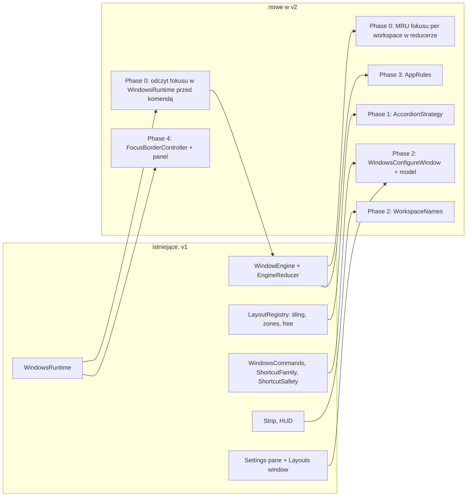

# Window Management v2: poprawka przenoszenia okien, domyślne skróty z AeroSpace, szczegółowa konfiguracja i ramka fokusu

Rozszerza `.ai/specs/2026-11-09-window-management.md` (zaimplementowany w PR #68, na `main` jako `3356906`). Nie zmienia jego kontraktów bez zaznaczenia; nowe klucze ustawień i pliki są dodatkami. Spec jest tylko projektem (design-only): implementacja idzie osobnymi PR-ami, po jednym na fazę.

## 📝 TLDR

Właściciel używa `WindowsPlugin` na co dzień na swoim Macu (Polish Pro, jeden wyświetlacz 5120×1440) i po pierwszym dniu zgłosił cztery rzeczy. (1) Skrót "przenieś okno do workspace'u N" przenosi czasem inne okno niż to z fokusem. (2) Domyślne skróty mają odpowiadać jego `~/.config/aerospace/aerospace.toml` (⌥J i ⌥K to fokus w lewo i w prawo, ⌥/ to układ tiles, ⌥, to accordion, ⌥- i ⌥= zmieniają rozmiar, odstępy 10, padding accordionu 30), a nie ogólnym zestawowi vi (HJKL) ze specu v1. (3) Konfiguracja ma być szczegółowa, a nie "presety": własne okno "Configure…" z listą skrótów, nazwami workspace'ów, odstępami i układami oraz regułami per aplikacja. (4) Lintel ma sam rysować ramkę wokół okna z fokusem (dziś właściciel robi to zewnętrznym narzędziem `borders`). Proponowane zachowanie to przyszłość, dziś nic z tego (poza błędem) nie istnieje.

## ✅ Resolved decisions (owner, 2026-11-11)

Odpowiedzi właściciela na pytania ze szkicu; reszta speca jest z nimi spójna.

| # | Pytanie | Decyzja |
|---|---|---|
| Q1 | Poprawka przenoszenia okien | **Phase 0 tego speca** (nie osobny PR przed specem). Faza 0 ma własny PR i może wejść jako pierwsza |
| Q2 | Workspace'y | 1–9 plus opcjonalne nazwy. Litery (A–G, I, M–Z z `persistent-workspaces`) nie wchodzą: w konfiguracji AeroSpace nie ma do nich żadnych skrótów |
| Q3 | Skróty a Polish Pro | **Rejestrować wszystko i tylko ostrzegać** (jak v1). Ostrzeżenie ma być widoczne od razu (patrz UI/UX), bo dziś siedzi w zwiniętym Advanced, a ⌥L już zjadło właścicielowi "ł" |
| Q4 | Tryb `service` | **Pomijamy** (razem z `join-with`, `flatten` i `close-all-windows-but-current`). Bez trybów wiązań |
| Q5 | Accordion | Tak, czwarty rodzaj układu obok Auto-tile, Zones i Free |
| Q6 | Reguły per aplikacja | Tak, minimalne: `bundle id → float | workspace N` |
| Q7 | Import z AeroSpace | Nie. Tylko interfejs w aplikacji; domyślne wartości już odpowiadają konfiguracji właściciela |
| Q8 | Kształt interfejsu | Osobne okno "Configure…" z paskiem bocznym; panel w Ustawieniach zostaje krótki |
| Q9 | Ramka fokusu | Tylko okno z fokusem (bez ramki nieaktywnej) |

## 📝 Problem Statement

Dowody: konfiguracja AeroSpace właściciela, raport QA z rundy 7 na prawdziwej aplikacji (`qa68/final4.txt` względem `baseline4.txt`) i kod na `main` (`3356906`):

- **Błąd przenoszenia (potwierdzona część).** `switchTo` w `Sources/WindowsPlugin/Engine/Reducer/ReducerContext+Parking.swift` parkuje okna starego workspace'u, ale nie oddaje fokusu żadnemu widocznemu oknu. `moveFocusedWindow` (`ReducerContext+Commands.swift`) działa na `state.focused`, a ten jest ustawiany wyłącznie przez zdarzenia (`windowFocused` w `ReducerContext+Windows.swift`). Zaraz po przełączeniu workspace'u skrót ⌥⇧N przenosi więc okno, które właśnie zostało zaparkowane. Po prawdziwej zmianie fokusu działa poprawnie.
- **Błąd przenoszenia (druga, niepotwierdzona część).** Właściciel mówi, że jego wskaźnik fokusu pokazuje inne okno niż to, które się przenosi. To nie musi być to samo zjawisko. Hipotezy do sprawdzenia w Phase 0, żadna nie jest ustalona: (a) `state.focused` jest nieaktualny, bo zdarzenie fokusu zostało zlane przez `EventCoalescer` albo zjedzone jako echo; (b) po przeniesieniu fokus trafia do `windows(in: old).last`, czyli ostatniego okna w kolejności, a nie ostatnio używanego, więc użytkownik widzi fokus na innym oknie niż się spodziewa; (c) fokus aplikacji (okno główne) różni się od fokusu okna (`kAXFocusedWindow`) dla aplikacji z wieloma oknami.
- **Dlaczego QA tego nie złapało.** W trybie `--qa` `makeCoordinator` używa `PreviewHotkeyRegistrar` z pustymi handlerami (`Hotkeys/KeyboardShortcutsRegistrar.swift`), więc QA v1 nigdy nie przeszło prawdziwej ścieżki skrótu. Rejestracja tego samego klawisza przez drugą instancję przechodzi, ale nie dostaje zdarzeń.
- **Skróty a Polish Pro.** `ShortcutSafety` (`Commands/ShortcutSafety.swift`) wykrywa skróty piszące znak i oznacza na Polish Pro m.in. ⌥1/4/5/9, ⌥⇧1/2/5/6/7/9, ⌥H/K/L i ⌥⇧H/J/K/L. Notatka "Some shortcuts type letters" i przycisk "Use ⌃⌥" są w zwiniętym Advanced (`WindowsSettingsPane+Advanced.swift`), a baner na górze pozostaje zielony. Prawdziwy Lintel połykał ⌥L ("ł" się nie wpisywało).
- **Domyślne skróty nie są skrótami właściciela.** `ShortcutFamily.arrows` w `WindowsCommands.swift` wiąże fokus z H J K L (lewo, dół, góra, prawo); AeroSpace właściciela używa tylko J (lewo) i K (prawo), bez góry i dołu. ⌥/ jest dziś `toggleLayout` (cykl rodzajów układu), a u właściciela ⌥/ to "tiles horizontal/vertical" i ⌥, to "accordion horizontal/vertical".
- **Konfiguracja to jeden zwinięty panel.** Skróty to wiersze rodzin modyfikatorów, a nie komendy; nie ma nazw workspace'ów, reguł per aplikację ani wskaźnika fokusu. Spec v1 wykluczył accordion, reguły per aplikację, ramki okien i nazwy workspace'ów ("Not doing"); ta decyzja jest tu świadomie zmieniona (patrz niżej).

## 📝 Proposed Solution

Cztery niezależne kawałki, każdy kończy się działającą aplikacją:

1. **Phase 0, poprawka fokusu i widoczność ostrzeżenia.** Silnik zna prawdziwy fokus w momencie komendy, a nie tylko z historii zdarzeń. Po przełączeniu workspace'u fokus trafia do ostatnio używanego okna pokazanego workspace'u. Przenoszenie odrzuca okno ukryte lub zaparkowane. Ostrzeżenie o skrótach piszących znaki trafia do banera na górze panelu i do kroku powitalnego. Do QA dochodzi wstrzykiwanie komend przez ten sam dispatcher co skróty (rozszerzenie istniejącej trasy `--qa-command-file`).
2. **Phase 1, domyślne skróty jak w AeroSpace właściciela i accordion.** Nowe domyślne (tabela niżej), czwarty rodzaj układu `accordion` jako strategia (jeden typ i jedna linia w `LayoutRegistry`), komendy `layout.tiles` i `layout.accordion`, krok zmiany rozmiaru jako ustawienie, `moveWorkspaceToNextDisplay`, domyślne odstępy 10/10, padding accordionu 30, domyślnie 9 workspace'ów.
3. **Phase 2, okno "Configure…".** Osobne okno z paskiem bocznym: Shortcuts (każda komenda z własnym rejestratorem, wyszukiwarka, wykrywanie konfliktów i znaków, "Reset to defaults"), Workspaces (tabela: numer, nazwa, rodzaj układu, odstępy, orientacja), Gaps & Layout (globalne wartości i padding accordionu). Nazwy workspace'ów w pasku, HUD i menu.
4. **Phase 3 i 4.** Reguły per aplikację (Rules w tym samym oknie) oraz natywna ramka fokusu (sekcja Focus border w tym samym oknie).

**Domyślne skróty (decyzja Q3: rejestrowane wszystkie, oznaczone ostrzegane).** Pole "Dziś" to `main`, pole "v2" to proponowana wartość; user-chosen skrót zawsze wygrywa (`BACKWARD_COMPATIBILITY.md` §5), więc zmiana dotyczy tylko skrótów, których użytkownik nie zmienił.

| Komenda | Dziś | v2 (AeroSpace właściciela) |
|---|---|---|
| `windows.focus.left` / `focus.right` | ⌥H / ⌥L | ⌥J / ⌥K |
| `windows.focus.up` / `focus.down` | ⌥K / ⌥J | bez skrótu (komenda zostaje, do przypisania) |
| `windows.move.left` / `move.right` | ⌥⇧H / ⌥⇧L | ⌥⇧J / ⌥⇧K |
| `windows.move.up` / `move.down` | ⌥⇧K / ⌥⇧J | bez skrótu |
| `windows.toggleLayout` | ⌥/ (cykl rodzajów) | bez skrótu (⌥/ dostaje `layout.tiles`); `windows.zones.nextLayout` jest dziś i zostaje bez skrótu |
| nowa `windows.layout.tiles` | brak | ⌥/ (ustaw Auto-tile; ponowne naciśnięcie przełącza horizontal/vertical) |
| nowa `windows.layout.accordion` | brak | ⌥, (ustaw Accordion; ponowne naciśnięcie przełącza horizontal/vertical) |
| `windows.resize.shrink` / `grow` | ⌥- / ⌥= (krok z v1) | ⌥- / ⌥=, krok 50 pt (ustawienie) |
| `windows.workspace.1…9`, `moveToWorkspace.1…9` | ⌥1–9, ⌥⇧1–9 | bez zmian |
| `windows.workspace.back` | ⌥Tab | bez zmian |
| nowa `windows.workspace.moveToNextDisplay` | brak | ⌥⇧Tab (z zawinięciem, jak `wrap-around`) |

Nie ma już HJKL w domyślnych: ⌥H i ⌥L znikają z listy zarejestrowanych, co samo usuwa dwa najgorsze kolizje z Polish Pro. ⌥K (u właściciela fokus w prawo) pozostaje oznaczone przez `ShortcutSafety` i jest zarejestrowane, bo tak wybrał (Q3); ostrzeżenie ma to mówić wprost.

**Alternatywy**

- *Parser `aerospace.toml` i import (Q7).* Odrzucone przez właściciela: drugi parser do utrzymania, a efekt (domyślne wartości) dostajemy za darmo.
- *Tryby wiązań (Q4).* Odrzucone: wchodzi z nimi `close-all-windows-but-current`, które niszczy niezapisaną pracę; reszta trybu (`flatten`, `join-with`) nie ma odpowiednika w modelu drzewa Lintela.
- *Litery jako workspace'y (Q2).* Odrzucone; zmienia kontrakt 1–9 (numerowane komendy, pasek, macierz przypisań).
- *Rozszerzenie panelu w Ustawieniach zamiast osobnego okna (Q8).* Odrzucone; to ten sam problem co dziś (ważne rzeczy w zwiniętym Advanced).
- *Ramka nieaktywna na wszystkich oknach (Q9).* Odrzucone: ramka na każdym oknie wymaga śledzenia ruchu każdego z nich, a nie jednego.

## 📝 Research

Porównanie z projektami referencyjnymi. Uwaga o dowodach: opis AeroSpace opiera się na konfiguracji właściciela, którą przeczytałem, i na wcześniejszym przeglądzie specu v1; opisy yabai, Amethyst, FancyZones i JankyBorders są z mojej wiedzy o ich dokumentacji, nie czytałem ich ponownie w tej sesji, więc traktuj je jako hipotezy do sprawdzenia w Phase 4.1 (spike ramki).

- **AeroSpace** (referencja właściciela): drzewo kontenerów (`tiles` i `accordion`, orientacja horizontal/vertical), workspace'y nazywane tekstem, `persistent-workspaces`, reguły `on-window-detected` (przeniesienie lub float), tryby wiązań, jeden plik TOML. Bierzemy: układ accordion z paddingiem, nazwy workspace'ów, reguły per aplikację w minimalnej formie, "workspace back and forth", "move workspace to monitor". Pomijamy: tryby wiązań, `join-with`, TOML, skrypty `after-startup-command`.
- **yabai:** BSP i stos, ramki okien przez zewnętrzne narzędzie, pełna funkcjonalność wymaga częściowo wyłączonego SIP. Potwierdza decyzję v1 (bez prywatnych wywołań CGS) i że ramka okna jest osobnym narzędziem, nie częścią menedżera.
- **Amethyst:** układy jako wymienne strategie per workspace i wyświetlacz. To potwierdza wzorzec `LayoutStrategy` z v1; accordion jest dla niego jedną strategią więcej.
- **FancyZones:** biblioteka układów z edytorem (już w v1); nie ma ramki fokusu ani workspace'ów.
- **JankyBorders (`borders` właściciela):** osobny proces rysujący ramkę wokół okna z fokusem i (opcjonalnie) wokół pozostałych; kolory aktywny/nieaktywny, szerokość, styl. Z mojej wiedzy używa prywatnych wywołań SkyLight do rysowania tuż nad oknem; to jest coś, czego **nie** chcemy (v1 zaakceptował jedno prywatne wywołanie, `_AXUIElementGetWindow`, ze strażnikami). Dlatego ramka jest rysowana publicznym API AppKit i spike (4.1) rozstrzyga, co da się zrobić bez prywatnych wywołań.
- **Czego nie przejmujemy:** złożoności wielu trybów wiązań, plikowej konfiguracji i skryptów; Lintel konfiguruje się przez interfejs, a ustawienia są kontraktem (`plugins.windows.*`).

## 📝 Architecture

Takeaway: żadna faza nie dotyka `LintelKit` ani rejestru wtyczek (`PluginRegistry`). Zmiany są wewnątrz `WindowsPlugin`; jedyna prawdopodobna zmiana kontraktu to ewentualny odczyt fokusu (patrz niżej) i ta już istnieje (`WindowClient.focusedWindow()`).

- **Phase 0, fokus w momencie komendy.** Reducer jest czysty i nie może pytać systemu. Dlatego `WindowsRuntime` (miejsce wysyłania komend użytkownika, `WindowsRuntime.swift` ok. linii 186) czyta `client.focusedWindow()` tuż przed wysłaniem komendy zależnej od fokusu (`moveToWorkspace.*`, `move.*`, `focus.*`, `toggleFloating`, komendy układu) i wstrzykuje do silnika wejście `.focusObserved(WindowID?)` w tej samej kolejności co komenda. Obie części idą jednym `engine.submit([...])` (jedna partia wstawiana do kolejki atomowo na aktorze silnika), nie dwoma wywołaniami `send`, bo dwa szybkie skróty to dwa równoległe zadania, z których każde czeka na odczyt, i osobne wejścia mogłyby się przeplatać. Nowe wejście jest potrzebne, a nie ma go jak zastąpić istniejące `.windowFocused`: to ostatnie uruchamia `followFocus` (przełączenie workspace'u dla okna ukrytego), a obserwacja nie może niczego przełączać. Reducer ustawia `state.focused` z obserwacji i dopiero potem wykonuje komendę. **Pierwszeństwo:** reducer trzyma `pendingFocus` (cel ostatniego efektu `.focus(id)`, czyszczony przez `windowFocused` tego okna albo po 1 s na zegarze wejść). Obserwacja, która wskazuje okno zaparkowane lub ukryte, a `pendingFocus` istnieje, przegrywa z nim (system jeszcze nie dogonił), więc ⌥2 i zaraz ⌥⇧3 działa na oknie, któremu silnik właśnie oddał fokus; każda inna obserwacja wygrywa z `state.focused`. Jeśli odczyt zwróci `nil` albo okno spoza zarządzanych, komendy zmieniające okno (`moveToWorkspace.*`, `move.*`, `toggleFloating`) są odrzucane z HUD ("No focused window"), a nie wykonywane na starym `state.focused`; `focus.*` zostaje tolerancyjne jak dziś: gdy obserwacja to okno niezarządzane (Finder, Lintel) albo `nil`, kierunek liczy się od ostatniego zarządzanego okna (`previousFocus`), a nie od pustego `state.focused`.
- **Phase 0, MRU: cykl życia.** MRU per workspace to pamięć (nie trafia do `state.json`): wpis dodaje `windowFocused`, usuwa `windowGone`, przenosi go razem z oknem `move`, a po zimnym starcie (snapshot) jest puste i wtedy `switchTo` wybiera okno według kolejności workspace'u (`windows(in:).last`).
- **Phase 0, oddawanie fokusu.** `switchTo` ustawia `state.focused` na okno pokazanego workspace'u wybrane z listy ostatnio używanych (MRU per workspace, aktualizowanej w `windowFocused`); gdy workspace jest pusty, `state.focused = nil`. Efekt `.focus(id)` przekazuje fokus systemowi. `moveFocusedWindow` odrzuca okno, które jest zaparkowane lub którego workspace jest ukryty (nigdy nie przenosimy okna, którego użytkownik nie widzi), a po przeniesieniu fokus wraca do MRU workspace'u źródłowego, nie do `last` według kolejności.
- **Phase 0, QA bez Carbon.** Istniejąca trasa DEBUG `--qa-command-file` (`QACommandRoute`, `PluginQACommands`) dostaje wiersz, który woła `PluginCommand.run` po id komendy (ten sam punkt wejścia, co skrót; bez drugiego mechanizmu i bez nowego argumentu), żeby QA przechodziło przez dispatcher komendy z prawdziwym silnikiem na wyizolowanych danych. Sama warstwa skrótu (Carbon, tłumaczenia klawiszy) jest testowana przez `InMemoryHotkeyRegistrar` z tablicą tłumaczeń Polish Pro i ręcznie na zainstalowanej aplikacji (patrz Phase 0, 0.6).
- **Phase 1, accordion.** Nowy typ `AccordionStrategy: LayoutStrategy` w `Sources/WindowsPlugin/Layouts/` i jedna linia w `LayoutRegistry.standard` (na końcu listy). Opcje strategii: `orientation` (`horizontal`, `vertical`; wartość `auto` jak w Auto-tile) i `padding` (domyślnie 30 pt, globalny klucz `plugins.windows.accordion.padding`, przesłonięcie per workspace przez istniejący mechanizm opcji). Układ: wszystkie okna zajmują ten sam obszar (po odstępach), a okna poza fokusem są przesunięte o `padding` w kierunku orientacji, żeby krawędzie wystawały (tak jak w AeroSpace). Stan strategii to kolejność okien (fokus bierze z `LayoutInput.focused`, nie duplikuje go), zapisywana jako nieprzezroczysty JSON pod nazwą rodzaju (jak v1). **Przeliczenie przy zmianie fokusu:** dziś `windowFocused` nie wywołuje układania (tylko `followFocus` dla okna ukrytego), a ramki accordionu zależą od okna z fokusem. Dlatego `LayoutStrategy` dostaje addytywną zdolność z wartością domyślną `false` (`arrangesOnFocusChange`, w `LayoutCapabilities.swift` jak pozostałe), a reducer ustawia `arrangeRequested` w `windowFocused` tylko dla workspace'u, którego rodzaj ją ma; prośby o ramkę idą tylko dla okien, których ramka docelowa się zmieniła. Szybkie przełączanie fokusu przez dziewięć okien nie może uruchomić `Watchdog` (limit 60 zmian ramek na sekundę, 2 s), czyli silnik nie zamrozi się i nie przywróci okien; jest to test w 1.3.
- **Phase 1, `layout.tiles` i `layout.accordion`.** To komendy należące do wtyczki, nie do strategii: lądują w `LayoutCommands` obok `toggleLayout()` (za `AccessibilityGate`) i są w `WindowsCommandID.reserved` (strategia nie może zadeklarować ich przez `LayoutCommandSpec`, bo `LayoutRegistry.commandSpecs` odrzuca id z `reserved`, a rodzaj układu nie powinien znać cudzych rodzajów). Rodzaj układu workspace'u jest konfiguracją (nadpisanie w `plugins.windows.workspaces`, `WorkspaceOverrides`), więc komenda zapisuje nadpisanie rodzaju tym samym kodem co `toggleLayout` (z zachowaniem `isReadOnly` dla wartości z nowszej wersji, rodzaj równy domyślnemu czyści nadpisanie) i woła `apply()`; **nie ma nowego wejścia silnika** ani stanu rodzaju w reducerze. Naciśnięcie, gdy workspace już ma ten rodzaj, przełącza orientację: dla Auto-tile jest to istniejąca komenda układu `tiling.toggleOrientation` (`EngineCommand.layout`, edycja stanu drzewa), dla Accordion przełączenie opcji `orientation` w nadpisaniu workspace'u (opcja jest konfiguracją, nie stanem).
- **Phase 1, `moveToNextDisplay`.** Model ma już "widoczny workspace per wyświetlacz" (znaczek na pasku). Komenda ustawia bieżący workspace jako widoczny na następnym wyświetlaczu (z zawinięciem), a to, co tam było, wraca na wyświetlacz źródłowy (zamiana). Po zamianie fokusowanym wyświetlaczem jest ten, na którym jest teraz przeniesiony workspace, więc `current` pozostaje tym samym workspace'em, a fokus systemowy trafia (efekt `.focus`) do jego okna z MRU (puste: `nil`). Przy jednym wyświetlaczu komenda nic nie robi i pokazuje HUD "Only one display"; właściciel ma jeden wyświetlacz, więc ścieżka jest testowana na fake'u klienta, nie ręcznie.
- **Phase 2, okno Configure.** `WindowsConfigureWindowController` (wzór: `LayoutsWindowController`, okno plugin-owned, nie sekcja okna głównego) z modelem `WindowsConfigureModel` (czysty, testowalny) i widokami SwiftUI na tokenach `LintelBrand`. Sekcje: Shortcuts, Workspaces, Gaps & Layout, Rules, Focus border (sekcje 3 i 4 dodają ostatnie dwie). Skróty używają `PluginContext.makeShortcutRecorder` per komenda (zamiast rodzin z v1), a rodziny numerowane zostają jako wiersz zbiorczy "Modifiers" dla `workspace.1…9` i `moveToWorkspace.1…9`.
- **Phase 3, reguły.** `AppRules` (czysta funkcja `RuleResolver.resolve(bundleID:) -> .float | .workspace(n) | nil`) jest wywoływana w reducerze przy tworzeniu okna; reguły docierają do niego przez `EngineConfig` (nowe pole obok `floatingBundleIDs`, przez `configChanged`), reducer nie czyta ustawień. `.floatingApps` zostaje źródłem prawdy dla reguł `float` (kontrakt v1 się nie zmienia), nowy klucz trzyma tylko przypisania `workspace`; okno Configure pokazuje jedną listę złożoną z obu.
- **Phase 4, ramka fokusu.** `FocusBorderController` (`@MainActor`) trzyma jeden bezramkowy, przeźroczysty dla myszy `NSPanel` (`ignoresMouseEvents = true`, `.nonactivating`, `sharingType = .none`, poziom i sposób porządkowania ustala spike 4.1) rysujący ramkę o zadanym kolorze, szerokości i promieniu. Źródłem pozycji jest ten sam strumień zdarzeń AX (`focused`, `moved`, `resized`, `destroyed`) i oczekiwane ramki silnika po reflow, nie osobny obserwator. Dla ruchu wywołanego przez Lintela panel skacze od razu do docelowej ramki; podczas ręcznego przeciągania okna (zdarzenia `moved` bez żadnej komendy) panel chowa się i wraca po ustaniu ruchu, bo opóźnienie powiadomień AX (v1 zmierzyło ok. 110 ms) i tak by się rozjechało. Przeliczenie ramki AX (początek w lewym górnym rogu) na AppKit (lewy dolny) jest czystą, testowaną funkcją.
- **Performance budgets (do zmierzenia w `docs/perf.md`):** komenda przeniesienia okna od odczytu fokusu do wykonania < 50 ms; reflow accordionu po jednym zdarzeniu < 30 ms (jak tiling); aktualizacja ramki po zmianie fokusu < 50 ms od dostarczenia powiadomienia; otwarcie okna Configure < 200 ms.

## 📝 Data Model

Bez bazy danych. Nowe ustawienia (wszystkie deklarowane raz w `WindowsSettings`, test sprawdza, że żaden klucz nie jest zapisywany gdzie indziej); klucze są kontraktem od wydania (`BACKWARD_COMPATIBILITY.md` §3).

| Klucz | Wartość | Domyślnie |
|---|---|---|
| `plugins.windows.workspaceNames` | jeden zwersjonowany JSON: `{ version: 1, names: { "1": "Code", … } }`, nazwa ≤ 24 znaki, bez znaków sterujących i bidi, nazwy nie muszą być unikalne | puste |
| `plugins.windows.appRules` | zwersjonowany JSON `{ version: 1, rules: [{ bundleID, workspace: 1…9 }] }`; reguła `float` to nadal wpis w `.floatingApps` | puste |
| `plugins.windows.accordion.padding` | liczba punktów, 0–200 | 30 |
| `plugins.windows.resize.step` | liczba punktów, 5–200 | 50 |
| `plugins.windows.shortcutDefaultsVersion` | Int: wersja migracji domyślnych skrótów (ukryty) | 0 |
| `plugins.windows.focusBorder` | zwersjonowany JSON `{ version: 1, enabled, color: "#rrggbb[aa]", width, radius }` | `enabled: false`, `#e1e3e4`, 5, 12 |

Zmiany istniejących domyślnych: `workspaceCount` 4 → 9, `gap.inner` i `gap.outer` → 10 (zgodnie z konfiguracją właściciela; gdy użytkownik nigdy nie zmienił wartości, czyta nową domyślną, a zapisana wartość wygrywa). Domyślne skróty zmieniają się według tabeli w Proposed Solution; **migracja jest obowiązkowa, nie do zweryfikowania:** `HotkeyService.syncCommands` zapisuje domyślny skrót komendy do rejestratora raz i zapisuje jej id w `commandShortcutDefaultsApplied`; potem nie liczy go ponownie. Każdy, kto włączył wtyczkę w v1, ma więc H/J/K/L i ⌥/ (`toggleLayout`) zapisane jak wybrane, a nowa domyślna go nie dotyka, przy czym nowa komenda `layout.tiles` (nowe id) dostałaby ⌥/ równolegle do `toggleLayout`, czyli dwie komendy na jednym skrócie globalnym. Dlatego wtyczka przy `activate()` uruchamia jednorazową migrację (znacznik `plugins.windows.shortcutDefaultsVersion`, Int, domyślnie 0, tu 1) przez `PluginContext.commandShortcut` / `setCommandShortcut`: zmienia skrót komendy tylko wtedy, gdy jest równy starej domyślnej; odpina usuniętą domyślną (np. `focus.up` ⌥K) przed przypisaniem tego klawisza innej komendzie (⌥K dla `focus.right`) i odpina `toggleLayout` z ⌥/ przed przypisaniem go `layout.tiles`. Migracja działa niezależnie od kolejności względem `syncCommands`: gdy ono biegnie pierwsze i nadaje nowej komendzie `layout.tiles` ⌥/, migracja odpina `toggleLayout` zaraz potem, a `DefaultShortcutTests` i test migracji sprawdzają stan końcowy (jeden właściciel każdego skrótu). Nie da się odróżnić "wybrał ⌥H" od "dostał ⌥H domyślnie"; przyjmujemy, że równy starej domyślnej znaczy niezmieniony (jedyny użytkownik to właściciel).

Walidacja: `appRules` odrzuca `workspace` poza 1…9, powtórzony `bundleID` (ostatni wygrywa przy odczycie, pierwszy przy zapisie z interfejsu) i `bundleID` dłuższy niż 255 znaków; `focusBorder` odrzuca niefinitywne liczby, szerokość poza 1–20 i promień poza 0–40, kolor spoza formatu hex; błędny JSON wraca do domyślnej wartości i jest raportowany raz w diagnostyce (liczniki, bez treści). Nazwy workspace'ów i reguły są danymi użytkownika i nigdy nie idą do logów ani przez katalog napisów. `state.json`, `layouts.json` i `assignments.json` bez zmian; stan accordionu jest nieprzezroczystym JSON-em pod nazwą rodzaju `accordion`, więc starsza wersja Lintela go zachowa bez zmian (v1 trzyma nieznane rodzaje nietknięte).

## 📝 API Contracts

Nowe komendy wtyczki (id nigdy się nie zmieniają po wydaniu): `windows.layout.tiles`, `windows.layout.accordion`, `windows.workspace.moveToNextDisplay`. Wszystkie `showsInMenu: false`. Istniejące `focus.up/down`, `move.up/down`, `join.*`, `toggleLayout` zostają, a ich domyślne skróty znikają zgodnie z tabelą. Plugin nie zmienia `LintelKit`: `WindowClient.focusedWindow()` istnieje; `PluginContext.makeShortcutRecorder` istnieje. Wymagane (sprawdzić w kroku 2.1): czy `makeShortcutRecorder` pozwala na rejestrator per komenda z wykrywaniem konfliktów między komendami wtyczki; jeśli nie, dodatek do `LintelKit` jest addytywny i z wartością domyślną (§1 `BACKWARD_COMPATIBILITY.md`).

Wejścia silnika (wewnętrzne, nie kontrakt): `.focusObserved` w partii z komendą (patrz Architecture, Phase 0) i `EngineCommand.moveWorkspaceToNextDisplay`. Rodzaj układu nie jest wejściem silnika (to konfiguracja, patrz `layout.tiles`). Efekty: `.focus(WindowID)` (istnieje) i jeden nowy przypadek `EngineEffect.notice(EngineNotice)` z `EngineNotice.noFocusedWindow` i `.singleDisplay` (istniejący `.hud(workspace:windowCount:)` zostaje bez zmian); nowe stany `WindowsHUDState.noFocusedWindow` i `.singleDisplay` pokazują się także przy wyłączonym `showHUD`, bo to informacja o odrzuconej komendzie, nie ozdoba.

## 📝 UI/UX

Brak zaakceptowanego projektu graficznego, więc nie ma linii `Prototype:`; makiety ekranów Configure można zamówić osobno przez `om-ux-design` (opcjonalnie, nie blokuje speca).

- **Panel w Ustawieniach (krótki).** Basics zostaje (liczba workspace'ów, domyślny rodzaj układu, pasek w menu) i dostaje wiersz "Configure…" z jednozdaniowym podsumowaniem ("9 workspaces · 12 shortcuts · 2 rules") oraz przełącznik "Focus border". Advanced traci wiersze rodzin skrótów i podsumowania per workspace (przechodzą do Configure).
- **Baner na górze panelu (Phase 0).** Gdy jakikolwiek zarejestrowany skrót pisze znak na aktywnym układzie (`ShortcutSafety`): poziom *attention* (nie zielony "Ready"), tytuł "N shortcuts type letters" (konkretnie np. "⌥K, ⌥1 and 2 more type characters on your keyboard"), akcja główna "Use ⌃⌥ for these" (zmienia tylko oznaczone komendy przez `setCommandShortcut` per komenda, a nie całą rodzinę jak dzisiejsze `useControlOption()`; wiersz modyfikatorów rodziny pokazuje wtedy stan "Mixed" zamiast wartości pierwszego wiązania, po jednym kliknięciu i bez potwierdzenia; odwracalna przez istniejący wiersz modyfikatorów w Advanced, a od Phase 2 przez "Reset" w Configure → Shortcuts), akcja druga "Review". To samo ostrzeżenie jest w kroku powitalnym i jako ikona ostrzeżenia przy komendzie w Configure → Shortcuts. Rejestracja nie zmienia się (Q3). Przełączenie źródła wprowadzania ponownie uruchamia sprawdzenie.
- **Okno Configure.** Pasek boczny: Shortcuts, Workspaces, Gaps & Layout, Rules, Focus border. Rozmiar domyślny 760×520, minimalny 640×420.
  - *Shortcuts.* Lista pogrupowana (Workspaces, Focus, Move, Layout, Resize, Display, Other), pole wyszukiwania, w wierszu nazwa komendy, rejestrator, ikona ostrzeżenia (znak na klawiaturze, z wyjaśnieniem w podpowiedzi), "Reset" per wiersz i "Reset all to defaults" (z `.destructiveConfirmation`, "This can't be undone."). Konflikt z inną komendą wtyczki lub skrótem systemowym pokazany w wierszu tekstem, nie samym kolorem. Rodziny numerowane mają jeden wiersz zbiorczy "Modifiers" dla cyfr 1–9.
  - *Workspaces.* Tabela dziewięciu wierszy: numer, nazwa (pole tekstowe, ≤ 24 znaki), rodzaj układu (Auto-tile, Accordion, Zones, Free, "Default"), odstępy (override lub "Default"), orientacja (Auto, Horizontal, Vertical). Podsumowanie efektywnej konfiguracji nigdy nie jest ukryte ("Default · 10 pt").
  - *Gaps & Layout.* Odstępy zewnętrzne i wewnętrzne, padding accordionu, krok zmiany rozmiaru, domyślny rodzaj układu, domyślna orientacja.
  - *Rules (Phase 3).* Tabela aplikacji: wybór aplikacji (z listy uruchomionych i z `/Applications`, nie wpisywanie bundle id), akcja (Float, Workspace 1–9), usuń. Reguły działają przy tworzeniu okna; przycisk "Apply to open windows" nie jest w zakresie.
  - *Focus border (Phase 4).* Włącznik, kolor (próbnik systemowy), szerokość, promień, podgląd na przykładowej ramce w oknie (nie na prawdziwym oknie).
- **Nazwy workspace'ów.** Pole w pasku (box zostaje z numerem, bo szerokość jest ograniczona: dziewięć pudełek po 18 pt); nazwa pojawia się w etykiecie dostępności pudełka ("Workspace 3, Code, 4 windows"), w menu prawego kliknięcia ("3 · Code") i w HUD po przełączeniu.
- **HUD.** Dwa nowe stany: "No focused window" i "Only one display". Krótkie, bez przycisków.
- **Ramka fokusu.** Czysto dekoracyjna: `accessibilityElement` wyłączony, bez komunikatów VoiceOver, bez animacji (Reduce Motion nie ma czego ograniczać), `sharingType = .none`, żeby nie wchodziła do nagrań ekranu. Ukryta, gdy fokus ma okno Lintela, pulpit, pełny ekran albo brak okna.
- **Accessibility i język.** Każda kontrolka z etykietą; Configure sprawdzone przy najmniejszym i największym rozmiarze tekstu, w jasnym i ciemnym, po angielsku i po polsku; wszystkie napisy w `Localizable.xcstrings` (en i pl, `StringCatalogTests`); nazwy workspace'ów i aplikacji to dane użytkownika, nie idą przez katalog.

## 📝 Edge Cases & Failure Scenarios

| Sytuacja | Zachowanie |
|---|---|
| Fokus systemowy na oknie nieznanym silnikowi (okno innego Space, dialog, Lintel) | Komendy przenoszące i `toggleFloating` odrzucone z HUD "No focused window"; nic się nie przenosi; `focus.*` działa jak dziś |
| `focusedWindow()` wolne lub aplikacja nie odpowiada | Limit czasu (0,25 s, przez `withDeadline` z `LintelCore`, bo `WindowClient.focusedWindow()` nie ma parametru limitu); przy braku odpowiedzi komenda odrzucona z HUD, nie wykonana na starym `state.focused`; licznik w diagnostyce |
| Workspace docelowy pusty po przełączeniu | `state.focused = nil`; ⌥⇧N nic nie przenosi i pokazuje HUD, nie bierze zaparkowanego okna |
| Okno przenoszone jest jedynym oknem źródłowego workspace'u | Po przeniesieniu fokus nie skacze na zaparkowane okno; `state.focused` czyszczone |
| Skrót piszący znak jest zarejestrowany (Q3) | Rejestrowany; baner attention na górze i w kroku powitalnym nazywa konkretne skróty; "Use ⌃⌥ for these" jednym kliknięciem; zmiana układu klawiatury ponawia sprawdzenie |
| Dwie komendy mają ten sam skrót | Wiersz w Configure pokazuje konflikt; zapis drugiego skrótu wymaga wyboru "Replace" albo anulowania; nigdy nie rejestrujemy cicho dwóch |
| Przełączenie na accordion przy wielu oknach | Okna zachowują kolejność z poprzedniego rodzaju (stan poprzedniego rodzaju zostaje nietknięty, jak w v1 po `toggleLayout`); powrót przywraca drzewo |
| Accordion i okno odmawia zmiany rozmiaru | Oznaczone jako stubborn i wyśrodkowane jak w v1; padding się nie zmienia |
| `moveWorkspaceToNextDisplay` przy jednym wyświetlaczu | HUD "Only one display", bez zmian stanu |
| Reguła wskazuje workspace, którego nie ma (liczba workspace'ów zmniejszona) | Reguła zachowana w ustawieniach, nieaktywna, oznaczona w Configure "Workspace 8 is off"; okno zostaje na bieżącym |
| Reguła i `floatingApps` dla tej samej aplikacji | Float wygrywa; Configure pokazuje jedną pozycję i nie pozwala dodać drugiej |
| Ramka fokusu przy oknie przeciąganym ręcznie | Ukryta do ustania ruchu (~100 ms), potem pokazana; brak migotania w lagujących zdarzeniach |
| Ramka i odstęp mniejszy niż szerokość ramki | Ramka rysowana na zewnątrz okna może zachodzić na sąsiada; Configure ostrzega "Border is wider than the gap" |
| Okno na granicy dwóch wyświetlaczy | Panel obejmuje oba (jedno okno AppKit może przekraczać ekrany) |
| Ramka i okno na pełnym ekranie, minimalizacja, zmiana Space | Ukryta; wraca po przywróceniu |
| Nieprawidłowy JSON w nowym kluczu | Domyślna wartość, raz zgłoszone w diagnostyce (liczniki, bez treści), plik użytkownika nietknięty |
| Plugin wyłączony lub Accessibility cofnięte | Ramka znika, reguły i komendy nie działają, nic nie jest przenoszone (jak v1) |

Prywatność: bez zmian względem v1; nazwy workspace'ów, reguły (bundle id) i diagnostyka fokusu nie trafiają do logów ani do `ranking.sqlite`. Nowy licznik diagnostyczny `focusMismatches` (komenda, przy której `state.focused` różnił się od odczytu systemowego) jest liczbą, bez id okien.

## 📝 Risks & Impact Review

- **Trudne do odwrócenia po wydaniu:** nowe klucze `plugins.windows.*`, id nowych komend, zmieniona lista domyślnych skrótów oraz domyślna liczba workspace'ów (`BACKWARD_COMPATIBILITY.md` §3, §5, §1; każdy dostaje wpis w PR implementacji). Łagodzenie: wtyczka wyłączona domyślnie i ma jednego użytkownika (właściciela); user-chosen skrót wygrywa; nowe klucze zwersjonowane.
- **Zmiana domyślnych skrótów to zmiana kontraktu (§5).** Uzasadnienie: v1 wyszedł 2026-11-11 (PR #68) i domyślne HJKL były błędnym wyborem względem rzeczywistej konfiguracji właściciela; dotknięci są tylko ci, którzy nie zmienili skrótu. Krok 1.1 dostarcza migrację domyślnych (zapisana domyślna jest zamrożona w `commandShortcutDefaultsApplied`).
- **Q3 to świadomy kompromis produktowy, nie błąd.** Rejestrowanie skrótów, które piszą znaki, kosztuje użytkownika literę w całym systemie, dopóki nie zareaguje; ostrzeżenie jest po to, żeby reakcja była jednym kliknięciem. Właściciel zna ten koszt ("ł" zniknęło mu przy ⌥L).
- **Ramka fokusu to największe ryzyko techniczne.** Bez prywatnych wywołań SkyLight nie da się narysować ramki zawsze tuż nad oknem innej aplikacji; spike 4.1 ma zmierzyć, czy publiczny panel na poziomie `.floating` rysujący ramkę na zewnątrz okna wystarcza (nigdy nie zasłania treści innych okien, ale może zachodzić na sąsiadów przy odstępie mniejszym niż szerokość). Jeśli nie wystarcza, Phase 4 zostaje odroczona (Phases 0–3 są od niej niezależne), a właściciel zostaje przy `borders`.
- **Zakres.** To są cztery niezależnie dostarczalne zdolności (poprawka, domyślne i accordion, okno konfiguracji, ramka). Każda jest osobną fazą z własnym PR-em i żadna nie wymaga kolejnej poza zależnością okna Configure dla Rules i Focus border; wspólny spec zostaje, bo mają wspólny cel i wspólne okno, a podział na fazy zachowuje możliwość dostarczenia osobno (ocena spójności zakresu: patrz Review).
- **Koszt:** jedna aktualizacja odczytu fokusu na komendę zależną od fokusu (kilka ms, bez stałego obserwatora), jeden panel i bez dodatkowych obserwatorów AX dla ramki.
- **Rzeczy poza kontrolą Lintela:** poprawne odtworzenie błędu na prawdziwej aplikacji wymaga ręcznego QA na komputerze właściciela (zainstalowany Lintel, prawdziwe skróty) za jego zgodą; QA w trybie `--qa` nie obejmuje warstwy Carbon (znany limit).

## 📋 Phasing

0. **Poprawka fokusu i widoczność ostrzeżenia.** Własny PR, samodzielnie dostarczalna, może wejść pierwsza i niezależnie od reszty (nie zależy od Phase 2).
1. **Domyślne skróty z AeroSpace, accordion i komendy układu.** Samodzielna.
2. **Okno Configure (Shortcuts, Workspaces, Gaps & Layout) i nazwy workspace'ów.** Wymaga Phase 1 tylko dla listy komend.
3. **Reguły per aplikację.** Logika i ustawienie (3.1, 3.2) testowalne bez okna; użytkownik ustawi je dopiero przez okno Configure z Phase 2.
4. **Ramka fokusu.** Spike najpierw; reszta wymaga okna Configure z Phase 2 (sekcja Focus border). Recenzja zakresu zaleciła wydzielenie jej do osobnego speca po spike'u (jest bramkowana wynikiem 4.1 i jedyna niesie ryzyko prywatnych wywołań); jeśli spike da wynik "odraczamy", faza przenosi się do osobnego speca bez wpływu na fazy 0–3.

## 📋 Implementation Plan

Każdy krok zostawia aplikację działającą i wtyczkę wyłączoną domyślnie. Bramka dla każdego kroku: `swift build`, `swift test`, `swift format lint --strict -r Sources Tests`; testy silnika pod `--sanitize=thread` w CI jak w v1.

### Phase 0: poprawka fokusu i widoczność ostrzeżenia

- 0.1 **Testy odtwarzające (najpierw czerwone).** Scenariusze na fake'u klienta: (a) workspace 1 z oknami A i B, przełącz na 2, ⌥⇧3 nie może przenieść zaparkowanego okna; (b) fake zwraca inny `focusedWindow()` niż `state.focused`, komenda ma działać na oknie systemowym, ale gdy fake zwraca okno zaparkowane, a silnik ma `pendingFocus`, wygrywa `pendingFocus` (reguła pierwszeństwa); (c) po przeniesieniu fokus trafia do ostatnio używanego okna workspace'u źródłowego. Test: ten krok jest testem.
- 0.2 **Fokus MRU per workspace i oddawanie fokusu w `switchTo`.** Pole MRU w stanie reducera, aktualizowane w `windowFocused`; `switchTo` ustawia `state.focused` i emituje `.focus`. Test: tablica przypadków (pusty workspace, jedno okno, kilka okien, powrót ⌥Tab).
- 0.3 **`.focusObserved` i odczyt w `WindowsRuntime`.** Jedna partia `submit([.focusObserved, .command])`, reguła `pendingFocus`; benchmark (domyślnie wyłączony) przeniesienia okna < 50 ms w `docs/perf.md`. Odczyt `client.focusedWindow()` z limitem czasu przed komendą zależną od fokusu, wstrzyknięcie wejścia w kolejności, HUD "No focused window" przy odrzuceniu, licznik `focusMismatches`. Test: scenariusze fake'a z opóźnieniem i odmową odpowiedzi.
- 0.4 **Strażnicy `moveFocusedWindow`.** Odrzucenie okna zaparkowanego lub ukrytego, zachowanie fokusu po przeniesieniu. Test: reducer na wartościach.
- 0.5 **Widoczne ostrzeżenie o skrótach piszących znaki.** Baner attention na górze panelu (`WindowsStatus`), akcja "Use ⌃⌥ for these" (tylko oznaczone komendy, odwracalna), ten sam tekst w kroku powitalnym. Rejestracja bez zmian. Test: tablica banerów (priorytety), test z `ShortcutSafety` i tablicą Polish Pro, `StringCatalogTests` (en i pl).
- 0.6 **QA bez kłamstwa o skrótach.** Rozszerzyć istniejącą trasę DEBUG `--qa-command-file` (`QAOptions.swift`, `PluginQACommands`, `WindowsPlugin+QA.swift`), żeby wołała `PluginCommand.run` jak skrót (bez drugiego mechanizmu), `InMemoryHotkeyRegistrar` z tłumaczeniami Polish Pro, wpis w `docs/qa.md` i `AGENTS.md`, że QA w `--qa` nie obejmuje Carbon, oraz procedura ręczna na zainstalowanej aplikacji (⌥2 potem ⌥⇧3, ⌥L pisze "ł" po rozwiązaniu ostrzeżenia). Procedura ręczna wymaga zgody właściciela przy każdym uruchomieniu na jego komputerze. Test: test w `LintelAppTests` (tam jest `InMemoryHotkeyRegistrar`; wtyczka go nie widzi) sprawdza, że każdy zarejestrowany domyślny skrót, który pisze znak, jest wymieniony w banerze.
- 0.7 **Diagnostyka drugiej przyczyny.** Jeśli po 0.2–0.4 właściciel nadal widzi inne okno niż to, które się przenosi, zebrać `focusMismatches` i trace (identyfikatory zahashowane, bez tytułów) z prawdziwego użycia; hipotezy (a), (b), (c) z Problem Statement sprawdzać po kolei, każda z testem. Kryterium zakończenia: dla każdej hipotezy test regresji, który przechodzi po poprawce, albo wpis w PR, że hipoteza nie zachodzi (z liczbami `focusMismatches`); krok jest opcjonalny, jeśli właściciel po 0.2–0.4 nie widzi już błędu.

### Phase 1: domyślne skróty z AeroSpace, accordion, komendy układu

- 1.1 **Migracja domyślnych skrótów.** Jednorazowa, ze znacznikiem `shortcutDefaultsVersion` (opis w Data Model): zmiana tylko skrótów równych starej domyślnej, kolejność odpinania przed przypisaniem. Test na tablicy: stara domyślna, zmieniona przez użytkownika, brak wpisu, zamiana ⌥K z `focus.up` na `focus.right`, kolizja ⌥/ `toggleLayout` i `layout.tiles`, drugie uruchomienie nic nie zmienia.
- 1.2 **Nowa tabela domyślnych skrótów.** `ShortcutFamily.arrows` → fokus/przeniesienie J i K (lewo i prawo), brak domyślnych dla góra/dół; `toggleLayoutShortcut` usunięty; `DefaultShortcutTests` zaktualizowane. **Klawisz `,`:** `HotkeyShortcut` (powłoka) nie zna dziś przecinka (tylko `-`, `=`, `/`, BC §1), więc ⌥, nie zostałby zarejestrowany, a `syncCommands` pominąłby go po cichu; krok dodaje `,` do tablicy `HotkeyShortcut` i do `ShortcutSafety.keyCodes` (kod 43) oraz wpis w BC §1 (klawisze interpunkcyjne). `WindowsSettingsModel` składa listę do sprawdzenia z rodzin i `toggleLayout`; zmienia się na pełny katalog komend wtyczki z ich bieżącymi skrótami, żeby ⌥/, ⌥, i ⌥⇧Tab też były sprawdzane. Test: `DefaultShortcutTests`, brak duplikatów, każdy domyślny skrót jest jednoznaczny i rejestrowalny (`HotkeyShortcut(KeyShortcut)` nie jest `nil` dla żadnego domyślnego), `ShortcutSafety` obejmuje nowe komendy.
- 1.3 **`AccordionStrategy`.** Benchmark (domyślnie wyłączony) reflow < 30 ms w `docs/perf.md`. Czysta funkcja `AccordionLayout.frames(order, focused, area, gaps, padding, orientation)`, strategia, rejestracja w `LayoutRegistry.standard`, opcje `orientation` i `padding`. Test: złote ramki (jedno, dwa, pięć okien, oba kierunki, gap 0 i 10, padding 0 i 30), niezmienność rejestru (kolizje id), stan nieprzezroczysty zachowany po przełączeniu rodzaju, `arrangesOnFocusChange` (zmiana fokusu przelicza tylko workspace accordionu, workspace Auto-tile nie), szybki cykl fokusu przez 9 okien nie uruchamia `Watchdog`. Pozycja w rejestrze: `AccordionStrategy` jest dopisany na końcu (po Auto-tile, Zones i Free), żeby cykl `toggleLayout` i domyślny rodzaj (pierwszy) pozostały jak w v1.
- 1.4 **`layout.tiles`, `layout.accordion`, krok resize.** Komendy w `LayoutCommands` (zapis nadpisania rodzaju, przełączenie orientacji przy ponownym naciśnięciu, `reserved`), ustawienie `resize.step`, ⌥/ i ⌥, jako domyślne. Test: tablica komend (rodzaj zapisany, równy domyślnemu czyści nadpisanie, wartość z nowszej wersji nietknięta, orientacja dla obu rodzajów), round trip rodzaju zachowuje oba stany.
- 1.5 **`moveWorkspaceToNextDisplay`.** Wejście silnika, model, HUD, ⌥⇧Tab. Test: scenariusze fake'a z dwoma i jednym wyświetlaczem, zawinięcie.
- 1.6 **Nowe domyślne wartości.** `workspaceCount` 9, odstępy 10/10, padding 30. Test: testy domyślnych w `WindowsSettings`, pasek z 9 pudełkami mieści się w limicie szerokości.
- 1.7 **Docs.** `docs/windows-plugin.md`, `BACKWARD_COMPATIBILITY.md`: §1 (nowy rodzaj układu `accordion`: wartość `plugins.windows.defaultKind`, rekordów przesłonięć i klucz w `state.json`, oraz nowe id komend), §3 (nowe klucze i zmiana domyślnych `workspaceCount` 4 → 9 i odstępów), §5 (zmiana domyślnych skrótów), `AGENTS.md` (wiersz Windows plugin: czwarty rodzaj układu). Uwaga: między 1.2 a 1.4 ⌥/ jest nieprzypisane, dlatego kroki 1.2–1.4 wchodzą w jednym PR.

### Phase 2: okno Configure i nazwy workspace'ów

- 2.1 **Spike rejestratora per komenda.** Sprawdzić, czy `makeShortcutRecorder` i `PluginContext` wystarczą (zapis, odczyt, wykrywanie konfliktów); jeśli nie, dodać addytywny, domyślny element do `LintelKit` (§1). Test: `LintelKitTests` kompilują domyślny kontekst.
- 2.2 **`WindowsConfigureModel` (czysty).** Lista komend z grupami, konfliktami, flagami `ShortcutSafety`, resetem, filtrem wyszukiwania. Test: tablice (konflikt, reset, filtr, zmiana układu klawiatury).
- 2.3 **Okno i sekcja Shortcuts.** `WindowsConfigureWindowController`, pasek boczny, sekcja Shortcuts z `.destructiveConfirmation` dla "Reset all". Test: klawiatura i VoiceOver tabela, `StringCatalogTests`; okno to pozycja ręcznego QA ze zrzutami (jasny i ciemny, najmniejszy i największy tekst, en i pl).
- 2.4 **Workspaces: nazwy i tabela.** Klucz `workspaceNames`, walidacja, nazwa w etykiecie pudełka, menu i HUD, przeniesienie przesłonięć per workspace z Advanced do tej tabeli. Test: walidacja nazw (długość, sterujące i bidi), stan paska i HUD na wartościach.
- 2.5 **Gaps & Layout.** Odstępy, padding, krok resize, domyślny rodzaj i orientacja. Test: model i rozstrzyganie domyślnych vs przesłonięć.
- 2.6 **Budżety okna Configure.** Benchmark (domyślnie wyłączony) otwarcia okna (< 200 ms), wynik w `docs/perf.md` i w PR. Budżety przeniesienia okna (< 50 ms, Phase 0, krok 0.3) i reflow accordionu (< 30 ms, Phase 1, krok 1.3) mierzy faza, która dostarcza to zachowanie.
- 2.7 **Panel w Ustawieniach.** Wiersz "Configure…" z podsumowaniem, przełącznik "Focus border" ukryty do Phase 4, usunięcie wierszy rodzin i podsumowań z Advanced. Test: `InactiveSettingsPaneTests` (panel nie startuje pracy w stanie nieaktywnym), tablica banerów.

### Phase 3: reguły per aplikację

- 3.1 **`AppRules` i `RuleResolver` (czyste).** Klucz `appRules`, walidacja, rozstrzyganie z `.floatingApps`. Test: tablica (float, workspace, konflikt, nieistniejący workspace).
- 3.2 **Reducer.** Przypisanie przy tworzeniu okna (bez przełączania workspace'u). Test: scenariusze fake'a (nowe okno aplikacji z regułą, aplikacja z oknem już istniejącym nie jest ruszana).
- 3.3 **Sekcja Rules.** Wybór aplikacji z listy uruchomionych i `/Applications`, akcje Float i Workspace, usuń. Test: model, `StringCatalogTests`; ekran to pozycja ręcznego QA.

### Phase 4: ramka fokusu

- 4.1 **Spike ramki (bez kodu produkcyjnego).** Na Macu właściciela zmierzyć: czy publiczny `NSPanel` na poziomie `.floating`, bezramkowy, `ignoresMouseEvents`, daje czystą ramkę wokół okna innej aplikacji; zachowanie przy zmianie Space, pełnym ekranie, wielu wyświetlaczach, w nagraniu ekranu (`sharingType = .none`), opóźnienie względem powiadomienia AX. Rozstrzygnięcie: ramka na zewnątrz kontra wewnątrz, poziom okna, czy Phase 4 w ogóle idzie. Zapisać wynik w następnym wolnym numerze ADR (`docs/decisions/`, sprawdzić otwarte PR-y). Kryterium: ADR zawiera pomiary i jedno z trzech rozstrzygnięć (idziemy z ramką na zewnątrz, idziemy z ramką wewnątrz, odraczamy Phase 4); bez kodu produkcyjnego.
- 4.2 **Czysta geometria.** Konwersja AX → AppKit, ramka ramki z szerokością i promieniem, ukrywanie (pełny ekran, brak okna, okno Lintela). Test: złote ramki na wielu wyświetlaczach i z różnym skalowaniem.
- 4.3 **`FocusBorderController` i panel.** Śledzenie z istniejącego strumienia zdarzeń i oczekiwanych ramek silnika, ukrywanie podczas ręcznego przeciągania, `sharingType = .none`, ustawienie `focusBorder`. Test: kontroler na fake'u (zdarzenia → sekwencja ramek), ręczne QA ze zrzutami.
- 4.4 **Sekcja Focus border.** Włącznik, kolor, szerokość, promień, podgląd, ostrzeżenie "Border is wider than the gap". Test: model, `StringCatalogTests`.
- 4.5 **Polish.** Audyt dostępności, budżet w `docs/perf.md`, `BACKWARD_COMPATIBILITY.md` (klucz `focusBorder`), `docs/qa.md`.

## 📝 Not doing

Tryby wiązań (`service` i inne), `join-with`, `flatten-workspace-tree`, `close-all-windows-but-current`, workspace'y z literami, import z `aerospace.toml` i dowolny tekstowy język konfiguracji, ramka nieaktywna na pozostałych oknach, reguły według tytułu okna, przypinanie workspace'ów do wyświetlaczy, przycisk "Apply to open windows", prywatne wywołania SkyLight, sterowanie natywnymi Spaces, skrypty i CLI. Każde może być osobnym specem; nic z tego nie zmienia powyższych kontraktów.
