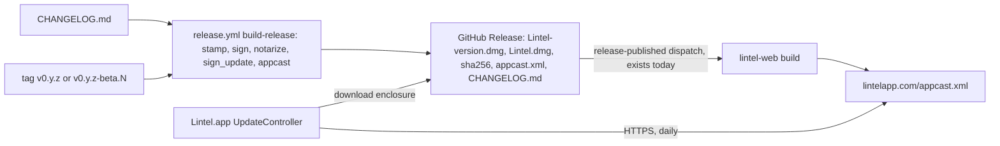

# In-app updates that keep macOS permissions, and repository hygiene for an open-source beta

> Status: **draft for owner review**. Design only: nothing here is implemented, every "will" is proposed behaviour. Base: `origin/main` at `aacfe5a` (2026-11-19). Research with sources: [`research/2026-11-19-signing-updates-research.md`](research/2026-11-19-signing-updates-research.md); items it could not confirm from a primary source are marked UNVERIFIED there and repeated under "Review limits".
>
> This spec **replaces** the unmerged local draft `2026-11-07-release-experience.md` (branch `feat/release-experience-spec`, never pushed) and reuses its decisions and its three unpushed implementation branches where they still fit (see "Earlier work").

## 📝 TLDR

**Who:** the owner (today the only person who installs Lintel) and, from the first public beta, every user and contributor.
**Today:** every install on the owner's Mac is an ad-hoc build made by an agent, so macOS forgets Microphone, Accessibility, Screen & System Audio Recording, Full Disk Access and the Keychain "Always Allow" each time. There is no release, no tag, no update check, no changelog, no branch protection and no contributor documentation; the repository is still called `Pounce`.
**Proposed:** (A) releases signed with one stable identity, an **Update** button in Lintel built on Sparkle 2 with a stable and a beta channel, and a rule that nothing but a release build is installed in `/Applications`; (B) SemVer `0.x` with `-beta.N` pre-releases, a `CHANGELOG.md`, a documented release process, community files, branch and tag rules, and the remaining "Pounce" names removed.
**Why now:** no release exists, so the signing identity, the feed address and the version scheme can still be chosen without costing any user a permission. After the first public release each of them is expensive to change.

## Resolved assumptions (autonomous defaults)

The owner decides; these defaults keep the design coherent until then. `⚠` marks a default that costs money or cannot be undone after the first release.

| # | Decision | Default | Why this default | What changes if the owner says otherwise |
|---|---|---|---|---|
| D1 | **Apple Developer ID and notarization: yes or no?** | **Yes**, individual account (US$99 per year). ⚠ NEEDS HUMAN CONFIRMATION | The owner already answered "buy" on 2026-11-07 (Q1 of the unmerged draft); only the account type was open. It removes the Gatekeeper block, makes the designated requirement Team-ID based (survives certificate renewal), allows Sparkle key rotation and the official Homebrew cask. The Team ID is permanent: changing the account later costs every user their grants once. | **No:** Phase 3 is skipped. Releases stay on the self-signed "Lintel Release" certificate. Updates and grant continuity still work (Phase 4 does not depend on Phase 3), but new users must use "Open Anyway", the certificate must never be regenerated, a lost Sparkle key cannot be rotated, and the official Homebrew cask stays closed. |
| D2 | Account type for D1 | Individual (ready in about a day; Gatekeeper shows the owner's name). ⚠ | An organization needs a D-U-N-S number (days to weeks). | Organization: Phase 3 waits for enrolment; the bridge in Phase 0 covers the wait. |
| D3 | Bridge now: finish the self-signed "Lintel Release" rotation so the owner can install signed builds this week? | **Yes** (owner: about 15 minutes, Phase 0) | It is the only way to stop losing grants before Phase 3 lands. Cost: the owner re-grants once now and once more at the switch to Developer ID. | No: the owner keeps losing grants until Phase 3 ships. |
| D4 | Feed address baked into every build | `https://lintelapp.com/appcast.xml` ⚠ (cannot change for installed copies) | The site is live (checked 2026-11-19: `302` to `/en/`). A GitHub Pages address breaks when the repository is renamed, and `releases/latest/download/…` skips pre-releases, so it cannot carry a beta channel. | GitHub Pages of this repository: rename the repository first (D7) and never again. |
| D5 | Version scheme | SemVer. Everything is `0.y.z` while the project is beta. Tags `v0.y.z-beta.N` are pre-releases on the **beta** channel; tags `v0.y.z` are releases on the **stable** channel. First tag: `v0.1.0-beta.1`. `1.0.0` is reserved for the first release the owner calls stable. | Matches the brief ("0.x / -beta.N"). `Resources/Info.plist` says `1.0.0` today, but no build with that number was ever released. | Plain `0.y.z` without suffixes: one channel only, the beta switch disappears from Settings. |
| D6 | Update checks | On by default, once a day, disclosed on the welcome screen; "install automatically" off by default; a build whose own version has a `-beta` suffix also receives beta updates. | Same as the owner's 2026-11-07 answer (Q3). A beta build that ignored the beta channel would never update while only betas exist. | Off by default: users stay on old versions; the README privacy text stays as it is. |
| D7 | Rename the GitHub repository `mjozefiak/Pounce` → `mjozefiak/lintel` | **Yes**, before the first tag | Web and git URLs redirect after a rename; the GitHub Pages URL and any hard-coded Pages link do not. Before the first release nothing public depends on the old name. | Keep the name: every public link keeps saying "Pounce". |
| D8 | Rules on `main` and on `v*` tags | Ruleset on `main`: pull request required, the `Build, test and lint` check required, no force push, no deletion, squash merge only, **0 required approvals** (a single maintainer cannot approve their own pull request). Tag ruleset: only the owner creates `v*` tags. | Keeps the agent pipeline working (it merges through pull requests already) and stops an accidental push or tag. | 1 approval: needs a second account with write access, or every merge is blocked. |
| D9 | Changelog format | Keep a Changelog headings (`## [Unreleased]`, `## [0.1.0-beta.1] - 2026-MM-DD`, `### Added / Changed / Fixed / Removed / Security`), English | `om-auto-update-changelog` copies the format of an existing `CHANGELOG.md`, so the file sets the format once. One extractor feeds the GitHub Release and the update dialog. | The skill's emoji format: change the extractor's heading pattern, nothing else. |
| D10 | Repository settings | Enable private vulnerability reporting and Dependabot (`swift`, `github-actions`); turn the wiki off; squash merge only; delete branches on merge; delete the 17 remote branches already merged into `main`; set description, homepage and topics. | All reversible, all free on a public personal repository. | Each is independent; skip any. |
| D11 | Scope cut from the 2026-11-07 draft | **Deferred:** the branded DMG window (`dmgbuild`), the "What's new" window, the `lintelapp.com/changelog` page. **Kept:** Move to Applications (an app run from the DMG or from Downloads cannot be updated). | Sparkle's dialog already shows the release notes; the rest is polish and does not block updates. | Bring them back as a follow-up spec. |
| D12 | One spec or two (updates / hygiene)? | One spec, as the brief asks; the phases are independent and each ships alone. | Versioning, changelog and the release workflow are shared by both topics. | Split at the Phase 1 / Phase 2 boundary. |
| D13 | Homebrew | Out of scope. With D1 = yes the official cask becomes possible later and needs no change here. | Homebrew disables casks that fail Gatekeeper (announced for September 2026). | With D1 = no: only an own tap is possible. |
| D14 | Public contact e-mail for conduct and security reports | None; GitHub's private report form and the maintainer's GitHub profile (pull request #105). | No personal address is published without the owner's choice. | Add an address such as `security@lintelapp.com` to `SECURITY.md` and `CODE_OF_CONDUCT.md`. |
| D15 | `LEGACY-POUNCE` migration code (old data folder, old Keychain services, old defaults domain) | Keep until `v0.2.0`, then remove in one pull request | Only the owner's Mac ever had Pounce data; the code is marked and inert for everyone else. | Remove now if the owner confirms the Mac was migrated. |

## 📝 Problem Statement

Everything below was checked on 2026-11-19, not assumed.

**A. Updates and permissions**

- `/Applications/Lintel.app` on the owner's Mac is signed ad-hoc: `Signature=adhoc`, designated requirement `cdhash H"…"`. macOS records an app's designated requirement when a permission is granted and checks each new version against it (Apple TN3127), so a `cdhash` requirement fails on every rebuild. That is the whole cause of the lost grants.
- A release would not have this problem, but none can be made: `gh release list` and `git tag` are empty; the `SIGNING_P12` secrets date from 2026-10-31 and hold the old "Pounce Release" certificate; `Resources/designated-requirement.txt` holds a placeholder; `release.yml` fails a tag build on purpose in that state, and pull-request DMGs are ad-hoc.
- Nothing in `Sources/` checks for a new version. `CFBundleVersion` is the constant `1`, so two releases could not be ordered.
- `docs/signing.md` tells developers never to sign with the release identity locally, and no rule tells agents not to install an ad-hoc build over the owner's copy. A stale `/Applications/Pounce.app` is still installed.

**B. Repository**

- GitHub's community profile scores 42 %: no `CONTRIBUTING`, `SECURITY`, `CODE_OF_CONDUCT`, issue or pull-request templates (pull request #105 adds them).
- `main` has no branch protection and no ruleset; merge commits, rebase merges and squash merges are all allowed; 93 remote branches exist, 17 of them merged. Private vulnerability reporting and Dependabot are off. The only Environment is `github-pages`.
- The repository is named `Pounce` and its description still says "app search, file search and clipboard history" although seven plugins are registered. The README repeats that, says "A paw appears in the menu bar" (the mark is the cut ring), claims "no network access" (model downloads exist) and links `mjozefiak.github.io/Pounce`.
- Unmarked "Pounce" names in live files: `README.md` (3 lines), `Sources/LintelApp/About/AboutWindowController.swift` (2 URLs), `docs/index.html` (10, removed by pull request #61), `release.yml` release-notes text ("paw"), one comment in `Packages/GRDBCipher/Package.swift`. The 17 files with `LEGACY-POUNCE` markers and the history under `.ai/specs` and `.ai/runs` are intentional.
- No `CHANGELOG.md`; `release.yml` would publish `--generate-notes` (pull-request titles). The tag check accepts only a tag equal to `CFBundleShortVersionString`, so a pre-release tag cannot be built.
- `ci.yml` and `release.yml` use actions by moving tag (`actions/checkout@v7`, `maxim-lobanov/setup-xcode@v1`); only `pages.yml` pins commits. `release.yml` runs with the signing key on pull requests from branches of this repository.
- `LICENSE` (MIT, 2026) and `Resources/THIRD_PARTY_NOTICES.txt` exist and cover the five dependencies in `Package.swift`; nothing checks that they stay in step.

## 📝 Research

Full text and URLs are in the research file. What decides the design:

| Question | Finding | Consequence |
|---|---|---|
| What keeps TCC and Keychain grants across an update? | The designated requirement must stay satisfied (TN3127, TN2206). Ad-hoc: a `cdhash`, lost on every build. Self-signed: identifier plus the hash of that one certificate, kept as long as the same certificate signs. Developer ID: identifier plus `anchor apple generic` plus Team ID, kept across certificate renewal. | Any stable identity fixes the owner's problem. Developer ID is the only one that survives a lost or expired certificate. |
| Can grants be moved to a new identity or bundle identifier? | No supported way (Apple DTS). Keychain items are not deleted; the new app gets a Deny / Allow / Always Allow prompt per item. | Every identity change costs one round of re-granting. Do each change once, before public users exist. The rename already changed the bundle identifier to `com.lintelapp.Lintel`; it must never change again. |
| Does Sparkle need Developer ID? | No. Sparkle accepts an update when its EdDSA signature verifies or when the new bundle satisfies the old bundle's designated requirement (read from Sparkle's source; documented only as "Developer ID recommended"). | Sparkle works on the self-signed bridge and carries users across the switch to Developer ID, as long as the EdDSA key does not change. Key rotation after a loss is documented only for Developer ID apps. |
| Sparkle 2 state | 2.10.1 (2026-10-25), MIT, macOS 12+, SwiftPM binary target. Channels through `sparkle:channel` and `allowedChannels(for:)`; gentle reminders for menu-bar apps (2.2+); signed feeds `SURequireSignedFeed` (2.9+); `SUVerifyUpdateBeforeExtraction` (2.7.3+); Markdown release notes (2.9+); DMG enclosures; Polish strings present. A hardened-runtime app without a Team ID must disable library validation to load `Sparkle.framework`. An app on a read-only volume or under App Translocation is silently not updated. | One pinned dependency covers the update flow. The existing `disable-library-validation` entitlement already covers the bridge. Move to Applications is required. |
| Own updater instead of Sparkle? | Possible (Stats does it), but it means writing download, signature verification, atomic replacement, relaunch and rollback for an app that holds Keychain keys and microphone access. | Rejected: more security-critical code than the feature is worth. |
| Self-signed versus Developer ID for new users | macOS 15 and later removed the Control-click override: an un-notarized app needs System Settings → Privacy & Security → Open Anyway. A self-signed app cannot be notarized. | The Gatekeeper block is the first thing every new user meets without D1. |
| GitHub on a free public personal repository | Rulesets for branches and tags, Environments with required reviewers and tag rules, private vulnerability reporting and Dependabot are all available. After a rename, web and git URLs redirect; GitHub Pages URLs do not. | D7, D8 and D10 cost nothing. |
| Versions | SemVer orders `0.1.0-beta.1 < 0.1.0-beta.2 < 0.1.0`. `CFBundleVersion` allows only integers and periods, and Sparkle compares only `sparkle:version` (= `CFBundleVersion`). | A pre-release needs a separate, always increasing build number. |

## 📝 Proposed Solution

1. **One signing identity per era, and only release builds in `/Applications`.** Phase 0 finishes the "Lintel Release" rotation so signed builds exist this week. Phase 3 moves to Developer ID and notarization (D1) in one deliberate step before the first public beta. Agents and scripts never install into `/Applications`; QA builds keep their own bundle identifier (`com.lintelapp.Lintel.QA`), so they never touch the release app's grants.
2. **Version comes from the tag.** `vX.Y.Z` or `vX.Y.Z-beta.N` is the only source: the workflow stamps `CFBundleShortVersionString` (the tag without `v`) and `CFBundleVersion` (the number of commits reachable from the tagged commit, a plain increasing integer) into the copied `Info.plist` before signing.
3. **`CHANGELOG.md` is the only source of release notes.** A section for the tag's version must exist, or the tag build fails. The same text is the GitHub Release body and the update dialog's notes.
4. **Sparkle 2 behind a port in `LintelApp`.** EdDSA-signed DMG, signed feed, gentle reminders, relaunch postponed while Lintel records or processes. Settings → General: "Check for updates automatically", "Include beta versions", "Check Now", the current version.
5. **A release process a stranger can follow**: `docs/releasing.md`, the Environment `release` holding every signing secret, rules on `main` and on tags, community files, a current README.

Alternatives that lost: an own updater (above); a `.pkg` installer (not drag-and-drop, needs a second certificate); staying ad-hoc and re-granting with a script (`tccutil` can only reset, never grant); a local "Lintel Dev" certificate for agent builds (a second identity under the same bundle identifier makes the TCC rows flip between two requirements; the QA bundle identifier already solves agent builds).

## 📝 Architecture

Takeaway: `release.yml` is the only producer. The site copies one signed file; the app trusts nothing but the EdDSA signatures, so neither the site nor GitHub can serve a forged update.

- **Existing:** `release.yml` (jobs `build`, `publish`, the `release-published` dispatch to `lintel-web`), `scripts/make-app.sh`, `scripts/make-dmg.sh`, `StatusItemController`, the General settings pane, the welcome flow, `SettingsKeys`, `QAOptions`.
- **New in this repository:** `Sources/LintelApp/Updates/` (`UpdateChecking` port, `UpdateController`, `UpdaterStartPolicy`, `UpdateChannel`), `Sources/LintelApp/Install/` (Move to Applications), `scripts/stamp-version.sh`, `scripts/version-from-tag.sh`, `scripts/changelog-section.sh`, `scripts/make-appcast.sh`, `scripts/verify-release-bundle.sh`, `CHANGELOG.md`, `docs/releasing.md`, `.github/dependabot.yml`, ADR 0010 "Distribution and updates".
- **Planned elsewhere:** `lintel-web` serves `/appcast.xml` (a copy of the newest release's `appcast.xml` asset, pre-releases included, fetched at build time) and drops the Gatekeeper note after Phase 3.
- **Dependency rule:** Sparkle (pinned exactly, MIT) is imported by `LintelApp` only. Plugins never see it. No `LintelKit` change is planned; Step 4.6 adds the additive `busyReason` requirement only if existing state cannot answer "is Lintel busy".

**The feed.** One `appcast.xml`, rebuilt on every release, holding at most two items: the newest stable release and, when it is newer, the newest beta (with `<sparkle:channel>beta</sparkle:channel>`). The file is signed (`SURequireSignedFeed`), uploaded as a release asset and copied by the site. Enclosures point at the versioned GitHub asset `…/releases/download/<tag>/Lintel-<version>.dmg`.

**Channels.** `UpdateChannel.allowed(settingOn:currentVersion:)` is a pure function: it returns `["beta"]` when "Include beta versions" is on or the running version has a pre-release suffix, otherwise the empty set (Sparkle always includes the default channel).

## 📝 Data Model

No database. Additions to the protected lists in `BACKWARD_COMPATIBILITY.md`, each in the pull request that introduces it:

- **Settings (§3):** `app.updates.includeBeta` (Bool; absent means "decide from the running version"), `app.install.moveDeclined` (Bool, default false). Sparkle's own keys in the app's defaults domain: `SUEnableAutomaticChecks`, `SUAutomaticallyUpdate`, `SULastCheckTime`, `SUSkippedVersion`; only an `UpdateSettings` wrapper touches them.
- **`Info.plist`:** `SUFeedURL`, `SUPublicEDKey`, `SUEnableAutomaticChecks`, `SUScheduledCheckInterval` (86400), `SURequireSignedFeed`, `SUVerifyUpdateBeforeExtraction`; `SUEnableSystemProfiling` stays absent. `CFBundleVersion` becomes the stamped build number.
- **Signing (§4):** the designated requirement recorded in `Resources/designated-requirement.txt`; the EdDSA public key; the feed address.
- **Secrets** (never committed, never printed; only the owner creates them): today `SIGNING_P12`, `SIGNING_P12_PASSWORD` as repository secrets. Target: Environment `release` holding `DEVELOPER_ID_P12`, `DEVELOPER_ID_P12_PASSWORD`, `NOTARY_KEY_P8`, `NOTARY_KEY_ID`, `NOTARY_ISSUER_ID` (D1 = yes) or the two `SIGNING_*` secrets (D1 = no), plus `SPARKLE_ED_PRIVATE_KEY`. The Environment deploys only from `v*` tags and from a manual run on `main`, with the owner as required reviewer. Each secret reaches only the one step that uses it. Pull-request builds get no Environment and always sign ad-hoc.

## 📝 API Contracts

Names other systems depend on; protected from the first release:

- **Tags:** `^v(0|[1-9]\d*)\.(0|[1-9]\d*)\.(0|[1-9]\d*)(-beta\.[1-9]\d*)?$`. Anything else fails the build before signing. A `-beta` tag creates a GitHub pre-release.
- **Release assets:** `Lintel-<version>.dmg` (the update enclosure), `Lintel.dmg` (same bytes; the stable name the site links), `Lintel.dmg.sha256`, `appcast.xml`, `CHANGELOG.md`.
- **Feed:** `https://lintelapp.com/appcast.xml` (D4). Item fields: `sparkle:version` = build number, `sparkle:shortVersionString` = tag without `v`, `sparkle:minimumSystemVersion` = `26.0`, `sparkle:channel` only on betas, release notes = the changelog section as Markdown, `sparkle:edSignature` and `length` from `sign_update`.
- **`CHANGELOG.md` headings** as in D9. `scripts/changelog-section.sh <version>` prints one section and fails when it is missing, duplicated or empty.

## 📝 UI/UX

- **Settings → General, "Updates" group:** the current version and build; "Check for updates automatically" (on); "Include beta versions" (on and explained while the running build is a beta); "Download and install updates automatically" (off); "Check Now".
- **Menu bar menu:** "Check for Updates…". After a background check finds one: a badge on the status item and "Update available: Version X…", which opens Sparkle's dialog with the release notes and the **Install Update** button. A background check never opens a window or takes focus.
- **While recording or processing** (meeting, dictation, notes revision): "Install and Relaunch" is postponed and the dialog says why.
- **Move to Applications:** one alert when Lintel starts outside `/Applications` and `~/Applications` (a mounted DMG, Downloads, App Translocation): Move, Don't Move, "Don't ask again". Never in DEBUG or QA builds.
- **Welcome screen:** one sentence: "Lintel checks for new versions once a day. This sends only the request itself. Change it in Settings → General."
- Every string in English and Polish (`StringCatalogTests`); VoiceOver labels on every new control. Sparkle's own dialogs use Sparkle's translations.

No prototype is accepted yet. The implementation pull requests for Steps 4.3 to 4.5 attach screenshots in light and dark mode; the Settings group follows the existing pane conventions in `.uxproof/`.

## 📝 Edge Cases & Failure Scenarios

- **Feed unreachable, stale or malformed:** background checks stay silent; "Check Now" shows "Couldn't check for updates" with the reason. A feed or enclosure with a bad signature is never installed.
- **The site rebuild fails after a release:** the feed stays at the previous version (still validly signed); the `publish` job compares the served feed with the new asset and ends with a visible warning. The release itself is valid.
- **Lintel runs from the DMG or under App Translocation:** the Move alert; if declined, "Check Now" explains that Lintel must be in Applications to update.
- **Update during a recording:** relaunch is postponed; nothing is lost.
- **Identity switch (bridge → Developer ID):** Sparkle installs the update because the EdDSA key is unchanged; macOS then treats the app as new. Release notes of that version say, first line, which permissions to grant again; Settings → Permissions shows them as missing; Keychain items prompt once each and no data is deleted (only `errSecItemNotFound` resets a store). A stale TCC row can show "on" while access is denied: the notes say to remove and re-add Lintel in that list.
- **EdDSA private key lost:** with Developer ID, Sparkle's documented key rotation applies. With the self-signed identity no rotation is documented: users would have to reinstall by hand. The key is kept in the Environment secret and in the owner's password manager.
- **"Lintel Release" certificate regenerated or lost (D1 = no):** every user loses grants; Sparkle still updates (EdDSA). `scripts/make-signing-cert.sh` already refuses to overwrite an existing certificate.
- **Notarization rejected or Apple unavailable:** the tag build fails before `publish`; nothing is half-released; the notary log is an artifact.
- **Tag without a changelog section, or a malformed tag:** the build fails in its first step.
- **Two builds from one commit:** same build number; Sparkle treats them as equal. A re-release needs a new commit (normally the changelog fix that prompted it).
- **Downgrade:** Sparkle never installs a lower `sparkle:version`; a user leaving the beta channel stays on their build until a stable release passes it.
- **A local ad-hoc build copied into `/Applications`:** grants are lost again and the updater does not start (`UpdaterStartPolicy`). `docs/qa.md` and `AGENTS.md` forbid it; Step 0.3.

## 📝 Risks & Impact Review

- **Hard to reverse after the first public release:** the Team ID or certificate in the designated requirement (D1, D2), the bundle identifier, the feed address (D4), the EdDSA public key, the asset names, the tag grammar. Each is written into `BACKWARD_COMPATIBILITY.md` when it lands.
- **Breaking change on purpose:** `BACKWARD_COMPATIBILITY.md` §4 lists "re-issuing or replacing the signing certificate" as breaking and asks for an ADR, release notes and a Keychain plan. Phase 0 and Phase 3 each replace the identity. Both are allowed only because no release exists; ADR 0010 and a dated paragraph in §4 record that, and name the one affected install (the owner's Mac). From the first public beta the unchanged-requirement check is binding.
- **Supply chain:** Sparkle downloads and installs code inside an app that holds Keychain keys and microphone access. Mitigation: exact pin, EdDSA on enclosure and feed, verification before extraction, the private key only in the Environment `release`, no third-party step while a signing key is unlocked, actions pinned by commit.
- **Release secrets:** today a pull request from a branch of this repository runs `release.yml` with `SIGNING_P12` available. Step 2.3 moves signing into a job that only tags and owner-approved manual runs can reach.
- **Privacy:** an update check tells the feed host (Cloudflare) the IP address, the app version and the macOS version. System profiling stays off. The README and the site say "no network access" and "no update check"; both change in the release that turns checks on.
- **Process risk:** with 0 required approvals the ruleset does not stop a bad merge by the pipeline; it stops direct pushes, force pushes and accidental tags. That is the accepted level for one maintainer.
- **Product direction calls (not rule violations):** checks on by default (D6); beta builds following the beta channel; dropping the DMG window and "What's new" from the earlier draft (D11).
- **Cost:** US$99 per year (D1); two notarization round trips per release build.

## 📝 Earlier work

Three local branches from 2026-11-07, never pushed, based on a `main` that is 12 days old: `feat/release-version-changelog` (version stamping, Team-ID entitlement selection, `CHANGELOG.md` with its extractor and script tests) and `feat/move-to-applications` (the Move prompt with tests). Steps 2.1, 2.2, 3.1 and 4.2 start from those commits (cherry-pick, then adapt: pre-release tags, the build number, the current `main`). They are a starting point, not reviewed code.

## 📋 Phasing

| Phase | Ships | Needs |
|---|---|---|
| **0. Immediate relief** | The owner installs a signed DMG and stops losing grants | D3; 15 minutes of the owner's time |
| **1. Repository hygiene** | Community files, README, rename, rules, settings | D7, D8, D10 for the settings steps |
| **2. Versions, changelog, release process** | `v0.1.0-beta.1` can be tagged and produces a signed pre-release with real notes | Phase 0 |
| **3. Developer ID and notarization** | No Gatekeeper block; Team-ID requirement | D1, D2; skipped when D1 = no |
| **4. In-app updates** | The Update button, channels, Move to Applications | Phase 2; Phase 3 unless D1 = no |

**Gate for the first public beta** (the download button on the site): Phases 2 and 4 done, Phase 3 done or D1 answered "no", the feed served at the D4 address. A build released without the updater can never learn about a later one, and a build released before the identity is final costs its users one round of grants. Until the gate is met, tags are `-beta` pre-releases that only the owner installs.

## 📋 Implementation Plan

Validation gate for every step that touches Swift or the manifest: `swift build`, `swift test`, `swift format lint --strict -r Sources Tests`. Script steps add tests under `scripts/tests/` run in CI. "Owner" steps touch secrets, certificates or accounts; agents never do them.

### Phase 0: immediate relief

- **0.1 Owner: create "Lintel Release" and rotate the secrets.** `scripts/make-signing-cert.sh --upload-secrets`, as `docs/signing.md` describes. Check: `gh secret list` shows both secrets with today's date.
- **0.2 Record the requirement.** Run `release.yml` by hand on `main`; a pull request copies the `designated-requirement.txt` artifact into `Resources/designated-requirement.txt` (it holds only the certificate's public hash). Check: the next run's "Verify signature" step compares instead of warning.
- **0.3 Install rule.** `AGENTS.md` and `docs/qa.md`: agents and scripts never copy a build into `/Applications`; the owner installs the DMG of a release (or, until Phase 2, of the manual run: `gh run download`). The owner deletes `/Applications/Pounce.app` and the old "Pounce Release" certificate. Check: `codesign -dr - /Applications/Lintel.app` matches the recorded requirement; after the next installed build, Microphone, Accessibility, Screen & System Audio Recording, Full Disk Access and the Keychain items still work without a prompt (owner's checklist in the pull request).

### Phase 1: repository hygiene

- **1.1 Community files.** `CONTRIBUTING.md`, `SECURITY.md`, `CODE_OF_CONDUCT.md` (Contributor Covenant 2.1), `SUPPORT.md`, issue forms, pull-request template. Open as pull request #105. Check: GitHub's community profile lists them.
- **1.2 README and live "Pounce" names.** README: the seven features, the cut-ring mark, the true network statement (model downloads, later the update check), `lintelapp.com`, build steps. `AboutWindowController` URLs, the `release.yml` notes text, the `GRDBCipher` comment. Check: a test asserts `git grep -i pounce` over `README.md`, `Sources`, `scripts`, `.github` and `Resources` finds only lines carrying `LEGACY-POUNCE`.
- **1.3 Rename and settings (owner or an agent with the owner's `gh`, after D7, D8, D10).** Rename the repository; update `origin` URLs, `WEBSITE_REPO` consumers and every `mjozefiak/Pounce` link; rulesets for `main` and `v*`; private vulnerability reporting; squash only; delete on merge; prune merged branches; description, homepage `https://lintelapp.com`, topics. Check: `gh api repos/mjozefiak/lintel/rulesets` lists both; a direct push to `main` is refused; a pull request still merges through the pipeline.
- **1.4 Workflow hardening.** Pin every action in `ci.yml` and `release.yml` by commit; add `.github/dependabot.yml` (`github-actions`, `swift`). Check: `grep 'uses:'` shows only 40-character commits; Dependabot opens its first pull request.
- **1.5 Notices stay in step.** A test reads `Package.swift` and `Resources/THIRD_PARTY_NOTICES.txt` and fails when a dependency has no notice. Check: removing a notice in a fixture fails the test.

### Phase 2: versions, changelog, release process

- **2.1 Version from the tag.** `scripts/version-from-tag.sh` (the grammar above), `scripts/stamp-version.sh` (both keys into the copied `Info.plist` before any `codesign`, then read back); `release.yml` checks out full history and passes `APP_VERSION` and `APP_BUILD` (`git rev-list --count HEAD`); the "tag equals `Info.plist`" check goes away; `Resources/Info.plist` holds `0.0.0` / `0` for local builds. Check: script tests for valid and invalid tags (`v0.1.0`, `v0.1.0-beta.1`, `v0.1`, `v0.1.0-rc.1`, `v01.0.0`), for the stamp, and that the signature verifies after stamping.
- **2.2 `CHANGELOG.md`.** The file with `## [Unreleased]` and entries for what users can see today; `scripts/changelog-section.sh`; a tag run fails without a section for its version, uses it as the release body (replacing `--generate-notes`), marks `-beta` tags as pre-releases and uploads `CHANGELOG.md`. `CONTRIBUTING.md` and the pull-request template ask for an Unreleased line for user-visible changes; `om-auto-update-changelog` is run before a tag and follows the file's format. Check: script tests with fixtures (missing, duplicate, empty); a Swift test of the real file's headings.
- **2.3 Protected release job.** Split `release.yml` into `build-adhoc` (pull requests and plain manual runs: no secrets, ad-hoc, tests) and `build-release` (`environment: release`: tags and manual runs with `sign: true` on `main`); `publish` only for tags. The owner creates the Environment and moves the secrets into it. Check: a pull-request run from a branch of this repository cannot read the secrets; a manual signed run produces a DMG whose requirement equals the recorded one and publishes nothing.
- **2.4 `docs/releasing.md`.** The runbook: preconditions (green `main`, changelog section), tagging, what the workflow does, the owner's install-and-verify checklist (grants survive), how to pull a bad release (delete the release, never reuse the tag or the build), beta-to-stable promotion. `SDLC.md` and `AGENTS.md` point to it. Check: the owner follows it to tag `v0.1.0-beta.1`; the pre-release appears with the changelog text; installing its DMG over the Phase 0 build keeps every grant.

### Phase 3: Developer ID and notarization (D1 = yes)

- **3.1 ADR 0010 and entitlements by Team ID.** The ADR records the identity, notarization, Sparkle and the feed. `make-app.sh` uses `--timestamp` and drops `disable-library-validation` when the identity has a Team ID, and keeps today's behaviour otherwise (`scripts/select-entitlements.sh`). Check: script tests with fixture `codesign -dv` output; an ad-hoc build still launches and loads its frameworks.
- **3.2 Owner: enrol, create the Developer ID Application certificate and an App Store Connect API key, store the five secrets in the Environment `release`, delete the `SIGNING_*` secrets.**
- **3.3 Notarize and staple.** In `build-release`: sign, `notarytool submit --wait`, staple the app, build and sign the DMG from the stapled app, notarize and staple the DMG, then make the versioned copy and the checksum. `scripts/verify-release-bundle.sh` checks `spctl` ("Notarized Developer ID"), `stapler validate` and a Team-ID requirement without `cdhash`. Check: script test against an ad-hoc fixture (must fail); a manual signed run passes and its DMG opens on a clean Mac without a warning.
- **3.4 Switch.** Record the new requirement; rewrite `docs/signing.md`; remove `scripts/make-signing-cert.sh`; the dated exemption in `BACKWARD_COMPATIBILITY.md` §4; remove the Gatekeeper text from the release notes, the README and (hand-off) `lintel-web`. The release that carries the switch names the permissions to grant again in its first changelog line. Check: the owner updates from the bridge build, re-grants once, and the following release keeps every grant.

### Phase 4: in-app updates

- **4.1 Sparkle embedded.** Package pinned to 2.10.1 in `LintelApp` only; `make-app.sh` copies `Sparkle.framework` and signs its nested code inside-out before the app; `THIRD_PARTY_NOTICES.txt`, the approved-packages row in `AGENTS.md`. Owner: `generate_keys`, private key into `SPARKLE_ED_PRIVATE_KEY` and the password manager; the public key goes into `Info.plist`. Before any later step depends on them, the pull request records for the pinned version: the signing order that passes `codesign --verify --strict --deep` and notarization; whether the XPC services are needed by a non-sandboxed app; a signed feed verifying with `SURequireSignedFeed`; Markdown release notes rendering; Polish strings present. Check: the signed app verifies and launches; the notes are in the pull request.
- **4.2 Move to Applications.** `ApplicationLocation` (pure decision from a bundle URL), the alert, `app.install.moveDeclined`; the move trashes an existing copy, copies with `ditto`, removes the quarantine attribute, opens the copy and quits; refuses while another copy is running. Check: table tests for the decision and the move with a fake file manager; a QA screenshot through `--qa-move-prompt`.
- **4.3 `UpdateController` behind `UpdateChecking`.** `UpdaterStartPolicy` (pure): the updater starts only in a non-DEBUG bundled app in an Applications folder whose signature is not ad-hoc, never under a `--qa…` argument except `--qa-updater`, which uses the QA bundle identifier's own defaults and a test feed. `UpdateChannel.allowed`. `Info.plist` keys with `SUEnableAutomaticChecks` false until 4.5. Check: table tests of both pure types; unit tests against a fake port; a test of the `Info.plist` keys.
- **4.4 Gentle reminders.** Scheduled checks never present a window: badge and menu item only; Sparkle's dialog opens on the user's action. Check: fake driver events produce the badge and the title; screenshots in light and dark.
- **4.5 Settings, menu, welcome sentence, checks on.** The Updates group, "Check for Updates…", the welcome line, `SUEnableAutomaticChecks` true, the README privacy text. Check: `StringCatalogTests`; the pane renders with the fake port; accessibility labels present.
- **4.6 Postponed relaunch.** Read the existing recording and processing state of Meetings, Dictation and Notes; only if the shell cannot reach it, add `LintelPlugin.busyReason` (additive, default `nil`, listed in `BACKWARD_COMPATIBILITY.md` §1). Check: controller test with a fake busy source; per-plugin tests when the contract is added.
- **4.7 Appcast.** `scripts/make-appcast.sh` builds the one- or two-item feed from the release's version, build, channel, changelog section and `sign_update` output, then signs the feed; built in `build-release`, uploaded by `publish`, which then compares `https://lintelapp.com/appcast.xml` with the asset and warns on a difference. Hand-off issue for `lintel-web`: serve the newest release's `appcast.xml` at `/appcast.xml`. Check: script test with a fixture DMG and a throw-away key (stable only; stable plus newer beta; beta older than stable is dropped); the XML validates.
- **4.8 End-to-end (manual, evidence in the pull request).** Two signed pre-releases, `-beta.N` and `-beta.N+1`. Install the first from its DMG, grant everything, then: the badge appears without a window; the dialog shows the changelog; Install Update relaunches into the new version; **Microphone, Accessibility, Screen & System Audio Recording, Full Disk Access and every Keychain store works without a prompt** and `codesign -dr -` is unchanged; a recording in progress postpones the relaunch; with "Include beta versions" off on a stable build the beta is not offered.

## 🧪 Review limits

- Nothing was built or signed; no secret, certificate or repository setting was read beyond names and dates (`gh secret list`), and none was changed.
- From Sparkle's source, not its documentation: an update is accepted on a valid EdDSA signature alone, which is what lets the self-signed bridge and the identity switch work. Step 4.1 confirms it on the pinned version before anything depends on it. Also unconfirmed for the pinned version: the manual signing order of Sparkle's nested helpers in a SwiftPM-only build, the completeness of the Polish strings, the exact Markdown release-notes attribute.
- No Apple statement was found on self-signed certificates and TCC on macOS 15 or 26; the claim that grants persist with the same certificate rests on TN3127, TN2206 and Apple's `codesign` source. Step 0.3 is the real test.
- Not confirmed from a primary source: the five-year validity of a Developer ID certificate and that renewal keeps the requirement (inferred from the Team-ID form); that `disable-library-validation` passes notarization (the design drops it for Developer ID anyway); that release-asset URLs redirect after a repository rename (the feed uses the new name from the start); whether an individual App Store Connect API key works with `notarytool`; the behaviour of Launch at Login across an identity change.
- `lintel-web` is a private repository and was not read; that its build can serve a release asset at `/appcast.xml` is an assumption based on the existing `release-published` dispatch.
