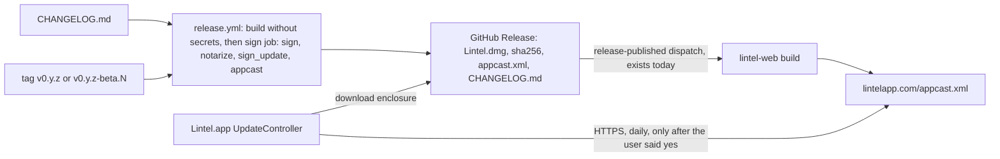

# In-app updates that keep macOS permissions, and repository hygiene for an open-source beta

> Status: **accepted by the owner on 2026-11-19** (decisions below; D6 and D16 differ from the first draft's defaults; later the same day the owner dropped the self-signed bridge, D3, and put a Homebrew tap in scope, D13). Design only: nothing here is implemented, every "will" is proposed behaviour. Base: `origin/main` at `aacfe5a` (2026-11-19). Research with sources: [`research/2026-11-19-signing-updates-research.md`](research/2026-11-19-signing-updates-research.md); items it could not confirm from a primary source are marked UNVERIFIED there and repeated under "Review limits".
>
> This spec **replaces** the unmerged local draft `2026-11-07-release-experience.md` (branch `feat/release-experience-spec`, never pushed) and reuses its decisions and its two unpushed implementation branches where they still fit (see "Earlier work").

## 📝 TLDR

**Who:** the owner (today the only person who installs Lintel) and, from the first public beta, every user and contributor.
**Today:** every install on the owner's Mac is an ad-hoc build made by an agent, so macOS forgets Microphone, Accessibility, Screen & System Audio Recording, Full Disk Access and the Keychain "Always Allow" each time. There is no release, no tag, no update check, no changelog, no branch protection and no contributor documentation; the repository is still called `Pounce`.
**Proposed:** (A) releases signed with one stable identity, an **Update** button in Lintel built on Sparkle 2 with a stable and a beta channel, and a rule that nothing but a release build is installed in `/Applications`; (B) SemVer `0.x` with `-beta.N` pre-releases, a `CHANGELOG.md`, a documented release process, community files, branch and tag rules, and the remaining "Pounce" names removed.
**Why now:** no release exists, so the signing identity, the feed address and the version scheme can still be chosen without costing any user a permission. After the first public release each of them is expensive to change.

## Resolved assumptions (autonomous defaults)

The owner answered on 2026-11-19: D1, D2 and D4 are confirmed, D6 and D16 were changed (see their rows), every other default is accepted. `⚠` marks a decision that costs money or cannot be undone after the first release. The last column records what the other answer would have meant.

| # | Decision | Default | Why this default | What changes if the owner says otherwise |
|---|---|---|---|---|
| D1 | **Apple Developer ID and notarization: yes or no?** | **Yes**, individual account (US$99 per year). ⚠ Confirmed by the owner, 2026-11-19. | The owner already answered "buy" on 2026-11-07 (Q1 of the unmerged draft); only the account type was open. It removes the Gatekeeper block, makes the designated requirement Team-ID based (survives certificate renewal), allows Sparkle key rotation and the official Homebrew cask. The Team ID is permanent: changing the account later costs every user their grants once. | **No:** Phase 3 is skipped. Releases stay on the self-signed "Lintel Release" certificate. Updates and grant continuity still work (Sparkle does not need Developer ID), but new users must use "Open Anyway", the certificate must never be regenerated, a lost Sparkle key cannot be rotated, and the official Homebrew cask stays closed. |
| D2 | Account type for D1 | Individual (ready in about a day; Gatekeeper shows the owner's name). ⚠ Confirmed by the owner, 2026-11-19. | An organization needs a D-U-N-S number (days to weeks). | Organization: Phase 3 waits for enrolment, and the owner stays on ad-hoc builds meanwhile. |
| D3 | Bridge: sign with a self-signed "Lintel Release" certificate until Developer ID is ready? | **No (owner, 2026-11-19, second answer).** The owner already has the Apple Developer Program, so the first signed build is a Developer ID build. The first answer ("yes") is withdrawn; Steps 0.1 and 0.2 are dropped. | One round of re-granting for the owner instead of two, one identity change under `BACKWARD_COMPATIBILITY.md` §4 instead of two, and `scripts/make-signing-cert.sh` can go. Cost: the owner keeps losing grants on ad-hoc builds for the days until the first notarized DMG. | Bridge first: the plan this spec had until 2026-11-19 (Phase 0 with a self-signed certificate, then a switch). |
| D4 | Feed address baked into every build | `https://lintelapp.com/appcast.xml` ⚠ (cannot change for installed copies). Confirmed by the owner, 2026-11-19. | The site is live (checked 2026-11-19: `302` to `/en/`). A GitHub Pages address breaks when the repository is renamed, and `releases/latest/download/…` skips pre-releases, so it cannot carry a beta channel. | GitHub Pages of this repository: rename the repository first (D7) and never again. |
| D5 | Version scheme | SemVer. Everything is `0.y.z` while the project is beta. Tags `v0.y.z-beta.N` are pre-releases on the **beta** channel; tags `v0.y.z` are releases on the **stable** channel. First tag: `v0.1.0-beta.1`. `1.0.0` is reserved for the first release the owner calls stable. | Matches the brief ("0.x / -beta.N"). `Resources/Info.plist` says `1.0.0` today, but no build with that number was ever released. | Plain `0.y.z` without suffixes: one channel only, the beta switch disappears from Settings. |
| D6 | Update checks | **Not on by default (owner, 2026-11-19).** Lintel shows Sparkle's standard permission question once, on the first launch after the welcome flow; the user decides. Until the user answers, and after a "no", Lintel makes no update request on its own ("Check Now" is the user's own action). "Install automatically" is off unless the user turns it on. | The user stays in control and the "no network access unless you ask for it" promise holds. Sparkle asks on the second launch by default; the research names `SUPromptUserOnFirstLaunch` for the first launch, which Step 4.1 confirms on the pinned version (if it does not exist there, the question comes on the second launch, still before any request). | On by default (the first draft's proposal, from the unmerged 2026-11-07 draft): rejected by the owner. |
| D7 | Rename the GitHub repository `mjozefiak/Pounce` → `mjozefiak/lintel` | **Yes**, before the first tag | Web and git URLs redirect after a rename; the GitHub Pages URL and any hard-coded Pages link do not. Before the first release nothing public depends on the old name. | Keep the name: every public link keeps saying "Pounce". |
| D8 | Rules on `main` and on `v*` tags | Ruleset on `main`: pull request required, the `Build, test and lint` check required, no force push, no deletion, squash merge only, **0 required approvals** (a single maintainer cannot approve their own pull request). Tag ruleset: only the owner creates `v*` tags. | Keeps the agent pipeline working (it merges through pull requests already) and stops an accidental push or tag. | 1 approval: needs a second account with write access, or every merge is blocked. |
| D9 | Changelog format | Keep a Changelog headings (`## [Unreleased]`, `## [0.1.0-beta.1] - 2026-MM-DD`, `### Added / Changed / Fixed / Removed / Security`), English | `om-auto-update-changelog` copies the format of an existing `CHANGELOG.md`, so the file sets the format once. One extractor feeds the GitHub Release and the update dialog. | The skill's emoji format: change the extractor's heading pattern, nothing else. |
| D10 | Repository settings | Enable private vulnerability reporting and Dependabot (`swift`, `github-actions`); turn the wiki off; squash merge only; delete branches on merge; delete the 17 remote branches already merged into `main`; set description, homepage and topics. | All reversible, all free on a public personal repository. | Each is independent; skip any. |
| D11 | Scope cut from the 2026-11-07 draft | **Deferred:** the branded DMG window (`dmgbuild`), the "What's new" window, the `lintelapp.com/changelog` page. **Kept:** Move to Applications (an app run from the DMG or from Downloads cannot be updated). | Sparkle's dialog already shows the release notes; the rest is polish and does not block updates. | Bring them back as a follow-up spec. |
| D12 | One spec or two (updates / hygiene)? | One spec, as the brief asks; the phases are independent and each ships alone. | Versioning, changelog and the release workflow are shared by both topics. | Split at the Phase 1 / Phase 2 boundary. |
| D13 | Homebrew | **In scope as the project's own tap (owner, 2026-11-19):** `mjozefiak/homebrew-lintel`, casks `lintel` and `lintel@beta`, updated by the release workflow (Phase 5). The official `homebrew/cask` is a later step with conditions the project does not meet yet. | An own tap needs nobody's approval and can carry betas. The official repository asks for public interest (at least 75 stars, or 225 when the owner submits it, or the fork and watcher equivalents) and a repository older than 30 days, and it requires apps to pass Gatekeeper, which D1 provides. | Out of scope (the first draft's default): withdrawn. |
| D14 | Public contact e-mail for conduct and security reports | None; GitHub's private report form and the maintainer's GitHub profile (pull request #105). | No personal address is published without the owner's choice. | Add an address such as `security@lintelapp.com` to `SECURITY.md` and `CODE_OF_CONDUCT.md`. |
| D15 | `LEGACY-POUNCE` migration code (old data folder, old Keychain services, old defaults domain) | Keep until `v0.2.0`, then remove in one pull request | Only the owner's Mac ever had Pounce data; the code is marked and inert for everyone else. | Remove now if the owner confirms the Mac was migrated. |
| D16 | A separate GitHub identity for agents | **Not now (owner, 2026-11-19); decide again before the first public beta** (it is on the gate's list). Until then agents keep using the owner's `gh`, and the risk is accepted and written down: rulesets, Environments and approvals bind an account, so they stop mistakes, not an agent that misbehaves. | The owner is the only user today, and no release exists that an agent could damage for anyone else. | When it is taken up, a separate account alone is not enough (review round 3): with 0 required approvals it could merge a change to `release.yml` or `scripts/` and then ask for a signed run. It needs a `CODEOWNERS` file over `.github/`, `scripts/`, `Resources/Info.plist`, the entitlements and the recorded requirement with "require review from code owners", every secret in an Environment (already the design here), and a check of which collaborator roles a personal repository offers. |
| D17 | What the site shows while only betas exist | **Before the gate** (see Phasing): no download; the site only has to keep building when every release is a pre-release. **From the gate on:** the newest beta, labelled "Beta", until a stable release exists; then the newest stable. "Newest" always means *most recently published, drafts excluded*. The feed is separate: `/appcast.xml` is always a byte-for-byte copy of the `appcast.xml` asset of the most recently published release that has one, pre-releases included, whatever the download button shows. Step 2.3 makes publication order equal build-number order, so this is also the release with the highest build number. | `BACKWARD_COMPATIBILITY.md` §6 says the site reads the "latest" release, which never is a pre-release. A beta offered before the updater and the final identity exist would strand its users. The site cannot see build numbers (neither the release API nor the dispatch carries them), so the rule is stated in terms it can see. | Stable only: no public download until the first stable release; the feed rule stays. |

## 📝 Problem Statement

Everything below was checked on 2026-11-19, not assumed.

**A. Updates and permissions**

- `/Applications/Lintel.app` on the owner's Mac is signed ad-hoc: `Signature=adhoc`, designated requirement `cdhash H"…"`. macOS records an app's designated requirement when a permission is granted and checks each new version against it (Apple TN3127), so a `cdhash` requirement fails on every rebuild. That is the whole cause of the lost grants.
- A release would not have this problem, but none can be made: `gh release list` and `git tag` are empty; the `SIGNING_P12` secrets date from 2026-10-31 and hold the old "Pounce Release" certificate; `Resources/designated-requirement.txt` holds a placeholder; `release.yml` fails a tag build on purpose in that state, and pull-request DMGs are ad-hoc.
- Nothing in `Sources/` checks for a new version. `CFBundleVersion` is the constant `1`, so two releases could not be ordered.
- `docs/signing.md` tells developers never to sign with the release identity locally, and no rule tells agents not to install an ad-hoc build over the owner's copy. A stale `/Applications/Pounce.app` is still installed.

**B. Repository**

- GitHub's community profile scores 42 %: no `CONTRIBUTING`, `SECURITY`, `CODE_OF_CONDUCT`, issue or pull-request templates (pull request #105 adds them).
- `main` has no branch protection and no ruleset; merge commits, rebase merges and squash merges are all allowed; 93 remote branches exist, 17 of them merged. Private vulnerability reporting and Dependabot are off. The only Environment is `github-pages`.
- The repository is named `Pounce` and its description still says "app search, file search and clipboard history" although seven plugins are registered. The README repeats that, says "A paw appears in the menu bar" (the mark is the cut ring), claims "no network access" (model downloads exist) and links `mjozefiak.github.io/Pounce`.
- Unmarked "Pounce" names in live files: `README.md` (3 lines), `Sources/LintelApp/About/AboutWindowController.swift` (2 URLs), `docs/index.html` (10, removed by pull request #61), `release.yml` release-notes text ("paw"), one comment in `Packages/GRDBCipher/Package.swift`. The 17 files with `LEGACY-POUNCE` markers and the history under `.ai/specs` and `.ai/runs` are intentional.
- No `CHANGELOG.md`; `release.yml` would publish `--generate-notes` (pull-request titles). The tag check accepts only a tag equal to `CFBundleShortVersionString`, so a pre-release tag cannot be built.
- `ci.yml` and `release.yml` use actions by moving tag (`actions/checkout@v7`, `maxim-lobanov/setup-xcode@v1`); only `pages.yml` pins commits. `release.yml` runs with the signing key on pull requests from branches of this repository.
- `LICENSE` (MIT, 2026) and `Resources/THIRD_PARTY_NOTICES.txt` exist and cover the five dependencies in `Package.swift`; nothing checks that they stay in step.

## 📝 Research

Full text and URLs are in the research file. What decides the design:

| Question | Finding | Consequence |
|---|---|---|
| What keeps TCC and Keychain grants across an update? | The designated requirement must stay satisfied (TN3127, TN2206). Ad-hoc: a `cdhash`, lost on every build. Self-signed: identifier plus the hash of that one certificate, kept as long as the same certificate signs. Developer ID: identifier plus `anchor apple generic` plus Team ID, kept across certificate renewal. | Any stable identity fixes the owner's problem. Developer ID is the only one that survives a lost or expired certificate. |
| Can grants be moved to a new identity or bundle identifier? | No supported way (Apple DTS). Keychain items are not deleted; the new app gets a Deny / Allow / Always Allow prompt per item. | Every identity change costs one round of re-granting. Do each change once, before public users exist. The rename already changed the bundle identifier to `com.lintelapp.Lintel`; it must never change again. |
| Does Sparkle need Developer ID? | No. Sparkle accepts an update when its EdDSA signature verifies or when the new bundle satisfies the old bundle's designated requirement (read from Sparkle's source; documented only as "Developer ID recommended"). | Sparkle works on the self-signed bridge and carries users across the switch to Developer ID, as long as the EdDSA key does not change. Key rotation after a loss is documented only for Developer ID apps. |
| Sparkle 2 state | 2.10.1 (2026-10-25), MIT, macOS 12+, SwiftPM binary target. Channels through `sparkle:channel` and `allowedChannels(for:)`; gentle reminders for menu-bar apps (2.2+); signed feeds `SURequireSignedFeed` (2.9+); `SUVerifyUpdateBeforeExtraction` (2.7.3+); Markdown release notes (2.9+); DMG enclosures; Polish strings present. A hardened-runtime app without a Team ID must disable library validation to load `Sparkle.framework`. An app on a read-only volume or under App Translocation is silently not updated. | One pinned dependency covers the update flow. The existing `disable-library-validation` entitlement already covers the bridge. Move to Applications is required. |
| Own updater instead of Sparkle? | Possible (Stats does it), but it means writing download, signature verification, atomic replacement, relaunch and rollback for an app that holds Keychain keys and microphone access. | Rejected: more security-critical code than the feature is worth. |
| Self-signed versus Developer ID for new users | macOS 15 and later removed the Control-click override: an un-notarized app needs System Settings → Privacy & Security → Open Anyway. A self-signed app cannot be notarized. | The Gatekeeper block is the first thing every new user meets without D1. |
| GitHub on a free public personal repository | Rulesets for branches and tags, Environments with required reviewers and tag rules, private vulnerability reporting and Dependabot are all available. After a rename, web and git URLs redirect; GitHub Pages URLs do not. | D7, D8 and D10 cost nothing. |
| Versions | SemVer orders `0.1.0-beta.1 < 0.1.0-beta.2 < 0.1.0`. `CFBundleVersion` allows only integers and periods, and Sparkle compares only `sparkle:version` (= `CFBundleVersion`). | A pre-release needs a separate, always increasing build number. |

## 📝 Proposed Solution

1. **One signing identity, Developer ID, from the first signed build; only release builds in `/Applications`.** There is no self-signed bridge (D3): Phase 3 signs and notarizes with Developer ID (D1), and that is the only identity change, made before any release exists. Agents and scripts never install into `/Applications`; QA builds keep their own bundle identifier (`com.lintelapp.Lintel.QA`), so they never touch the release app's grants. The bundle identifier `com.lintelapp.Lintel` stays: the research prefers a new identifier for a clean start, but that would also drop the settings domain and Launch at Login, and the only affected install is the owner's Mac, where `tccutil reset All com.lintelapp.Lintel` before the first grant clears the stale rows.
2. **Version comes from the tag.** `vX.Y.Z` or `vX.Y.Z-beta.N` is the only source: the workflow stamps `CFBundleShortVersionString` (the tag without `v`) and `CFBundleVersion` (the number of commits reachable from the tagged commit, a plain integer) into the copied `Info.plist` before signing. **Release tags are allowed only on commits of `main`**, where that count always grows; there are no hotfix branches, a fix goes to `main` and gets the next tag.
3. **`CHANGELOG.md` is the only source of release notes.** A section for the tag's version must exist, or the tag build fails. The same text is the GitHub Release body and the update dialog's notes.
4. **Sparkle 2 behind a port in `LintelApp`.** EdDSA-signed DMG, signed feed, gentle reminders, relaunch postponed while Lintel records or processes. Settings → General: "Check for updates automatically", "Include beta versions", "Check Now", the current version.
5. **A release process a stranger can follow**: `docs/releasing.md`, the Environment `release` holding every signing secret, rules on `main` and on tags, community files, a current README.

Alternatives that lost: an own updater (above); a `.pkg` installer (not drag-and-drop, needs a second certificate); staying ad-hoc and re-granting with a script (`tccutil` can only reset, never grant); a local "Lintel Dev" certificate for agent builds (a second identity under the same bundle identifier makes the TCC rows flip between two requirements; the QA bundle identifier already solves agent builds).

## 📝 Architecture



Takeaway: `release.yml` is the only producer. The site copies one signed file; the app trusts nothing but the EdDSA signatures, so neither the site nor GitHub can serve a forged update.

- **Existing:** `release.yml` (jobs `build`, `publish`, the `release-published` dispatch to `lintel-web`), `scripts/make-app.sh`, `scripts/make-dmg.sh`, `StatusItemController`, the General settings pane, the welcome flow, `SettingsKeys`, `QAOptions`.
- **New in this repository:** `Sources/LintelApp/Updates/` (`UpdateChecking` port, `UpdateController`, `UpdaterStartPolicy`, `UpdateChannel`), `Sources/LintelApp/Install/` (Move to Applications), `scripts/stamp-version.sh`, `scripts/version-from-tag.sh`, `scripts/changelog-section.sh`, `scripts/make-appcast.sh`, `scripts/verify-release-bundle.sh`, `CHANGELOG.md`, `docs/releasing.md`, `.github/dependabot.yml`, ADR 0010 "Distribution and updates".
- **Planned elsewhere (`lintel-web`, before the first tag, Step 2.4):** keep building when every release is a pre-release; serve `/appcast.xml` as a copy of the `appcast.xml` asset of the most recently published release that has one, pre-releases included (D17); point `GITHUB_REPO` at the renamed repository. At the gate: the "Beta" download. After Phase 3: drop the Gatekeeper note.
- **Dependency rule:** Sparkle (pinned exactly, MIT) is imported by `LintelApp` only. Plugins never see it. No `LintelKit` change is planned; Step 4.6 adds the additive `busyReason` requirement only if existing state cannot answer "is Lintel busy".

**The feed.** One `appcast.xml`, rebuilt on every release, holding at most two items: the newest stable release and, when its `sparkle:version` is higher, the newest beta (with `<sparkle:channel>beta</sparkle:channel>`). `make-appcast.sh` writes the item of the release being built and takes the other channel's item from the previous release's `appcast.xml` asset ("previous" = the most recently published non-draft release before this one), which the `sign` job downloads as data, accepts only when its feed signature verifies against the public key in `Info.plist`, and strips of its signature before merging. A previous release without that asset counts as "no previous feed". A previous feed that is present but does not verify **fails the job**: dropping it silently would remove the other channel's item from the new feed. The tool that verifies a feed signature is named in Step 4.1. The carried item's enclosure signature stays valid because that DMG did not change. The merged file is signed (`SURequireSignedFeed`), uploaded as a release asset and copied by the site. Tag runs go one at a time and none is cancelled: one concurrency group for all tags, with queueing switched on, because a plain concurrency group keeps only one waiting run and cancels the older ones (Step 2.3 checks this with two tags pushed together). Two close tags therefore never read the same previous feed. Enclosures point at `…/releases/download/<tag>/Lintel.dmg`: the tag makes the address unique, so one DMG name is enough.

**Channels.** One explicit setting, `app.updates.includeBeta`. `UpdateChannel.allowed(includeBeta:)` is a pure function: `["beta"]` when the setting is true, otherwise the empty set (Sparkle always includes the default channel). The first launch of a pre-release build with the key absent stores `true`, so a tester stays on the beta channel after a stable release arrives and leaves it only by turning the switch off. A release build with the key absent means `false`.

## 📝 Data Model

No database. Additions to the protected lists in `BACKWARD_COMPATIBILITY.md`, each in the pull request that introduces it:

- **Settings (§3):** `app.updates.includeBeta` (Bool; written once as `true` by the first pre-release build that finds it absent; absent on a stable build means `false`), `app.install.moveDeclined` (Bool, default false). Sparkle's own keys in the app's defaults domain: `SUEnableAutomaticChecks`, `SUAutomaticallyUpdate`, `SULastCheckTime`, `SUSkippedVersion`; only an `UpdateSettings` wrapper touches them.
- **`Info.plist`:** `SUFeedURL`, `SUPublicEDKey`, `SUScheduledCheckInterval` (86400), `SURequireSignedFeed`, `SUVerifyUpdateBeforeExtraction`, and the first-launch form of the permission question (D6). `SUEnableAutomaticChecks` is **absent** in a release build, because its absence is what makes Sparkle ask; `SUEnableSystemProfiling` stays absent. `CFBundleVersion` becomes the stamped build number.
- **Signing (§4):** the designated requirement recorded in `Resources/designated-requirement.txt`; the EdDSA public key; the feed address. The owner's Team ID is `39G44CM6GF` (public; given by the owner on 2026-11-19). The requirement a Developer ID build must have is therefore `identifier "com.lintelapp.Lintel" and anchor apple generic and certificate 1[field.1.2.840.113635.100.6.2.6] /* exists */ and certificate leaf[field.1.2.840.113635.100.6.1.13] /* exists */ and certificate leaf[subject.OU] = "39G44CM6GF"`; Step 3.3 checks the Team ID and the absence of a `cdhash`, and Step 3.4 records the exact text `codesign -dr -` prints for the first signed build, in `Resources/designated-requirement.txt` and `docs/signing.md`.
- **Secrets** (never committed, never printed; only the owner creates them): today `SIGNING_P12`, `SIGNING_P12_PASSWORD` as repository secrets. Target: Environment `release` holding `DEVELOPER_ID_P12`, `DEVELOPER_ID_P12_PASSWORD`, `NOTARY_KEY_P8`, `NOTARY_KEY_ID`, `NOTARY_ISSUER_ID` (D1 = yes) or the two `SIGNING_*` secrets (D1 = no), plus `SPARKLE_ED_PRIVATE_KEY`. A second Environment, `publish` (`v*` tags only), holds `HOMEBREW_TAP_TOKEN` (Phase 5; a fine-grained token that can write only to the tap repository) and `LINTEL_WEB_DISPATCH_TOKEN`, the token that asks `lintel-web` to rebuild; it does not exist today (checked 2026-11-19: the only secrets are the two `SIGNING_*`), so no release would rebuild the site until the owner creates it (Step 2.4). No secret stays at repository level, where a workflow run from any branch of this repository could read it. The Environment `release` deploys only from `v*` tags and from a manual run on `main`, with the owner as required reviewer. Only the `sign` job (Step 2.3) uses the Environment; it compiles nothing and runs no tests. Pull-request builds get no Environment and always sign ad-hoc. After export, the owner deletes the release identity and the Sparkle private key from the login keychain of the Mac that agents work on and keeps them in a password manager. **Limit of this protection:** see D16; while agents act as the owner's account, an agent could create a tag or approve a deployment.

## 📝 API Contracts

Names other systems depend on; protected from the first release:

- **Tags:** `^v(0|[1-9]\d*)\.(0|[1-9]\d*)\.(0|[1-9]\d*)(-beta\.[1-9]\d*)?$`. Anything else fails the build before signing. A `-beta` tag creates a GitHub pre-release.
- **Release assets** (`BACKWARD_COMPATIBILITY.md` §6, unchanged in shape): exactly one `.dmg` (`Lintel.dmg`, also the update enclosure) and exactly one `.dmg.sha256`; new, additive: `appcast.xml` and `CHANGELOG.md`. `make-dmg.sh` stops writing the versioned copy `Lintel-<version>.dmg`. §6 is amended in Step 2.4, together with the site, for one thing only: which release the site reads for the download and for the feed (D17). The tag stays `v` + `CFBundleShortVersionString`.
- **Feed:** `https://lintelapp.com/appcast.xml` (D4). Item fields: `sparkle:version` = build number, `sparkle:shortVersionString` = tag without `v`, `sparkle:minimumSystemVersion` = `26.0`, `sparkle:channel` only on betas, release notes = the changelog section as Markdown, `sparkle:edSignature` and `length` from `sign_update`.
- **`CHANGELOG.md` headings** as in D9. `scripts/changelog-section.sh <version>` prints one section and fails when it is missing, duplicated or empty.

## 📝 UI/UX

- **Settings → General, "Updates" group:** the current version and build; "Check for updates automatically" (shows the user's answer to the permission question; off until they answer); "Include beta versions" (a plain switch; on after a beta build was installed, with the note "You are running a beta version" while that is true; turning it off means the next update offered is the next stable release); "Download and install updates automatically" (off); "Check Now".
- **Menu bar menu:** "Check for Updates…". After a background check finds one: a badge on the status item and "Update available: Version X…", which opens Sparkle's dialog with the release notes and the **Install Update** button. A background check never opens a window or takes focus.
- **While recording or processing** (meeting, dictation, notes revision): "Install and Relaunch" is postponed and the dialog says why.
- **Move to Applications:** one alert when Lintel starts outside `/Applications` and `~/Applications` (a mounted DMG, Downloads, App Translocation): Move, Don't Move, "Don't ask again". The alert names the folder it will use: `~/Applications` when that folder exists and holds an app, otherwise `/Applications`; when the folder (or the installed copy in it) is not writable it offers the Applications folder in the home folder instead. Lintel never asks for an administrator (owner decision: a copy installed as root would make every later Sparkle update ask for an administrator password). Not in DEBUG or QA builds, except through the DEBUG argument `--qa-move-prompt` (with `--qa-move-scenario`), which shows the alert over a fake file manager for screenshots and moves nothing.
- **Permission question (D6):** Sparkle's standard dialog ("Check for updates automatically?" with its own translations), shown once, on the first launch after the welcome flow has finished, never over it. The updater is started only then, so nothing is requested earlier. The welcome screen itself gets no new text.
- Every string in English and Polish (`StringCatalogTests`); VoiceOver labels on every new control. Sparkle's own dialogs use Sparkle's translations.

No prototype is accepted yet. The implementation pull requests for Steps 4.3 to 4.5 attach screenshots in light and dark mode; the Settings group follows the existing pane conventions in `.uxproof/`.

## 📝 Edge Cases & Failure Scenarios

- **Feed unreachable, stale or malformed:** background checks stay silent; "Check Now" shows "Couldn't check for updates" with the reason. A feed or enclosure with a bad signature is never installed.
- **The site rebuild fails or is slow after a release:** the feed stays at the previous version (still validly signed). The `publish` job polls `https://lintelapp.com/appcast.xml` for up to ten minutes and ends with a visible warning when it still differs from the new asset. The release itself is valid.
- **A bad release:** fixed by publishing the next version from `main`. If a release must be deleted, the runbook has the owner re-run the site build by hand, so the feed never keeps pointing at a deleted DMG; until then an update attempt ends in Sparkle's download error and nothing is installed.
- **Lintel runs from the DMG or under App Translocation:** the Move alert; if declined, "Check Now" explains that Lintel must be in Applications to update.
- **Update during a recording:** relaunch is postponed; nothing is lost.
- **First Developer ID build on the owner's Mac (ad-hoc → Developer ID):** the only identity change, and only the owner's Mac goes through it, by installing a DMG by hand; no build with the updater ever sees it. macOS treats the new build as a new app. **Keychain plan (§4):** the stores `com.lintelapp.clipboard`, `com.lintelapp.dictation`, `com.lintelapp.meetings` and `com.lintelapp.notes` each show one Deny / Allow / Always Allow prompt; Always Allow restores access; Deny disables that one store for the session and deletes nothing (only `errSecItemNotFound` resets a store). The owner runs `tccutil reset All com.lintelapp.Lintel` first, grants the permissions again and checks that Launch at Login is still registered (re-toggle it in Settings if not). Any later change of the Team ID would reach real users: Sparkle would still install the update because the EdDSA key is unchanged, the release notes would have to name the permissions to grant again in their first line, and it is a breaking change under §4 that needs its own ADR.
- **EdDSA private key lost:** with Developer ID, Sparkle's documented key rotation applies. With the self-signed identity no rotation is documented: users would have to reinstall by hand. The key is kept in the Environment secret and in the owner's password manager.
- **(Does not apply after D1 = yes and D3 = no; kept for the record.) "Lintel Release" certificate regenerated or lost:** every user loses grants; Sparkle still updates (EdDSA). `scripts/make-signing-cert.sh` already refuses to overwrite an existing certificate.
- **Notarization rejected or Apple unavailable:** the tag build fails before `publish`; nothing is half-released; the notary log is an artifact.
- **Tag without a changelog section, or a malformed tag:** the build fails in its first step.
- **Two tags on one commit:** the second tag fails in `build` (the commit is not a strict descendant of the newest release), so two releases never share a build number. A re-release needs a new commit on `main` (normally the changelog fix that prompted it). Manual signed runs of one commit do share a number; they publish nothing.
- **A `v*` tag on a commit that is not on `main`:** the `build` job, which has no secrets, fails in its first step (`git merge-base --is-ancestor`), before the `sign` job is requested. This check lives in the tagged commit's own workflow file, so it stops mistakes; the tag ruleset and the owner's approval of the deployment are what stop anything else.
- **Move to Applications when a newer Lintel is already installed there:** the alert says so and offers to open the installed copy instead; it never replaces a higher build number with a lower one.
- **The user never answers, or answers "no":** no scheduled check ever runs; "Check Now" and the menu item still work, and the switch in Settings turns checks on later. Such a user learns about updates only by asking.
- **A tag older than the newest release:** the `build` job fails when the tagged commit is not a strict descendant of the commit of the most recently published release, so build numbers and publication order cannot disagree (Step 2.3).
- **Downgrade and leaving the beta channel:** Sparkle never installs a lower `sparkle:version`. A user who turns "Include beta versions" off keeps the running beta until a stable release with a higher build number exists.
- **A local ad-hoc build copied into `/Applications`:** grants are lost again and the updater does not start (`UpdaterStartPolicy`). `docs/qa.md` and `AGENTS.md` forbid it; Step 0.3.

## 📝 Risks & Impact Review

- **Hard to reverse after the first public release:** the Team ID or certificate in the designated requirement (D1, D2), the bundle identifier, the feed address (D4), the EdDSA public key, the asset names, the tag grammar. Each is written into `BACKWARD_COMPATIBILITY.md` when it lands.
- **Breaking change on purpose:** `BACKWARD_COMPATIBILITY.md` §4 lists "re-issuing or replacing the signing certificate" as breaking and asks for an ADR, release notes and a Keychain plan. Phase 3 replaces the identity once (the never-used self-signed "Lintel Release" plan in §4 and `docs/signing.md` gives way to Developer ID). It is allowed only because no release exists; ADR 0010 and a dated paragraph in §4 record that, and name the one affected install (the owner's Mac). From the first public beta the unchanged-requirement check is binding.
- **Supply chain:** Sparkle downloads and installs code inside an app that holds Keychain keys and microphone access. Mitigation: exact pin, EdDSA on enclosure and feed, verification before extraction, the private key only in the Environment `release`, actions pinned by commit, and a `sign` job that runs only Apple's tools, the repository's own scripts and a `sign_update` it downloads itself and checks against a committed SHA-256. Today's workflow does not have that property: it imports the key and then runs `swift test` and the whole build with the keychain unlocked for an hour.
- **Release secrets:** today a pull request from a branch of this repository runs `release.yml` with `SIGNING_P12` available. Step 2.3 moves signing into a job that only tags and owner-approved manual runs can reach. The remaining gaps are the shared account and self-merged changes to the release paths (D16, deferred by the owner until before the first public beta): rules and approvals bind an account, and agents act as the owner's account. Until D16 is settled the owner's own check before each approval is the control: the runbook (Step 2.5) has the owner read the diff of `.github/`, `scripts/` and `Resources/` since the previous release.
- **Privacy:** an update check tells the feed host (Cloudflare) the IP address, the app version and the macOS version. System profiling stays off. Nothing is sent before the user agrees (D6). The README and the site say "no network access" and "no update check"; both change, in the release that adds the question, to say that Lintel asks first.
- **Process risk:** with 0 required approvals the ruleset does not stop a bad merge by the pipeline; it stops direct pushes, force pushes and accidental tags. That is the accepted level for one maintainer.
- **Product direction calls (not rule violations):** asking instead of checking by default (D6, decided by the owner: fewer users on the newest version, in exchange for no request without consent); beta builds following the beta channel; dropping the DMG window and "What's new" from the earlier draft (D11).
- **Cost:** US$99 per year (D1); two notarization round trips per release build.

## 📝 Earlier work

Two local branches from 2026-11-07 with three commits, never pushed, based on a `main` that is 12 days old: `feat/release-version-changelog` (one commit for version stamping and Team-ID entitlement selection, one for `CHANGELOG.md` with its extractor and script tests) and `feat/move-to-applications` (the Move prompt with tests). Steps 2.1, 2.2, 3.1 and 4.2 start from those commits (cherry-pick, then adapt: pre-release tags, the build number, one DMG name, the current `main`). They are a starting point, not reviewed code.

## 📋 Phasing

| Phase | Ships | Needs |
|---|---|---|
| **0. Install rule** | Agents stop overwriting the owner's installed copy; the self-signed bridge is dropped (D3) | nothing |
| **1. Repository hygiene** | Community files, README, rename, rules, settings | D7, D8, D10 for the settings steps |
| **2. Versions, changelog, release process** | `v0.1.0-beta.1` can be tagged and produces a signed pre-release with real notes; the site keeps working and is ready to serve the feed once Step 4.7 produces one | Phase 3 (a signed build exists); the `lintel-web` change of Step 2.4 before the first tag |
| **3. Developer ID and notarization** | The first signed, notarized DMG: the owner stops losing grants; no Gatekeeper block; Team-ID requirement | D1, D2; owner checklist B. Brought forward: its workflow part ships right after the version stamping (pull request #9 below) |
| **5. Homebrew tap** | `brew install --cask mjozefiak/lintel/lintel@beta`, kept current by the release workflow | Phase 3; published from the gate on |
| **4. In-app updates** | The Update button, channels, Move to Applications | Phase 2. Technically independent of Phase 3 (Sparkle accepts an EdDSA-signed update on any identity); planned after Phase 3 when D1 = yes, so that no build with the updater ever goes through an identity switch |

**Gate for the first public beta** (the site's "Beta" download, D17, and any announcement): Phases 2 and 4 done, Phase 3 done or D1 answered "no", the feed served at the D4 address. A build released without the updater can never learn about a later one, and a build released before the identity is final costs its users one round of grants. D16 is decided again at the gate. Until the gate is met, tags are `-beta` pre-releases that only the owner installs; GitHub still shows them publicly, so each such release body starts with one line saying it is a test build without an updater and should not be installed.

## 📋 Implementation Plan

Validation gate for every step that touches Swift or the manifest: `swift build`, `swift test`, `swift format lint --strict -r Sources Tests`. Script steps add tests under `scripts/tests/` run in CI. "Owner" steps touch secrets, certificates or accounts; agents never do them.

### Phase 0: install rule

- **0.1 and 0.2 (the self-signed bridge): dropped by the owner on 2026-11-19 (D3).** Recording the requirement moves to Step 3.4.
- **0.3 Install rule.** `AGENTS.md` and `docs/qa.md`: agents and scripts never copy a build into `/Applications`; the owner installs the DMG of a release (or, until Phase 2, of the manual run: `gh run download`). `AGENTS.md` also says, because agents act as the owner's account (D16): agents never push a `v*` tag, never approve a deployment, and never run `gh secret` or the Environments and pending-deployments API. The owner deletes `/Applications/Pounce.app` and the old "Pounce Release" certificate. Check: the rule is in both files and no script in `scripts/` writes to `/Applications`. Whether grants survive is checked later, with the first signed builds (Step 3.4 and owner checklist A6).

### Phase 1: repository hygiene

- **1.1 Community files.** `CONTRIBUTING.md`, `SECURITY.md`, `CODE_OF_CONDUCT.md` (Contributor Covenant 2.1), `SUPPORT.md`, issue forms, pull-request template. Open as pull request #105. Check: GitHub's community profile lists them.
- **1.2 README and live "Pounce" names.** README: the seven features, the cut-ring mark, the true network statement (model downloads, later the update check), `lintelapp.com`, build steps. `AboutWindowController` URLs, the `release.yml` notes text, the `GRDBCipher` comment. Check: a test asserts `git grep -i pounce` over `README.md`, `Sources`, `scripts`, `.github` and `Resources` finds only lines carrying `LEGACY-POUNCE`.
- **1.3 Rename and settings (owner or an agent with the owner's `gh`, after D7, D8, D10).** Rename the repository; update `origin` URLs, every `mjozefiak/Pounce` link, and (hand-off) the site's `GITHUB_REPO`, which `BACKWARD_COMPATIBILITY.md` §6 names; rulesets for `main` and `v*`; private vulnerability reporting; squash only; delete on merge; prune merged branches; description, homepage `https://lintelapp.com`, topics. Check: `gh api repos/mjozefiak/lintel/rulesets` lists both; a direct push to `main` is refused; a pull request still merges through the pipeline.
- **1.4 Workflow hardening.** Pin every action in `ci.yml` and `release.yml` by commit; add `.github/dependabot.yml` (`github-actions`, `swift`). Check: `grep 'uses:'` shows only 40-character commits; Dependabot opens its first pull request.
- **1.5 Notices stay in step.** A test reads `Package.swift` and `Resources/THIRD_PARTY_NOTICES.txt` and fails when a dependency has no notice. Check: removing a notice in a fixture fails the test.

### Phase 2: versions, changelog, release process

- **2.1 Version from the tag.** `scripts/version-from-tag.sh` (the grammar above), `scripts/stamp-version.sh` (both keys into the copied `Info.plist` before any `codesign`, then read back); `release.yml` checks out full history and passes `APP_VERSION` and `APP_BUILD` (`git rev-list --count HEAD`); the "tag equals `Info.plist`" check goes away; `Resources/Info.plist` holds `0.0.0` / `0` for local builds. Check: script tests for valid and invalid tags (`v0.1.0`, `v0.1.0-beta.1`, `v0.1`, `v0.1.0-rc.1`, `v01.0.0`), for the stamp, and that the signature verifies after stamping.
- **2.2 `CHANGELOG.md`.** The file with `## [Unreleased]` and entries for what users can see today; `scripts/changelog-section.sh`; a tag run fails without a section for its version, uses it as the release body (replacing `--generate-notes`), marks `-beta` tags as pre-releases and uploads `CHANGELOG.md`. `CONTRIBUTING.md` and the pull-request template ask for an Unreleased line for user-visible changes; `om-auto-update-changelog` is run before a tag and follows the file's format. Check: script tests with fixtures (missing, duplicate, empty); a Swift test of the real file's headings.
- **2.3 Protected release job.** Split `release.yml` into three jobs. `build` (every trigger, no secrets): checks that a tagged commit is on `main`, runs the tests, builds the app with an ad-hoc signature and uploads the bundle as an artifact. `sign` (`environment: release`; tags and manual runs with `sign: true` on `main` only): checks out the repository, selects Xcode with `xcode-select` (no third-party action), takes **only the `.app`** from the artifact, re-signs it with the release identity through the repository's own scripts (`make-app.sh` gains a sign-only mode), builds the DMG with `hdiutil`, verifies the requirement, deletes the keychain. Tools that later run next to a key (`sign_update` in Step 4.7) are downloaded by the `sign` job itself from Sparkle's release and checked against a SHA-256 committed in this repository; nothing executable comes from `build`. The existing "Second build keeps the same designated requirement" step, which recompiles, is removed: the comparison with `Resources/designated-requirement.txt` already proves the requirement is stable from one release to the next. For a tag, `build` also fails unless the tagged commit is a strict descendant of the commit of the most recently published release. `publish` runs for tags only (`environment: publish`), and all tag runs share one concurrency group with queueing that covers the whole run, `build` included, so none is cancelled and a second tag's ancestry check runs only after the first tag is published. `BACKWARD_COMPATIBILITY.md` §4 and `docs/signing.md` are updated in the same pull request where they say "repository secrets" and describe the old job. The owner has already created the Environment `release` with the Developer ID secrets (owner checklist B); nothing is moved. Until Step 3.4 records the requirement, `Resources/designated-requirement.txt` keeps its placeholder: a tag run fails on it, a manual signed run only warns and uploads the requirement it printed as an artifact, which is what Step 3.4 commits. Today's check that the requirement contains `certificate leaf = H"…"` (true only for a self-signed certificate) is replaced by `scripts/verify-release-bundle.sh` (Step 3.3). Check: a pull-request run from a branch of this repository cannot read the secrets; the `sign` job's log shows no compiler, test or third-party action step; a manual signed run produces a DMG whose requirement names the Team ID and has no `cdhash` (and equals the recorded one once Step 3.4 has landed) and publishes nothing; a tag on a commit outside `main`, or behind the newest release, fails in `build`; two tags pushed together both finish, in order.
- **2.4 Site contract (before the first tag).** A `lintel-web` change: the site builds when every release is a pre-release (no download yet), serves `/appcast.xml` by the D17 rule when the asset exists, and uses the renamed repository; the "Beta" download is a second, small site change made at the gate. Owner: create the fine-grained token for `lintel-web` (Contents: read and write, that repository only) and store it as `LINTEL_WEB_DISPATCH_TOKEN` in the Environment `publish`. In the same change `BACKWARD_COMPATIBILITY.md` §6 is amended (which release the download reads; which release the feed reads, both as "most recently published, drafts excluded", D17; `appcast.xml` and `CHANGELOG.md` listed as additive assets). `make-dmg.sh` stops writing `Lintel-<version>.dmg`. Check: a script test that a release build's `dist` holds exactly one `.dmg` and one `.dmg.sha256`; after `v0.1.0-beta.1` the site is rebuilt by the dispatch, still builds and shows no download.
- **2.5 `docs/releasing.md`.** The runbook: preconditions (green `main`, changelog section), tagging, what the workflow does, what the owner checks before approving the `release` deployment (the tag's commit is on `main`, the version is the intended one, and the diff of `.github/`, `scripts/` and `Resources/` since the previous release holds nothing unexpected), the owner's install-and-verify checklist (grants survive), how to handle a bad release (publish the next version; if a release must be deleted, re-run the site build; never reuse a tag), beta-to-stable promotion (a new commit on `main`, normally the changelog section for the stable version, then the stable tag: the same commit cannot carry two releases). `SDLC.md` and `AGENTS.md` point to it. Check: the owner follows it to tag `v0.1.0-beta.1`; the pre-release appears with the changelog text; installing its DMG over the previous signed build keeps every grant.

### Phase 3: Developer ID and notarization (D1 = yes)

- **3.1 ADR 0010 and entitlements by Team ID.** The ADR records the identity, notarization, Sparkle and the feed. `make-app.sh` uses `--timestamp` and drops `disable-library-validation` when the identity has a Team ID, and keeps today's behaviour otherwise (`scripts/select-entitlements.sh`). Check: script tests with fixture `codesign -dv` output; an ad-hoc build still launches and loads its frameworks.
- **3.2 Owner: create the Developer ID Application certificate and an App Store Connect API key and store the five secrets in the Environment `release`** (owner checklist B; enrolment is already done). The old `SIGNING_*` repository secrets are deleted after pull request #9 is merged.
- **3.3 Notarize and staple.** In the `sign` job: sign, `notarytool submit --wait`, staple the app, build and sign the DMG from the stapled app, notarize and staple the DMG, then compute the checksum. `scripts/verify-release-bundle.sh` checks `spctl` ("Notarized Developer ID"), `stapler validate` and a Team-ID requirement without `cdhash`. Check: script test against an ad-hoc fixture (must fail); a manual signed run passes; a copy of its DMG that carries the quarantine attribute (downloaded with a browser, not with `gh`, which sets none) opens with macOS's ordinary first-open confirmation and never with a block or "Open Anyway".
- **3.4 Switch.** Record the new requirement; rewrite `docs/signing.md`; remove `scripts/make-signing-cert.sh`; the dated exemption in `BACKWARD_COMPATIBILITY.md` §4; remove the Gatekeeper text from the release notes, the README and (hand-off) `lintel-web`. The release that carries the switch names the permissions to grant again in its first changelog line. Check: the owner installs the first Developer ID build over the ad-hoc one (owner checklist A), grants once, and the following build keeps every grant.

### Phase 4: in-app updates

- **4.1 Sparkle embedded.** Package pinned to 2.10.1 in `LintelApp` only; `make-app.sh` copies `Sparkle.framework` and signs its nested code inside-out before the app; `THIRD_PARTY_NOTICES.txt`, the approved-packages row in `AGENTS.md`. No real key yet: `SUPublicEDKey` stays absent, which keeps the updater off (4.3), and the owner's key arrives with Step 4.5. Before any later step depends on them, the pull request records for the pinned version, from a scratch build with a throw-away key that is never committed or released: the signing order that passes `codesign --verify --strict --deep` (and notarization, when Phase 3 has landed); that an update signed only with EdDSA installs over a build with a different signing identity (the claim D1 = no and the bridge rest on); whether the XPC services are needed by a non-sandboxed app; a signed feed verifying with `SURequireSignedFeed`, and the command that verifies a feed signature outside the app (Step 4.7 needs it); the key or API that puts the permission question on the first launch (D6), and that no request leaves the app before the answer; Markdown release notes rendering; Polish strings present. Check: the signed app verifies and launches; the notes are in the pull request.
- **4.2 Move to Applications.** As built: `ApplicationLocation` (pure decision from a bundle URL), `InstallDestination.decide` (pure over the file manager port: `.direct(folder)`, `.fallbackToUserApplications`, with `.needsAuthorization` reserved and never produced), the alert, `app.install.moveDeclined`, the DEBUG arguments `--qa-move-prompt` and `--qa-move-scenario`. The move refuses while any other Lintel (by bundle identifier, from any location) is running; when an installed copy in either Applications folder has a higher `CFBundleVersion` it offers to open that copy instead and replaces nothing; an equal or lower build is replaced: the new copy is made with `ditto` under a staging name and loses the quarantine attribute, then the old copy goes to the Trash, the new one is renamed into place, opened, and Lintel quits. Once the new copy is verified (same bundle identifier and build number) the original goes to the Trash too, unless it ran from a disk image, a read-only volume or App Translocation; a failed trash is only logged. A failed copy leaves the old copy in place; stale staging copies of a crashed attempt are swept. No administrator authorization: LetsMove uses the deprecated `AuthorizationExecuteWithPrivileges` and a root-owned copy would make every Sparkle update ask for a password. Check: table tests for the decision, the destination and the move with a fake file manager; a QA screenshot through `--qa-move-prompt`.
- **4.3 `UpdateController` behind `UpdateChecking`.** `UpdaterStartPolicy` (pure): the updater starts only in a non-DEBUG bundled app in an Applications folder whose signature is not ad-hoc. DEBUG and QA builds never start it and never write Sparkle's defaults: QA screenshots and tests run against a fake `UpdateChecking` port (QA options exist only in DEBUG builds, so a QA switch for the real updater is not possible). The real updater is exercised only in Step 4.8. `UpdateChannel.allowed`, and the one-time write of `app.updates.includeBeta` by a pre-release build. The updater sits behind a build-time switch that is off until 4.5: `SUEnableAutomaticChecks` is `false` in `Info.plist` and `UpdaterStartPolicy` also refuses to start without an `SUPublicEDKey`, so a build made before the owner's key exists never asks and never checks. Check: table tests of both pure types; unit tests against a fake port; a test of the `Info.plist` keys.
- **4.4 Gentle reminders.** Scheduled checks never present a window: badge and menu item only; Sparkle's dialog opens on the user's action. Check: fake driver events produce the badge and the title; screenshots in light and dark.
- **4.5 Settings, menu, the permission question.** The Updates group, "Check for Updates…", the switch flipped: the owner runs `generate_keys` (private key into `SPARKLE_ED_PRIVATE_KEY` in the Environment `release` and the password manager) and the public key goes into `Info.plist`; `SUEnableAutomaticChecks` removed from `Info.plist` so Sparkle asks, the first-launch form from 4.1, the updater started only after the welcome flow has finished; the README privacy text. Check: `StringCatalogTests`; the pane renders with the fake port; accessibility labels present; a unit test that `UpdateController` does not start the updater while the welcome flow is pending.
- **4.6 Postponed relaunch.** Read the existing recording and processing state of Meetings, Dictation and Notes; only if the shell cannot reach it, add `LintelPlugin.busyReason` (additive, default `nil`, listed in `BACKWARD_COMPATIBILITY.md` §1). Check: controller test with a fake busy source; per-plugin tests when the contract is added.
- **4.7 Appcast.** `scripts/make-appcast.sh` builds the one- or two-item feed from the release's version, build, channel, changelog section and `sign_update` output, merges the other channel's item from the previous release's `appcast.xml` (failing when that feed is present but does not verify), then signs the feed; built in the `sign` job with the checksum-verified `sign_update`, uploaded by `publish`, which then polls `https://lintelapp.com/appcast.xml` for up to ten minutes and warns when it still differs. The site already serves the asset (Step 2.4). Check: script test with a fixture DMG, a fixture previous feed and a throw-away key (first release ever; stable plus newer beta; beta older than stable is dropped; previous item kept byte for byte; previous feed with a bad signature fails); the XML validates.
- **4.8 End-to-end (manual, evidence in the pull request).** Two signed pre-releases, `-beta.N` and `-beta.N+1`. Install the first from its DMG on a clean settings domain: the permission question appears once, after the welcome flow, and no request reaches the feed host before it is answered (watched with `nettop` or a local proxy); answering "no" leaves checks off and "Check Now" working. Then answer "yes", grant everything, and: the badge appears without a window; the dialog shows the changelog; Install Update relaunches into the new version; **Microphone, Accessibility, Screen & System Audio Recording, Full Disk Access and every Keychain store works without a prompt** and `codesign -dr -` is unchanged; a recording in progress postpones the relaunch; with "Include beta versions" turned off the next beta is not offered; Launch at Login still works.

### Phase 5: Homebrew tap (D13)

Checked against Homebrew's documentation on 2026-11-19 (Cask Cookbook, Taps, Brew Livecheck, Package Acceptance Policy, FAQ).

**Design.** A public repository `mjozefiak/homebrew-lintel` (the `homebrew-` prefix lets users write `mjozefiak/lintel`) with two casks, following Homebrew's rule that an alternative channel uses the same token with an `@<channel>` suffix:

- `lintel@beta`: the newest release of either channel. It exists from the gate for the first public beta.
- `lintel`: the newest stable release. It appears with the first stable release.

```ruby
cask "lintel" do
  version "0.1.0"
  sha256 "<the release's .dmg.sha256>"

  url "https://github.com/mjozefiak/lintel/releases/download/v#{version}/Lintel.dmg",
      verified: "github.com/mjozefiak/lintel/"
  name "Lintel"
  desc "Launcher with file search, clipboard history, dictation and meeting notes"
  homepage "https://lintelapp.com/"

  livecheck do
    url "https://lintelapp.com/appcast.xml"
    strategy :sparkle do |items|
      items.reject(&:channel).map(&:short_version)   # lintel@beta keeps every item
    end
  end

  auto_updates true
  conflicts_with cask: "lintel@beta"
  depends_on arch: :arm64
  depends_on macos: :tahoe

  app "Lintel.app"

  zap trash: [
    "~/Library/Application Support/Lintel",
    "~/Library/Caches/Lintel",
    "~/Library/Caches/com.lintelapp.Lintel",
    "~/Library/HTTPStorages/com.lintelapp.Lintel",
    "~/Library/Preferences/com.lintelapp.Lintel.plist",
    "~/Library/Saved Application State/com.lintelapp.Lintel.savedState",
    "~/Library/WebKit/com.lintelapp.Lintel",
  ]
end
```

- `version` is the tag without `v`, the same string as `CFBundleShortVersionString`, with no comma part, so Homebrew can compare it with the installed bundle. `auto_updates true` is correct only once Sparkle is in the build: `brew upgrade` then skips a copy that updated itself and never downgrades it.
- Both casks install `Lintel.app`, so each declares `conflicts_with cask:` naming the other. Stanzas follow the Cask Cookbook's order (`depends_on` entries alphabetically), which `brew style` enforces.
- `zap` removes the data folder (models included), caches and settings. It cannot remove the Keychain items (`com.lintelapp.clipboard`, `.dictation`, `.meetings`, `.notes`); the tap's README says so. The path list is checked in Step 5.1 with `brew generate-zap` against a real install.
- The release workflow is the only writer. The `livecheck` block is there for `brew livecheck` and for a later move to the official repository, where Homebrew's own automation reads it.

**Steps.**

- **5.1 Cask template and renderer.** `packaging/homebrew/lintel.rb.tmpl` and `scripts/update-cask.sh <version> <sha256>` in this repository: renders `Casks/lintel@beta.rb` for every release and `Casks/lintel.rb` for a stable one, and changes nothing when the file is already current. Check: script tests (stable, beta, repeat run, malformed version or checksum refused); CI runs `brew style` and `brew audit --cask` on the rendered fixtures (the macOS runner has Homebrew).
- **5.2 Owner, then the workflow.** The owner creates the public repository `mjozefiak/homebrew-lintel` and a fine-grained token limited to it (Contents: read and write), stored as `HOMEBREW_TAP_TOKEN` in the Environment `publish`. The `publish` job, after the release exists, clones the tap with that token, runs the renderer with the version and the checksum from the release's `.dmg.sha256`, and pushes one commit. No third-party action. No token: the step is skipped, which is how the tap stays empty before the gate. A failed push is a warning; the release is valid and the step can be re-run. The tap gets a README (install command, what `zap` leaves behind) and its own small workflow that runs `brew audit --cask` on a push.
- **5.3 Documentation and proof.** Install section in the README and on the site (hand-off), `docs/releasing.md`. Check, on a Mac without Lintel: `brew install --cask mjozefiak/lintel/lintel@beta` installs the notarized app; Homebrew quarantines every cask download, so the first open shows macOS's ordinary "downloaded from the Internet" confirmation and never a block or "Open Anyway"; after an in-app update `brew upgrade` leaves it alone; `brew uninstall --zap` removes the listed paths (run against a throw-away user account, never the owner's data).
- **5.4 Later: the official `homebrew/cask`.** Not planned work. Conditions: the app passes Gatekeeper (D1); the repository is at least 30 days old and has at least 75 stars, 30 forks or 30 watchers, or three times that (225 / 90 / 90) when the owner submits it; a stable release exists; the cask passes `brew audit --new --cask`. After acceptance Homebrew's automation bumps the cask from the `livecheck` block, `lintel` leaves the own tap, and the tap keeps `lintel@beta` only if betas are still wanted there.

## 📋 Owner checklist

Only the owner can do these: they touch certificates, secrets, money and account settings. Menu names on Apple's and GitHub's sites are as of 2026-11 and may have moved.

**A. The first signed build (after pull request #9 below is merged and part B is done; about 15 minutes)**

1. GitHub → Actions → "Release" → Run workflow → branch `main`, with signing on. Approve the `release` deployment when asked, after the check the runbook describes. Wait for it to finish.
2. Tell an agent the run finished. The agent opens the pull request that records the designated requirement from the run's artifact (Step 3.4); merge it.
3. Download the DMG (`gh run download <run id> -n Lintel-dmg`), quit Lintel, drag the new Lintel into Applications. Check it in a terminal, because a file fetched with `gh` is not quarantined and would open even if notarization had failed: `spctl -a -vvv -t exec /Applications/Lintel.app` must say "Notarized Developer ID" and `xcrun stapler validate /Applications/Lintel.app` must pass.
4. Once: `tccutil reset All com.lintelapp.Lintel`, start Lintel, grant Microphone, Accessibility, Screen & System Audio Recording and Full Disk Access again, answer the Keychain prompts with "Always Allow".
5. Delete `/Applications/Pounce.app`. In Keychain Access → login → My Certificates, delete "Pounce Release" if it is still there. Do **not** run `scripts/make-signing-cert.sh`; the self-signed certificate is no longer part of the plan (D3).
6. From now on install only DMGs from that workflow or from a release. The grants must survive the next one; if they do not, stop and report it.

**B. Developer ID (now; the owner already has the Apple Developer Program, so steps 1 and 2 are done)**

1. Make sure the Apple Account has two-factor authentication and the legal name is correct: Gatekeeper shows that name to every user.
2. <https://developer.apple.com/programs/enroll/> → Start Your Enrollment → **Individual / Sole Proprietor** → pay US$99. Wait for the confirmation e-mail (usually within 48 hours).
3. Keychain Access → Certificate Assistant → Request a Certificate From a Certificate Authority → "Saved to disk". This creates the private key on this Mac.
4. <https://developer.apple.com/account/resources/certificates/add> → **Developer ID Application** → upload the request → download the `.cer` → double-click it.
5. Keychain Access → My Certificates → "Developer ID Application: <name> (<TEAM ID>)" → Export as `.p12` with a strong password. Write down the Team ID; it is permanent and becomes part of every user's permissions.
6. <https://appstoreconnect.apple.com/access/integrations/api> → request access if asked → Team Keys → generate a key with the **Developer** role → download the `.p8` (possible only once) and note the Key ID and the Issuer ID.
7. GitHub → Settings → Environments → New environment `release`: required reviewer = the owner; deployment branches and tags = `main` and `v*`. Then, in a terminal (values are read from files or typed, never pasted into a chat or a log):
   `base64 < DeveloperID.p12 | tr -d '\n' | gh secret set DEVELOPER_ID_P12 --env release`, and the same way `DEVELOPER_ID_P12_PASSWORD`, `NOTARY_KEY_P8` (`gh secret set NOTARY_KEY_P8 --env release < AuthKey_XXXX.p8`), `NOTARY_KEY_ID`, `NOTARY_ISSUER_ID`.
8. Store the `.p12`, its password and the `.p8` in the password manager; delete the files from disk. Delete the Developer ID identity from the login keychain of the Mac agents work on as soon as the secrets are stored. After pull request #9 is merged, delete the repository secrets `SIGNING_P12` and `SIGNING_P12_PASSWORD` (`gh secret delete`); they still hold the old "Pounce Release" certificate and nothing uses them any more.
9. Tell an agent "Developer ID secrets are in place" and give it the Team ID (it is public, not a secret). Then part A.

**C. Later, when an agent asks**

- Step 1.3: confirm the repository rename; the agent does it with `gh`.
- Step 2.4: create the Environment `publish` (deployment tags `v*`) and `LINTEL_WEB_DISPATCH_TOKEN` in it.
- Step 5.2 (at the gate for the first public beta): create the public repository `mjozefiak/homebrew-lintel` (empty, with a README) and a fine-grained token limited to that repository (Contents: read and write; set an expiry and a reminder), stored as `HOMEBREW_TAP_TOKEN` in the Environment `publish`.
- Step 4.5: run Sparkle's `generate_keys`, store the private key as `SPARKLE_ED_PRIVATE_KEY` in the Environment `release` and in the password manager, give the agent the public key.

## 📋 Implementation pull requests

One pull request per row, in this order within each group. At most one `risk-high` pull request is open at a time, in this order: #4, #9, #12, #6, #11, #13. Rows #1 to #5 need no certificate. Since the owner dropped the bridge (D3), the signing work (#9) comes straight after #4.

| # | Steps | Content | Risk | Waits for |
|---|---|---|---|---|
| 1 | 2.2 (file and script only) | `CHANGELOG.md`, `scripts/changelog-section.sh`, script and heading tests, contributor text. No `release.yml` change: the workflow part of 2.2 ships in #4 | low | nothing |
| 2 | 1.2 | README and the live "Pounce" names, with the grep test | low | nothing |
| 3 | 1.5, 1.4 | Notices test; actions pinned by commit; `dependabot.yml` | medium | nothing |
| 4 | 2.1, rest of 2.2 | Version and build number from the tag (`version-from-tag.sh`, `stamp-version.sh`, `Info.plist` `0.0.0`); `release.yml` takes the release body from the changelog and marks pre-releases | **high** (release workflow, `CFBundleVersion`) | #1 |
| 5 | 4.2 | Move to Applications | medium | nothing |
| 6 | 4.1, 4.3 | Sparkle embedded and `UpdateController` behind the switch that is off (no `SUPublicEDKey`); fake port; no user-visible change | **high** (new dependency, bundle signing) | #9 and #12 merged |
| 7 | 4.4, 4.6 | Gentle reminders and postponed relaunch, against the fake port | medium | #6 |
| 8 | 0.3 | The install rule in `AGENTS.md` and `docs/qa.md` | low | nothing |
| 9 | 2.3, 3.1, 3.3 | `build` / `sign` / `publish` jobs and Environments; entitlements by Team ID and `--timestamp`; notarization and stapling; ADR 0010; §4 text | **high** | #4 merged; owner checklist B; the Team ID |
| 10 | 1.3 | Rename, rulesets and repository settings | medium | owner's go-ahead; before the first tag |
| 11 | 2.4, 2.5 | Site contract and §6 amendment; `docs/releasing.md`; then the owner tags `v0.1.0-beta.1` | **high** (§6) | #9, #10, #12; the `lintel-web` change |
| 12 | 3.4 | Record the Developer ID requirement; rewrite `docs/signing.md`; remove `scripts/make-signing-cert.sh`; the dated paragraph in §4 | **high** (§4) | #9 and one manual signed run (owner checklist A1) |
| 13 | 4.5, 4.7 | Settings, menu, the owner's Sparkle key and the permission question switched on; the appcast | **high** | #12; the owner's Sparkle key |
| 14 | 4.8 | End-to-end evidence with two signed pre-releases | none (evidence) | #13 |
| 15 | 5.1, 5.2 | Homebrew: cask template, renderer with tests, the tap step in `publish` (skipped while no token exists) | medium | #11 |
| 16 | 5.3 | Homebrew: install documentation and the install / upgrade / zap proof | low | the gate (#13, #14); the tap repository and token (owner) |

## 🧪 Review limits

- Nothing was built or signed; no secret, certificate or repository setting was read beyond names and dates (`gh secret list`), and none was changed.
- From Sparkle's source, not its documentation: an update is accepted on a valid EdDSA signature alone, which is what lets the self-signed bridge and the identity switch work. Step 4.1 confirms it on the pinned version before anything depends on it. Also unconfirmed for the pinned version: the manual signing order of Sparkle's nested helpers in a SwiftPM-only build, the completeness of the Polish strings, the exact Markdown release-notes attribute.
- No Apple statement was found on self-signed certificates and TCC on macOS 15 or 26; the claim that grants persist with the same certificate rests on TN3127, TN2206 and Apple's `codesign` source. This no longer matters for the plan: there is no self-signed build (D3); owner checklist A6 is the test for Developer ID.
- Not confirmed from a primary source: the five-year validity of a Developer ID certificate and that renewal keeps the requirement (inferred from the Team-ID form); that `disable-library-validation` passes notarization (the design drops it for Developer ID anyway); that release-asset URLs redirect after a repository rename (the feed uses the new name from the start); whether an individual App Store Connect API key works with `notarytool`; the behaviour of Launch at Login across an identity change.
- Three review rounds and one delta review (of `34cf31b`) requested changes; the fixes for the delta review (pull-request order, where the Sparkle key arrives, the owner's export and Environment steps) were not reviewed again.
- The changes of 2026-11-19 after the merge (D3 dropped, the Homebrew phase) were reviewed once, as their own pull request; the fixes for that review were not reviewed again. The Research table and Step 4.1 still describe what Sparkle would do on a self-signed identity; that is background now, not the plan.
- Homebrew, not confirmed: that `depends_on macos: :tahoe` is the symbol for macOS 26 in the Homebrew version users run; the exact `zap` paths (Step 5.1 checks them); whether the official repository accepts an app whose only releases are betas; the notability numbers are as documented on 2026-11-19 and may change.
- Not confirmed: the name of the setting that moves Sparkle's permission question to the first launch (Step 4.1); the exact workflow syntax for a concurrency group that queues every run (Step 2.3); which roles a collaborator can have on a personal repository (D16); the current menu names in the owner checklist.
- `lintel-web` is a private repository and was not read; that its build can serve a release asset at `/appcast.xml` is an assumption based on the existing `release-published` dispatch.
