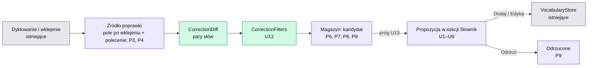
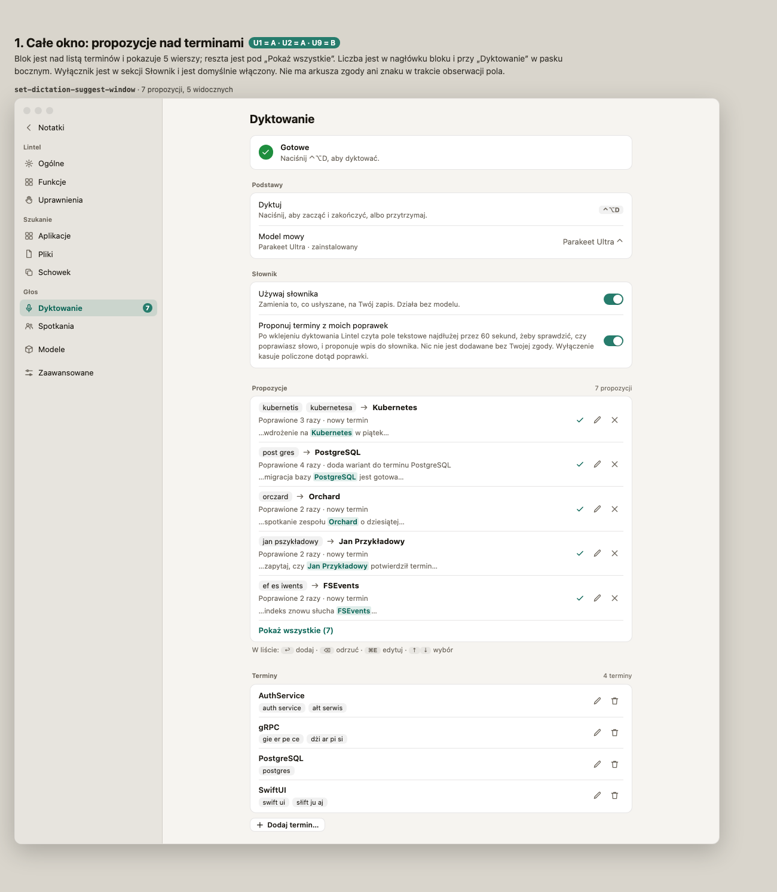
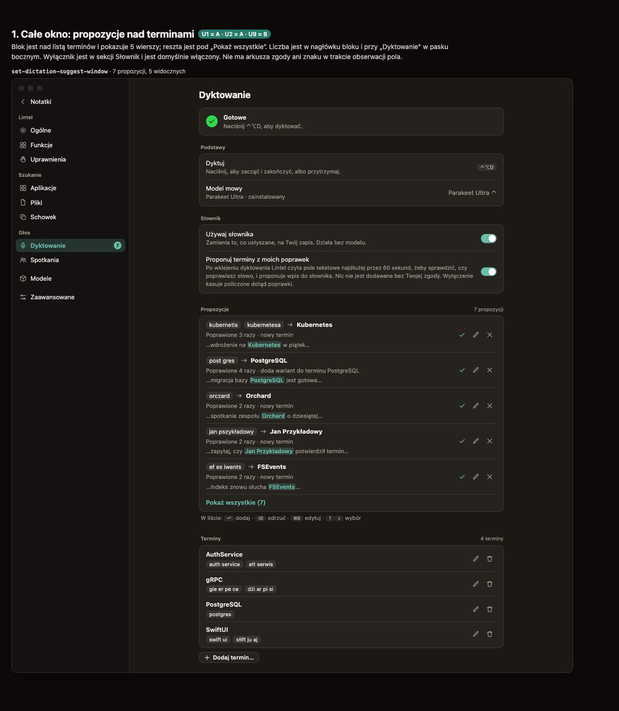
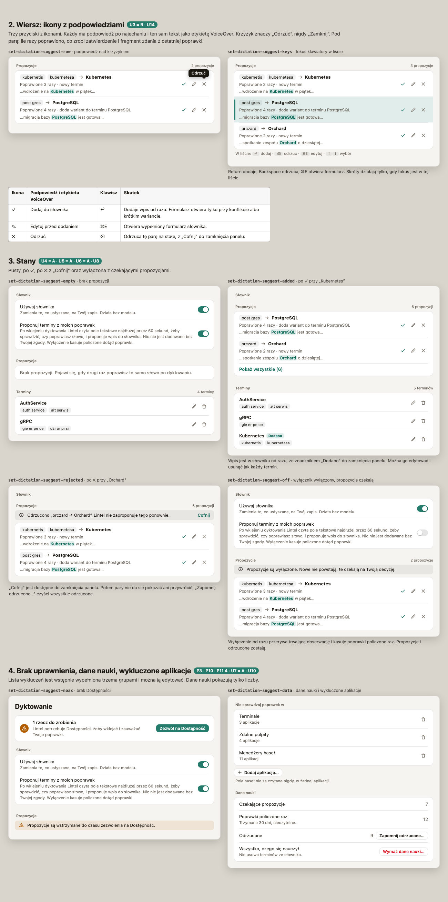
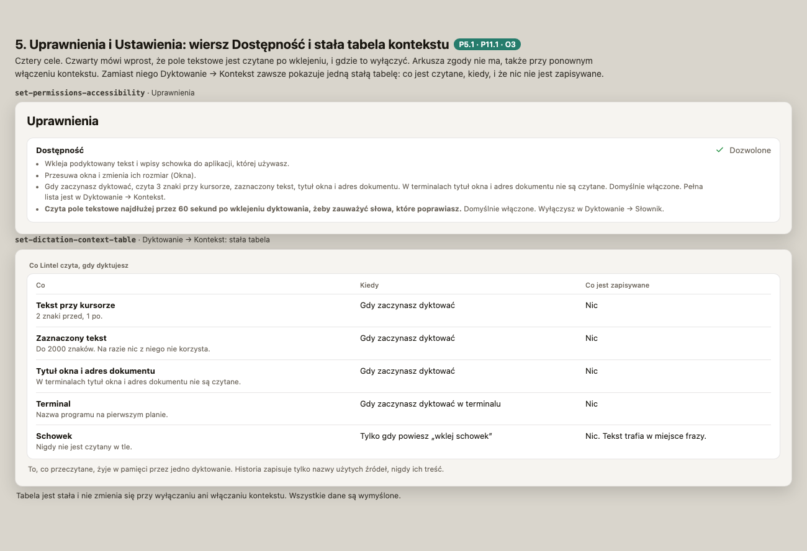
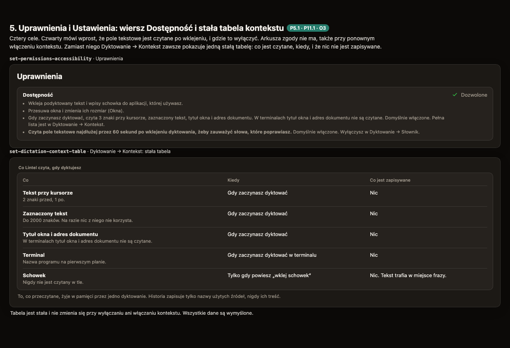
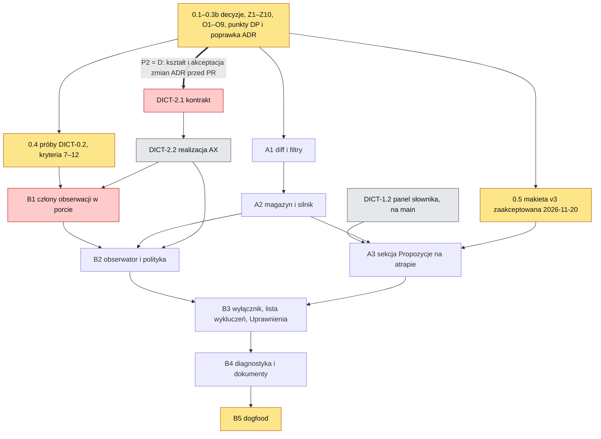

# Auto-nauka słownika dyktowania: propozycje terminów z poprawek użytkownika

> Status: **projekt z naniesionymi decyzjami właściciela z 2026-11-20** (P1–P13, U1–U14, K1–K4, próg 2). Sekcja „Open Questions" została zastąpiona tabelami decyzji. Część decyzji właściciel podjął świadomie wbrew rekomendacji autora; są zapisane jako **decyzje właściciela, ryzyko przyjęte (czytanie pól bez wskaźnika i bez zgody per funkcja)**, a ich skutki są w sekcji „Model zagrożeń". **Punkty Z1–Z10 (co kontekst dyktowania czyta domyślnie i dziewięć punktów „Do potwierdzenia") mają odpowiedzi właściciela z 2026-11-20** i są zapisane w sekcjach „Odpowiedzi właściciela na Z1–Z10" i „Z1: co kontekst dyktowania czyta domyślnie". Trzy z nich (CTX-2 = A, CTX-3 = A, CTX-4 = A) właściciel wybrał wbrew rekomendacji autora: **decyzje właściciela, ryzyko przyjęte**; rekomendacja autora zostaje widoczna jako odnotowana. Luki i sprzeczności, które po tych odpowiedziach zostały (punkty O1–O9), mają **decyzje właściciela z 2026-11-20**: sekcja „Decyzje właściciela O1–O9". Punkty, których te decyzje nie obejmowały (DP1–DP9), mają **odpowiedzi właściciela z 2026-11-20**: sekcja „Odpowiedzi właściciela na DP1–DP9". Tam, gdzie późniejsza odpowiedź zawęża wcześniejszą (Z6 i O6 przez DP1–DP4 i DP8; CTX-5 przez DP5; O2 przez DP6), obowiązuje późniejsza, węższa; wcześniejsza zostaje widoczna. Nic z tego dokumentu nie jest zaimplementowane. **Bramki zamknięte przez właściciela 2026-11-20:** poprawka ADR 0010 ma status **Accepted**, ADR 0013 (wysyłka zatwierdzonych terminów, wymagany przez regułę 4 ADR 0010) ma status **Accepted**, makieta v3 jest **zaakceptowana** jako prototyp (w wersji sprzed trzech zmian tekstu wypisanych w sekcji „Makieta").
>
> Prototype: makieta v3 (zaakceptowana przez właściciela 2026-11-20); zrzuty w `assets/dictation-vocabulary-auto-learn/mockup-v3-*.png`, źródło HTML poza repozytorium. Implementacja UI idzie 1:1 z makietą i może wejść do kolejki, za torem dostawcy i makietą HUD.
>
> **Skutek decyzji P1/P2, termin twardy: przed PR DICT-2.1.** P2 = D („do utraty fokusu") wymaga trzech nowych, addytywnych członów zamrożonego kontraktu `FocusContextReader` (tożsamość pola, ponowny odczyt tego samego pola, powiadomienie o utracie fokusu; każdy z wartością domyślną). Ten kształt i zmiany ADR 0010, które z P1/P2 wynikają (plik poprawki, status Accepted, decyzja właściciela 2026-11-20), są zaakceptowane **przed** PR DICT-2.1 i wchodzą do tego samego PR kontraktowego, bez drugiego PR w jednej kolejce `LintelKit` (jeden PR kontraktowy naraz, razem z DICT-3.3 i MEET). Szczegóły: „Wybrane źródło poprawki i kontrakt `LintelKit`".
>
> Decyzja właściciela z 2026-11-20, która wyznacza ramy: panel słownika (DICT-1.2) wychodzi teraz i jest na `main` (PR #157); auto-nauka wchodzi **po** fundamencie kontekstu (DICT-2.1 `FocusContextReader` w `LintelKit`, DICT-2.2 realizacja Accessibility). Decyzje UX i prywatności właściciel podejmuje osobno.
>
> Dokumenty powiązane: backlog `.ai/specs/backlog/2026-11-13-epic-context-aware-dictation.md` (story DICT-2.8 i zakres story DICT-2.1), ADR `docs/decisions/0010-dictation-context.md` (bez zmian, Accepted), jego poprawka `docs/decisions/0010-dictation-context-amendment-auto-learn.md` (status Accepted, 2026-11-20), `docs/decisions/0013-approved-vocabulary-terms-to-providers.md` (status Accepted, 2026-11-20; decyzja Z6 zawężona odpowiedziami na DP1–DP4 i DP8) i spec dostawców `.ai/specs/2026-11-10-external-ai-providers.md` (nowy rodzaj danych w oknie zgody: zatwierdzone terminy słownika).
>
> Wszystkie przykłady w tym pliku są wymyślone. Żaden nie pochodzi z prawdziwego dyktowania ani spotkania.

## 📝 TLDR

**Kto:** osoba, która dyktuje i po wklejeniu ręcznie poprawia te same nazwy własne („kubernetis" → „Kubernetes").
**Dziś:** słownik (`vocabulary.json`, `TermReplacer`) działa, ale każdy termin trzeba wpisać ręcznie w Ustawienia → Dyktowanie → Słownik. Lintel nie wie, że użytkownik poprawił słowo.
**Przyszłe zachowanie (decyzje właściciela 2026-11-20):** po wklejeniu podyktowanego tekstu Lintel czyta przez Dostępność całą wartość pola, do którego wkleił, i czyta ją drugi raz przy utracie fokusu, po 60 s albo przy następnym dyktowaniu; do tego jest jawne polecenie „Dodaj poprawkę do słownika" na zaznaczeniu. Lintel liczy powtarzające się pary „usłyszane → poprawione" i po drugiej takiej samej poprawce pokazuje **propozycję** w sekcji Słownik. Nic nie trafia do słownika bez zatwierdzenia. Odrzucona para nie wraca. Funkcja jest **włączona domyślnie u każdego, kto ma włączone Dyktowanie, także po aktualizacji**, bez arkusza zgody i bez wskaźnika obserwacji; działa we wszystkich aplikacjach poza edytowalną listą wykluczeń.
**Dlaczego to wymaga osobnego specu i zmiany ADR:** obserwacja pola łamie reguły ADR 0010 (odczyt tylko przy naciśnięciu skrótu; nic z pola nie jest zapisywane; wyłączone, dopóki użytkownik nie włączy), rozszerza kontrakt `FocusContextReader`, który zamraża dopiero DICT-2.1, a decyzja o wartości domyślnej odwraca D-Q1.

## ✅ Decyzje właściciela 2026-11-20 (zastępują sekcję „Open Questions")

Zasady tej sekcji:

- Każdy wiersz poniżej to **decyzja właściciela 2026-11-20**, przekazana przez orkiestratora w trzech paczkach. Autor specu niczego nie wybrał. Warianty, które przegrały, i pełne uzasadnienia rekomendacji są w wersji tego pliku z PR #176.
- Wiersze oznaczone **ryzyko przyjęte** to decyzje podjęte świadomie wbrew rekomendacji autora. Ich wspólny zapis: **decyzje właściciela, ryzyko przyjęte (czytanie pól bez wskaźnika i bez zgody per funkcja)**. Skutki są w sekcji „Model zagrożeń", bez łagodzenia.
- Punkty Z1–Z10 (dawna lista „Do potwierdzenia") mają odpowiedzi właściciela z 2026-11-20; są zapisane dokładnie tak, jak je wybrał. Punkty O1–O9 (luki i sprzeczności po odpowiedziach na Z1–Z10) mają decyzje właściciela z 2026-11-20, zapisane dokładnie tak, jak je wybrał. Punkty DP1–DP9 (to, czego decyzje O1–O9 nie obejmowały) mają odpowiedzi właściciela z 2026-11-20, zapisane dokładnie tak, jak je wybrał. Tam, gdzie i one nie obejmują szczegółu, spec go **nie rozstrzyga**: szczegół jest na liście „Zostaje do potwierdzenia".
- Implementacja kroku nie zaczyna się, dopóki punkty z listy „Zostaje do potwierdzenia", które go dotyczą, nie mają odpowiedzi.

**Twarde odmowy** (decyzja właściciela 2026-11-20: potwierdzone, obowiązują zawsze i nie da się ich wyłączyć): pola bezpieczne; aktywne Secure Event Input; własne okna Lintel; aplikacje z listy wykluczeń; brak uprawnienia Dostępność; nic z pola, par ani kandydatów w logach, raportach awarii, diagnostyce i `ranking.sqlite`.

### Decyzje prywatności (P1–P13)

| ID | Pytanie | Decyzja właściciela 2026-11-20 | Skutek w tym specu |
|---|---|---|---|
| **P1** | Skąd Lintel wie o poprawce | **A+B**: obserwacja pola przez Dostępność po wklejeniu oraz jawne polecenie „Dodaj poprawkę do słownika" na zaznaczeniu. Wariant C (tylko okna Lintel) niewybrany. | Fazy A, B i C1. Opis wariantu C usunięty (K3). |
| **P2** | Jak długo trwa obserwacja | **D**: do utraty fokusu, najdłużej **60 s**, koniec także przy następnym dyktowaniu; **(i) dwa odczyty** (bazowy i końcowy), bez nasłuchu każdej zmiany. | Rozszerzenie kontraktu `FocusContextReader` w PR DICT-2.1. |
| **P3** | W jakich aplikacjach | **Wszystkie aplikacje poza listą wykluczeń.** Lista jest wstępnie wypełniona trzema kategoriami: terminale, zdalne pulpity, menedżery haseł; użytkownik ją edytuje (dodaje i usuwa wpisy). **Przeglądarki działają.** *Ryzyko przyjęte.* | `CorrectionPolicy` czyta listę; kategorie to zamknięte listy identyfikatorów pakietów, każdy sprawdzony na zainstalowanej kopii (niepotwierdzony wypada). Lista nauki jest osobna od listy kontekstu (Z2). |
| **P4** | Ile pola jest czytane | **B: cała wartość pola**, w obu odczytach. *Ryzyko przyjęte.* | W pamięci jest przez czas obserwacji cały dokument, wątek albo rozmowa, także tekst niedyktowany. Limity: 12 000 znaków wklejonego tekstu i 100 000 znaków pola (Z5). |
| **P5** | Wartość domyślna | **(1) B: włączona domyślnie u wszystkich, także po aktualizacji.** Bez arkusza zgody i bez jednorazowego okna; informacja tylko w opisie Uprawnień i w Ustawieniach. **(2) Kontekst dyktowania także włączony domyślnie** (odwraca D-Q1 i zasadę opt-in ADR 0010). *Ryzyko przyjęte.* | Klucz `plugins.dictation.suggestFromCorrections` ma wartość domyślną `true`. „U wszystkich" znaczy: u każdego, kto ma włączone Dyktowanie (wtyczka jest domyślnie wyłączona) i nadał Dostępność. Zmiany ADR 0010: plik poprawki, zmiany 2, 4 i 13. Co dokładnie kontekst czyta domyślnie: decyzja Z1, sekcja niżej. Wyłączniki kontekstu i nauki są osobne (Z3). |
| **P6** | Co jest przechowywane | **(1) d: para, licznik, daty i fragment zdania. Fragment zdania TYLKO dla gotowych propozycji** (potwierdzone przez właściciela). **(2) b: kandydaci pod progiem tylko jako skrót z kluczem** i licznik z datami. Identyfikator aplikacji nie jest zapisywany. | Wyjątek od reguły „treść pola nigdy na dysku": fragment zdania gotowej propozycji. Fragment: do 80 znaków, tylko z wklejonego tekstu (Z4). Jednorazowa poprawka nigdy nie leży na dysku w czytelnej postaci. |
| **P7** | Gdzie | **B: nowe tabele w zaszyfrowanym `dictation.sqlite`** (SQLCipher). | Migracja addytywna po `v2-context`; gdy historii nie da się otworzyć, nauka stoi; reset bazy po `errSecItemNotFound` zabiera też dane nauki. |
| **P8** | Jak długo | **Kandydaci 30 dni; propozycje czekają do decyzji użytkownika; brak odpowiedzi nie jest odrzuceniem.** | Retencja co godzinę i przy otwarciu magazynu. Limity liczby: 200 kandydatów, 50 propozycji (Z9). |
| **P9** | Odrzucone | **A: skrót z kluczem (HMAC), na zawsze, dokładnie ta para.** | Listy odrzuconych nie da się wyświetlić; jedyna operacja to „Zapomnij odrzucone…" (U7 = A). Górna granica liczby skrótów: 5000 (Z9). |
| **P10** | Wyłączenie i wymazanie | **(1) B: wyłączenie kasuje kandydatów pod progiem** i zostawia propozycje oraz odrzucone. **(2)** „Wymaż dane nauki…" kasuje kandydatów, propozycje i odrzucone, nie terminy. **(3)** „Usuń dane" w Funkcjach kasuje także to; wyłączenie wtyczki działa jak wyłączenie wyłącznika. **(4)** „Wyczyść historię" nie rusza danych nauki. **(5) Trwająca obserwacja jest przerywana od razu, bez odczytu końcowego.** | Sekcja „Wymazanie danych". |
| **P11** | Co użytkownik widzi | **(1)** czwarty cel w wierszu Dostępność: tak. **(2)** wiersz „poprawki" w tabeli zaufania: tak. **(3) A: bez znaku w trakcie obserwacji.** *Ryzyko przyjęte.* **(4)** wiersze „Dane nauki" z liczbami: tak. | Użytkownik nie ma sygnału, że pole jest właśnie czytane; dowiaduje się o funkcji z Ustawień i z opisu Uprawnień. |
| **P12** | Co opuszcza Maca i modele | **(1)** Niezatwierdzone propozycje, kandydaci, odrzucone i fragmenty zdań **zostają lokalnie**. **Zatwierdzone terminy słownika mogą iść do zewnętrznego dostawcy, gdy użytkownik go włączył.** **(2) B: lokalny model może oceniać propozycje.** | Nowy rodzaj danych w oknie zgody dostawcy (spec dostawców). Zmiana reguł 3 i 4 ADR 0010 (plik poprawki, zmiana 9). Zakres (Z6 i O6, zawężone odpowiedziami na DP1–DP4 i DP8; ADR 0013, Accepted): do Claude idzie sama poprawna pisownia zatwierdzonych terminów, tylko przy notatkach ze spotkań pisanych przez Claude Code; nie przez klucz API, nie do innych dostawców, nie przy dyktowaniu, nie do modelu wbudowanego, nie do „Mojego serwera"; nie idzie, gdy Dyktowanie jest wyłączone; każde rozszerzenie to osobna decyzja właściciela. Model lokalny widzi samą parę i może tylko wstrzymać (Z7). |
| **P13** | Testy, QA, diagnostyka | **Potwierdzone wszystkie trzy:** dane wyłącznie syntetyczne; QA na atrapie czytnika; w diagnostyce tylko liczby. | Bez zmian względem propozycji. |

### Decyzje UX (U1–U14)

| ID | Pytanie | Decyzja właściciela 2026-11-20 | Skutek w tym specu |
|---|---|---|---|
| **U1** | Miejsce propozycji | **A: blok „Propozycje" nad listą terminów, 5 widocznych**, reszta pod „Pokaż wszystkie". | Makieta v3, ekran `set-dictation-suggest-window`. |
| **U2** | Gdzie jest wyłącznik | **A: w sekcji Słownik**, pod „Używaj słownika". | Nie zależy od panelu Kontekst (DICT-2.4). |
| **U3** | Akcje w wierszu | **B: ikony ✓ ✎ ✕ z podpowiedziami (tooltip) i etykietami VoiceOver; ✕ znaczy „Odrzuć".** | Każda ikona ma `help` i etykietę dostępności; ✕ nigdy nie jest opisane jako „Zamknij". |
| **U4** | Brak propozycji | **A: jedna linia wyjaśnienia.** | Jeden tekst `en`/`pl`. |
| **U5** | Co robi ✓ | **A: dodaje od razu**; formularz DICT-1.2 otwiera się tylko przy konflikcie (D7) albo krótkim wariancie (D8). | Zapis przez `VocabularyStore.save`; `VocabularyRules` bez obejścia. |
| **U6** | Odrzucenie | **A: od razu, z „Cofnij"** do zamknięcia panelu. | Skrót odrzucenia zapisany od razu; „Cofnij" usuwa go i przywraca wiersz, póki para jest w pamięci panelu (przy P9 = A później się nie da). |
| **U7** | Zarządzanie odrzuconymi | **A: tylko „Zapomnij odrzucone…".** | Wynika z P9 = A. |
| **U8** | Nauka wyłączona, a są propozycje | **Według P10: zostają widoczne i rozstrzygalne, z dopiskiem.** | Wyłączenie kasuje tylko kandydatów pod progiem. |
| **U9** | Licznik | **B: liczba w nagłówku sekcji i przy „Dyktowanie" w pasku bocznym Ustawień.** Bez notki w HUD. | Wymaga addytywnego członu w `LintelKit` (koszt opisany w „API Contracts"); osobny PR kontraktowy (Z8). |
| **U10** | Aplikacje bez wsparcia | **(2) a: nic nie pokazywać.** (1) brak Dostępności: linia w sekcji i akcja w banerze, jedyny narysowany wariant. | Identyfikatory aplikacji nie są zapisywane. |
| **U11** | Arkusz zgody | **Nie dotyczy: arkusza zgody nie ma** (P5.1). | Ekrany `dlg-suggest-consent-*` i klucz `suggestConsentShown` usunięte. |
| **U12** | Filtry | **Według rekomendacji:** CamelCase proponować; samą zmianę wielkości liter pomijać; przeredagowania pomijać; limit 3 słowa i 64 znaki; e-maile i emoji pomijać; **imiona i nazwiska proponować**; pospolite słowa pomijać. | Źródło listy pospolitych słów (wbudowana czy systemowa) zostaje sprawdzeniem technicznym w kroku A1. |
| **U13** | Próg | **(1) próg = 2.** (3) 5 widocznych (U1). | (2) grupowanie form w jeden wiersz: tak (Z9). |
| **U14** | Klawiatura i nazwy | **Return = dodaj, Backspace (⌫) = odrzuć, ⌘E = edytuj**; nazwy jak w makiecie; VoiceOver nie ogłasza nowej propozycji, gdy użytkownik jest w innej aplikacji. | Skróty działają tylko, gdy fokus jest w liście propozycji; wpis do `BACKWARD_COMPATIBILITY.md` §5. |

### Pozostałe decyzje (K1–K4)

| ID | Pytanie | Decyzja właściciela 2026-11-20 | Skutek |
|---|---|---|---|
| **K1** | Kształt obserwacji „na zapas" w DICT-2.1? | **Zamknięte:** P2 zapadło przed DICT-2.1, kształt wchodzi do PR DICT-2.1. | Człony opcjonalne z wartościami domyślnymi. |
| **K2** | Czy historia notuje, że dyktowanie było obserwowane? | **Nie.** | `context_sources` bez nowej wartości; zmiana 10 ADR nie jest potrzebna. |
| **K3** | Usunąć opis źródła „tylko w oknach Lintel"? | **Tak.** | `InAppCorrectionSource` i krok C2 usunięte z tego specu. |
| **K4** | Klucz skrótów | **Podklucz wspólnego klucza dyktowania** (`MasterKeyStore(service: com.lintelapp.dictation)`, nowa etykieta HKDF). | Bez nowego wpisu Pęku kluczy. „Wymaż dane nauki…" nie jest wymazaniem kryptograficznym (T21). |

### Odpowiedzi właściciela na Z1–Z10 (2026-11-20; zastępują listę „Do potwierdzenia")

Lista „Do potwierdzenia" z poprzedniej wersji tego pliku miała dziesięć punktów. Właściciel odpowiedział na wszystkie 2026-11-20. Każdy wiersz to **decyzja właściciela 2026-11-20**, zapisana tak, jak ją wybrał; autor niczego nie dodał ani nie zawęził. Kolumna „Rekomendacja autora" jest zapisem tego, co autor proponował, nie warunkiem.

| # | Punkt | Decyzja właściciela 2026-11-20 | Rekomendacja autora (odnotowana) | Skutek w tym specu |
|---|---|---|---|---|
| **Z1** | Co kontekst dyktowania czyta domyślnie, per źródło | **CTX-1 pole = B** (tylko 2 znaki przed, 1 po). **CTX-2 zaznaczenie = A** (przy każdym dyktowaniu). **CTX-3 schowek = A** (włączone, potwierdzenie w HUD przy pierwszych 5 użyciach). **CTX-4 okno = A** (tytuł i adres dokumentu). **CTX-5/6 terminal i pliki = tylko nazwa procesu; katalog roboczy i pliki po próbach.** CTX-2, CTX-3 i CTX-4: **decyzje właściciela, ryzyko przyjęte.** **Zawężone odpowiedziami na DP5 i DP6 (obowiązuje):** nazwa procesu też czeka na próby; w terminalach nieczytany także adres dokumentu. | CTX-1: B (zgodna). CTX-2: C. CTX-3: B, do pomiaru DICT-3.1. CTX-4: C. CTX-5: B do wyniku prób, potem C. CTX-6: B, C po próbach. | Sekcja „Z1: co kontekst dyktowania czyta domyślnie" niżej; model zagrożeń, „Co kontekst dyktowania czyta domyślnie"; **pomiar DICT-3.1 trzeba wykonać przed wydaniem**. |
| **Z2** | Lista wykluczeń nauki: wspólna z listą kontekstu czy osobna | **Osobne listy wykluczeń.** Lista nauki: terminale, zdalne pulpity i maszyny wirtualne, menedżery haseł. | osobna (zgodna) | Klucz `plugins.dictation.suggestDeniedApps`; lista kontekstu `contextDeniedApps` zostaje osobna (ADR 0010: menedżery haseł). Kontekst działa w terminalach, nauka nie. |
| **Z3** | Czy wyłączenie kontekstu wyłącza też auto-naukę | **Osobne wyłączniki.** | niezależny wyłącznik (zgodna) | `contextEnabled = false` nie wyłącza nauki, a wyłączenie nauki nie wyłącza kontekstu. Reguła 1 ADR 0010 („wyłączony kontekst = nic nie jest czytane") musi zostać przepisana: każdy wyłącznik zatrzymuje własne odczyty (plik poprawki, zmiana 2). |
| **Z4** | Fragment zdania: zakres i długość | **Według rekomendacji autora:** fragment do 80 znaków z wklejonego tekstu. | tylko z zakresu wklejonego tekstu, po poprawce, najwyżej 80 znaków wokół poprawionego słowa, jeden (z ostatniej poprawki), widoczny pod parą w wierszu | Typ `SentenceFragment` z limitem 80 znaków; nigdy tekst spoza wklejonego zakresu. |
| **Z5** | Limity P4 | **Według rekomendacji autora:** 12 000 / 100 000 znaków. | 12 000 znaków wklejonego tekstu; pole do 100 000 znaków (dłuższe: brak obserwacji); obie liczby do sprawdzenia próbami DICT-0.2 | Wklejony tekst dłuższy niż 12 000 znaków albo pole dłuższe niż 100 000 znaków: obserwacja nie startuje. Kryterium 8 prób nadal mierzy, czy odczyt 100 000 znaków mieści się w budżecie. |
| **Z6** | Zatwierdzone terminy u dostawcy: w których żądaniach | **Zatwierdzone terminy idą do dostawcy przy NOTATKACH ze spotkań (Claude) i do „Mojego serwera"; wymaga nowego ADR (reguła 4 ADR 0010).** **Zawężone tego samego dnia odpowiedziami na DP1–DP4 i DP8 (obowiązuje):** do Claude idzie sama poprawna pisownia zatwierdzonych terminów, tylko przy notatkach ze spotkań pisanych przez Claude Code; nie przez klucz API, nie do innych dostawców, nie przy dyktowaniu, nie do modelu wbudowanego, nie do „Mojego serwera"; nie idzie, gdy Dyktowanie jest wyłączone; każde rozszerzenie to osobna decyzja właściciela. | autor nie rekomendował zakresu (punkt był pytaniem) | `docs/decisions/0013-approved-vocabulary-terms-to-providers.md` (status Accepted, 2026-11-20). Spec dostawców: rodzaj danych (e) z ustalonym zakresem (tylko notatki przez Claude Code). Propozycje i fragmenty zdań zostają lokalnie. „Mój serwer" nie dostaje terminów. |
| **Z7** | Ocena propozycji przez model lokalny | **Według rekomendacji autora:** lokalny model widzi samą parę i może tylko wstrzymać. | tylko model wbudowany (`LLMLease`, priorytet `background`); widzi parę, bez fragmentu; ocena może propozycję tylko wstrzymać, nigdy dodać ani zatwierdzić; wyłączone, dopóki nie przejdzie pomiaru na syntetycznym zbiorze | Krok C3. „Mój serwer" nie ocenia propozycji. |
| **Z8** | Licznik w pasku bocznym: w PR DICT-2.1 czy osobno | **Według rekomendacji autora:** licznik osobnym PR kontraktu. | osobny mały PR kontraktowy przed krokiem A3; do tego czasu liczba tylko w nagłówku sekcji | PR DICT-2.1 nie zawiera członu `SettingsStatus`; osobny PR w kolejce `LintelKit`. |
| **Z9** | Drobne luki | **Według rekomendacji autora:** 200 / 50 / 5000. | grupowanie form tak; 200 kandydatów / 50 propozycji / 5000 odrzuconych; maszyny wirtualne tak | Grupowanie form w jeden wiersz; limity liczby; maszyny wirtualne w kategorii „zdalne pulpity" (potwierdzone też w Z2). |
| **Z10** | Zapis zgody na słabszą wartość domyślną | **Według rekomendacji autora:** zgoda właściciela komentarzem w PR-ach wprowadzających klucze. | komentarz właściciela w PR kroku B2 (klucz nauki) i w PR DICT-2.3 (klucz kontekstu) | Każdy PR, który wprowadza klucz ze słabszą wartością domyślną, czeka na komentarz właściciela. Po Z1 dotyczy to także wartości domyślnej `clipboardReference` (DICT-3.1). Dla źródła `terminal` (nazwa procesu, katalog roboczy, pliki; DICT-3.2, DICT-3.3) zgodę daje **z góry** odpowiedź właściciela na DP5 z 2026-11-20, zapisana w poprawce ADR 0010: PR, który je włącza po próbach spełniających twarde kryterium, nie czeka na kolejny komentarz. |

### Z1: co kontekst dyktowania czyta domyślnie (decyzja właściciela 2026-11-20)

Decyzja P5.2 włącza kontekst domyślnie u wszystkich, także po aktualizacji. Tabela niżej zostaje jako zapis wariantów, które autor przedstawił; kolumna „Decyzja właściciela" mówi, co obowiązuje. Do 2026-11-20 (ADR 0010, backlog DICT) wszystko było wyłączone: `contextEnabled = false` (D-Q1), odwołanie do schowka wyłączone (D-Q6), źródło `terminal` wyłączone (D-Q14), odwołania do plików wyłączone. Twarde odmowy i lista wykluczeń kontekstu (`contextDeniedApps`) obowiązują bez zmian.

| # | Źródło (co i kiedy jest czytane) | Warianty | Konsekwencje | Odwraca | Rekomendacja autora (odnotowana) | **Decyzja właściciela 2026-11-20** |
|---|---|---|---|---|---|---|
| **CTX-1** | **Pole**: rodzaj pola i tekst wokół kursora, przy naciśnięciu skrótu (limit ADR: 500 znaków przed, 200 po, odczyt po zakresie) | **A** włączone, limit 500/200 · **B** włączone, ale czytane tylko tyle, ile używają reguły (2 znaki przed, 1 po), większy limit dopiero gdy powstanie reguła, która go potrzebuje · **C** wyłączone | A: przy każdym dyktowaniu w pamięci jest do 700 znaków cudzego tekstu, z czego reguły wstawiania używają trzech. B: ta sama korzyść (spacja, wielka litera, kropka), najmniejszy odczyt; zmiana limitu to później zmiana tabeli zaufania. C: „kontekst włączony" nie daje nic poza profilem aplikacji. | A i B: D-Q1 | **B** | **B: tylko 2 znaki przed, 1 po.** Zgodna z rekomendacją. |
| **CTX-2** | **Zaznaczenie**: zaznaczony tekst, do 2000 znaków, przy naciśnięciu skrótu | **A** włączone · **B** wyłączone, dopóki żadna reguła go nie używa · **C** czytane tylko na polecenie „Dodaj poprawkę do słownika" (P1, część B), nigdy przy skrócie | A: Lintel czyta zaznaczenie przy każdym dyktowaniu, choć w Fazach 0–3 nic go nie używa (ADR mówi to wprost). B: brak odczytu bez celu. C: odczyt tylko wtedy, gdy użytkownik sam o niego prosi. | A: D-Q1 | **C** (zawiera B) | **A: przy każdym dyktowaniu.** Wbrew rekomendacji: **decyzja właściciela, ryzyko przyjęte** (odczyt bez obecnego użytku). |
| **CTX-3** | **Schowek**: tekst schowka, tylko gdy użytkownik wypowie frazę z zamkniętej listy jako cały segment | **A** włączone, z potwierdzeniem w HUD przy pierwszych 5 użyciach · **B** wyłączone (stan dzisiejszy) · **C** włączone, ale każde użycie wymaga potwierdzenia w HUD | Schowek nie jest czytany biernie; ryzykiem jest **nieodwracalne wklejenie zawartości schowka** po błędnie rozpoznanej frazie (ryzyko „wysokie" w backlogu). Pomiar „0 fałszywych na 60 frazach" nie został wykonany. C spowalnia każde użycie. | A i C: D-Q6 | **B**, do pomiaru DICT-3.1 | **A: włączone, potwierdzenie w HUD przy pierwszych 5 użyciach.** Wbrew rekomendacji: **decyzja właściciela, ryzyko przyjęte** (schowek włączony przed pomiarem fałszywych rozpoznań). **Pomiar DICT-3.1 trzeba wykonać przed wydaniem.** **Doprecyzowane decyzją O5 (2026-11-20):** włączone domyślnie tylko po czystym pomiarze DICT-3.1; do pomiaru i po jakimkolwiek fałszywym wklejeniu domyślnie wyłączone. |
| **CTX-4** | **Okno**: tytuł okna i adres dokumentu, przy naciśnięciu skrótu | **A** włączone oba · **B** tylko tytuł · **C** wyłączone, dopóki żadna reguła ich nie używa | Tytuł okna często zawiera temat wiadomości, nazwę pliku albo rozmówcy. W Fazach 0–3 nic go nie używa; dokument może kiedyś posłużyć odwołaniu „ten plik" (niepotwierdzone, [0.2]). | A i B: D-Q1 | **C** | **A: tytuł i adres dokumentu.** Wbrew rekomendacji: **decyzja właściciela, ryzyko przyjęte** (odczyt bez obecnego użytku). **Doprecyzowane decyzją O2 (2026-11-20):** w terminalach tytuł okna nie jest czytany. **Odpowiedź na DP6 (2026-11-20):** w terminalach nie jest czytany także adres dokumentu. |
| **CTX-5** | **Terminal**: nazwa procesu pierwszoplanowego i katalog roboczy (libproc), przy naciśnięciu skrótu | **A** włączone · **B** wyłączone (stan dzisiejszy) · **C** włączona tylko nazwa procesu (profil `agentCLI`), katalog dopiero z odwołaniami do plików | Nowa klasa danych o innych aplikacjach (ścieżki projektów). Reguła jednoznaczności karty jest niepotwierdzona ([0.2], kryteria 3 i 6). Listy wykluczeń są osobne (Z2), więc kontekst w terminalach działa. | A i C: D-Q14 | **B** do wyniku prób; potem **C** | **Tylko nazwa procesu; katalog roboczy po próbach.** Odwraca D-Q14 w części (nazwa procesu). **Doprecyzowane decyzją O1 (2026-11-20):** kontrakt `TerminalContext` ma oba pola, katalog jest pusty do prób; po udanych próbach katalog włącza się sam, bez ponownej decyzji (wtedy D-Q14 jest odwrócone w całości). **Zawężone odpowiedzią na DP5 (2026-11-20; obowiązuje):** nazwa procesu **też czeka na próby**; do udanych prób źródło `terminal` nie czyta niczego, więc D-Q14 nie jest odwrócone nawet w części. „Udane próby" = właściwa karta terminala we wszystkich przypadkach testowych, zero błędnych katalogów; przy jakimkolwiek błędzie decyzja wraca do właściciela. |
| **CTX-6** | **Pliki**: nazwy plików pod katalogiem roboczym terminala, tylko gdy użytkownik wypowie wyzwalacz pliku | **A** włączone (wymaga CTX-5 = A) · **B** wyłączone (stan dzisiejszy) · **C** włącza się razem ze źródłem `terminal`, bez osobnego przełącznika | Listowanie czyta nazwy z dysku (głębokość 8, 50 000 wpisów); miejsca chronione przez TCC są odmawiane przed dotknięciem dysku. Wstawiona ścieżka zostaje w historii jako treść dyktowania. | A i C: D-Q14 (pośrednio) | **B**; **C** po próbach | **Pliki po próbach** (do tego czasu wyłączone). **Doprecyzowane decyzją O1 (2026-11-20):** po udanych próbach odwołania do plików włączają się same, bez ponownej decyzji. |

**Zapis decyzji wbrew rekomendacji.** CTX-2 = A, CTX-3 = A i CTX-4 = A to **decyzje właściciela, ryzyko przyjęte**. Autor rekomendował C, B i C; powody autora (zaznaczenie i tytuł okna są czytane, choć w Fazach 0–3 żadna reguła ich nie używa; schowek jest włączony, zanim zmierzono fałszywe rozpoznania frazy) zostają odnotowane i nie zmieniają decyzji. Skutki są w modelu zagrożeń („Co kontekst dyktowania czyta domyślnie", T27–T34), bez łagodzenia. Decyzja O5 zawęża CTX-3 = A: schowek jest włączony domyślnie **tylko po czystym pomiarze**; powód autora „schowek włączony przed pomiarem" przestaje więc opisywać stan po decyzji. **Pomiar DICT-3.1 (0 fałszywych podstawień na 60 frazach klasy `none`, trafność w klasie `clipboard` co najmniej 90%) trzeba wykonać przed wydaniem**, które włącza odwołanie do schowka.

Stan domyślny po decyzji, dla każdego, kto ma włączone Dyktowanie i nadał Dostępność, także po aktualizacji:

| Ustawienie | Wartość domyślna po Z1 | Przed 2026-11-20 |
|---|---|---|
| `contextEnabled` | `true` (P5.2) | `false` |
| `contextSources` | `window` (tytuł i adres dokumentu; w terminalach ani tytuł okna, ani adres dokumentu nie są czytane: O2, DP6), `field` (2 znaki przed, 1 po), `selection` (do 2000 znaków). Źródło `terminal` **poza listą do udanych prób** (DP5); po udanych próbach na liście | lista bez `terminal`, przy wyłączonym kontekście |
| nazwa procesu pierwszoplanowego w terminalu | nieczytana do wyniku prób (DP5: nazwa programu też czeka na próby); **po udanych próbach czytana domyślnie, bez ponownej decyzji** (O1, DP5) | nieczytana |
| `clipboardReference` | `true` **tylko po czystym pomiarze DICT-3.1** (0 fałszywych wklejeń), z potwierdzeniem w HUD przy pierwszych 5 użyciach; do pomiaru i po jakimkolwiek fałszywym wklejeniu `false` (O5) | `false` |
| katalog roboczy terminala | nieczytany do wyniku prób (pole w `TerminalContext` puste); **po udanych próbach czytany domyślnie, bez ponownej decyzji** (O1) | nieczytany |
| `fileReferences` | `false` do wyniku prób; **po udanych próbach `true`, bez ponownej decyzji** (O1) | `false` |

Poza tą listą, ale w tym samym miejscu Ustawień: profile aplikacji (`appProfiles`, D-Q5, zmieniają wynik, nie czytają więcej) i `smartInsertion`. Decyzje P5.2 i Z1 ich nie wymieniają; decyzja O4 niżej zostawia ich wartości z backlogu (`appProfiles = false`, `smartInsertion = true`); te wartości są **potwierdzone przez właściciela** (odpowiedź na DP7, 2026-11-20: `smartInsertion` włączone, `appProfiles` wyłączone).

**„Udane próby" (odpowiedź właściciela na DP5, 2026-11-20; twarde kryterium).** Próby są udane, gdy we **wszystkich** przypadkach testowych wskazana jest **właściwa karta terminala** i jest **zero błędnych katalogów**. Przy jakimkolwiek błędzie nic się nie włącza, a decyzja wraca do właściciela. Na wynik prób czekają razem: nazwa procesu, katalog roboczy i odwołania do plików. Ta decyzja jest **zgodą właściciela z góry** i spełnia wymóg Z10: PR, który włącza te trzy wartości domyślne i pokazuje wyniki prób spełniające kryterium, nie czeka na kolejny komentarz właściciela. Zapis w poprawce ADR 0010 (zmiana 13).

Skutek dla backlogu: stories DICT-2.3 (wartości domyślne `contextEnabled` i `contextSources`), DICT-2.4 (arkusz zgody „przy każdym włączeniu", trzy cele Dostępności), DICT-3.1 (`clipboardReference` domyślnie `false`) i DICT-3.2 (źródło `terminal` domyślnie poza listą) są napisane dla modelu opt-in i **muszą zostać przepisane według Z1 i odpowiedzi na DP1–DP9**, zanim wystartują. Dla DICT-3.2 zdanie „domyślnie poza listą" zostaje prawdziwe do udanych prób (DP5).

### Decyzje właściciela O1–O9 (2026-11-20)

Po naniesieniu odpowiedzi na Z1–Z10 zostało dziewięć luk i sprzeczności (O1–O9). Właściciel rozstrzygnął je 2026-11-20; decyzje przekazał orkiestrator. Są zapisane dokładnie tak, jak je wybrał. O1, O2, O3, O5 i O6 to decyzje właściciela. O4, O7, O8 i O9 to **decyzje techniczne przyjęte według rekomendacji autora specu** (właściciel zdał się na autora). Czego decyzje nie obejmują, jest w następnej sekcji i nie jest tu rozstrzygane.

| # | Punkt | **Decyzja 2026-11-20** | Skutek |
|---|---|---|---|
| **O1** | „Tylko nazwa procesu" w terminalu: kształt kontraktu i co znaczy „po próbach" | **Decyzja właściciela.** Kontrakt `TerminalContext` ma **oba pola** (nazwa procesu i katalog roboczy), jak w ADR 0010; żądanie nie dostaje nowego członu. Katalog jest **pusty do prób**. **Po udanych próbach katalog roboczy i odwołania do plików (linkowanie plików) włączają się same, domyślnie, bez ponownej decyzji właściciela.** To **decyzja właściciela, ryzyko przyjęte**. | Zamrażany kształt z ADR 0010 zostaje bez zmian (`workingDirectory` jest opcjonalne, więc „pusty" to `nil`). Do wyniku prób realizacja portu **nie czyta** katalogu (nie wywołuje odczytu z libproc dla katalogu); „odczytać i odrzucić" nie spełnia decyzji. Po udanych próbach wydanie, które je zawiera, czyta przy każdym naciśnięciu skrótu w terminalu ścieżkę katalogu roboczego, a po wypowiedzeniu wyzwalacza pliku listuje nazwy plików pod nim; u wszystkich, także po aktualizacji, bez pytania. Odwraca wtedy D-Q14 w całości. **Uzupełnione odpowiedzią na DP5:** nazwa procesu też czeka na próby (do prób realizacja nie czyta ani nazwy, ani katalogu); „udane próby" mają twarde kryterium (właściwa karta we wszystkich przypadkach testowych, zero błędnych katalogów; przy błędzie decyzja wraca do właściciela); zgoda z góry spełnia Z10. Model zagrożeń: T30, T33. |
| **O2** | Tytuł okna terminala a katalog roboczy | **Decyzja właściciela.** W terminalach tytuł okna **nie jest czytany**. | Zawęża CTX-4 = A: źródło `window` nie zwraca tytułu, gdy aplikacja na pierwszym planie jest terminalem. Tytuł okna terminala, który często zawiera katalog albo polecenie, nie trafia do pamięci Lintel, także po próbach. **Uzupełnione odpowiedzią na DP6:** w terminalach nie jest czytany także adres dokumentu; „terminale" to ta sama zamknięta lista identyfikatorów pakietów co kategoria „terminale" listy wykluczeń nauki; terminal wbudowany w edytor kodu (albo otwarty w przeglądarce) to **znane ograniczenie**: tam tytuł i adres są czytane. Model zagrożeń: T28, T30, T31. |
| **O3** | Arkusz zgody kontekstu; gdzie jest informacja o zaznaczeniu | **Decyzja właściciela.** **Bez arkusza zgody**, także przy ponownym włączeniu kontekstu. Zamiast niego **stała tabela w Ustawieniach**: co jest czytane, kiedy, i że nic nie jest zapisywane; z **wierszem dla zaznaczenia**. | Wymóg tabeli zaufania ADR 0010 dla `selection` („tekst zgody mówi, że nic go jeszcze nie używa") spełnia wiersz tabeli. Tabela jest widoczna zawsze, niezależnie od stanu wyłącznika. Narysowana w makiecie v3 (ekran `set-dictation-context-table`). DICT-2.4 do przepisania: bez arkusza. **Odpowiedź na DP9:** zdanie pod tabelą (historia zapisuje tylko nazwy użytych źródeł, nigdy ich treść) wystarczy. **Po udanych próbach** tabela potrzebuje wierszy dla nazwy procesu, katalogu roboczego i plików; DICT-2.4 musi to zapisać. |
| **O4** | Wartości domyślne `appProfiles` i `smartInsertion` | **Decyzja techniczna przyjęta według rekomendacji autora specu.** Wartości z backlogu zostają: `appProfiles = false` (D-Q5), `smartInsertion = true` (działa tylko przy włączonym kontekście, DICT-2.5). | Profile aplikacji nie zmieniają wyniku u obecnych użytkowników, dopóki sami ich nie włączą. `smartInsertion` zaczyna działać u wszystkich razem z kontekstem włączonym domyślnie (spacja, wielka litera, kropka). **Potwierdzone przez właściciela (odpowiedź na DP7, 2026-11-20):** `smartInsertion` włączone, `appProfiles` wyłączone. |
| **O5** | Schowek, gdy pomiar DICT-3.1 nie przejdzie | **Decyzja właściciela.** Jeśli pomiar DICT-3.1 wykaże **jakiekolwiek fałszywe wklejenie**, schowek jest **domyślnie wyłączony** (kryterium 3 story DICT-3.6 zostaje). **Włączony domyślnie tylko po czystym pomiarze.** | Sprzeczność CTX-3 = A z DICT-3.6 znika: kryterium wygrywa. `clipboardReference` jest domyślnie `true` wyłącznie w wydaniu, które ma czysty pomiar (0 fałszywych podstawień na 60 frazach klasy `none`, trafność w klasie `clipboard` co najmniej 90%); do tego czasu `false`. Potwierdzenie w HUD przy pierwszych 5 użyciach zostaje. Model zagrożeń: T29. |
| **O6** | Zakres wysyłki zatwierdzonych terminów | **Decyzja właściciela.** Do Claude przy notatkach idzie **cały słownik zatwierdzonych terminów** (poprawna pisownia). „Mój serwer" **tak samo w zadaniach notatek**. **Bramkę jakości G trzeba powtórzyć po zmianie promptu.** Czy idą także usłyszane formy: **propozycja z wariantami** (niżej). **Zawężone odpowiedziami na DP1–DP4 i DP8 (obowiązuje):** bez usłyszanych form; „Mój serwer" **nie** dostaje terminów (nie pisze notatek); tylko notatki przez Claude Code. | Wysyłany jest zapis docelowy („Zapisz jako") każdego wpisu `vocabulary.json`, nie tylko terminy pasujące do danego transkryptu. Każde spotkanie pisane przez Claude Code niesie cały słownik (samą poprawną pisownię). Prompt `whole1` dostaje nową wersję, a pomiar bramki G jest powtarzany, zanim wersja z terminami trafi do użytkowników. Model zagrożeń: T10a. ADR 0013. |
| **O7** | Droga terminów ze słownika dyktowania do notatek ze spotkań | **Decyzja techniczna przyjęta według rekomendacji autora specu.** Terminy idą przez **addytywny port w `LintelKit`**, jako pozycja w kolejce kontraktu (jeden PR kontraktowy naraz). | `MeetingsPlugin` nie importuje `DictationPlugin`. Nowy człon ma wartość domyślną (brak terminów). ADR 0013 jest zaakceptowany; port wchodzi osobnym PR kontraktowym. Wyłączona wtyczka Dyktowanie nie wnosi przez port żadnych terminów (DP8). |
| **O8** | Słownik spotkań (MEET-5.2) na liście „Nigdy" | **Decyzja techniczna przyjęta według rekomendacji autora specu.** **Bez zmian:** słownik spotkań (MEET-5.2) zostaje na liście „Nigdy" specu dostawców. | Różnica jest zamierzona: do dostawcy idzie słownik dyktowania, słownik spotkania nie. MEET-5.2 bez zmian. |
| **O9** | Progi prób 7–12 | **Decyzja techniczna przyjęta według rekomendacji autora specu.** Progi z sekcji „Kryteria prób" obowiązują: „obsługiwana" = 20 z 20; start kroku B1 = 8 z 12 aplikacji. | Krok 0.4 może wystartować z tymi progami. |

#### O6 (2): usłyszane formy u dostawcy: wybrany wariant A (odpowiedź właściciela na DP1, 2026-11-20)

Wpis słownika ma zapis docelowy („Zapisz jako") i usłyszane formy, czyli to, co rozpoznawanie mowy pisze zamiast niego (wymyślony przykład: forma „kubernetis" przy terminie „Kubernetes"). Właściciel wybrał **A: bez form**. Warianty B i C zostają jako zapis tego, co nie zostało wybrane; każdy z nich byłby rozszerzeniem zakresu, czyli osobną decyzją właściciela.

| Wariant | Co idzie do Claude przy notatkach przez Claude Code | Korzyść | Koszt i ryzyko |
|---|---|---|---|
| **A** (**wybrany**) | Tylko zapis docelowy każdego terminu | Najmniej danych; model widzi listę poprawnych nazw i sam dopasowuje zniekształcone słowa transkryptu | Model może nie połączyć mocno zniekształconej formy z terminem; wtedy nazwa w notatkach zostaje błędna |
| B (niewybrany) | Zapis docelowy oraz formy tylko tych terminów, których forma występuje w danym transkrypcie | Model dostaje gotową parę „usłyszane → poprawne" tam, gdzie jest potrzebna | Wychodzi więcej danych: formy pokazują, jak użytkownik mówi i co rozpoznawanie myli; wymaga dopasowania przed wysyłką; nowy wiersz w oknie zgody |
| C (niewybrany) | Zapis docelowy i wszystkie formy wszystkich terminów | Najprostsze w budowie; największa szansa na poprawną nazwę | Najwięcej danych w każdym żądaniu, także form bez związku ze spotkaniem; dłuższy prompt; nowy wiersz w oknie zgody |

Usłyszane formy zostają na liście „Nigdy" specu dostawców, a test „Co opuszcza Maca" ma kanarka w usłyszanej formie.

### Odpowiedzi właściciela na DP1–DP9 (2026-11-20; zastępują listę „Do potwierdzenia po O1–O9")

Po decyzjach O1–O9 zostało dziewięć punktów (DP1–DP9). Właściciel odpowiedział na wszystkie 2026-11-20; odpowiedzi przekazał orkiestrator. Są zapisane dokładnie tak, jak je wybrał. Kolumna „Stan sprzed odpowiedzi" to stan najostrożniejszy, który spec trzymał do tej pory.

| # | Punkt | **Odpowiedź właściciela 2026-11-20** | Stan sprzed odpowiedzi | Skutek |
|---|---|---|---|---|
| **DP1** | Usłyszane formy u dostawcy (warianty A, B, C wyżej) | **Nie idą.** Do Claude idzie sama poprawna pisownia (bez usłyszanych form). | A: bez form | Wariant A. Usłyszane formy na liście „Nigdy"; kanarek w teście. |
| **DP2** | „Mój serwer" | **Nie.** „Mój serwer" nie pisze notatek i nie dostaje terminów. | nic nie jest wysyłane | Zawęża Z6 i O6. „Mój serwer" nie dostaje terminu słownika w żadnym żądaniu, także przy czyszczeniu dyktowania (DICT-4.2 bez terminów). Dla „Mojego serwera" reguła 4 ADR 0010 zostaje bez zmian. |
| **DP3** | Inne kanały i dostawcy: klucz API (Faza 2 specu dostawców), kolejni dostawcy (Faza 3), dyktowanie przez dostawcę (Faza 4) | **Nie.** Tylko notatki ze spotkań przez Claude Code; nie klucz API, nie inni dostawcy, nie dyktowanie. | terminy nie idą tymi drogami | Fazy 2–4 specu dostawców nie dołączają terminów. |
| **DP4** | Model wbudowany piszący notatki | **Nie dostaje terminów.** | nie dostaje | Prompt notatek modelu wbudowanego bez zmian. |
| **DP5** | Próby terminala: czy nazwa procesu czeka na próby; co znaczy „udane próby"; czy PR włączający czeka na komentarz z Z10 | **Zgoda z góry, z twardym kryterium.** „Udane próby" = **właściwa karta terminala we wszystkich przypadkach testowych, zero błędnych katalogów.** **Przy jakimkolwiek błędzie decyzja wraca do właściciela.** **Nazwa programu też czeka na próby.** Dzisiejsza decyzja jest zgodą wymaganą przez Z10 i jest zapisana w ADR. | nazwa czytana według reguły ADR 0010; katalog i pliki nie włączają się; komentarz wymagany | Zawęża CTX-5 („tylko nazwa procesu" domyślnie): do udanych prób źródło `terminal` nie czyta niczego. Po udanych próbach nazwa procesu, katalog roboczy i pliki włączają się same (O1). Zapis zgody: poprawka ADR 0010, zmiana 13. DICT-3.2, DICT-3.3. |
| **DP6** | Zakres „terminala" w O2: adres dokumentu; która lista aplikacji; terminal wbudowany | **Według propozycji:** w terminalach pomijany jest **także adres dokumentu**; lista terminali to ta sama zamknięta lista identyfikatorów co kategoria „terminale" listy wykluczeń nauki; terminal wbudowany w edytor kodu (albo w przeglądarkę) to **znane ograniczenie**. | adres w terminalu nieczytany; lista z propozycji; ryzyko resztkowe | Źródło `window` w terminalu nie zwraca ani tytułu, ani adresu dokumentu. Znane ograniczenie opisane w T31. DICT-2.3. |
| **DP7** | Wartości domyślne z O4 | **Potwierdzone:** `smartInsertion` włączone, `appProfiles` wyłączone. | wartości z backlogu, niepotwierdzone | Po aktualizacji wynik dyktowania zmienia się u obecnych użytkowników (spacja wiodąca, wielka litera, kropka); profile aplikacji włącza tylko przełącznik w Ustawieniach. DICT-2.3, DICT-2.5. |
| **DP8** | Terminy przy wyłączonym Dyktowaniu | **Nie idą**, gdy Dyktowanie jest wyłączone. | nie idą | Wyłączona wtyczka nie wnosi terminów przez port z O7; test. |
| **DP9** | Słowa stałej tabeli (O3) i jej miejsce | **Według propozycji: zdanie pod tabelą wystarczy.** Miejsce: Dyktowanie → Kontekst. | jak w makiecie v3 | „Nic nie jest zapisywane" dotyczy treści odczytów; zdanie pod tabelą mówi, że historia zapisuje tylko nazwy użytych źródeł. DICT-2.4. |

**Minimum (DP1–DP4, DP8).** Razem te odpowiedzi znaczą: do Claude idzie sama poprawna pisownia zatwierdzonych terminów, tylko przy notatkach ze spotkań pisanych przez Claude Code; nie przez klucz API, nie do innych dostawców, nie przy dyktowaniu, nie do modelu wbudowanego, nie do „Mojego serwera"; nie idzie, gdy Dyktowanie jest wyłączone; każde rozszerzenie to osobna decyzja właściciela.

### Bramki (zamknięte przez właściciela 2026-11-20)

- Poprawka ADR 0010: **Accepted**.
- ADR 0013: **Accepted**, w zakresie minimum.
- Makieta v3: **zaakceptowana** jako prototyp. Implementacja UI 1:1 z makietą może wejść do kolejki, **za torem dostawcy i makietą HUD**. Właściciel zaakceptował makietę w wersji sprzed trzech zmian tekstu, które wynikają z odpowiedzi na DP5 i DP6 i z zasady „tylko dane oczywiście fikcyjne"; lista różnic „przed / po" jest w sekcji „Makieta" i czeka na jego potwierdzenie.

### ⚠️ Zostaje do potwierdzenia (odpowiedzi tego nie obejmują; autor tego nie rozstrzyga)

| # | Punkt | Skąd się bierze | Stan do odpowiedzi | Dotyczy |
|---|---|---|---|---|
| **R1** | **Wiersz „Terminal" w stałej tabeli przed próbami.** Zaakceptowana makieta ma w tabeli wiersz „Terminal: nazwa programu na pierwszym planie". Po DP5 nazwa programu czeka na próby, więc w wydaniu sprzed prób ten wiersz opisywałby odczyt, którego nie ma. Czy przed próbami wiersza nie ma, czy zostaje z innym tekstem. | DP5 obok zaakceptowanej makiety | makieta bez zmiany w tym wierszu; do odpowiedzi DICT-2.4 nie rysuje wiersza „Terminal" przed próbami | DICT-2.4 |
| **R2** | **Wiersze tabeli po próbach.** Po udanych próbach tabela potrzebuje wierszy dla nazwy procesu, katalogu roboczego i plików, a wiersz Dostępności w Uprawnieniach potrzebuje ich wymienienia. Makieta ich nie rysuje; ich słowa nie są ustalone. | O1, DP5; uwaga recenzenta | wiersze są wymagane (zapisane w DICT-2.4 i DICT-3.2); słowa do ustalenia przed wydaniem z próbami | DICT-2.4, DICT-3.2, DICT-3.3 |
| **R3** | **Lista przypadków testowych prób terminala.** Kryterium DP5 mówi „we wszystkich przypadkach testowych". Listę przypadków wyznaczają kryteria 3 i 6 prób DICT-0.2; nie jest ona zapisana w tym specu ani zatwierdzona osobno. | DP5 obok DICT-0.2 | przypadki z kryteriów 3 i 6 DICT-0.2; wynik prób pokazuje pełną listę przypadków | DICT-0.2, DICT-3.2 |
| **R4** | **Trzy zmiany tekstu w zaakceptowanej makiecie** (lista „przed / po" w sekcji „Makieta"). | odpowiedzi na DP5, DP6; zasada danych fikcyjnych | zmiany naniesione w zrzutach; czekają na potwierdzenie właściciela | implementacja UI |
| **R5** | **Wpisanie zaakceptowanych zmian do tekstu ADR 0010.** Poprawka jest zaakceptowana, ale plik `0010-dictation-context.md` nie jest zmieniany w tym PR. | krok 0.3b | osobny PR dokumentów przed PR DICT-2.1; do tego czasu obowiązuje plik poprawki | DICT-2.1 |
| **R6** | **Story DICT-4.2 a „nie dyktowanie, nie model wbudowany".** Warunkowa story DICT-4.2 dołącza listę terminów słownika do promptu czyszczenia dyktowania w **modelu wbudowanym** (lokalnie, nic nie opuszcza procesu; dla „Mojego serwera" i dostawcy już dziś nie dołącza). Odpowiedzi na DP1–DP4 i DP8 dotyczą tego, co idzie do Claude i komu jeszcze terminy nie idą; nie mówią wprost, czy lokalna story DICT-4.2 zostaje. | minimum (DP3, DP4) obok backlogu DICT-4.2 | DICT-4.2 bez zmian w backlogu i nie startuje bez odpowiedzi | DICT-4.2 |

## 📝 Problem Statement

- Słownik wymaga ręcznego wpisania każdego terminu i każdej usłyszanej formy. Użytkownik poprawia to samo słowo w wklejonym tekście wiele razy, zanim otworzy Ustawienia.
- Konkurencja uczy się z poprawek (patrz „Wzorce rynkowe"), więc brak tej funkcji jest widoczny.
- **Czego nie wiemy:** nie ma pomiaru, jak często właściciel poprawia nazwy po dyktowaniu (bramka DICT-0.1 przeszła bez linii bazowej, ADR 0010). Makieta nie dowodzi popytu, jakości filtrów ani zachowania Accessibility w prawdziwych aplikacjach. Wartość funkcji oceni dopiero dogfood (krok B5).

## 📝 Cel i nie-cele

**Cel.** Skrócić drogę od „poprawiłem słowo" do „Lintel pisze je dobrze", bez dodania czegokolwiek do słownika bez zgody użytkownika i bez osłabienia modelu zaufania ADR 0010 poza tym, na co właściciel wprost się zgodzi.

**Nie-cele (niezależnie od decyzji; wynikają ze zlecenia albo z obowiązującego ADR 0010):**

- Dodawanie terminów po cichu, bez zatwierdzenia (model Wispr Flow i Typeless): zlecenie.
- Zapis całej wartości pola, tekstu spoza wklejonego zakresu albo tytułu okna gdziekolwiek. Jedyne, co z pola trafia na dysk, to para „usłyszane → poprawione" i fragment zdania gotowej propozycji (decyzja P6; wyjątek od reguły 2 ADR 0010, zmiana 1 w pliku poprawki).
- Zapis jakiegokolwiek atrybutu do cudzej aplikacji; włączanie `AXManualAccessibility` (D-Q9): ADR 0010.

**Nie-cele wynikające z decyzji właściciela 2026-11-20:**

- Odrzucenie przez upływ czasu bez odpowiedzi (model VoiceInk): P8, brak odpowiedzi nie jest odrzuceniem.
- Wyskakujące okno z propozycją po dyktowaniu i notka w HUD: propozycje czekają w Ustawieniach (U1 = A, U9 = B).
- Arkusz zgody, jednorazowe okno informacyjne i znak w trakcie obserwacji: P5.1, P11.3 (ryzyko przyjęte).
- Wysyłanie niezatwierdzonych propozycji, kandydatów, odrzuconych par albo fragmentów zdań poza Mac (dostawca zewnętrzny, synchronizacja): P12. Zatwierdzone terminy słownika to osobny przypadek: sama poprawna pisownia idzie do Claude przy notatkach ze spotkań pisanych przez Claude Code i żadną inną drogą (Z6 i O6 zawężone odpowiedziami na DP1–DP4 i DP8; spec dostawców, ADR 0013 Accepted).
- Zapis identyfikatora aplikacji, w której zrobiono poprawkę (P6), i lista „tu nauka nie działa" (U10.2 = a).
- Poprawki w oknach Lintel jako źródło (wariant C z P1, niewybrany; K3).
- Odczyt Accessibility bezpośrednio w `DictationPlugin` z pominięciem portu.
- Dopasowanie fonetyczne i kandydaci z migawki (DICT-4.1): osobna story z własnym pomiarem.
- Nauka z poprawek w notatkach ze spotkań (MEET): poza zakresem.
- Zmiana `TermReplacer`, formatu `vocabulary.json` albo panelu DICT-1.2 poza dodaniem sekcji „Propozycje".

## 📝 Proposed Solution

### Przepływ



Szare elementy istnieją na `main`, zielone są stałe we wszystkich wariantach, fioletowe zależały od decyzji właściciela (podjętych 2026-11-20). Wniosek: rdzeń (różnicowanie, filtry, próg, zatwierdzanie przez reguły DICT-1.2) nie zależy od żadnej decyzji prywatności i da się go zbudować na atrapie źródła.

Kroki:

1. **Dyktowanie i wklejenie.** Bez zmian. Punkt zaczepienia: `DictationController.produceAndPaste()`, tylko wynik `.pasted` (nie `.copied`) i tylko główne wklejenie (nie „Wklej surową wersję"). Tekst odniesienia to `output.text`, czyli tekst po formaterze i po słowniku: usłyszana forma musi być taka, jaką `TermReplacer` zobaczy w następnym dyktowaniu.
2. **Obserwacja poprawki.** Źródło poprawki (`CorrectionSource`) dostarcza najwyżej jedną parę tekstów „wklejone / po poprawkach" na dyktowanie. Źródła (P1 = A+B): obserwacja pola po wklejeniu, do utraty fokusu, najdłużej 60 s albo do następnego dyktowania, dwoma odczytami całej wartości pola (P2 = D, (i); P4 = B), oraz jawne polecenie na zaznaczeniu. Działa we wszystkich aplikacjach poza listą wykluczeń (P3).
3. **Kandydat.** `CorrectionDiff` wyznacza zmienione ciągi słów; `CorrectionFilters` odrzuca to, co nie jest poprawką pisowni; para już obsługiwana przez słownik albo odrzucona wcześniej nie jest liczona.
4. **Propozycja.** Para poprawiona drugi raz (próg 2, U13.1) staje się propozycją w sekcji Słownik, razem z fragmentem zdania z tej poprawki (P6.1d). Pierwsza poprawka pary istnieje na dysku tylko jako skrót z kluczem.
5. **Zatwierdzenie albo odrzucenie.** ✓ przechodzi przez `VocabularyRules` (D7, D8) i `VocabularyStore.save` i dodaje wpis od razu (U5 = A); ✕ zapisuje skrót pary jako odrzuconej, na zawsze i dokładnie dla tej pary (P9 = A), z „Cofnij" do zamknięcia panelu (U6 = A).

### Rozważone alternatywy

| Alternatywa | Dlaczego nie jest propozycją główną |
|---|---|
| Ciche dodawanie (Wispr Flow, Typeless) | Błędna reguła zamienia poprawne słowa w każdym dyktowaniu i użytkownik nie wie dlaczego; sprzeczne ze zleceniem. |
| Wyskakująca propozycja po dyktowaniu z odrzuceniem po 10 s (VoiceInk) | Przerywa pracę; okno widoczne przy udostępnianiu ekranu pokazałoby słowo; odrzucenie przez brak odpowiedzi jest trwałe i przypadkowe. |
| Recenzja par przez model jako jedyny filtr | Reguły w Swifcie zostają podstawą. Decyzją właściciela (P12.2 = B) lokalny model **może** dodatkowo oceniać propozycje: widzi samą parę i może propozycję tylko wstrzymać (Z7). |
| Nasłuch każdej zmiany wartości pola | Śledzenie pisania w cudzej aplikacji; odrzucone decyzją właściciela P2 = (i) z 2026-11-20. |
| Odczyt Accessibility wprost w `DictationPlugin` | Dwa miejsca odczytu i dwa modele zaufania; sprzeczne z architekturą (jedno miejsce w `LintelApp`). |

### Wzorce rynkowe

Dostęp do źródeł: 2026-11-20 (lista decyzji makiety v2) oraz raport `.ai/specs/research/2026-11-13-context-aware-dictation-market-B.md` (2026-11-13). „NIEPOTWIERDZONE" znaczy: nie znaleziono w źródle pierwotnym.

| Produkt | Model | Co wiadomo | Czego nie wiadomo |
|---|---|---|---|
| Wispr Flow | dodaje po cichu | Obserwuje pole, do którego wkleił tekst; zmiana pisowni słowa dodaje je do słownika; wyłącznik „Auto-add to Dictionary"; słownik synchronizowany z kontem (`wisprflow.ai/data-controls`, dokumentacja słownika). | Mechanizm (Accessibility?), lista wykluczonych aplikacji, czy treść pola trafia do chmury, wartość domyślna. Lista pominięć (nazwy plików, URL-e, symbole kodu, liczby, daty) była w artykule 2026-11-13, a 2026-11-20 już jej nie ma: w tym specu jest **naszym wymaganiem**, nie cytatem. |
| Typeless | dodaje po cichu, z oznaczeniem | Poprawione słowo trafia do grupy „Auto-added"; filtr listy „All / Auto-added / Manually-added" (`typeless.com/help`). | Mechanizm, wyłącznik, wykluczenia. |
| VoiceInk | proponuje, użytkownik zatwierdza | Czyta pole przez Dostępność i zapisuje lokalnie krótkie fragmenty poprawek; obserwacja kończy się przy opuszczeniu pola, nowym nagraniu albo po 60 s; dwa odczyty; próg 1–3; odrzucenie także przez 10 s bez odpowiedzi; limity 12 000 znaków wklejonego tekstu, 64 znaki kandydata, 3 propozycje na obserwację; domyślnie włączone (`tryvoiceink.com/docs/auto-learn-dictionary`; kod GPL v3 czytany tylko jako opis zachowania, nic nie jest kopiowane). | Lista wykluczonych aplikacji. |
| OpenWhispr | opcja do włączenia | „Can watch for the moment you fix a transcription" (dokumentacja słownika). | Szczegóły. |
| Superwhisper, Aqua Voice | tylko ręczny słownik | — | — |

**Co bierzemy (zlecenie i decyzje właściciela 2026-11-20):** model „propozycja + zatwierdzenie", dwa odczyty zamiast nasłuchu, koniec przy utracie fokusu, po 60 s albo przy następnym dyktowaniu, próg 2, fragment zdania przy propozycji, funkcję włączoną domyślnie (wszystko jak VoiceInk) i limit 64 znaków kandydata. **Czego nie bierzemy:** wyskakujących okien, odrzucenia przez upływ czasu, cichego dodawania (Wispr Flow, Typeless) i synchronizacji niezatwierdzonych par.

## 📝 Architecture

### Zasady stałe (żadna decyzja ich nie zmienia)

- Cały kod auto-nauki jest w `Sources/DictationPlugin/AutoLearn/` i w `Tests/DictationPluginTests/`. Żaden inny plugin go nie widzi.
- Odczyt cudzej aplikacji idzie wyłącznie przez port `FocusContextReader` (`PluginContext.focusContext`), którego realizacja jest w `LintelApp` (DICT-2.2). Plugin nie importuje Accessibility (test skanujący źródła).
- Różnicowanie i filtry są czystą logiką bez I/O. Zostają w `DictationPlugin`, nie w `LintelCore`: nie ma drugiego użytkownika, a reguła „no feature-specific logic in core" obowiązuje.
- Zatwierdzenie przechodzi przez istniejące `VocabularyRules` i `VocabularyStore`; auto-nauka nie ma własnej ścieżki zapisu do `vocabulary.json`.
- Kod pluginu nie zatrzymuje procesu (`fatalError`, `try!`, wymuszone rozpakowanie są zabronione). Każdy błąd obserwacji albo magazynu kończy się „brak nauki", nigdy błędem dyktowania; wklejenie i zapis historii nie czekają na obserwację.
- Nic z tekstu pola, par, kandydatów ani odrzuconych nie trafia do loggera. Logi niosą nazwy powodów, liczby i czasy.

### Komponenty

| Komponent | Rodzaj | Rola | Decyzje (P, U) i odpowiedzi (Z) |
|---|---|---|---|
| `CorrectionSource` (protokół wewnętrzny) | port w pluginie | `func corrections(for: PastedDictation) async -> CorrectionSample?`; realizacje niżej | P1 |
| `FieldCorrectionObserver` | realizacja | Obserwacja pola przez `FocusContextReader` po wklejeniu: odczyt bazowy całej wartości z uchwytem, odczyt końcowy przy utracie fokusu, po 60 s albo przy następnym dyktowaniu | P1 = A+B, P2 = D, P4 = B; limity Z5 (12 000 / 100 000) |
| `SelectionCorrectionCommand` | realizacja | Jawne polecenie na zaznaczeniu | P1 = A+B |
| `ScriptedCorrectionSource` | atrapa (testy, DEBUG QA) | Podaje pary z pliku albo z testu | — |
| `CorrectionPolicy` | czysta logika | Czy wolno obserwować: wyłącznik (domyślnie włączony), lista wykluczeń, twarde odmowy, limity długości | P3, P5; Z2 (osobna lista), Z3 (osobny wyłącznik), Z5 |
| `CorrectionDiff` | czysta logika | Z dwóch tekstów wyznacza zmienione ciągi słów | U12.4 |
| `CorrectionFilters` | czysta logika | Odrzuca nie-poprawki; zwraca powód pominięcia | U12 |
| `SuggestionEngine` | logika + magazyn | Liczy pary, stosuje próg 2 i grupowanie, sprawdza słownik i odrzucone, przy osiągnięciu progu zapisuje czytelną parę z fragmentem zdania | U13, P6, P9; Z4 (fragment do 80 znaków), Z9 (200 / 50 / 5000) |
| `SuggestionReviewer` | opcjonalny krok | Ocena propozycji przez model wbudowany; może propozycję tylko wstrzymać | P12.2 = B; Z7 (sama para, tylko wstrzymanie) |
| `SuggestionStore` (protokół wewnętrzny) | port w pluginie | Kandydaci, propozycje, odrzucone, retencja, wymazanie; realizacja w `dictation.sqlite` | P6–P10 |
| `SuggestionsPanelModel` + widok sekcji | UI | Sekcja „Propozycje" w panelu Dyktowanie, wyłącznik, lista wykluczeń, wiersze „Dane nauki" | U1–U14, P11 |
| `AutoLearnDiagnostics` | liczniki | Liczby obserwacji, pominięć według powodu, propozycji | P13 |

### Wybrane warianty i ich skutki

**Wybrane źródło poprawki i kontrakt `LintelKit` (P1 = A+B, P2 = D: decyzje właściciela 2026-11-20)**

Tabela zostaje jako zapis rozważonych wariantów obserwacji; obowiązują wiersze oznaczone „wybrane". Wariant P1 = C został usunięty z tego specu (K3).

| Wybór | Kiedy czytane | Co jest potrzebne z `LintelKit` | Zmiana ADR 0010 | Najwcześniejsze wejście |
|---|---|---|---|---|
| P1 = B (**wybrane** jako część D) | raz, na polecenie użytkownika | `snapshot` ze źródłem `selection` (kształt z DICT-2.1) | odczyt poza naciśnięciem skrótu dyktowania; wiersz tabeli zaufania; cel Dostępności | po DICT-2.2 |
| P1 = A, P2 = C (niewybrane) | przy następnym naciśnięciu skrótu (istniejąca migawka `field`) | nic ponad DICT-2.1 | tylko wyjątek od zakazu zapisu (zmiana 1) i wiersz „poprawki" | po DICT-2.3 (migawka przy skrócie) |
| P1 = A, P2 = B (niewybrane) | drugi odczyt N sekund po wklejeniu | nic ponad DICT-2.1: drugie `snapshot(.field)` | odczyt poza naciśnięciem skrótu; limity | po DICT-2.2 |
| P1 = A, P2 = D (**wybrane**) | odczyt bazowy po wklejeniu i końcowy przy utracie fokusu, po 60 s albo przy następnym dyktowaniu | **rozszerzenie kontraktu** (niżej) | nowy kształt w decyzji 3; limity; [0.2] | kształt w PR DICT-2.1 (przed nim akceptacja zmian ADR); realizacja po DICT-2.2 |

**Kształt kontraktu, który wchodzi do PR DICT-2.1 (wynika z P2 = D).** Dzisiejszy zamrożony kształt (ADR 0010, decyzja 3) ma jedno wywołanie `snapshot` i nie ma tożsamości pola. Obserwacja do utraty fokusu potrzebuje trzech rzeczy, których w nim nie ma:

1. **Tożsamość pola.** Odczyt końcowy musi dotyczyć tego samego elementu, także po tym, jak fokus go opuścił. Bez tego porównanie z innym polem daje bzdurne pary.
2. **Ponowny odczyt tego samego zakresu.** Po poprawce kursor jest gdzie indziej, więc „500 znaków przed kursorem" nie obejmuje już wklejonego tekstu. Port musi pamiętać bezwzględny zakres odczytu bazowego i czytać ten sam zakres z zapasem; plugin nie operuje przesunięciami w cudzym polu.
3. **Powiadomienie o utracie fokusu** z limitem czasu.

Proponowany kształt (addytywny, każdy nowy człon z wartością domyślną; dokładne sygnatury zamraża poprawka ADR, nie ten spec):

```swift
/// Opaque handle to the field a snapshot was read from. Holds no text and is never stored.
/// The port keeps the element and the absolute range it read until `release` or its own time limit.
public struct FocusFieldHandle: Hashable, Sendable {
    public let rawValue: UInt64
    public init(rawValue: UInt64)
}

/// Open set, like `SkipReason`.
public struct FocusLossReason: RawRepresentable, Hashable, Sendable {
    public let rawValue: String
    public init(rawValue: String)
    public static let focusMoved, applicationChanged, timeout, cancelled, unsupported: FocusLossReason
}

public struct FieldRereadRequest: Equatable, Sendable {
    public var slackCharacters: Int   // how far the range may have grown; default 200
    public var maxCharacters: Int     // hard cap of the returned text
    public var budget: Duration       // default 250 ms
}

public struct FieldReread: Equatable, Sendable {
    public var text: String?          // nil when skipped
    public var skipped: SkipReason?
}

// FocusContextRequest, new member with a default:
//   keepsFieldHandle: Bool = false
// FocusContext, new member with a default:
//   fieldHandle: FocusFieldHandle? = nil
// FocusContextReader, new requirements with default implementations in a protocol extension:
//   func reread(_ handle: FocusFieldHandle, _ request: FieldRereadRequest) async -> FieldReread   // default: skipped == .unsupported
//   func focusLoss(of handle: FocusFieldHandle, within limit: Duration) async -> FocusLossReason  // default: .unsupported
//   func release(_ handle: FocusFieldHandle) async                                                // default: nothing
```

Właściwości tego kształtu:

- `NoFocusContextReader` i każda istniejąca realizacja kompilują się bez zmian; nauka wtedy po prostu nie działa (`unsupported`).
- Uchwyt nie niesie treści; test kontraktu sprawdza, że `FocusFieldHandle` nie ma pola tekstowego ani identyfikatora aplikacji.
- Port zwalnia uchwyt sam po własnym limicie (górna granica w tabeli limitów ADR), więc plugin, który zapomni `release`, nie trzyma cudzego elementu.
- Wiarygodność powiadomienia o zmianie fokusu i możliwość odczytu elementu po utracie fokusu są **[0.2]** (kryteria prób niżej). Jeśli próby wypadną źle, człony zostają w kontrakcie i zwracają `unsupported` (ta sama zasada co dla `documentURL` i `terminal`).
- Kiedy: P2 = D zapadło przed startem DICT-2.1 (2026-11-20), więc kształt wchodzi do tego samego PR kontraktowego (K1 zamknięte). Warunek spełniony 2026-11-20: właściciel zaakceptował treść zmian ADR 0010 z pliku poprawki, zanim PR DICT-2.1 został otwarty; dokładne sygnatury zamraża ta poprawka.
- **Cała wartość pola (P4 = B) nie zmienia kształtu.** Odczyt bazowy to `snapshot` ze źródłem `field`, `keepsFieldHandle = true` i limitami `maxCharactersBeforeCaret` / `maxCharactersAfterCaret` ustawionymi na górną granicę obserwacji (100 000 znaków, Z5), więc obejmuje całe pole, jeśli mieści się w granicy. `reread` zwraca wtedy całą wartość, najwyżej `maxCharacters`. Pole dłuższe niż granica: obserwacja nie startuje. Realizacja czyta wartość jednym wywołaniem, a nie po zakresie; kryterium 4 story DICT-2.2 („nie przez pobranie całej wartości") dotyczy migawki kontekstu i musi dostać wyjątek dla obserwacji (plik poprawki ADR, zmiany 3 i 8).

**Magazyn (decyzje P6, P7, P9).** Nowe tabele w zaszyfrowanym `dictation.sqlite` (SQLCipher), migracja addytywna z własną nazwą, po `v2-context`, jeśli DICT-1.4 wejdzie wcześniej; starszy kod wobec nowszego schematu według `BACKWARD_COMPATIBILITY.md` §2.

| Tabela (nazwa robocza) | Zawartość | Czytelne słowa? |
|---|---|---|
| `autolearn_candidate` | skrót HMAC pary, licznik, data pierwszej i ostatniej poprawki | nie |
| `autolearn_suggestion` | usłyszane formy, poprawione słowo, licznik, daty, fragment zdania (do 80 znaków, Z4) | **tak** |
| `autolearn_rejected` | skrót HMAC pary, data odrzucenia | nie |
| `autolearn_counter` | liczby diagnostyki | nie |

Skutki wyboru bazy historii:

- `SuggestionStore` jest protokołem wewnętrznym pluginu; pierwsza realizacja to `InMemorySuggestionStore` (testy), druga działa na `DictationStore`.
- Gdy historii nie da się otworzyć (błąd Pęku kluczy inny niż `errSecItemNotFound`), nauka stoi, nic nie jest kasowane, sekcja pokazuje stan wstrzymania; obserwacja wtedy nie startuje (nie ma gdzie liczyć).
- Reset bazy po `errSecItemNotFound` (istniejąca reguła `EncryptedDatabaseOpener`) archiwizuje bazę razem z danymi nauki; odrzucone pary mogą wtedy wrócić.
- Baza istnieje także wtedy, gdy użytkownik wyłączył „Zapisuj historię": tabele nauki nie zależą od tego ustawienia. „Wyczyść historię" ich nie rusza (P10.4).
- Skróty: HMAC-SHA-256 z podkluczem HKDF wspólnego klucza dyktowania (K4). Wejście: `VocabularyRules.key(usłyszane)` + separator + poprawione po `tidy` i normalizacji NFC.
- Żadnej nowej zależności i żadnego nowego wpisu Pęku kluczy. `Plugins/dictation/` zostaje 0700, pliki 0600.

**Zarządzanie kluczem skrótów** (kandydaci pod progiem i odrzucone; decyzje P6.2 = b, P9 = A, K4).

- **Pochodzenie.** Klucz HMAC jest podkluczem HKDF (`MasterKeyStore.derived(info:)`) z nową etykietą, np. `autolearn-hmac-v1`, ze wspólnego klucza dyktowania (K4). Nigdy nie jest zapisywany na dysku, w ustawieniach ani w logach; żyje w pamięci procesu tylko na czas liczenia.
- **Wejście.** `VocabularyRules.key(usłyszane)`, separator spoza tekstu (np. U+001F) i poprawione po `VocabularyRules.tidy` oraz normalizacji NFC; ta sama normalizacja co w `TermReplacer` (forma `TextNormalizer`), żeby pary różniące się tylko wielkością liter albo znakami diakrytycznymi nie dawały dwóch skrótów. Etykieta z wersją pozwala zmienić normalizację bez mieszania starych i nowych skrótów (stare tracą ważność).
- **Siła.** Para to krótki tekst o małej entropii: skrót chroni tylko, dopóki klucz jest tajny. Kto ma dostęp do klucza w Pęku kluczy (proces Lintel), może sprawdzić dowolną zgadywaną parę. Skrót chroni więc przed odczytem pliku przez inny proces i przed kopią samego pliku, nie przed samym Lintel.
- **Błędy Pęku kluczy.** Ta sama reguła co historia (`EncryptedDatabaseOpener`): tylko `errSecItemNotFound` pozwala utworzyć nowy klucz, a wtedy stare skróty są bezużyteczne (kandydaci liczą od zera, odrzucone pary mogą wrócić: sekcja pokazuje to jednym zdaniem); każdy inny błąd wstrzymuje liczenie i niczego nie kasuje.
- **Wymazanie.** „Wymaż dane nauki…" i „Zapomnij odrzucone…" usuwają wiersze i wykonują `VACUUM`. Klucz jest wspólny z historią i zostaje, więc kopia zapasowa starej bazy razem z kluczem nadal pozwala odczytać dawne propozycje i sprawdzić zgadywaną parę (T21): wymazanie nie jest kryptograficzne. „Usuń dane" w Funkcjach usuwa wpis dyktowania w Pęku kluczy (`DictationHistory.erase()`), a powłoka katalog `Plugins/dictation/`.

**Retencja (decyzja P8).** Zadanie retencji uruchamia się przy otwarciu magazynu i co godzinę (jak `DictationHistory`), na wstrzykniętym zegarze. Kandydat jest usuwany 30 dni po ostatniej poprawce. Propozycje nie wygasają: czekają na decyzję użytkownika. Limity liczby (decyzja Z9): 200 kandydatów (najstarszy wypada), 50 propozycji (nowa para nie staje się propozycją, dopóki użytkownik nie rozstrzygnie starszych; zostaje kandydatem), 5000 odrzuconych. Wygaśnięcie usuwa wiersz i niczego nie oznacza jako odrzucone.

**Filtry pominięć (zlecenie + decyzja U12).** Wartości z decyzji: CamelCase jest proponowany (nie jest `codeSymbol`); sama zmiana wielkości liter albo znaków diakrytycznych jest pomijana; przeredagowania są pomijane (próg podobieństwa mierzony w kroku A1); `tooLong` to zmiana ponad 3 słowa albo kandydat ponad 64 znaki; e-maile i emoji są pomijane; imiona i nazwiska są proponowane; pospolite słowa są pomijane (źródło listy: sprawdzenie techniczne w A1). Stała lista powodów pominięcia (wartości otwartego zbioru `CorrectionSkip`, używane tylko w licznikach diagnostyki):

| Powód | Reguła | Parametr z decyzji |
|---|---|---|
| `fileName` | poprawione wygląda jak nazwa pliku albo ścieżka (rozszerzenie po kropce, `/`, `\`, `~`) | — |
| `url` | schemat `://`, `www.`, domena z kropką | e-maile: U12.6 |
| `codeSymbol` | znaki `_ ( ) { } [ ] = ; < > $ #`, `::`, `->` | CamelCase: U12.1 |
| `number` | po obu stronach liczba albo różnica tylko w cyfrach | — |
| `date` | data albo godzina w formach pl/en | — |
| `commonWord` | poprawione jest pospolitym słowem | źródło listy: U12.5 |
| `caseOnly` | różnica tylko w wielkości liter | U12.2 |
| `rephrase` | podobieństwo poniżej progu | U12.3 (próg mierzony) |
| `tooLong` | zmiana ponad N słów albo kandydat ponad M znaków | U12.4 |
| `emoji` | emoji po którejkolwiek stronie | U12.6 |
| `alreadyCovered` | `TermReplacer` już zamienia tę formę na ten termin | — |
| `rejectedBefore` | para jest na liście odrzuconych | P9.2 |
| `wholeTextRemoved` | wklejony tekst zniknął w całości (cofnięcie ⌘Z) | — |
| `anchorLost` | w odczycie nie da się odnaleźć wklejonego tekstu ani jego otoczenia | — |

Filtry działają na tekście w pamięci i zwracają tylko powód; odrzucona przez filtr para nie jest nigdzie zapisywana. Porównania „ta sama forma" (`alreadyCovered`, `caseOnly`, grupowanie) używają formy `TextNormalizer`, tak jak `TermReplacer`: poprawka, która dodaje tylko znaki diakrytyczne („zrodlo" → „źródło"), zachowuje się jak `caseOnly`, bo sam termin jest już aliasem (U12.2 obejmuje oba przypadki).

### Punkty styku z istniejącym kodem (`origin/main`, 2026-11-20)

| Miejsce | Dziś | Zmiana |
|---|---|---|
| `DictationController.produceAndPaste()` | wkleja, pokazuje HUD, zapisuje historię | po wyniku `.pasted` przekazuje `PastedDictation` (tekst, identyfikator pakietu celu, czas) do `CorrectionSource`, bez czekania |
| `VocabularyStore`, `VocabularyRules`, `VocabularyPanelModel` | panel DICT-1.2 | bez zmian w regułach; panel dostaje sekcję „Propozycje" i przyjmuje wypełniony formularz z propozycji |
| `DictationSettings` | `vocabularyEnabled` i inne | nowy klucz wyłącznika (domyślnie `true`, niezależny od `contextEnabled`: Z3) i osobna lista wykluczeń nauki (Z2) |
| `DictationPlugin.eraseData()` | słownik, potem historia | dochodzi wymazanie danych nauki, przed historią |
| „Wyczyść historię" (`DictationHistory`) | czyści tabele historii | bez zmian w zachowaniu; test, że tabele nauki w tej samej bazie zostają |
| `settingsStatus` | baner panelu | dochodzi liczba propozycji dla paska bocznego (U9 = B; człon `LintelKit` w osobnym PR kontraktowym, Z8), czytana z pamięci |
| `DictationPlugin.deactivate()` | kończy sesję | przerywa trwającą obserwację i zwalnia uchwyt |
| `LintelApp/Settings/PermissionsPane` | opis celu Dostępności | nowy cel (P11.1) |
| `LintelKit` | `FocusContextReader` jeszcze nie istnieje (brak PR DICT-2.1); `SettingsStatus` nie ma liczby | człony obserwacji z P2 = D w PR DICT-2.1; liczba dla paska bocznego (U9 = B) jako addytywny człon w osobnym PR kontraktowym (Z8) |

## 📝 Data Model

Model logiczny; realizacja fizyczna to tabele w `dictation.sqlite` (sekcja „Magazyn"). Nazwy pól po angielsku.

| Encja | Pola | Uwagi |
|---|---|---|
| `Candidate` (para poprawiona raz) | `key` (HMAC pary), `count`, `firstSeenAt`, `lastSeenAt` | bez czytelnego słowa; 30 dni; kasowana przy wyłączeniu wyłącznika |
| `Suggestion` (czeka na decyzję) | `id`, `corrected`, `heardForms: [String]`, `count`, `firstSeenAt`, `lastSeenAt`, `fragment` (do 80 znaków, Z4) | jedyne miejsce, w którym niezatwierdzona para i kawałek zdania leżą w czytelnej postaci; bez identyfikatora aplikacji |
| `Rejected` | `key` (HMAC pary), `rejectedAt` | na zawsze; dokładnie ta para |
| `Counters` (diagnostyka) | liczby obserwacji, pominięć według `CorrectionSkip`, propozycji, zatwierdzeń, odrzuceń | bez treści |

Dane wrażliwe: `Suggestion.corrected`, `heardForms` i `fragment` to słowa wpisane albo wypowiedziane przez użytkownika, także w cudzej aplikacji. Traktowane jak tekst dyktowania: nigdy w logach, nigdy w `ranking.sqlite`, nigdy w diagnostyce, nigdy u dostawcy (do dostawcy może trafić dopiero termin zatwierdzony, już jako wpis słownika: Z6). Graf modelu danych nie jest generowany: nazwy tabel i kolumn ustala krok A2.

## 📝 API Contracts

**Klucze ustawień** (nazwy robocze; po wydaniu są chronione, `BACKWARD_COMPATIBILITY.md` §3):

| Klucz | Typ i wartość domyślna | Uwagi |
|---|---|---|
| `plugins.dictation.suggestFromCorrections` | Bool; **domyślnie `true`** (decyzja P5.1, ryzyko przyjęte) | Brak klucza znaczy „włączone", więc funkcja włącza się także po aktualizacji. §3 wymaga zgody właściciela zapisanej w PR, który wprowadza klucz: komentarz właściciela w tym PR (Z10). Klucz nie zależy od `contextEnabled` (Z3). |
| `plugins.dictation.suggestDeniedApps` | [String]; brak klucza = wstępna lista trzech kategorii | Osobna lista (decyzja Z2): terminale, zdalne pulpity i maszyny wirtualne, menedżery haseł. Usunięcie wpisu przez użytkownika jest zapisywane jako pełna lista, więc nowe wydanie nie przywraca wpisu po cichu. |
| `plugins.dictation.qaCorrections` | ścieżka pliku z parami | tylko DEBUG, nie jest kontraktem |

Klucz `suggestConsentShown` z wcześniejszej wersji nie powstaje (nie ma arkusza zgody). Wartości domyślne kluczy kontekstu (`contextEnabled`, `contextSources`) zmienia story DICT-2.3 według decyzji Z1 (sekcja „Z1: co kontekst dyktowania czyta domyślnie"). Każdy nowy klucz dostaje wpis w `SettingsKeyCoverageTests` i w §3 z uzasadnieniem wartości domyślnej.

**`LintelKit`.** Dwie zmiany, obie addytywne, z wartościami domyślnymi:

1. Kształt obserwacji z P2 = D (sekcja Architecture) wchodzi do PR DICT-2.1.
2. Liczba dla paska bocznego Ustawień (U9 = B).

**Koszt U9 = B w kontrakcie (sprawdzone na `origin/main`, 2026-11-20).** Pasek boczny rysuje dziś przy panelu wtyczki tylko kropkę: `SettingsHostModel.attention` trzyma poziom `attention` albo `error` banera wyliczony przez `StatusDerivation`. `SettingsStatus` (`Sources/LintelKit/MainWindow.swift`) ma `level`, `title`, `detail`, `fix` i `acknowledgedPermissions`; liczby nie ma, a powłoka nie zna liczby propozycji, bo magazyn należy do wtyczki. Najmniejsza zmiana to jeden opcjonalny człon, np. `SettingsStatus.badgeCount: Int? = nil` (nazwa robocza). Koszt:

- **PR kontraktowy `LintelKit`** (`risk-high`, drugi recenzent, akapit w §1, testy `PluginHost` pod TSan) w jednej kolejce z DICT-2.1, MEET-2.5, DICT-3.3 i MEET-3.5. Decyzja Z8: osobny mały PR kontraktowy przed krokiem A3, nie PR DICT-2.1; do tego czasu liczba jest tylko w nagłówku sekcji.
- **Powłoka:** `SettingsHostModel` (liczby obok `attention`), wiersz paska bocznego, etykieta VoiceOver („Dyktowanie, 3 propozycje"), ekran w zaakceptowanym prototypie okna głównego. Odświeżanie już istnieje (`PluginStatusRelay` po `resultsChanged`, najwyżej jeden odczyt na 100 ms).
- **Wtyczka:** getter `settingsStatus` tylko czyta, więc liczba jest trzymana w pamięci i odświeżana po aktywacji, po obserwacji i po ✓ albo ✕; getter nie otwiera bazy. Wtyczka nieaktywna nie ma liczby.
- **Prywatność:** liczba jest widoczna zawsze, gdy widać Ustawienia, także przy udostępnianiu ekranu (T15). Sama liczba, nigdy słowo.
- Drogi bez zmiany kontraktu nie ma: `detail` to tekst banera panelu, nie wiersza paska bocznego.

**Komendy.** `dictation.addCorrection` (P1 = A+B; `PluginCommand` bez domyślnego skrótu, w menu; nazwa robocza, tekst „Dodaj poprawkę do słownika / Add Correction to Vocabulary").

**Skróty w liście propozycji (U14).** Return = dodaj, ⌫ = odrzuć, ⌘E = edytuj; działają tylko, gdy fokus klawiatury jest w liście propozycji (wpis w §5).

**Diagnostyka.** „Kopiuj diagnostykę" dostaje blok liczb (P13); format tekstowy nie jest kontraktem.

## 📝 UI/UX

Makieta **v3** (2026-11-20) rysuje decyzje właściciela U1–U14 bez wariantów. **Zaakceptowana przez właściciela 2026-11-20 jako prototyp** (krok 0.5 zamknięty); implementacja UI idzie 1:1 z makietą i może wejść do kolejki, za torem dostawcy i makietą HUD. Właściciel zaakceptował wersję sprzed trzech zmian tekstu wypisanych niżej („Różnice względem zaakceptowanej wersji"); wygląd poza nimi jest bez zmian. Sama makieta (HTML) jest poza repozytorium, jak v1 i v2; w repozytorium są jej zrzuty. Styl: tokeny zaakceptowanego prototypu `.ai/prototypes/lintel-app/index.html`. Wszystkie dane w makiecie są wymyślone.

Zrzuty makiety v3 (zastąpiły zrzuty v2, w tym arkusz zgody, którego już nie ma):

- `assets/dictation-vocabulary-auto-learn/mockup-v3-01-window-pl-light.png` i `-dark.png`: całe okno, blok propozycji nad terminami, licznik w nagłówku i w pasku bocznym.
- `assets/dictation-vocabulary-auto-learn/mockup-v3-02-states-pl-light.png`, `-pl-dark.png` i `-en-light.png`: wiersz z ikonami i podpowiedzią, stan pusty, po ✓, po ✕ z „Cofnij", wyłączona, klawiatura, brak Dostępności, dane nauki i lista wykluczeń.
- `assets/dictation-vocabulary-auto-learn/mockup-v3-05-permissions-context-pl-light.png`, `-pl-dark.png` i `-en-light.png`: Uprawnienia (wiersz Dostępność, cztery cele) i stała tabela kontekstu w Dyktowanie → Kontekst: co jest czytane, kiedy, i że nic nie jest zapisywane, z wierszem dla zaznaczenia; bez arkusza zgody (decyzja O3). Wiersz Dostępność wymienia adres dokumentu i mówi, że w terminalach tytuł okna i adres dokumentu nie są czytane (O2, DP6).











Ekrany makiety (stałe identyfikatory): `set-dictation-suggest-window`, `set-dictation-suggest-row`, `set-dictation-suggest-empty`, `set-dictation-suggest-added`, `set-dictation-suggest-rejected`, `set-dictation-suggest-off`, `set-dictation-suggest-keys`, `set-dictation-suggest-noax`, `set-dictation-suggest-data`, `set-permissions-accessibility`, `set-dictation-context-table`. Ekrany `dlg-suggest-consent-*` i `hud-suggest` z v2 nie istnieją.

**Różnice względem zaakceptowanej wersji (do potwierdzenia przez właściciela, punkt R4).** Właściciel zaakceptował makietę 2026-11-20 w wersji sprzed tych zmian. Zmieniony jest tylko tekst; układ, kolory i pozostałe słowa są bez zmian. Zrzuty w repozytorium pokazują wersję po zmianach.

| # | Ekran | Przed (wersja zaakceptowana) | Po | Powód |
|---|---|---|---|---|
| 1 | `set-permissions-accessibility`, trzeci cel wiersza Dostępność | „Gdy zaczynasz dyktować, czyta 3 znaki przy kursorze, zaznaczony tekst i tytuł okna. Domyślnie włączone. Pełna lista jest w Dyktowanie → Kontekst." | „Gdy zaczynasz dyktować, czyta 3 znaki przy kursorze, zaznaczony tekst, tytuł okna i adres dokumentu. W terminalach tytuł okna i adres dokumentu nie są czytane. Domyślnie włączone. Pełna lista jest w Dyktowanie → Kontekst." (tekst angielski zmieniony tak samo) | CTX-4 = A (adres dokumentu jest czytany, a wiersz go nie wymieniał); O2 i DP6; uwaga recenzenta |
| 2 | `set-dictation-context-table`, dopisek w wierszu „Tytuł okna i adres dokumentu" | „W terminalach tytuł okna nie jest czytany." | „W terminalach tytuł okna i adres dokumentu nie są czytane." (tekst angielski zmieniony tak samo) | DP6 |
| 3 | `set-dictation-suggest-window`, jeden wiersz propozycji z imieniem i nazwiskiem | wymyślone imię i nazwisko, które mogło wyglądać na prawdziwą osobę | „Jan Przykładowy" (usłyszane: „jan pszykładowy") | zasada: tylko dane oczywiście fikcyjne; zrzut okna jest przez to wyższy o 3 piksele |

Poza zrzutami: zdanie we wstępie strony makiety („to jeszcze nie jest zaakceptowany prototyp") zastąpione informacją o akceptacji. Bez zmiany został wiersz „Terminal" stałej tabeli (punkt R1).

Co rysuje makieta (decyzje właściciela 2026-11-20):

| Element | Zachowanie | Decyzja |
|---|---|---|
| Blok „Propozycje" | nad listą terminów; 5 wierszy, reszta pod „Pokaż wszystkie (N)" | U1 = A, U13.3 |
| Wyłącznik „Proponuj terminy z moich poprawek" | w sekcji Słownik, pod „Używaj słownika"; domyślnie włączony; opis mówi, co jest czytane i że wyłączenie kasuje policzone poprawki | U2 = A, P5.1, P10.1 |
| Wiersz propozycji | usłyszane formy → poprawione, „Poprawione N razy", skutek („nowy termin" albo „doda wariant do terminu X"), fragment zdania (do 80 znaków, Z4) | P6.1d, U13.2 |
| Ikony ✓ ✎ ✕ | każda z podpowiedzią i etykietą VoiceOver: „Dodaj do słownika", „Edytuj przed dodaniem", „Odrzuć"; ✕ nigdy „Zamknij" | U3 = B |
| ✓ | dodaje od razu, termin dostaje znacznik „Dodano" do zamknięcia panelu; konflikt (D7) albo krótki wariant (D8) otwiera formularz DICT-1.2 | U5 = A |
| ✕ | wiersz znika od razu; pasek „Odrzucono … · Cofnij" do zamknięcia panelu | U6 = A |
| Stan pusty | jedna linia: „Brak propozycji. Pojawi się, gdy drugi raz poprawisz to samo słowo po dyktowaniu." | U4 = A |
| Licznik | w nagłówku bloku i przy „Dyktowanie" w pasku bocznym | U9 = B |
| Klawiatura | Return = dodaj, ⌫ = odrzuć, ⌘E = edytuj; strzałki zmieniają wiersz | U14 |
| Stała tabela kontekstu | w Dyktowanie → Kontekst, zawsze widoczna, bez arkusza zgody; wiersze: tekst przy kursorze, zaznaczony tekst („na razie nic z niego nie korzysta"), tytuł okna i adres dokumentu („w terminalach tytuł okna i adres dokumentu nie są czytane"), terminal (stan po próbach, punkt R1), schowek; kolumny: co, kiedy, co jest zapisywane (nic); zdanie pod tabelą o nazwach źródeł w historii (DP9: wystarczy). Po udanych próbach potrzebne są jeszcze wiersze dla katalogu roboczego i plików (R2) | O3, O2, DP6, DP9, CTX-1–CTX-5 |
| „Dane nauki" | liczby (propozycje, policzone poprawki, odrzucone) oraz „Zapomnij odrzucone…" i „Wymaż dane nauki…" | P11.4, U7 = A |
| Lista wykluczeń | wstępnie: terminale, zdalne pulpity i maszyny wirtualne, menedżery haseł; dodawanie i usuwanie; lista osobna od listy kontekstu | P3, Z2 |
| Wiersz Dostępność w Uprawnieniach | cztery cele, czwarty mówi wprost o czytaniu pola po wklejeniu i wskazuje wyłącznik | P11.1, P5.1 |

Stany sekcji, które implementacja musi obsłużyć:

| Stan | Co widać |
|---|---|
| wyłączona | wyłącznik i opis; czekające propozycje zostają widoczne i rozstrzygalne, z dopiskiem „Nowe propozycje nie powstają" (U8) |
| włączona, brak propozycji | jedna linia (U4) |
| włączona, propozycje | wiersze jak wyżej |
| brak Dostępności | linia „Propozycje są wstrzymane…", akcja w banerze panelu (U10.1) |
| magazyn niedostępny (błąd Pęku kluczy) | linia stanu wstrzymania; nic nie jest kasowane |
| słownik tylko do odczytu (`VocabularyStore.Condition`) | ✓ nieaktywne z wyjaśnieniem; odrzucanie działa |
| limit 2000 terminów | ✓ otwiera komunikat limitu z DICT-1.2 |

Wymagania stałe: kolory tylko z `LintelBrand`; rozmiary przez `lintelTextSize` (S, M, XL); każdy wiersz, ikona i wyłącznik ma etykietę VoiceOver; nowa propozycja nie jest ogłaszana, gdy użytkownik jest w innej aplikacji (U14); teksty `en` i `pl` w `Resources/Localizable.xcstrings`; `settingsPane()` nie otwiera magazynu ani Pęku kluczy, gdy plugin jest nieaktywny (`InactiveSettingsPaneTests`).

W makiecie niesprawdzone: przejście klawiaturą, VoiceOver, wąskie okno.

## 📝 Model zagrożeń

Stan po decyzjach właściciela z 2026-11-20, łącznie z odpowiedziami na Z1–Z10, decyzjami O1–O9 i odpowiedziami na DP1–DP9. Ta sekcja opisuje funkcję taką, jaka ma być wydana: włączoną domyślnie, bez arkusza zgody, bez wskaźnika obserwacji, czytającą całą wartość pola; oraz kontekst dyktowania włączony domyślnie, z listą źródeł z decyzji Z1. Niczego nie łagodzi i niczego nie wyolbrzymia.

Dwa odczyty cudzych aplikacji są niezależne (Z3: osobne wyłączniki; Z2: osobne listy wykluczeń): **auto-nauka** czyta pole po wklejeniu, **kontekst** czyta przy naciśnięciu skrótu. Wyłączenie jednego nie zatrzymuje drugiego. Opis poniżej dotyczy najpierw auto-nauki; kontekst ma własną podsekcję „Co kontekst dyktowania czyta domyślnie".

### Co jest czytane, kiedy i jak długo

- **Co:** cała wartość pola tekstowego, do którego Lintel wkleił podyktowany tekst (P4 = B). To często cały dokument, wątek poczty albo rozmowa, czyli także tekst, którego użytkownik nie dyktował, i tekst napisany przez inne osoby. Przy poleceniu „Dodaj poprawkę do słownika": zaznaczony tekst.
- **Kiedy:** po każdym udanym głównym wklejeniu dyktowania, jeżeli wyłącznik „Proponuj terminy z moich poprawek" jest włączony (domyślnie jest), Lintel ma uprawnienie Dostępność, aplikacja nie jest na liście wykluczeń i nie zachodzi żadna twarda odmowa. Dzieje się to we wszystkich aplikacjach spoza listy, także w przeglądarkach (P3).
- **Ile razy:** dwa odczyty na dyktowanie. Bazowy zaraz po wklejeniu, końcowy przy utracie fokusu przez pole, po 60 s albo przy następnym dyktowaniu, zależnie od tego, co nastąpi pierwsze (P2 = D). Między nimi Lintel niczego nie czyta i nie nasłuchuje zmian.
- **Jak długo żyje odczyt:** oba teksty są tylko w pamięci procesu Lintel, najdłużej przez czas obserwacji (do 60 s) i porównania, i są kasowane na każdej ścieżce wyjścia (koniec, anulowanie, błąd, wyłączenie).
- **Czego użytkownik nie widzi:** nie ma znaku, że obserwacja trwa (P11.3 = A), nie ma arkusza zgody ani jednorazowego okna (P5.1). O funkcji mówi opis wiersza Dostępność w Uprawnieniach, wyłącznik z opisem w sekcji Słownik i tabela zaufania.

### Co trafia na dysk

Wszystko poniżej leży w zaszyfrowanym `dictation.sqlite` (SQLCipher; P7 = B), w `Plugins/dictation/` (katalog 0700, plik 0600).

| Dana | Postać | Jak długo |
|---|---|---|
| Kandydat pod progiem (para poprawiona raz) | skrót HMAC-SHA-256 pary z kluczem, licznik, data pierwszej i ostatniej poprawki. Bez czytelnego słowa. | 30 dni od ostatniej poprawki; kasowany też przy wyłączeniu wyłącznika |
| Gotowa propozycja (para poprawiona co najmniej 2 razy) | czytelnie: usłyszane formy, poprawione słowo, licznik, daty i **fragment zdania** wokół poprawki (tylko tutaj; do 80 znaków, tylko z wklejonego tekstu: Z4) | do decyzji użytkownika; brak odpowiedzi nie jest odrzuceniem |
| Odrzucona para | skrót HMAC z kluczem i data | na zawsze, do „Zapomnij odrzucone…" albo wymazania |
| Liczniki diagnostyki | same liczby | do wymazania danych |

Na dysk **nie** trafia: cała wartość pola, tekst spoza fragmentu, tytuł okna, identyfikator aplikacji, w której zrobiono poprawkę. Do logów, raportów awarii, diagnostyki i `ranking.sqlite` nie trafia żadne słowo. Zatwierdzony termin trafia do jawnego `vocabulary.json` (0600), jak każdy termin wpisany ręcznie.

Klucz skrótów to podklucz HKDF wspólnego klucza dyktowania (K4): nie jest osobnym wpisem Pęku kluczy i nie jest zapisywany na dysku.

### Kto może to odczytać

- **Proces Lintel:** wszystko, łącznie z całą wartością pola w czasie obserwacji. Skrót z kluczem nie chroni przed samym Lintel: kto ma klucz, może sprawdzić dowolną zgadywaną parę.
- **Inny proces tego samego użytkownika:** plik `dictation.sqlite` jako szyfrogram; bez klucza z Pęku kluczy logowania nie odczyta propozycji ani fragmentów. Odczyta jawny `vocabulary.json`, czyli terminy już zatwierdzone (stan dzisiejszy).
- **Osoba przy odblokowanym Macu albo oglądająca udostępniany ekran:** propozycje i fragmenty zdań widoczne w Ustawienia → Dyktowanie → Słownik oraz liczbę przy „Dyktowanie" w pasku bocznym.
- **Ktoś z kopią zapasową** (Time Machine, kopia dysku): szyfrogram; do odczytu potrzebny jest też klucz z Pęku kluczy logowania. „Wymaż dane nauki…" nie sięga kopii, a klucz wspólny z historią nie jest przy tym usuwany (K4), więc stara kopia razem z kluczem nadal jest czytelna.
- **Zewnętrzny dostawca AI:** tylko zatwierdzone terminy słownika i tylko wtedy, gdy użytkownik włączył dostawcę i zaakceptował okno zgody, które to mówi; wtedy **cały słownik zatwierdzonych terminów** (poprawna pisownia każdego wpisu, bez usłyszanych form) idzie razem z transkryptem przy pisaniu notatek ze spotkań przez Claude Code, i tylko wtedy, gdy Dyktowanie jest włączone (P12, Z6, O6, DP1–DP4, DP8; ADR 0013, Accepted). Żadną inną drogą: nie przez klucz API, nie do innych dostawców, nie przy dyktowaniu. Nigdy: niezatwierdzone propozycje, kandydaci, odrzucone, fragmenty zdań, treść pola, migawka kontekstu.
- **„Mój serwer"** (serwer LLM pod adresem pętli zwrotnej, wybrany przez użytkownika): **nic ze słownika** (odpowiedź właściciela na DP2, 2026-11-20; zawęża Z6 i O6). „Mój serwer" nie pisze notatek i nie dostaje terminów w żadnym żądaniu, także przy czyszczeniu tekstu dyktowania. Reguła 4 ADR 0010 zostaje dla niego bez zmian.
- **Model wbudowany piszący notatki:** nie dostaje terminów (DP4).
- **Model lokalny:** model wbudowany może dostać samą parę do oceny, bez fragmentu zdania, i może propozycję tylko wstrzymać (P12.2 = B, Z7). Para nie opuszcza Maca. „Mój serwer" nie ocenia propozycji.

### Tabela zagrożeń

Aktywa: treść pola cudzej aplikacji (także tekst niedyktowany), pary „usłyszane → poprawione", fragmenty zdań, lista odrzuconych.

| # | Zagrożenie | Skutek | Zabezpieczenie | Co zostaje |
|---|---|---|---|---|
| T1 | Treść pola trafia na dysk | Cudzy tekst w pliku Lintel | Odczyty tylko w pamięci jednej obserwacji, kasowane na każdej ścieżce wyjścia; magazyn przyjmuje wyłącznie typy `CorrectionPair` i `SentenceFragment` (najwyżej 80 znaków, tylko z wklejonego zakresu: Z4), nie `String` pola (test typów i test skanujący) | Para i fragment zdania gotowej propozycji **są** treścią pola i leżą na dysku: wyjątek przyjęty decyzją P6.1d |
| T2 | Treść pola, para albo fragment trafia do logów, raportu awarii albo diagnostyki | Wyciek poza kontrolę użytkownika | Test skanujący źródła `AutoLearn/`: żadne wywołanie loggera nie przyjmuje `CorrectionSample`, `CorrectionPair`, `SentenceFragment`, `Suggestion`; test z atrapą loggera na ścieżkach błędów; diagnostyka tylko z liczb | — |
| T3 | Pole bezpieczne albo Secure Event Input | Odczyt hasła | Twarda odmowa w porcie (`field == .secure`, brak tekstu) i ponowne sprawdzenie przy odczycie końcowym; obserwacja nie startuje, gdy migawka bazowa ma `secure` | — |
| T4 | Pole hasła albo kodu zbudowane ze zwykłego pola na stronie WWW | Cała wartość takiego pola jest w pamięci do 60 s; hasło wpisane po dyktowaniu wygląda jak poprawka | Filtry (`rephrase`: słowo niepodobne do usłyszanego; `number`, `codeSymbol`); próg 2: jednorazowa zmiana nie staje się propozycją, a pod progiem jest tylko skrótem z kluczem | Lintel tego nie wykryje (znane ograniczenie ADR 0010). Przeglądarki działają decyzją P3: **ryzyko przyjęte** |
| T5 | Menedżery haseł | Odczyt sejfu | Kategoria na wstępnie wypełnionej liście wykluczeń; port nie jest wywoływany; pola bezpieczne są odmawiane niezależnie od aplikacji | Menedżer spoza listy (albo usunięty z niej przez użytkownika) z polem niezabezpieczonym; rozszerzenie menedżera w przeglądarce |
| T6 | Terminale | Odczyt to często cały bufor: polecenia i wklejane sekrety | Kategoria na wstępnie wypełnionej liście wykluczeń | Terminal spoza listy, terminal wbudowany w edytor kodu, terminal w przeglądarce; przy P4 = B w pamięci jest wtedy cały bufor |
| T7 | Zdalne pulpity i maszyny wirtualne (Z2, Z9) | Pole należy do innego systemu, a tekst do innej osoby lub organizacji | Kategoria na wstępnie wypełnionej liście wykluczeń | Lista identyfikatorów nigdy nie jest pełna; zdalny pulpit w przeglądarce. Lista dotyczy tylko nauki: kontekst ma własną listę (menedżery haseł), więc w zdalnym pulpicie i w maszynie wirtualnej kontekst czyta to, co udostępnia Accessibility (T31) |
| T8 | Niewłaściwe pole | Bzdurne pary z cudzego tekstu | Uchwyt pola (P2 = D) i odnalezienie wklejonego tekstu; `anchorLost` kończy obserwację bez nauki | Wiarygodność uchwytu po utracie fokusu: kryterium 10 |
| T8a | **Wyścig fokusu**: wklejenie trafia w jeden element, a odczyt pochodzi z innego pola (okno dialogowe, autouzupełnianie, pole wyszukiwania) | Cała wartość innego pola jest w pamięci do końca porównania; para z tekstu, którego użytkownik nie dyktował | Odczyt bazowy jest ważny tylko, gdy (1) pid celu wklejenia równa się pid odczytu, (2) wklejony tekst jest w odczycie (zakotwiczenie), (3) uchwyt pochodzi z tego odczytu; inaczej `anchorLost`, tekst jest kasowany od razu. Odczyt końcowy idzie przez uchwyt, nigdy przez „bieżący fokus" | Kryterium 7 mierzy wyścig |
| T9 | Odczyt pliku magazynu przez inny proces użytkownika | Lista poprawek użytkownika | 0600; szyfrowanie SQLCipher; skróty pod progiem i dla odrzuconych | Zatwierdzone terminy są w jawnym `vocabulary.json` (stan dzisiejszy) |
| T10 | Niezatwierdzona para albo fragment trafia do dostawcy albo do promptu wysyłanego poza Mac | Złamanie decyzji P12 | Typy auto-nauki nie są importowane przez kod dostawców ani formatery z serwerem; test skanujący; lista „Co opuszcza Maca" w specu dostawców ma osobny test z ciągami-kanarkami w propozycjach i fragmentach | — |
| T10a | **Zatwierdzone terminy u dostawcy** (P12) | Nazwiska klientów, nazwy projektów i produktów ze słownika trafiają do zewnętrznej firmy i podlegają jej zasadom przechowywania | Tylko po włączeniu dostawcy (Claude Code) i oknie zgody, które wymienia terminy słownika jako rodzaj danych; nowa wersja tekstu zgody unieważnia starą zgodę; powrót na model lokalny kończy wysyłkę; jeden odbiorca i jedna droga; sama poprawna pisownia; nic przy wyłączonym Dyktowaniu | Tego, co wysłano, nie da się cofnąć. Termin zatwierdzony jednym kliknięciem ✓ staje się daną wysyłaną przy następnych notatkach ze spotkania, także przy automatycznych ponowieniach i „Regenerate Notes". Dotyczy całego słownika, także terminów wpisanych ręcznie przed tą zmianą. **W każdym żądaniu idzie cały słownik, nie tylko terminy pasujące do danego spotkania** (O6): dostawca dostaje nazwy klientów i projektów także przy spotkaniu, którego nie dotyczą, i już po pierwszym żądaniu ma całą listę. Usłyszane formy nie idą (DP1). Zakres: tylko notatki ze spotkań pisane przez Claude Code; nie klucz API, nie inni dostawcy, nie dyktowanie, nie model wbudowany, nie „Mój serwer"; nic, gdy Dyktowanie jest wyłączone (DP2–DP4, DP8). Każde rozszerzenie to osobna decyzja właściciela. **Ryzyko przyjęte** (P12, Z6, O6) |
| T10b | Ocena propozycji przez model lokalny (P12.2 = B) | Para trafia do promptu modelu wbudowanego; błędna ocena ukrywa dobrą propozycję | Model działa lokalnie (`LLMLease`, `background`); prompty i odpowiedzi nie są logowane; model widzi samą parę, bez fragmentu zdania; ocena może tylko wstrzymać propozycję (Z7); pomiar na syntetycznym zbiorze przed włączeniem | Wstrzymana dobra propozycja nie jest pokazywana, dopóki ocena się nie zmieni |
| T11 | Zawieszona aplikacja blokuje odczyt | Dyktowanie albo okna Lintel czekają | Kolejka na pid i limit na wywołanie z DICT-2.2; obserwacja poza ścieżką wklejenia; budżet w `docs/perf.md` | Odczyt całej wartości długiego pola jest wolniejszy niż odczyt po zakresie; brak pomiarów do DICT-0.2 |
| T12 | Błędna reguła po zatwierdzeniu | Poprawne słowa zamieniane w każdym dyktowaniu | Zatwierdzanie przez użytkownika; D7 i D8; `TermReplacer` dopasowuje tylko całe słowa; wpis da się usunąć w panelu | ✓ dodaje jednym kliknięciem (U5 = A), więc pomyłka jest łatwa; polska odmiana da wiele form jednego terminu |
| T13 | Prawdziwe dane właściciela w repozytorium | Trwały wyciek w publicznej historii | Fixture, testy, zrzuty i przykłady wyłącznie syntetyczne; QA na atrapie; punkt obowiązkowy recenzji | — |
| T14 | Obserwacja trwa po wyłączeniu | Odczyt wbrew woli użytkownika | Wyłączenie wyłącznika, `deactivate()` i cofnięcie Dostępności anulują zadanie od razu, bez odczytu końcowego (P10.5); odczyt bazowy jest kasowany | — |
| T15 | Udostępnianie ekranu | Widać poprawione słowo i fragment zdania | Propozycje tylko w Ustawieniach; HUD ich nie pokazuje; w pasku bocznym tylko liczba | Otwarte okno Ustawień podczas udostępniania; liczba w pasku bocznym jest widoczna zawsze, gdy widać Ustawienia |
| T16 | Okna prywatne przeglądarki | Słowa i fragment zdania z sesji, której użytkownik nie chce zostawiać na dysku, trafiają do magazynu | Okno prywatne jest odmawiane tylko wtedy, gdy próby (kryterium 11) pokażą atrybut, który je pewnie rozpoznaje | Bez pewnego rozpoznania Lintel nie odróżni okna prywatnego od zwykłego: **ryzyko przyjęte** razem z P3 |
| T17 | Aplikacje bez Accessibility albo z niepełnym AX (część aplikacji Electron, gry; wartość nieaktualna) | Brak nauki albo para z nieaktualnej wartości | `unsupported` i brak nauki; `AXManualAccessibility` nie jest włączane (D-Q9); nic nie jest pokazywane (U10.2 = a) | Zasięg nieznany do kryteriów 7 i 11 |
| T18 | „Poprawka" zrobiona przez inną aplikację albo osobę: ekspander tekstu, korektor, asystent AI w polu, autokorekta, współpracownik w dokumencie współdzielonym | Lintel uczy się słów, których użytkownik nie wpisał | Liczy się tylko zmiana wewnątrz zakresu wklejonego tekstu; próg 2 i zatwierdzenie przez użytkownika; filtry; zmiana wielu miejsc naraz kończy obserwację bez nauki (`tooLong`) | Nieodróżnialne od poprawki użytkownika na poziomie AX; zatwierdzenie jest ostatnią linią obrony |
| T19 | **Słowa wrażliwe jako propozycje**: nazwisko klienta albo pacjenta, adres, nazwa leku, kod wpisany jawnie w miejsce podyktowanego słowa | Słowo i fragment zdania leżą w magazynie i są widoczne w Ustawieniach | Filtry `number`, `url`, `emoji`, `codeSymbol`, `rephrase`; pod progiem tylko skrót; szyfrowany magazyn; „Wymaż dane nauki…" | Imiona i nazwiska są proponowane celowo (U12). Nazwisko poprawione dwa razy staje się czytelną propozycją z fragmentem zdania: cena funkcji |
| T20 | Klucz skrótów i wymazanie | Utrata klucza przywraca odrzucone pary | „Zarządzanie kluczem skrótów": pochodzenie, normalizacja, reguła resetu jak w historii, brak klucza na dysku i w logach | Klucz wspólny z historią (K4) przeżywa „Wymaż dane nauki…" |
| T21 | Kopie zapasowe magazynu nauki | „Wymaż dane nauki…" nie sięga kopii | Kopia bez klucza jest nieczytelna; dokumentacja mówi wprost, że kopie zapasowe nie są czyszczone | Wymazanie nie jest kryptograficzne (K4): stara kopia razem z kluczem z Pęku kluczy pozwala odczytać dawne propozycje i sprawdzać zgadywane pary |
| T22 | Zmiana pola na bezpieczne albo włączenie Secure Event Input w trakcie obserwacji | Odczyt końcowy hasła | `reread` sprawdza stan bezpieczeństwa ponownie i zwraca `secureField`; obserwacja kończy się bez nauki | Zależy od kryterium 10 |
| T23 | **Użytkownicy po aktualizacji**, którzy nadali Dostępność tylko do wklejania (albo przesuwania okien) | Po aktualizacji Lintel zaczyna czytać pola w cudzych aplikacjach bez pytania i bez komunikatu; uprawnienie systemowe jest to samo, cel nowy | Opis wiersza Dostępność (cztery cele), wyłącznik i opis w sekcji Słownik, wiersz „poprawki" w tabeli zaufania; `BACKWARD_COMPATIBILITY.md` §4–§5 wymaga noty wydania przy zmianie celu uprawnienia | Użytkownik, który nie otworzy Ustawień ani noty wydania, nie dowie się o zmianie: **ryzyko przyjęte** (P5.1). Rekomendacja orkiestratora niżej |
| T24 | **Brak wskaźnika** | Użytkownik nie wie, w której chwili pole jest czytane, więc nie może świadomie odejść od pola z treścią wrażliwą | Obserwacja jest krótka (do 60 s), ograniczona do pola, do którego sam dyktował, i ma dwa odczyty | **Ryzyko przyjęte** (P11.3 = A) |
| T25 | **Treść wrażliwa w aplikacjach spoza listy wykluczeń**: dokumentacja medyczna, CRM, bankowość w przeglądarce, komunikator z cudzymi wiadomościami, dokument prawny | Cała wartość pola jest w pamięci Lintel do 60 s po każdym dyktowaniu w tym polu; poprawione słowa mogą stać się propozycją z fragmentem zdania | Użytkownik może dodać aplikację do listy wykluczeń albo wyłączyć naukę; fragment tylko z wklejonego zakresu, do 80 znaków (Z4) | Lista jest listą aplikacji, nie stron: nie da się wykluczyć jednej witryny w przeglądarce. **Ryzyko przyjęte** (P3, P4) |
| T26 | **Fragment zdania na dysku i w Ustawieniach** | Kilka słów podyktowanego zdania leży w magazynie, dopóki użytkownik nie rozstrzygnie propozycji (bez limitu czasu, P8) | Tylko gotowe propozycje; limit długości; zaszyfrowany magazyn; kasowany przy ✓, ✕ i wymazaniu; nigdy do dostawcy | Propozycja, której użytkownik nigdy nie rozstrzygnie, trzyma fragment bezterminowo (do limitu liczby propozycji) |

### Co kontekst dyktowania czyta domyślnie (decyzje P5.2 i Z1)

To jest drugi, osobny odczyt: dzieje się **przy każdym naciśnięciu skrótu dyktowania**, u każdego, kto ma włączone Dyktowanie i nadał Dostępność, także po aktualizacji, bez arkusza zgody (P5.2). Nie zależy od auto-nauki i nie ma wskaźnika. Aplikacje z listy `contextDeniedApps` (menedżery haseł) i twarde odmowy (pola bezpieczne, Secure Event Input, okna Lintel, brak Dostępności) są pomijane. Terminale, zdalne pulpity i maszyny wirtualne **nie** są na tej liście: są tylko na liście nauki (Z2).

| Źródło | Co jest czytane domyślnie | Kiedy | Czy coś tego dziś używa | Gdzie żyje |
|---|---|---|---|---|
| Aplikacja | identyfikator pakietu i pid aplikacji na pierwszym planie | każde naciśnięcie skrótu | profile aplikacji; historia (jak dziś) | identyfikator w historii jak dziś; pid w pamięci |
| Pole (CTX-1 = B) | rodzaj pola, 2 znaki przed kursorem i 1 po | każde naciśnięcie skrótu | reguły wstawiania (spacja, wielka litera, kropka) | pamięć, jedno dyktowanie |
| Zaznaczenie (CTX-2 = A) | zaznaczony tekst, do 2000 znaków | każde naciśnięcie skrótu | **nic w Fazach 0–3** | pamięć, jedno dyktowanie |
| Okno (CTX-4 = A, O2, DP6) | tytuł okna i adres dokumentu; **w terminalach ani tytuł okna, ani adres dokumentu nie są czytane** (O2, DP6) | każde naciśnięcie skrótu | **nic w Fazach 0–3** (dokument może kiedyś posłużyć odwołaniu „ten plik", [0.2]) | pamięć, jedno dyktowanie |
| Terminal (CTX-5, O1, DP5) | **nic do wyniku prób** (ani nazwa procesu pierwszoplanowego, ani katalog roboczy; realizacja nie wywołuje odczytu); **po udanych próbach nazwa procesu i katalog roboczy, bez ponownej decyzji** | po udanych próbach: każde naciśnięcie skrótu w terminalu | profil `agentCLI`; po próbach katalog służy odwołaniom do plików | pamięć, jedno dyktowanie |
| Schowek (CTX-3 = A, O5) | tekst schowka, do 20 000 znaków; **domyślnie włączone tylko po czystym pomiarze DICT-3.1**, inaczej domyślnie wyłączone | tylko gdy użytkownik wypowie frazę schowka jako cały segment; nigdy biernie | wklejany dosłownie w miejsce frazy | nie jest przechowywany; historia zapisuje znacznik `⟦schowek⟧` |
| Pliki (CTX-6, O1) | nic **do wyniku prób; po udanych próbach, bez ponownej decyzji:** nazwy plików pod katalogiem roboczym terminala (głębokość 8, do 50 000 wpisów) | tylko gdy użytkownik wypowie wyzwalacz pliku | wstawiana ścieżka pliku | lista w pamięci; wstawiona ścieżka zostaje w historii jako treść dyktowania |

Czego to dotyczy w praktyce, bez łagodzenia:

- **Zaznaczenie** to dowolny tekst, który akurat jest zaznaczony w aplikacji na pierwszym planie: akapit cudzej wiadomości, fragment dokumentu, wiersz arkusza, zaznaczenie w terminalu (także wklejony tam sekret), tekst w zdalnym pulpicie, jeśli aplikacja go udostępnia. Trafia do pamięci Lintel przy każdym dyktowaniu i nie jest do niczego używany.
- **Tytuł okna** często zawiera temat wiadomości, nazwę pliku, nazwę rozmówcy albo kanału, tytuł strony WWW; w terminalu tytuł często zawiera katalog roboczy albo uruchomione polecenie i dlatego **w terminalach nie jest czytany** (decyzja O2). **Adres dokumentu** to ścieżka pliku otwartego w aplikacji; w przeglądarce może to być adres strony (niepotwierdzone, [0.2]), także w oknie prywatnym; w terminalu może zawierać katalog roboczy i dlatego **w terminalach też nie jest czytany** (odpowiedź na DP6). Znane ograniczenie: terminal wbudowany w edytor kodu albo otwarty w przeglądarce nie jest na liście terminali, więc tam tytuł i adres są czytane. Oba trafiają do pamięci przy każdym dyktowaniu i nie są do niczego używane.
- **Schowek** nie jest czytany biernie. Ryzykiem jest wklejenie: gdy rozpoznawanie mowy błędnie usłyszy frazę schowka jako cały segment, do aplikacji docelowej trafia dosłowna zawartość schowka (do 20 000 znaków), na przykład do okna rozmowy albo pola formularza, i **nie da się tego cofnąć** z poziomu Lintel. Przy pierwszych 5 użyciach HUD pokazuje przez 2 s potwierdzenie z możliwością rezygnacji; od szóstego użycia zwłoki nie ma. Pomiar „0 fałszywych podstawień na 60 frazach" **nie został wykonany**. Decyzja O5: schowek jest włączony domyślnie tylko w wydaniu z czystym pomiarem; przy jakimkolwiek fałszywym wklejeniu zostaje domyślnie wyłączony, a kto włączy go sam, ma to samo ryzyko.
- **Nazwa procesu, katalog roboczy i pliki (po udanych próbach, O1, DP5).** Dziś nieczytane; nazwa procesu też czeka na próby (DP5). „Udane próby" to właściwa karta terminala we wszystkich przypadkach testowych i zero błędnych katalogów; przy jakimkolwiek błędzie nic się nie włącza i decyzja wraca do właściciela. Po udanych próbach włączają się same, bez ponownej decyzji i bez pytania użytkownika: przy każdym naciśnięciu skrótu w terminalu Lintel czyta nazwę i ścieżkę katalogu roboczego procesu na pierwszym planie (ścieżka często zawiera nazwę klienta albo projektu), a po wypowiedzeniu wyzwalacza pliku czyta z dysku nazwy plików pod tym katalogiem. Ścieżka wstawiona do tekstu zostaje w historii jako treść dyktowania. Miejsca chronione przez TCC są odmawiane przed dotknięciem dysku.
- **Pole:** odczyt kontekstu to 3 znaki. To nie ogranicza auto-nauki, która po wklejeniu czyta całą wartość tego samego pola (P4 = B), jeżeli jest włączona.
- **Na dysk** z migawki nie trafia nic poza tym, co historia dyktowania zapisuje już dziś albo według reguły 5 ADR 0010: identyfikator pakietu, nazwa profilu, nazwy użytych źródeł (`context_sources`) i znacznik `⟦schowek⟧`. Zaznaczenie, tytuł okna, adres dokumentu i nazwa procesu nie są zapisywane ani logowane.
- **Poza proces** migawka nie wychodzi: ani do zewnętrznego dostawcy, ani do „Mojego serwera" (reguła 4 ADR 0010, w tej części bez zmian). Wklejona zawartość schowka trafia do aplikacji docelowej, bo o to prosi fraza.
- **Kto może to odczytać:** proces Lintel, przez czas jednego dyktowania. Inny proces, kopia zapasowa i dostawca nie dostają migawki.

Zagrożenia kontekstu (uzupełnienie tabeli zagrożeń):

| # | Zagrożenie | Skutek | Zabezpieczenie | Co zostaje |
|---|---|---|---|---|
| T27 | **Zaznaczenie czytane przy każdym dyktowaniu bez użytku** (CTX-2 = A) | Do 2000 znaków zaznaczonego tekstu, także cudzego albo wrażliwego, jest w pamięci Lintel przy każdym naciśnięciu skrótu; żadna reguła go nie potrzebuje | Tylko pamięć, jedno dyktowanie, kasowane przy wklejeniu, anulowaniu i błędzie; nie w logach, nie na dysku, nie w żądaniu poza proces; twarde odmowy; `contextDeniedApps`; przełącznik źródła | Odczyt bez celu jest powierzchnią błędu: każdy przyszły błąd logowania albo zrzutu pamięci obejmie tekst, którego Lintel nie musiał mieć. **Ryzyko przyjęte** (wbrew rekomendacji autora: C) |
| T28 | **Tytuł okna i adres dokumentu czytane przy każdym dyktowaniu bez użytku** (CTX-4 = A) | Temat wiadomości, nazwa pliku, rozmówcy, adres strony albo ścieżka dokumentu w pamięci przy każdym naciśnięciu skrótu | Jak T27 | Jak T27; w przeglądarce adres może zawierać dane sesji (niepotwierdzone, [0.2]); okna prywatnego Lintel nie rozpoznaje (T16). W terminalach ani tytuł, ani adres nie są czytane (O2, DP6). **Ryzyko przyjęte** (wbrew rekomendacji autora: C) |
| T29 | **Fałszywie rozpoznana fraza schowka** (CTX-3 = A; O5: włączone domyślnie tylko po czystym pomiarze) | Zawartość schowka (hasło skopiowane z menedżera bez znacznika ukrycia, token, prywatna wiadomość) zostaje wklejona do aplikacji docelowej i ewentualnie wysłana przez użytkownika; nie do cofnięcia | Fraza musi być całym segmentem między pauzami; zamknięta lista fraz; typy ukryte i przejściowe schowka są odmawiane; limit 20 000 znaków; potwierdzenie w HUD przez 2 s przy pierwszych 5 użyciach; przełącznik „Wklej schowek głosem"; **wartość domyślna zależy od pomiaru DICT-3.1 (O5): jakiekolwiek fałszywe wklejenie = domyślnie wyłączone** | Po 5 użyciach nie ma zwłoki. Czysty pomiar na 60 frazach nie wyklucza fałszywego rozpoznania u użytkownika (inny głos, mikrofon, hałas, język). Kto włączy schowek sam przy nieczystym pomiarze, ma pełne ryzyko. **Ryzyko przyjęte** dla stanu po czystym pomiarze (CTX-3 = A z O5) |
| T30 | **Nazwa procesu w terminalu** (CTX-5, DP5) | Do udanych prób: nic, nazwa nie jest czytana. Po udanych próbach Lintel wie, jakie narzędzie działa na pierwszym planie w terminalu; przy błędnym przypisaniu karty może to być proces z innej karty | Do prób realizacja nie wywołuje odczytu ani nazwy, ani katalogu (O1, DP5); twarde kryterium prób: właściwa karta we wszystkich przypadkach testowych, zero błędnych katalogów, przy błędzie decyzja wraca do właściciela; tytuł okna i adres dokumentu terminala nieczytane (O2, DP6); przy wątpliwości `unsupported`; proces innego użytkownika daje `nil` | Próby sprawdzają skończoną listę przypadków (R3); karta przypisana błędnie w układzie spoza tej listy daje nazwę procesu z innej karty. To, że przed próbami nic nie jest czytane, gwarantuje realizacja portu i jej test, nie kształt kontraktu (kontrakt ma oba pola) |
| T31 | **Kontekst w terminalach, zdalnych pulpitach i maszynach wirtualnych** | Lista wykluczeń nauki tam działa, lista kontekstu nie: zaznaczenie z terminala (także wklejony tam sekret) oraz zaznaczenie i tytuł okna z cudzego systemu są czytane przy skrócie. Tytuł okna i adres dokumentu samego terminala nie są czytane (O2, DP6) | Twarde odmowy; `contextDeniedApps` edytowalna przez użytkownika; migawka tylko w pamięci | Skutek decyzji Z2 (osobne listy) razem z CTX-2 = A i CTX-4 = A. O2 i DP6 dotyczą aplikacji z listy terminali (ta sama zamknięta lista co kategoria „terminale" listy wykluczeń nauki). **Znane ograniczenie (DP6):** terminal wbudowany w edytor kodu albo otwarty w przeglądarce nie jest na niej, więc tytuł i adres dokumentu takiego okna są czytane, a po próbach nie działa tam źródło `terminal` |
| T33 | **Nazwa procesu, katalog roboczy i pliki włączają się same po udanych próbach** (O1, DP5) | Od wydania z udanymi próbami Lintel czyta przy każdym naciśnięciu skrótu w terminalu nazwę procesu i ścieżkę katalogu roboczego (nowa klasa danych o innych aplikacjach: nazwy klientów i projektów w ścieżkach), a po wyzwalaczu pliku listuje z dysku nazwy plików pod nim; u wszystkich, także po aktualizacji, bez pytania i bez osobnej decyzji właściciela | Ścieżka i lista tylko w pamięci, jedno dyktowanie; nie w logach i nie w żądaniu poza proces; miejsca chronione TCC odmawiane przed dotknięciem dysku; limity (głębokość 8, 50 000 wpisów); przy niejednoznacznej karcie `unsupported`; przełączniki źródła `terminal` i odwołań do plików; `contextDeniedApps`; wiersze w stałej tabeli dla nazwy procesu, katalogu i plików (R2) i nota wydania; twarde kryterium prób (właściwa karta we wszystkich przypadkach testowych, zero błędnych katalogów), a przy jakimkolwiek błędzie powrót decyzji do właściciela (DP5) | Włączenie nie ma własnej bramki decyzyjnej: jedyną bramką są próby; zgoda właściciela jest dana z góry (DP5, spełnia Z10), więc przed włączeniem nie ma już jego komentarza. Próby obejmują skończoną listę przypadków (R3). Karta przypisana błędnie poza tymi przypadkami daje katalog innej karty, a więc ścieżkę z innego projektu wstawioną do tekstu. Wstawiona ścieżka zostaje w historii. Użytkownik, który nie otworzy Ustawień ani noty wydania, nie dowie się o zmianie. **Decyzja właściciela, ryzyko przyjęte** (O1) |
| T34 | **Brak arkusza zgody także przy ponownym włączeniu kontekstu** (O3) | Użytkownik, który wyłączył kontekst i włącza go ponownie, nie dostaje żadnego okna z listą odczytów | Stała tabela w Ustawienia → Dyktowanie → Kontekst (co, kiedy, nic nie jest zapisywane), z wierszem dla zaznaczenia, widoczna także przy wyłączonym kontekście, obok wyłącznika | Tabelę widzi tylko ten, kto otworzy panel. „Nic nie jest zapisywane" dotyczy treści; historia zapisuje nazwy użytych źródeł, co mówi zdanie pod tabelą (DP9: wystarczy). **Decyzja właściciela, ryzyko przyjęte** (O3) |
| T32 | **Użytkownicy po aktualizacji a kontekst** | Kto nadał Dostępność tylko do wklejania, po aktualizacji ma przy każdym dyktowaniu odczyt zaznaczenia, tytułu okna, adresu dokumentu i 3 znaków pola oraz, po czystym pomiarze DICT-3.1, włączoną frazę schowka, bez pytania i bez komunikatu | Opis wiersza Dostępność, panel Kontekst ze stałą tabelą (O3) i wyłącznikiem, nota wydania (`BACKWARD_COMPATIBILITY.md` §4–§5) | Jak T23: użytkownik, który nie otworzy Ustawień ani noty wydania, nie dowie się o zmianie. Arkusza zgody nie ma, także przy ponownym włączeniu (O3, T34). Fraza schowka jest włączona tylko po czystym pomiarze (O5). **Ryzyko przyjęte** (P5.2) |

### Ryzyka resztkowe przyjęte przez właściciela

Decyzje właściciela, ryzyko przyjęte (czytanie pól bez wskaźnika i bez zgody per funkcja):

1. Pola z treścią wrażliwą w aplikacjach spoza listy wykluczeń są czytane w całości (T4, T16, T25).
2. Użytkownicy po aktualizacji, którzy nadali Dostępność tylko do wklejania, dostają odczyt pól bez pytania (T23).
3. Nie ma znaku, że pole jest właśnie czytane (T24).
4. Fragment zdania gotowej propozycji leży na dysku do decyzji użytkownika (T26), a nazwiska są proponowane (T19).
5. Cały słownik zatwierdzonych terminów (sama poprawna pisownia) idzie do Claude przy notatkach ze spotkań pisanych przez Claude Code, po włączeniu tego dostawcy i przy włączonym Dyktowaniu; żadną inną drogą i nie do „Mojego serwera" (T10a; Z6 i O6 zawężone odpowiedziami na DP1–DP4 i DP8).
6. Wymazanie danych nauki nie jest kryptograficzne i nie sięga kopii zapasowych (T21).

Decyzje właściciela z odpowiedzi na Z1, ryzyko przyjęte (kontekst czytany domyślnie, bez zgody w aplikacji). Punkty 7–9 właściciel wybrał wbrew rekomendacji autora, która zostaje odnotowana w sekcji Z1:

7. Zaznaczony tekst (do 2000 znaków) jest czytany przy każdym naciśnięciu skrótu dyktowania, choć w Fazach 0–3 żadna reguła go nie używa (CTX-2 = A; T27).
8. Tytuł okna i adres dokumentu są czytane przy każdym naciśnięciu skrótu, choć w Fazach 0–3 żadna reguła ich nie używa (CTX-4 = A; T28). W terminalach ani tytuł okna, ani adres dokumentu nie są czytane (O2, DP6); terminal wbudowany w edytor kodu to znane ograniczenie (T31).
9. Odwołanie do schowka jest włączone domyślnie **tylko po czystym pomiarze DICT-3.1**; przy jakimkolwiek fałszywym wklejeniu zostaje domyślnie wyłączone (O5). Po czystym pomiarze ryzyko zostaje: wklejenia zawartości schowka nie da się cofnąć, a po 5 użyciach nie ma już zwłoki na anulowanie (CTX-3 = A; T29).
10. Użytkownicy po aktualizacji, którzy nadali Dostępność tylko do wklejania, dostają te odczyty przy każdym dyktowaniu bez pytania (T23, T32).
11. Nazwa procesu pierwszoplanowego w terminalu nie jest czytana do udanych prób; po nich jest czytana domyślnie (CTX-5 zawężone przez DP5; T30).

Decyzje właściciela z O1–O9 (2026-11-20), ryzyko przyjęte:

12. Po udanych próbach (właściwa karta we wszystkich przypadkach testowych, zero błędnych katalogów) nazwa procesu, katalog roboczy terminala i odwołania do plików włączają się same, u wszystkich, bez ponownej decyzji właściciela (zgoda dana z góry, DP5) i bez pytania użytkownika (O1; T33).
13. Nie ma arkusza zgody także przy ponownym włączeniu kontekstu; informacją jest stała tabela w Ustawieniach (O3; T34).
14. W każdym żądaniu notatek idzie cały słownik zatwierdzonych terminów, nie tylko terminy pasujące do spotkania (O6; T10a).

### Środki, które zostają

- **Twarde odmowy**, niewyłączalne: pola bezpieczne, Secure Event Input, okna Lintel; ponowne sprawdzenie przy odczycie końcowym.
- **Lista wykluczeń nauki**, wstępnie wypełniona (terminale, zdalne pulpity i maszyny wirtualne, menedżery haseł), edytowalna; osobna od listy kontekstu (Z2).
- **Wyłącznik w sekcji Słownik.** Wyłączenie kasuje kandydatów i przerywa obserwację od razu, bez odczytu końcowego. Nie wyłącza kontekstu (Z3).
- **Dla kontekstu:** osobny wyłącznik `contextEnabled`, który zatrzymuje odczyty przy skrócie (i nie wyłącza nauki, Z3); przełączniki źródeł i odwołań; lista `contextDeniedApps` (menedżery haseł); odczyt pola ograniczony do 3 znaków (CTX-1 = B); migawka tylko w pamięci, przez jedno dyktowanie; potwierdzenie w HUD przy pierwszych 5 użyciach schowka; schowek domyślnie włączony tylko po czystym pomiarze DICT-3.1 (O5); tytuł okna i adres dokumentu nieczytane w terminalach (O2, DP6); nazwa procesu, katalog roboczy terminala i pliki nieczytane do wyniku prób (po próbach spełniających twarde kryterium włączają się same, O1 i DP5); stała tabela „co, kiedy, nic nie jest zapisywane" w panelu Kontekst (O3); migawka nigdy nie trafia do dostawcy ani do „Mojego serwera" (reguła 4 ADR 0010, w tej części bez zmian).
- **Retencja 30 dni** dla kandydatów; „Zapomnij odrzucone…", „Wymaż dane nauki…", „Usuń dane".
- **Dwa odczyty, najwyżej 60 s**, bez nasłuchu; odczyty tylko w pamięci.
- **Próg 2 i skrót z kluczem pod progiem**: jednorazowa zmiana nigdy nie jest czytelna na dysku.
- **Zatwierdzanie przez użytkownika**: nic nie trafia do słownika samo.
- **Szyfrowany magazyn** i brak jakiegokolwiek słowa w logach i diagnostyce.
- **Cofnięcie uprawnienia Dostępność** w Ustawieniach systemowych wyłącza odczyt całkowicie (razem z wklejaniem).

### Rekomendacja orkiestratora (nie decyzja)

To jest rekomendacja orkiestratora, nie decyzja właściciela, i nie jest wpisana do planu jako wymaganie.

- **Informacje o wydaniu:** wpis w `CHANGELOG.md` (treść wydania na GitHubie) dla wersji, która włącza funkcję, napisany wprost: po aktualizacji Lintel sprawdza pole, do którego wkleił dyktowanie, przez najwyżej 60 s; czyta całą jego wartość; działa we wszystkich aplikacjach poza listą wykluczeń; gdzie to wyłączyć. Po odpowiedzi na Z1 ta sama rekomendacja obejmuje kontekst: nota powinna wymienić, że przy każdym dyktowaniu czytane są zaznaczenie, tytuł okna i adres dokumentu (poza terminalami), że fraza schowka jest włączona (tylko w wydaniu z czystym pomiarem DICT-3.1, O5), i gdzie każde z nich wyłączyć. `BACKWARD_COMPATIBILITY.md` §4–§5 i tak wymaga noty wydania przy zmianie celu uprawnienia; rekomendacja dotyczy tego, żeby nota nazywała odczyt pól, a nie tylko „nową funkcję słownika".
- **Opis Uprawnień:** czwarty cel w wierszu Dostępność powinien mówić to samo jednym zdaniem i wskazywać wyłącznik (decyzja P5.1 już umieszcza informację w opisie Uprawnień; rekomendacja dotyczy jej treści: „czyta pole po wklejeniu", nie „pomaga uczyć słownik").

## 📝 Wymazanie danych

Macierz według decyzji właściciela 2026-11-20 (P10; ✔ usuwa, — zostawia):

| Akcja | Kandydaci | Propozycje (z fragmentami) | Odrzucone | Terminy w słowniku | Trwająca obserwacja |
|---|---|---|---|---|---|
| Wyłączenie wyłącznika (P10.1 = B) | ✔ | — (widoczne i rozstrzygalne, U8) | — | — | przerwana od razu, bez odczytu końcowego (P10.5) |
| „Zapomnij odrzucone…" (U7 = A) | — | — | ✔ | — | — |
| „Wymaż dane nauki…" (P10.2) | ✔ | ✔ | ✔ | — | przerwana |
| „Wyczyść historię" dyktowania (P10.4) | — | — | — | — | — |
| „Usuń dane" w Funkcjach (`eraseData()`, P10.3) | ✔ | ✔ | ✔ | ✔ (jak dziś) | przerwana |
| Wyłączenie wtyczki Dyktowanie (P10.3) | ✔ | — | — | — | przerwana |
| Reset bazy po `errSecItemNotFound` (P7 = B) | ✔ (z archiwum bazy) | ✔ | ✔ | — | — |
| ✓ albo ✕ na propozycji | — | ✔ ten wiersz i jego fragment („Cofnij" po ✕ odtwarza go z pamięci panelu) | ✕: dopisuje skrót | ✓: dopisuje termin | — |

Reguły stałe: „Zapomnij odrzucone…", „Wymaż dane nauki…" i „Usuń dane" idą przez `.destructiveConfirmation` (`ConfirmSheet`, domyślny „Anuluj"); wyłączenie wyłącznika nie pyta, ale opis wyłącznika mówi, że kasuje policzone dotąd poprawki. „Wyczyść historię" działa na tabelach historii i nie dotyka tabel nauki, choć leżą w tej samej bazie (test). Wymazanie nauki w `eraseData()` wykonuje się przed historią i jego błąd nie blokuje wymazania reszty. Po usunięciu wierszy wykonywany jest `VACUUM` (najwyżej raz dziennie, jak w historii). Utrata klucza czyni kandydatów i odrzucone bezużytecznymi, co jest równoważne ich zapomnieniu. Wymazanie nie sięga kopii zapasowych i nie usuwa klucza (K4, T21).

## 📝 Uprawnienia

- **Żadnego nowego uprawnienia systemowego.** Odczyt używa uprawnienia Dostępność, które dyktowanie już deklaruje (wklejanie). Nowy jest **cel**: czytanie pola po wklejeniu i zaznaczenia na polecenie (P1 = A+B, oba).
- Tekst wiersza Dostępność w Ustawienia → Uprawnienia: z trzech celów (stan po DICT-2.4) robią się cztery (P11.1). To zmiana opisu celu uprawnienia: `BACKWARD_COMPATIBILITY.md` §4 i §5, nota wydania, etykieta `risk-high`.
- Brak uprawnienia: obserwacja nie startuje, port zwraca `notPermitted`, sekcja pokazuje linię wstrzymania (U10.1). `settingsStatus` tylko czyta zapamiętany stan; o uprawnienie pyta wyłącznie kliknięcie użytkownika. Cofnięcie uprawnienia w trakcie obserwacji kończy ją bez nauki.
- Uprawnienie nie jest dopisywane do `requiredPermissions` po raz drugi; `StatusDerivation` nie liczy auto-nauki jako osobnej „rzeczy do zrobienia".
- **Zgody w aplikacji nie ma** (decyzja P5.1, ryzyko przyjęte): żadnego arkusza, żadnego jednorazowego okna, żadnego `OnboardingStep`. Kto nadał Dostępność do wklejania, ten po aktualizacji ma włączony także odczyt pola (T23). Informacja jest w opisie wiersza Dostępność, przy wyłączniku w sekcji Słownik i w tabeli zaufania.

## 📝 Edge Cases & Failure Scenarios

| Sytuacja | Zachowanie | Co widzi użytkownik |
|---|---|---|
| Użytkownik cofa wklejenie (⌘Z) | `wholeTextRemoved`, brak nauki | nic |
| Autokorekta systemu zmienia słowo | nieodróżnialne od poprawki; chroni próg i zatwierdzanie | ewentualna propozycja, którą można odrzucić |
| Użytkownik dopisuje zdanie, nic nie poprawia | różnica poza zakresem wklejonego tekstu jest ignorowana | nic |
| Użytkownik przepisuje całe zdanie | `tooLong` albo `rephrase` | nic |
| Poprawka to odmiana („Kubernetesa") | osobna usłyszana forma; formy z tą samą poprawką są grupowane w jeden wiersz (Z9) | jeden wiersz z kilkoma formami |
| Nowe dyktowanie w trakcie obserwacji | obserwacja kończy się odczytem końcowym przez uchwyt, przed migawką nowego dyktowania (P2 = D) | nic |
| Aplikacja nie udostępnia wartości pola | `unsupported`, brak nauki | nic (U10.2 = a) |
| Aplikacja nie odpowiada | limit wywołania, `timeout`, brak nauki | nic; dyktowanie nie jest opóźnione |
| Fokus przechodzi do innego okna tej samej aplikacji | koniec obserwacji i odczyt końcowy przez uchwyt (P2 = D) | nic |
| Wklejony tekst dłuższy niż limit albo pole dłuższe niż górna granica odczytu (12 000 / 100 000 znaków, Z5) | obserwacja nie startuje | nic |
| Tekst wklejony do pola, w którym już był ten sam tekst | zakotwiczenie na zakresie odczytu bazowego; przy niejednoznaczności `anchorLost` | nic |
| Propozycja koliduje z istniejącym wpisem (D7) | „Dodaj" otwiera formularz z komunikatem | formularz DICT-1.2 |
| Usłyszana forma krótsza niż 4 znaki (D8) | „Dodaj" otwiera formularz z ostrzeżeniem | formularz z polem wyboru |
| Termin dodany ręcznie w trakcie liczenia | kolejne poprawki tej pary to `alreadyCovered`; czekająca propozycja znika | propozycja znika z listy |
| `vocabulary.json` tylko do odczytu albo odłożony | propozycje widoczne, „Dodaj" nieaktywne | wyjaśnienie w sekcji |
| Błąd zapisu magazynu | para nie jest liczona; licznik błędów rośnie | nic; liczba w diagnostyce |
| Zmiana zegara systemowego | retencja liczy od `lastSeenAt`; czas z przyszłości traktowany jak „teraz" | nic |
| Dwa okna Ustawień albo edycja w trakcie obserwacji | jeden właściciel magazynu, model panelu odświeża się po zdarzeniu | spójna lista |
| „Cofnij" po ✕, a panel został zamknięty | skrót odrzucenia zostaje; pary nie ma już w pamięci | „Cofnij" znika razem z paskiem |
| Wyłącznik wyłączony w trakcie obserwacji | zadanie anulowane, odczyt bazowy skasowany, bez odczytu końcowego (P10.5); kandydaci skasowani (P10.1) | nic |
| Aplikacja usunięta z listy wykluczeń przez użytkownika | następne dyktowanie w niej jest obserwowane | nic; opis listy mówi, do czego służy |

## 📝 Testy

Swift Testing, porty w pamięci, katalogi tymczasowe; nic nie zostaje po teście (żadnych pakietów `UserDefaults`, żadnych prawdziwych wpisów Pęku kluczy, żadnego prawdziwego odczytu Accessibility).

| Obszar | Jak |
|---|---|
| `CorrectionDiff`, `CorrectionFilters` | testy tabelaryczne na syntetycznym zbiorze par `Tests/DictationPluginTests/Fixtures/autolearn/corrections.json` (pl i en; klasy: poprawka nazwy, odmiana, wielkość liter, przeredagowanie, nazwa pliku, URL, symbol kodu, liczba, data, pospolite słowo, cofnięcie); test formatu zbioru (minimalne liczności klas, oba języki) na wzór `ReferencePhrasesFormatTests`. Para nigdy nie jest usuwana ani łagodzona, żeby filtr przeszedł |
| Próg podobieństwa (U12.3) | pomiar na tym samym zbiorze; wynik i wybrana liczba w PR; cel: 0 fałszywych propozycji w klasach „nie-poprawka" |
| `SuggestionEngine` | próg, grupowanie, `alreadyCovered`, `rejectedBefore`, „odrzucona nie wraca", limity |
| `SuggestionStore` | obie realizacje przechodzą ten sam zestaw testów kontraktu portu; retencja 30 dni na atrapie zegara; uszkodzona baza; `InMemoryKeychainClient` dla skrótów; błąd Pęku kluczy inny niż `errSecItemNotFound` niczego nie kasuje; w tabeli kandydatów i odrzuconych nie ma czytelnego słowa (test czyta surowe wiersze); fragment zdania istnieje tylko w tabeli propozycji i mieści się w limicie 80 znaków (Z4) |
| Migracja | w górę z poprzedniego schematu `dictation.sqlite`; starszy kod wobec nowszego schematu (§2); „Wyczyść historię" zostawia tabele nauki |
| `FieldCorrectionObserver` | atrapa `FocusContextReader` (scenariusze: poprawka, brak zmian, utrata fokusu, limit czasu 60 s, następne dyktowanie, pole `FieldKind.secure`, pominięcia `SkipReason` `secureField`, `denied`, `notPermitted`, `timeout`, `unsupported`, wyścig fokusu: inny pid albo brak wklejonego tekstu w odczycie bazowym, pole, które staje się bezpieczne przed odczytem końcowym, zmiana poza wklejonym zakresem, pole dłuższe niż górna granica) i atrapa zegara; dokładnie dwa wywołania odczytu na obserwację; zero wywołań portu przy wyłączonym wyłączniku, w aplikacji z listy wykluczeń i we własnych oknach; wyłączenie w trakcie obserwacji nie robi odczytu końcowego |
| Wartość domyślna | brak klucza `suggestFromCorrections` znaczy „włączone" (świeży profil i profil po aktualizacji); wstępna lista wykluczeń zawiera trzy kategorie; lista zapisana przez użytkownika nie jest nadpisywana |
| Co opuszcza Maca | test skanujący: typy auto-nauki nie są importowane przez kod dostawców; test z ciągami-kanarkami w propozycji, fragmencie, kandydacie i odrzuconej parze: żadnego nie ma w żądaniu do dostawcy (spec dostawców) |
| `SuggestionReviewer` (Z7) | atrapa `LLMRuntime`: ocena może tylko wstrzymać propozycję; błąd, brak modelu albo zajęty `LLMLease` = propozycja jest pokazywana jak bez oceny; prompt wersjonowany, test migawkowy; prompt i odpowiedź nie trafiają do loggera |
| Realizacja AX nowych członów (P2 = D) | w `LintelAppTests` na atrapie warstwy AX (protokół nad `AXUIElementCopy…`; jeśli DICT-2.2 go nie wprowadzi, dodaje go krok B1, bez zmiany zachowania DICT-2.2): uchwyt, ponowny odczyt tego samego zakresu, zwolnienie po limicie, brak zapisu atrybutów; TSan dla kolejek |
| Czyszczenie pamięci | po każdej ścieżce wyjścia obserwator nie trzyma tekstu (test na trzech ścieżkach, jak DICT-2.3 kryterium 4) |
| Logowanie | test skanujący źródła `AutoLearn/` i test z atrapą loggera |
| Granice modułów | test skanujący: brak `import ApplicationServices` i `AX…` w `DictationPlugin`; typy auto-nauki nieużywane w formaterach |
| Panel | testy `SuggestionsPanelModel` (każdy stan z tabeli UI/UX, zatwierdzenie nowego terminu i wariantu, konflikt, krótki wariant, odrzucenie, wyłączenie); `StringCatalogTests`; `SettingsKeyCoverageTests`; `InactiveSettingsPaneTests` |
| Wymazanie | każda akcja z macierzy; `eraseData()` przy błędzie magazynu nauki |
| CI | `swift test`; TSan dla testów obserwatora, jeśli używa współbieżności poza aktorem |

## 📝 QA

- Build debug (`CONFIGURATION=debug scripts/make-app.sh`) z argumentami `--qa…`; nigdy instalacja w `/Applications` ani prawdziwe dane.
- Faza A: `--qa-setting plugins.dictation.qaCorrections=<plik>` podaje syntetyczne pary do `ScriptedCorrectionSource`; `--qa-settings dictation` otwiera panel.
- Faza B: `--qa-focus-context <plik JSON>` (DICT-2.2) podaje migawkę bazową i końcową; `--qa-accessibility granted|denied` przełącza stan uprawnienia. Żadna prawdziwa aplikacja nie jest czytana.
- Zrzuty w trybie jasnym i ciemnym, `pl` i `en`, rozmiar M i XL, dla stanów: wyłączona z czekającymi propozycjami, pusta, pięć propozycji, „Pokaż wszystkie", brak Dostępności, magazyn wstrzymany, po ✓, po ✕ z „Cofnij", podpowiedź nad ✕, „Zapomnij odrzucone…", „Wymaż dane nauki…", lista wykluczeń, wiersz Dostępność, licznik w pasku bocznym; porównanie 1:1 z zaakceptowanym prototypem.
- Przejście klawiaturą i VoiceOver po sekcji (w makiecie niesprawdzone).
- **Ręcznie, przez właściciela, na zainstalowanej kopii** (czego QA agenta nie sprawdzi): macierz „aplikacja × poprawka wykryta" na liście aplikacji z DICT-0.2; w komentarzu QA jako „NIE SPRAWDZONE" z powodem.
- Kroki bez UI (`skip-qa`): A1, A2, B1, B2; ich dowodem są testy i, dla B1, macierz ręczna w PR.

## 📝 Kryteria prób DICT-0.2 dopisane dla auto-nauki

Kryteria 7–12 (poprawka ADR jest zaakceptowana, więc wchodzą do DICT-0.2 i do tabeli „Open points" ADR; potrzebne, bo P1 = A+B). Skrypt próbny drukuje typy, długości i czasy, nigdy treść; pola testowe zawierają tekst syntetyczny.

| # | Given / When / Then | Wynik potrzebny do |
|---|---|---|
| 7 | Given 12 aplikacji z kryterium 1, When skrypt wkleja tekst syntetyczny i czyta pole ponownie po 0,2 s, 1 s i 5 s, Then tabela „aplikacja × czy wklejony tekst jest w odczycie" z czasem, po którym wartość jest aktualna (20 prób); dodatkowo wyścig fokusu: skrypt przenosi fokus do innego pola 0, 50 i 200 ms po ⌘V, Then tabela „czy odczyt bazowy pochodzi z pola, do którego wklejono, i czy zakotwiczenie to wykrywa" | opóźnienie odczytu bazowego; lista aplikacji, w których nauka działa; T8a |
| 8 | Given pola z 1 000, 10 000 i 100 000 znaków tekstu syntetycznego, When skrypt czyta **całą wartość** pola (P4 = B) po wklejeniu i ponownie przez zachowaną referencję z kursorem przeniesionym w inne miejsce, Then tabela „aplikacja × długość × czas odczytu × czy wartość jest pełna i aktualna" (20 prób) | górna granica odczytu i limit wklejonego tekstu (Z5); budżet |
| 9 | Given obserwator powiadomień o zmianie fokusowanego elementu, When fokus przechodzi do innego pola, innego okna i innej aplikacji, Then tabela „aplikacja × powiadomienie przyszło / nie", opóźnienie, liczba fałszywych powiadomień w 20 próbach | wykonalność wybranego P2 = D |
| 10 | Given element, który stracił fokus, When skrypt czyta jego zakres przez zachowaną referencję, Then tabela „aplikacja × odczyt po utracie fokusu działa" (także po zamknięciu okna: oczekiwany błąd, bez zawieszenia); dodatkowo pole zmienione na bezpieczne i włączone Secure Event Input między odczytami: `reread` zwraca `secureField` | kształt `reread`; T22 |
| 11 | Given pole w terminalu, w przeglądarce (zwykłe, `contenteditable`, pole hasła zbudowane ze zwykłego pola) i w aplikacji Electron, When kryteria 7–10 są powtarzane, Then osobne wiersze oraz to, ile tekstu zwraca odczyt terminala (cały bufor czy zakres), i czy jakikolwiek atrybut okna pewnie odróżnia okno prywatne przeglądarki od zwykłego (Safari, Chrome, Firefox) | decyzje P3.1, P3.2; T16, T17 |
| 12 | Given aplikacja z zatrzymanym wątkiem głównym w trakcie obserwacji, Then czas powrotu ponownego odczytu i potwierdzenie, że kolejka pid nie blokuje innych procesów | limit na wywołanie, budżet |

Progi decyzji (decyzja techniczna przyjęta według rekomendacji autora specu, O9, 2026-11-20): aplikacja jest „obsługiwana", gdy kryteria 7 i 8 przechodzą w 20 z 20 prób dla pola o długości górnej granicy (100 000 znaków, Z5); krok B1 startuje, gdy kryteria 9 i 10 przechodzą w co najmniej 8 z 12 aplikacji; w przeciwnym razie człony kontraktu zostają `unsupported`, a właściciel decyduje ponownie (P2 = D i P4 = B zostały wybrane przed próbami). Kryterium 11 nie służy już decyzji o przeglądarkach i terminalach (zapadła w P3); zostaje, bo mierzy rozpoznanie okna prywatnego (T16) i zachowanie aplikacji Electron (T17).

## 📝 Risks & Impact Review

**Trudne do cofnięcia:**

| Element | Dlaczego trudny do cofnięcia | Jak ograniczyć |
|---|---|---|
| Rozszerzenie `FocusContextReader` (P2 = D) | chroniony kontrakt `LintelKit`, tylko zmiany addytywne | wszystkie człony opcjonalne z wartością domyślną; kształt w zaakceptowanej poprawce ADR przed PR DICT-2.1; negatywny wynik prób = `unsupported`, bez zmiany kształtu |
| Nowy cel uprawnienia Dostępność | obietnica wobec użytkownika; cofnięcie to kolejna zmiana tekstu i nota wydania | tekst czwartego celu nazywa odczyt pola wprost; nota wydania (§4–§5) |
| Wartość domyślna „włączone", także po aktualizacji (P5.1) | po wydaniu odczyt działa u wszystkich, którzy mają Dyktowanie i Dostępność; późniejsze wyłączenie domyślne nie cofa tego, co już przeczytano i zapisano | decyzja właściciela, ryzyko przyjęte; zgoda zapisana komentarzem właściciela w PR, który wprowadza klucz (Z10); wyłącznik; twarde odmowy; lista wykluczeń |
| Fragment zdania w magazynie (P6.1d) | pierwszy przypadek, w którym kawałek treści pola leży na dysku; wycofanie wymaga migracji i czyszczenia danych | najwyżej 80 znaków i tylko z wklejonego zakresu (Z4), tylko gotowe propozycje, szyfrowana baza |
| Zatwierdzone terminy u dostawcy (P12) | wysłanego nie da się cofnąć | okno zgody z nowym rodzajem danych; zakres minimum (tylko notatki ze spotkań przez Claude Code, sama poprawna pisownia; bez „Mojego serwera"); ADR 0013 (Accepted); każde rozszerzenie to osobna decyzja właściciela |
| Kontekst włączony domyślnie z listą źródeł z Z1 (P5.2; CTX-2 = A, CTX-3 = A, CTX-4 = A wbrew rekomendacji autora) | po wydaniu zaznaczenie, tytuł okna i adres dokumentu są czytane przy każdym dyktowaniu u wszystkich; wklejenia schowka po błędnie rozpoznanej frazie nie da się cofnąć | decyzje właściciela, ryzyko przyjęte; zgoda zapisana w PR-ach wprowadzających klucze (Z10; dla źródeł terminala z góry, DP5); pomiar DICT-3.1 przed wydaniem; wyłącznik kontekstu i przełączniki źródeł |
| Klucze ustawień | chronione po wydaniu | nazwy zatwierdzone w kroku, który je wprowadza |
| Tabele nauki w `dictation.sqlite` (P7 = B) | migracja bazy historii; reset bazy zabiera dane nauki | migracja tylko addytywna; test starszego kodu wobec nowszego schematu |
| Reguły 1–4 ADR 0010 i zasada opt-in (D-Q1) | fundament modelu zaufania i tekstów na stronie produktu | zmiana tylko przez zaakceptowaną poprawkę ADR; tabela zaufania jako jedno źródło tekstów |

**Ryzyka produktu i wykonania:**

| Ryzyko | Skutek | Ograniczenie | Co zostaje |
|---|---|---|---|
| Fałszywe propozycje | szum; po zatwierdzeniu błędna reguła | zatwierdzanie, próg, filtry, D7 i D8, pomiar na syntetycznym zbiorze | próg podobieństwa bez danych; polska odmiana |
| Wyciek treści pola | patrz model zagrożeń | dwa odczyty, odczyt tylko w pamięci, twarde odmowy, lista wykluczeń, skróty pod progiem, szyfrowanie | cała wartość pola w pamięci do 60 s we wszystkich aplikacjach spoza listy; pole hasła na stronie WWW; para i fragment są treścią (ryzyko przyjęte) |
| Utrata zaufania („Lintel czyta, co piszę po dyktowaniu, i nikt mnie nie zapytał") | podważa obietnicę lokalnego, przewidywalnego narzędzia; najmocniej u osób po aktualizacji | opis w Uprawnieniach i przy wyłączniku, tabela zaufania, nota wydania, „Wymaż dane nauki…" | decyzja właściciela, ryzyko przyjęte (P5.1, P11.3); rekomendacja orkiestratora w modelu zagrożeń |
| Wydajność i zawieszenia | odczyt blokuje się na cudzej aplikacji | kolejka pid, limit na wywołanie, obserwacja poza ścieżką wklejenia | brak pomiarów (DICT-0.2, DICT-2.7) |
| Aplikacje bez Accessibility (część Electron, terminale) | nauka nie działa tam, gdzie użytkownik dyktuje najwięcej; funkcja wygląda na zepsutą | linia stanu pustego (U4), nota w dokumentacji | zasięg nieznany do macierzy z prób |
| Brak dowodu popytu | funkcja mało używana | każdy krok wdrażany osobno; faza A nie dotyka kontraktu; krok B5 jest bramką | bramka DICT-0.1 przeszła bez linii bazowej |
| Zależności | DICT-2.1–2.2 niezmergowane, próby niewykonane | faza A na atrapie; akceptacja zmian ADR przed DICT-2.1 | termin fazy B zależy od DICT-0.2 |
| Kolejka `LintelKit` | spóźnione wpisanie zmian do tekstu ADR 0010 opóźnia PR DICT-2.1, a z nim DICT-3.3 i MEET | zmiany ADR zaakceptowane 2026-11-20 (krok 0.2); wpisanie do ADR 0010 osobnym PR dokumentów przed DICT-2.1 (R5) | — |
| Dane właściciela w repozytorium | trwały wyciek | tylko dane syntetyczne; punkt recenzji | — |

## 📋 Phasing

| Faza | Treść | Warunek wejścia | Wdrażalna osobno |
|---|---|---|---|
| **0. Decyzje i dokumenty** (bez kodu) | decyzje właściciela i odpowiedzi na Z1–Z10 (zrobione 2026-11-20); decyzje O1–O9 (zrobione 2026-11-20); odpowiedzi na punkty DP1–DP9 (zrobione 2026-11-20); akceptacja poprawki ADR i ADR 0013 (zrobione 2026-11-20); kryteria prób 7–12 w DICT-0.2 i ich wykonanie; kształt z P2 = D w DICT-2.1; akceptacja makiety v3 jako prototypu (zrobione 2026-11-20) | ten spec | tak (dokumenty) |
| **A. Rdzeń na atrapie** (bez Accessibility) | różnicowanie, filtry, silnik, magazyn, sekcja „Propozycje" zasilana tylko przez atrapę QA | punkty z kolumny „Otwarte przed startem"; DICT-1.2 na `main` (jest) | tak; w wydaniu sekcja jest niewidoczna, dopóki nie ma źródła poprawek |
| **B. Obserwacja pola** | `FieldCorrectionObserver`, polityka, wyłącznik, lista wykluczeń, Uprawnienia, diagnostyka, dogfood | DICT-2.2 zmergowane, próby DICT-0.2 z kryteriami 7–12 wykonane, poprawka ADR zaakceptowana | tak; **od kroku B3 włączona domyślnie u wszystkich** (P5.1) |
| **C. Jawne polecenie** | C1: „Dodaj poprawkę do słownika" na zaznaczeniu (P1 = A+B) | po DICT-2.2 | tak |

W zakresie są fazy A, B i C1. Źródło „poprawki w oknach Lintel" zostało usunięte (K3).

## 📋 Implementation Plan

Każdy krok to jedna gałąź `feat/` i jeden PR oparty na `main`, pełna bramka (`swift build`, `swift test`, `swift format lint --strict -r Sources Tests`), teksty `en`/`pl`, `AGENTS.md` i `BACKWARD_COMPATIBILITY.md` w tym samym PR, gdy dochodzi typ, klucz albo format. Po każdym kroku aplikacja działa jak przed nim dla użytkownika, który nie włączył funkcji.

### Faza 0 — decyzje i dokumenty

| Krok | Treść | Zależy od | Wynik sprawdzalny |
|---|---|---|---|
| 0.1 | Właściciel wypełnia P1, P2 i K1 | — | **zrobione 2026-11-20** (P1 = A+B, P2 = D z (i), 60 s; K1 zamknięte) |
| 0.2 | **Przed PR DICT-2.1:** właściciel akceptuje treść zmian ADR 0010 (**zrobione 2026-11-20**: poprawka Accepted), które P1/P2 przesądzają (plik poprawki, sekcja „Change 7 in detail"); kształt z sekcji „Architecture" przeniesiony do zakresu DICT-2.1 (backlog: story DICT-2.1 już go wymienia) | 0.1 | PR DICT-2.1 zawiera nowe człony i testy `LintelKitTests` wartości domyślnych; ADR 0010 ma dopisany nowy kształt w decyzji 3 |
| 0.3 | Właściciel wypełnia pozostałe P, U i K | 0.1 | **zrobione 2026-11-20** (tabele decyzji w tym specu) |
| 0.3a | Właściciel odpowiada na Z1 (co kontekst czyta domyślnie) i na Z2–Z10 | 0.3 | **zrobione 2026-11-20** (sekcje „Odpowiedzi właściciela na Z1–Z10" i „Z1: co kontekst dyktowania czyta domyślnie") |
| 0.3b | Właściciel odpowiada na punkty otwarte O1–O9 (**zrobione 2026-11-20**, sekcja „Decyzje właściciela O1–O9"); odpowiada na punkty DP1–DP9 (**zrobione 2026-11-20**); akceptuje treść poprawki ADR 0010 i ADR 0013 (**zrobione 2026-11-20**, oba Accepted). Zostaje: wpisanie zaakceptowanych zmian do tekstu ADR 0010 (punkt R5) i przepisanie stories | 0.3a | ADR 0010 z dopisanymi zmianami; ADR 0013 Accepted; stories DICT-2.3, DICT-2.4, DICT-3.1 i DICT-3.2 przepisane |
| 0.4 | Kryteria 7–12 dopisane do DICT-0.2; próby wykonane, wyniki w ADR | 0.3 | wypełnione tabele w ADR |
| 0.5 | Makieta v3 zaakceptowana przez właściciela jako prototyp (**zrobione 2026-11-20**; trzy zmiany tekstu czekają na potwierdzenie, R4). Implementacja UI wchodzi do kolejki za torem dostawcy i makietą HUD | 0.3 | linia `Prototype:` w tym specu |

### Faza A — rdzeń na atrapie

| Krok | Treść | Otwarte przed startem | Zależy od | Test, który go zamyka | Etykiety |
|---|---|---|---|---|---|
| A1 | `CorrectionDiff`, `CorrectionFilters`, `CorrectionSkip`, syntetyczny zbiór par i test jego formatu; pomiar progu podobieństwa; sprawdzenie źródła listy pospolitych słów | — | — | testy tabelaryczne na zbiorze; 0 fałszywych propozycji w klasach „nie-poprawka" | `feature`, `risk-low`, `skip-qa` |
| A2 | `SuggestionStore` (protokół, `InMemorySuggestionStore`, realizacja w `dictation.sqlite` z migracją), `SuggestionEngine` (próg 2, fragment zdania), retencja, odrzucone, wymazanie w `eraseData()` | — (Z4, Z9 rozstrzygnięte) | A1 | testy kontraktu portu dla obu realizacji; „odrzucona nie wraca"; macierz wymazania; migracja; brak czytelnego słowa pod progiem | `feature`, `risk-high` (migracja, nowy zapis na dysk), `skip-qa` |
| A3 | `ScriptedCorrectionSource` i klucz QA (DEBUG); `SuggestionsPanelModel` i sekcja „Propozycje" (ikony, „Cofnij", skróty, licznik w nagłówku); zatwierdzanie przez `VocabularyRules`; wiersze „Dane nauki"; licznik w pasku bocznym po członie `LintelKit` z osobnego PR kontraktowego (Z8) | krok 0.5 | A2 | testy modelu panelu dla każdego stanu; QA natywne ze zrzutami | `feature`, `risk-low`, `needs-qa` |

Po fazie A sekcja istnieje w kodzie, ale w wydaniu nie jest pokazywana (nie ma źródła poprawek i wyłącznika). Test źródłowy sprawdza, że widoczność zależy od istnienia aktywnego źródła.

### Faza B — obserwacja pola (P1 = A+B, P2 = D)

| Krok | Treść | Otwarte przed startem | Zależy od | Test, który go zamyka | Etykiety |
|---|---|---|---|---|---|
| B1 | Realizacja `reread`, `focusLoss`, `release` w `AXFocusContextReader` i w atrapie QA; odczyt całej wartości z górną granicą 100 000 znaków | — (Z5 i O9 rozstrzygnięte) | DICT-2.2, krok 0.2, krok 0.4 | testy na atrapie warstwy AX, TSan; macierz ręczna w PR | `feature`, `risk-high`, `skip-qa` |
| B2 | `CorrectionPolicy`, `FieldCorrectionObserver` (koniec przy utracie fokusu, po 60 s albo przy następnym dyktowaniu; dwa odczyty), zaczep w `DictationController`, lista wykluczeń; obserwator jest w tym kroku zbudowany i przetestowany, ale **nie jest jeszcze podłączony w wydaniu** (podłącza go krok B3 razem z UI i notą wydania), więc dla użytkownika nic się nie zmienia | komentarz właściciela ze zgodą na wartość domyślną w tym PR (Z10) | A2, B1, DICT-2.2 | zero wywołań portu przy każdej odmowie; czyszczenie pamięci na trzech ścieżkach; test skanujący logowanie | `feature`, `risk-high`, `skip-qa` |
| B3 | Wyłącznik w UI (domyślnie włączony), lista wykluczeń, wiersz Dostępność z czwartym celem, wiersz „poprawki" w tabeli zaufania, stan „brak Dostępności", nota wydania. **Od tego kroku funkcja czyta pola u wszystkich.** | krok 0.5 | A3, B2 | testy modelu; test wartości domyślnej; QA natywne z `--qa-focus-context` i `--qa-accessibility`; test ścieżki odmowy uprawnienia | `feature`, `risk-high`, `needs-qa` |
| B4 | Liczniki diagnostyki, budżet w `docs/perf.md`, procedura w `docs/qa.md` | — | B3 | test, że diagnostyka zawiera tylko liczby | `feature`, `risk-low`, `skip-qa` |
| B5 | Dogfood właściciela: liczby obserwacji, pominięć według powodu, propozycji, zatwierdzeń, odrzuceń i ręcznie zanotowane fałszywe propozycje; decyzja o dalszym losie funkcji | — | B4 | raport w PR dokumentacyjnym (tylko liczby) | `documentation`, `risk-low`, `skip-qa` |

### Faza C — jawne polecenie

| Krok | Treść | Otwarte przed startem | Zależy od |
|---|---|---|---|
| C1 | `dictation.addCorrection`: odczyt zaznaczenia na polecenie, otwarcie wypełnionego formularza słownika; polecenie podlega osobnej liście wykluczeń nauki (Z2) | — | A3, DICT-2.2 |
| C3 | `SuggestionReviewer`: ocena propozycji przez model wbudowany (P12.2 = B), wersjonowany prompt (sama para, bez fragmentu), syntetyczny korpus; ocena może tylko wstrzymać (Z7) | — | A2; pomiar przed włączeniem |

### Mapa zależności



Żółte węzły to bramki, czerwone to zmiany kontraktu, szare to stories spoza tego specu (DICT-2.x jeszcze niezmergowane, DICT-1.2 na `main`). Wniosek: A1–A3 mogą iść równolegle z DICT-2.x; cała faza B czeka na DICT-2.2 i na próby.

### Dokumenty do zmiany przy implementacji (nie w tym PR)

- `BACKWARD_COMPATIBILITY.md`: §1 (człony z P2 = D, w PR DICT-2.1), §2 (format albo migracja z P7), §3 (klucze), §4–§5 (cel Dostępności, nota wydania, skróty z U14).
- `AGENTS.md`: wiersz „Dictation plugin" (typy `AutoLearn/`, klucze, zasady logowania).
- `docs/perf.md` (budżet obserwacji, „not yet measured"), `docs/qa.md` (klucze QA), `CHANGELOG.md`.
- ADR 0010: zmiany z pliku poprawki (Accepted 2026-11-20), do wpisania w tekst ADR przed PR DICT-2.1 (R5).
- Backlog: DICT-2.3 i DICT-2.4 (przepisanie według Z1: wartości domyślne, brak arkusza zgody dla nauki, trzy cele → cztery), DICT-3.1 (`clipboardReference` domyślnie `true` tylko po czystym pomiarze, O5) i DICT-3.2 (do prób nic: ani nazwa procesu, ani katalog; po udanych próbach nazwa, katalog i pliki włączają się same, O1 i DP5; twarde kryterium prób), DICT-2.4 (wiersze stałej tabeli dla nazwy procesu, katalogu i plików po próbach), DICT-0.2 (kryteria 7–12).
- Spec dostawców: test i okno zgody dla zatwierdzonych terminów (zakres minimum: cały słownik, sama poprawna pisownia, tylko notatki przez Claude Code; ADR 0013 Accepted, DP1–DP4 i DP8 mają odpowiedzi); powtórzenie bramki jakości G po zmianie promptu `whole1` (O6).
- ADR 0013 (`docs/decisions/0013-approved-vocabulary-terms-to-providers.md`): status Accepted (2026-11-20); ADR 0010, reguła 4, dostaje odsyłacz do niego.
