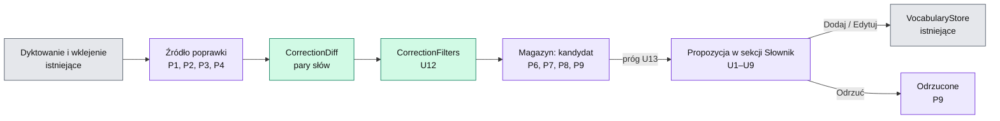
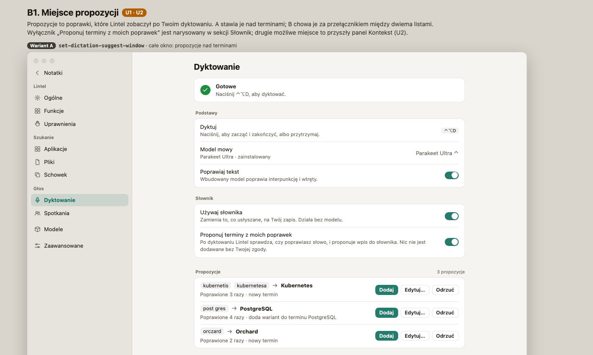
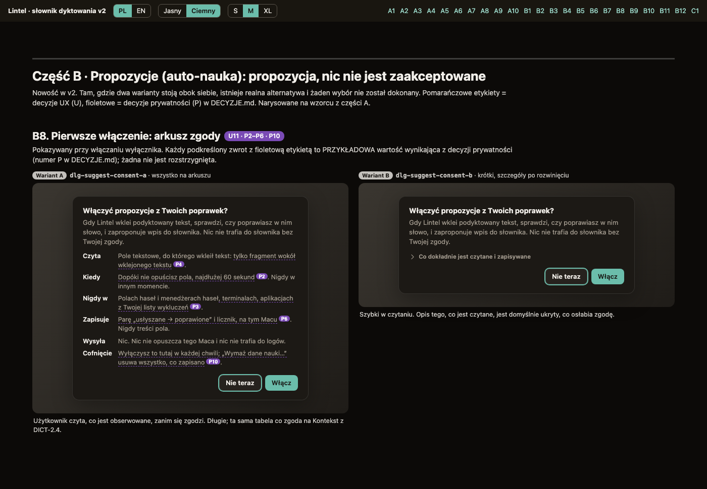

# Auto-nauka słownika dyktowania: propozycje terminów z poprawek użytkownika

> Status: **projekt, zablokowany decyzjami właściciela.** Sekcja „Open Questions" poniżej jest twardą bramką: żadne z 27 pytań (U1–U14, P1–P13) nie ma odpowiedzi i żaden wariant nie został wybrany przez autora. Spec opisuje architekturę **parametryzowaną** tymi decyzjami. Nic z tego dokumentu nie jest zaimplementowane.
>
> Decyzja właściciela z 2026-11-20, która wyznacza ramy: panel słownika (DICT-1.2) wychodzi teraz i jest na `main` (PR #157); auto-nauka wchodzi **po** fundamencie kontekstu (DICT-2.1 `FocusContextReader` w `LintelKit`, DICT-2.2 realizacja Accessibility). Decyzje UX i prywatności właściciel podejmuje osobno.
>
> Dokumenty powiązane: backlog `.ai/specs/backlog/2026-11-13-epic-context-aware-dictation.md` (story DICT-2.8, dopisana razem z tym specem), ADR `docs/decisions/0010-dictation-context.md` (bez zmian) i propozycja jego poprawki `docs/decisions/0010-dictation-context-amendment-auto-learn.md` (status Proposed).
>
> Wszystkie przykłady w tym pliku są wymyślone. Żaden nie pochodzi z prawdziwego dyktowania ani spotkania.

## 📝 TLDR

**Kto:** osoba, która dyktuje i po wklejeniu ręcznie poprawia te same nazwy własne („kubernetis" → „Kubernetes").
**Dziś:** słownik (`vocabulary.json`, `TermReplacer`) działa, ale każdy termin trzeba wpisać ręcznie w Ustawienia → Dyktowanie → Słownik. Lintel nie wie, że użytkownik poprawił słowo.
**Propozycja (przyszłe zachowanie):** po wklejeniu podyktowanego tekstu Lintel dowiaduje się o poprawce (sposób: decyzja P1), liczy powtarzające się pary „usłyszane → poprawione" i po przekroczeniu progu pokazuje **propozycję** w sekcji Słownik. Nic nie trafia do słownika bez zatwierdzenia. Odrzucona para nie wraca.
**Dlaczego to wymaga osobnego specu:** wariant z obserwacją pola łamie dwie reguły ADR 0010 (odczyt tylko przy naciśnięciu skrótu; nic z pola nie jest zapisywane) i przy jednym z wariantów zmienia zamrożony kontrakt `FocusContextReader`, zanim DICT-2.1 go zamrozi.

## ⚠️ Open Questions — otwarte decyzje właściciela (twarda bramka)

Zasady tej sekcji:

- Pole „Decyzja właściciela" jest **puste we wszystkich wierszach** i wypełnia je wyłącznie właściciel. Ten spec powstał w trybie autonomicznym, ale wartości domyślne **celowo nie zostały przyjęte** (decyzja właściciela z 2026-11-19, punkt 10, i z 2026-11-20). Dlatego nie ma tu sekcji „Resolved assumptions".
- „Rekomendacja" to opinia autora z uzasadnieniem. Nie jest wyborem i nie wolno jej implementować jako wyboru.
- Implementacja żadnego kroku nie zaczyna się, dopóki nie są wypełnione decyzje wymienione przy tym kroku w „Implementation Plan" (kolumna „Bramka decyzji").
- Kolejność odpowiadania, która oszczędza pracy: P1 → P2 (bo od nich zależy kontrakt `LintelKit` przed DICT-2.1) → P5 → P3, P4 → P6–P10 → P11–P13 → U1–U14.
- Warianty i źródła rynkowe pochodzą z makiety v2 i jej listy decyzji (rewizja 2, 2026-11-20; makieta jest poza repozytorium, zrzuty części B są w `assets/dictation-vocabulary-auto-learn/`).

**Twarde odmowy proponowane dla każdego wariantu** (jedno potwierdzenie): pola bezpieczne; aktywne Secure Event Input; własne okna Lintel; aplikacje z listy `contextDeniedApps`; brak uprawnienia Dostępność; nic z pola, par ani kandydatów w logach, raportach awarii, diagnostyce i `ranking.sqlite`.
Decyzja właściciela: ___

### Decyzje prywatności (P1–P13)

| ID | Pytanie | Warianty | Konsekwencje techniczne | Rekomendacja i uzasadnienie | Decyzja właściciela |
|---|---|---|---|---|---|
| **P1** | Skąd Lintel wie o poprawce | **A** obserwacja pola przez Dostępność po wklejeniu · **B** tylko jawne polecenie („Dodaj poprawkę do słownika" na zaznaczeniu) · **C** tylko poprawki w oknach Lintel (np. edycja dyktowania w Notatkach) · **D** A+B albo A+C | A: nowy cel uprawnienia Dostępność, port odczytu z DICT-2.1/2.2, poprawka ADR (zmiany 1, 3, 5, 7, 11). B: źródło `selection` z DICT-2.1/2.2, odczyt na polecenie poza naciśnięciem skrótu dyktowania (zmiany 3, 5, 7); nowa komenda `PluginCommand`. C: zero zmian w ADR i `LintelKit`, nie zależy od DICT-2.x; do sprawdzenia w kodzie, czy edycja w Notatkach daje parę „przed/po" (Notes nie importuje `DictationPlugin`). Sekcja „Propozycje", magazyn i filtry są dla A, B i C te same. | A spełnia zlecenie, ale tylko z ograniczeniami P2–P6. C jest jedynym wariantem bez zależności od DICT-2.x i bez zmiany ADR, ale obejmuje mało poprawek (tekst poprawia się tam, gdzie został wklejony). | ___ |
| **P2** | Jak długo trwa obserwacja i ile razy pole jest czytane (dotyczy P1 = A) | **A** do utraty fokusu przez pole, z limitem czasu (np. 60 s) · **B** jeden odczyt po stałym czasie N s (10/30/60) · **C** tylko przy następnym dyktowaniu (porównanie z migawką, którą kontekst i tak robi) · **D** A, a dodatkowo koniec przy następnym dyktowaniu. Niezależnie: **(i)** dwa odczyty (bazowy i końcowy) albo **(ii)** nasłuch każdej zmiany wartości | A/D: **rozszerzenie zamrożonego kontraktu** (tożsamość pola, ponowny odczyt tego samego pola, powiadomienie o utracie fokusu); kształt musi wejść do ADR **przed** PR DICT-2.1 albo kosztuje drugi PR kontraktowy w kolejce `LintelKit`. B: kontrakt bez zmian, drugie `snapshot(.field)` po czasie; „to samo pole" tylko przez pid i odnalezienie wklejonego tekstu; ADR musi dopuścić odczyt poza naciśnięciem skrótu. C: żadnego nowego momentu odczytu, kontrakt i reguła „czytamy tylko przy skrócie" bez zmian; uczy się tylko, gdy użytkownik dyktuje ponownie w tym samym polu, z 500 znaków przed kursorem, i wymaga włączonego kontekstu ze źródłem `field`. (ii) to w praktyce śledzenie pisania w cudzej aplikacji przez czas obserwacji. | (i) w każdym przypadku. Między A–D bez wyboru autora: C ma najmniejszy koszt prywatności i uczy się najmniej; A z limitem 60 s uczy się najwięcej i wymaga zmiany ADR oraz kontraktu. Jeśli celem jest najpierw bezpieczne wdrożenie: C, potem ewentualnie A po dogfoodzie. | A–D: ___ · (i)/(ii): ___ · limit czasu albo N: ___ |
| **P3** | W jakich aplikacjach | **A** wszystkie poza listą odmów (start: `contextDeniedApps`) · **B** tylko dozwolone (lista użytkownika) · **C** A plus kategorie domyślnie wykluczone, każda osobno: (1) terminale, (2) przeglądarki: wykluczyć / nie / tylko dozwolone, (3) zdalne pulpity i maszyny wirtualne. Dodatkowo: jedna lista wspólna z kontekstem czy osobna | A/C: `CorrectionPolicy` czyta `contextDeniedApps` (klucz z DICT-2.3) i ewentualnie drugi klucz. Osobna lista = nowy klucz ustawień (`BACKWARD_COMPATIBILITY.md` §3) i drugi edytor listy w UI; wspólna = jeden model, ale wyklucza kontekst w terminalu (DICT-3.x) razem z nauką. Kategorie = zamknięte listy identyfikatorów pakietów w kodzie, każdy sprawdzony na zainstalowanej kopii (reguła ADR: niepotwierdzony identyfikator wypada). B: edytor listy dozwolonych i pusty stan „nauka nigdzie nie działa". | C z (1) wykluczyć i (3) wykluczyć; lista wspólna plus kategorie nauki jako dodatkowe wpisy. Punkt (2) bez rekomendacji: to wybór między ryzykiem (pole hasła zbudowane ze zwykłego pola na stronie) a użytecznością (poczta, czat i dokumenty w przeglądarce). | A/B/C: ___ · (1): ___ · (2): ___ · (3): ___ · lista: ___ |
| **P4** | Ile pola jest czytane i co jest w pamięci | **A** tylko fragment wokół wklejonego tekstu, odczytem po zakresie · **B** cała wartość pola. Dodatkowo: górny limit długości wklejonego tekstu, powyżej którego obserwacji nie ma | A: odczyt przez atrybut zakresu jak w DICT-2.2; limit 500 znaków przed kursorem z ADR nie wystarcza dla dłuższych dyktowań, więc tabela limitów ADR dostaje osobny wiersz „odczyt obserwacji" albo dłuższe dyktowania nie są obserwowane. Wykonalność w głównych aplikacjach nieznana do prób DICT-0.2. B: w pamięci cały dokument lub rozmowa, także tekst niedyktowany; prostszy algorytm odnajdywania. W obu: odczyty tylko w pamięci, kasowane na końcu obserwacji. | A. Jeśli próby pokażą, że odczyt po zakresie nie działa w danej aplikacji, to w tej aplikacji nie ma nauki; nie ma przejścia na B. | A/B: ___ · limit wklejonego tekstu: ___ |
| **P5** | Wartość domyślna i relacja do wyłącznika kontekstu | (1) **A** wyłączone, włączane po arkuszu zgody · **B** włączone. (2) **a** auto-nauka podlega `contextEnabled` · **b** niezależny wyłącznik. (3) osobny arkusz zgody czy wiersz w arkuszu zgody na kontekst (DICT-2.4), domyślnie odznaczony | 1B łamie zasadę ADR i `BACKWARD_COMPATIBILITY.md` §3 (ustawienie, które czyta więcej, wymaga zgody). 2a: reguła 1 ADR bez zmian; auto-nauka nie może wejść przed DICT-2.3/2.4; wyłącznik jest nieaktywny, gdy kontekst jest wyłączony. 2b: reguła 1 ADR do przepisania („kontekst wyłączony" przestaje znaczyć „nic nie czytamy"); auto-nauka zależy tylko od DICT-2.1/2.2. 3: osobny arkusz = osobny widok i teksty; wiersz = zmiana arkusza DICT-2.4. | 1A, 2a, 3 osobny arkusz. Jedna prosta obietnica („wyłączam kontekst = Lintel nie czyta cudzych aplikacji") jest warta więcej niż elastyczność. | (1): ___ · (2): ___ · (3): ___ |
| **P6** | Co jest przechowywane | (1) propozycja: **a** tylko para i licznik · **b** plus data pierwszej i ostatniej poprawki · **c** plus identyfikator aplikacji · **d** plus fragment zdania. (2) kandydaci pod progiem: **a** jawnie na dysku · **b** tylko skrót z kluczem i licznik, jawna para dopiero przy osiągnięciu progu · **c** tylko w pamięci. (3) nigdy: treść pola, zdanie wokół poprawki, tytuł okna, logi z jakimkolwiek słowem | 1b jest konieczne, jeśli P8 ma wygaszanie. 1c to nowa dana o zachowaniu (wymagana tylko przez U10.2b). 1d przeczy punktowi 3. 2b: potrzebny klucz HMAC z Pęku kluczy (`MasterKeyStore`), więc błąd Pęku kluczy wstrzymuje liczenie; jawna para jest w pamięci w chwili osiągnięcia progu, więc da się ją zapisać. 2c: licznik zeruje się przy zamknięciu aplikacji i przy `deactivate()`; przy progu 1 (U13.1) pytanie 2 znika. | 1a + 1b, bez c i d; 2b. Sama para jest treścią (słowo wpisane w cudzej aplikacji); przy 2b jednorazowa poprawka nigdy nie leży na dysku w czytelnej postaci. | (1): ___ · (2): ___ · (3) potwierdzenie: ___ |
| **P7** | Gdzie | **A** `Plugins/dictation/suggestions.json` (0600, `AtomicFile`) · **B** nowe tabele w `dictation.sqlite` (SQLCipher, migracja addytywna) · **C** osobny zaszyfrowany plik z podkluczem HKDF z `MasterKeyStore(service: com.lintelapp.dictation)` | A: nowy utrwalony format JSON z wersją, jawny dla każdego procesu użytkownika. B: szyfrowanie istniejącym mechanizmem; gdy historii nie da się otworzyć (błąd Pęku kluczy), nauka stoi; reset bazy po `errSecItemNotFound` zabiera też propozycje i odrzucone; kolejność migracji względem `v2-context` (DICT-1.4); P10.4 musi powiedzieć wprost, czy „Wyczyść historię" je rusza. C: szyfrowane i niezależne od historii; nowy format do utrzymania (AES-GCM, wersja, polityka resetu jak w `EncryptedDatabaseOpener`). Zatwierdzony wpis i tak trafia do jawnego `vocabulary.json`; szyfrowanie chroni to, czego użytkownik **nie** zatwierdził. | B albo C (różnica to koszt i powiązanie z historią). A tylko przy P6.2 = b lub c i P9 = A, bo wtedy jawnie leżą wyłącznie propozycje czekające na decyzję. | ___ |
| **P8** | Jak długo | (1) kandydaci pod progiem: 30 dni / 90 dni / nigdy; limit liczby (np. 200). (2) czekające propozycje: **a** do decyzji użytkownika, z limitem liczby (np. 50) · **b** wygasają po 30/90 dniach. (3) odrzucenie przez brak odpowiedzi: tak / nie | Retencja uruchamiana jak `DictationHistory` (co godzinę i przy otwarciu magazynu), na wstrzykniętym zegarze. Wygaśnięcie to zapomnienie, nie odrzucenie: para może wrócić. Limity trafiają do tabeli limitów ADR (zmiana 8). | (1) 30 dni, jak domyślna retencja historii; (2) a; (3) nie, bo propozycje czekają w Ustawieniach i nie ma wyskakującego okna. | (1): ___ · (2): ___ · (3): ___ |
| **P9** | Odrzucone: skrót czy jawnie | **A** HMAC-SHA-256 znormalizowanej pary z kluczem z Pęku kluczy · **B** jawnie (w zaszyfrowanym magazynie przy P7 = B/C) · **C** zwykły skrót bez klucza. Dodatkowo: (1) na zawsze czy z limitem; (2) „to samo" = dokładnie ta para, czy każda propozycja z tym samym poprawionym słowem | A: nie da się ich wyświetlić, jedyna operacja to „Zapomnij odrzucone" (U7 = A); po utracie klucza lista jest bezużyteczna i pary mogą wrócić. B: lista i „Przywróć" (U7 = B); Lintel trzyma słowa, których użytkownik nie chciał. C: dla pojedynczych słów daje się odwrócić przez zgadywanie. Limit łamie „nigdy nie wracają" po jego przekroczeniu. | A; (1) na zawsze z wysokim limitem technicznym opisanym w dokumentacji; (2) dokładnie ta para. | A/B/C: ___ · (1): ___ · (2): ___ |
| **P10** | Wyłączenie i wymazanie | (1) wyłączenie: **A** przestaje czytać, wszystko zostaje · **B** kasuje kandydatów pod progiem, zostawia propozycje i odrzucone · **C** kasuje wszystko poza odrzuconymi (albo łącznie). (2) „Wymaż dane nauki…": kandydaci, propozycje i odrzucone; nie terminy w słowniku. (3) „Usuń dane" w Funkcjach usuwa także to; wyłączenie wtyczki = jak wyłączenie wyłącznika. (4) „Wyczyść historię": nie rusza / rusza. (5) trwająca obserwacja przerywana natychmiast, bez końcowego odczytu | Patrz sekcja „Wymazanie danych" (macierz). 1B i 1C wymagają operacji magazynu `purge(scope:)`; 3 dopisuje krok do `DictationPlugin.eraseData()` przed historią (jak dziś słownik); przy P7 = B punkt 4 wymaga, by „Wyczyść historię" nie kasowała tabel nauki (albo kasowała: decyzja). 5: anulowanie zadania obserwacji i `release` uchwytu pola. | 1B; 2 i 3 jak opisano; 4 nie rusza; 5 tak. | (1): ___ · (2): ___ · (3): ___ · (4): ___ · (5): ___ |
| **P11** | Co użytkownik widzi | (1) czwarty cel w wierszu Dostępność w Ustawienia → Uprawnienia. (2) nowy wiersz „poprawki" w tabeli zaufania (panel Kontekst, strona produktu). (3) sygnał w trakcie obserwacji: **A** brak · **B** znak w HUD albo w pasku menu. (4) wiersze „Dane nauki" z liczbami i przyciskami w panelu Dyktowanie | 1: zmiana tekstu celu uprawnienia (`BACKWARD_COMPATIBILITY.md` §4 i §5, nota wydania); zależy od kolejności z DICT-2.4 (trzy cele → cztery). 2: tabela zaufania jest jednym źródłem dla trzech miejsc. 3B: HUD widoczny do 60 s po każdym dyktowaniu (przy P2 = A) albo nowy stan ikony paska menu; HUD jest widoczny przy udostępnianiu ekranu. 4: liczby z magazynu, bez treści. | 1, 2, 4 tak; 3A przy P2 = B lub C, do rozważenia 3B przy P2 = A. | (1): ___ · (2): ___ · (3): ___ · (4): ___ |
| **P12** | Co nigdy nie opuszcza Maca i modele | (1) pary, kandydaci i odrzucone nigdy nie trafiają do zewnętrznego dostawcy, do „Mojego serwera" ani do synchronizacji. (2) recenzja propozycji przez model: **A** brak, tylko reguły w Swifcie · **B** wbudowany model lokalny ocenia parę | 1: test skanujący, że typy auto-nauki nie są importowane przez formatery ani przez kod dostawców; dopisek do reguły 4 ADR. 2B: para trafia do promptu lokalnego modelu (zmiana reguły 3 ADR), `LLMLease` z priorytetem `background`, nowy wersjonowany prompt i korpus regresyjny. | 1 tak; 2A. | (1): ___ · (2): ___ |
| **P13** | Testy, QA i diagnostyka | Testy i fixture wyłącznie syntetyczne; QA przez atrapę czytnika (`--qa-focus-context` z DICT-2.2), bez czytania prawdziwych aplikacji; „Kopiuj diagnostykę": tylko liczby (obserwacje, pominięcia według powodu, propozycje) | Liczniki w pamięci procesu albo w magazynie (liczby bez treści); test skanujący logowanie jak w DICT-2.3. | Potwierdzić wszystkie trzy. | ___ |

### Decyzje UX (U1–U14)

Litery w nawiasach (B1–B12) to sekcje części B makiety.

| ID | Pytanie | Warianty | Konsekwencje techniczne | Rekomendacja i uzasadnienie | Decyzja właściciela |
|---|---|---|---|---|---|
| **U1** | Miejsce propozycji (B1) | **A** blok „Propozycje" nad listą terminów · **B** przełącznik segmentowy „Terminy / Propozycje (3)" | A: sekcja Słownik rośnie, potrzebny limit wysokości (U13.3). B: nowa kontrolka w panelach Ustawień (nie ma jej w `LintelUI`), stan wyboru w modelu panelu. | A z limitem wysokości. Propozycja, której nie widać, nie zostanie rozstrzygnięta. | ___ |
| **U2** | Gdzie mieszka wyłącznik auto-nauki (B1) | **A** w sekcji Słownik, pod „Używaj słownika" · **B** w panelu Kontekst (DICT-2.4), w Słowniku tylko odnośnik · **C** w obu (ten sam klucz) | B i C zależą od panelu Kontekst, który nie ma zaakceptowanego prototypu; wariant B nie jest narysowany. Zależy od P5.2. | Brak silnej; C, jeśli P5.2 = a. | ___ |
| **U3** | Wiersz propozycji i akcje (B2) | **A** przyciski z tekstem „Dodaj", „Edytuj…", „Odrzuć" · **B** ikony ✓ ✎ ✕ z etykietami VoiceOver | A: przy rozmiarze XL przyciski zawijają się pod wiersz (układ do sprawdzenia w `TextSize`). B: zwarte; ✕ wygląda jak „zamknij", a odrzucenie jest trwałe. | A, z powodu trwałości odrzucenia. | ___ |
| **U4** | Brak propozycji (B3) | **A** jedna linia „Brak propozycji. Pojawi się, gdy poprawisz to samo słowo po dyktowaniu." · **B** nic poza wyłącznikiem | A: jeden tekst `en`/`pl`. | A. Przy funkcji, która obserwuje, panel powinien mówić, że działa i co ją uruchamia. | ___ |
| **U5** | Co robi „Dodaj" (B4) | **A** jedno naciśnięcie dodaje wpis, znacznik „Dodano" do zamknięcia panelu · **B** zawsze otwiera wypełniony formularz DICT-1.2 | W obu: konflikt (reguły D7) albo krótki wariant (D8) zawsze otwiera formularz, więc `VocabularyRules` nie mają obejścia. A: zapis przez `VocabularyStore.save` i odświeżenie `VocabularyPanelModel`. | A. Użytkownik już widzi parę w wierszu, a wpis można potem edytować. | ___ |
| **U6** | Odrzucenie: co dzieje się od razu (B5) | **A** od razu, z paskiem „Cofnij" do zamknięcia panelu · **B** od razu, bez „Cofnij" · **C** potwierdzenie w arkuszu jak usuwanie terminu | A: pasek cofania nie istnieje w panelach (D10 go nie wybrał); wymaga opóźnionego zapisu odrzucenia albo operacji `unreject`, która przy P9 = A działa tylko, póki para jest w pamięci. C: `ConfirmSheet` przy każdym odrzuceniu. | Brak silnej; B, jeśli U3 = A (nazwany przycisk trudno nacisnąć przypadkiem). | ___ |
| **U7** | Zarządzanie odrzuconymi (B5) | **A** tylko „Zapomnij odrzucone…" · **B** lista odrzuconych z „Przywróć" | Wynika z P9: B wymaga P9 = B. | Wynika z P9. | ___ |
| **U8** | Auto-nauka wyłączona: co z czekającymi propozycjami (B6) | **A** zostają widoczne i rozstrzygalne, z dopiskiem · **B** nic nie widać | Wynika z P10.1. | Wynika z P10. | ___ |
| **U9** | Licznik i odznaka (B9) | **A** liczba tylko w nagłówku sekcji · **B** także liczba przy „Dyktowanie" w pasku bocznym · **C** także notka w HUD dyktowania (nigdy samo słowo) | B: nowy sygnał w pasku bocznym; dziś `SettingsHost` ma tylko kropkę statusu z `settingsStatus`, więc potrzebna zmiana w powłoce albo nowa wartość w kontrakcie `SettingsStatus` (wtedy PR kontraktowy `LintelKit`). C: nowy stan `HUDState`, ogłoszenie przez `AnnouncementGate`. | B. C przerywa dyktowanie; A sprawia, że funkcja jest niewidoczna. Uwaga autora: koszt B w kontrakcie trzeba poznać przed decyzją. | ___ |
| **U10** | Aplikacje bez wsparcia i brak Dostępności (B7) | (1) brak uprawnienia: linia w sekcji, akcja w banerze panelu (jedyny narysowany wariant). (2) aplikacja, która nie udostępnia tekstu: **a** nic nie pokazywać · **b** lista „tu nauka nie działa" w Ustawieniach | 2b wymaga zapisywania identyfikatorów aplikacji (P6.1c). | 2a. | (1): ___ · (2): ___ |
| **U11** | Arkusz zgody (B8) | (1) **A** wszystko na arkuszu (tabela: czyta, kiedy, nigdy w, zapisuje, wysyła, cofnięcie) · **B** krótki tekst i szczegóły po rozwinięciu. (2) **a** przy każdym włączeniu · **b** tylko za pierwszym razem. (3) domyślny przycisk „Nie teraz" / „Włącz" | Treść arkusza wynika z P2–P6 i P10 i jest generowana z tej samej tabeli zaufania co panel Kontekst. 2b wymaga zapamiętania zgody (nowy klucz ustawień). | 1A, 2a, 3 „Nie teraz" (wzorzec zgody na kontekst z ADR 0010). | (1): ___ · (2): ___ · (3): ___ |
| **U12** | Szczegóły filtrów (B10) | (1) CamelCase („auth service" → `AuthService`): **a** proponować · **b** pomijać jako symbol kodu. (2) sama wielkość liter: **a** pomijać · **b** proponować jako termin bez wariantów, nie na początku zdania. (3) przeredagowanie („kot" → „pies"): pomijać, gdy słowa nie są podobne. (4) długość: zmiana ponad 3 słowa pominięta; kandydat najwyżej N znaków. (5) lista pospolitych słów: **a** wbudowana pl+en · **b** słownik systemowy (`NSSpellChecker`). (6) e-maile, emoji, bardzo popularne imiona: dodać do pominięć? | Wszystko to parametry `CorrectionFilters` (czysta logika). 3: próg podobieństwa nie ma danych i jest mierzony na syntetycznym zbiorze. 5a: lista w zasobach z licencją zgodną z MIT/BSD/Apache i wpisem w `THIRD_PARTY_NOTICES.txt`; 5b: `NSSpellChecker` jest AppKit i działa na głównym aktorze, dostępność dla `pl` do sprawdzenia. | 1a, 2a, 3 tak, 4 jak w makiecie (3 słowa, 64 znaki), 5 do rozstrzygnięcia po sprawdzeniu 5b, 6: e-maile i emoji tak, imiona nie (imiona i nazwiska to częsty powód istnienia słownika). | (1): ___ · (2): ___ · (3): ___ · (4): ___ · (5): ___ · (6): ___ |
| **U13** | Kiedy para staje się propozycją | (1) próg: 1 / 2 / 3 poprawki tej samej pary. (2) grupowanie kilku usłyszanych form z tą samą poprawką w jeden wiersz: tak / nie. (3) limit widocznych propozycji (np. 5, reszta pod „Pokaż wszystkie") | Próg 1 usuwa pojęcie kandydata pod progiem (P6.2, P8.1). Grupowanie: klucz propozycji to poprawione słowo, lista usłyszanych form w wierszu. | Próg 2, grupowanie tak, 5 widocznych. | (1): ___ · (2): ___ · (3): ___ |
| **U14** | Klawiatura i nazwy (B12) | (1) Return = Dodaj, ⌫ = Odrzuć, edycja: ⌘E albo spacja, Esc = „Nie teraz"/anuluj. (2) nazwy: „Propozycje / Suggestions", „Proponuj terminy z moich poprawek / Suggest terms from my corrections", „Dodaj / Edytuj… / Odrzuć", „Zapomnij odrzucone… / Forget Rejected…", „Wymaż dane nauki… / Erase Learning Data…". (3) VoiceOver nigdy nie ogłasza nowej propozycji, gdy użytkownik jest w innej aplikacji | Skróty działają tylko, gdy fokus jest w liście propozycji; wpis do `BACKWARD_COMPATIBILITY.md` §5, jeśli staną się zachowaniem widocznym dla użytkownika. | Potwierdzić albo podać własne. | (1): ___ · (2): ___ · (3): ___ |

### Pytania spoza list U i P, które wyszły przy pisaniu specu

| ID | Pytanie | Dlaczego | Rekomendacja | Decyzja właściciela |
|---|---|---|---|---|
| **K1** | Jeśli P2 nie będzie rozstrzygnięte, zanim zacznie się PR DICT-2.1: czy dopisać opcjonalny kształt obserwacji do DICT-2.1 „na zapas", czy przyjąć osobny PR kontraktowy później? | ADR 0010, decyzja 3: żaden inny kształt bez zmiany ADR. Kolejka `LintelKit` jest jedna dla DICT i MEET. | Nie blokować DICT-2.1 i nie zamrażać kształtu, którego próby DICT-0.2 jeszcze nie potwierdziły; osobny PR w kolejce. | ___ |
| **K2** | Reguła 5 ADR: czy `dictation_entry.context_sources` ma notować, że dyktowanie było obserwowane? | Zmiana 10 z listy poprawek ADR. | Nie: historia nie musi wiedzieć o obserwacji, a nowa wartość na zamkniętej liście to zmiana utrwalonego formatu. | ___ |
| **K3** | Czy jeden spec obejmuje też wariant P1 = B (jawne polecenie) i P1 = C (wewnątrz Lintel)? | Są to osobno wdrażalne źródła poprawek; wspólne są magazyn, filtry i sekcja „Propozycje". | Zostają w tym specu jako fazy opcjonalne (C1, C2), bo bez wspólnego rdzenia nie działają; po wyborze P1 niewybrane fazy są usuwane. | ___ |

## 📝 Problem Statement

- Słownik wymaga ręcznego wpisania każdego terminu i każdej usłyszanej formy. Użytkownik poprawia to samo słowo w wklejonym tekście wiele razy, zanim otworzy Ustawienia.
- Konkurencja uczy się z poprawek (patrz „Wzorce rynkowe"), więc brak tej funkcji jest widoczny.
- **Czego nie wiemy:** nie ma pomiaru, jak często właściciel poprawia nazwy po dyktowaniu (bramka DICT-0.1 przeszła bez linii bazowej, ADR 0010). Makieta nie dowodzi popytu, jakości filtrów ani zachowania Accessibility w prawdziwych aplikacjach. Wartość funkcji oceni dopiero dogfood (krok B5).

## 📝 Cel i nie-cele

**Cel.** Skrócić drogę od „poprawiłem słowo" do „Lintel pisze je dobrze", bez dodania czegokolwiek do słownika bez zgody użytkownika i bez osłabienia modelu zaufania ADR 0010 poza tym, na co właściciel wprost się zgodzi.

**Nie-cele (niezależnie od decyzji):**

- Dodawanie terminów po cichu, bez zatwierdzenia (model Wispr Flow i Typeless).
- Wyskakujące okna z propozycją i odrzucenie przez upływ czasu (model VoiceInk).
- Wysyłanie par, kandydatów albo odrzuconych poza proces: do dostawcy zewnętrznego, do „Mojego serwera", do synchronizacji.
- Zapis treści pola, zdania wokół poprawki albo tytułu okna gdziekolwiek.
- Zapis jakiegokolwiek atrybutu do cudzej aplikacji; włączanie `AXManualAccessibility` (D-Q9).
- Odczyt Accessibility bezpośrednio w `DictationPlugin` z pominięciem portu.
- Dopasowanie fonetyczne i kandydaci z migawki (DICT-4.1): osobna story z własnym pomiarem.
- Nauka z poprawek w notatkach ze spotkań (MEET): poza zakresem.
- Zmiana `TermReplacer`, formatu `vocabulary.json` albo panelu DICT-1.2 poza dodaniem sekcji „Propozycje".

## 📝 Proposed Solution

### Przepływ



Szare elementy istnieją na `main`, zielone są stałe we wszystkich wariantach, fioletowe zależą od decyzji. Wniosek: rdzeń (różnicowanie, filtry, próg, zatwierdzanie przez reguły DICT-1.2) nie zależy od żadnej decyzji prywatności i da się go zbudować na atrapie źródła.

Kroki:

1. **Dyktowanie i wklejenie.** Bez zmian. Punkt zaczepienia: `DictationController.produceAndPaste()`, tylko wynik `.pasted` (nie `.copied`) i tylko główne wklejenie (nie „Wklej surową wersję"). Tekst odniesienia to `output.text`, czyli tekst po formaterze i po słowniku: usłyszana forma musi być taka, jaką `TermReplacer` zobaczy w następnym dyktowaniu.
2. **Obserwacja poprawki.** Źródło poprawki (`CorrectionSource`) dostarcza najwyżej jedną parę tekstów „wklejone / po poprawkach" na dyktowanie. Które źródło i kiedy czyta: P1–P4.
3. **Kandydat.** `CorrectionDiff` wyznacza zmienione ciągi słów; `CorrectionFilters` odrzuca to, co nie jest poprawką pisowni; para już obsługiwana przez słownik albo odrzucona wcześniej nie jest liczona.
4. **Propozycja.** Para, która osiągnęła próg (U13.1), staje się propozycją w sekcji Słownik.
5. **Zatwierdzenie albo odrzucenie.** „Dodaj" przechodzi przez `VocabularyRules` (D7, D8) i `VocabularyStore.save`; „Odrzuć" zapisuje parę jako odrzuconą i para nie wraca.

### Rozważone alternatywy

| Alternatywa | Dlaczego nie jest propozycją główną |
|---|---|
| Ciche dodawanie (Wispr Flow, Typeless) | Błędna reguła zamienia poprawne słowa w każdym dyktowaniu i użytkownik nie wie dlaczego; sprzeczne ze zleceniem. |
| Wyskakująca propozycja po dyktowaniu z odrzuceniem po 10 s (VoiceInk) | Przerywa pracę; okno widoczne przy udostępnianiu ekranu pokazałoby słowo; odrzucenie przez brak odpowiedzi jest trwałe i przypadkowe. |
| Recenzja par przez model | Para trafia do promptu (zmiana reguły 3 ADR); zostaje jako decyzja P12.2, rekomendacja: nie. |
| Nasłuch każdej zmiany wartości pola | Śledzenie pisania w cudzej aplikacji; zostaje jako P2 (ii), rekomendacja: nie. |
| Odczyt Accessibility wprost w `DictationPlugin` | Dwa miejsca odczytu i dwa modele zaufania; sprzeczne z architekturą (jedno miejsce w `LintelApp`). |

### Wzorce rynkowe

Dostęp do źródeł: 2026-11-20 (lista decyzji makiety v2) oraz raport `.ai/specs/research/2026-11-13-context-aware-dictation-market-B.md` (2026-11-13). „NIEPOTWIERDZONE" znaczy: nie znaleziono w źródle pierwotnym.

| Produkt | Model | Co wiadomo | Czego nie wiadomo |
|---|---|---|---|
| Wispr Flow | dodaje po cichu | Obserwuje pole, do którego wkleił tekst; zmiana pisowni słowa dodaje je do słownika; wyłącznik „Auto-add to Dictionary"; słownik synchronizowany z kontem (`wisprflow.ai/data-controls`, dokumentacja słownika). | Mechanizm (Accessibility?), lista wykluczonych aplikacji, czy treść pola trafia do chmury, wartość domyślna. Lista pominięć (nazwy plików, URL-e, symbole kodu, liczby, daty) była w artykule 2026-11-13, a 2026-11-20 już jej nie ma: w tym specu jest **naszym wymaganiem**, nie cytatem. |
| Typeless | dodaje po cichu, z oznaczeniem | Poprawione słowo trafia do grupy „Auto-added"; filtr listy „All / Auto-added / Manually-added" (`typeless.com/help`). | Mechanizm, wyłącznik, wykluczenia. |
| VoiceInk | proponuje, użytkownik zatwierdza | Czyta pole przez Dostępność i zapisuje lokalnie krótkie fragmenty poprawek; obserwacja kończy się przy opuszczeniu pola, nowym nagraniu albo po 60 s; dwa odczyty; próg 1–3; odrzucenie także przez 10 s bez odpowiedzi; limity 12 000 znaków wklejonego tekstu, 64 znaki kandydata, 3 propozycje na obserwację; domyślnie włączone (`tryvoiceink.com/docs/auto-learn-dictionary`; kod GPL v3 czytany tylko jako opis zachowania, nic nie jest kopiowane). | Lista wykluczonych aplikacji. |
| OpenWhispr | opcja do włączenia | „Can watch for the moment you fix a transcription" (dokumentacja słownika). | Szczegóły. |
| Superwhisper, Aqua Voice | tylko ręczny słownik | — | — |

**Co bierzemy:** model „propozycja + zatwierdzenie" (VoiceInk), dwa odczyty zamiast nasłuchu, limity długości. **Co pomijamy:** wyskakujące okna, odrzucenie przez upływ czasu, fragmenty zdań na dysku, recenzję przez zewnętrzny model, synchronizację.

## 📝 Architecture

### Zasady stałe (żadna decyzja ich nie zmienia)

- Cały kod auto-nauki jest w `Sources/DictationPlugin/AutoLearn/` i w `Tests/DictationPluginTests/`. Żaden inny plugin go nie widzi.
- Odczyt cudzej aplikacji idzie wyłącznie przez port `FocusContextReader` (`PluginContext.focusContext`), którego realizacja jest w `LintelApp` (DICT-2.2). Plugin nie importuje Accessibility (test skanujący źródła).
- Różnicowanie i filtry są czystą logiką bez I/O. Zostają w `DictationPlugin`, nie w `LintelCore`: nie ma drugiego użytkownika, a reguła „no feature-specific logic in core" obowiązuje.
- Zatwierdzenie przechodzi przez istniejące `VocabularyRules` i `VocabularyStore`; auto-nauka nie ma własnej ścieżki zapisu do `vocabulary.json`.
- Kod pluginu nie zatrzymuje procesu (`fatalError`, `try!`, wymuszone rozpakowanie są zabronione). Każdy błąd obserwacji albo magazynu kończy się „brak nauki", nigdy błędem dyktowania; wklejenie i zapis historii nie czekają na obserwację.
- Nic z tekstu pola, par, kandydatów ani odrzuconych nie trafia do loggera. Logi niosą nazwy powodów, liczby i czasy.

### Komponenty

| Komponent | Rodzaj | Rola | Zależy od decyzji |
|---|---|---|---|
| `CorrectionSource` (protokół wewnętrzny) | port w pluginie | `func corrections(for: PastedDictation) async -> CorrectionSample?`; realizacje niżej | P1 |
| `FieldCorrectionObserver` | realizacja | Obserwacja pola przez `FocusContextReader` po wklejeniu | P1 = A; kształt od P2, P4 |
| `SelectionCorrectionCommand` | realizacja | Jawne polecenie na zaznaczeniu | P1 = B |
| `InAppCorrectionSource` | realizacja | Poprawki w oknach Lintel | P1 = C |
| `ScriptedCorrectionSource` | atrapa (testy, DEBUG QA) | Podaje pary z pliku albo z testu | — |
| `CorrectionPolicy` | czysta logika | Czy wolno obserwować: wyłącznik, relacja do `contextEnabled`, lista odmów, kategorie, limity długości | P3, P4, P5 |
| `CorrectionDiff` | czysta logika | Z dwóch tekstów wyznacza zmienione ciągi słów | U12.4 |
| `CorrectionFilters` | czysta logika | Odrzuca nie-poprawki; zwraca powód pominięcia | U12 |
| `SuggestionEngine` | logika + magazyn | Liczy pary, stosuje próg i grupowanie, sprawdza słownik i odrzucone | U13, P6, P9 |
| `SuggestionStore` (protokół wewnętrzny) | port w pluginie | Kandydaci, propozycje, odrzucone, retencja, wymazanie | P6–P10 |
| `SuggestionsPanelModel` + widok sekcji | UI | Sekcja „Propozycje" w panelu Dyktowanie, arkusz zgody, wiersze „Dane nauki" | U1–U14, P11 |
| `AutoLearnDiagnostics` | liczniki | Liczby obserwacji, pominięć według powodu, propozycji | P13 |

### Co zmienia każdy wariant

**Źródło poprawki i kontrakt `LintelKit` (P1, P2)**

| Wybór | Kiedy czytane | Co jest potrzebne z `LintelKit` | Zmiana ADR 0010 | Najwcześniejsze wejście |
|---|---|---|---|---|
| P1 = C | nigdy poza oknami Lintel | nic | brak | niezależnie od DICT-2.x |
| P1 = B | raz, na polecenie użytkownika | `snapshot` ze źródłem `selection` (kształt z DICT-2.1) | odczyt poza naciśnięciem skrótu dyktowania; wiersz tabeli zaufania; cel Dostępności | po DICT-2.2 |
| P1 = A, P2 = C | przy następnym naciśnięciu skrótu (istniejąca migawka `field`) | nic ponad DICT-2.1 | tylko wyjątek od zakazu zapisu (zmiana 1) i wiersz „poprawki" | po DICT-2.3 (migawka przy skrócie) |
| P1 = A, P2 = B | drugi odczyt N sekund po wklejeniu | nic ponad DICT-2.1: drugie `snapshot(.field)` | odczyt poza naciśnięciem skrótu; limity | po DICT-2.2 |
| P1 = A, P2 = A lub D | odczyt bazowy po wklejeniu i końcowy przy utracie fokusu albo po limicie | **rozszerzenie kontraktu** (niżej) | nowy kształt w decyzji 3; limity; [0.2] | po DICT-2.2; kształt **przed** DICT-2.1 albo drugi PR kontraktowy |

**Kształt kontraktu potrzebny przed DICT-2.1 dla wariantu „do utraty fokusu" (P2 = A/D).** Dzisiejszy zamrożony kształt (ADR 0010, decyzja 3) ma jedno wywołanie `snapshot` i nie ma tożsamości pola. Obserwacja do utraty fokusu potrzebuje trzech rzeczy, których w nim nie ma:

1. **Tożsamość pola.** Odczyt końcowy musi dotyczyć tego samego elementu, także po tym, jak fokus go opuścił. Bez tego porównanie z innym polem daje bzdurne pary.
2. **Ponowny odczyt tego samego zakresu.** Po poprawce kursor jest gdzie indziej, więc „500 znaków przed kursorem" nie obejmuje już wklejonego tekstu. Port musi pamiętać bezwzględny zakres odczytu bazowego i czytać ten sam zakres z zapasem; plugin nie operuje przesunięciami w cudzym polu.
3. **Powiadomienie o utracie fokusu** z limitem czasu.

Proponowany kształt (addytywny, każdy nowy człon z wartością domyślną; dokładne sygnatury zamraża poprawka ADR, nie ten spec):

```swift
/// Opaque handle to the field a snapshot was read from. Holds no text and is never stored.
/// The port keeps the element and the absolute range it read until `release` or its own time limit.
public struct FocusFieldHandle: Hashable, Sendable {
    public let rawValue: UInt64
    public init(rawValue: UInt64)
}

/// Open set, like `SkipReason`.
public struct FocusLossReason: RawRepresentable, Hashable, Sendable {
    public let rawValue: String
    public init(rawValue: String)
    public static let focusMoved, applicationChanged, timeout, cancelled, unsupported: FocusLossReason
}

public struct FieldRereadRequest: Equatable, Sendable {
    public var slackCharacters: Int   // how far the range may have grown; default 200
    public var maxCharacters: Int     // hard cap of the returned text
    public var budget: Duration       // default 250 ms
}

public struct FieldReread: Equatable, Sendable {
    public var text: String?          // nil when skipped
    public var skipped: SkipReason?
}

// FocusContextRequest, new member with a default:
//   keepsFieldHandle: Bool = false
// FocusContext, new member with a default:
//   fieldHandle: FocusFieldHandle? = nil
// FocusContextReader, new requirements with default implementations in a protocol extension:
//   func reread(_ handle: FocusFieldHandle, _ request: FieldRereadRequest) async -> FieldReread   // default: skipped == .unsupported
//   func focusLoss(of handle: FocusFieldHandle, within limit: Duration) async -> FocusLossReason  // default: .unsupported
//   func release(_ handle: FocusFieldHandle) async                                                // default: nothing
```

Właściwości tego kształtu:

- `NoFocusContextReader` i każda istniejąca realizacja kompilują się bez zmian; nauka wtedy po prostu nie działa (`unsupported`).
- Uchwyt nie niesie treści; test kontraktu sprawdza, że `FocusFieldHandle` nie ma pola tekstowego ani identyfikatora aplikacji.
- Port zwalnia uchwyt sam po własnym limicie (górna granica w tabeli limitów ADR), więc plugin, który zapomni `release`, nie trzyma cudzego elementu.
- Wiarygodność powiadomienia o zmianie fokusu i możliwość odczytu elementu po utracie fokusu są **[0.2]** (kryteria prób niżej). Jeśli próby wypadną źle, człony zostają w kontrakcie i zwracają `unsupported` (ta sama zasada co dla `documentURL` i `terminal`).
- Kiedy: jeśli P2 = A/D zapadnie przed startem DICT-2.1, kształt wchodzi do tego samego PR kontraktowego. Jeśli nie zapadnie: pytanie K1.

**Magazyn (P6, P7, P9)**

| Wybór | Kandydaci pod progiem | Propozycje | Odrzucone | Nowa utrwalona powierzchnia |
|---|---|---|---|---|
| P7 = A | w `suggestions.json` (jawnie przy P6.2 = a, skrót przy b, brak przy c) | jawnie | skrót (P9 = A) albo jawnie (P9 = B) | plik JSON z `version`, 0600, przez `AtomicFile`; odłożenie uszkodzonego pliku jak `vocabulary.json.corrupt` |
| P7 = B | tabela w `dictation.sqlite` | tabela | tabela | migracja addytywna (nazwa do ustalenia, po `v2-context`, jeśli DICT-1.4 jest wcześniej); starszy kod wobec nowszego schematu według `BACKWARD_COMPATIBILITY.md` §2 |
| P7 = C | zaszyfrowany plik | zaszyfrowany plik | zaszyfrowany plik | nowy format (AES-GCM, nagłówek z wersją); polityka resetu jak `EncryptedDatabaseOpener`: tylko `errSecItemNotFound` archiwizuje i resetuje |

Wspólne dla każdego wariantu:

- `SuggestionStore` jest protokołem wewnętrznym pluginu; pierwsza realizacja to `InMemorySuggestionStore` (testy i faza A), druga to wybrana w P7. Zmiana wyboru po wdrożeniu to migracja danych, więc P7 trzeba rozstrzygnąć przed krokiem A2.
- Skróty (P6.2 = b, P9 = A): HMAC-SHA-256 z podkluczem HKDF z `MasterKeyStore(service: com.lintelapp.dictation)` (nowa etykieta podklucza, nie nowy wpis Pęku kluczy). Wejście: `VocabularyRules.key(usłyszane)` + separator + poprawione po `tidy` i normalizacji NFC. Brak klucza albo błąd Pęku kluczy: liczenie stoi, nic nie jest kasowane, sekcja pokazuje stan wstrzymania (ta sama reguła co historia).
- Żaden wariant nie dodaje wpisu Pęku kluczy ani zależności.
- `Plugins/dictation/` zostaje 0700, pliki 0600.

**Retencja (P8).** Zadanie retencji uruchamia się przy otwarciu magazynu i co godzinę (jak `DictationHistory`), na wstrzykniętym zegarze. Parametry z P8: wiek kandydatów, limit liczby kandydatów, limit albo wiek propozycji, limit odrzuconych (P9.1). Wygaśnięcie usuwa wiersz i niczego nie oznacza jako odrzucone.

**Filtry pominięć (zlecenie + U12).** Stała lista powodów pominięcia (wartości otwartego zbioru `CorrectionSkip`, używane tylko w licznikach diagnostyki):

| Powód | Reguła | Parametr z decyzji |
|---|---|---|
| `fileName` | poprawione wygląda jak nazwa pliku albo ścieżka (rozszerzenie po kropce, `/`, `\`, `~`) | — |
| `url` | schemat `://`, `www.`, domena z kropką | e-maile: U12.6 |
| `codeSymbol` | znaki `_ ( ) { } [ ] = ; < > $ #`, `::`, `->` | CamelCase: U12.1 |
| `number` | po obu stronach liczba albo różnica tylko w cyfrach | — |
| `date` | data albo godzina w formach pl/en | — |
| `commonWord` | poprawione jest pospolitym słowem | źródło listy: U12.5 |
| `caseOnly` | różnica tylko w wielkości liter | U12.2 |
| `rephrase` | podobieństwo poniżej progu | U12.3 (próg mierzony) |
| `tooLong` | zmiana ponad N słów albo kandydat ponad M znaków | U12.4 |
| `emoji` | emoji po którejkolwiek stronie | U12.6 |
| `alreadyCovered` | `TermReplacer` już zamienia tę formę na ten termin | — |
| `rejectedBefore` | para jest na liście odrzuconych | P9.2 |
| `wholeTextRemoved` | wklejony tekst zniknął w całości (cofnięcie ⌘Z) | — |
| `anchorLost` | w odczycie nie da się odnaleźć wklejonego tekstu ani jego otoczenia | — |

Filtry działają na tekście w pamięci i zwracają tylko powód; odrzucona para nie jest nigdzie zapisywana.

### Punkty styku z istniejącym kodem (`origin/main`, 2026-11-20)

| Miejsce | Dziś | Zmiana |
|---|---|---|
| `DictationController.produceAndPaste()` | wkleja, pokazuje HUD, zapisuje historię | po wyniku `.pasted` przekazuje `PastedDictation` (tekst, identyfikator pakietu celu, czas) do `CorrectionSource`, bez czekania |
| `VocabularyStore`, `VocabularyRules`, `VocabularyPanelModel` | panel DICT-1.2 | bez zmian w regułach; panel dostaje sekcję „Propozycje" i przyjmuje wypełniony formularz z propozycji |
| `DictationSettings` | `vocabularyEnabled` i inne | nowy klucz wyłącznika; ewentualnie lista odmów nauki (P3) |
| `DictationPlugin.eraseData()` | słownik, potem historia | dochodzi wymazanie danych nauki, przed historią |
| `DictationPlugin.deactivate()` | kończy sesję | przerywa trwającą obserwację i zwalnia uchwyt |
| `LintelApp/Settings/PermissionsPane` | opis celu Dostępności | nowy cel (P11.1) |
| `LintelKit` | `FocusContextReader` jeszcze nie istnieje (brak PR DICT-2.1) | tylko przy P2 = A/D |

## 📝 Data Model

Model logiczny, niezależny od P7. Nazwy pól po angielsku; realizacja fizyczna wynika z P6, P7, P9.

| Encja | Pola | Uwagi |
|---|---|---|
| `Candidate` (para pod progiem) | `key` (skrót albo jawna para: P6.2), `count`, `firstSeenAt`, `lastSeenAt` | nie istnieje przy progu 1 (U13.1) i przy P6.2 = c |
| `Suggestion` (czeka na decyzję) | `id`, `corrected`, `heardForms: [String]` (jedna przy U13.2 = nie), `count`, `firstSeenAt`, `lastSeenAt`; opcjonalnie `bundleID` (tylko P6.1c) | jedyne miejsce, w którym niezatwierdzona para leży w czytelnej postaci |
| `Rejected` | `key` (HMAC: P9 = A) albo jawna para (P9 = B), `rejectedAt` | zakres „tego samego": P9.2 |
| `Counters` (diagnostyka) | liczby obserwacji, pominięć według `CorrectionSkip`, propozycji, zatwierdzeń, odrzuceń | bez treści; czy trwałe, czy tylko w pamięci: P13 |

Dane wrażliwe: `Suggestion.corrected` i `heardForms` to słowa wpisane albo wypowiedziane przez użytkownika, także w cudzej aplikacji. Traktowane jak tekst dyktowania: nigdy w logach, nigdy w `ranking.sqlite`, nigdy w diagnostyce. Graf modelu danych nie jest generowany: fizyczny schemat zależy od P7.

## 📝 API Contracts

**Klucze ustawień** (nazwy robocze; po wydaniu są chronione, `BACKWARD_COMPATIBILITY.md` §3):

| Klucz | Typ i wartość domyślna | Kiedy istnieje |
|---|---|---|
| `plugins.dictation.suggestFromCorrections` | Bool; domyślna według P5.1 | zawsze |
| `plugins.dictation.suggestDeniedApps` | [String] | tylko przy osobnej liście (P3) |
| `plugins.dictation.suggestConsentShown` | Bool | tylko przy U11.2 = b |
| `plugins.dictation.qaCorrections` | ścieżka pliku z parami | tylko DEBUG, nie jest kontraktem |

Każdy nowy klucz dostaje wpis w `SettingsKeyCoverageTests` i w §3 z uzasadnieniem wartości domyślnej.

**`LintelKit`.** Bez zmian, poza P2 = A/D (kształt wyżej) i ewentualnie U9 = B (jeśli liczba w pasku bocznym wymaga nowej wartości w `SettingsStatus`).

**Komendy.** `dictation.addCorrection` tylko przy P1 = B (`PluginCommand` bez domyślnego skrótu, w menu).

**Diagnostyka.** „Kopiuj diagnostykę" dostaje blok liczb (P13); format tekstowy nie jest kontraktem.

## 📝 UI/UX

Propozycja, **bez zaakceptowanego prototypu**. Makieta v2 (rewizja 2, 2026-11-20) jest poza repozytorium; jej część B (sekcje B1–B12) rysuje sekcję „Propozycje" z wariantami A/B obok siebie tam, gdzie istnieje realna alternatywa, a część C to interaktywny symulator poprawek z filtrami i progiem (układ symulatora nie jest propozycją). Styl: tokeny zaakceptowanego prototypu `.ai/prototypes/lintel-app/index.html`. Wszystkie dane w makiecie są wymyślone.

Zrzuty makiety (propozycja, nie wzorzec):

- `assets/dictation-vocabulary-auto-learn/mockup-01-suggestions-window-light.png` i `-dark.png`: całe okno, propozycje nad terminami (B1, wariant A).
- `assets/dictation-vocabulary-auto-learn/mockup-02-consent-sheet-light.png` i `-dark.png`: arkusz zgody w dwóch wariantach (B8); podkreślone zwroty to wartości przykładowe wynikające z decyzji P.





Ekrany makiety (stałe identyfikatory): `set-dictation-suggest-*` (sekcja i jej stany), `dlg-suggest-consent-a|b` (arkusz zgody), `hud-suggest` (notka w HUD, tylko U9 = C), `set-permissions-accessibility` (wiersz Dostępność).

Stany sekcji, które implementacja musi obsłużyć niezależnie od wariantów:

| Stan | Co widać |
|---|---|
| wyłączona | wyłącznik i opis; czekające propozycje według U8 |
| włączona, brak propozycji | według U4 |
| włączona, propozycje | wiersz: usłyszane formy → poprawione, „Poprawione N razy", skutek zatwierdzenia („nowy termin" albo „doda wariant do terminu X") |
| brak Dostępności | linia „Propozycje są wstrzymane…", akcja w banerze panelu (U10.1) |
| magazyn niedostępny (błąd Pęku kluczy przy P7 = B/C albo skrótach) | linia stanu wstrzymania; nic nie jest kasowane |
| słownik tylko do odczytu (`VocabularyStore.Condition`) | „Dodaj" nieaktywne z wyjaśnieniem; odrzucanie działa |
| limit 2000 terminów | „Dodaj" otwiera komunikat limitu z DICT-1.2 |

Wymagania stałe: kolory tylko z `LintelBrand`; rozmiary przez `lintelTextSize` (S, M, XL); każdy wiersz, przycisk i wyłącznik ma etykietę VoiceOver; nowa propozycja nie jest ogłaszana, gdy użytkownik jest w innej aplikacji (U14.3); teksty `en` i `pl` w `Resources/Localizable.xcstrings`; `settingsPane()` nie otwiera magazynu ani Pęku kluczy, gdy plugin jest nieaktywny (`InactiveSettingsPaneTests`).

Zgodnie z regułą backlogu (wspólne DoD, punkt 8) i z decyzją właściciela o zgodności 1:1: implementacja UI zaczyna się dopiero po akceptacji prototypu ekranów z wybranymi wariantami U1–U14.

## 📝 Model zagrożeń

Aktywa: treść pola cudzej aplikacji (także tekst niedyktowany), pary „usłyszane → poprawione", lista odrzuconych, informacja „w jakiej aplikacji użytkownik poprawia".

| # | Zagrożenie | Skutek | Zabezpieczenie | Od decyzji | Co zostaje |
|---|---|---|---|---|---|
| T1 | Treść pola trafia na dysk | Cudzy tekst w pliku Lintel | Odczyty żyją tylko w pamięci jednej obserwacji i są kasowane na każdej ścieżce wyjścia (koniec, anulowanie, błąd, wyłączenie); magazyn przyjmuje wyłącznie typ `CorrectionPair`, nie `String` pola (test typów i test skanujący) | P6.3 | Sama para jest treścią |
| T2 | Treść pola albo para trafia do logów, raportu awarii albo diagnostyki | Wyciek poza kontrolę użytkownika | Test skanujący źródła `AutoLearn/` (wzorzec z DICT-2.3): żadne wywołanie loggera nie przyjmuje `CorrectionSample`, `CorrectionPair`, `Suggestion`; test z atrapą loggera na ścieżkach błędów; diagnostyka tylko z liczb | P13 | — |
| T3 | Pole bezpieczne albo Secure Event Input | Odczyt hasła | Odmowa w porcie (DICT-2.2: `field == .secure`, brak tekstu) i ponowne sprawdzenie przy odczycie końcowym; obserwacja nie startuje, gdy migawka bazowa ma `secure` | twarde odmowy | — |
| T4 | Pole hasła zbudowane ze zwykłego pola na stronie WWW | Hasło wpisane po dyktowaniu wygląda jak poprawka | Filtry (jedno „słowo" bez podobieństwa do usłyszanego to `rephrase`); próg ≥ 2 (U13.1); skrót pod progiem (P6.2 = b); kategoria przeglądarek (P3.2) | P3, P6, U13 | Znane ograniczenie z ADR 0010: Lintel tego nie wykryje. Jeśli przeglądarki nie są wykluczone, ryzyko jest przyjęte przez właściciela |
| T5 | Menedżery haseł | Odczyt sejfu | `contextDeniedApps` obowiązuje naukę; port nie jest wywoływany; niepotwierdzony identyfikator wypada z listy, a pola bezpieczne są odmawiane niezależnie od aplikacji | P3 | Menedżer spoza listy z polem niezabezpieczonym |
| T6 | Terminale | Odczyt to często cały bufor; polecenia i wklejane sekrety | Kategoria wykluczona (P3.1); przy braku wykluczenia odczyt po zakresie (P4 = A) i filtr `codeSymbol` | P3, P4 | Zakresowy odczyt w terminalach niepotwierdzony [0.2] |
| T7 | Zdalne pulpity i maszyny wirtualne | Pole należy do innego systemu; odczyt może zwrócić obraz albo nic, a tekst należy do innej osoby lub organizacji | Kategoria wykluczona (P3.3) | P3 | Lista identyfikatorów nigdy nie jest pełna |
| T8 | Niewłaściwe pole | Bzdurne pary z cudzego tekstu | Uchwyt pola (P2 = A/D) albo pid + odnalezienie wklejonego tekstu (P2 = B/C); `anchorLost` kończy obserwację bez nauki | P2 | Przy P2 = B/C brak tożsamości pola |
| T9 | Odczytany plik magazynu przez inny proces użytkownika | Lista poprawek użytkownika | 0600; szyfrowanie (P7 = B/C); skróty pod progiem i dla odrzuconych | P6, P7, P9 | Zatwierdzone terminy są w jawnym `vocabulary.json` (stan dzisiejszy) |
| T10 | Para trafia do modelu albo poza Mac | Złamanie reguł 3 i 4 ADR | Typy auto-nauki nie są importowane przez formatery, `CleanupPrompt` ani kod dostawców (test skanujący); brak synchronizacji | P12 | — |
| T11 | Zawieszona aplikacja blokuje odczyt | Dyktowanie albo okna Lintel czekają | Kolejka na pid i limit na wywołanie z DICT-2.2; obserwacja poza ścieżką wklejenia; budżet w `docs/perf.md` | — | Brak pomiarów do DICT-0.2 |
| T12 | Błędna reguła po zatwierdzeniu | Poprawne słowa zamieniane w każdym dyktowaniu | Zatwierdzanie przez użytkownika; D7 i D8; `TermReplacer` dopasowuje tylko całe słowa; wpis da się usunąć w panelu | U5, U13 | Polska odmiana da wiele form jednego terminu |
| T13 | Prawdziwe dane właściciela w repozytorium | Trwały wyciek w publicznej historii | Fixture, testy, zrzuty i przykłady wyłącznie syntetyczne; QA na atrapie; punkt obowiązkowy recenzji | P13 | — |
| T14 | Obserwacja trwa po wyłączeniu | Odczyt wbrew woli użytkownika | Wyłączenie wyłącznika, `deactivate()`, wyłączenie kontekstu (P5.2 = a) i cofnięcie Dostępności anulują zadanie natychmiast, bez odczytu końcowego (P10.5) | P5, P10 | — |
| T15 | Udostępnianie ekranu | Widać poprawione słowo | Propozycje tylko w Ustawieniach; HUD nigdy nie pokazuje słowa (U9 = C: tylko liczba) | U9, P11.3 | Otwarte okno Ustawień podczas udostępniania |

## 📝 Wymazanie danych

Macierz parametryzowana P10 (✔ usuwa, — zostawia, ? decyzja):

| Akcja | Kandydaci | Propozycje | Odrzucone | Terminy w słowniku | Trwająca obserwacja |
|---|---|---|---|---|---|
| Wyłączenie wyłącznika | ? (P10.1) | ? (P10.1) | ? (P10.1) | — | przerwana (P10.5) |
| „Zapomnij odrzucone…" | — | — | ✔ | — | — |
| „Wymaż dane nauki…" (arkusz potwierdzenia) | ✔ | ✔ | ✔ | — | przerwana |
| „Wyczyść historię" dyktowania | ? (P10.4) | ? (P10.4) | ? (P10.4) | — | — |
| „Usuń dane" w Funkcjach (`eraseData()`) | ✔ | ✔ | ✔ | ✔ (jak dziś) | przerwana |
| Wyłączenie wtyczki Dyktowanie | jak wyłączenie wyłącznika (P10.3) | | | — | przerwana |
| Reset bazy po `errSecItemNotFound` (tylko P7 = B) | ✔ (z archiwum bazy) | ✔ | ✔ | — | — |

Reguły stałe: każda akcja kasująca idzie przez `.destructiveConfirmation` (`ConfirmSheet`, domyślny „Anuluj"); wymazanie nauki w `eraseData()` wykonuje się przed historią i jego błąd nie blokuje wymazania reszty; przy skrótach z kluczem utrata klucza czyni kandydatów i odrzucone bezużytecznymi, co jest równoważne ich zapomnieniu (opisane w dokumentacji).

## 📝 Uprawnienia

- **Żadnego nowego uprawnienia systemowego.** Odczyt używa uprawnienia Dostępność, które dyktowanie już deklaruje (wklejanie). Nowy jest **cel**: czytanie pola po wklejeniu (P1 = A) albo zaznaczenia na polecenie (P1 = B). P1 = C nie używa Dostępności.
- Tekst wiersza Dostępność w Ustawienia → Uprawnienia: z trzech celów (stan po DICT-2.4) robią się cztery (P11.1). To zmiana opisu celu uprawnienia: `BACKWARD_COMPATIBILITY.md` §4 i §5, nota wydania, etykieta `risk-high`.
- Brak uprawnienia: obserwacja nie startuje, port zwraca `notPermitted`, sekcja pokazuje linię wstrzymania (U10.1). `settingsStatus` tylko czyta zapamiętany stan; o uprawnienie pyta wyłącznie kliknięcie użytkownika. Cofnięcie uprawnienia w trakcie obserwacji kończy ją bez nauki.
- Uprawnienie nie jest dopisywane do `requiredPermissions` po raz drugi; `StatusDerivation` nie liczy auto-nauki jako osobnej „rzeczy do zrobienia", gdy wyłącznik jest wyłączony.
- Zgoda w aplikacji: arkusz według U11 i P5.3; nie jest `OnboardingStep` (ten sam powód co w DICT-2.4: krok pokazałby się sam).

## 📝 Edge Cases & Failure Scenarios

| Sytuacja | Zachowanie | Co widzi użytkownik |
|---|---|---|
| Użytkownik cofa wklejenie (⌘Z) | `wholeTextRemoved`, brak nauki | nic |
| Autokorekta systemu zmienia słowo | nieodróżnialne od poprawki; chroni próg i zatwierdzanie | ewentualna propozycja, którą można odrzucić |
| Użytkownik dopisuje zdanie, nic nie poprawia | różnica poza zakresem wklejonego tekstu jest ignorowana | nic |
| Użytkownik przepisuje całe zdanie | `tooLong` albo `rephrase` | nic |
| Poprawka to odmiana („Kubernetesa") | osobna usłyszana forma; grupowanie według U13.2 | jeden albo kilka wierszy |
| Nowe dyktowanie w trakcie obserwacji | obserwacja kończy się według P2 (D: odczyt końcowy; inne: anulowanie) | nic |
| Aplikacja nie udostępnia tekstu albo zakresu | `unsupported`, brak nauki | według U10.2 |
| Aplikacja nie odpowiada | limit wywołania, `timeout`, brak nauki | nic; dyktowanie nie jest opóźnione |
| Fokus przechodzi do innego okna tej samej aplikacji | przy P2 = A/D koniec obserwacji i odczyt uchwytu; przy P2 = B `anchorLost` | nic |
| Wklejony tekst dłuższy niż limit (P4) | obserwacja nie startuje | nic |
| Tekst wklejony do pola, w którym już był ten sam tekst | zakotwiczenie na zakresie odczytu bazowego; przy niejednoznaczności `anchorLost` | nic |
| Propozycja koliduje z istniejącym wpisem (D7) | „Dodaj" otwiera formularz z komunikatem | formularz DICT-1.2 |
| Usłyszana forma krótsza niż 4 znaki (D8) | „Dodaj" otwiera formularz z ostrzeżeniem | formularz z polem wyboru |
| Termin dodany ręcznie w trakcie liczenia | kolejne poprawki tej pary to `alreadyCovered`; czekająca propozycja znika | propozycja znika z listy |
| `vocabulary.json` tylko do odczytu albo odłożony | propozycje widoczne, „Dodaj" nieaktywne | wyjaśnienie w sekcji |
| Błąd zapisu magazynu | para nie jest liczona; licznik błędów rośnie | nic; liczba w diagnostyce |
| Zmiana zegara systemowego | retencja liczy od `lastSeenAt`; czas z przyszłości traktowany jak „teraz" | nic |
| Dwa okna Ustawień albo edycja w trakcie obserwacji | jeden właściciel magazynu, model panelu odświeża się po zdarzeniu | spójna lista |

## 📝 Testy

Swift Testing, porty w pamięci, katalogi tymczasowe; nic nie zostaje po teście (żadnych pakietów `UserDefaults`, żadnych prawdziwych wpisów Pęku kluczy, żadnego prawdziwego odczytu Accessibility).

| Obszar | Jak |
|---|---|
| `CorrectionDiff`, `CorrectionFilters` | testy tabelaryczne na syntetycznym zbiorze par `Tests/DictationPluginTests/Fixtures/autolearn/corrections.json` (pl i en; klasy: poprawka nazwy, odmiana, wielkość liter, przeredagowanie, nazwa pliku, URL, symbol kodu, liczba, data, pospolite słowo, cofnięcie); test formatu zbioru (minimalne liczności klas, oba języki) na wzór `ReferencePhrasesFormatTests`. Para nigdy nie jest usuwana ani łagodzona, żeby filtr przeszedł |
| Próg podobieństwa (U12.3) | pomiar na tym samym zbiorze; wynik i wybrana liczba w PR; cel: 0 fałszywych propozycji w klasach „nie-poprawka" |
| `SuggestionEngine` | próg, grupowanie, `alreadyCovered`, `rejectedBefore`, „odrzucona nie wraca", limity |
| `SuggestionStore` | każda realizacja przechodzi ten sam zestaw testów kontraktu portu; retencja na atrapie zegara; uszkodzony plik albo baza; `InMemoryKeychainClient` dla skrótów; błąd Pęku kluczy inny niż `errSecItemNotFound` niczego nie kasuje |
| Migracja (P7 = B) | w górę z poprzedniego schematu; starszy kod wobec nowszego schematu (§2) |
| `FieldCorrectionObserver` | atrapa `FocusContextReader` (scenariusze: poprawka, brak zmian, utrata fokusu, limit czasu, `secure`, `denied`, `notPermitted`, `timeout`, `unsupported`) i atrapa zegara; zero wywołań portu przy wyłączonym wyłączniku, przy wyłączonym kontekście (P5.2 = a), w aplikacji z listy odmów i we własnych oknach |
| Realizacja AX nowych członów (P2 = A/D) | w `LintelAppTests` na atrapie warstwy AX z DICT-2.2 (protokół nad `AXUIElementCopy…`): uchwyt, ponowny odczyt tego samego zakresu, zwolnienie po limicie, brak zapisu atrybutów; TSan dla kolejek |
| Czyszczenie pamięci | po każdej ścieżce wyjścia obserwator nie trzyma tekstu (test na trzech ścieżkach, jak DICT-2.3 kryterium 4) |
| Logowanie | test skanujący źródła `AutoLearn/` i test z atrapą loggera |
| Granice modułów | test skanujący: brak `import ApplicationServices` i `AX…` w `DictationPlugin`; typy auto-nauki nieużywane w formaterach |
| Panel | testy `SuggestionsPanelModel` (każdy stan z tabeli UI/UX, zatwierdzenie nowego terminu i wariantu, konflikt, krótki wariant, odrzucenie, wyłączenie); `StringCatalogTests`; `SettingsKeyCoverageTests`; `InactiveSettingsPaneTests` |
| Wymazanie | każda akcja z macierzy; `eraseData()` przy błędzie magazynu nauki |
| CI | `swift test`; TSan dla testów obserwatora, jeśli używa współbieżności poza aktorem |

## 📝 QA

- Build debug (`CONFIGURATION=debug scripts/make-app.sh`) z argumentami `--qa…`; nigdy instalacja w `/Applications` ani prawdziwe dane.
- Faza A: `--qa-setting plugins.dictation.qaCorrections=<plik>` podaje syntetyczne pary do `ScriptedCorrectionSource`; `--qa-settings dictation` otwiera panel.
- Faza B: `--qa-focus-context <plik JSON>` (DICT-2.2) podaje migawkę bazową i końcową; `--qa-accessibility granted|denied` przełącza stan uprawnienia. Żadna prawdziwa aplikacja nie jest czytana.
- Zrzuty w trybie jasnym i ciemnym, `pl` i `en`, rozmiar M i XL, dla stanów: wyłączona, pusta, trzy propozycje, długa lista, brak Dostępności, magazyn wstrzymany, arkusz zgody, po zatwierdzeniu, po odrzuceniu, „Wymaż dane nauki…"; porównanie 1:1 z zaakceptowanym prototypem.
- Przejście klawiaturą i VoiceOver po sekcji (w makiecie niesprawdzone).
- **Ręcznie, przez właściciela, na zainstalowanej kopii** (czego QA agenta nie sprawdzi): macierz „aplikacja × poprawka wykryta" na liście aplikacji z DICT-0.2; w komentarzu QA jako „NIE SPRAWDZONE" z powodem.
- Kroki bez UI (`skip-qa`): A1, A2, B1, B2; ich dowodem są testy i, dla B1, macierz ręczna w PR.

## 📝 Kryteria prób DICT-0.2 dopisane dla auto-nauki

Propozycja kryteriów 7–12 (wchodzą do DICT-0.2 i do tabeli „Open points" ADR dopiero po akceptacji poprawki ADR; potrzebne tylko przy P1 = A albo B). Skrypt próbny drukuje typy, długości i czasy, nigdy treść; pola testowe zawierają tekst syntetyczny.

| # | Given / When / Then | Wynik potrzebny do |
|---|---|---|
| 7 | Given 12 aplikacji z kryterium 1, When skrypt wkleja tekst syntetyczny i czyta pole ponownie po 0,2 s, 1 s i 5 s, Then tabela „aplikacja × czy wklejony tekst jest w odczycie" z czasem, po którym wartość jest aktualna (20 prób) | opóźnienie odczytu bazowego; lista aplikacji, w których nauka działa |
| 8 | Given to samo pole z kursorem przeniesionym w inne miejsce, When skrypt czyta zapamiętany bezwzględny zakres przez atrybut zakresu, Then tabela „aplikacja × odczyt po zakresie działa / puste / błąd" | wykonalność P4 = A |
| 9 | Given obserwator powiadomień o zmianie fokusowanego elementu, When fokus przechodzi do innego pola, innego okna i innej aplikacji, Then tabela „aplikacja × powiadomienie przyszło / nie", opóźnienie, liczba fałszywych powiadomień w 20 próbach | wykonalność P2 = A/D |
| 10 | Given element, który stracił fokus, When skrypt czyta jego zakres przez zachowaną referencję, Then tabela „aplikacja × odczyt po utracie fokusu działa" (także po zamknięciu okna: oczekiwany błąd, bez zawieszenia) | kształt `reread` |
| 11 | Given pole w terminalu, w przeglądarce (zwykłe, `contenteditable`, pole hasła zbudowane ze zwykłego pola) i w aplikacji Electron, When kryteria 7–10 są powtarzane, Then osobne wiersze oraz to, ile tekstu zwraca odczyt terminala (cały bufor czy zakres) | decyzje P3.1, P3.2 |
| 12 | Given aplikacja z zatrzymanym wątkiem głównym w trakcie obserwacji, Then czas powrotu ponownego odczytu i potwierdzenie, że kolejka pid nie blokuje innych procesów | limit na wywołanie, budżet |

Proponowane progi decyzji (do potwierdzenia razem z poprawką ADR): aplikacja jest „obsługiwana", gdy kryteria 7 i 8 przechodzą w 20 z 20 prób; krok B1 w wariancie P2 = A/D startuje, gdy kryteria 9 i 10 przechodzą w co najmniej 8 z 12 aplikacji, w przeciwnym razie człony kontraktu zostają `unsupported`, a właściciel wybiera ponownie między P2 = B i C.

## 📝 Risks & Impact Review

**Trudne do cofnięcia:**

| Element | Dlaczego trudny do cofnięcia | Jak ograniczyć |
|---|---|---|
| Rozszerzenie `FocusContextReader` (P2 = A/D) | chroniony kontrakt `LintelKit`, tylko zmiany addytywne | wszystkie człony opcjonalne z wartością domyślną; kształt w ADR przed PR; decyzja po próbach albo K1 |
| Nowy cel uprawnienia Dostępność | obietnica wobec użytkownika; cofnięcie to kolejna zmiana tekstu i nota wydania | domyślnie wyłączone (P5.1 = A), arkusz zgody |
| Klucze ustawień | chronione po wydaniu | nazwy zatwierdzone w kroku, który je wprowadza |
| Format magazynu (P7) | utrwalony format albo migracja bazy | wersja w formacie; migracja tylko addytywna; wybór przed krokiem A2 |
| Reguły 1 i 2 ADR 0010 | fundament modelu zaufania i tekstów na stronie produktu | zmiana tylko przez zaakceptowaną poprawkę ADR |

**Ryzyka produktu i wykonania:**

| Ryzyko | Skutek | Ograniczenie | Co zostaje |
|---|---|---|---|
| Fałszywe propozycje | szum; po zatwierdzeniu błędna reguła | zatwierdzanie, próg, filtry, D7 i D8, pomiar na syntetycznym zbiorze | próg podobieństwa bez danych; polska odmiana |
| Wyciek treści pola | patrz model zagrożeń T1–T9 | odczyt po zakresie, dwa odczyty, odmowy, skróty, szyfrowanie | pole hasła na stronie WWW; para jest treścią |
| Utrata zaufania („Lintel czyta, co piszę po dyktowaniu") | podważa obietnicę lokalnego, przewidywalnego narzędzia | domyślnie wyłączone, zgoda, jeden wyłącznik, „Wymaż dane nauki…" | zależy od zrozumiałości tekstów: do sprawdzenia z użytkownikiem |
| Wydajność i zawieszenia | odczyt blokuje się na cudzej aplikacji | kolejka pid, limit na wywołanie, obserwacja poza ścieżką wklejenia | brak pomiarów (DICT-0.2, DICT-2.7) |
| Aplikacje bez Accessibility (część Electron, terminale) | nauka nie działa tam, gdzie użytkownik dyktuje najwięcej; funkcja wygląda na zepsutą | linia stanu pustego (U4), nota w dokumentacji | zasięg nieznany do macierzy z prób |
| Brak dowodu popytu | funkcja mało używana | każdy krok wdrażany osobno; faza A nie dotyka kontraktu; krok B5 jest bramką | bramka DICT-0.1 przeszła bez linii bazowej |
| Zależności | DICT-2.1–2.4 niezmergowane, próby niewykonane | faza A na atrapie; decyzja P2 przed DICT-2.1 | termin fazy B zależy od DICT-0.2 |
| Kolejka `LintelKit` | drugi PR kontraktowy blokuje DICT-3.3 i MEET | kształt w DICT-2.1 albo świadome K1 | — |
| Dane właściciela w repozytorium | trwały wyciek | tylko dane syntetyczne; punkt recenzji | — |

## 📋 Phasing

| Faza | Treść | Warunek wejścia | Wdrażalna osobno |
|---|---|---|---|
| **0. Decyzje i dokumenty** (bez kodu) | odpowiedzi właściciela; akceptacja poprawki ADR; kryteria prób 7–12 w DICT-0.2 i ich wykonanie; przy P2 = A/D kształt w DICT-2.1; prototyp ekranów | ten spec | tak (dokumenty) |
| **A. Rdzeń na atrapie** (bez Accessibility, bez `LintelKit`) | różnicowanie, filtry, silnik, magazyn, sekcja „Propozycje" zasilana tylko przez atrapę QA | decyzje z kolumny „Bramka decyzji"; DICT-1.2 na `main` (jest) | tak; w wydaniu sekcja jest niewidoczna, dopóki nie ma źródła poprawek |
| **B. Obserwacja pola** | `FieldCorrectionObserver`, polityka, zgoda, Uprawnienia, diagnostyka, dogfood | DICT-2.2 zmergowane, próby DICT-0.2 z kryteriami 7–12 wykonane, poprawka ADR zaakceptowana; przy P5.2 = a także DICT-2.3 i DICT-2.4 | tak; domyślnie według P5.1 |
| **C. Źródła opcjonalne** | C1 jawne polecenie (P1 = B/D), C2 poprawki w oknach Lintel (P1 = C/D) | wybór P1; C1 po DICT-2.2; C2 niezależnie od DICT-2.x | tak |

Jeśli P1 = C, faza B odpada, a faza C2 następuje bezpośrednio po A i jest pierwszym źródłem w wydaniu.

## 📋 Implementation Plan

Każdy krok to jedna gałąź `feat/` i jeden PR oparty na `main`, pełna bramka (`swift build`, `swift test`, `swift format lint --strict -r Sources Tests`), teksty `en`/`pl`, `AGENTS.md` i `BACKWARD_COMPATIBILITY.md` w tym samym PR, gdy dochodzi typ, klucz albo format. Po każdym kroku aplikacja działa jak przed nim dla użytkownika, który nie włączył funkcji.

### Faza 0 — decyzje i dokumenty

| Krok | Treść | Zależy od | Wynik sprawdzalny |
|---|---|---|---|
| 0.1 | Właściciel wypełnia P1, P2 i K1 | — | wypełnione pola w tym specu |
| 0.2 | Przy P2 = A/D: kształt z sekcji „Architecture" przeniesiony do poprawki ADR i do zakresu DICT-2.1 | 0.1 | PR DICT-2.1 zawiera nowe człony i testy `LintelKitTests` wartości domyślnych |
| 0.3 | Właściciel wypełnia pozostałe P i U; poprawka ADR zmienia status na Accepted i jest wpisana do ADR 0010 | 0.1 | ADR 0010 z dopisanymi zmianami, które wynikają z wybranych wariantów |
| 0.4 | Kryteria 7–12 dopisane do DICT-0.2; próby wykonane, wyniki w ADR | 0.3 | wypełnione tabele w ADR |
| 0.5 | Prototyp ekranów z wybranymi wariantami, zaakceptowany przez właściciela | 0.3 | linia `Prototype:` w tym specu |

### Faza A — rdzeń na atrapie

| Krok | Treść | Bramka decyzji | Zależy od | Test, który go zamyka | Etykiety |
|---|---|---|---|---|---|
| A1 | `CorrectionDiff`, `CorrectionFilters`, `CorrectionSkip`, syntetyczny zbiór par i test jego formatu; pomiar progu podobieństwa | U12 | — | testy tabelaryczne na zbiorze; 0 fałszywych propozycji w klasach „nie-poprawka" | `feature`, `risk-low`, `skip-qa` |
| A2 | `SuggestionStore` (protokół, `InMemorySuggestionStore`, realizacja z P7), `SuggestionEngine`, retencja, odrzucone, wymazanie w `eraseData()` | P6, P7, P8, P9, P10, U13 | A1 | testy kontraktu portu dla obu realizacji; „odrzucona nie wraca"; macierz wymazania; migracja przy P7 = B | `feature`, `risk-high` przy nowym formacie na dysku albo migracji, `skip-qa` |
| A3 | `ScriptedCorrectionSource` i klucz QA (DEBUG); `SuggestionsPanelModel` i sekcja „Propozycje"; zatwierdzanie przez `VocabularyRules`; wiersze „Dane nauki" | U1, U3–U10, U13, U14, P11.4; krok 0.5 | A2 | testy modelu panelu dla każdego stanu; QA natywne ze zrzutami | `feature`, `risk-low`, `needs-qa` |

Po fazie A sekcja istnieje w kodzie, ale w wydaniu nie jest pokazywana (nie ma źródła poprawek i wyłącznika). Test źródłowy sprawdza, że widoczność zależy od istnienia aktywnego źródła.

### Faza B — obserwacja pola (P1 = A/D)

| Krok | Treść | Bramka decyzji | Zależy od | Test, który go zamyka | Etykiety |
|---|---|---|---|---|---|
| B1 | Przy P2 = A/D: realizacja `reread`, `focusLoss`, `release` w `AXFocusContextReader` i w atrapie QA | P2, P4 | DICT-2.2, krok 0.2, krok 0.4 | testy na atrapie warstwy AX, TSan; macierz ręczna w PR | `feature`, `risk-high`, `skip-qa` |
| B2 | `CorrectionPolicy`, `FieldCorrectionObserver` w wariancie z P2, zaczep w `DictationController`, klucz wyłącznika (bez UI, więc bez zmiany dla użytkownika) | P1–P5 | A2, DICT-2.2 (i B1 przy P2 = A/D; DICT-2.3 przy P2 = C albo P5.2 = a) | zero wywołań portu przy każdej odmowie; czyszczenie pamięci na trzech ścieżkach; test skanujący logowanie | `feature`, `risk-high`, `skip-qa` |
| B3 | Wyłącznik w UI, arkusz zgody, wiersz Dostępność, wiersz „poprawki" w tabeli zaufania, stan „brak Dostępności" | U2, U11, P5, P11; krok 0.5 | A3, B2 (i DICT-2.4 przy U2 = B/C albo P5.3 = wiersz) | testy modelu; QA natywne z `--qa-focus-context` i `--qa-accessibility`; test ścieżki odmowy uprawnienia | `feature`, `risk-high`, `needs-qa` |
| B4 | Liczniki diagnostyki, budżet w `docs/perf.md`, procedura w `docs/qa.md`, nota wydania | P13 | B3 | test, że diagnostyka zawiera tylko liczby | `feature`, `risk-low`, `skip-qa` |
| B5 | Dogfood właściciela: liczby obserwacji, pominięć według powodu, propozycji, zatwierdzeń, odrzuceń i ręcznie zanotowane fałszywe propozycje; decyzja o dalszym losie funkcji | — | B4 | raport w PR dokumentacyjnym (tylko liczby) | `documentation`, `risk-low`, `skip-qa` |

### Faza C — źródła opcjonalne

| Krok | Treść | Bramka decyzji | Zależy od |
|---|---|---|---|
| C1 | `dictation.addCorrection`: odczyt zaznaczenia na polecenie, otwarcie wypełnionego formularza słownika | P1 = B/D | A3, DICT-2.2 |
| C2 | `InAppCorrectionSource`: najpierw sprawdzenie w kodzie, czy edycja dyktowania w Notatkach daje parę „przed/po" bez importu między pluginami (jeśli wymaga nowego portu w `LintelKit`, to osobna decyzja i PR kontraktowy) | P1 = C/D | A3 |

### Mapa zależności

```mermaid
flowchart TD
  classDef gate fill:#fde68a,color:#111,stroke:#b45309
  classDef contract fill:#fecaca,color:#111,stroke:#b91c1c
  classDef existing fill:#e5e7eb,color:#111,stroke:#4b5563
  O[0.1–0.3 decyzje i poprawka ADR]:::gate --> A1
  O --> P[0.4 próby DICT-0.2, kryteria 7–12]:::gate
  O --> X[0.5 prototyp ekranów]:::gate
  D12[DICT-1.2 panel słownika, na main]:::existing --> A3
  A1[A1 diff i filtry] --> A2[A2 magazyn i silnik]
  A2 --> A3[A3 sekcja Propozycje na atrapie]
  X --> A3
  D21[DICT-2.1 kontrakt]:::contract --> D22[DICT-2.2 realizacja AX]:::existing
  O -. P2 = A/D: kształt przed PR .-> D21
  P --> B1
  D22 --> B1[B1 człony obserwacji w porcie]:::contract
  B1 --> B2[B2 obserwator i polityka]
  A2 --> B2
  D22 --> B2
  B2 --> B3[B3 zgoda, wyłącznik, Uprawnienia]
  A3 --> B3
  D24[DICT-2.4 zgoda na kontekst]:::existing -. P5.2 = a .-> B3
  B3 --> B4[B4 diagnostyka i dokumenty] --> B5[B5 dogfood]:::gate
```

Żółte węzły to bramki, czerwone to zmiany kontraktu, szare to stories spoza tego specu (DICT-2.x jeszcze niezmergowane, DICT-1.2 na `main`). Wniosek: A1–A3 mogą iść równolegle z DICT-2.x; cała faza B czeka na DICT-2.2 i na próby.

### Dokumenty do zmiany przy implementacji (nie w tym PR)

- `BACKWARD_COMPATIBILITY.md`: §1 (przy P2 = A/D), §2 (format albo migracja z P7), §3 (klucze), §4–§5 (cel Dostępności, nota wydania, skróty z U14).
- `AGENTS.md`: wiersz „Dictation plugin" (typy `AutoLearn/`, klucze, zasady logowania).
- `docs/perf.md` (budżet obserwacji, „not yet measured"), `docs/qa.md` (klucze QA), `CHANGELOG.md`.
- ADR 0010: zmiany z pliku propozycji, po akceptacji.
- Backlog: DICT-2.4 kryterium 4 (trzy cele → cztery), DICT-0.2 (kryteria 7–12).
