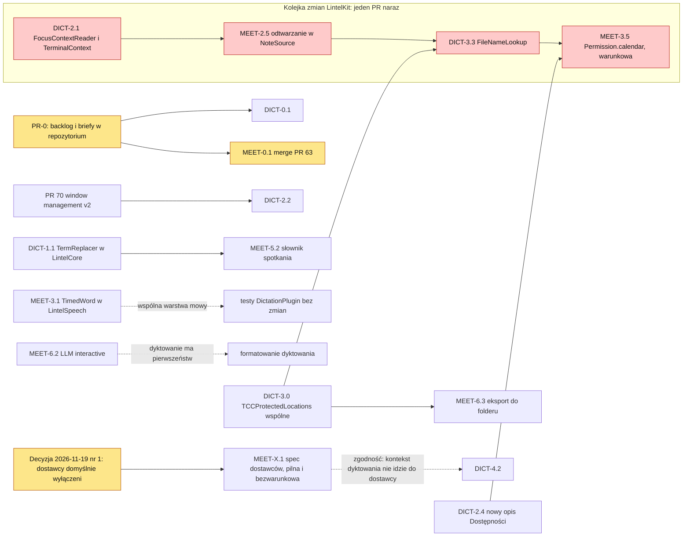

# Backlog 2026-11-13: dyktowanie świadome kontekstu i notatki ze spotkań lepsze niż Claude

- Epiki: `.ai/specs/backlog/2026-11-13-epic-context-aware-dictation.md` (DICT, 23 stories), `.ai/specs/backlog/2026-11-13-epic-meeting-notes-beyond-claude.md` (MEET, 35 stories)
- Wejście: cztery briefy `.ai/specs/briefs/2026-11-13-*-{A,B}.md` (dwóch niezależnych agentów), research `.ai/specs/research/2026-11-13-*.md`
- Stan kodu: `origin/main` `3356906` (2026-11-10), PR #63 według `gh pr view 63` z 2026-11-13
- Status: propozycja. **Właściciel nie potwierdził kierunku.** Każde pytanie ma wartość domyślną, pod którą backlog jest spójny; zmiana odpowiedzi zmienia wskazane stories.
- **Aktualizacja 2026-11-19:** właściciel podjął 9 decyzji, które nadpisują ten backlog tam, gdzie się różnią (MEET-0.2, MEET-0.3, MEET-4.3, MEET-X.1, DICT-0.1, D-Q10, M-Q5, M-Q14 i inne). Zob. sekcja „Decyzje właściciela (2026-11-19)” na końcu. Adnotacje „decyzja 2026-11-19” w treści wskazują na tę sekcję.

## Najważniejsze wnioski

1. **Dyktowanie nie potrzebuje nowego grantu systemowego, ale potrzebuje zgody w aplikacji.** Odczyt pola idzie tym samym grantem Dostępność, który dyktowanie już ma. Każdy tekst w aplikacji mówi jednak dziś o wklejaniu albo przesuwaniu okien, a żaden o czytaniu treści. Dlatego kontekst jest domyślnie wyłączony i włączany krokiem z listą źródeł, także u obecnych użytkowników.
2. **Oba epiki zaczynają się od taniej bramki, nie od kodu.** DICT-0.1 liczy na własnej historii właściciela, czy problem w ogóle występuje (próg 5 na 20 dyktowań). MEET-0.1 – 0.3 to merge PR #63, jedno ślepe porównanie z Claude i dwa tygodnie dogfoodu z kryterium zatrzymania. *(Decyzja 2026-11-19 nr 2 i 6: DICT-0.1 zaliczona decyzją właściciela bez liczenia; MEET-0.2 i MEET-0.3 zastąpione pętlą oceny notatek przez sędziego Fable.)*
3. **PR #63 jest gotowy do merge i blokuje cały epic spotkań.** Czerwone sprawdzenie to jeden niestabilny test w kroku Test workflow Release, nie podpisywanie.
4. **Podstawienia robi kod, nie model.** W dyktowaniu `CleanupPrompt` zostaje w wersji 1 *(decyzja 2026-11-19 nr 7: założenie uchylone, prompt zmienia się, by usuwać zmiany zdania i autopoprawki)*, a słownik, reguły wstawiania i odwołania działają w Swifcie przed i po kroku LLM. W spotkaniach jakość idzie przez sprawdzalność i pomiar, a zmiany modeli wyłącznie przez harness.
5. **Wspólne wąskie gardło to `LintelKit` i decyzje prywatności.** Pięć stories zmienia chroniony kontrakt (DICT-2.1, DICT-3.3, MEET-2.5, MEET-4.3, MEET-3.5) i musi iść pojedynczo. *(Decyzja 2026-11-19 nr 4: MEET-4.3 wycofana, w kolejce zostają cztery.)* Cztery decyzje odwracają wcześniejsze ustalenia (zachowanie audio, notatnik w trakcie nagrania, auto-eksport, MCP) i czekają na właściciela.

## Jak powstał ten backlog

- Cztery briefy przeczytane w całości; rozbieżności rozstrzygnięte w tabelach niżej.
- Dwóch subagentów równolegle zweryfikowało kod na `origin/main` (dyktowanie; spotkania i PR #63) i oszacowało rozmiary. Ich wyniki zostały użyte krytycznie: kilka założeń briefów okazało się nieaktualnych (lista w sekcji „Co briefy miały nieaktualne”).
- `om-brainstorm`: zastosowana technika (co najmniej dwie alternatywy plus „nie budować”, sprawdzenie otwartych PR-ów, przegląd przez niezależnego recenzenta; zgłoszeń w trackerze nie przeszukiwano). Skill jest interaktywny i wymaga potwierdzenia kierunku przez użytkownika; zlecenie zabraniało pytań, więc bramka potwierdzenia jest zastąpiona listą pytań z wartościami domyślnymi. Nowy brief nie powstał, bo briefy A i B już istnieją.
- `om-spec-writing`: użyty podział na fazy i kroki testowalne, z których każdy zostawia aplikację działającą, oraz reguły wartości domyślnych dla trybu bez nadzoru (najmniejszy zasięg, najbardziej odwracalna opcja, znacznik ⚠ tam, gdzie domyślna dotyka prywatności albo chronionego kontraktu).
- Niezależny recenzent (osobny subagent, bez kontekstu autora) sprawdził spójność identyfikatorów, zależności, kryteriów i etykiet wobec `AGENTS.md`, `SDLC.md` i `BACKWARD_COMPATIBILITY.md` na `origin/main`. Zgłosił 40 uwag; naniesione zostały wszystkie o wadze High i Medium, m.in.: zgoda jako arkusz zamiast `OnboardingStep`, źródło `terminal` jako osobna zgoda, ukryte zmiany `LintelKit` (MEET-4.3), punkt IPC w `MeetingsPlugin`, luka wstrzyknięcia w sekcji „Niepotwierdzone”, stan zadań poza tabelą pochodną, nowa story DICT-3.0.
- `om-prepare-issue`: tylko jako wzorzec treści story. Nie założono żadnego zgłoszenia, PR ani commita; nie zmieniono `Sources/` ani `Tests/`.

## Rozstrzygnięcia A vs B: dyktowanie

| # | Temat | Brief A | Brief B | Fakt z kodu | Rozstrzygnięcie |
|---|---|---|---|---|---|
| 1 | Uprawnienie Dostępność | bez nowego uprawnienia | ta sama zgoda systemowa, ale nowy cel: ponowna zgoda w aplikacji | `requiredPermissions = [.microphone, .accessibility]`; teksty mówią tylko o wklejaniu i przesuwaniu okien; `AXWindowClient` czyta tytuły okien, nikt nie czyta pól | **Oba mają rację w swojej części.** Bez nowego grantu TCC (A), ze zgodą w aplikacji i nowym opisem w Uprawnieniach (B). DICT-2.4 |
| 2 | Bramka przed kodem | 0.1: pomiar na historii dyktowania, próg 5 z 20 | brak; Faza 1a może ruszyć od razu | historia zaszyfrowana, klucz w Pęku kluczy, brak narzędzia offline | **A, jako Story 0** (DICT-0.1). Powód przeciw nie istnieje; jedyna trudność to odczyt, rozwiązany monitem Pęku kluczy albo ręcznym eksportem 30 wpisów |
| 3 | Co najpierw po bramce | migawka i reguły wstawiania | słownik i profile bez Accessibility i bez `LintelKit` | słownik nie potrzebuje żadnego portu | **B.** Faza 1 dostarcza wartość bez chronionego kontraktu i bez odczytu cudzych aplikacji |
| 4 | Prompt LLM | `CleanupPrompt` v2 z listą terminów i nową regułą strażnika | prompt bez zmian; reguły po kroku LLM | `version = 1`; ADR 0005 notuje cofnięcie wcześniejszej v2 | **B w Fazach 0–3.** Zamiana po LLM naprawia też to, co model „poprawił”. Wariant A zostaje jako warunkowa DICT-4.2. *(Decyzja 2026-11-19 nr 7: „prompt bez zmian” uchylone dla usuwania zmian zdania i autopoprawek; lista terminów nierozstrzygnięta.)* |
| 5 | Jak chronić odwołania przed modelem | znaczniki w tekście, strażnik sprawdza „dokładnie raz” | podział tekstu; model nie widzi ani treści, ani znacznika | formatowanie biegnie kawałkami w trakcie nagrania | **B.** Mały model nie może zgubić ani powielić znacznika; koszt to najwyżej jedno dodatkowe wywołanie |
| 6 | Źródło nazw plików | indeks `FilesPlugin` przez nowy wkład pluginu | ograniczone listowanie katalogu roboczego w hoście | indeks pomija pliki ukryte i wymaga włączonego wyszukiwania; wzorzec `noteSources` istnieje | **B (domyślnie), pytanie D-Q7.** Mniejszy kontrakt (jeden port zamiast portu i wkładu) i niezależność od innego pluginu |
| 7 | Electron (`AXManualAccessibility`) | ustawiać i przywracać | nie domyślnie | port nie zapisuje dziś nic do cudzych aplikacji poza ramkami okien | **B.** Żadnych zapisów atrybutów w cudzych aplikacjach w tym epiku |
| 8 | Limit tekstu przed kursorem | 2000 znaków | 500 znaków | — | **B (500 / 200).** Tekst służy tylko regułom wstawiania i kandydatom; mniej danych w pamięci |
| 9 | Odwołanie do schowka | włączone razem z kontekstem | domyślnie wyłączone, cały segment, potwierdzenie w HUD | wklejenia nie da się cofnąć | **B.** DICT-3.1 |
| 10 | Kto egzekwuje odmowę dla pól haseł | `ContextPolicy` w pluginie | realizacja portu | — | **B**, plus lista odmów aplikacji w pluginie (A). Przyszły konsument portu nie może pominąć odmowy |
| 11 | Słownik: gdzie leży | `vocabulary.json` przez `AtomicFile` | `SettingsStore` | `DictationPlugin` zależy już od `LintelPersistence` | **A.** Plik wersjonowany, usuwany przez `eraseData()` |
| 12 | Profile aplikacji | nie-cel („styl per aplikacja”) | tak, małe reguły interpunkcji | — | **B w wąskim zakresie** (wielka litera, kropka), domyślnie wyłączone; przepisywanie tonu zostaje nie-celem (A) |
| 13 | Kandydaci na terminy z ekranu (dopasowanie fonetyczne) | Faza 2, bramka 2% | brak (tylko słownik) | — | **Warunkowo** (DICT-4.1), tylko gdy DICT-0.1 pokaże ≤ 2% fałszywych podmian |
| 14 | Nazwy kluczy ustawień | `contextEnabled` | `context.enabled` | `DictationSettings` używa płaskich nazw camelCase | **A** (płaskie) |
| 15 | Stara migawka | odrzucić wszystko z aplikacji źródłowej po zmianie aplikacji | porównanie pid plus próg 30 s | — | **Oba razem** (DICT-2.5 kryterium 5) |
| 16 | Kontekst na „Mój serwer” | lista terminów może iść na loopback | nic | — | **B w Fazach 0–3** (prompt bez zmian); w DICT-4.2 najwyżej terminy ze słownika użytkownika |
| 17 | Podział na specy | trzy | cztery | — | Backlog zastępuje podział: pięć faz, 23 stories; spec potrzebny tylko dla kandydatów poza epikiem |

Zgodne w obu briefach, przyjęte bez zmian: bez zrzutów ekranu i OCR; tryb poleceń osobno; podbijanie w silniku mowy dopiero po pomiarze; `⌘V` zostaje sposobem wstawiania; schowek w historii jako znacznik, nie treść; migawka tylko w pamięci, raz na naciśnięcie.

## Rozstrzygnięcia A vs B: spotkania

| # | Temat | Brief A | Brief B | Fakt z kodu / PR | Rozstrzygnięcie |
|---|---|---|---|---|---|
| 1 | Pierwszy krok | merge PR #63, sprawdzian godziny, dogfood, ślepe porównanie z Claude | cztery mierzalne tezy, pomiar polskiego, część pakietów równolegle do dogfoodu | PR #63 MERGEABLE; czerwony check to niestabilny test | **Jedna sekwencja:** MEET-0.1 (merge) → MEET-0.2 (ślepe porównanie, jeden wieczór) → MEET-0.3 (dogfood) z Fazą 1 biegnącą równolegle. *(Decyzja 2026-11-19 nr 2: MEET-0.2 i MEET-0.3 zastąpione pętlą oceny przez sędziego Fable.)* Tezy B są definicją zwycięstwa epica, ślepe porównanie A jest jedynym pomiarem bezpośrednim |
| 2 | Zmiany kodu w trakcie dogfoodu | żadnych | sprawdzalność, strażniki nagrania i zgoda mogą ruszyć | — | **Kompromis (M-Q4):** wolno wszystko, co nie zmienia treści notatek ani segmentów (Faza 1 i MEET-6.3). Oznaczenie poparcia i punkty jako dane zmieniają notatkę, więc czekają na bramkę |
| 3 | `keepAudio`: kiedy | po bramce dogfoodu | osobny mały spec, od razu, z pytaniem przy pierwszym nagraniu | szkic tylko jako niezacommitowany diff na starym drzewie | **Wcześnie (MEET-1.1), domyślnie wyłączone, 30 dni, bez pytania przy pierwszym nagraniu.** Bez audio z dogfoodu nie powstanie zbiór wzorcowy. ⚠ M-Q3 |
| 4 | Zbiór wzorcowy | 3–5 spotkań (docelowo 8–12) | 20–30 | brak; etykiety tylko w archiwum ewaluacji | **3 na start**, rośnie z dogfoodu; 20–30 jako cel przed publikowaniem liczb |
| 5 | Kalendarz | tylko po niezaliczonej bramce sugestii imion | tak, opcjonalnie | brak `Permission.calendar`; spec imion zamknął „bez kalendarza” | **A.** Nie odwracać zamkniętej decyzji z góry (MEET-3.5 warunkowa). ⚠ M-Q6 |
| 6 | Szablony | nie w tym programie | 2–3 wbudowane | jeden stały | **A.** Notatki hybrydowe najpierw |
| 7 | Sugestie imion a podział segmentów | po podziale | niezależne | spec imion sam zaleca czekać na podział | **A** (MEET-3.3 po MEET-3.2) |
| 8 | Punkty jako dane | tabela zadań w Fazie 4 | decyzja: metadane w Markdownie albo tabela pochodna, uzgodniona z #56 | `NotesResult.points` w pamięci; N10 trzyma edycje w `notes.sqlite` | **Tabela pochodna opisująca oryginał agenta** (MEET-2.1), wcześnie, bo zasila metryki, otwarte zadania i odsłuch |
| 9 | Archiwum | FTS5 + wektory + RRF od razu | najpierw FTS5; wektory, gdy pomiar pokaże braki | FTS5 istnieje | **B** (MEET-6.2) |
| 10 | MCP: model udostępniania | flaga „poufne” wyłączająca spotkanie | udostępnianie włączane per spotkanie, dziennik dostępu | jeden plik wykonywalny, klucz w aplikacji | **B.** Domyślnie nic nie jest widoczne |
| 11 | Drugi przebieg mowy | całe spotkanie Whisperem jako opcja | tylko segmenty oznaczone | brak kolumn pewności i słów | **Decyduje pomiar** (MEET-5.1 → MEET-5.3) |
| 12 | Strażniki nagrania | brak | zmiana częstotliwości, bufory zerowe, pętle powiadomień | zmiana częstotliwości już obsłużona; `audio_gap` to jedna flaga | **B w zawężeniu** do tego, czego brakuje (MEET-1.7) |
| 13 | Limit 90 minut | pomiar, potem podniesienie albo okna | przypadek brzegowy | limit zgadnięty, benchmark nieuruchomiony | **A** (MEET-0.4 mierzy, MEET-3.4 zmienia) |
| 14 | `words_json` | decyzja otwarta w specu | — | `v1-meetings` już zastosowana w bazie dogfood | **Nowa migracja** |
| 15 | Jeśli Claude wygra porównanie | kierunek A′ wyprzedza Fazy 1–4 | dostawca jako opcja dla kroku pisania | spec dostawców (odświeżony 2026-11-19, PR #111) | **MEET-X.1 warunkowo**, tylko dla spotkań niepoufnych; Fazy 2–4 zostają. *(Decyzja 2026-11-19 nr 1: MEET-X.1 pilna i bezwarunkowa, nie zależy od wyniku MEET-0.2; bez podziału na spotkania niepoufne, zgoda przy wyborze dostawcy, doprecyzowanie D4.)* |

Zgodne w obu briefach, przyjęte bez zmian: nie gonić funkcji na żywo; bez odcisków głosu; notatnik hybrydowy jako własność `MeetingsPlugin`; eksport do folderu i MCP jako opt-in; modele tylko przez harness; nie powtarzać weryfikatora semantycznego i promptu v4.

## Co briefy miały nieaktualne (z weryfikacji kodu)

- PR #63 nie wymaga już rebase; czerwone „Build signed DMG” to test, nie podpisywanie.
- „Strażnik zmiany częstotliwości próbkowania” w dużej części istnieje (`.formatChanged`, odtworzenie tap).
- `audio_gap` nie nadaje się do pokazania luki w transkrypcie: to jedna flaga na spotkanie bez czytelnika.
- Krok 1.3 specu `speaker-quality` (metryki mówców w kodzie) nie jest na `main`, choć zależą od niego dwie bramki.
- `FluidAudio` jest przypięty z `traits: ["Diarizer"]`, nie `[]`; `MeetingsPlugin`, `NotesPlugin` i `WindowsPlugin` są zarejestrowane.
- Zmienne środowiskowe to `LINTEL_*`; usługa Pęku kluczy dyktowania to `com.lintelapp.dictation`.
- Następny wolny numer ADR to 0010; numer 0007 jest użyty dwa razy. Spec dostawców rezerwuje zajęty 0008.
- `markerTypes` jest na `PasteboardRepresentation`, nie na `PasteboardClient`.
- Stan uprawnienia Dostępność czyta `CGPreflightPostEventAccess()`; `AXIsProcessTrusted()` jest tylko w `AXWindowClient`. Aplikacja nigdy sama nie wywołuje monitu.

## Wspólny podział na fazy

Oba epiki mają ten sam rytm: bramka bez kodu → fundament bez chronionych kontraktów → zmiany kontraktowe i funkcje → kandydaci warunkowi.

| Etap wspólny | DICT | MEET | Bramka wyjścia |
|---|---|---|---|
| **E0 Bramki** | DICT-0.1, 0.2, 0.3 | MEET-0.1, 0.2, 0.3, 0.4 | DICT: ~~≥ 5 z 20 dyktowań~~ (zaliczona decyzją 2026-11-19 nr 6) i ADR 0010. MEET: PR #63 na `main`, ~~≥ 3 wpisy `failures.md`, wynik ślepego porównania~~ (zastąpione oceną Fable, decyzja nr 2) |
| **E1 Fundament** (bez `LintelKit`) | DICT-1.1 – 1.4 | MEET-1.1 – 1.7 | DICT: słownik i profile w użyciu. MEET: linia bazowa na zbiorze wzorcowym |
| **E2 Funkcje główne** | DICT-2.1 – 2.7 | MEET-2.1 – 2.5, MEET-3.1 – 3.4 | DICT: budżety zmierzone. MEET: tezy 3 i 4 spełnione |
| **E3 Rozszerzenia** | DICT-3.0 – 3.6 | MEET-4.1, 4.2, ~~4.3~~ (wycofana 2026-11-19, decyzja 4), 4.4, MEET-5.1 – 5.2, MEET-6.1 – 6.3 | dogfood DICT-3.6; pomiar MEET-4.4 |
| **E4 Warunkowe i zależne od decyzji** | DICT-4.1, 4.2 | MEET-3.5, 5.3; MEET-6.4 – 6.6 (decyzja M-Q12). MEET-X.1 wyszła z tego etapu: pilna i bezwarunkowa (decyzja 2026-11-19 nr 1) | każda ma własny warunek albo decyzję właściciela |

## Oś czasu

Tygodnie liczone od dnia, w którym właściciel zmerguje PR-0 i PR #63. Ograniczeniem jest kalendarz właściciela (dogfood, decyzje, recenzje `risk-high`), nie praca agenta. Zakładane są dwa równoległe strumienie agentów: jeden na epic.

| Tydzień | Właściciel | Strumień DICT | Strumień MEET |
|---|---|---|---|
| 0 | merge PR-0 i PR #63; odpowiedzi na pytania ⚠ | ~~DICT-0.1~~ (zaliczona decyzją 2026-11-19) | MEET-0.1; start MEET-1.1; **MEET-X.1 (pilna, decyzja 2026-11-19 nr 1; tydzień 0 to interpretacja, do potwierdzenia przez właściciela)** |
| 1 | ~~ślepe porównanie (jeden wieczór)~~ (zastąpione oceną Fable, decyzja 2026-11-19 nr 2); start dogfoodu z `keepAudio` | DICT-0.2, DICT-0.3; DICT-1.1 | ~~MEET-0.2~~ (zastąpione oceną Fable), MEET-0.4, MEET-1.2, MEET-1.3 (schemat), MEET-1.6 |
| 2 | dogfood; recenzja i akceptacja ADR 0010 | DICT-1.2, 1.3, 1.4, DICT-3.0 | MEET-1.7, MEET-1.4 |
| 3 | ~~bramka MEET-0.3~~ (zastąpiona oceną Fable); poprawione transkrypty 3 spotkań (dane MEET-1.3) | DICT-2.1, potem DICT-2.2 i 2.3 | MEET-6.3, MEET-1.5 |
| 4 | QA zgody (DICT-2.4) | DICT-2.4, 2.5, 2.6 | MEET-2.1, 2.2, 2.3, 2.4 |
| 5 | QA odsłuchu | DICT-2.7, DICT-3.1 | MEET-2.5 (po DICT-2.1), MEET-3.1 |
| 6 | — | DICT-3.2, potem 3.3 | MEET-3.2, MEET-3.4 |
| 7 | start dogfoodu DICT | DICT-3.4, 3.5 | MEET-3.3, MEET-4.1 |
| 8–9 | dogfood DICT; decyzja o Fazie 6; nagrania z notatnikiem | DICT-3.6 | MEET-4.2, ~~MEET-4.3~~ (wycofana 2026-11-19), MEET-5.1 |
| 10+ | wzorce dla 3 spotkań z notatkami; decyzje warunkowe | DICT-4.x | MEET-4.4, MEET-5.2, MEET-6.1, 6.2, 6.4 – 6.6 |

## Graf zależności między epikami

Wniosek z diagramu: epiki są prawie niezależne. Łączy je pięć rzeczy: kolejka zmian `LintelKit`, wspólny `TermReplacer`, wspólne `TCCProtectedLocations` (DICT-3.0), wspólna warstwa mowy i lease modeli, oraz plik tekstów.

### Zależności i reguły wspólne

| Zasób wspólny | Kto go dotyka | Reguła |
|---|---|---|
| `LintelKit` (chroniony, `risk-high`) | DICT-2.1, MEET-2.5, DICT-3.3, ~~MEET-4.3~~ (wycofana 2026-11-19, decyzja 4), MEET-3.5 | Jeden otwarty PR naraz, w kolejności z grafu. Każdy dopisuje własny akapit w `BACKWARD_COMPATIBILITY.md` §1 i przechodzi testy `PluginHost` pod TSan |
| `LintelCore` | DICT-1.1 (`TermReplacer`), DICT-3.0 (`TCCProtectedLocations`), DICT-4.1, MEET-5.2, MEET-6.3 | Typ ogólny, bez logiki dyktowania ani spotkań; MEET-5.2 nie zmienia go, tylko używa |
| `LintelSpeech` | MEET-3.1 (`TimedWord`), MEET-5.3 | Addytywnie, z wartością domyślną; `DictationPluginTests` muszą przejść bez zmian; target dalej nie zależy od żadnego targetu repozytorium |
| `LLMLease`, `SpeechEngineLease` | dyktowanie (`interactive`), notatki i drugi przebieg (`background`), MEET-6.2 (`interactive`) | Dyktowanie ma pierwszeństwo; każda story dodająca użycie ma test wywłaszczenia pod TSan |
| `Resources/Localizable.xcstrings` | każda story z UI | Konflikty scalania są pewne: story z UI rebase'uje tuż przed merge; w jednym strumieniu najwyżej jeden otwarty PR z UI |
| `LintelApp/Settings/PermissionsPane.swift` | DICT-2.4 (opis Dostępności), MEET-3.5 (wiersz kalendarza) | DICT-2.4 pierwsza |
| `LintelApp/Ports/` (kolejki AX) | PR #70, DICT-2.2 | PR #70 przed DICT-2.2 (DICT-2.1 na niego nie czeka) |
| Migracje `meetings.sqlite` | MEET-1.6, 1.7, 2.1, 3.1, 4.1, 5.2, 5.3, 6.1, 6.5 (oraz MEET-3.5, jeśli ruszy) | Jedna migracja na PR; numer `vN-<funkcja>` przydzielany przy merge (następny wolny na `main`); przy rebase autor przenumerowuje swoją |
| Migracje `dictation.sqlite` | DICT-1.4 | Jedyna w epiku DICT (`v2-context`) |
| Numery ADR | DICT-0.1 (0010), MEET-0.2 (zastąpiona oceną Fable, decyzja 2026-11-19 nr 2; czy ADR kierunku nadal powstaje: interpretacja, do potwierdzenia przez właściciela), 2.1, 5.1, 6.4 | 0010 zarezerwowany dla kontekstu dyktowania; pozostałe biorą następny wolny przy merge. Podwójny 0007 zostaje (zmiana nazwy plików zerwałaby odnośniki) |
| `docs/perf.md` | DICT-0.3, 2.7, MEET-0.4, 1.5, 3.4 | Każda story dotyka tylko własnych wierszy |
| Słowniki | `vocabulary.json` (dyktowanie), `plugins.meetings.glossaryTerms` (spotkania) | Osobne dane, wspólna logika. Wspólny słownik dla obu pluginów wymagałby portu w `LintelKit`; poza tym backlogiem |
| Zewnętrzni dostawcy | MEET-X.1, DICT-4.2 | Kontekst dyktowania nigdy nie idzie do dostawcy; do dostawcy może iść tylko transkrypt spotkania za zgodą. Od 2026-11-19 dostawcy są w produkcie, domyślnie wyłączeni (model lokalny); transkrypt (z imionami mówców) idzie dopiero po wyborze dostawcy w ustawieniach i jednym oknie zgody (decyzja nr 1, doprecyzowania D2 i D4) |

## Kolejność PR-ów

Kolejność minimalizująca konflikty; pozycje w tym samym wierszu mogą być otwarte równolegle (różne strumienie, różne pliki).

| # | PR | Uwagi |
|---|---|---|
| 0 | **PR-0** `docs(specs)`: briefy, research, ten backlog i dotąd nieśledzony spec `2026-11-10-external-ai-providers.md` w repozytorium | Tylko dokumentacja (`skip-qa`). Bez niego komendy `om-auto-create-pr … Source doc: …` nie znajdą plików w świeżym worktree. `AGENTS.md` jest już aktualny (rejestracja pluginów, `traits`) |
| 1 | **PR #63** (MEET-0.1) | Czynność właściciela. Przed nim nic nie dotyka `Sources/MeetingsPlugin/Notes/`, `MeetingsSettings` ani tekstów spotkań |
| 2 | ~~DICT-0.1~~ (zaliczona decyzją 2026-11-19; ADR 0010 bez liczb linii bazowej: interpretacja, do potwierdzenia przez właściciela) ∥ MEET-1.1 (`keepAudio`) ∥ **MEET-X.1 (pilna; miejsce w wierszu 2 to interpretacja, do potwierdzenia przez właściciela)** | MEET-1.1 jak najwcześniej, żeby dogfood zasilał zbiór wzorcowy |
| 3 | DICT-0.2 ∥ ~~MEET-0.2~~ (zastąpione oceną Fable) ∥ MEET-1.2 ∥ MEET-0.4 | sama dokumentacja i harness; ADR kierunku (dawniej z MEET-0.2) nadal potrzebny wpisom 1.5, 4.4 (interpretacja, do potwierdzenia przez właściciela) |
| 4 | DICT-0.3 ∥ MEET-1.3 (schemat i walidator) ∥ MEET-1.6 | MEET-1.6 to pierwsza migracja spotkań w tym backlogu |
| 5 | DICT-1.1 → DICT-1.2 ∥ MEET-1.7 → MEET-1.4 | |
| 6 | DICT-1.3 → DICT-1.4 ∥ DICT-3.0 → MEET-6.3 | DICT-3.0 to czysta refaktoryzacja; może wejść wcześniej |
| 7 | **DICT-2.1** (`LintelKit`) ∥ PR #70 (jeśli jeszcze otwarty; musi wejść przed DICT-2.2) | początek kolejki kontraktowej |
| 8 | DICT-2.2 ∥ DICT-2.3 ∥ ~~MEET-0.3~~ (zastąpione oceną Fable) → MEET-1.5 | bramka: ocena Fable zamiast MEET-0.3, oraz MEET-1.5 (wymaga danych MEET-1.3) |
| 9 | DICT-2.4 → DICT-2.5 → DICT-2.6 ∥ MEET-2.1 → MEET-2.2, MEET-2.3 | |
| 10 | DICT-2.7 ∥ MEET-2.4 → **MEET-2.5** (`LintelKit`) | |
| 11 | DICT-3.1 ∥ MEET-3.1 → MEET-3.2 | |
| 12 | DICT-3.2 → **DICT-3.3** (`LintelKit`) ∥ MEET-3.4, MEET-3.3 | |
| 13 | DICT-3.4 → DICT-3.5 ∥ MEET-4.1 → MEET-4.2 → ~~MEET-4.3~~ (wycofana 2026-11-19, decyzja 4) | |
| 14 | DICT-3.6 ∥ MEET-5.1 | |
| 15 | późniejsze: MEET-5.2 (po DICT-1.1 i MEET-5.1), MEET-6.1, MEET-6.2, MEET-4.4 (po zebraniu nagrań z notatnikiem) | zwykłe stories, tylko później w kolejce |
| 16 | warunkowe albo zależne od decyzji (MEET-X.1 pilna, decyzja 2026-11-19 nr 1; przeniesiona do wiersza 2, miejsce to interpretacja do potwierdzenia): DICT-4.1, DICT-4.2, MEET-5.3, MEET-3.5; MEET-6.4 → 6.5 → 6.6 (M-Q12) | każda po spełnieniu własnego warunku |

PR-y niezwiązane: #69 (spec window management v2, zmergowany) i #61 (`do-not-merge`) nie kolidują z żadną story.

## Zbiorcza lista pytań do właściciela

Wartość domyślna jest tą, pod którą backlog został napisany. ⚠ oznacza decyzję prywatności albo odwrócenie wcześniejszego ustalenia: bez odpowiedzi story może być zaimplementowana, ale jej PR nie powinien być mergowany.

### Wspólne

| ID | Pytanie | Domyślnie | Zmienia |
|---|---|---|---|
| C-Q1 | Zacommitować briefy, research i backlog jako PR-0? | tak | wszystkie komendy startowe |
| C-Q2 | Dwa równoległe strumienie agentów (po jednym na epic), czy jeden? | dwa | oś czasu; przy jednym: MEET E0–E1 przed DICT E1 |
| C-Q3 | Który epic ma pierwszeństwo w kolejce `LintelKit` i w recenzjach `risk-high`? | kolejność z grafu: DICT-2.1, MEET-2.5, DICT-3.3, ~~MEET-4.3~~ (wycofana 2026-11-19, decyzja 4), MEET-3.5 | graf i tabela kolejności PR-ów |

### Dyktowanie

| ID | Pytanie | Domyślnie | Zmienia |
|---|---|---|---|
| D-Q1 ⚠ | Kontekst domyślnie włączony? | nie | DICT-2.3, 2.4 |
| D-Q2 | Nowy opis Dostępności w Uprawnieniach (także dla `WindowsPlugin`)? | tak | DICT-2.4 |
| D-Q3 | Próg bramki: 5 z 20 dyktowań | tak | DICT-0.1 |
| D-Q4 ⚠ | Jednorazowy odczyt własnej historii dyktowania narzędziem poza repozytorium (monit Pęku kluczy) i przechowanie odszyfrowanych transkryptów jako zbioru regresyjnego na zaszyfrowanym obrazie dysku do końca DICT-3.6? | tak; zapas: ręczny eksport 30 wpisów | DICT-0.1, 3.6, 4.1 |
| D-Q5 | Profile aplikacji domyślnie włączone? | nie | DICT-1.3 |
| D-Q6 ⚠ | Schowek głosem w zwykłym dyktowaniu, domyślnie wyłączony, cały segment, potwierdzenie w HUD? | tak | DICT-3.1 |
| D-Q7 | Pliki: listowanie w hoście czy indeks `FilesPlugin`? | listowanie w hoście | DICT-3.3 |
| D-Q8 | Wyzwalacze pliku: „małpa”, „at”, „tag”, nazwa z rozszerzeniem; samo „plik X” nie? | tak | DICT-3.4 |
| D-Q9 | `AXManualAccessibility` w Electronie? | nie | DICT-2.2 |
| D-Q10 | `CleanupPrompt` bez zmian w Fazach 0–3? | tak. **Uchylone 2026-11-19 (decyzja nr 7):** `CleanupPrompt` zmienia się, by usuwać zmiany zdania i autopoprawki, `FormatterGuard` do dostosowania | DICT-4.2 (interpretacja, do potwierdzenia: nowa praca obok DICT-4.2, nie DICT-4.2) |
| D-Q11 ⚠ | Uchylić nie-cele „reguły per aplikacja” i „własny słownik” ze specu dyktowania? | tak | DICT-0.3 |
| D-Q12 | Zapisywać w historii listę użytych źródeł (bez treści)? | tak | DICT-1.4 |
| D-Q13 | Kandydaci na terminy z ekranu? | warunkowo, po bramce 2% | DICT-4.1 |
| D-Q14 ⚠ | Czytać proces pierwszoplanowy i katalog roboczy terminala jako osobne źródło, domyślnie wyłączone? | tak | DICT-3.2 – 3.5 |

### Spotkania

| ID | Pytanie | Domyślnie | Zmienia |
|---|---|---|---|
| M-Q1 | Merge PR #63 po ponownym uruchomieniu niestabilnego sprawdzenia? | tak | wszystko |
| M-Q2 | Definicja „lepiej niż Claude”: cztery tezy + ślepe porównanie? | tak. **Ślepe porównanie (MEET-0.2) zastąpione oceną Fable 2026-11-19 (decyzja nr 2)** | metryki epica |
| M-Q3 ⚠ | `keepAudio` przed dogfoodem, domyślnie wyłączone, 30 dni, bez pytania przy pierwszym nagraniu? | tak | MEET-1.1, 1.3, 2.5 |
| M-Q4 | W trakcie dogfoodu wolno tylko zmiany nieruszające treści notatek? | tak | kolejność Faz 1 i 2 |
| M-Q5 | Zbiór wzorcowy: 3 spotkania, sędziowie lokalni; chmurowi tylko za zgodą uczestników? | tak. **Uchylone dla sędziego Fable 2026-11-19 (decyzja nr 2)** | MEET-1.3, 1.4 |
| M-Q6 ⚠ | Kalendarz dopiero po niezaliczonej bramce sugestii imion? | tak | MEET-3.5 |
| M-Q7 | Szablony notatek w tym epiku? | nie | zakres |
| M-Q8 ⚠ | Notatnik w trakcie nagrania jako własność `MeetingsPlugin`? | tak | MEET-4.1 |
| M-Q9 | Punkty jako tabela pochodna opisująca oryginał agenta? | tak | MEET-2.1, 6.1 |
| M-Q10 | `words_json` w nowej migracji? | tak | MEET-3.1 |
| M-Q11 | Podział segmentów w dwóch PR-ach (spec mówi: razem)? | dwa | MEET-3.1, 3.2 |
| M-Q12 ⚠ | Lokalny MCP jako jawny wyjątek, udostępnianie per spotkanie? | tak | MEET-6.4 – 6.6 |
| M-Q13 ⚠ | Auto-eksport jawnego Markdownu do folderu, opt-in? | tak | MEET-6.3 |
| M-Q14 ⚠ | Jeśli Claude wygra porównanie: dostawca zewnętrzny dla spotkań niepoufnych jako pierwszy? | tak. **Przestarzałe 2026-11-19 (decyzja nr 1):** MEET-X.1 pilna i bezwarunkowa | MEET-X.1, kolejność faz |
| M-Q15 | Drugi przebieg: wariant według pomiaru? | tak | MEET-5.3 |
| M-Q16 | Zmiana domyślnego modelu notatek tylko przez harness? | tak | MEET-5.1 |
| M-Q17 ⚠ | Odszyfrowanie dźwięku do zbioru wzorcowego narzędziem poza repozytorium (monit Pęku kluczy), jawny dźwięk tylko na zaszyfrowanym obrazie dysku? | tak | MEET-1.3, 1.5 |

## Ograniczenia tego backlogu

- Uwagi recenzenta o wadze Low naniesiono częściowo; nienaniesione: brak jawnego prototypu dla każdej story z UI (zastąpione wspólną regułą DoD) i brak osobnych wierszy osi czasu dla pracy właściciela nad wzorcami.
- Estymaty pochodzą z lektury kodu, nie z prób implementacji; stories L mogą wymagać podziału po pierwszym podejściu.
- Kryteria liczbowe w stories jakościowych (progi 2%, 80%, 10%, okna −60 s / +30 s) pochodzą z briefów i istniejących speców; nie są wynikami pomiarów i powinny zostać potwierdzone linią bazową (DICT-0.1, MEET-1.5).
- Fakty o konkurencji i Claude Meetings pochodzą z briefów i nie były ponownie sprawdzane.
- Nie uruchomiono aplikacji ani bramki walidacji: ten backlog to wyłącznie dokumenty.
- Tracker nie był zmieniany; duplikaty wobec istniejących zgłoszeń należy sprawdzić przy zakładaniu ticketów (`om-prepare-issue` robi to sam).

## Decyzje właściciela (2026-11-13)

Odpowiedzi na pytania oznaczone ⚠. Pozostałe pytania przyjmują wartości domyślne z epików, dopóki właściciel ich nie zmieni.

| Pytanie | Decyzja |
|---|---|
| D-Q1 kontekst domyślnie | Domyślnie wyłączony, włączany po zgodzie w arkuszu w panelu. |
| D-Q4 odczyt historii (bramka DICT-0.1) | Narzędzie poza repo z monitem Pęku kluczy; na zewnątrz tylko liczby, zbiór regresyjny na zaszyfrowanym obrazie. |
| D-Q6 schowek głosem | Domyślnie wyłączony, tylko gdy cały segment to jawna fraza, potwierdzenie w HUD. |
| D-Q11 nie-cele specu dyktowania | Uchylone: reguły per aplikacja i słownik (zapisać uchylenie w specu dyktowania). |
| D-Q14 proces i cwd terminala | Osobne źródło, domyślnie wyłączone, z własnym opisem. |
| M-Q3 keepAudio | Przed dogfoodem, domyślnie wyłączone, retencja 30 dni. |
| M-Q6 kalendarz | Opcjonalna podpowiedź imion mówców, obsługa wielu kalendarzy, nigdy wymagana (spotkania nie zawsze są w kalendarzu). Budowa dopiero po niezaliczonej bramce 80% sugestii imion bez kalendarza. |
| M-Q8 notatnik w trakcie nagrania | Własność MeetingsPlugin (dane w `meetings.sqlite`). |
| M-Q12 lokalny MCP | Domyślnie wyłączony, udostępnianie per spotkanie. |
| M-Q13 auto-eksport Markdown | Opt-in, wybór folderu, ostrzeżenie o braku szyfrowania. |
| M-Q14 plan B, jeśli wygra Claude | Zewnętrzny dostawca (spec external-ai-providers) dla spotkań niepoufnych, za zgodą. *(Przestarzałe 2026-11-19: decyzja nr 1 i doprecyzowanie D4, zgoda przy wyborze dostawcy, bez podziału na spotkania niepoufne.)* |
| M-Q17 zbiór wzorcowy | Poza repo, 3 spotkania właściciela (za zgodą uczestników), lokalni sędziowie; w repo tylko liczby. *(„Lokalni sędziowie” uchylone dla sędziego Fable 2026-11-19, decyzja 2.)* |

## Decyzje właściciela (2026-11-19)

Dziewięć decyzji nadpisuje ten backlog tam, gdzie się różnią. Źródło: wiadomość właściciela z 2026-11-19, uzupełniona doprecyzowaniami z tego samego dnia (podsekcja niżej; mają pierwszeństwo przed tabelą). Epiki mają przy dotkniętych stories krótką adnotację ze wskazaniem na tę sekcję; treść stories nie jest przepisana.

Kolumna „Skutek wprost” zawiera tylko to, co wynika z brzmienia decyzji. Kolumna „Interpretacja autora” to wnioski autora tego wpisu: **interpretacja, do potwierdzenia przez właściciela**, nie decyzja. Do czasu potwierdzenia nie zmieniają statusu żadnej story.

| # | Decyzja (brzmienie właściciela) | Skutek wprost | Interpretacja autora (do potwierdzenia przez właściciela) |
|---|---|---|---|
| 1 | Zewnętrzni dostawcy (Claude itd.) w produkcie: TAK, pilnie. Domyślnie WYŁĄCZENI; transkrypt idzie do dostawcy dopiero po włączeniu przez użytkownika, z tekstem zgody dla uczestników. | **MEET-X.1 pilna i bezwarunkowa** (przestaje być warunkowa): nie zależy już od wyniku MEET-0.2 ani od M-Q14; M-Q14 przestarzałe. Dostawcy domyślnie wyłączeni; bez włączenia przez użytkownika nic nie jest wysyłane. Spec `2026-11-10-external-ai-providers.md` jest odświeżony 2026-11-19 (PR #111, aedc511); odpowiedzi właściciela na jego pytania są w doprecyzowaniach D6–D8. | Miejsce MEET-X.1 w tygodniu 0 osi czasu i w wierszu 2 kolejności PR-ów. ~~Tekst zgody dla uczestników łączy się z MEET-1.6; ograniczenie do spotkań niepoufnych do rozstrzygnięcia~~ — rozstrzygnięte doprecyzowaniami D1 i D4: MEET-1.6 bez zmian, zgoda przy wyborze dostawcy obejmuje wszystkie spotkania. |
| 2 | Fable jako recenzent jakości notatek: zielone światło na ocenianie WSZYSTKICH spotkań właściciela (świadome uchylenie M-Q5 dla sędziego Fable). Zastępuje ślepe porównanie MEET-0.2 i bramkę dogfoodu MEET-0.3. Uwagi właściciela nanoszone później. | **MEET-0.2 i MEET-0.3 zastąpione** oceną notatek przez sędziego Fable. M-Q5 uchylone tylko dla tego sędziego (zapis niżej); dla innych sędziów chmurowych M-Q5 obowiązuje bez zmian. | MEET-1.5 (linia bazowa) i późniejsze bramki liczą się od oceny Fable. ADR kierunku, który miał powstać w MEET-0.2, nadal jest potrzebny wpisom MEET-1.5 i MEET-4.4. |
| 3 | Notatka = podsumowanie spotkania (ustalenia, decyzje, zadania). Żadnych timestampów w notatce. Timestampy zostają w transkrypcie. | Bez znaczników czasu w treści notatki; transkrypt zachowuje znaczniki. | Dotyczy cytatów `[mm:ss]` składanych przez `NotesComposer`; dotyka stories o sprawdzalności (MEET-2.x) i odtwarzaniu (MEET-2.5): odsłuch z notatki bez znacznika czasu wymaga innego kotwiczenia. Do rozpisania w specu. |
| 4 | Oznaczenia AI/człowiek w notatkach: usunąć (także z historii zmian jako osobnego oznaczenia). MEET-4.3 (`NoteBlockProvenance.author`) wypada z kolejki. | **MEET-4.3 wycofana 2026-11-19, decyzja 4**: wypada z kolejki `LintelKit` i z kolejności PR-ów. Oznaczenia AI/człowiek do usunięcia z notatek, także z historii zmian jako osobne oznaczenie (dziś jeszcze istnieją). | MEET-4.4 ma MEET-4.3 w zależnościach i wymaga przeliczenia przy specu. Usunięcie istniejących oznaczeń z Notes (paski autora, historia) to osobna zmiana, spec najpierw. |
| 5 | Formatowanie notatek do poprawy (obecne złe); #64 w zakresie. | Nowa praca nad formatem notatek, w tym #64. | Brak numeru story; do nadania przy specu. |
| 6 | Bramka DICT-0.1 zaliczona decyzją właściciela (bez liczenia 5 z 20; brak linii bazowej zaakceptowany). Epik DICT rusza. | **DICT-0.1 zaliczona**, epik DICT rusza (DICT-1.x mogą startować). | ADR 0010 powstaje bez liczb z pomiaru. Warunek D-Q13 (≤ 2% fałszywych podmian z kryterium 2 DICT-0.1) nie ma danych, więc DICT-4.1 zostaje wstrzymana do własnego pomiaru. |
| 7 | Dyktowanie: formatowanie ma usuwać zmiany zdania i autopoprawki („albo jednak”, „nie, czekaj”) i dawać sensowną wiadomość. Uchyla D-Q10 (`CleanupPrompt` bez zmian); `FormatterGuard` do dostosowania. | **D-Q10 uchylone** w zakresie „`CleanupPrompt` bez zmian”: prompt zmienia się tak, by usuwać zmiany zdania i autopoprawki; `FormatterGuard` do dostosowania. | To nowa praca, nie DICT-4.2: lista terminów w prompcie (treść DICT-4.2) nie jest tą decyzją zlecona i zachowuje swój warunek. Obie zmiany dotykają `CleanupPrompt.version`, `FormatterGuard` i snapshotów promptu, więc numer wersji trzeba uzgodnić. |
| 8 | Nowe funkcje (spec najpierw): czat w aplikacji (szukanie w notatkach, poprawki notatek), akcje po spotkaniu (Jira, mail; agent proponuje, użytkownik zatwierdza). | Dwa nowe specy, bez implementacji przed specem. | Czat sąsiaduje z MEET-6.1 – 6.2 (archiwum), akcje po spotkaniu z MEET-X.1 (zgoda na wysyłkę danych poza Maca). |
| 9 | Pilne błędy: mikrofon nie łapie głosu (log: „Audio track mic ended”, HUD „Microphone disconnected”); okna po uśpieniu nadal się psują; transkrypcja miesza języki. | Trzy pilne poprawki błędów. | Poprawki idą poza epikami. Mikrofon: MEET-1.7 (strażniki nagrania) ma pierwszeństwo przed resztą Fazy 1. Mieszanie języków łączy się z MEET-5.1 (pomiar silników). |

### Zapis M-Q5 (jako świadoma decyzja właściciela)

Brzmienie właściciela: „Fable jako recenzent jakości notatek: zielone światło na ocenianie WSZYSTKICH spotkań właściciela (świadome uchylenie M-Q5 dla sędziego Fable)”. Zapis w backlogu:

> M-Q5 uchylone dla sędziego Fable: właściciel zezwolił, aby Fable oceniał notatki ze WSZYSTKICH jego spotkań. Poprzednie brzmienie („panel sędziów lokalny, chmurowi tylko na nagraniach ze zgodą uczestników”) przestaje obowiązywać dla tego sędziego. To świadoma decyzja właściciela z 2026-11-19.

### Doprecyzowania z tego samego dnia

Osiem doprecyzowań właściciela z 2026-11-19 (ostateczne; D6–D8 to odpowiedzi na pytania odświeżonego specu dostawców). Nadpisują rekomendacje review specu dostawców (w tym K2, Q1, Q9) i tam, gdzie się różnią, decyzję nr 1 wyżej.

| # | Doprecyzowanie (brzmienie właściciela) | Skutek dla backlogu |
|---|---|---|
| D1 | Tekst informacji dla uczestników **bez zmian**: nie wspomina o sędzim Fable ani o chmurze. | MEET-1.6 bez zmian (tekst z PR #88 zostaje). Punkt otwarty o tekście zgody zamknięty (niżej). |
| D2 | Imiona mówców idą do dostawcy; okno zgody mówi to wprost. | Okno zgody w MEET-X.1 wymienia imiona mówców obok transkryptu. |
| D3 | **Bez** potwierdzenia „uczestnicy wiedzą” per spotkanie. | Brak kroku potwierdzenia przy nagraniu ani przy wysyłce. |
| D4 | **Bez** flagi per spotkanie i bez przełącznika „każde nowe spotkanie”. Moment decyzyjny to **wybór modelu/dostawcy w ustawieniach**: jedno świadome okno zgody („transkrypty wszystkich spotkań, z imionami, trafią do dostawcy X”); potem każde spotkanie idzie do wybranego dostawcy, dopóki użytkownik nie wróci na model lokalny. Domyślnie nadal model lokalny. Zgoda nadal egzekwowana w kodzie przed każdym procesem dostawcy (testy „0 procesów bez zgody” zostają). Znacznik „wysłano do: Claude · model” na poziomie spotkania zostaje. | Kryterium MEET-X.1 o wysyłce włączanej per spotkanie zastąpione zgodą przy wyborze dostawcy; nie ma podziału na spotkania poufne i niepoufne. Domyślnie model lokalny, więc bez wyboru dostawcy nic nie jest wysyłane. |
| D5 | v1 = Claude Code CLI na subskrypcji; BYOK (klucz API, Pęk kluczy, HTTPS z listą hostów) to druga faza, zaraz po v1. | Kolejność faz w odświeżonym specu dostawców: najpierw Claude Code CLI, potem BYOK. |
| D6 | Q6: **bez** stopki w eksporcie Markdown i w kopii, żadnych oznaczeń AI. Informacja o dostawcy tylko w aplikacji (szczegóły spotkania). | Spec dostawców: stopka wypada z zakresu, testów i podziału na PR-y; test „eksport i kopia nie zawierają nazwy dostawcy”. |
| D7 | Q11: dziennika wysyłek **nie ma w v1**; wysyłki częściowe bez śladu zostają opisanym ograniczeniem. Automatyczne ponowienia przy ważnej zgodzie: tak, powiedziane w oknie zgody. Znaczniki czasu segmentów idą do dostawcy: tak, wymienione w oknie zgody i w opisie tego, co opuszcza Maca. | Migracja `v3-notes-provider` bez zmian (dwie kolumny). Okno zgody wymienia automatyczne ponowienia i znaczniki czasu segmentów. |
| D8 | Q2, Q7, Q8: wartości domyślne przyjęte: dyktowanie poza v1, fallback wyłączony i tylko dostawca → lokalny, te same kawałki. Q10 (numer ADR) zostaje do ustalenia przy merge. | Q2, Q7, Q8 w specu dostawców rozstrzygnięte; otwarte tylko Q10. |

Skutki dla backlogu według właściciela: MEET-X.1 — kryterium o fladze per spotkanie zastąpione zgodą przy wyborze dostawcy; MEET-1.6 bez zmian; B3 (pierwszy przebieg sędziego Fable; identyfikator spoza tego backlogu) nie czeka już na właściciela.

### Punkt zamknięty: informacja dla uczestników

**Rozstrzygnięte 2026-11-19 (doprecyzowanie D1): tekst bez zmian.** Tekst „Copy message” z MEET-1.6 (PR #88) nie wspomina o ocenie przez sędziego Fable ani o wysyłce do dostawcy i tak zostaje. W repozytorium nie ma treści spotkań ani transkryptów; ocena odbywa się poza nim, a w repozytorium zostają same liczby.

### Zmiany statusu stories

| Story / pytanie | Status po 2026-11-19 |
|---|---|
| MEET-0.2 | Zastąpiona pętlą oceny przez sędziego Fable (decyzja 2) |
| MEET-0.3 | Zastąpiona pętlą oceny przez sędziego Fable (decyzja 2) |
| MEET-4.3 | **Wycofana 2026-11-19, decyzja 4** |
| MEET-X.1 | Pilna i bezwarunkowa (decyzja 1); zgoda przy wyborze dostawcy zamiast flagi per spotkanie, v1 Claude Code CLI, potem BYOK (doprecyzowania D2–D5) |
| MEET-1.6 | Bez zmian (doprecyzowanie D1) |
| DICT-0.1 | Zaliczona decyzją właściciela (decyzja 6) |
| D-Q10 | Uchylone (decyzja 7) |
| M-Q5 | Uchylone dla sędziego Fable (decyzja 2) |
| M-Q14 | Przestarzałe (decyzja 1) |
