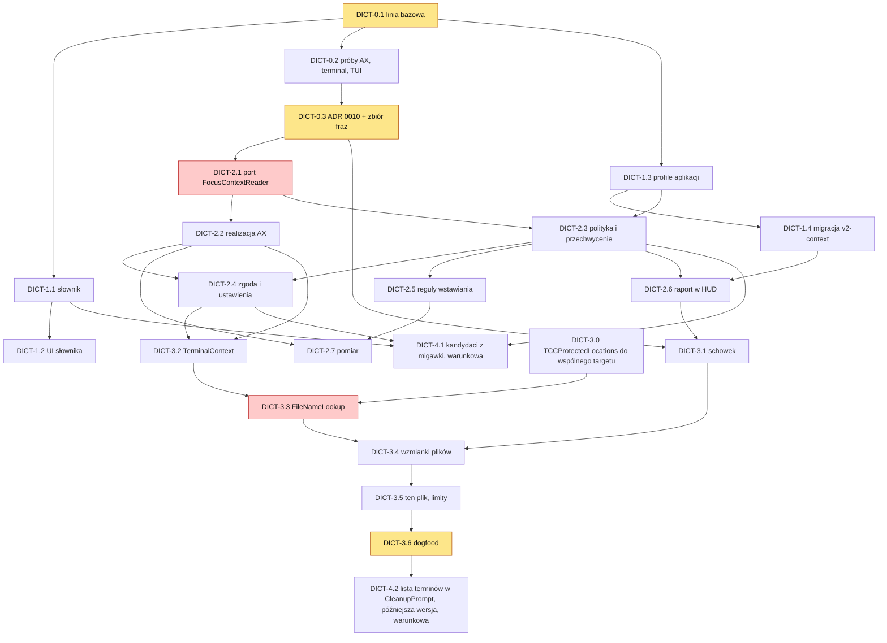

# Epic DICT: dyktowanie świadome kontekstu

- Data: 2026-11-13
- Źródła: briefy `.ai/specs/briefs/2026-11-13-context-aware-dictation-A.md` i `-B.md`, research `.ai/specs/research/2026-11-13-context-aware-dictation-*.md`, spec `.ai/specs/2026-11-01-voice-dictation.md`
- Rozstrzygnięcia A vs B, wspólna oś czasu i zbiorcza lista pytań: `.ai/specs/backlog/2026-11-13-backlog-overview.md`
- Stan kodu: zweryfikowany na `origin/main` (`3356906`), nazwy targetów `Lintel*`. Lokalny checkout jest nieaktualny i nie był źródłem faktów.
- Status: backlog gotowy do implementacji story po story. Kierunek **nie jest potwierdzony przez właściciela**; każda decyzja ma wartość domyślną w sekcji „Decyzje właściciela”.

## Cel i metryka sukcesu

**Cel.** W chwili naciśnięcia skrótu dyktowania Lintel robi jedną, lokalną, ograniczoną czasowo migawkę kontekstu (aplikacja, rodzaj pola, tekst wokół kursora, zaznaczenie, tytuł i dokument okna, w terminalu katalog roboczy) i używa jej regułami w Swifcie: słownik poprawia pisownię nazw, reguły wstawiania dopasowują spację i wielką literę, a jawne frazy głosowe wstawiają schowek albo zweryfikowaną ścieżkę pliku. Kontekst nigdy nie jest powodem do przepisania wypowiedzi i nigdy nie opuszcza Maca.

**Metryki sukcesu** (mierzone na zbiorze z DICT-0.1 i w dogfoodzie DICT-3.6):

| Metryka | Linia bazowa | Cel |
|---|---|---|
| Dyktowania z nazwą pliku, identyfikatorem lub odwołaniem do schowka wymagające ręcznej poprawki | mierzy DICT-0.1 | spadek o co najmniej połowę po Fazie 3 |
| Fałszywe podmiany słownika | — | ≤ 2% słów na zbiorze regresyjnym |
| Fałszywe odwołania (schowek, plik) w zwykłej prozie | — | 0 na zbiorze 60 fraz (warunek konieczny) |
| Skrót → nagrywanie i HUD | budżet < 150 ms, niezmierzony | bez pogorszenia; migawka nie blokuje startu |
| Migawka kontekstu | — | ≤ 250 ms łącznie, po czasie dyktowanie bez kontekstu |
| Treść kontekstu w logach, `ranking.sqlite`, historii | — | 0 wystąpień (test skanujący źródła i test z atrapą loggera) |

## Zakres

- Słownik użytkownika z deterministyczną zamianą; profile aplikacji z identyfikatora pakietu.
- Port odczytu fokusu w `LintelKit` i jego realizacja przez Accessibility w `LintelApp`.
- Polityka odmów, zgoda w aplikacji, raport źródeł w HUD.
- Reguły wstawiania (spacja, wielka litera, kropka, terminal).
- Odwołania głosowe: schowek, plik w terminalu, „ten plik”.

## Poza zakresem

- Zrzuty ekranu, OCR, uprawnienie Nagrywanie ekranu, adres URL karty przeglądarki, historia schowka jako kontekst.
- Tekst kontekstu w prompcie LLM w Fazach 0–3 (`CleanupPrompt` zostaje w wersji 1).
- Tryb poleceń głosowych pod osobnym skrótem, automatyczny Enter, edycja zaznaczenia modelem (osobny spec).
- Podbijanie słownictwa w silniku mowy (`promptTokens`, CTC), dopóki pomiar nie pokaże zysku po polsku.
- Ustawianie `AXManualAccessibility` / `AXEnhancedUserInterface` w cudzych aplikacjach.
- Przepisywanie tonu zależnie od aplikacji, własne prompty użytkownika, uczenie słownika z poprawek.
- Wysyłanie czegokolwiek z kontekstu do zewnętrznego dostawcy lub na „Mój serwer”.

## Założenia (zweryfikowane w kodzie `origin/main`)

1. **Nowy grant systemowy nie jest potrzebny.** Odczyt przez `AXUIElement` korzysta z tego samego grantu Dostępność, który dyktowanie już deklaruje (`DictationPlugin.swift:322`, `[.microphone, .accessibility]`). `AXWindowClient` (PR #68) już czyta atrybuty okien innych aplikacji pod tym grantem.
2. **Potrzebna jest zgoda w aplikacji.** Każdy tekst o Dostępności mówi dziś o wklejaniu albo przesuwaniu okien (`PermissionsPane.swift:127-132`, `DictationViews.swift:175`, `WindowsOnboarding.swift:26`). Żaden nie mówi o czytaniu treści. Czytanie pola tekstowego to nowy cel, więc wymaga własnego wyłącznika (domyślnie wyłączonego), kroku onboardingu i poprawionego opisu w Ustawienia → Uprawnienia, także dla obecnych użytkowników.
3. **Stan uprawnienia jest dziś czytany na dwa sposoby.** `SystemPermissionsReader` używa `CGPreflightPostEventAccess()` (`SystemClients.swift:319`), a `AXWindowClient` używa `AXIsProcessTrusted()`. Nowy port sprawdza `AXIsProcessTrusted()`.
4. **Aplikacja docelowa jest dziś czytana za późno.** `frontmostBundleID()` jest wywoływane w `produceAndPaste()` (`DictationController.swift:176`), po transkrypcji. `prepareAndStart()` (`:85-124`) nie czyta nic o celu.
5. **Formatowanie biegnie kawałkami w trakcie nagrania** (`DictationSession.startFormatting`, `:376-395`). Wszystko, czego formatowanie potrzebuje z migawki, musi istnieć przed pierwszym kawałkiem.
6. **`PluginContext` jest strukturą z jednym inicjalizatorem**, a nowe porty wchodzą jako parametry z wartością domyślną (wzorzec `windows: any WindowClient = NoWindowClient()`).
7. **Nie ma odczytu fokusu.** W `Sources` nie ma `kAXFocusedUIElementAttribute`, `kAXValueAttribute`, `kAXSelectedText…` ani `AXDocument`. `AXWindowClient` daje wzorzec: `nonisolated final class`, jedna kolejka szeregowa na pid (`PerProcessQueues`), `messagingTimeout = 0.25`.
8. **Historia dyktowania jest zaszyfrowana** kluczem z Pęku kluczy (`MasterKeyStore(service: "com.lintelapp.dictation")`, HKDF `sqlcipher`). Na `origin/main` nie ma narzędzia do odczytu offline.
9. **Brak linii bazowej wydajności.** Wszystkie komórki „Measured” dyktowania w `docs/perf.md` są puste.
10. `speechLanguage` i `FormatterGuard.Language.dominant` znają tylko `pl` i `en`; reguły i frazy tego epica też.

## Decyzje właściciela (Open Questions z wartością domyślną)

| ID | Pytanie | Wartość domyślna przyjęta w backlogu |
|---|---|---|
| D-Q1 ⚠ | Czy kontekst ma być domyślnie włączony? (`BACKWARD_COMPATIBILITY.md` §3: ustawienie, które czyta więcej, wymaga zgody właściciela.) | **Wyłączony.** `contextEnabled = false`, włączany krokiem onboardingu z listą źródeł. **Odwrócone decyzją właściciela 2026-11-20 (P5.2 specu auto-nauki): kontekst włączony domyślnie u wszystkich, także po aktualizacji; ryzyko przyjęte.** Które źródła są wtedy na liście domyślnej: punkt Z1 specu auto-nauki, do potwierdzenia przed DICT-2.x. |
| D-Q2 | Czy poprawić wspólny opis Dostępności w Ustawienia → Uprawnienia, tak by mówił o czytaniu okien i pól? Dotyczy też `WindowsPlugin`, który już czyta tytuły okien. | **Tak**, w DICT-2.4. |
| D-Q3 | Próg bramki DICT-0.1: „mniej niż 5 na 20 dyktowań z nazwą, identyfikatorem lub odwołaniem → nie zaczynać”. | **Przyjęty.** Bramka zaliczona decyzją właściciela 2026-11-19 (decyzja 6), bez liczenia. |
| D-Q4 ⚠ | Zgoda na jednorazowy odczyt własnej historii dyktowania przez narzędzie poza repozytorium (system pokaże monit Pęku kluczy) **oraz na przechowanie odszyfrowanych transkryptów poza repozytorium jako zbioru regresyjnego**, dłużej niż 30-dniowa retencja historii. | **Tak**: do repozytorium trafiają wyłącznie liczby; zbiór leży na zaszyfrowanym obrazie dysku i jest kasowany po DICT-3.6 (albo po DICT-4.1, jeśli ruszy). Zapasowo ręczny eksport 30 wpisów. |
| D-Q5 | Profile aplikacji zmieniają wynik u obecnych użytkowników (bez kropki w terminalu). Domyślnie włączone? | **Wyłączone** (`appProfiles = false`); włączane razem z kontekstem w onboardingu. |
| D-Q6 ⚠ | Odwołanie do schowka: zwykłe dyktowanie czy tylko tryb poleceń? Domyślnie włączone? | **Zamknięta lista fraz w zwykłym dyktowaniu, domyślnie wyłączone**, fraza musi być całym segmentem między pauzami, potwierdzenie w HUD przy pierwszych 5 użyciach. **2026-11-20:** czy zostaje wyłączone przy kontekście włączonym domyślnie, rozstrzyga Z1 (wiersz CTX-3). |
| D-Q7 | Skąd lista plików: indeks `FilesPlugin` (nowy wkład pluginu) czy ograniczone listowanie katalogu roboczego w hoście? | **Listowanie w hoście** (`FileNameLookup`): mniejszy kontrakt, działa bez włączonego wyszukiwania plików. Indeks jako rozszerzenie później. |
| D-Q8 | Słowa wyzwalające plik: „małpa”, „at”, „tag” + nazwa, albo nazwa z wypowiedzianym rozszerzeniem. Czy samo „plik X” ma wyzwalać? | **Nie**; „plik” jest zwykłym słowem. |
| D-Q9 | Włączać `AXManualAccessibility` w aplikacjach Electron? | **Nie.** VS Code, Cursor i Slack dostają profil z identyfikatora i tytuł okna. |
| D-Q10 | Lista terminów w prompcie LLM (w późniejszej wersji `CleanupPrompt`, po v2)? | **Nie w Fazach 0–3.** Kandydat DICT-4.2, tylko po pomiarze. **Założenie „`CleanupPrompt` bez zmian w Fazach 0–3” uchylone 2026-11-19 (decyzja 7):** prompt zmienia się, by usuwać zmiany zdania i autopoprawki, `FormatterGuard` do dostosowania. **Doprecyzowane przez właściciela 2026-11-19 (ADR 0010):** zmiana z decyzji 7 to `CleanupPrompt` w wersji 2; lista terminów (DICT-4.2) to późniejsza wersja promptu i zachowuje swój warunek; zob. przegląd backlogu, sekcja „Decyzje właściciela (2026-11-19)”. |
| D-Q11 ⚠ | Uchylić nie-cele specu dyktowania („reguły per aplikacja”, „własny słownik”)? | **Tak**, wprost w ADR 0010. |
| D-Q12 | Zapisywać w historii listę użytych źródeł (bez treści)? | **Tak**, kolumna `context_sources`. |
| D-Q13 | Kandydaci na terminy z ekranu (dopasowanie fonetyczne, DICT-4.1): robić? | **Warunkowo**, tylko gdy DICT-0.1 (kryterium 2) pokaże ≤ 2% fałszywych podmian. |
| D-Q14 ⚠ | Czytać proces pierwszoplanowy i katalog roboczy terminala (libproc)? To nowa klasa danych o innych aplikacjach. | **Tak, jako osobne źródło `terminal`, domyślnie wyłączone**, wymienione w tabeli zaufania i w arkuszu zgody. **2026-11-20:** czy zostaje wyłączone przy kontekście włączonym domyślnie, rozstrzyga Z1 (wiersze CTX-5 i CTX-6). |

## Ryzyka

| Ryzyko | Poziom | Ograniczenie |
|---|---|---|
| Odczyt treści innych aplikacji (zaufanie) | wysokie | domyślnie wyłączone, odmowy w realizacji portu, nic na dysku, raport w HUD, lista odmów |
| Fałszywe wstawienie schowka (nie do cofnięcia) | wysokie | D-Q6: wyłączone domyślnie, cały segment, potwierdzenie w HUD, 0 fałszywych na 60 frazach |
| Fałszywe podmiany nazw i plików | wysokie | wyzwalacz + jeden zwycięzca z marginesem + istnienie na dysku; bramka 2%; `dictation.pasteLastRaw` |
| Zmiana chronionego kontraktu `LintelKit` | wysokie | tylko addytywnie, kształt zamrażany po próbie DICT-0.2, jeden PR kontraktowy naraz |
| Kontekst terminala nie działa przy kilku kartach, `tmux`, `ssh` | wysokie dla Fazy 3 | DICT-0.2 jest bramką; brak pewności → funkcje plików wyłączone dla tego dyktowania |
| Zawieszenie na wywołaniu AX | średnie | kolejka na pid, limit na wywołanie, budżet 250 ms, dyktowanie nie czeka |
| Pola haseł zbudowane ze zwykłego pola na stronie WWW | średnie, nieusuwalne | tekst pola nigdy nie jest utrwalany ani wysyłany; opisane w tabeli zaufania |
| Migawka z innej aplikacji niż cel wklejenia | średnie | porównanie pid przed wklejeniem; próg wieku migawki 30 s |
| Apple włączy egzekwowanie prywatności schowka | średnie | odczyt tylko przy `accessBehavior == .alwaysAllow` |
| Brak linii bazowej wydajności | średnie | DICT-2.7 mierzy przed i po |

**Rollback:** `contextEnabled = false` wyłącza wszystko, co czyta. Dane: `vocabulary.json` i dwie kolumny w `dictation_entry`; obie zmiany są addytywne. Zachowanie starszego builda wobec nowszego schematu określa `BACKWARD_COMPATIBILITY.md` §2 (wyłącza funkcję i nie rusza danych); DICT-1.4 sprawdza to testem.

## Fazy

| Faza | Treść | Stories | Warunek wejścia |
|---|---|---|---|
| 0 | Bramka i próby, bez kodu produktu | DICT-0.1 – 0.3 | — |
| 1 | Słownik i profile, bez Accessibility i bez `LintelKit` | DICT-1.1 – 1.4 | bramka DICT-0.1 (kryterium 3) |
| 2 | Port, zgoda, reguły wstawiania | DICT-2.1 – 2.7 | ADR 0010 (DICT-0.3) |
| 3 | Odwołania głosowe | DICT-3.0 – 3.6 | wyniki DICT-0.2 i zbiór fraz z DICT-0.3 |
| 4 | Kandydaci warunkowi (bez rozpisanych kroków poza 4.1 i 4.2) | DICT-4.1, 4.2 | pomiary z Faz 0–3 |

## Mapa zależności

Wniosek z diagramu: dwa czerwone węzły (DICT-2.1 i DICT-3.3) to zmiany `LintelKit`; idą po kolei, w jednej kolejce z kontraktowymi stories epica MEET (kolejność w przeglądzie). Typy terminala są zamrażane już w DICT-2.1, więc DICT-3.2 nie dotyka kontraktu. Faza 1 nie czeka na żaden z nich.

Zależności z epikiem MEET: `TermReplacer` z DICT-1.1 trafia do `LintelCore`, bo użyje go też MEET-5.2 (pluginy nie importują się nawzajem). Szczegóły w `2026-11-13-backlog-overview.md`.

## Wspólne reguły dla każdej story

**Wspólne Definition of Done**

1. Bramka przechodzi w kolejności: `swift build`, `swift test`, `swift format lint --strict -r Sources Tests`.
2. Jedna gałąź `feat/` i jeden PR na story, oparty na `main`; tytuł w formacie conventional commits.
3. Kod pluginu bez `fatalError`, `try!` i wymuszonego rozpakowania; błąd odczytu kontekstu kończy się „brak kontekstu”, nigdy błędem dyktowania.
4. Każdy nowy tekst ma wartości `en` i `pl` w `Resources/Localizable.xcstrings` (`StringCatalogTests`).
5. Zmiany kontraktów są addytywne, z wartością domyślną; dotknięta powierzchnia z `BACKWARD_COMPATIBILITY.md` jest nazwana w PR i dopisana do tego pliku.
6. Migracja: test w górę z poprzedniego schematu oraz test, że starszy kod wobec nowszego schematu zachowuje się zgodnie z `BACKWARD_COMPATIBILITY.md` §2; plan wycofania w PR. Testy w Swift Testing na portach w pamięci i katalogach tymczasowych; nic nie zostaje po teście (bez pakietów `UserDefaults`, bez prawdziwych wpisów Pęku kluczy).
7. `AGENTS.md` zaktualizowany w tym samym PR, gdy dochodzi typ, klucz ustawień albo port.
8. Story z UI: przed kodem prototyp ekranu (`om-ux-design`) zaakceptowany przez właściciela i wskazany w PR; implementacja zgodna z nim 1:1. Zrzuty w trybie jasnym i ciemnym z buildu debug z argumentami `--qa…` (`docs/qa.md`) dla stanów: pusty, wypełniony, błąd, brak uprawnienia, długa treść; etykiety VoiceOver.

**Wspólne reguły prywatności**

- Treść migawki (tekst pola, zaznaczenie, tytuł okna, ścieżka dokumentu, zawartość schowka) nie trafia do logów, `ranking.sqlite`, `dictation.sqlite`, raportów awarii ani diagnostyki. Nie loguje się też długości pól.
- Migawka żyje w pamięci przez jedno dyktowanie i jest zerowana przy wklejeniu, anulowaniu i błędzie.
- „Wyłączone” znaczy, że nic nie jest czytane.

**Etykiety.** Każda story podaje kategorię, ryzyko i znacznik QA według `SDLC.md`. Każda story, która zmienia powierzchnię z `BACKWARD_COMPATIBILITY.md` (w tym nowy klucz ustawień, §3), jest `risk-high`: brak samodzielnego QA, drugi recenzent, test ścieżki odmowy dla uprawnień, test migracji w górę i wobec starszego kodu.

**Estymaty.** S: do 300 linii, jeden dzień pracy agenta. M: 300–800 linii. L: ponad 800 linii albo kilka powierzchni.

**Komenda startowa.** Każda zakłada, że pliki backlogu są w repozytorium (PR-0 z przeglądu). Wzór: `om-auto-create-pr "<zadanie> — Source doc: .ai/specs/backlog/2026-11-13-epic-context-aware-dictation.md (story DICT-x.y)"`.

---

## Faza 0 — bramka i próby

### DICT-0.1 — Linia bazowa na historii dyktowania (bramka wejścia)

> **Status 2026-11-19:** zaliczona decyzją właściciela (decyzja 6), bez liczenia 5 z 20; brak linii bazowej zaakceptowany. Zob. przegląd backlogu, sekcja „Decyzje właściciela (2026-11-19)”.

- **Story:** Jako właściciel chcę wiedzieć, jak często w moich dyktowaniach padają nazwy plików, identyfikatory i odwołania do schowka, aby nie budować funkcji, której nie potrzebuję.
- **Zależności:** brak. Decyzja D-Q4.
- **Powierzchnie:** żadna w `Sources/` ani `Tests/`. Narzędzie żyje poza repozytorium; do repozytorium trafia tylko tabela liczb w `docs/decisions/0010-dictation-context.md` (sekcja „Linia bazowa”, status „Proposed”).
- **Etykiety:** `documentation`, `risk-low`, `skip-qa`, `priority-high` · **Estymata:** S
- **Kryteria akceptacji:**
  1. Given historia dyktowania właściciela z co najmniej 20 wpisami, When narzędzie przeczyta `raw_text`, Then raport podaje liczbę dyktowań zawierających (i) nazwę pliku lub rozszerzenie, (ii) identyfikator kodu, (iii) frazę odwołania do schowka, oraz łączny odsetek.
  2. Given lista nazw plików z repozytoriów właściciela i prototyp dopasowania (normalizacja camelCase i snake_case, klucz fonetyczny PL/EN), When prototyp przejdzie po tych samych transkryptach, Then raport podaje trafność i odsetek fałszywych podmian w słowach.
  3. Given wynik (i)+(ii)+(iii) poniżej 25% dyktowań (5 na 20; przy innej liczbie wpisów liczy się odsetek, minimum 20 wpisów), Then epic zostaje wstrzymany, a decyzja jest zapisana w ADR. Given fałszywe podmiany powyżej 2% słów, Then DICT-4.1 jest skreślona, a słownik (DICT-1.1) zostaje przy dopasowaniu dokładnym.
  4. Given zakończone narzędzie, Then żaden transkrypt nie jest w repozytorium, w logach ani w wyniku; zbiór transkryptów zostaje poza repozytorium, na zaszyfrowanym obrazie dysku, jako zbiór regresyjny (D-Q4) i jest kasowany po DICT-3.6 albo DICT-4.1.
  5. Given klasyfikacja (i)–(iii), Then robią ją jawne reguły narzędzia (lista rozszerzeń, wzorce camelCase / snake_case / ścieżki, lista fraz schowka), a właściciel ręcznie sprawdza 20 losowych wpisów; raport podaje zgodność reguł z oceną ręczną.
- **Plan testów:** brak testów w repozytorium. Narzędzie ma własny test na trzech syntetycznych transkryptach z ręcznie policzonym wynikiem.
- **Prywatność:** odczyt wymaga klucza z Pęku kluczy; system pokazuje monit, który zatwierdza właściciel. Narzędzie niczego nie zapisuje do Pęku kluczy i nie kopiuje bazy. Zapas bez Pęku kluczy: właściciel kopiuje 30 wpisów z listy `dictation.history` do pliku poza repozytorium.
- **DoD:** wspólne DoD (punkty 1–2 jako PR tylko z dokumentacją) + tabela liczb i decyzja bramki w ADR 0010.
- **Start:** czynność właściciela i agenta poza repozytorium; zapis wyniku: `om-auto-create-pr "Dodaj docs/decisions/0010-dictation-context.md (status Proposed) z sekcją Linia bazowa: tabela liczb z pomiaru DICT-0.1 i decyzja bramki; bez zmian w Sources i Tests — Source doc: .ai/specs/backlog/2026-11-13-epic-context-aware-dictation.md (story DICT-0.1)"`

### DICT-0.2 — Próby: odczyt Accessibility, kontekst terminala, wklejanie do TUI, schowek

- **Story:** Jako autor kontraktu chcę zmierzyć, co faktycznie da się odczytać i w jakim czasie, aby zamrozić kształt portu na faktach, a nie na dokumentacji.
- **Zależności:** DICT-0.1 (bramka przeszła).
- **Powierzchnie:** żadna w `Sources/`. Skrypt próbny poza repozytorium; wyniki do ADR 0010.
- **Etykiety:** `documentation`, `risk-low`, `skip-qa`, `priority-high` · **Estymata:** M
- **Kryteria akceptacji:**
  1. Given Terminal.app, iTerm2, Ghostty, Xcode, Notatki, Mail, Safari, Chrome, VS Code, Cursor, Slack, Claude Desktop, When skrypt czyta rolę pola, tekst wokół kursora, zaznaczenie, tytuł okna i `AXDocument`, Then ADR ma tabelę „aplikacja × atrybut” z wynikiem (działa / puste / błąd) i czasem każdego wywołania (mediana i maksimum z 20 prób).
  2. Given aplikacja z zatrzymanym wątkiem głównym, When skrypt czyta z `AXUIElementSetMessagingTimeout`, Then ADR podaje faktyczny czas powrotu i rekomendowany limit na wywołanie.
  3. Given trzy terminale z dwiema kartami w różnych katalogach, When skrypt używa `AXDocument` oraz `proc_pidinfo` (`PROC_PIDVNODEPATHINFO`, `e_tpgid`), Then ADR mówi dla każdego terminala, czy aktywna karta daje się pewnie przypisać do katalogu i procesu pierwszoplanowego; `tmux` i `ssh` mają osobny wiersz.
  4. Given Claude Code, Codex CLI i Gemini CLI, When wklejane jest `@ścieżka` względna, bezwzględna, ze spacją i w tekście dłuższym niż 800 znaków, Then ADR ma tabelę formatów „narzędzie → składnia”, albo decyzję „tylko zwykła ścieżka”.
  5. Given podpisany build na macOS 26 i 27, Then ADR podaje wartość `NSPasteboard.accessBehavior` i zachowanie alertu przy odczycie ze skrótu globalnego.
  6. Given wyniki 3, When pewne przypisanie działa w mniej niż dwóch z trzech terminali, Then DICT-3.2 – 3.5 są oznaczone w ADR jako wstrzymane, a Faza 3 kończy się na DICT-3.1.
- **Plan testów:** ręczny, wyniki w ADR. Skrypt nie trafia do repozytorium.
- **Prywatność:** skrypt drukuje typy, długości i czasy, nie treść pól.
- **DoD:** wspólne DoD (PR tylko z dokumentacją) + wypełnione tabele w ADR 0010.
- **Start:** `om-auto-create-pr "Uzupełnij docs/decisions/0010-dictation-context.md o wyniki prób DICT-0.2 (macierz Accessibility, kontekst terminala, wklejanie @ścieżki do TUI, accessBehavior); bez zmian w Sources i Tests — Source doc: .ai/specs/backlog/2026-11-13-epic-context-aware-dictation.md (story DICT-0.2)"`

### DICT-0.3 — ADR 0010: model zaufania, zamrożony kontrakt, zbiór 60 fraz

- **Story:** Jako recenzent chcę jednego dokumentu z modelem zaufania, kształtem portu i budżetami oraz stałego zbioru fraz, aby każdy późniejszy PR dało się sprawdzić wobec decyzji.
- **Zależności:** DICT-0.2.
- **Powierzchnie:** `docs/decisions/0010-dictation-context.md` (status „Accepted” dopiero po akceptacji właściciela w PR), `docs/perf.md` (nowe wiersze budżetów, bez pomiarów), `Tests/DictationPluginTests/Fixtures/context/reference-phrases.json` i jeden test formatu tego pliku.
- **Etykiety:** `documentation`, `risk-low`, `skip-qa`, `priority-high` · **Estymata:** S
- **Kryteria akceptacji:**
  1. Given ADR, Then zawiera tabelę zaufania (źródło, kiedy czytane, limit, dokąd trafia, trwałość, twarde odmowy), ostateczne sygnatury `FocusContextReader`, `FocusContextRequest`, `FocusContext`, limity znaków (domyślnie 500 przed kursorem, 200 po, 2000 zaznaczenia), limit czasu na wywołanie z DICT-0.2, kształt `TerminalContext` i `FileNameLookup`, tabelę składni wzmianek per narzędzie oraz zamkniętą listę identyfikatorów pakietów dla domyślnej listy odmów (`contextDeniedApps`).
  2. Given ADR, Then wprost uchyla nie-cele specu dyktowania „reguły per aplikacja” i „własny słownik” (D-Q11) i zostawia „własne prompty użytkownika”.
  3. Given plik fraz, Then zawiera co najmniej 60 pozycji PL/EN w trzech klasach: odwołanie do schowka, odwołanie do pliku, zwykła proza z tymi samymi słowami; każda pozycja ma oczekiwany wynik (`clipboard`, `file`, `none`) i jest zapisana jako lista segmentów między pauzami (pole `segments`), żeby dało się sprawdzić regułę „fraza jako cały segment”.
  4. Given test formatu, When plik ma pozycję bez klasy albo mniej niż 20 pozycji klasy `none`, Then test nie przechodzi.
  5. Given `docs/perf.md`, Then ma wiersze: migawka ≤ 250 ms, reguły po transkrypcji ≤ 20 ms dla 500 słów, `FileNameLookup` ≤ 50 ms przy ciepłej pamięci podręcznej, ≤ 300 ms przy pierwszym listowaniu, ≤ 20 wyników; wszystkie z pustą kolumną „Measured”.
- **Plan testów:** jeden test Swift Testing walidujący plik fraz.
- **Prywatność:** frazy są syntetyczne; żadna nie pochodzi z historii właściciela.
- **DoD:** wspólne DoD.
- **Start:** `om-auto-create-pr "Zaakceptuj ADR 0010 (model zaufania, sygnatury portu FocusContextReader, limity, uchylenie nie-celów specu dyktowania), dodaj wiersze budżetów do docs/perf.md i zbiór 60 fraz PL/EN z testem formatu — Source doc: .ai/specs/backlog/2026-11-13-epic-context-aware-dictation.md (story DICT-0.3)"`

---

## Faza 1 — słownik i profile (bez Accessibility, bez `LintelKit`)

### DICT-1.1 — Słownik użytkownika i deterministyczna zamiana

- **Story:** Jako osoba dyktująca chcę zapisać własne terminy z wariantami wymowy, aby nazwy własne i identyfikatory były zapisywane poprawnie bez modelu.
- **Zależności:** DICT-0.1.
- **Powierzchnie:** `LintelCore` (nowy czysty typ `TermReplacer`, bez I/O); `DictationPlugin` (`VocabularyStore`, wpięcie po kroku formatowania); dane na dysku: `Plugins/dictation/vocabulary.json` (nowy format, `BACKWARD_COMPATIBILITY.md` §2); ustawienie `plugins.dictation.vocabularyEnabled` (Bool, domyślnie `true`, §3).
- **Etykiety:** `feature`, `risk-high` (nowy format na dysku), `skip-qa`, `priority-medium` · **Estymata:** M
- **Kryteria akceptacji:**
  1. Given słownik z terminem `AuthService` i aliasem „auth service”, When transkrypt zawiera „otwórz auth service teraz”, Then wynik to „otwórz AuthService teraz”, także w trybie `raw`.
  2. Given alias „plan”, When transkrypt zawiera „planowanie”, Then nic się nie zmienia (dopasowanie tylko na granicach znormalizowanych tokenów).
  3. Given pusty słownik albo `vocabularyEnabled = false`, Then wynik jest bajt w bajt taki jak przed zmianą.
  4. Given plik `vocabulary.json` uszkodzony, Then powstaje jedna kopia `.corrupt`, słownik jest pusty, a dyktowanie działa. Given plik w nowszej wersji, Then jest tylko czytany, nigdy nadpisywany.
  5. Given `eraseData()`, Then `vocabulary.json` znika.
  6. Given 500 słów i 200 terminów, Then `TermReplacer` kończy w ≤ 20 ms (test wydajności wyłączony domyślnie, wynik w PR).
  7. Given zamiana następuje po `TextFormatter`, Then `FormatterGuard` i `CleanupPrompt` (wersja 1) są nietknięte, a `Output.rawText` zostaje bez zamian (`dictation.pasteLastRaw` wkleja tekst surowy).
- **Plan testów:** `LintelCoreTests` (tabela par PL/EN, zestaw negatywny: środek słowa, krótkie słowa, różnice wielkości liter); `DictationPluginTests` (zapis i odczyt przez `AtomicFile` w katalogu tymczasowym, plik uszkodzony, wersja nowsza, `eraseData`); test, że sesja z `RawFormatter` stosuje słownik.
- **Prywatność:** terminy słownika nie trafiają do logów. Plik `0600` w `Plugins/dictation/` (`0700`).
- **DoD:** wspólne DoD + wpis w `BACKWARD_COMPATIBILITY.md` §2 i §3.
- **Start:** `om-auto-create-pr "Słownik użytkownika dyktowania: TermReplacer w LintelCore (czysta logika), VocabularyStore nad AtomicFile (Plugins/dictation/vocabulary.json, wersjonowany), zamiana po kroku formatowania, klucz plugins.dictation.vocabularyEnabled; bez UI — Source doc: .ai/specs/backlog/2026-11-13-epic-context-aware-dictation.md (story DICT-1.1)"`

### DICT-1.2 — Panel słownika w Ustawienia → Dyktowanie

- **Story:** Jako osoba dyktująca chcę dodawać, edytować i usuwać terminy w Ustawieniach, aby nie edytować pliku ręcznie.
- **Zależności:** DICT-1.1.
- **Powierzchnie:** `DictationPlugin` (widok i model panelu), `Resources/Localizable.xcstrings`. Bez zmian kontraktów.
- **Etykiety:** `feature`, `risk-low`, `needs-qa`, `priority-medium` · **Estymata:** M
- **Kryteria akceptacji:**
  1. Given panel, When dodaję termin z dwoma aliasami, Then wpis jest w `vocabulary.json` i działa w następnym dyktowaniu bez restartu.
  2. Given termin, którego alias jest pojedynczym słowem krótszym niż 4 znaki, Then panel pokazuje ostrzeżenie o ryzyku fałszywych podmian i wymaga potwierdzenia.
  3. Given dwa terminy z tym samym aliasem, Then zapis jest odrzucony z komunikatem.
  4. Given VoiceOver, Then każdy wiersz, pole i przycisk ma etykietę; lista działa z klawiatury.
- **Plan testów:** testy modelu widoku (dodanie, edycja, usunięcie, kolizja aliasów, ostrzeżenie); `StringCatalogTests`; zrzuty jasny i ciemny, stan pusty i stan z 3 wpisami.
- **Prywatność:** jak DICT-1.1.
- **DoD:** wspólne DoD + porównanie ekranu z istniejącymi panelami Ustawień 1:1 w stylu.
- **Start:** `om-auto-create-pr "Panel Słownik w Ustawienia → Dyktowanie: lista terminów z aliasami, dodawanie, edycja, usuwanie, ostrzeżenie dla krótkich aliasów, teksty en i pl — Source doc: .ai/specs/backlog/2026-11-13-epic-context-aware-dictation.md (story DICT-1.2)"`

### DICT-1.3 — Profile aplikacji z identyfikatora pakietu

- **Story:** Jako osoba dyktująca do terminala i czatu chcę, by tekst nie zaczynał się wielką literą i nie kończył kropką tam, gdzie to przeszkadza, aby nie poprawiać każdego wklejenia.
- **Zależności:** DICT-0.1. Niezależna od DICT-1.1.
- **Powierzchnie:** `DictationPlugin` (`AppProfile`, odczyt `frontmostApplication` w `prepareAndStart()`, reguły po formatowaniu); ustawienia `plugins.dictation.appProfiles` (Bool, domyślnie `false`, D-Q5) i `plugins.dictation.profileOverrides` (słownik bundle id → profil); zachowanie widoczne dla użytkownika (§5), więc nota wydania.
- **Etykiety:** `feature`, `risk-high` (nowe klucze ustawień, §3), `needs-qa`, `priority-medium` · **Estymata:** M
- **Kryteria akceptacji:**
  0. Given Ustawienia → Dyktowanie, Then jest przełącznik „Dopasuj do aplikacji” (`appProfiles`) z opisem reguł i lista nadpisań (aplikacja → profil).
  1. Given `appProfiles = true` i Terminal.app na wierzchu w chwili naciśnięcia skrótu, When dyktuję „lista plików”, Then wklejony tekst nie zaczyna się wielką literą i nie kończy kropką.
  2. Given profil `chat` i wypowiedź do 8 słów, Then nie ma kropki na końcu; pytajnik i wykrzyknik zostają.
  3. Given `appProfiles = false`, Then wynik jest bajt w bajt taki jak przed zmianą, a `prepareAndStart()` nie czyta aplikacji.
  4. Given nadpisanie użytkownika dla bundle id, Then wygrywa z tabelą wbudowaną.
  5. Given aplikacja na wierzchu przy wklejeniu ma inny pid niż przy starcie, Then stosowany jest profil aplikacji z chwili wklejenia.
  6. Given nieznany bundle id, Then profil `other` nie zmienia niczego.
- **Plan testów:** testy tabelaryczne PL/EN dla profili `terminal`, `codeEditor`, `chat`, `mail`, `document`, `other`; test zmiany aplikacji w trakcie; test, że przy wyłączonym kluczu atrapa `WorkspaceClient` nie rejestruje odczytu w `prepareAndStart()`.
- **Prywatność:** czytany jest tylko identyfikator pakietu, tak jak dziś przy zapisie historii.
- **DoD:** wspólne DoD + `qa-approved` + wpis w §3 i nota wydania (§5).
- **Start:** `om-auto-create-pr "Profile aplikacji dyktowania: AppProfile z bundle id czytanego w prepareAndStart, wbudowana tabela + plugins.dictation.profileOverrides, reguły wielkiej litery i kropki po formatowaniu, klucz plugins.dictation.appProfiles domyślnie false — Source doc: .ai/specs/backlog/2026-11-13-epic-context-aware-dictation.md (story DICT-1.3)"`

### DICT-1.4 — Migracja `v2-context` w historii dyktowania

- **Story:** Jako właściciel chcę widzieć w historii, jaki profil i jakie źródła kontekstu zostały użyte, aby diagnozować błędne podstawienia bez zapisywania treści kontekstu.
- **Zależności:** DICT-1.3.
- **Powierzchnie:** `dictation.sqlite`: migracja `v2-context` dodająca do `dictation_entry` kolumny `app_profile TEXT NULL` i `context_sources TEXT NULL` (§2); `DictationEntry` i mapowanie wierszy.
- **Etykiety:** `feature`, `risk-high` (migracja), `skip-qa`, `priority-medium` · **Estymata:** S
- **Kryteria akceptacji:**
  1. Given baza w schemacie `v1-history` z 3 wpisami, When aplikacja otworzy ją po zmianie, Then migracja przechodzi, wpisy czytają się bez zmian, a nowe kolumny są `NULL`.
  2. Given dyktowanie z profilem `terminal`, Then wpis ma `app_profile = "terminal"`; `context_sources` zawiera wyłącznie nazwy źródeł z zamkniętej listy, nigdy treść. Ta story zapisuje `vocabulary` i `profile`; kolejne stories dopisują własne nazwy (`field`, `selection`, `window`, `terminal`, `clipboard`, `files`).
  3. Given baza po migracji otwarta przez kod sprzed zmiany (symulacja w teście), Then zachowanie jest zgodne z `BACKWARD_COMPATIBILITY.md` §2: historia jest wyłączona albo czytana bez nowych kolumn, a żaden plik nie jest zmieniany ani archiwizowany.
  4. Given `historyEnabled = false`, Then nic nie jest zapisywane, jak dziś.
- **Plan testów:** test migracji z bazy v1 utworzonej w teście; test zapisu i odczytu kolumn; test, że `context_sources` odrzuca wartość spoza listy.
- **Prywatność:** kolumny przechowują nazwy źródeł, nie treść.
- **DoD:** wspólne DoD + wpis w §2 + plan wycofania w PR (kolumny są ignorowane przez starszy kod).
- **Start:** `om-auto-create-pr "Migracja v2-context w dictation.sqlite: kolumny app_profile i context_sources w dictation_entry, zapis profilu z DICT-1.3, test migracji z v1-history — Source doc: .ai/specs/backlog/2026-11-13-epic-context-aware-dictation.md (story DICT-1.4)"`

---

## Faza 2 — port, zgoda, reguły wstawiania

### DICT-2.1 — Kontrakt `FocusContextReader` w `LintelKit`

- **Story:** Jako autor pluginu chcę portu, który daje jedną migawkę fokusu, aby czytać kontekst bez importowania Accessibility do pluginu.
- **Zależności:** DICT-0.3 (sygnatury z ADR 0010). W tym czasie żaden inny PR nie zmienia `LintelKit`. **Przed startem (od 2026-11-20):** właściciel akceptuje treść zmian ADR 0010 z `docs/decisions/0010-dictation-context-amendment-auto-learn.md`, które przesądzają decyzje P1 = A+B i P2 = D auto-nauki (DICT-2.8), co najmniej zmianę 7 (kształt) i dopisek o odczycie zaznaczenia na polecenie; ADR 0010 dostaje nowy kształt w decyzji 3, zanim ten PR zostanie otwarty. **Stan 2026-11-20 (sprawdzone):** kolejność „rozszerzenie kontraktu i zmiany ADR 0010 przed PR DICT-2.1" jest zapisana tutaj, w story DICT-2.8 i w kroku 0.2 specu auto-nauki. Decyzja P4 = B (cała wartość pola) nie zmienia kształtu członów (plik propozycji ADR, „Change 7 in detail"). Licznik w pasku bocznym (U9 = B) to osobny człon `SettingsStatus`, poza typami fokusu; czy wchodzi do tego PR: punkt Z8.
- **Powierzchnie:** `LintelKit` (chroniony kontrakt, §1): `FocusContextReader`, `FocusContextRequest`, `FocusContext` (w tym `terminal: TerminalContext?`, domyślnie `nil`), `FocusContextSource` (`window`, `field`, `selection`, `terminal`), `FieldKind`, `SkipReason` (`secureField`, `timeout`, `unsupported`, `notPermitted`, `denied`), `TerminalContext`, `NoFocusContextReader`; `PluginContext.focusContext` z wartością domyślną `NoFocusContextReader()`. **Rozszerzenia dla auto-nauki (DICT-2.8, decyzje właściciela P1 = A+B i P2 = D z 2026-11-20), w tym samym PR, addytywnie i z wartościami domyślnymi:** `FocusFieldHandle` (tożsamość pola, bez treści), `FocusLossReason` (zbiór otwarty), `FieldRereadRequest`, `FieldReread`, `FocusContextRequest.keepsFieldHandle` (domyślnie `false`), `FocusContext.fieldHandle` (domyślnie `nil`) oraz wymagania `reread(_:_:)` (ponowny odczyt tego samego pola), `focusLoss(of:within:)` (powiadomienie o utracie fokusu) i `release(_:)` z domyślnymi realizacjami w rozszerzeniu protokołu (`unsupported` / nic); sygnatury według zaakceptowanej poprawki ADR. `FocusContextSource`, `SkipReason` i `FieldKind` (decyzja właściciela 2026-11-19, ADR 0010) są zbiorami otwartymi (struktura z `rawValue` i stałymi statycznymi, nie zamknięty `enum`), żeby dodanie wartości nie łamało wyczerpujących instrukcji `switch`.
- **Etykiety:** `feature`, `risk-high`, `skip-qa`, `priority-high` · **Estymata:** S
- **Kryteria akceptacji:**
  1. Given `PluginContext` zbudowany bez nowego parametru, Then `focusContext.snapshot(_:)` zwraca `FocusContext` z `field == .none`, bez tekstu, a każde żądane źródło ma `skipped == .unsupported`.
  2. Given istniejące pluginy, Then kompilują się bez zmian w swoim kodzie.
  3. Given `snapshot(_:)`, Then nie rzuca i jest `async`; typy są `Sendable`.
  4. Given testy `PluginHost` pod `--sanitize=thread`, Then przechodzą.
  5. Given `BACKWARD_COMPATIBILITY.md` §1, Then ma akapit „Added with context-aware dictation” z listą typów i wartości domyślnych.
  6. Given `NoFocusContextReader` i realizacja bez nowych członów, Then `reread` zwraca `skipped == .unsupported`, `focusLoss` zwraca `.unsupported`, `release` nic nie robi, `fieldHandle == nil`; test sprawdza, że `FocusFieldHandle` nie ma pola tekstowego ani identyfikatora aplikacji.
- **Plan testów:** `LintelKitTests` (wartości domyślne, `Sendable`, równość typów wartości); pełna bramka plus TSan dla `PluginHost`.
- **Prywatność:** komentarz dokumentujący w kontrakcie: realizacja odmawia dla pól bezpiecznych i nigdy nie loguje pól migawki.
- **DoD:** wspólne DoD + drugi recenzent (`risk-high`).
- **Start:** `om-auto-create-pr "LintelKit: addytywny port FocusContextReader z typami FocusContextRequest, FocusContext, FocusContextSource, FieldKind, SkipReason, domyślną realizacją NoFocusContextReader i parametrem PluginContext.focusContext oraz addytywnymi członami obserwacji dla auto-nauki (FocusFieldHandle, FocusLossReason, FieldRereadRequest, FieldReread, keepsFieldHandle, fieldHandle, reread, focusLoss, release z wartościami domyślnymi); sygnatury z ADR 0010 po akceptacji poprawki auto-nauki; wpis w BACKWARD_COMPATIBILITY.md — Source doc: .ai/specs/backlog/2026-11-13-epic-context-aware-dictation.md (story DICT-2.1)"`

### DICT-2.2 — `AXFocusContextReader` w `LintelApp` i atrapa QA

- **Story:** Jako użytkownik chcę, by odczyt pola był szybki, ograniczony i odmawiał dla haseł, aby funkcja nie spowalniała dyktowania i nie czytała sekretów.
- **Zależności:** DICT-2.1. PR #70 (window management v2, Phase 0) powinien być zmergowany wcześniej, bo dotyka tych samych plików `LintelApp/Ports`.
- **Powierzchnie:** `LintelApp` (`Ports/AXFocusContextReader.swift`, `AppEnvironment`, `QA/QAOptions.swift`: `--qa-focus-context <plik JSON>`). Nowy cel istniejącego grantu Dostępność (§4).
- **Etykiety:** `feature`, `risk-high` (TCC, czytanie cudzych aplikacji), `skip-qa` (bez UI; macierz ręczna w PR), `priority-high` · **Estymata:** L
- **Kryteria akceptacji:**
  1. Given `AXIsProcessTrusted() == false`, Then każde źródło ma `skipped == .notPermitted`, a żadne wywołanie AX nie jest wykonywane (atrapa warstwy AX rejestruje zero wywołań).
  2. Given element z podrolą `AXSecureTextField` albo aktywne Secure Event Input, Then `field == .secure`, a `textBeforeCaret`, `textAfterCaret` i `selectedText` są `nil`, niezależnie od żądanych źródeł.
  3. Given fokus w oknie samego Lintela, Then tekst nie jest czytany.
  4. Given pole z 10 000 znaków i żądanie 500 przed i 200 po, Then zwrócone teksty mają najwyżej tyle znaków i są czytane przez `kAXStringForRangeParameterizedAttribute`, a nie przez pobranie całej wartości.
  5. Given źródło `.terminal` w żądaniu, Then ta story zwraca `terminal == nil` i `skipped[.terminal] == .unsupported` (realizacja w DICT-3.2).
  5a. Given aplikacja, która nie odpowiada, When budżet żądania to 250 ms, Then `snapshot` wraca w ≤ 300 ms z `skipped == .timeout` dla niedokończonych źródeł, a kolejka pid nie blokuje `AXWindowClient` innych procesów.
  6. Given `--qa-focus-context plik.json`, Then port zwraca migawkę z pliku i nie wywołuje Accessibility.
  7. Given żaden atrybut nie jest zapisywany do cudzej aplikacji (D-Q9), Then test skanujący źródło pliku nie znajduje `AXUIElementSetAttributeValue`.
  8. Given tekst z niewidocznymi znakami Unicode (kierunkowe, zerowej szerokości), Then są usuwane przed zwróceniem.
- **Plan testów:** testy jednostkowe na atrapie warstwy AX (protokół nad `AXUIElementCopy…`): odmowa bez grantu, pole bezpieczne, limity długości, limit czasu, własne okno; test pod TSan dla kolejek; ręczna macierz z DICT-0.2 powtórzona na buildzie i wklejona do PR.
- **Prywatność:** wspólne reguły; dodatkowo test z atrapą loggera, że ścieżki błędów nie przekazują pól migawki.
- **DoD:** wspólne DoD + test ścieżki odmowy uprawnienia + drugi recenzent + macierz ręczna w PR.
- **Start:** `om-auto-create-pr "LintelApp: AXFocusContextReader realizujący FocusContextReader (AXIsProcessTrusted, kolejka szeregowa na pid jak AXWindowClient, limit na wywołanie i budżet żądania, odmowa dla pól bezpiecznych, Secure Event Input i okien Lintela, odczyt zakresem, bez zapisów do cudzych aplikacji) oraz atrapa QA --qa-focus-context — Source doc: .ai/specs/backlog/2026-11-13-epic-context-aware-dictation.md (story DICT-2.2)"`

### DICT-2.3 — `ContextPolicy`, ustawienia i przechwycenie migawki przy starcie

> **Do przepisania (2026-11-20).** Decyzja właściciela P5.2 (spec auto-nauki) włącza kontekst domyślnie u wszystkich, także po aktualizacji, i odwraca D-Q1. Wartości domyślne `contextEnabled` i `contextSources` w tej story są napisane dla modelu opt-in. Story nie startuje, dopóki właściciel nie odpowie na punkt Z1 (co kontekst czyta domyślnie, per źródło) i story nie zostanie przepisana.

- **Story:** Jako osoba dyktująca chcę, by kontekst był czytany raz, przy naciśnięciu skrótu, tylko gdy go włączyłam i tylko w dozwolonych aplikacjach.
- **Zależności:** DICT-2.1, DICT-1.3 (odczyt aplikacji w `prepareAndStart()`).
- **Powierzchnie:** `DictationPlugin` (`ContextPolicy`, `ContextCapture`, `ContextSnapshot`, `DictationController`); ustawienia (§3): `plugins.dictation.contextEnabled` (Bool, **domyślnie `false`**), `plugins.dictation.contextSources` (lista z `window`, `field`, `selection`; `terminal` dochodzi w DICT-3.2 i nie jest domyślnie na liście), `plugins.dictation.contextDeniedApps` (lista bundle id; wartości domyślne to zamknięta lista identyfikatorów z ADR 0010: menedżery haseł, Pęk kluczy, Hasła).
- **Etykiety:** `feature`, `risk-high` (ustawienie prywatności), `skip-qa`, `priority-high` · **Estymata:** M
- **Kryteria akceptacji:**
  1. Given `contextEnabled = false`, When naciskam skrót, Then atrapa `FocusContextReader` rejestruje zero wywołań.
  2. Given `contextEnabled = true` i aplikacja z listy odmów, Then port nie jest wywoływany, a `ContextSnapshot` ma tylko aplikację.
  3. Given `contextEnabled = true`, When port odpowiada po 2 s, Then nagrywanie i HUD startują bez czekania (czas startu taki sam jak z portem odpowiadającym natychmiast, tolerancja 10 ms na atrapie zegara), a spóźniona migawka jest odrzucana.
  4. Given zakończenie przez wklejenie, Esc albo błąd, Then `ContextSnapshot` jest `nil` (test na każdej z trzech ścieżek).
  5. Given źródło wyłączone w `contextSources`, Then nie ma go w `FocusContextRequest.sources`.
  6. Given nowe pliki tej story, Then test skanujący źródła (wzorem `DependencyRuleTests`) nie znajduje wywołania loggera, które przyjmuje pole `ContextSnapshot` lub `FocusContext`.
- **Plan testów:** atrapa portu rejestrująca wywołania; atrapa zegara; test anulowania; test skanujący źródła; `SettingsKeyCoverageTests` dla nowych kluczy.
- **Prywatność:** wspólne reguły. Do czasu DICT-2.4 klucz można włączyć tylko poza UI, więc dla użytkowników nic się nie zmienia.
- **DoD:** wspólne DoD + wpis w §3 z uzasadnieniem wartości domyślnej + drugi recenzent.
- **Start:** `om-auto-create-pr "DictationPlugin: ContextPolicy (lista odmów, źródła), ContextCapture uruchamiany w prepareAndStart równolegle z nagraniem z budżetem 250 ms, ContextSnapshot tylko w pamięci i zerowany na każdej ścieżce wyjścia, klucze plugins.dictation.contextEnabled (false), contextSources, contextDeniedApps, test skanujący logowanie — Source doc: .ai/specs/backlog/2026-11-13-epic-context-aware-dictation.md (story DICT-2.3)"`

### DICT-2.4 — Zgoda w aplikacji: onboarding, panel Kontekst, opis w Uprawnieniach

> **Do przepisania (2026-11-20).** Kryteria 2 (arkusz zgody przy każdym włączeniu, „nic nie pokazuje się samo") i 4 (trzy cele Dostępności) są napisane dla modelu opt-in. Po decyzjach właściciela: kontekst jest włączony domyślnie (P5.2), auto-nauka nie ma arkusza zgody (P5.1), wiersz Dostępność ma cztery cele (P11.1). Czy arkusz zostaje przy ponownym włączaniu kontekstu, wynika z odpowiedzi na Z1. Story nie startuje przed tą odpowiedzią.

- **Story:** Jako użytkownik chcę zobaczyć, co dokładnie będzie czytane, zanim to włączę, i móc to wyłączyć w jednym miejscu.
- **Zależności:** DICT-2.2, DICT-2.3.
- **Powierzchnie:** `DictationPlugin` (panel Ustawienia → Dyktowanie → Kontekst z arkuszem zgody); `LintelApp/Settings/PermissionsPane.swift` (nowy opis Dostępności, D-Q2; zmiana tekstu celu uprawnienia, §4 i §5); `Resources/Localizable.xcstrings`. Zgoda **nie** jest `OnboardingStep`: krok pluginu pokazałby się sam przy następnym uruchomieniu, a pominięty nie wróciłby (`app.onboarding.completedSteps`).
- **Etykiety:** `feature`, `risk-high` (cel uprawnienia TCC, zgoda na czytanie cudzych aplikacji), `needs-qa`, `priority-high` · **Estymata:** L
- **Kryteria akceptacji:**
  1. Given włączone dyktowanie i `contextEnabled = false`, When otwieram panel Kontekst, Then widzę wyłącznik, tabelę zaufania (źródło, kiedy, dokąd trafia, jak długo żyje) i listę aplikacji wykluczonych.
  2. Given przełączam wyłącznik na włączony, Then pojawia się arkusz zgody z listą źródeł i przyciskami „Włącz” i „Nie teraz”; dopiero „Włącz” ustawia `contextEnabled = true`; po „Nie teraz” arkusz wraca przy każdej kolejnej próbie włączenia. Dotyczy także obecnych instalacji; nic nie pokazuje się samo.
  2a. Given panel Kontekst przy włączonym kontekście, Then ma przełączniki źródeł (`contextSources`: okno, pole, zaznaczenie) i „Dopasuj spację i wielką literę” (`smartInsertion`); arkusz zgody proponuje też włączenie profili aplikacji (`appProfiles`, D-Q5).
  3. Given brak grantu Dostępność, Then krok prowadzi do Ustawień systemowych i mówi, że bez grantu czytana jest tylko nazwa aplikacji.
  4. Given Ustawienia → Uprawnienia, Then wiersz Dostępność mówi o trzech celach: wklejanie, przesuwanie okien, czytanie pola tekstowego przy dyktowaniu (gdy włączone); tekst `en` i `pl`.
  5. Given dodaję aplikację do listy wykluczonych, Then następne dyktowanie w niej nie wywołuje portu.
  6. Given VoiceOver, Then tabela zaufania jest czytana wiersz po wierszu, a wyłączniki mają etykiety.
- **Plan testów:** testy modelu widoku; `StringCatalogTests`; QA natywne z `--qa-focus-context` i `--qa-accessibility granted|denied`: zrzuty jasny i ciemny dla stanów wyłączony, krok zgody, włączony, brak grantu.
- **Prywatność:** tabela zaufania jest jedynym źródłem prawdy dla tekstów na stronie produktu.
- **DoD:** wspólne DoD + `qa-approved` przez recenzenta QA + drugi recenzent + nota wydania (§5).
- **Start:** `om-auto-create-pr "Zgoda na kontekst dyktowania: panel Ustawienia → Dyktowanie → Kontekst (wyłącznik, tabela zaufania, przełączniki źródeł, lista wykluczeń), arkusz zgody pokazywany przy każdym włączeniu (nie OnboardingStep), także obecnym użytkownikom, nowy opis Dostępności w Ustawienia → Uprawnienia, teksty en i pl, QA natywne — Source doc: .ai/specs/backlog/2026-11-13-epic-context-aware-dictation.md (story DICT-2.4)"`

### DICT-2.5 — `InsertionRules`: spacja, wielka litera, kropka, terminal

- **Story:** Jako osoba dyktująca w środek zdania chcę, by tekst pasował do tego, co stoi przed kursorem, aby nie poprawiać spacji i wielkich liter.
- **Zależności:** DICT-2.3.
- **Powierzchnie:** `DictationPlugin` (`InsertionRules`, wpięcie między `Output.text` a `TextPaster.paste`); ustawienie `plugins.dictation.smartInsertion` (Bool, domyślnie `true`, działa tylko przy `contextEnabled == true`).
- **Etykiety:** `feature`, `risk-high` (nowy klucz ustawień, §3), `skip-qa`, `priority-medium` · **Estymata:** M
- **Kryteria akceptacji:**
  1. Given tekst przed kursorem kończy się literą, Then wklejany tekst zaczyna się spacją i małą literą (z wyjątkiem pierwszego słowa będącego terminem ze słownika użytkownika, jeśli DICT-1.1 jest na `main`).
  2. Given tekst przed kursorem kończy się „. ” albo pole jest puste, Then wklejany tekst zaczyna się wielką literą i bez spacji wiodącej.
  3. Given tekst po kursorze zaczyna się literą (dyktowanie w środku zdania), Then wynik nie kończy się kropką.
  4. Given `field == .terminal` albo profil `terminal`, Then znaki sterujące są usuwane, a nowe linie zamieniane na spacje; Enter nie jest nigdy wysyłany.
  5. Given pid aplikacji przy wklejeniu różni się od pid z migawki, albo od migawki minęło ponad 120 s (stała do potwierdzenia w dogfoodzie; krótszy próg wyłączałby reguły dla długich promptów), Then `InsertionRules` są pomijane i wstawianie działa jak przed zmianą.
  5a. Given profil aplikacji (DICT-1.3) i `InsertionRules` dają sprzeczny wynik, Then kolejność jest stała: najpierw profil, potem `InsertionRules`; w profilu `terminal` wielkość litery i kropkę ustala profil, a `InsertionRules` tylko spację i oczyszczanie.
  6. Given `smartInsertion = false` albo brak tekstu w migawce, Then wynik jest taki jak przed zmianą.
- **Plan testów:** tabela przypadków PL/EN (co najmniej 40 wierszy: interpunkcja, cudzysłowy, nawiasy, nowa linia, emoji przed kursorem); test progu wieku (120 s) i zmiany pid; test znaków sterujących; test kolejności profil → reguły.
- **Prywatność:** używane są najwyżej dwa ostatnie znaki przed kursorem i pierwszy po nim; reszta tekstu pola nie jest tu potrzebna.
- **DoD:** wspólne DoD + wpis w §3.
- **Start:** `om-auto-create-pr "DictationPlugin: InsertionRules (spacja wiodąca, wielkość pierwszej litery, kropka końcowa, oczyszczanie dla terminala) stosowane między Output.text a TextPaster.paste po regułach profilu, pomijane przy zmianie pid lub migawce starszej niż 120 s, klucz plugins.dictation.smartInsertion — Source doc: .ai/specs/backlog/2026-11-13-epic-context-aware-dictation.md (story DICT-2.5)"`

### DICT-2.6 — `ContextReport` w HUD i zapis źródeł w historii

- **Story:** Jako użytkownik chcę po każdym dyktowaniu widzieć, z czego Lintel skorzystał i co pominął, aby ufać funkcji i rozumieć jej błędy.
- **Zależności:** DICT-1.4, DICT-2.3.
- **Powierzchnie:** `DictationPlugin` (`ContextReport`, `HUDState`, `DictationHUDView`); `Resources/Localizable.xcstrings`.
- **Etykiety:** `feature`, `risk-low`, `needs-qa`, `priority-medium` · **Estymata:** M
- **Kryteria akceptacji:**
  1. Given dyktowanie z profilem `terminal` i zamianą słownikową, Then HUD po wklejeniu pokazuje jedną linię, np. „Terminal · słownik: 1”, i ogłasza ją VoiceOver przez `AnnouncementGate`.
  2. Given źródło pominięte z powodu `.timeout`, `.secureField`, `.denied` albo `.notPermitted`, Then HUD pokazuje powód raz na dyktowanie („kontekst pominięty: pole hasła”); `.notPermitted` pokazuje się najwyżej raz na uruchomienie aplikacji.
  3. Given `contextEnabled = false` i `appProfiles = false`, Then HUD wygląda jak przed zmianą.
  4. Given wpis historii, Then `context_sources` zawiera dokładnie źródła pokazane w HUD.
- **Plan testów:** testy `HUDState` i `ContextReport` (kombinacje źródeł i powodów); `StringCatalogTests`; zrzuty jasny i ciemny dla trzech stanów.
- **Prywatność:** raport pokazuje nazwy źródeł i liczniki, nigdy treść.
- **DoD:** wspólne DoD + `qa-approved`.
- **Start:** `om-auto-create-pr "DictationPlugin: ContextReport (użyte i pominięte źródła z powodem) pokazywany w HUD po wklejeniu z ogłoszeniem VoiceOver, zapis listy źródeł do dictation_entry.context_sources — Source doc: .ai/specs/backlog/2026-11-13-epic-context-aware-dictation.md (story DICT-2.6)"`

### DICT-2.7 — Pomiar budżetów

- **Story:** Jako właściciel chcę liczb zamiast szacunków, aby wiedzieć, że kontekst nie spowolnił dyktowania.
- **Zależności:** DICT-2.2, DICT-2.5.
- **Powierzchnie:** `docs/perf.md`; test wydajności wyłączony domyślnie w `Tests/DictationPluginTests/Benchmarks.swift`.
- **Etykiety:** `documentation`, `risk-low`, `skip-qa`, `priority-medium` · **Estymata:** S
- **Kryteria akceptacji:**
  1. Given aplikacje z macierzy DICT-0.2, Then `docs/perf.md` ma zmierzony czas migawki (mediana i p95 z 20 prób) dla każdej. To pomiar ręczny na buildzie debug z prawdziwym `AXFocusContextReader` (czasy zbiera licznik w pamięci pokazywany w panelu QA), nie benchmark automatyczny.
  2. Given pomiar „skrót → nagrywanie i HUD” z `contextEnabled` włączonym i wyłączonym, Then różnica median jest ≤ 10 ms; inaczej story kończy się zgłoszeniem błędu, nie zmianą budżetu.
  3. Given `InsertionRules` + `TermReplacer` na 500 słowach, Then czas ≤ 20 ms.
- **Plan testów:** benchmark sterowany zmienną środowiskową `LINTEL_DICTATION_CONTEXT_BENCH`; wyniki w PR.
- **Prywatność:** benchmark automatyczny (kryteria 2 i 3) używa migawek syntetycznych; pomiar ręczny zapisuje tylko czasy.
- **DoD:** wspólne DoD.
- **Start:** `om-auto-create-pr "Pomiar budżetów kontekstu dyktowania: benchmark wyłączony domyślnie (LINTEL_DICTATION_CONTEXT_BENCH), zmierzone wiersze w docs/perf.md dla migawki, startu nagrania i reguł po transkrypcji — Source doc: .ai/specs/backlog/2026-11-13-epic-context-aware-dictation.md (story DICT-2.7)"`

### DICT-2.8 — Propozycje słownika z poprawek (auto-nauka) — decyzje właściciela naniesione, czeka na Z1–Z10

Dopisana 2026-11-20. Decyzja właściciela z 2026-11-20: panel słownika (DICT-1.2) wychodzi teraz (PR #157, zmergowany), auto-nauka wchodzi **po** fundamencie kontekstu (DICT-2.1, DICT-2.2). Story nie jest w diagramie zależności powyżej; jej zależności są opisane tutaj i w specu.

- **Story:** Jako osoba dyktująca chcę, by Lintel zauważał, że po dyktowaniu poprawiam to samo słowo, i proponował wpis do słownika, który sama zatwierdzam, aby nie wpisywać każdego terminu ręcznie.
- **Spec:** `.ai/specs/2026-11-20-dictation-vocabulary-auto-learn.md` (tabele decyzji, model zagrożeń). Propozycja zmian ADR: `docs/decisions/0010-dictation-context-amendment-auto-learn.md` (status Proposed, 13 zmian; ADR 0010 bez zmian).
- **Bramka (twarda):** decyzje właściciela P1–P13, U1–U14 i K1–K4 zapadły 2026-11-20 i są w specu. Otwarte: **Z1** (co kontekst czyta domyślnie; przed DICT-2.x) i punkty **Z2–Z10** „Do potwierdzenia" specu; każdy krok specu wymienia punkty, które muszą mieć odpowiedź przed jego startem. Do tego: akceptacja treści poprawki ADR i akceptacja makiety v3 jako prototypu.
- **Zależności:** DICT-1.2 (jest na `main`). Część bez Accessibility (faza A specu: różnicowanie, filtry, magazyn, sekcja „Propozycje" na atrapie źródła) nie zależy od DICT-2.x. Kształt kontraktu obserwacji wchodzi do DICT-2.1. Obserwacja pola (faza B) i jawne polecenie (faza C1) wymagają DICT-2.2 i wykonanych prób DICT-0.2 z dopisanymi kryteriami 7–12. Magazyn to tabele w `dictation.sqlite`, więc migracja idzie po `v2-context` (DICT-1.4), jeśli tamta wejdzie wcześniej.
- **Decyzje właściciela z 2026-11-20 (skrót; pełne tabele w specu):** obserwacja pola po wklejeniu i jawne polecenie (P1 = A+B); do utraty fokusu, najdłużej 60 s, dwa odczyty (P2 = D); wszystkie aplikacje poza edytowalną listą wykluczeń wstępnie wypełnioną terminalami, zdalnymi pulpitami i menedżerami haseł, przeglądarki działają (P3); cała wartość pola (P4 = B); **włączona domyślnie u wszystkich, także po aktualizacji, bez arkusza zgody, bez jednorazowego okna i bez wskaźnika obserwacji** (P5.1, P11.3); para, licznik, daty i fragment zdania tylko dla gotowych propozycji, kandydaci jako skrót z kluczem (P6); tabele w zaszyfrowanym `dictation.sqlite` (P7); kandydaci 30 dni (P8); odrzucone jako skrót na zawsze (P9); wyłączenie kasuje kandydatów i przerywa obserwację (P10); próg 2; ikony ✓ ✎ ✕, „Cofnij", licznik także w pasku bocznym (U3, U6, U9). Decyzje o domyślnym włączeniu, o czytaniu całej wartości pola we wszystkich aplikacjach i o braku zgody oraz wskaźnika są zapisane jako **decyzje właściciela, ryzyko przyjęte (czytanie pól bez wskaźnika i bez zgody per funkcja)**.
- **Kontrakt `LintelKit`:** (1) P2 = D wymaga rozszerzenia `FocusContextReader` (uchwyt pola, ponowny odczyt tego samego pola, powiadomienie o utracie fokusu; addytywnie, z wartościami domyślnymi). Rozszerzenie i zmiany ADR 0010 wchodzą **przed** PR DICT-2.1 i do tego samego PR kontraktowego (story DICT-2.1 je wymienia), więc nie powstaje drugi PR w kolejce z DICT-3.3 i MEET. (2) **Licznik przy „Dyktowanie" w pasku bocznym Ustawień (U9 = B)** wymaga drugiej zmiany kontraktu: pasek boczny ma dziś tylko kropkę z poziomu banera (`SettingsHostModel.attention`), a `SettingsStatus` nie ma liczby. Koszt: jeden opcjonalny człon (np. `SettingsStatus.badgeCount: Int? = nil`), PR `risk-high` w kolejce `LintelKit` z akapitem w `BACKWARD_COMPATIBILITY.md` §1, zmiana powłoki (`SettingsHostModel`, wiersz paska bocznego, VoiceOver, ekran prototypu okna głównego) i trzymanie liczby w pamięci wtyczki, bo getter `settingsStatus` tylko czyta. Dołączyć do PR DICT-2.1 czy osobno: punkt Z8 specu. Szczegóły: spec, „API Contracts".
- **Powierzchnie:** `DictationPlugin` (`AutoLearn/`, panel, `DictationSettings`, `eraseData()`, migracja `dictation.sqlite`); `LintelApp` (`AXFocusContextReader`, `PermissionsPane`: czwarty cel Dostępności, §4 i §5; pasek boczny Ustawień); `LintelKit` (§1: człony obserwacji i liczba dla paska bocznego); nowe klucze `plugins.dictation.*` (§3; wartość domyślna `true` wymaga zgody właściciela zapisanej w PR); nowe tabele w `dictation.sqlite` (§2); ADR 0010 (13 zmian z pliku propozycji); stories DICT-2.3 i DICT-2.4 (do przepisania); spec dostawców (zatwierdzone terminy jako nowy rodzaj danych).
- **Etykiety:** kroki z nowym celem uprawnienia, nowym kluczem ustawień, nowym zapisem na dysk albo zmianą kontraktu są `risk-high` (drugi recenzent, test ścieżki odmowy, test migracji, bez samodzielnego QA); kroki z czystą logiką `risk-low`; kroki z UI `needs-qa`. Priorytet nadaje właściciel razem z decyzjami.
- **Estymata:** L (kilka powierzchni; spec dzieli pracę na kroki A1–A3, B1–B5, C1–C2, każdy na osobnym PR).
- **Kryteria akceptacji:** w specu, przy każdym kroku („Test, który go zamyka"). Wspólne: nic nie trafia do słownika bez zatwierdzenia; odrzucona para nie wraca; cała wartość pola nigdy nie trafia na dysk ani do logów (na dysk trafia para i, tylko dla gotowej propozycji, fragment zdania); twarde odmowy (pola bezpieczne, Secure Event Input, własne okna Lintel, lista wykluczeń, brak Dostępności) są niewyłączalne; wyłączenie przerywa trwającą obserwację bez końcowego odczytu i kasuje kandydatów.
- **Prywatność:** wspólne reguły epica obowiązują, z wyjątkami, które musi najpierw dopuścić zaakceptowana poprawka ADR 0010 (odczyt po wklejeniu; zapis pary i fragmentu zdania; wartość domyślna „włączone" bez zgody w aplikacji; zatwierdzone terminy u dostawcy). Ryzyka resztkowe przyjęte przez właściciela są wypisane w modelu zagrożeń specu, między innymi: pola z treścią wrażliwą w aplikacjach spoza listy wykluczeń i użytkownicy po aktualizacji, którzy nadali Dostępność tylko do wklejania. Testy, fixture, zrzuty i przykłady wyłącznie syntetyczne.
- **DoD:** wspólne DoD + makieta v3 zaakceptowana jako prototyp przed kodem UI + zaakceptowana poprawka ADR przed pierwszym krokiem, który czyta cudzą aplikację albo zapisuje parę + komentarz właściciela ze zgodą na wartość domyślną w PR, który wprowadza klucz.
- **Start:** brak komendy startowej, dopóki Z1–Z10 i akceptacja poprawki ADR są otwarte. Potem: `om-auto-implement-spec .ai/specs/2026-11-20-dictation-vocabulary-auto-learn.md` krok po kroku. Kolejność bez zmian: wydania i tor dostawcy pierwsze.

---

## Faza 3 — odwołania głosowe

Warunek wejścia: zbiór fraz z DICT-0.3; dla DICT-3.2 – 3.5 dodatnie wyniki DICT-0.2 (kryterium 6).

### DICT-3.0 — `TCCProtectedLocations` we wspólnym targecie

- **Story:** Jako autor hosta i innych pluginów chcę sprawdzać, czy ścieżka leży w lokalizacji chronionej przez TCC, bez importowania `FilesPlugin`, aby nie wywołać monitu systemowego.
- **Zależności:** brak (czysta refaktoryzacja; może iść w dowolnym momencie przed DICT-3.3 i MEET-6.3).
- **Powierzchnie:** przeniesienie `TCCProtectedLocations` z `FilesPlugin` do `LintelCore` (część bez I/O: klasyfikacja ścieżki) i, jeśli rozwiązywanie dowiązań wymaga I/O, cienka funkcja w `LintelPersistence`; `FilesPlugin` używa wersji wspólnej. Bez zmiany zachowania i bez zmiany `LintelKit`.
- **Etykiety:** `refactor`, `risk-medium`, `skip-qa`, `priority-medium` · **Estymata:** S
- **Kryteria akceptacji:**
  1. Given istniejące testy `FilesPluginTests` dla trybu ścieżki i `TCCProtectedLocations`, Then przechodzą bez zmiany asercji.
  2. Given `LintelCore`, Then nadal nie wykonuje I/O (klasyfikacja działa na ścieżce i katalogu domowym podanych jako argumenty).
  3. Given test grafu zależności, Then `LintelApp` i `MeetingsPlugin` mogą użyć sprawdzenia bez zależności od `FilesPlugin`.
  4. Given `FilesPluginTests` pod `--sanitize=thread`, Then przechodzą.
- **Plan testów:** przeniesione testy jednostkowe; pełna bramka plus TSan dla `FilesPlugin`.
- **Prywatność:** bez zmian; sprawdzenie nie dotyka systemu plików dla ścieżek chronionych.
- **DoD:** wspólne DoD.
- **Start:** `om-auto-create-pr "Refaktoryzacja bez zmiany zachowania: przenieś TCCProtectedLocations z FilesPlugin do wspólnego targetu (klasyfikacja ścieżek w LintelCore, ewentualne I/O w LintelPersistence), FilesPlugin używa wersji wspólnej — Source doc: .ai/specs/backlog/2026-11-13-epic-context-aware-dictation.md (story DICT-3.0)"`

### DICT-3.1 — Odwołanie do schowka

- **Story:** Jako osoba dyktująca prompt chcę powiedzieć „wklej schowek” i dostać dosłowną zawartość schowka w tym miejscu, aby nie przerywać dyktowania na ⌘V.
- **Zależności:** DICT-0.3, DICT-2.6. Decyzja D-Q6.
- **Powierzchnie:** `DictationPlugin` (`ReferenceResolver`, podział kawałka w `DictationSession` przed `startFormatting`, wstawienie w Swifcie, `HUDState`, przełącznik w panelu Kontekst); ustawienia `plugins.dictation.clipboardReference` (Bool, **domyślnie `false`**) i `plugins.dictation.clipboardReferenceUses` (Int, licznik potwierdzeń; §3); historia zapisuje znacznik `⟦schowek⟧` zamiast treści. Bez zmian `LintelKit`: potwierdzenie używa istniejącego `claimEscapeKey`.
- **Etykiety:** `feature`, `risk-high` (nieodwracalne wklejenie prywatnej treści), `needs-qa`, `priority-medium` · **Estymata:** M
- **Kryteria akceptacji:**
  1. Given `clipboardReference = true` i wypowiedź „popraw ten błąd [pauza] wklej schowek [pauza] i dodaj test”, Then wklejony tekst to sformatowane „Popraw ten błąd”, dosłowna zawartość schowka, sformatowane „i dodaj test”.
  2. Given fraza w środku zdania („wklej schowek to polecenie, którego używam”), Then nic nie jest podstawiane (fraza musi być całym segmentem między pauzami VAD albo końcem wypowiedzi).
  3. Given zbiór 60 fraz z DICT-0.3, Then liczba fałszywych podstawień w klasie `none` wynosi 0, a trafność w klasie `clipboard` ≥ 90%.
  4. Given atrapa `TextFormatter`, Then żaden przekazany jej tekst nie zawiera treści schowka ani znacznika.
  5. Given schowek z typem z `PasteboardRepresentation.markerTypes`, `accessBehavior != .alwaysAllow`, treść nietekstowa albo ponad 20 000 znaków, Then odwołanie jest pomijane, słowa zostają, a HUD mówi dlaczego.
  6. Given pierwsze 5 użyć (licznik `clipboardReferenceUses`), Then przed wklejeniem HUD pokazuje przez 2 s „Wklejam ze schowkiem (N znaków). Esc: bez schowka” z klikalnym przyciskiem „Bez schowka”; Esc (istniejący `claimEscapeKey`) albo przycisk wkleja tekst bez schowka; brak reakcji wkleja ze schowkiem. Po 5 użyciach opóźnienia nie ma, a raport w HUD zostaje.
  6a. Given panel Kontekst, Then ma przełącznik „Wklej schowek głosem” z ostrzeżeniem, że wklejenia nie da się cofnąć.
  7. Given wpis historii, Then `formatted_text` zawiera `⟦schowek⟧`, a `context_sources` zawiera `clipboard`.
  8. Given `restoreClipboard = true`, Then po wklejeniu schowek wraca do poprzedniej zawartości jak dziś (odczyt treści następuje przed zapisem `TextPaster`).
  9. Given `dictation.pasteLastRaw`, Then wklejany jest transkrypt surowy bez podstawień.
- **Plan testów:** testy `ReferenceResolver` na zbiorze fraz; nazwany schowek testowy z typami concealed i transient; atrapa formatera; test kolejności odczytu i przywracania; test potwierdzenia w HUD; zrzuty.
- **Prywatność:** treść schowka nie trafia do LLM, logów ani historii.
- **DoD:** wspólne DoD + `qa-approved` + drugi recenzent + wpis w §3 z uzasadnieniem wartości domyślnej.
- **Start:** `om-auto-create-pr "DictationPlugin: odwołanie głosowe do schowka. ReferenceResolver rozpoznaje zamkniętą listę fraz PL/EN tylko jako cały segment, dzieli kawałek przed formatowaniem, wstawia treść schowka w Swifcie (model nie widzi treści ani znacznika), potwierdzenie w HUD przy pierwszych 5 użyciach, znacznik w historii, klucz plugins.dictation.clipboardReference domyślnie false — Source doc: .ai/specs/backlog/2026-11-13-epic-context-aware-dictation.md (story DICT-3.1)"`

### DICT-3.2 — `TerminalContext`: proces pierwszoplanowy i katalog roboczy

- **Story:** Jako osoba dyktująca do agenta w terminalu chcę, by Lintel znał katalog projektu i narzędzie, aby wzmianki plików były poprawne.
- **Zależności:** DICT-2.2, DICT-2.4 (arkusz zgody i tabela zaufania); wynik DICT-0.2 (kryteria 3 i 6). Decyzja D-Q14 ⚠.
- **Powierzchnie:** `LintelApp` (libproc w `AXFocusContextReader`; typy `TerminalContext` i źródło `.terminal` istnieją od DICT-2.1, więc `LintelKit` się nie zmienia); `DictationPlugin` (profil `agentCLI`, wartość `terminal` w `contextSources`, **domyślnie nie na liście**; wiersz „Terminal: proces i katalog” w tabeli zaufania i w arkuszu zgody, przełącznik źródła w panelu Kontekst).
- **Etykiety:** `feature`, `risk-high` (nowa klasa czytanych danych, §3), `needs-qa`, `priority-medium` · **Estymata:** M
- **Kryteria akceptacji:**
  1. Given terminal z jedną kartą i procesem `claude` na pierwszym planie, Then `terminal.foregroundProcess == "claude"`, `workingDirectory` to katalog tego procesu, profil to `agentCLI`.
  2. Given kilka kart bez pewnego przypisania (według reguły z ADR 0010), Then `terminal == nil` i `skipped[.terminal] == .unsupported`.
  3. Given proces pierwszoplanowy `ssh` albo `tmux`, Then `isRemote == true`, a `workingDirectory == nil`.
  4. Given proces innego użytkownika (`EPERM`), Then `terminal == nil`, bez błędu.
  5. Given źródło `terminal` nie jest na liście `contextSources` (stan domyślny), Then libproc nie jest wywoływany (atrapa warstwy procesów rejestruje zero wywołań).
  6. Given panel Kontekst, Then źródło „Terminal: proces i katalog roboczy” ma własny przełącznik i wiersz w tabeli zaufania; włączenie pokazuje arkusz zgody dla tego źródła.
- **Plan testów:** atrapa warstwy procesów (drzewo pid → nazwa, cwd, `e_tpgid`); testy reguły jednoznaczności; ręczne QA na trzech terminalach w PR.
- **Prywatność:** ścieżka katalogu żyje tylko w migawce i nie jest logowana.
- **DoD:** wspólne DoD + `qa-approved` + wpis w §3 + drugi recenzent + zgoda właściciela w PR.
- **Start:** `om-auto-create-pr "TerminalContext: realizacja źródła .terminal przez libproc w LintelApp według reguły jednoznaczności z ADR 0010 (typy istnieją w LintelKit od DICT-2.1), źródło terminal w contextSources domyślnie wyłączone z wierszem w tabeli zaufania i arkuszem zgody, profil agentCLI w DictationPlugin — Source doc: .ai/specs/backlog/2026-11-13-epic-context-aware-dictation.md (story DICT-3.2)"`

### DICT-3.3 — Port `FileNameLookup` i ograniczone listowanie katalogu

- **Story:** Jako autor pluginu chcę zapytać hosta o pliki pasujące do wypowiedzianej nazwy pod katalogiem projektu, bez importowania `FilesPlugin`.
- **Zależności:** DICT-3.0, DICT-3.2. Decyzja D-Q7. Kolejka `LintelKit`: po MEET-2.5, jeśli ta jest otwarta (przegląd).
- **Powierzchnie:** `LintelKit` (addytywnie: `FileNameLookup` z `files(matching:under:limit:) async -> [URL]`, `PluginContext.fileNames: (any FileNameLookup)?` domyślnie `nil`; §1); `LintelApp` (`DirectoryFileNameLookup`).
- **Etykiety:** `feature`, `risk-high` (`LintelKit`, odczyt dysku), `skip-qa`, `priority-medium` · **Estymata:** M
- **Kryteria akceptacji:**
  1. Given drzewo tymczasowe z 5000 plików, When pytam o tokeny `["auth", "service"]`, Then wynik zawiera `AuthService.swift` i `auth_service.ts`, ma najwyżej `limit` pozycji i wraca w ≤ 50 ms przy ciepłej pamięci podręcznej oraz ≤ 300 ms przy pierwszym listowaniu.
  2. Given katalogi `node_modules`, `.git`, `.build`, `DerivedData`, Then nie są przeszukiwane; głębokość ≤ 8, liczba wpisów ≤ 50 000, po przekroczeniu wynik jest pusty.
  3. Given `root` w lokalizacji chronionej przez TCC (Biurko, Dokumenty, Pobrane, iCloud Drive) bez pełnego dostępu do dysku, Then wynik jest pusty i żadne wywołanie systemu plików nie dotyka tej ścieżki (brak monitu TCC); sprawdzenie używa wspólnego `TCCProtectedLocations` z DICT-3.0.
  4. Given `root` będący dowiązaniem poza katalog domowy, Then jest sprawdzany tak samo po rozwiązaniu.
  5. Given `PluginContext` bez portu, Then `fileNames == nil` i pluginy działają.
- **Plan testów:** drzewo tymczasowe; test limitów; test odmowy TCC na atrapie `PermissionsReader`; test limitu czasu.
- **Prywatność:** nazwy plików nie są logowane; pamięć podręczna listowania żyje w pamięci do końca dyktowania.
- **DoD:** wspólne DoD + wpis w §1 + drugi recenzent.
- **Start:** `om-auto-create-pr "FileNameLookup: addytywny port w LintelKit (PluginContext.fileNames domyślnie nil) i DirectoryFileNameLookup w LintelApp: ograniczone listowanie katalogu z limitami głębokości, wpisów i czasu, pomijanie node_modules/.git/.build/DerivedData, odmowa dla lokalizacji TCC bez pełnego dostępu do dysku — Source doc: .ai/specs/backlog/2026-11-13-epic-context-aware-dictation.md (story DICT-3.3)"`

### DICT-3.4 — Wzmianki plików i `MentionSyntax`

- **Story:** Jako osoba dyktująca do Claude Code chcę powiedzieć „małpa auth service kropka swift” i dostać `@Sources/Auth/AuthService.swift`, aby agent dostał właściwy plik.
- **Zależności:** DICT-3.1 (`ReferenceResolver`), DICT-3.3.
- **Powierzchnie:** `DictationPlugin` (`ReferenceResolver` dla plików, `MentionSyntax`); ustawienie `plugins.dictation.fileReferences` (Bool, **domyślnie `false`**).
- **Etykiety:** `feature`, `risk-high` (nowy klucz ustawień, §3), `needs-qa`, `priority-medium` · **Estymata:** M
- **Kryteria akceptacji:**
  0. Given panel Kontekst, Then ma przełącznik „Wzmianki plików głosem” (`fileReferences`), aktywny tylko przy włączonym źródle `terminal`.
  1. Given `agentCLI` z `claude`, katalog z jednym `AuthService.swift`, When mówię „małpa auth service kropka swift”, Then wklejane jest `@Sources/Auth/AuthService.swift` (ścieżka względna do katalogu roboczego).
  2. Given dwa pliki pasują, Then słowa zostają bez zmian, a HUD mówi „2 pliki pasują”.
  3. Given „otwórz plik konfiguracyjny” (bez wyzwalacza i bez rozszerzenia), Then nic nie jest podstawiane (D-Q8).
  4. Given narzędzie `codex`, `aider` albo zwykła powłoka, Then wstawiana jest sama ścieżka względna; składnia według tabeli z ADR 0010. Poza terminalem funkcja nie działa (brak katalogu, pod którym można szukać).
  5. Given `terminal == nil` albo `isRemote`, Then funkcja jest wyłączona dla tego dyktowania.
  6. Given zbiór 60 fraz, Then 0 fałszywych podstawień w klasie `none`.
  7. Given ścieżka ze spacją, Then jest cytowana zgodnie z tabelą narzędzia.
- **Plan testów:** drzewo tymczasowe + atrapa `FileNameLookup`; tabela „narzędzie → składnia”; zbiór fraz; zrzut HUD z podstawieniem.
- **Prywatność:** ścieżka w wyniku jest częścią podyktowanej treści i zostaje w historii.
- **DoD:** wspólne DoD + `qa-approved` + QA ręczne w Claude Code i zwykłej powłoce w PR.
- **Start:** `om-auto-create-pr "DictationPlugin: wzmianki plików głosem. ReferenceResolver z wyzwalaczami (małpa, at, tag, nazwa z wypowiedzianym rozszerzeniem), dopasowanie przez FileNameLookup z jednym zwycięzcą, MentionSyntax per narzędzie według ADR 0010, klucz plugins.dictation.fileReferences domyślnie false — Source doc: .ai/specs/backlog/2026-11-13-epic-context-aware-dictation.md (story DICT-3.4)"`

### DICT-3.5 — „Ten plik” i limity wklejki dla agentów CLI

- **Story:** Jako osoba dyktująca chcę powiedzieć „ten plik” po skopiowaniu pliku w Finderze, aby nie wymawiać nazwy.
- **Zależności:** DICT-3.4.
- **Powierzchnie:** `DictationPlugin` (`ReferenceResolver`).
- **Etykiety:** `feature`, `risk-medium`, `needs-qa` (ostrzeżenie w HUD), `priority-low` · **Estymata:** S
- **Kryteria akceptacji:**
  1. Given `clipboardReference = true` i `fileReferences = true`, w schowku jest dokładnie jeden URL pliku i fraza „ten plik” jako cały segment, Then wstawiana jest ścieżka w składni celu. Przy wyłączonym `clipboardReference` schowek nie jest czytany.
  2. Given brak URL pliku w schowku, Then słowa zostają bez zmian (dokument okna poprzedniej aplikacji dochodzi tylko, jeśli DICT-0.2 pokazał wiarygodny `AXDocument`).
  3. Given profil `agentCLI` i wynik dłuższy niż 800 znaków albo 3 linie, Then HUD ostrzega, że narzędzie zwinie wklejkę; tekst nie jest skracany.
- **Plan testów:** nazwany schowek z URL pliku, z dwoma URL, z tekstem; test progu 800 znaków.
- **Prywatność:** jak DICT-3.1.
- **DoD:** wspólne DoD.
- **Start:** `om-auto-create-pr "DictationPlugin: odwołanie 'ten plik' (dokładnie jeden URL pliku w schowku) i ostrzeżenie o limicie wklejki 800 znaków / 3 linie w profilu agentCLI — Source doc: .ai/specs/backlog/2026-11-13-epic-context-aware-dictation.md (story DICT-3.5)"`

### DICT-3.6 — Dogfood i decyzja o Fazie 4

- **Story:** Jako właściciel chcę dwóch tygodni używania z licznikiem błędów, aby zdecydować, czy funkcje mają być domyślnie włączone i czy budować Fazę 4.
- **Zależności:** DICT-3.5 (albo DICT-3.1, jeśli pliki wstrzymano).
- **Powierzchnie:** `docs/decisions/0010-dictation-context.md` (sekcja „Dogfood”).
- **Etykiety:** `documentation`, `risk-low`, `skip-qa`, `priority-medium` · **Estymata:** S
- **Kryteria akceptacji:**
  1. Given dwa tygodnie pracy w Claude Code i Cursorze, Then ADR podaje liczbę dyktowań, liczbę użyć każdego źródła (z `context_sources`) i liczbę fałszywych podstawień zapisanych ręcznie.
  2. Given ponowne uruchomienie narzędzia z DICT-0.1 na nowej historii, Then ADR podaje metrykę „dyktowania wymagające poprawki nazwy” przed i po.
  3. Given jakiekolwiek fałszywe wstawienie schowka, Then `clipboardReference` zostaje domyślnie wyłączone i powstaje zgłoszenie.
- **Plan testów:** brak; pomiar.
- **Prywatność:** jak DICT-0.1.
- **DoD:** PR z dokumentacją + decyzje D-Q5, D-Q6, D-Q13 potwierdzone albo zmienione przez właściciela.
- **Start:** `om-auto-create-pr "Dopisz do ADR 0010 sekcję Dogfood: liczniki użycia źródeł, fałszywe podstawienia, metryka przed i po, rekomendacje dla wartości domyślnych i Fazy 4 — Source doc: .ai/specs/backlog/2026-11-13-epic-context-aware-dictation.md (story DICT-3.6)"`

---

## Faza 4 — kandydaci warunkowi

Te dwie story mają pełny format, ale ruszają tylko po spełnieniu warunku. Pozostali kandydaci (podbijanie słownictwa w silniku mowy, tryb poleceń, przełącznik `AXManualAccessibility` per aplikacja, indeks `FilesPlugin` jako źródło plików) wymagają własnych speców.

### DICT-4.1 — Kandydaci na terminy z migawki i dopasowanie fonetyczne

> **Status 2026-11-19 (interpretacja, do potwierdzenia przez właściciela):** DICT-0.1 zaliczona bez liczenia (decyzja 6), więc warunek D-Q13 nie ma danych; story wstrzymana do własnego pomiaru.

- **Story:** Jako osoba dyktująca chcę, by nazwy widoczne w oknie (identyfikatory, nazwy plików) poprawiały pisownię rozpoznanych słów, bez dopisywania ich do słownika.
- **Zależności:** DICT-2.3, DICT-2.4, DICT-1.1. **Warunek:** DICT-0.1 kryterium 2 dało ≤ 2% fałszywych podmian (D-Q13).
- **Powierzchnie:** `LintelCore` (klucz fonetyczny PL/EN w `TermReplacer`), `DictationPlugin` (`TermCandidates`); ustawienie `plugins.dictation.contextTerms` (Bool, domyślnie `false`).
- **Etykiety:** `feature`, `risk-high` (nowy klucz ustawień, §3), `needs-qa` (przełącznik w panelu Kontekst), `priority-low` · **Estymata:** M
- **Kryteria akceptacji:**
  0. Given panel Kontekst, Then ma przełącznik „Poprawiaj nazwy z okna” (`contextTerms`).
  1. Given migawka z tekstem zawierającym `FocusContextReader`, When transkrypt zawiera „fokus kontekst rider”, Then wynik zawiera `FocusContextReader`.
  2. Given migawka z prozą, Then lista kandydatów zawiera tylko tokeny wyglądające na identyfikator (wielka litera w środku, cyfra obok litery, `_`, `.`), najwyżej 50, bez zdań.
  3. Given zbiór regresyjny z DICT-0.1, Then fałszywe podmiany ≤ 2% słów; inaczej story nie jest mergowana.
  4. Given słowo krótsze niż 5 znaków, Then nie jest podmieniane dopasowaniem fonetycznym.
- **Plan testów:** pary „rozpoznane → oczekiwane”, zestaw negatywny, test limitu listy; test na zbiorze regresyjnym poza repozytorium (wynik w PR).
- **Prywatność:** kandydaci żyją w migawce; nie trafiają do promptu, logów ani historii.
- **DoD:** wspólne DoD + wynik bramki 2% w PR.
- **Start:** `om-auto-create-pr "DictationPlugin: TermCandidates z migawki (tylko tokeny wyglądające na identyfikator) i dopasowanie fonetyczne PL/EN w TermReplacer z progiem i marginesem, klucz plugins.dictation.contextTerms domyślnie false, bramka 2% fałszywych podmian — Source doc: .ai/specs/backlog/2026-11-13-epic-context-aware-dictation.md (story DICT-4.1)"`

### DICT-4.2 — Lista terminów w późniejszej wersji `CleanupPrompt` i reguła strażnika

> **Status 2026-11-19 (decyzja właściciela, ADR 0010):** `CleanupPrompt` w wersji 2 to zmiana z decyzji 7: usuwanie fragmentów jawnie wycofanych przez mówiącego (zmiany zdania, autopoprawki). To osobna praca, nie ta story. Lista terminów z tej story to **późniejsza wersja promptu**: pierwsza wolna po wersji 2 w chwili startu (niżej „wersja N”, dziś byłaby to 3). Warunek story zostaje bez zmian. Story startuje po wydaniu wersji 2, bo obie zmiany dotykają `CleanupPrompt.version`, `FormatterGuard` i snapshotów promptu.

- **Story:** Jako osoba używająca formatowania LLM chcę, by model nie „poprawiał” terminów ze słownika, aby formatowanie nie psuło nazw.
- **Zależności:** DICT-1.1, DICT-3.6, wydana `CleanupPrompt` w wersji 2 (decyzja 7). **Warunek:** dogfood pokazał, że LLM zmienia terminy przed zamianą słownikową w sposób, którego zamiana po LLM nie naprawia; oraz pomiar na `LlamaRuntime`, że +250 tokenów mieści się w budżecie ogona (< 8 s na modelu 4B).
- **Powierzchnie:** `CleanupPrompt.version` 2 → N (zachowanie widoczne dla użytkownika, §5, nota wydania), `FormatterGuard` (nowa reguła obok reguł wersji 2), fixture `prompt-vN.txt`.
- **Etykiety:** `feature`, `risk-high` (ADR 0005 notuje, że wcześniejsza zmiana promptu była już raz cofnięta), `skip-qa`, `priority-low` · **Estymata:** M
- **Kryteria akceptacji:**
  1. Given lista do 20 terminów bliskich transkryptowi, Then stoi po stałym prefiksie promptu wersji 2 (reguły usuwania wycofanych fragmentów zostają bez zmian), a migawka promptu jest pod testem.
  2. Given wynik modelu z identyfikatorem, którego nie ma w transkrypcie ani na liście, Then `FormatterGuard` odrzuca kawałek i wraca tekst surowy.
  3. Given liczby zapisane cyframi i poprawione zwykłe słowa, Then przechodzą jak dziś; wszystkie istniejące przypadki strażnika są zielone, a wynik na korpusie autopoprawek (PR #115) nie jest gorszy niż dla wersji 2, osobno dla każdego modelu wbudowanego.
  4. Given źródło LLM inne niż model wbudowany („Mój serwer” albo dostawca zewnętrzny), Then lista terminów nie jest dołączana, a prompt pozostaje w wersji 2; nic ze słownika ani z migawki nie opuszcza procesu.
  5. Given pomiar na Qwen3-4B na najsłabszym dostępnym Macu właściciela (model i pamięć nazwane w PR), Then ogon ≤ 8 s; inaczej story nie jest mergowana.
- **Plan testów:** test migawkowy promptu; przypadki strażnika; test prawdziwego modelu wyłączony domyślnie (`LINTEL_LLAMA_MODEL`), wyniki w PR.
- **Prywatność:** terminy z migawki nie opuszczają procesu.
- **DoD:** wspólne DoD + nota wydania + drugi recenzent.
- **Start:** `om-auto-create-pr "CleanupPrompt, wersja po v2: blok listy terminów po stałym prefiksie i reguła FormatterGuard 'identyfikator tylko z transkryptu lub listy', fixture nowej wersji promptu, wynik na korpusie autopoprawek nie gorszy niż v2, pomiar ogona na LlamaRuntime — Source doc: .ai/specs/backlog/2026-11-13-epic-context-aware-dictation.md (story DICT-4.2)"`
