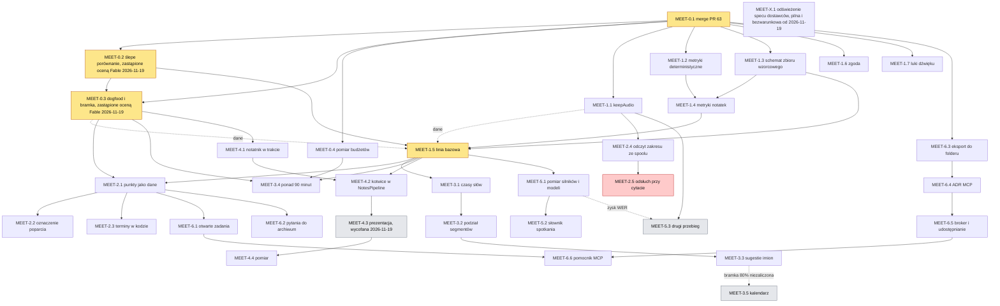

# Epic MEET: notatki ze spotkań lepsze niż Claude Meetings

- Data: 2026-11-13
- Źródła: briefy `.ai/specs/briefs/2026-11-13-meeting-notes-beyond-claude-A.md` i `-B.md`, brief `.ai/specs/briefs/2026-11-09-meeting-notes-dogfood.md`, research `.ai/specs/research/2026-11-13-meeting-notes-*.md`, specy `2026-11-03-meeting-notes`, `2026-11-04-notes-workspace`, `2026-11-06-meeting-segment-split`, `2026-11-06-meeting-speaker-names`, `2026-11-06-meeting-speaker-quality`, `2026-11-06-meeting-quality-harness`, `2026-11-10-external-ai-providers` (nieaktualny, odświeżany w MEET-X.1)
- Rozstrzygnięcia A vs B, wspólna oś czasu i zbiorcza lista pytań: `.ai/specs/backlog/2026-11-13-backlog-overview.md`
- Stan kodu: zweryfikowany na `origin/main` (`3356906`) i w PR #63 (`gh pr view 63`, 2026-11-13). Lokalny checkout jest nieaktualny i nie był źródłem faktów.
- Status: backlog gotowy do implementacji story po story. Kierunek **nie jest potwierdzony przez właściciela**; każda decyzja ma wartość domyślną w sekcji „Decyzje właściciela”.

## Cel i metryka sukcesu

**Cel.** Lintel ma być najlepszym prywatnym źródłem prawdy o spotkaniach: nagrywa bez bota w każdej aplikacji, nic nie opuszcza Maca, polski jest zmierzony, a każdy punkt notatki da się sprawdzić. Asystenci, w tym Claude, są klientami archiwum, a nie konkurentami. Epic nie próbuje wygrać samą jakością pisania modelu 4B z modelem czołowym.

**Definicja zwycięstwa: cztery sprawdzalne tezy i jedno porównanie bezpośrednie.**

| # | Teza | Stan dziś | Miara spełnienia |
|---|---|---|---|
| 1 | Zasięg: każda aplikacja spotkań i rozmowa na żywo, jedna osoba, offline | działa, niezmierzone | MEET-0.4: test na Zoom, Meet, Teams i w pokoju przechodzi; wiersze w `docs/perf.md` zmierzone |
| 2 | Prywatność: dźwięk, transkrypt i notatki zostają na Macu, każde wyjście jest jawne i za zgodą | spełnione | bez regresji; eksport i MCP domyślnie wyłączone, z dziennikiem |
| 3 | Sprawdzalność: 100% punktów ma odnośnik do miejsca w transkrypcie albo jawne oznaczenie braku poparcia; przy zachowanym audio odsłuch | odnośnik jest, oznaczenia i odsłuchu brak | MEET-2.2, MEET-2.5 |
| 4 | Polski zmierzony: WER, błąd na angielskich terminach, udział słów z błędnym mówcą, F1 zadań z właścicielem, pokrycie punktów wzorcowych | brak prawdy wzorcowej | MEET-1.5: linia bazowa na ≥ 3 spotkaniach; cel programu 20–30 |
| B | Ślepe porównanie z Claude na tym samym transkrypcie | nie wykonano | MEET-0.2: właściciel szereguje na ślepo |

**Cele liczbowe (kierunek, nie próg statystyczny przy 3–5 spotkaniach):** pokrycie 6 z 6 dziesięciominutowych odcinków; pokrycie punktów wzorcowych ≥ 80%; ≥ 70% zadań z poprawnym właścicielem; < 5% słów z błędnym mówcą. Decyzje zapadają na porównaniach parami tych samych spotkań, z co najmniej 3 przebiegami na wariant.

## Zakres

- Domknięcie PR #63, dogfood, ślepe porównanie, pomiar budżetów.
- Zachowanie audio (opcja), harness z metrykami deterministycznymi i metrykami notatek, zbiór wzorcowy.
- Zgoda uczestników, odporność przechwytywania.
- Sprawdzalne notatki: punkty jako dane, oznaczenie braku poparcia, terminy w kodzie, odsłuch.
- Kto mówił: podział segmentów, sugestie imion, spotkania dłuższe niż 90 minut.
- Notatki hybrydowe: notatnik w trakcie nagrania sterujący wynikiem.
- Jakość PL/EN: słownik spotkania, drugi przebieg (po pomiarze).
- Archiwum i mosty: otwarte zadania, pytania do archiwum, eksport do folderu, lokalny MCP.

## Poza zakresem

- Uczestnik lub bot w rozmowie; artefakty i odpowiedzi w trakcie spotkania; agenci wykonujący zadania.
- Konta, synchronizacja, współdzielenie w zespole, maile z podsumowaniem.
- Odciski głosu i rozpoznawanie osób między spotkaniami.
- Automatyczny start nagrywania bez działania użytkownika.
- Własne prompty użytkownika; wiele szablonów (M-Q7); swobodna korekta transkryptu przez LLM.
- Ponowne próby z weryfikatorem semantycznym i promptem MAP v4 przed powstaniem zbioru wzorcowego.
- Transkrypt na żywo, „streść ostatnie minuty”, odczyt nazw mówców z okna Zoom/Meet/Teams przez Accessibility, import plików audio.
- Kalendarz, dopóki nie zajdzie warunek MEET-3.5.
- Zewnętrzny dostawca dla notatek: osobny spec `2026-11-10-external-ai-providers` (wymaga odświeżenia, MEET-X.1).

## Założenia (zweryfikowane w kodzie i w PR)

1. **PR #63 jest gotowy do merge.** OPEN, MERGEABLE, po rebase z 2026-11-10, etykiety `merge-queue` i `qa-approved`. Czerwone „Build signed DMG” to jeden niestabilny test w kroku Test workflow Release (`theSessionWritesSourceBundleIDOnlyWhenGiven`, `SuggestionIntegrationTests.swift:84`), nie podpisywanie; ten sam commit przeszedł „Build, test and lint”. PR dotyka tylko `MeetingsPlugin`, bez migracji; dodaje klucz `plugins.meetings.selfName`, sekcję „Kluczowe punkty”, `ownerFromSpeaker`, wyłączony `NotesVerifier`.
2. **Na `main` punkty `SUM` nie są renderowane jako lista** (`NotesComposer.swift:47-80`); dlatego notatka z godziny ma kilka linijek. Naprawia to dopiero PR #63.
3. **`meetings.sqlite` ma jedną migrację `v1-meetings`**, formalnie niewydaną (brak tagów i wydań), ale już zastosowaną w bazie dogfood właściciela. Zmiana w miejscu nie uruchomi się tam ponownie, więc każda zmiana schematu w tym epiku jest nową migracją.
4. **Audio znika przy `ready`** w trzech miejscach: `MeetingSession.markReady`, `MeetingResumer.markReady`, `RecoveryJob`. `AudioState` ma tylko `spool` i `deleted`. Szkic `keepAudio` to niezacommitowane +167 linii na drzewie sprzed zmiany nazwy (`Pounce-keepaudio`); służy tylko jako odniesienie.
5. **`SpoolReader` jest sekwencyjny** (`nextSamples`, `nextChunk`), ramki po 2 s, AES-GCM z indeksem ramki. Odsłuch zakresu wymaga nowego API.
6. **Limit diaryzacji 90 minut jest zgadnięty** (`DiarizationBudget.unmeasuredMaximumDuration`, `Diarizer.swift:34`); `DiarizationBenchmarks` istnieje i nie był uruchomiony.
7. **Harness ma WER, CER, `termRecall`** i ogólny normalizator. Nie ma metryk mówców, MeetEval, metryk notatek ani kodu sędziego (jest tylko rubryka). Krok 1.3 specu `speaker-quality` nie jest na `main`, a zależą od niego bramki podziału segmentów i sugestii imion.
8. **Zmiana częstotliwości próbkowania jest już obsłużona** (`.formatChanged`, odtworzenie tap, wypełnianie ciszą). Luki to: bufory zerowe w środku spotkania i dane o lukach per zakres. `meeting.audio_gap` to jedna flaga na spotkanie, ustawiana tylko przez odzyskiwanie, bez czytelnika w produkcji.
9. **Dane płyną w jedną stronę:** `NotesPlugin` czyta z Meetings przez `NoteSource`; `OverlaySeeder.canSeed` zabrania warstwy w stanach `recording`, `processing`, `writing`; decyzja N10 odrzuca zapis zwrotny do `meetings.sqlite`. Notatnik w trakcie nagrania musi więc należeć do `MeetingsPlugin`.
10. **`NotesResult.points` istnieje w pamięci**, ale zapisywany jest tylko `notes_markdown`. `NoteBlockProvenance.quoteTimesMs` już wiąże blok z czasem cytatu.
11. **`Permission` nie ma przypadku kalendarza**; spec imion mówców zamknął decyzję „bez kalendarza” (Q2).
12. **Jest jeden plik wykonywalny** (`Lintel`), a `scripts/make-app.sh` kopiuje dokładnie jeden. Pomocnik MCP nie może sam czytać biblioteki, bo klucz SQLCipher trzyma aplikacja.
13. **Meetings używa LLM i silnika mowy tylko z priorytetem `background`.** Pytania do archiwum będą pierwszym użyciem `interactive` w tym pluginie.
14. **Żaden wiersz Meetings w `docs/perf.md` nie jest zmierzony.**

## Decyzje właściciela (Open Questions z wartością domyślną)

| ID | Pytanie | Wartość domyślna przyjęta w backlogu |
|---|---|---|
| M-Q1 | Merge PR #63 teraz, po ponownym uruchomieniu niestabilnego sprawdzenia? | **Tak.** Blokuje wszystko, co dotyka `Sources/MeetingsPlugin/Notes/`. |
| M-Q2 | Co znaczy „lepiej niż Claude”? | **Cztery tezy + ślepe porównanie** (tabela wyżej). **Ślepe porównanie (MEET-0.2) zastąpione oceną Fable 2026-11-19 (decyzja 2).** |
| M-Q3 ⚠ | `keepAudio` jako opcja (zmienia decyzję Q7 specu spotkań). Przed dogfoodem? Na ile dni? Pytać przy pierwszym nagraniu? | **Tak, przed dogfoodem lub w jego pierwszych dniach, domyślnie wyłączone, 30 dni, bez pytania przy pierwszym nagraniu** (sam przełącznik w Prywatności). Bez audio nie powstanie zbiór wzorcowy; 14 dni wygasłoby przed jego zebraniem. |
| M-Q4 | Które zmiany wolno wydawać w trakcie dwóch tygodni dogfoodu („bez zmian w kodzie produktu” z briefu 2026-11-09)? | **Tylko te, które nie zmieniają treści notatek:** Faza 1 tego epica. Wszystko, co zmienia `NotesPipeline`, `NotesGuard`, `NotesComposer` lub segmenty, czeka na bramkę MEET-0.3. |
| M-Q5 | Zbiór wzorcowy: ile pracy ręcznej i czy sędziowie chmurowi? | **3 spotkania na start** (poprawiony transkrypt z mówcami, 10–25 punktów, zadania), rosnące z dogfoodu; **panel sędziów lokalny**, chmurowi tylko na nagraniach ze zgodą uczestników. **Uchylone dla sędziego Fable 2026-11-19 (decyzja 2); zob. przegląd backlogu, sekcja „Decyzje właściciela (2026-11-19)”.** |
| M-Q6 ⚠ | Kalendarz (EventKit) jako źródło uczestników: odwrócić zamkniętą decyzję? | **Nie z góry.** MEET-3.5 rusza tylko, gdy sugestie imion (MEET-3.3) nie przejdą bramki 80%, albo po wyraźnej decyzji. |
| M-Q7 | 2–3 wbudowane szablony notatek (zmienia Q8 specu spotkań)? | **Nie w tym epiku.** Notatki hybrydowe pokrywają większość potrzeby. |
| M-Q8 ⚠ | Notatnik w trakcie nagrania: własność `MeetingsPlugin` czy nowy port z Notes? | **Własność `MeetingsPlugin`**; Notes widzi go jako warstwę tylko do odczytu. Reguła „bez warstwy w stanie `recording`” i N10 zostają nietknięte. |
| M-Q9 | Punkty notatki jako dane: tabela pochodna czy metadane w Markdownie? | **Tabela pochodna `meeting_note_item`**, przebudowywana przy każdej generacji; opisuje oryginał agenta. Edycje użytkownika zostają w `notes.sqlite` (N10). |
| M-Q10 | `words_json`: zmiana `v1-meetings` w miejscu czy nowa migracja? | **Nowa migracja** (założenie 3). |
| M-Q11 | Podział segmentów: jeden PR (spec mówi „Faza 1 i 2 razem”) czy dwa? | **Dwa PR-y** (MEET-3.1 zapisuje słowa i nie zmienia zachowania; MEET-3.2 dzieli). |
| M-Q12 ⚠ | Lokalny MCP: zgodny z „nic nie opuszcza Maca”? Model udostępniania? | **Tak, jako jawny wyjątek:** domyślnie wyłączony, tylko odczyt, **udostępnianie włączane per spotkanie**, dziennik dostępu, bez obietnicy rozróżniania klientów. |
| M-Q13 ⚠ | Automatyczny eksport do folderu (jawny Markdown poza zaszyfrowaną bazą)? | **Tak, opt-in, z ostrzeżeniem.** |
| M-Q14 ⚠ | Jeśli Claude wyraźnie wygra ślepe porównanie także z modelem 30B? | **Dla spotkań niepoufnych pierwszeństwo dostaje MEET-X.1** (dostawca zewnętrzny dla kroku pisania); Fazy 2–4 zostają, bo poprawiają też wejście dla modelu chmurowego. **Przestarzałe 2026-11-19 (decyzja 1): MEET-X.1 pilna i bezwarunkowa; zob. przegląd backlogu, sekcja „Decyzje właściciela (2026-11-19)”.** |
| M-Q15 | Drugi przebieg mowy: całe spotkanie Whisperem czy tylko segmenty oznaczone? | **Decyduje pomiar MEET-5.1**; bez zysku WER funkcja nie powstaje. |
| M-Q16 | Zmiana domyślnego modelu notatek (Bielik, Gemma)? | **Nie bez harnessu.** Pomiar w MEET-5.1; repozytoria Bielika są bramkowane. |
| M-Q17 ⚠ | Zbiór wzorcowy wymaga odszyfrowanego dźwięku poza aplikacją (narzędzie poza repozytorium, monit Pęku kluczy dla `com.lintelapp.meetings`). Zgoda? | **Tak:** jawny dźwięk tylko na zaszyfrowanym obrazie dysku ze zbiorem wzorcowym, kasowany razem z wpisem; aplikacja nadal nigdy nie zapisuje jawnego audio. |

## Ryzyka

| Ryzyko | Poziom | Ograniczenie |
|---|---|---|
| Budowanie na niezmierzonej podstawie (żadna zmiana jakości nie wyszła dotąd poza szum ±8 punktów) | wysokie | Faza 0 i Faza 1 przed zmianami jakości; każda zmiana jakości ma bramkę na zbiorze wzorcowym, ≥ 3 przebiegi na wariant |
| Zachowane audio zwiększa wrażliwość danych i czyni format spoolu obiecanym | wysokie | domyślnie wyłączone, 30 dni, szyfrowanie jak spool, jedno miejsce do skasowania, wpis w `BACKWARD_COMPATIBILITY.md` §2 |
| MCP jako kanał wyniesienia treści i wstrzyknięcia poleceń | wysokie | ADR przed kodem, stdio, tylko odczyt, udostępnianie per spotkanie, dziennik, limit rozmiaru |
| Nagrywanie bez wiedzy uczestników (pozew przeciw Granoli dotyczy modelu bez bota) | średnie, prawne | MEET-1.6; język produktu bez „niewidzialności”; to nie jest porada prawna |
| Lokalny model pisze słabsze notatki niż model czołowy | wysokie dla tezy B | MEET-0.2 mierzy to wprost; M-Q14 określa reakcję |
| Anthropic wyda lokalny rejestrator („Parka”, niepotwierdzone) | średnie | zostają tezy 2–4; MCP czyni Lintela użytecznym także dla użytkowników Claude |
| Kolizja z modelem warstw Notes (#56) | średnie | tabela pochodna opisuje tylko oryginał agenta; notatnik jest własnością Meetings |
| Kilka addytywnych migracji `meetings.sqlite` w równoległych PR-ach | średnie | numer migracji przydzielany przy merge (reguła w przeglądzie), jedna migracja na PR |
| Rozmiar mapy drogowej (35 stories) | wysokie | fazy niezależne, każda z kryterium zatrzymania; po Fazie 3 przegląd, czy właściciel faktycznie nagrywa |
| Nowe modele (Nemotron, Bielik v3) świeże lub bramkowane | niskie | tylko przez harness, sprawdzenie licencji przed wpisem do `LLMModelCatalog` |

**Rollback:** każda funkcja ma wyłącznik; migracje są addytywne; zachowanie starszego builda wobec nowszego schematu określa `BACKWARD_COMPATIBILITY.md` §2 (wyłącza funkcję, nie rusza danych) i każda story z migracją sprawdza to testem; eksport i MCP nie zmieniają danych.

## Fazy

| Faza | Treść | Stories | Warunek wejścia |
|---|---|---|---|
| 0 | Domknięcie i bramki, bez nowego kodu produktu | MEET-0.1 – 0.4 | — |
| 1 | Fundament równoległy do dogfoodu (nie zmienia treści notatek) | MEET-1.1 – 1.7 | MEET-0.1 |
| 2 | Sprawdzalne notatki | MEET-2.1 – 2.5 | bramka MEET-0.3 (zastąpiona oceną Fable, 2026-11-19), linia bazowa MEET-1.5 |
| 3 | Kto mówił | MEET-3.1 – 3.5 | MEET-1.2, MEET-1.5 |
| 4 | Notatki hybrydowe | MEET-4.1 – 4.4 (MEET-4.3 wycofana 2026-11-19, decyzja 4) | bramka MEET-0.3 (zastąpiona oceną Fable) |
| 5 | Jakość PL/EN | MEET-5.1 – 5.3 | MEET-1.5; DICT-1.1 dla 5.2 |
| 6 | Archiwum i mosty | MEET-6.1 – 6.6 | MEET-2.1 dla 6.1 i 6.2; MEET-0.1 i DICT-3.0 dla 6.3; decyzja M-Q12 dla 6.4 – 6.6 |
| X | ~~Warunkowa~~ pilna i bezwarunkowa (decyzja 2026-11-19 nr 1): dostawca zewnętrzny | MEET-X.1 | ~~wynik MEET-0.2 (M-Q14)~~ brak warunku |

Fazy 2, 3 i 4 są od siebie niezależne i mogą iść w dowolnej kolejności po bramce; kolejność domyślna to 2 → 3 → 4, bo sprawdzalność jest tezą, której Claude nie spełnia, a właściciele zadań to jedyny powtarzalny zysk w dotychczasowych pomiarach.

## Mapa zależności

Wniosek z diagramu: PR #63 jest jedynym węzłem, od którego zależy wszystko. Dwa żółte węzły po nim (dogfood i linia bazowa) rozdzielają pracę na „wolno od razu” (Faza 1, MEET-6.3) i „dopiero po danych” (Fazy 2–5).

Zależności z epikiem DICT: MEET-5.2 używa `TermReplacer` z `LintelCore` (DICT-1.1); MEET-2.5 i MEET-3.5 zmieniają `LintelKit` (MEET-4.3 wycofana 2026-11-19) i muszą być uszeregowane z DICT-2.1 i DICT-3.3; MEET-6.3 używa wspólnego `TCCProtectedLocations` z DICT-3.0. Szczegóły w `2026-11-13-backlog-overview.md`.

## Wspólne reguły dla każdej story

**Wspólne Definition of Done**

1. Bramka przechodzi w kolejności: `swift build`, `swift test`, `swift format lint --strict -r Sources Tests`. Testy z prawdziwymi modelami i nagraniami są wyłączone domyślnie (zmienne `LINTEL_*`), a ich wyniki są w PR.
2. Jedna gałąź `feat/` i jeden PR na story, oparty na `main` **po merge PR #63**; tytuł w formacie conventional commits.
3. Kod pluginu bez `fatalError`, `try!` i wymuszonego rozpakowania.
4. Każdy nowy tekst ma wartości `en` i `pl` w `Resources/Localizable.xcstrings`.
5. Zmiany schematu to wyłącznie nowe, addytywne migracje, jedna na PR, z testem w górę z poprzedniego schematu, testem zachowania starszego kodu wobec nowszego schematu (§2) i planem wycofania w PR. Numer migracji (`vN-<funkcja>`) jest przydzielany przy merge: następny wolny na `main`.
6. Nowe klucze `plugins.meetings.*` są deklarowane w `MeetingsSettings`, domyślnie wyłączone, gdy przechwytują, przechowują albo udostępniają więcej; wpis w `BACKWARD_COMPATIBILITY.md` §3.
7. Zmiana jakości (transkrypt, mówcy, notatki) ma w PR tabelę „przed / po” z harnessu na zbiorze wzorcowym, ≥ 3 przebiegi na wariant; bez zysku ponad szum zmiana nie jest mergowana albo zostaje wyłączona stałą w kodzie.
8. `AGENTS.md` zaktualizowany w tym samym PR, gdy dochodzi typ, klucz, tabela albo port.
9. Story z UI: przed kodem prototyp ekranu (`om-ux-design`) zaakceptowany przez właściciela i wskazany w PR; implementacja zgodna z nim 1:1; stany na zrzutach: pusty, wypełniony, błąd, brak uprawnienia, długa treść. Zrzuty jasny i ciemny z buildu debug z argumentami `--qa…` (`--qa-meeting-mic-wav`, `--qa-meeting-system-wav`, `--qa-meeting-spool-dir`, `--qa-notes`), etykiety VoiceOver.

**Wspólne reguły prywatności**

- Tekst transkryptu, notatek, notatek użytkownika, imion uczestników i pytań do archiwum nie trafia do logów, `ranking.sqlite`, śladu notatek (`NotesTrace` zapisuje tylko identyfikatory, liczniki i powody) ani schowka bez działania użytkownika.
- Dane spotkań żyją w `meetings.sqlite` (SQLCipher) i w zaszyfrowanym spoolu. Zbiór wzorcowy i wyniki ocen żyją poza repozytorium.
- Każde wyjście danych poza zaszyfrowaną bazę (eksport, MCP, dostawca) jest domyślnie wyłączone, jawne i widoczne przy spotkaniu.
- Testy Pythona w `scripts/meeting-eval/` nie należą do bramki ani do CI: story, która je zmienia, uruchamia `python3 -m unittest discover scripts/meeting-eval` i wkleja wynik do PR.

**Etykiety i estymaty:** jak w epiku DICT (`SDLC.md`: `risk-high` dla `LintelKit`, migracji, formatów na dysku, Pęku kluczy, uprawnień TCC i `Package.swift`; także dla każdej zmiany powierzchni z `BACKWARD_COMPATIBILITY.md`, w tym nowego klucza ustawień). S: do 300 linii; M: 300–800; L: ponad 800 albo kilka powierzchni.

**Komenda startowa.** Wzór: `om-auto-create-pr "<zadanie> — Source doc: .ai/specs/backlog/2026-11-13-epic-meeting-notes-beyond-claude.md (story MEET-x.y)"`. Story oznaczone „najpierw spec” mają komendę `om-auto-write-spec`, a implementacja idzie przez `om-auto-implement-spec`.

---

## Faza 0 — domknięcie i bramki

### MEET-0.1 — Merge PR #63 i sprawdzian pełnej godziny

- **Story:** Jako właściciel chcę, by notatka z godzinnego spotkania obejmowała całą godzinę w zbudowanej aplikacji, aby pierwotna porażka była potwierdzona jako naprawiona.
- **Zależności:** brak. Decyzja M-Q1. **Blokuje wszystkie pozostałe stories.**
- **Powierzchnie:** PR #63 (`MeetingsPlugin`, klucz `plugins.meetings.selfName`); bez nowego kodu.
- **Etykiety:** PR #63 ma już `feature`, `risk-medium`, `needs-qa`, `qa-approved`, `merge-queue` · **Estymata:** S
- **Kryteria akceptacji:**
  1. Given ponownie uruchomiony workflow Release dla gałęzi PR, Then krok Test przechodzi. Jeśli `theSessionWritesSourceBundleIDOnlyWhenGiven` pada ponownie, powstaje zgłoszenie `bug` z logiem, a merge wymaga albo zielonego przebiegu po naprawie testu, albo jawnego odstępstwa opiekuna zapisanego w PR (wymagane sprawdzenia bramkują każdy merge).
  1a. Given etykieta `qa-approved` sprzed rebase z 2026-11-10, Then PR ma aktualną linię `QA head: <sha>` zgodną z bieżącym commitem; inaczej QA jest powtarzane.
  2. Given PR zmergowany przez właściciela (squash), Then `main` zawiera sekcję „Kluczowe punkty”, `selfName` i `ownerFromSpeaker`.
  3. Given prawdziwe godzinne spotkanie nagrane buildem z `main`, Then notatka ma co najmniej jeden punkt w każdym z 6 dziesięciominutowych odcinków. Wynik (6 liczb, bez treści) jest zapisany w `failures.md` właściciela.
  4. Given wynik poniżej 6 z 6, Then powstaje zgłoszenie `bug` `priority-high` i Faza 1 dalej rusza, a Fazy 2–5 czekają.
- **Plan testów:** istniejące testy PR; sprawdzian ręczny na prawdziwym spotkaniu.
- **Prywatność:** do repozytorium i trackera trafiają tylko liczby odcinków.
- **DoD:** PR zmergowany, sprawdzian zapisany.
- **Start:** czynność właściciela: `om-approve-merge-pr 63` po zielonym ponownym uruchomieniu; w razie potrzeby `om-auto-fix-pr 63 --ci-only`.

### MEET-0.2 — Ślepe porównanie z Claude na tym samym transkrypcie

> **Status 2026-11-19:** zastąpiona pętlą oceny notatek przez sędziego Fable (decyzja 2); ślepe porównanie nie jest wykonywane. Zob. przegląd backlogu, sekcja „Decyzje właściciela (2026-11-19)”.

- **Story:** Jako właściciel chcę jednego uczciwego porównania notatek Lintela z notatkami Claude, aby wiedzieć, czy struktura wygrywa z jakością modelu.
- **Zależności:** MEET-0.1. Decyzje M-Q5, M-Q14.
- **Powierzchnie:** żadna w `Sources/`. Wynik w `docs/decisions/00NN-meeting-notes-direction.md` (numer przy merge).
- **Etykiety:** `documentation`, `risk-low`, `skip-qa`, `priority-high` · **Estymata:** S
- **Kryteria akceptacji:**
  1. Given jeden polski godzinny transkrypt ze spotkania wewnętrznego, na które uczestnicy się zgodzili, Then powstają trzy notatki: Lintel z Qwen3-4B, Lintel z Qwen3-30B-A3B, Claude z wklejonego transkryptu; pliki są anonimizowane (A, B, C) przez skrypt albo drugą osobę.
  2. Given właściciel szereguje je na ślepo, Then ADR zapisuje kolejność, dla każdej notatki listę braków i zmyśleń (liczby i kategorie, bez treści), oraz odpowiedź na pytanie „czy po tej notatce wiem, co robić jutro”.
  3. Given Claude jest pierwszy i obie notatki Lintela są ocenione jako niewystarczające do pracy, Then ADR uruchamia MEET-X.1 (M-Q14). W każdym innym wyniku kolejność faz zostaje.
  4. Given brak spotkania ze zgodą, Then porównanie robi się na nagraniu publicznym z archiwum ewaluacji i ADR to zaznacza jako słabszy dowód.
- **Plan testów:** brak; pomiar.
- **Prywatność:** transkrypt opuszcza Maca tylko dla spotkania ze zgodą uczestników; ADR nie zawiera treści.
- **DoD:** PR z dokumentacją; decyzja M-Q14 potwierdzona albo zmieniona.
- **Start:** `om-auto-create-pr "Dodaj ADR kierunku notatek ze spotkań: wynik ślepego porównania Lintel 4B / Lintel 30B / Claude (kolejność, kategorie braków, decyzja o kierunku A′), bez treści transkryptu — Source doc: .ai/specs/backlog/2026-11-13-epic-meeting-notes-beyond-claude.md (story MEET-0.2)"`

### MEET-0.3 — Dogfood dwa tygodnie i bramka zatrzymania

> **Status 2026-11-19:** zastąpiona pętlą oceny notatek przez sędziego Fable (decyzja 2); dwutygodniowy dogfood nie jest bramką. Zob. przegląd backlogu, sekcja „Decyzje właściciela (2026-11-19)”.

- **Story:** Jako właściciel chcę dwóch tygodni prawdziwego używania z dziennikiem błędów, aby dalsze inwestycje wynikały z powtarzalnych wzorców.
- **Zależności:** MEET-0.1; MEET-0.2 (ADR, do którego trafia wynik). Decyzja M-Q4.
- **Powierzchnie:** żadna w repozytorium poza sekcją „Dogfood” w ADR z MEET-0.2. Proces według briefu `2026-11-09-meeting-notes-dogfood`.
- **Etykiety:** `documentation`, `risk-low`, `skip-qa`, `priority-high` · **Estymata:** S (praca agenta), 2 tygodnie kalendarzowe
- **Kryteria akceptacji:**
  1. Given każde prawdziwe spotkanie, Then powstaje eksport `.md`, poprawiona kopia `*.edited.md` i wpis w `failures.md` z czterema odpowiedziami (czy wiem, co robić; czego brakuje; co zmyślone; które kto/co/termin są błędne).
  2. Given dwa tygodnie i mniej niż 3 wpisy w `failures.md`, Then inwestycja w Fazy 2–6 jest wstrzymana, a decyzja zapisana w ADR.
  3. Given 3 lub więcej wpisów, Then ADR zawiera tabelę wzorców błędów z licznikami i potwierdza albo zmienia kolejność Faz 2, 3, 4.
  4. Given okres dogfoodu, Then na `main` nie wchodzi żadna zmiana w `NotesPipeline`, `NotesGuard`, `NotesComposer`, `NotesPrompt`, `TranscriptChunker` ani w zapisie segmentów (M-Q4).
- **Plan testów:** brak.
- **Prywatność:** `failures.md` i pary plików żyją poza repozytorium.
- **DoD:** sekcja „Dogfood” w ADR, decyzja bramki.
- **Start:** czynność właściciela; zapis: `om-auto-create-pr "Dopisz do ADR kierunku notatek sekcję Dogfood: liczba spotkań, liczba wpisów failures.md, tabela wzorców błędów z licznikami, decyzja bramki i kolejność Faz 2–4 — Source doc: .ai/specs/backlog/2026-11-13-epic-meeting-notes-beyond-claude.md (story MEET-0.3)"`

### MEET-0.4 — Pomiar budżetów i krok 1.12 specu spotkań

- **Story:** Jako właściciel chcę zmierzonych budżetów i potwierdzenia, że nagrywanie działa w prawdziwych aplikacjach, aby teza „działa wszędzie” miała dowód.
- **Zależności:** MEET-0.1.
- **Powierzchnie:** `docs/perf.md` (wiersze Meetings, Meeting notes, Diarization).
- **Etykiety:** `documentation`, `risk-low`, `skip-qa`, `priority-high` · **Estymata:** M
- **Kryteria akceptacji:**
  1. Given Zoom, Google Meet, Teams, rozmowa w pokoju, słuchawki Bluetooth (w tym przełączenie A2DP → HFP), głośniki, Then tabela QA w PR ma dla każdego scenariusza wynik (oba tory nagrane / luka / błąd) i listę awarii jako zgłoszenia.
  2. Given nagranie 3 h, Then zmierzone są: pamięć w trakcie (budżet < 1,5 GB), ogon po Stop (< 3 s), czas notatek z godziny (≤ 8 min). Pomiary na Macu właściciela i na najsłabszym dostępnym Macu; model i pamięć obu są nazwane w tabeli.
  3. Given `DiarizationBenchmarks` z `LINTEL_DIARIZATION_MODEL_FOLDER` i `LINTEL_DIARIZATION_BENCH_AUDIO` dla 1 h, 90 min, 2 h i 3 h, Then `docs/perf.md` ma czas i szczyt pamięci dla każdej długości.
  4. Given pomiary, Then żaden wiersz Meetings nie ma już „not yet measured”; przekroczony budżet jest zgłoszeniem, nie cichą zmianą budżetu.
- **Plan testów:** istniejące benchmarki sterowane zmiennymi; QA ręczne.
- **Prywatność:** nagrania testowe nie trafiają do repozytorium.
- **DoD:** wspólne DoD (PR z dokumentacją).
- **Start:** `om-auto-create-pr "Wypełnij wiersze Meetings, Meeting notes i Diarization w docs/perf.md pomiarami (QA na Zoom/Meet/Teams/pokój/Bluetooth, nagranie 3 h, DiarizationBenchmarks dla 1 h, 90 min, 2 h, 3 h) — Source doc: .ai/specs/backlog/2026-11-13-epic-meeting-notes-beyond-claude.md (story MEET-0.4)"`

---

## Faza 1 — fundament równoległy do dogfoodu

Żadna story tej fazy nie zmienia treści notatek ani segmentów, więc nie zakłóca dogfoodu (M-Q4).

### MEET-1.1 — `keepAudio`: opcjonalne zachowanie zaszyfrowanego audio

- **Story:** Jako właściciel chcę móc zachować zaszyfrowane nagranie na 30 dni, aby dało się zbudować zbiór wzorcowy, a później odsłuchać cytat.
- **Zależności:** MEET-0.1. Decyzja M-Q3 ⚠.
- **Powierzchnie:** `MeetingsPlugin` (`MeetingsSettings`, oba `markReady`, `RecoveryJob`, `RetentionJob`, `MeetingsPrivacy`, panel ustawień); ustawienia `plugins.meetings.keepAudio` (Bool, **domyślnie `false`**) i `plugins.meetings.keptAudioDays` (Int, 30); `AudioState.kept` (nowa wartość kolumny `audio_state`, bez zmiany schematu); teksty użycia mikrofonu i dźwięku systemowego w `Resources/InfoPlist.xcstrings` oraz opisy w `Localizable.xcstrings`, które dziś obiecują trzymanie audio „do ukończenia transkryptu” (`en` i `pl`); `BACKWARD_COMPATIBILITY.md` §2 (format spoolu staje się obiecany na czas życia zachowanego audio), §3 i §5 (zmiana obietnicy widocznej dla użytkownika, nota wydania); poprawka specu spotkań (decyzja Q7).
- **Etykiety:** `feature`, `risk-high` (retencja, format na dysku), `needs-qa`, `priority-high` · **Estymata:** M
- **Kryteria akceptacji:**
  1. Given `keepAudio = false`, Then zachowanie jest identyczne jak dziś: spool usunięty przy `ready`, `audio_state = deleted` (istniejące testy bez zmian).
  2. Given `keepAudio = true`, When spotkanie osiąga `ready` ścieżką `MeetingSession`, `MeetingResumer` albo `RecoveryJob`, Then spool zostaje, a `audio_state = kept`.
  3. Given spotkanie z `kept` starsze niż `keptAudioDays`, When biegnie `RetentionJob`, Then spool jest usunięty, a stan to `deleted`.
  4. Given usunięcie spotkania albo `eraseData()`, Then zachowany spool znika razem z nim.
  5. Given Ustawienia → Spotkania → Prywatność, Then jest przełącznik z opisem (czyje głosy, jak długo, gdzie), liczba zachowanych nagrań i przycisk „Usuń zachowane nagrania”, który po potwierdzeniu w arkuszu (§5) usuwa wszystkie spoole `kept`.
  5a. Given `keepAudio` zostaje wyłączone, gdy istnieją nagrania `kept`, Then zostają one do wygaśnięcia albo ręcznego usunięcia, a panel to mówi i pokazuje ich liczbę.
  5b. Given teksty uprawnień i prywatności, Then nie obiecują już usunięcia audio po transkrypcji bez zastrzeżenia „chyba że włączysz zachowywanie nagrań”.
  6. Given baza otwarta przez kod sprzed zmiany, Then nieznana wartość `kept` nie powoduje błędu odczytu (test dekodowania z wartością domyślną).
- **Plan testów:** testy sesji i resumera na katalogach tymczasowych (obie wartości klucza, trzy ścieżki `ready`); test wygasania z atrapą zegara; test usuwania; test dekodowania stanu; zrzuty panelu.
- **Prywatność:** audio pozostaje w spoolu AES-GCM; nigdy jako plik jawny. Zmiana wartości domyślnej wymaga osobnej zgody właściciela.
- **DoD:** wspólne DoD + `qa-approved` + drugi recenzent + zgoda właściciela w PR (§3) + nota wydania (§5).
- **Start:** `om-auto-create-pr "MeetingsPlugin: opcja keepAudio (plugins.meetings.keepAudio domyślnie false, keptAudioDays 30, poprawione teksty użycia w InfoPlist.xcstrings), AudioState.kept na trzech ścieżkach ready, wygasanie w RetentionJob, przycisk Usuń zachowane nagrania w Prywatności, wpisy w BACKWARD_COMPATIBILITY.md §2 i §3, poprawka decyzji Q7 w specu spotkań; implementacja od nowa na main, szkic z lokalnego worktree Pounce-keepaudio, jeśli dostępny, tylko jako odniesienie — Source doc: .ai/specs/backlog/2026-11-13-epic-meeting-notes-beyond-claude.md (story MEET-1.1)"`

### MEET-1.2 — Harness: metryki deterministyczne transkryptu i mówców

- **Story:** Jako autor zmian jakości chcę metryk liczonych kodem, a nie sędzią, aby bramki podziału segmentów i imion miały czym mierzyć.
- **Zależności:** MEET-0.1.
- **Powierzchnie:** `scripts/meeting-eval/` (`score.py`, `test_score.py`), `Tests/MeetingsPluginTests/Eval/` (`EvalResult` z mówcą per słowo lub segment); dokończenie kroku 1.3 specu `2026-11-06-meeting-speaker-quality`. Bez zmian w `Sources/`.
- **Etykiety:** `feature`, `risk-low`, `skip-qa`, `priority-high` · **Estymata:** M
- **Kryteria akceptacji:**
  1. Given para (hipoteza, wzorzec) po polsku, Then `score.py` liczy WER z jednym normalizatorem polskim (liczebniki zapisane cyframi i słownie zrównane, interpunkcja, wielkość liter) i podaje wynik zgodny z ręcznie policzonym fixture z dokładnością 0,1 punktu procentowego.
  2. Given lista angielskich terminów spotkania, Then raport podaje błąd na terminach (odsetek terminów wzorca nieobecnych w hipotezie).
  3. Given wzorzec z mówcami, Then raport podaje udział słów z błędnym mówcą, udział segmentów mieszających mówców i różnicę liczby klastrów; próg ostrzeżenia 10% segmentów lub różnica ≥ 2 (jak w specu).
  4. Given zainstalowany MeetEval, Then raport dodaje cpWER; bez niego ten wiersz jest pominięty z komunikatem, a reszta działa.
  5. Given `test_score.py`, Then każda metryka ma test na syntetycznej parze z wynikiem policzonym ręcznie.
- **Plan testów:** `test_score.py`; test Swift dla nowego pola `EvalResult` (kodowanie i dekodowanie).
- **Prywatność:** wyniki zawierają liczby; transkrypty wzorcowe żyją poza repozytorium.
- **DoD:** wspólne DoD + odhaczony krok 1.3 w specu `speaker-quality`.
- **Start:** `om-auto-create-pr "Harness spotkań: normalizator polski i WER, błąd na terminach angielskich, udział słów z błędnym mówcą, segmenty mieszane, różnica klastrów, opcjonalny cpWER przez MeetEval; testy na syntetycznych parach; krok 1.3 specu meeting-speaker-quality — Source doc: .ai/specs/backlog/2026-11-13-epic-meeting-notes-beyond-claude.md (story MEET-1.2)"`

### MEET-1.3 — Zbiór wzorcowy: format i pierwsze trzy spotkania

- **Story:** Jako właściciel chcę małego zbioru prawdziwych spotkań z prawdą wzorcową, aby zmiany jakości były oceniane na faktach.
- **Zależności:** PR ze schematem i walidatorem: tylko MEET-0.1 (może wejść w pierwszym tygodniu, potrzebuje go MEET-1.4). Dane (kryterium 3): MEET-1.1 (zachowane audio) i nagrania z dogfoodu MEET-0.3; bramkują MEET-1.5, nie ten PR. Decyzje M-Q5, M-Q17 ⚠.
- **Powierzchnie:** `scripts/meeting-eval/` (schemat wpisu, walidator), dokumentacja w `scripts/meeting-eval/README.md`. Dane poza repozytorium, zaszyfrowane.
- **Etykiety:** `documentation`, `risk-low`, `skip-qa`, `priority-high` · **Estymata:** M (plus 1–2 dni pracy właściciela)
- **Kryteria akceptacji:**
  1. Given schemat wpisu, Then opisuje: dźwięk dwutorowy (odszyfrowany ze spoolu narzędziem poza repozytorium, uruchamianym ręcznie przez właściciela z monitem Pęku kluczy, M-Q17; plik jawny leży wyłącznie na zaszyfrowanym obrazie dysku ze zbiorem i jest kasowany razem z wpisem), poprawiony transkrypt z mówcami, listę terminów angielskich, 10–25 punktów kluczowych, decyzje, zadania z właścicielem i terminem, zgodę uczestników (tak / nie na sędziów chmurowych).
  2. Given walidator, When wpis nie ma zadań albo mówców, Then walidator zgłasza błąd z nazwą brakującego pola.
  3. (Dane, po merge PR, praca właściciela) Given trzy spotkania z dogfoodu (co najmniej dwa po polsku, co najmniej jedno z angielskimi terminami), Then każde przechodzi walidator; potwierdzenie samą liczbą w MEET-1.5.
  4. Given repozytorium, Then nie zawiera żadnego pliku zbioru; README mówi, gdzie zbiór leży i jak go wskazać zmienną `LINTEL_MEETING_GOLD_DIR`.
- **Plan testów:** test walidatora na syntetycznym wpisie poprawnym i trzech błędnych.
- **Prywatność:** zbiór zawiera głosy i treść rozmów; nigdy w repozytorium ani w trackerze.
- **DoD:** wspólne DoD dla PR ze schematem; trzy wpisy przechodzące walidator są warunkiem MEET-1.5.
- **Start:** `om-auto-create-pr "Zbiór wzorcowy spotkań: schemat wpisu i walidator w scripts/meeting-eval, README ze ścieżką przez LINTEL_MEETING_GOLD_DIR, test walidatora; dane poza repozytorium — Source doc: .ai/specs/backlog/2026-11-13-epic-meeting-notes-beyond-claude.md (story MEET-1.3)"`

### MEET-1.4 — Harness: metryki notatek na poziomie twierdzeń

- **Story:** Jako autor zmian w notatkach chcę wiedzieć, ile punktów wzorcowych notatka pokrywa i ile zadań ma poprawnego właściciela, aby nie polegać na jednym werdykcie sędziego.
- **Zależności:** MEET-1.2; PR ze schematem z MEET-1.3.
- **Powierzchnie:** `scripts/meeting-eval/` (nowy moduł oceny notatek, protokół panelu sędziów), `notes-rubric.md`.
- **Etykiety:** `feature`, `risk-low`, `skip-qa`, `priority-high` · **Estymata:** L (dopuszczalny podział na dwa PR-y: metryki deterministyczne, potem panel sędziów)
- **Kryteria akceptacji:**
  1. Given notatka i wpis wzorcowy, Then raport podaje: pokrycie punktów wzorcowych, odsetek punktów notatki z potwierdzonym cytatem (deterministycznie, z danych notatki), F1 zadań na trzech poziomach (zadanie; + właściciel; + termin).
  2. Given dopasowanie punktu notatki do punktu wzorcowego wymaga oceny semantycznej, Then robi ją panel 2–3 lokalnych sędziów z różnych rodzin modeli, z ≥ 5 powtórzeniami dla decyzji spornych; raport podaje rozrzut między powtórzeniami.
  3. Given porównanie dwóch wariantów, Then jest liczone parami na tych samych spotkaniach, ≥ 3 przebiegi na wariant, a raport mówi „ponad szum” tylko, gdy różnica przekracza zmierzony rozrzut.
  4. Given spotkanie bez zgody na sędziów chmurowych, Then narzędzie odmawia wysłania go do sędziego innego niż lokalny.
  5. Given fixture z ręcznie policzonym wynikiem, Then metryki deterministyczne zgadzają się co do jednostki.
- **Plan testów:** testy Pythona na fixture; test odmowy dla wpisu bez zgody; test powtarzalności z atrapą sędziego.
- **Prywatność:** treść spotkań trafia tylko do sędziów lokalnych, chyba że wpis ma zgodę.
- **DoD:** wspólne DoD.
- **Start:** `om-auto-create-pr "Harness spotkań: metryki notatek (pokrycie punktów wzorcowych, odsetek punktów z potwierdzonym cytatem, F1 zadań na trzech poziomach), panel lokalnych sędziów z powtórzeniami i porównaniem parami, blokada sędziów chmurowych bez zgody — Source doc: .ai/specs/backlog/2026-11-13-epic-meeting-notes-beyond-claude.md (story MEET-1.4)"`

### MEET-1.5 — Linia bazowa

- **Story:** Jako właściciel chcę jednej tabeli liczb dla `main`, aby każda późniejsza zmiana miała punkt odniesienia.
- **Zależności:** MEET-1.3 (schemat i trzy wpisy danych), MEET-1.4, MEET-0.2 (ADR). Dane wymagają MEET-1.1 i nagrań z MEET-0.3.
- **Powierzchnie:** ADR z MEET-0.2 (sekcja „Linia bazowa”), `docs/perf.md`.
- **Etykiety:** `documentation`, `risk-low`, `skip-qa`, `priority-high` · **Estymata:** S
- **Kryteria akceptacji:**
  1. Given zbiór wzorcowy (≥ 3 spotkania), Then ADR ma tabelę: WER, błąd na terminach, udział słów z błędnym mówcą, pokrycie punktów, F1 zadań (3 poziomy), odsetek punktów z cytatem, każda z rozrzutem z 3 przebiegów.
  2. Given tabela „Definicja zwycięstwa” tego epica, Then kolumna „Stan dziś” jest zastąpiona liczbami zmierzonymi.
  3. Given udział słów z błędnym mówcą poniżej 5% i pokrycie ≥ 80%, Then ADR rekomenduje pominięcie Fazy 3 albo Fazy 2 odpowiednio i zostawia decyzję właścicielowi.
- **Plan testów:** brak; pomiar.
- **Prywatność:** tylko liczby.
- **DoD:** PR z dokumentacją.
- **Start:** `om-auto-create-pr "Dopisz do ADR kierunku notatek sekcję Linia bazowa: metryki harnessu na zbiorze wzorcowym dla main z rozrzutem z 3 przebiegów, zaktualizuj tabelę celów w backlogu — Source doc: .ai/specs/backlog/2026-11-13-epic-meeting-notes-beyond-claude.md (story MEET-1.5)"`

### MEET-1.6 — Zgoda uczestników: zdanie do skopiowania

- **Story:** Jako osoba nagrywająca chcę jednym kliknięciem skopiować zdanie informujące uczestników, aby łatwo dopełnić obowiązku poinformowania.
- **Zależności:** MEET-0.1.
- **Powierzchnie:** `MeetingsPlugin` (`MeetingHUDState`, HUD nagrywania, okno spotkania); migracja `vN-consent` dodająca `meeting.consent_text_copied_at INTEGER NULL` (§2); `Resources/Localizable.xcstrings`.
- **Etykiety:** `feature`, `risk-high` (migracja), `needs-qa`, `priority-medium` · **Estymata:** S
- **Kryteria akceptacji:**
  1. Given `consentReminder = true` i start nagrania, Then przypomnienie w HUD ma przycisk „Kopiuj komunikat”; kliknięcie wkłada do schowka zdanie w języku systemu (`en` lub `pl`) i zapisuje czas w `consent_text_copied_at`.
  2. Given okno spotkania, Then pokazuje „Komunikat skopiowany o 10:02” albo nic; nigdzie nie pada „powiadomiono uczestników”.
  3. Given baza w schemacie sprzed zmiany, Then migracja przechodzi, a kolumna jest `NULL`.
  4. Given teksty aplikacji, Then test skanujący katalog tekstów nie znajduje sformułowań „niewidoczny”, „nikt się nie dowie”, „invisible”, „undetectable” w kluczach spotkań.
- **Plan testów:** test stanu HUD; test migracji; nazwany schowek testowy; `StringCatalogTests`; zrzuty jasny i ciemny.
- **Prywatność:** zapisywany jest tylko czas skopiowania.
- **DoD:** wspólne DoD + `qa-approved`.
- **Start:** `om-auto-create-pr "MeetingsPlugin: przycisk Kopiuj komunikat w przypomnieniu o zgodzie (zdanie en/pl do schowka), kolumna meeting.consent_text_copied_at w nowej migracji, informacja w oknie spotkania, test języka bez sformułowań o niewidoczności — Source doc: .ai/specs/backlog/2026-11-13-epic-meeting-notes-beyond-claude.md (story MEET-1.6)"`

### MEET-1.7 — Luki dźwięku: wykrywanie w trakcie i pokazanie w transkrypcie

- **Story:** Jako osoba nagrywająca chcę od razu wiedzieć, że dźwięk systemowy przestał płynąć, i widzieć lukę w transkrypcie, aby nie odkryć po godzinie, że nagranie jest puste.
- **Zależności:** MEET-0.1. Lista awarii z MEET-0.4, jeśli już jest.
- **Powierzchnie:** `MeetingsPlugin` (`SystemAudioPipeline`, `MeetingController`, `MeetingHUDState`, `MarkdownExporter`, warstwa `transcript`); migracja `vN-audio-gaps` z tabelą `meeting_audio_gap(meeting_id, channel, start_ms, end_ms, reason)` (§2). Istniejąca flaga `meeting.audio_gap` zostaje bez zmian.
- **Etykiety:** `feature`, `risk-high` (migracja), `needs-qa`, `priority-medium` · **Estymata:** M
- **Kryteria akceptacji:**
  0. Given początek story, Then krótka próba na prawdziwym Zoomie lub Meet rozstrzyga, czy wyciszony rozmówca daje dokładne zera, czy szum; wynik jest w PR. Jeśli zera są nieodróżnialne od martwego tap, ostrzeżenie ma treść neutralną („Brak dźwięku systemowego od 10 s”) i nie twierdzi awarii.
  1. Given tor systemowy dostarcza same bufory zerowe przez 10 s, gdy proces źródłowy nadal istnieje, a tor mikrofonu ma mowę, Then HUD pokazuje ostrzeżenie najpóźniej po 12 s od początku ciszy i ogłasza je VoiceOver.
  2. Given dźwięk wraca, Then ostrzeżenie znika, a w `meeting_audio_gap` jest wiersz z zakresem i powodem `silentSystem`.
  3. Given odtworzenie tap (`.recreated`) z wypełnieniem ciszą dłuższym niż 2 s, Then powstaje wiersz z powodem `recreated`.
  4. Given spotkanie z luką, Then transkrypt w oknie i w eksporcie Markdown ma w miejscu luki linię „[brak dźwięku systemowego 12 s]” z czasem. Linia pojawia się tylko przy luce i nie zmienia notatek, więc nie narusza zamrożenia z M-Q4.
  5. Given spotkanie, w którym nikt po drugiej stronie nie mówi (cisza bez buforów zerowych), Then ostrzeżenie się nie pojawia (test na atrapie z szumem tła).
  6. Given baza sprzed zmiany, Then migracja przechodzi; stare spotkania nie mają luk.
- **Plan testów:** `FakeBackend` (`AudioSourceSupport.swift`) z sekwencjami: zera, szum, odtworzenie; test migracji; test eksportu (golden z `LINTEL_UPDATE_GOLDEN`); zrzuty HUD.
- **Prywatność:** zapisywane są zakresy czasu i powód, nie dźwięk.
- **DoD:** wspólne DoD + `qa-approved`.
- **Start:** `om-auto-create-pr "MeetingsPlugin: wykrywanie buforów zerowych toru systemowego w trakcie spotkania z ostrzeżeniem w HUD najpóźniej po 12 s, tabela meeting_audio_gap w nowej migracji (zakres, kanał, powód), linia luki w transkrypcie i eksporcie Markdown — Source doc: .ai/specs/backlog/2026-11-13-epic-meeting-notes-beyond-claude.md (story MEET-1.7)"`

---

## Faza 2 — sprawdzalne notatki

Warunek wejścia: bramka MEET-0.3 i linia bazowa MEET-1.5.

### MEET-2.1 — Punkty notatki jako dane (`meeting_note_item`)

- **Story:** Jako użytkownik i jako harness chcę punktów notatki w postaci danych, aby dało się liczyć zadania, pokazywać otwarte zadania i wiązać punkt z czasem.
- **Zależności:** MEET-0.3, MEET-1.5. Decyzja M-Q9.
- **Powierzchnie:** `MeetingsPlugin` (`MeetingsStore+Notes`, zapis `NotesResult.points`); migracja `vN-note-items` z tabelą `meeting_note_item(id, meeting_id, kind, text, owner_speaker_id, due_phrase, due_date, support, quote_start_ms, quote_end_ms, position)` (§2); ADR (numer przy merge) z regułą jednego źródła prawdy.
- **Etykiety:** `feature`, `risk-high` (migracja), `skip-qa`, `priority-high` · **Estymata:** M
- **Kryteria akceptacji:**
  1. Given zakończona generacja notatek, Then `meeting_note_item` ma jeden wiersz na punkt zweryfikowany przez `NotesGuard`, w kolejności z `notes_markdown`, w tej samej transakcji co zapis `notes_markdown`.
  2. Given regeneracja notatek, Then wiersze spotkania są zastępowane w całości; tabela nie przechowuje żadnego stanu użytkownika (stan zadań żyje osobno, MEET-6.1).
  3. Given wiązanie z transkryptem, Then jest po zakresie czasu (`quote_start_ms`, `quote_end_ms`), nie po identyfikatorze segmentu, więc przetrwa podział segmentów z MEET-3.2.
  4. Given użytkownik edytuje warstwę notatek w Notes (rewizja w `notes.sqlite`), Then `meeting_note_item` się nie zmienia; ADR mówi wprost, że tabela opisuje oryginał agenta.
  5. Given spotkanie sprzed zmiany, Then czyta się jak dziś i ma zero wierszy; wiersze powstają przy następnej regeneracji.
  6. Given usunięcie spotkania, Then jego wiersze znikają (klucz obcy z kaskadą).
- **Plan testów:** test migracji; test zapisu i regeneracji; test kaskady; test spójności kolejności z Markdownem na fixture notatek.
- **Prywatność:** tabela jest w zaszyfrowanej bazie; `text` nie trafia do logów ani do śladu.
- **DoD:** wspólne DoD + ADR + drugi recenzent.
- **Start:** `om-auto-create-pr "MeetingsPlugin: tabela pochodna meeting_note_item w nowej migracji, zapis NotesResult.points w transakcji z notes_markdown, przebudowa przy regeneracji, wiązanie po zakresie czasu; ADR o jednym źródle prawdy wobec warstw Notes — Source doc: .ai/specs/backlog/2026-11-13-epic-meeting-notes-beyond-claude.md (story MEET-2.1)"`

### MEET-2.2 — Jawne oznaczenie punktów bez potwierdzonego cytatu

- **Story:** Jako czytelnik notatki chcę widzieć, które punkty nie mają potwierdzenia w transkrypcie, zamiast ich cichego ukrycia, aby wiedzieć, czemu ufać.
- **Zależności:** MEET-2.1.
- **Powierzchnie:** `MeetingsPlugin` (`NotesGuard`, `NotesComposer`, `MeetingNoteLayers`); `meeting_note_item.support` (`quoted`, `unsupported`); zachowanie widoczne dla użytkownika (§5).
- **Etykiety:** `feature`, `risk-medium`, `needs-qa`, `priority-high` · **Estymata:** M
- **Kryteria akceptacji:**
  1. Given punkt rodzaju `DEC` albo `TASK` odrzucony dziś z powodem `quoteNotInTranscript`, którego cytat ma częściowe pokrycie (co najmniej 60% słów cytatu występuje w jednym oknie 30 s transkryptu; próg do potwierdzenia na zbiorze wzorcowym), Then trafia do osobnej sekcji „Niepotwierdzone” z oznaczeniem i czasem tego okna, zamiast zniknąć. Punkty bez częściowego pokrycia oraz punkty `SUM` bez cytatu nadal są odrzucane.
  1a. Given wstrzyknięte zadanie bez żadnego pokrycia w transkrypcie (nowy fixture: `TASK` z cytatem spoza nagrania), Then jest odrzucane i nie trafia do „Niepotwierdzone”, do `meeting_note_item` ani dalej (MEET-6.1, MCP).
  2. Given notatka, Then 100% punktów poza sekcją „Niepotwierdzone” ma końcówkę `[mm:ss]` i `support = quoted`.
  3. Given punkt odrzucony z powodu `languageChanged`, `emptyText` albo jako odpowiedź modelu na polecenie z transkryptu (fixture `injection.json`), Then nadal jest odrzucany.
  4. Given zbiór wzorcowy, Then pokrycie punktów nie spada, a liczba zmyśleń w sekcjach potwierdzonych nie rośnie (tabela przed / po w PR).
  5. Given eksport Markdown i warstwa w Notes, Then sekcja „Niepotwierdzone” jest widoczna i wizualnie odrębna.
  6. Given `notes_dropped_count`, Then nadal liczy tylko punkty faktycznie odrzucone; zmiana znaczenia jest opisana w `BACKWARD_COMPATIBILITY.md` §5.
- **Plan testów:** przypadki strażnika (każdy `DropReason`); golden kompozytora; fixture wstrzyknięcia; harness przed / po; zrzuty.
- **Prywatność:** bez zmian.
- **DoD:** wspólne DoD + `qa-approved` + nota wydania.
- **Start:** `om-auto-create-pr "MeetingsPlugin: sekcja Niepotwierdzone dla decyzji i zadań bez potwierdzonego cytatu (support = unsupported) zamiast cichego odrzucenia, bez zmiany reguł dla wstrzyknięć i zmiany języka, pomiar przed/po w harnessie — Source doc: .ai/specs/backlog/2026-11-13-epic-meeting-notes-beyond-claude.md (story MEET-2.2)"`

### MEET-2.3 — Terminy zadań rozwiązywane w kodzie

- **Story:** Jako osoba czytająca zadania chcę daty zamiast „do piątku”, aby termin był jednoznaczny tydzień później.
- **Zależności:** MEET-2.1.
- **Powierzchnie:** `MeetingsPlugin` (`DuePhraseResolver` obok istniejących `checkedDue`, `Temporal`, `NotesDeadline`); pola `due_phrase`, `due_date`.
- **Etykiety:** `feature`, `risk-low`, `skip-qa`, `priority-medium` · **Estymata:** S
- **Kryteria akceptacji:**
  1. Given spotkanie ze środy 2026-11-11 i cytat „do piątku”, Then `due_phrase = "do piątku"`, `due_date = 2026-11-13`, a notatka pokazuje „do piątku (13.11)”.
  2. Given fraza terminu nie występuje w cytacie punktu, Then `due_date` jest puste (model nie może dopisać terminu).
  3. Given frazy niejednoznaczne („wkrótce”, „po urlopie”), Then zostaje sama fraza.
  4. Given tabela co najmniej 40 fraz PL/EN, w tym granice tygodnia, miesiąca i roku oraz „jutro” na spotkaniu o 23:50, Then wszystkie dają oczekiwaną datę. Strefa czasowa to strefa systemu w chwili generacji notatek (baza przechowuje tylko `started_at`); notatka podaje datę bez godziny, a ograniczenie jest opisane w PR.
- **Plan testów:** test tabelaryczny z ustaloną datą i strefą.
- **Prywatność:** bez zmian.
- **DoD:** wspólne DoD.
- **Start:** `om-auto-create-pr "MeetingsPlugin: DuePhraseResolver rozwiązujący frazy terminów PL/EN względem daty spotkania, tylko gdy fraza jest w cytacie; zapis due_phrase i due_date w meeting_note_item; test tabelaryczny — Source doc: .ai/specs/backlog/2026-11-13-epic-meeting-notes-beyond-claude.md (story MEET-2.3)"`

### MEET-2.4 — Odczyt zakresu czasu ze spoolu

- **Story:** Jako autor odsłuchu i drugiego przebiegu chcę czytać wybrany zakres zaszyfrowanego nagrania bez odszyfrowywania całości.
- **Zależności:** MEET-1.1.
- **Powierzchnie:** `MeetingsPlugin` (`SpoolReader`: `samples(from:to:)` oparte na indeksie ramek 2 s). Format spoolu bez zmian.
- **Etykiety:** `feature`, `risk-medium`, `skip-qa`, `priority-medium` · **Estymata:** M
- **Kryteria akceptacji:**
  1. Given spool 60 min, When czytam zakres 31:10–31:30, Then dostaję próbki zgodne co do próbki z odczytem sekwencyjnym tego samego zakresu, a odszyfrowywane są najwyżej ramki pokrywające zakres plus jedna.
  2. Given czas odczytu 20 s z końca godzinnego spoolu, Then ≤ 100 ms (test wydajności wyłączony domyślnie, wynik w PR).
  3. Given zakres poza nagraniem, obcięty spool albo błąd uwierzytelnienia ramki, Then funkcja rzuca typowany błąd; nie zwraca częściowych danych jako sukcesu.
  4. Given odczyt, Then na dysku nie powstaje żaden plik (test: katalog tymczasowy ma te same pliki przed i po).
- **Plan testów:** spool syntetyczny przez `SpoolWriter`; porównanie z odczytem sekwencyjnym; przypadki błędów; pod TSan.
- **Prywatność:** próbki tylko w pamięci.
- **DoD:** wspólne DoD.
- **Start:** `om-auto-create-pr "MeetingsPlugin: SpoolReader.samples(from:to:) czytający zakres czasu po indeksie ramek bez odszyfrowywania całości, typowane błędy, zero plików jawnych — Source doc: .ai/specs/backlog/2026-11-13-epic-meeting-notes-beyond-claude.md (story MEET-2.4)"`

### MEET-2.5 — Odsłuch przy cytacie

- **Story:** Jako czytelnik notatki chcę kliknąć cytat i usłyszeć ten fragment, aby sprawdzić punkt bez czytania transkryptu.
- **Zależności:** MEET-2.4. Kolejka `LintelKit`: po DICT-2.1, przed DICT-3.3 (przegląd); w tym czasie żaden inny PR nie zmienia `LintelKit`.
- **Powierzchnie:** `LintelKit` (addytywnie w `NoteContract.swift`: opcjonalna zdolność źródła, np. `NoteSourcePlayback` z `canPlay(_:)` i `play(_:around timeMs:)`, domyślnie brak; §1); `MeetingsPlugin` (odtwarzacz na `AVAudioEngine` z próbek w pamięci); `NotesPlugin` (przycisk przy chipie cytatu).
- **Etykiety:** `feature`, `risk-high` (`LintelKit`), `needs-qa`, `priority-medium` · **Estymata:** L (dopuszczalny podział na dwa PR-y: kontrakt z odtwarzaczem w `MeetingsPlugin`, potem przycisk w `NotesPlugin`)
- **Kryteria akceptacji:**
  1. Given spotkanie z `audio_state = kept`, When klikam odsłuch przy cytacie, Then słyszę zakres od 10 s przed do 10 s po czasie cytatu, start w ≤ 300 ms.
  2. Given `audio_state = deleted`, Then przycisku odsłuchu nie ma; chip nadal skacze do transkryptu.
  3. Given odtwarzanie, When klikam inny cytat albo zamykam okno, Then poprzednie odtwarzanie zatrzymuje się, a próbki są zwalniane.
  4. Given trwa nagrywanie innego spotkania, Then odsłuch jest niedostępny z komunikatem (nie zakłóca toru systemowego).
  5. Given źródło notatek bez tej zdolności (notatki ręczne), Then `NotesPlugin` nie pokazuje przycisku; istniejące źródła kompilują się bez zmian.
  6. Given VoiceOver, Then przycisk ma etykietę z czasem cytatu.
- **Plan testów:** `LintelKitTests` (wartość domyślna); atrapa odtwarzacza; test stanów `kept` / `deleted`; test braku plików jawnych; zrzuty.
- **Prywatność:** dźwięk nie jest zapisywany poza spoolem; nic nie trafia do schowka.
- **DoD:** wspólne DoD + `qa-approved` + wpis w §1 + drugi recenzent.
- **Start:** `om-auto-create-pr "Odsłuch przy cytacie: addytywna zdolność odtwarzania w kontrakcie NoteSource (LintelKit), odtwarzacz w MeetingsPlugin nad SpoolReader.samples(from:to:), przycisk przy chipie cytatu w NotesPlugin, tylko gdy audio_state = kept — Source doc: .ai/specs/backlog/2026-11-13-epic-meeting-notes-beyond-claude.md (story MEET-2.5)"`

---

## Faza 3 — kto mówił

Warunek wejścia: metryki z MEET-1.2 i linia bazowa MEET-1.5. Spec podziału: `.ai/specs/2026-11-06-meeting-segment-split.md`; spec imion: `.ai/specs/2026-11-06-meeting-speaker-names.md`.

### MEET-3.1 — Czasy słów w transkrypcie

- **Story:** Jako autor podziału segmentów chcę znać czas każdego słowa, aby przypisać mówcę do słowa, a nie do 15-sekundowego segmentu.
- **Zależności:** MEET-1.5. Decyzje M-Q10, M-Q11. Odpowiada krokom 1.1–1.4 specu podziału.
- **Powierzchnie:** `LintelSpeech` (`TimedWord`, `TranscriptSegment.words`; addytywnie, z wartością domyślną pustą), `ParakeetEngine` (słowa z `tokenTimings`); `MeetingsPlugin` (trzy miejsca zapisu: `MeetingSession.accept`, `replayOne`, `MeetingResumer.handleRange`); migracja `vN-segment-words` (`ALTER TABLE meeting_segment ADD COLUMN words_json TEXT NULL`, §2).
- **Etykiety:** `feature`, `risk-high` (migracja, wspólna warstwa mowy), `skip-qa`, `priority-high` · **Estymata:** M
- **Kryteria akceptacji:**
  1. Given transkrypcja Parakeet, Then każdy nowy segment ma `words_json` z listą (słowo, start, koniec), a czasy są rosnące i mieszczą się w granicach segmentu.
  2. Given silnik bez czasów słów (WhisperKit), Then `words_json` jest `NULL`, a wszystko działa jak dziś.
  3. Given dyktowanie (`DictationPlugin`), Then jego zachowanie i testy są bez zmian (pole ma wartość domyślną).
  4. Given baza sprzed zmiany, Then migracja przechodzi; stare segmenty mają `NULL`.
  5. Given godzinne spotkanie, Then rozmiar bazy rośnie o nie więcej niż 3 MB, a tekst segmentów, notatki i metryki harnessu są identyczne jak przed zmianą.
- **Plan testów:** testy `LintelSpeechTests` (budowa słów z tokenów, sklejanie podsłów); test migracji; testy trzech miejsc zapisu; test, że `LintelSpeech` nadal nie zależy od żadnego targetu repozytorium.
- **Prywatność:** słowa są treścią transkryptu: tylko w zaszyfrowanej bazie.
- **DoD:** wspólne DoD + drugi recenzent.
- **Start:** `om-auto-create-pr "Czasy słów: TimedWord i TranscriptSegment.words w LintelSpeech (addytywnie), słowa z tokenTimings w ParakeetEngine, kolumna meeting_segment.words_json w nowej migracji, zapis w MeetingSession.accept, replayOne i MeetingResumer.handleRange; bez zmiany zachowania — Source doc: .ai/specs/2026-11-06-meeting-segment-split.md (kroki 1.1–1.4), backlog story MEET-3.1"`

### MEET-3.2 — Podział segmentów na granicach mówców

- **Story:** Jako czytelnik transkryptu chcę, by wypowiedź jednej osoby nie była przypisana innej, aby zadania miały właściwego właściciela.
- **Zależności:** MEET-3.1. Odpowiada krokom 2.1–2.5 specu podziału.
- **Powierzchnie:** `MeetingsPlugin` (`SegmentSplitter` jako czysta logika, `MeetingsStore.applySegmentSplit`, `MeetingFinalizer`, `SpeakerAssigner`).
- **Etykiety:** `feature`, `risk-medium`, `skip-qa`, `priority-high` · **Estymata:** L
- **Kryteria akceptacji:**
  1. Given segment ze słowami dwóch mówców według diaryzacji, Then jest dzielony w miejscu zmiany, gdy seria ma co najmniej 1,5 s albo 3 słowa (próg ze specu); krótsze serie zostają przy sąsiedzie.
  2. Given segment bez `words_json`, Then nie jest dzielony.
  3. Given zbiór wzorcowy i nagranie `ovn`, Then udział segmentów mieszających mówców spada poniżej 10%, udział słów z błędnym mówcą spada względem linii bazowej, a liczba zweryfikowanych punktów notatek nie spada; ≥ 3 przebiegi na wariant (bramka 2.4 specu).
  4. Given bramka niezaliczona, Then podział jest wyłączony stałą w kodzie, a PR mimo to może wejść jako kod nieaktywny z wynikiem w opisie.
  5. Given podział, Then `meeting_note_item` i `quoteTimesMs` dalej wskazują właściwe miejsca (wiązanie po czasie), a FTS jest spójny po `applySegmentSplit`.
  6. Given godzinne spotkanie, Then podział dodaje ≤ 2 s do finalizacji.
- **Plan testów:** testy `SegmentSplitter` (tabela przypadków); test `applySegmentSplit` w transakcji; test `SpeakerAssigner`; benchmark 1 h; harness przed / po.
- **Prywatność:** bez zmian.
- **DoD:** wspólne DoD + tabela bramki w PR.
- **Start:** `om-auto-create-pr "Podział segmentów na granicach mówców: SegmentSplitter, MeetingsStore.applySegmentSplit, integracja w MeetingFinalizer, bramka pomiarowa na zbiorze wzorcowym i ovn — Source doc: .ai/specs/2026-11-06-meeting-segment-split.md (kroki 2.1–2.5), backlog story MEET-3.2"`

### MEET-3.3 — Sugestie imion mówców z rozmowy

- **Story:** Jako czytelnik notatki chcę propozycji imion zamiast „Mówca 2”, potwierdzanych jednym kliknięciem, aby zadania miały imiennych właścicieli.
- **Zależności:** MEET-3.2 (spec imion sam zaleca czekać na podział). Odpowiada Fazie 2 specu imion (kroki 2.1–2.4).
- **Powierzchnie:** `MeetingsPlugin` (`SpeakerNameSuggester`, lista Mówcy w oknie spotkania); bez migracji (potwierdzone imię trafia do `meeting_speaker.label`).
- **Etykiety:** `feature`, `risk-medium`, `needs-qa`, `priority-medium` · **Estymata:** M
- **Kryteria akceptacji:**
  1. Given przedstawienie się („tu Anna”) albo zwrot po imieniu z odpowiedzią następnego mówcy, Then lista Mówcy pokazuje sugestię z przyciskami Akceptuj i Odrzuć; imię pojawia się w transkrypcie i notatkach dopiero po akceptacji.
  2. Given akceptacja, Then notatki dostają stan `stale` (jak przy zmianie `selfName`).
  3. Given zbiór wzorcowy i nagrania z archiwum ewaluacji, Then sugestie występują w co najmniej 1 na 3 spotkania i mają trafność ≥ 80% liczoną na co najmniej 10 sugestiach; przy mniejszej próbie wynik to „za mało danych” i decyzję podejmuje właściciel. Przy trafności poniżej 80% UI nie jest wydawane, a wynik uruchamia decyzję M-Q6.
  4. Given ślad notatek i logi, Then nie zawierają imion (test prywatności ze specu, krok 2.2).
  5. Given imię w odmianie („Ani”, „Tomkowi”), Then sugestia jest w mianowniku, gdy forma jest na wbudowanej liście polskich imion; inaczej w formie usłyszanej.
- **Plan testów:** testy `SpeakerNameSuggester` (PL/EN, przypadki negatywne: imię osoby trzeciej, cytat); test prywatności; QA natywne z `--qa-notes`; pomiar w PR.
- **Prywatność:** imiona tylko w zaszyfrowanej bazie; brak tożsamości między spotkaniami.
- **DoD:** wspólne DoD + `qa-approved` + wynik bramki 80%.
- **Start:** `om-auto-create-pr "Sugestie imion mówców z potwierdzeniem: SpeakerNameSuggester, Akceptuj/Odrzuć w liście Mówcy, test prywatności, bramka 80% trafności — Source doc: .ai/specs/2026-11-06-meeting-speaker-names.md (Faza 2, kroki 2.1–2.4), backlog story MEET-3.3"`

### MEET-3.4 — Mówcy w spotkaniach dłuższych niż 90 minut

- **Story:** Jako osoba nagrywająca długie spotkania chcę etykiet mówców także po 90 minutach, aby nie tracić właścicieli zadań.
- **Zależności:** MEET-0.4 (pomiar pamięci i czasu dla 2 h i 3 h), MEET-0.3 (zmienia etykiety mówców, więc po zamrożeniu dogfoodu), MEET-1.5 (tabela przed / po).
- **Powierzchnie:** `MeetingsPlugin` (`DiarizationBudget`, ewentualnie `FluidDiarizer`, `SpeakerAssigner`).
- **Etykiety:** `feature`, `risk-medium`, `needs-qa` (komunikat w oknie spotkania), `priority-medium` · **Estymata:** S
- **Kryteria akceptacji:**
  1. Given pomiar z MEET-0.4 pokazuje, że diaryzacja 3 h mieści się w budżecie pamięci (< 1,5 GB ponad stan spoczynku) i kończy w ≤ 10 min, Then limit jest podniesiony do 3 h, a stała traci przedrostek `unmeasured`.
  2. Given pomiar przekracza budżet dla 3 h, Then limit jest podniesiony do największej zmierzonej długości mieszczącej się w budżecie, a diaryzacja w oknach z łączeniem klastrów jest zapisana jako osobna, nowa story (L; wymaga oznaczonego nagrania 2 h, którego dziś nie ma) i nie jest częścią tej.
  3. Given spotkanie ponad nowy limit, Then nadal wraca do etykiet kanałów (`overBudget`), a okno spotkania mówi dlaczego.
- **Plan testów:** `DiarizationBenchmarks` dla 2 h i 3 h; test progu `overBudget`; zrzut komunikatu.
- **Prywatność:** bez zmian; żadnych odcisków głosu poza jednym spotkaniem.
- **DoD:** wspólne DoD + `qa-approved` + zaktualizowany wiersz w `docs/perf.md`.
- **Start:** `om-auto-create-pr "Diaryzacja ponad 90 minut: podnieś DiarizationBudget do największej długości zmierzonej w docs/perf.md jako mieszczącej się w budżecie pamięci i czasu; komunikat w oknie spotkania przy overBudget — Source doc: .ai/specs/backlog/2026-11-13-epic-meeting-notes-beyond-claude.md (story MEET-3.4)"`

### MEET-3.5 — (Warunkowa ⚠) Uczestnicy z kalendarza

- **Story:** Jako osoba nagrywająca spotkania z zaproszeniem chcę listy uczestników jako kandydatów na imiona, aby nie wpisywać ich ręcznie.
- **Zależności:** MEET-3.3; DICT-2.4 (nowy opis w Ustawienia → Uprawnienia); kolejka `LintelKit`: ostatnia (przegląd). **Warunek:** bramka 80% z MEET-3.3 niezaliczona albo wyraźna decyzja właściciela (M-Q6 ⚠). Najpierw spec, bo odwraca zamkniętą decyzję Q2 specu imion i nie-cel specu spotkań.
- **Powierzchnie:** `LintelKit` (addytywnie: `Permission.calendar`, port odczytu wydarzeń z pustą realizacją domyślną; §1); `LintelApp` (EventKit, `PermissionsReader`, Ustawienia → Uprawnienia, `InfoPlist.xcstrings`, uprawnienie w `Lintel.entitlements`; §4); `MeetingsPlugin` (kandydaci, klucz `plugins.meetings.calendarContext` domyślnie `false`, migracja uczestników).
- **Etykiety:** `feature`, `risk-high` (nowe uprawnienie TCC, `LintelKit`, migracja), `needs-qa`, `priority-low` · **Estymata:** L (dzielona na 2–3 PR-y w specu)
- **Kryteria akceptacji:**
  1. Given `calendarContext = false`, Then EventKit nie jest dotykany i system nie pokazuje monitu (QA ręczne; TCC nie da się sprawdzić testem jednostkowym).
  2. Given włączenie funkcji, Then monit systemowy pojawia się dopiero wtedy, a odmowa zostawia funkcję wyłączoną z komunikatem.
  3. Given start nagrania i dokładnie jedno wydarzenie trwające teraz, Then tytuł spotkania i uczestnicy są kandydatami; imiona nigdy nie są przypisywane mówcom automatycznie.
  4. Given brak wydarzenia, dwa nakładające się albo wydarzenie całodniowe, Then kandydatów nie ma.
  5. Given dodanie `Permission.calendar`, Then każdy `switch` po `Permission` w repozytorium kompiluje się (przypadek obsłużony jawnie) i istniejące pluginy nie zmieniają zachowania.
- **Plan testów:** `LintelKitTests`; atrapa portu kalendarza; test ścieżki odmowy; QA ręczne monitu.
- **Prywatność:** uczestnicy to dane osób trzecich: tylko w zaszyfrowanej bazie, czytane tylko dla bieżącego wydarzenia.
- **DoD:** wspólne DoD + `qa-approved` + drugi recenzent + zgoda właściciela w PR.
- **Start:** `om-auto-write-spec "Uczestnicy z kalendarza jako kandydaci na imiona mówców (Permission.calendar, port kalendarza, EventKit, opt-in); odwraca decyzję Q2 specu meeting-speaker-names — brief: .ai/specs/backlog/2026-11-13-epic-meeting-notes-beyond-claude.md (story MEET-3.5)"`

---

## Faza 4 — notatki hybrydowe

Warunek wejścia: bramka MEET-0.3. Decyzja M-Q8 ⚠.

### MEET-4.1 — Notatnik w trakcie nagrania

- **Story:** Jako uczestnik spotkania chcę zapisywać krótkie notatki w trakcie nagrania, każdą ze znacznikiem czasu, aby później sterowały tym, co ważne w notatce.
- **Zależności:** MEET-0.3.
- **Powierzchnie:** `MeetingsPlugin` (pole notatek otwierane z HUD nagrywania, `MeetingNoteLayers`: nowa warstwa `user-notes` z autorem `.human`, tylko do odczytu w Notes); migracja `vN-user-notes` z tabelą `meeting_user_note(id, meeting_id, time_ms, text, created_at)` (§2). `NotesPlugin` i `LintelKit` bez zmian; reguła `OverlaySeeder.canSeed` bez zmian.
- **Etykiety:** `feature`, `risk-high` (migracja), `needs-qa`, `priority-medium` · **Estymata:** L
- **Kryteria akceptacji:**
  1. Given trwa nagranie, When otwieram notatnik z HUD i wpisuję linię zakończoną Return, Then linia jest zapisana w `meeting_user_note` z `time_ms` równym czasowi nagrania w chwili rozpoczęcia pisania tej linii.
  2. Given awaria aplikacji w trakcie nagrania, Then po odzyskaniu spotkania wszystkie zatwierdzone linie są w bazie (zapis po każdej linii).
  3. Given spotkanie w stanie `ready`, Then Notes pokazuje warstwę „Twoje notatki” z autorem „Ty”, tylko do odczytu; edycja linii jest możliwa w oknie spotkania.
  4. Given brak notatek użytkownika, Then warstwa nie istnieje i nic się nie zmienia w UI ani w notatkach AI.
  4a. Given udostępnianie ekranu, Then okno notatnika ma `sharingType = .none` i nie jest widoczne dla uczestników (HUD nagrywania pozostaje widoczny, jak dziś).
  4b. Given warstwa `user-notes`, Then jest wystawiona tak jak warstwa `transcript` (bez nakładki w `notes.sqlite`). Jeśli `NotesPlugin` zasiewa nakładki po autorze, a nie po identyfikatorze warstwy, story zatrzymuje się i zgłasza potrzebę zmiany kontraktu jako osobną story `risk-high`, zamiast zmieniać `LintelKit` po cichu.
  5. Given notatnik otwarty, Then skrót dyktowania i panel launchera działają jak dotąd, a notatnik nie zabiera fokusu aplikacji spotkania przy starcie nagrania.
  6. Given pisanie w trakcie nagrania, Then nagrywanie nie gubi ramek (test obciążeniowy na atrapie źródeł: 0 luk).
  7. Given test grafu zależności, Then `MeetingsPlugin` nie importuje `NotesPlugin`.
- **Plan testów:** testy magazynu i migracji; test odzyskiwania; test warstwy w `MeetingNoteSource`; QA natywne z `--qa-meeting-mic-wav`; zrzuty jasny i ciemny.
- **Prywatność:** notatki użytkownika tylko w zaszyfrowanej bazie; nie w logach.
- **DoD:** wspólne DoD + `qa-approved` + drugi recenzent + akapit w specu `notes-workspace` potwierdzający, że N10 i reguła `recording` są nietknięte.
- **Start:** `om-auto-create-pr "MeetingsPlugin: notatnik w trakcie nagrania otwierany z HUD, linie ze znacznikiem czasu w tabeli meeting_user_note (nowa migracja, zapis po każdej linii), warstwa user-notes tylko do odczytu w kontrakcie NoteSource; bez zmian w NotesPlugin i LintelKit — Source doc: .ai/specs/backlog/2026-11-13-epic-meeting-notes-beyond-claude.md (story MEET-4.1)"`

### MEET-4.2 — Kotwice w `NotesPipeline`

- **Story:** Jako autor notatek z trakcie chcę, by każda moja linia stała się nagłówkiem rozwiniętym punktami z cytatami, aby notatka AI szła za tym, co uznałem za ważne.
- **Zależności:** MEET-4.1, MEET-1.5.
- **Powierzchnie:** `MeetingsPlugin` (`NotesPipeline`, osobny prompt kotwic z własną wersją i własnym goldenem, `NotesComposer`, `NotesGuard` bez zmian reguł dla punktów modelu). `NotesPrompt.version` dla spotkań bez linii użytkownika się nie zmienia. Zachowanie widoczne dla użytkownika (§5).
- **Etykiety:** `feature`, `risk-medium`, `needs-qa` (nowe sekcje i teksty w notatce), `priority-medium` · **Estymata:** M
- **Kryteria akceptacji:**
  1. Given 4 linie użytkownika, Then notatka ma 4 nagłówki z ich tekstem dosłownie (bajt w bajt), w kolejności czasu.
  2. Given linia z czasu T, Then punkty pod nagłówkiem pochodzą z okna transkryptu od T − 60 s do T + 30 s i każdy przeszedł `NotesGuard`.
  3. Given punkty spoza wszystkich okien, Then trafiają do sekcji „Omówiono również”.
  4. Given brak linii użytkownika, Then wynik jest identyczny jak przed zmianą: używany jest dotychczasowy prompt w niezmienionej wersji i ten sam golden.
  5. Given linia użytkownika zawiera polecenie dla modelu („zignoruj transkrypt”), Then jest traktowana jako dane: nagłówek zostaje, punkty nadal pochodzą z transkryptu.
  6. Given okno bez żadnego zweryfikowanego punktu, Then nagłówek zostaje z adnotacją „brak potwierdzonych punktów”.
- **Plan testów:** testy na atrapie `LLMRuntime`; golden kompozytora; fixture wstrzyknięcia w linii użytkownika; snapshot promptu nowej wersji; `RealNotesTests` wyłączone domyślnie.
- **Prywatność:** linie użytkownika nie trafiają do śladu (tylko liczniki).
- **DoD:** wspólne DoD + `qa-approved` + nota wydania.
- **Start:** `om-auto-create-pr "NotesPipeline: linie użytkownika z meeting_user_note jako obowiązkowe nagłówki, punkty z okna −60 s/+30 s zweryfikowane przez NotesGuard, sekcja Omówiono również, osobny wersjonowany prompt kotwic, wynik bez linii identyczny jak dziś — Source doc: .ai/specs/backlog/2026-11-13-epic-meeting-notes-beyond-claude.md (story MEET-4.2)"`

### MEET-4.3 — Prezentacja notatek hybrydowych

> **Status 2026-11-19:** **wycofana 2026-11-19, decyzja 4** (oznaczenia AI/człowiek do usunięcia z notatek; bez `NoteBlockProvenance.author`). Zob. przegląd backlogu, sekcja „Decyzje właściciela (2026-11-19)”.

- **Story:** Jako czytelnik chcę odróżniać swoje linie od tekstu AI i móc poprawić swoje notatki po spotkaniu, aby notatka została moja.
- **Zależności:** MEET-4.2. Kolejka `LintelKit`: po DICT-3.3 (przegląd).
- **Powierzchnie:** `LintelKit` (addytywnie: `NoteBlockProvenance.author: NoteAuthor? = nil`; dziś autor istnieje tylko na poziomie warstwy; §1); `NotesPlugin` (pasek autora per blok, gdy pole jest ustawione); `MeetingsPlugin` (okno spotkania, `MeetingNoteLayers`, `MarkdownExporter`); semantyka stanu `stale` (§5 mówi dziś, że ustawia go tylko zmiana nazwy mówcy albo „To ja”); `Resources/Localizable.xcstrings`.
- **Etykiety:** `feature`, `risk-high` (`LintelKit`, zmiana chronionej semantyki `stale`), `needs-qa`, `priority-medium` · **Estymata:** M
- **Kryteria akceptacji:**
  1. Given notatka hybrydowa, Then nagłówki użytkownika mają pasek autora „Ty”, a punkty modelu „AI” (`NoteBlockProvenance.author`); źródła, które nie ustawiają pola, wyglądają jak dziś.
  2. Given edycja linii użytkownika po spotkaniu, Then notatki dostają stan `stale` i przycisk „Wygeneruj ponownie”; nowa przyczyna `stale` jest dopisana w `BACKWARD_COMPATIBILITY.md` §5 i w nocie wydania.
  3. Given eksport Markdown, Then linie użytkownika są oznaczone (golden).
  4. Given VoiceOver, Then autor bloku jest częścią etykiety.
- **Plan testów:** testy warstw; golden eksportu; zrzuty jasny i ciemny; porównanie z prototypem Notes 1:1.
- **Prywatność:** bez zmian.
- **DoD:** wspólne DoD + `qa-approved` + wpisy w §1 i §5 + drugi recenzent.
- **Start:** `om-auto-create-pr "Prezentacja notatek hybrydowych: addytywne pole NoteBlockProvenance.author w LintelKit, paski autora Ty/AI w NotesPlugin, stan stale i regeneracja po edycji linii użytkownika, oznaczenie autora w eksporcie Markdown — Source doc: .ai/specs/backlog/2026-11-13-epic-meeting-notes-beyond-claude.md (story MEET-4.3)"`

### MEET-4.4 — Pomiar notatek hybrydowych

> **Status 2026-11-19 (interpretacja, do potwierdzenia przez właściciela):** zależy od wycofanej MEET-4.3 (decyzja 4); zależności i kryteria do przeliczenia przy specu. Zob. przegląd backlogu, sekcja „Decyzje właściciela (2026-11-19)”.

- **Story:** Jako właściciel chcę wiedzieć, czy kotwice poprawiają pokrycie tego, co sam zanotowałem.
- **Zależności:** MEET-4.3, MEET-0.2 (ADR); co najmniej 3 nowe spotkania nagrane z notatkami użytkownika po wydaniu MEET-4.1 – 4.3 i opisane wzorcowo przez właściciela (kilka tygodni po MEET-4.3).
- **Powierzchnie:** ADR kierunku (sekcja „Notatki hybrydowe”).
- **Etykiety:** `documentation`, `risk-low`, `skip-qa`, `priority-low` · **Estymata:** S
- **Kryteria akceptacji:**
  1. Given co najmniej 3 spotkania z notatkami użytkownika, Then ADR podaje pokrycie punktów wzorcowych z kotwicami i bez, z rozrzutem z 3 przebiegów.
  2. Given brak zysku ponad szum, Then ADR rekomenduje zostawienie funkcji jako organizacji notatki (bez twierdzenia o jakości) albo jej wyłączenie.
- **Plan testów:** brak; pomiar.
- **Prywatność:** tylko liczby.
- **DoD:** PR z dokumentacją.
- **Start:** `om-auto-create-pr "Dopisz do ADR kierunku notatek pomiar notatek hybrydowych: pokrycie z kotwicami i bez na zbiorze wzorcowym — Source doc: .ai/specs/backlog/2026-11-13-epic-meeting-notes-beyond-claude.md (story MEET-4.4)"`

---

## Faza 5 — jakość PL/EN

### MEET-5.1 — Pomiar silników mowy, słownictwa i modeli notatek

- **Story:** Jako właściciel chcę liczb dla kandydatów, zanim cokolwiek zmienimy w domyślnych modelach, aby nie powtarzać zmian ocenianych na wyczucie.
- **Zależności:** MEET-1.5.
- **Powierzchnie:** ADR (numer przy merge); kod tylko w `Tests/` i `scripts/meeting-eval/` (nowe warianty silnika w `run.sh`).
- **Etykiety:** `documentation`, `risk-low`, `skip-qa`, `priority-medium` · **Estymata:** M
- **Kryteria akceptacji:**
  1. Given zbiór wzorcowy, Then ADR ma tabelę WER, błąd na terminach, RTF i szczyt pamięci dla Parakeet Ultra, Whisper large-v3-turbo z przypiętym językiem, oraz Nemotron Unified ASR, jeśli ładuje się lokalnie w przypiętym FluidAudio 0.18.2 (inaczej wiersz „nie ładuje się”).
  2. Given podbijanie słownictwa CTC w FluidAudio, Then ADR mówi, czy ładuje się lokalnie bez `downloadAndLoad` i jaki jest zysk i odsetek fałszywych podmian na polskich nazwach.
  3. Given kandydaci LLM (co najmniej Qwen3-30B-A3B i jeden model polski lub Gemma), Then ADR ma metryki notatek z MEET-1.4, ≥ 3 przebiegi; zmiana domyślnego modelu jest rekomendowana tylko przy zysku ponad szum i po sprawdzeniu licencji i warunków pobierania.
  4. Given wynik Whisper lepszy od Parakeet o więcej niż rozrzut na polskich spotkaniach, Then ADR uruchamia MEET-5.3 i wybiera wariant (M-Q15).
- **Plan testów:** istniejące testy sterowane `LINTEL_MEETING_EVAL_*`.
- **Prywatność:** wyniki to liczby.
- **DoD:** PR z ADR; żadna wartość domyślna nie zmienia się w tej story.
- **Start:** `om-auto-create-pr "ADR: pomiar silników mowy (Parakeet Ultra, Whisper turbo, Nemotron jeśli się ładuje), podbijania słownictwa CTC i kandydatów LLM na zbiorze wzorcowym; nowe warianty w scripts/meeting-eval/run.sh; bez zmian wartości domyślnych — Source doc: .ai/specs/backlog/2026-11-13-epic-meeting-notes-beyond-claude.md (story MEET-5.1)"`

### MEET-5.2 — Słownik spotkania (`MeetingGlossary`)

- **Story:** Jako osoba nagrywająca chcę, by imiona uczestników i żargon były zapisane poprawnie w transkrypcie, bo błędy w nazwach własnych najbardziej szkodzą notatce.
- **Zależności:** MEET-5.1; **DICT-1.1** (`TermReplacer` w `LintelCore`).
- **Powierzchnie:** `MeetingsPlugin` (`MeetingGlossary`: `selfName` i terminy użytkownika; potwierdzone imiona mówców nie wchodzą do słownika, bo powstają po transkrypcji, a przenoszenie ich między spotkaniami byłoby tożsamością między spotkaniami; krok po transkrypcji w trzech miejscach zapisu segmentów); ustawienie `plugins.meetings.glossaryTerms`; migracja `vN-segment-raw-text` (`meeting_segment.raw_text TEXT NULL`, tekst sprzed zamian; §2).
- **Etykiety:** `feature`, `risk-high` (migracja), `needs-qa`, `priority-medium` · **Estymata:** M
- **Kryteria akceptacji:**
  1. Given termin „Kubernetes” z aliasem „kubernetis”, Then segment ma w `text` „Kubernetes”, a w `raw_text` tekst oryginalny.
  2. Given pusty słownik, Then `raw_text` jest `NULL`, a `text` jak dziś.
  3. Given zamiana, Then jest wyłącznie na pozycje słownika, na granicach tokenów, tym samym `TermReplacer` co w dyktowaniu; żadnego LLM.
  4. Given zbiór wzorcowy, Then błąd na terminach spada, a fałszywe podmiany są ≤ 2% słów; inaczej story nie jest mergowana.
  5. Given usunięcie terminu ze słownika, Then istniejące spotkania się nie zmieniają (zamiana działa przy transkrypcji, nie przy odczycie).
  6. Given test grafu, Then `MeetingsPlugin` nie importuje `DictationPlugin`; słowniki obu pluginów są osobnymi danymi.
  7. Given segment ma `words_json` (MEET-3.1), Then zamiana aktualizuje też listę słów: zastąpiony ciąg dostaje start pierwszego i koniec ostatniego słowa, więc podział segmentów (MEET-3.2) działa na tekście po zamianie.
- **Plan testów:** testy zamiany w trzech miejscach zapisu; test migracji; panel ustawień (model widoku, zrzuty); harness przed / po.
- **Prywatność:** terminy i imiona nie trafiają do logów.
- **DoD:** wspólne DoD + `qa-approved` + tabela bramki.
- **Start:** `om-auto-create-pr "MeetingsPlugin: MeetingGlossary (selfName, terminy użytkownika) i zamiana wyłącznie na pozycje słownika przez TermReplacer z LintelCore przy zapisie segmentów, kolumna raw_text w nowej migracji, panel terminów w ustawieniach, bramka 2% fałszywych podmian — Source doc: .ai/specs/backlog/2026-11-13-epic-meeting-notes-beyond-claude.md (story MEET-5.2)"`

### MEET-5.3 — (Warunkowa) Dokładniejszy transkrypt drugim przebiegiem

- **Story:** Jako osoba, której zależy na dokładności, chcę opcji drugiego przebiegu dokładniejszym silnikiem po spotkaniu, aby transkrypt polskiej rozmowy miał mniej błędów.
- **Zależności:** MEET-5.1 (**warunek:** zysk WER ponad rozrzut), MEET-1.1 albo przebieg przed `ready` (spool jeszcze istnieje), MEET-3.1 dla wariantu „tylko segmenty oznaczone”. Najpierw spec (wybór wariantu, M-Q15).
- **Powierzchnie:** `MeetingsPlugin` (nowy etap w `MeetingFinalizer`, `SpeechEngineLease` z priorytetem `background`); ustawienie `plugins.meetings.accurateTranscript` (domyślnie `false`); kolumna `engine_pass` w nowej migracji.
- **Etykiety:** `feature`, `risk-high` (migracja), `needs-qa`, `priority-low` · **Estymata:** L
- **Kryteria akceptacji:**
  1. Given `accurateTranscript = false`, Then nic się nie zmienia.
  2. Given opcja włączona, Then drugi przebieg biegnie w tle po Stop, zachowuje czasy i mówców segmentów, a dyktowanie w tym czasie działa (żądanie `interactive` wyprzedza `background`).
  3. Given zbiór wzorcowy, Then WER polskich spotkań spada ponad rozrzut; budżet: ≤ 8 min na godzinę audio na M4 Max dla wariantu pełnego albo ≤ 60 s dla wariantu ≤ 20% dźwięku.
  4. Given drugi przebieg nie powiódł się albo został przerwany, Then zostaje tekst pierwszego przebiegu, a spotkanie osiąga `ready`.
- **Plan testów:** atrapa silnika; test przerwania; test wywłaszczenia przez dyktowanie pod TSan; harness przed / po.
- **Prywatność:** bez zmian.
- **DoD:** wspólne DoD + `qa-approved` + tabela bramki.
- **Start:** `om-auto-write-spec "Dokładniejszy transkrypt spotkania drugim przebiegiem (Whisper z przypiętym językiem), wariant wybrany na podstawie ADR z MEET-5.1 — brief: .ai/specs/backlog/2026-11-13-epic-meeting-notes-beyond-claude.md (story MEET-5.3)"`

---

## Faza 6 — archiwum i mosty

### MEET-6.1 — Otwarte zadania ze wszystkich spotkań

- **Story:** Jako osoba po kilku spotkaniach chcę jednej listy otwartych zadań z właścicielem i terminem, aby nie przeglądać każdej notatki.
- **Zależności:** MEET-2.1; zalecane MEET-2.3 i MEET-3.3.
- **Powierzchnie:** `MeetingsPlugin` (widok „Otwarte zadania”; miejsce w UI rozstrzyga prototyp: filtr trybu listy albo sekcja w oknie głównym); nowa tabela `meeting_task_state(meeting_id, quote_start_ms, quote_end_ms, state, completed_at)` w nowej migracji, osobna od pochodnej `meeting_note_item`, żeby regeneracja nie kasowała stanu użytkownika.
- **Etykiety:** `feature`, `risk-high` (migracja), `needs-qa`, `priority-medium` · **Estymata:** L
- **Kryteria akceptacji:**
  1. Given 3 spotkania z zadaniami, Then widok pokazuje wszystkie zadania `open` posortowane po terminie, z właścicielem, spotkaniem i czasem cytatu; Return otwiera spotkanie w miejscu cytatu.
  2. Given oznaczam zadanie jako zrobione, Then znika z listy, a stan przetrwa regenerację notatek, gdy nowe zadanie ma cytat pokrywający się z zapisanym zakresem w co najmniej 50%.
  2a. Given po regeneracji żaden cytat nie pasuje do zapisanego stanu, Then zadanie pojawia się jako otwarte, wiersz stanu zostaje, a okno spotkania mówi „N oznaczeń ukończenia nie udało się przenieść”; nic nie jest po cichu tracone ani po cichu zamykane.
  3. Given zadanie w sekcji „Niepotwierdzone”, Then jest na liście z oznaczeniem.
  4. Given 1000 spotkań, Then lista otwiera się w < 200 ms.
  5. Given wyniki listy, Then nie są rankowane przez powłokę ani zapisywane w `ranking.sqlite`.
- **Plan testów:** testy zapytań i zachowania stanu przy regeneracji; test wydajności wyłączony domyślnie; zrzuty.
- **Prywatność:** bez zmian.
- **DoD:** wspólne DoD + `qa-approved`.
- **Start:** `om-auto-create-pr "MeetingsPlugin: widok Otwarte zadania ze wszystkich spotkań nad meeting_note_item, stan open/done w osobnej tabeli meeting_task_state (nowa migracja) dopasowywany po zakresie cytatu przy regeneracji, przejście do cytatu — Source doc: .ai/specs/backlog/2026-11-13-epic-meeting-notes-beyond-claude.md (story MEET-6.1)"`

### MEET-6.2 — Pytania do archiwum z odpowiedzią i cytatami

- **Story:** Jako osoba szukająca ustaleń sprzed miesiąca chcę zadać pytanie zwykłym zdaniem i dostać odpowiedź z cytatami, lokalnie.
- **Zależności:** MEET-2.1. Najpierw spec (UI, pierwsze użycie `LLMLease` z priorytetem `interactive` w tym pluginie).
- **Powierzchnie:** `MeetingsPlugin` (wyszukiwanie na istniejącym FTS5 z rozszerzeniem zapytania o formy fleksyjne, prompt odpowiedzi, strażnik cytatów, UI). Bez kanału wektorowego w pierwszym kroku; bez nowych zależności.
- **Etykiety:** `feature`, `risk-medium`, `needs-qa`, `priority-medium` · **Estymata:** L
- **Kryteria akceptacji:**
  1. Given pytanie z pokryciem w archiwum, Then każde zdanie odpowiedzi ma cytat (spotkanie, czas, mówca), a każdy cytat przechodzi to samo dopasowanie słów co `NotesGuard`; zdanie bez potwierdzonego cytatu jest usuwane.
  2. Given pytanie bez pokrycia, Then odpowiedź to „Nie znalazłem tego w nagranych spotkaniach”, bez treści od modelu.
  3. Given 1000 spotkań, Then wyszukiwanie < 200 ms, pierwszy token < 5 s przy ciepłym modelu.
  4. Given zestaw 20 pytań wzorcowych z oczekiwanym spotkaniem, Then właściwe spotkanie jest wśród 5 pierwszych trafień dla ≥ 80%; poniżej tego progu spec dopisuje kanał wektorowy (BLOB w tej samej bazie, przeszukanie w pamięci).
  5. Given treść transkryptu z poleceniem dla modelu, Then jest traktowana jako dane (fixture wstrzyknięcia).
  6. Given trwa dyktowanie, Then ma pierwszeństwo do modelu, a pytanie czeka z widocznym stanem.
- **Plan testów:** atrapa `LLMRuntime`; test strażnika cytatów; zestaw pytań; fixture wstrzyknięcia; test wydajności wyłączony domyślnie.
- **Prywatność:** pytania i odpowiedzi nie są logowane ani zapisywane w `ranking.sqlite`.
- **DoD:** wspólne DoD + `qa-approved`.
- **Start:** `om-auto-write-spec "Pytania do archiwum spotkań: FTS5 z rozszerzeniem fleksyjnym, odpowiedź lokalnego LLM wyłącznie z odnalezionych fragmentów z cytatem w każdym zdaniu, odpowiedź 'nie znalazłem' bez pokrycia — brief: .ai/specs/backlog/2026-11-13-epic-meeting-notes-beyond-claude.md (story MEET-6.2)"`

### MEET-6.3 — Automatyczny eksport Markdown do folderu

- **Story:** Jako użytkownik Obsidiana chcę, by gotowa notatka sama trafiała do wskazanego folderu, aby moje narzędzia i asystenci mieli do niej dostęp.
- **Zależności:** MEET-0.1, DICT-3.0 (wspólne `TCCProtectedLocations`). Decyzja M-Q13 ⚠.
- **Powierzchnie:** `MeetingsPlugin` (`MarkdownExporter` bez zmian formatu, hak po `ready` i po regeneracji, panel ustawień); ustawienie `plugins.meetings.autoExportFolder` (zakładka folderu, domyślnie brak); poprawka specu spotkań (auto-eksport był nie-celem).
- **Etykiety:** `feature`, `risk-high` (dane opuszczają zaszyfrowaną bazę), `needs-qa`, `priority-medium` · **Estymata:** M
- **Kryteria akceptacji:**
  1. Given brak wybranego folderu, Then nic nie jest eksportowane.
  2. Given wybór folderu, Then panel pokazuje ostrzeżenie „pliki w tym folderze nie są szyfrowane” i wymaga potwierdzenia.
  3. Given spotkanie osiąga `ready` z notatkami, Then w folderze powstaje `RRRR-MM-DD tytuł.md` z metadanymi (data, mówcy); regeneracja nadpisuje ten sam plik tylko wtedy, gdy nie zmienił się od eksportu (skrót treści zapisany przy eksporcie); plik zmieniony przez użytkownika zostaje, a nowa wersja dostaje przyrostek; kolizja nazw też dodaje przyrostek.
  4. Given folder niedostępny, tylko do odczytu albo w lokalizacji chronionej bez uprawnienia, Then eksport jest pomijany, spotkanie i tak osiąga `ready`, a okno spotkania pokazuje powód.
  5. Given usunięcie spotkania, Then wyeksportowany plik zostaje, a panel o tym mówi.
  6. Given okno spotkania, Then pokazuje „Wyeksportowano do …” przy każdym spotkaniu, którego plik powstał.
- **Plan testów:** katalogi tymczasowe (brak, tylko do odczytu, kolizja); golden eksportu; test, że błąd eksportu nie zmienia stanu spotkania; zrzuty.
- **Prywatność:** jawne wyjście danych: opt-in, widoczne przy spotkaniu. Nazwa folderu nie trafia do logów.
- **DoD:** wspólne DoD + `qa-approved` + drugi recenzent + wpis w §3.
- **Start:** `om-auto-create-pr "MeetingsPlugin: automatyczny eksport Markdown do wskazanego folderu po ready i po regeneracji (plugins.meetings.autoExportFolder, opt-in z ostrzeżeniem o braku szyfrowania), obsługa braku dostępu i kolizji nazw, informacja przy spotkaniu, poprawka nie-celu w specu spotkań — Source doc: .ai/specs/backlog/2026-11-13-epic-meeting-notes-beyond-claude.md (story MEET-6.3)"`

### MEET-6.4 — ADR: lokalny serwer MCP

- **Story:** Jako właściciel chcę modelu zagrożeń i architektury MCP na piśmie, zanim powstanie drugi plik wykonywalny i kanał wyjścia danych.
- **Zależności:** MEET-6.3 (wspólny tekst zgody dla wyjść danych), MEET-6.1 (narzędzie `list_open_action_items`). Decyzja M-Q12 ⚠.
- **Powierzchnie:** `docs/decisions/00NN-meetings-mcp.md`; `BACKWARD_COMPATIBILITY.md` (nowa powierzchnia: nazwy i kształt narzędzi MCP).
- **Etykiety:** `documentation`, `risk-low`, `skip-qa`, `priority-low` · **Estymata:** S
- **Kryteria akceptacji:**
  1. Given ADR, Then opisuje: pomocnik stdio jako osobny produkt wykonywalny w `Package.swift`, podpisywany przez `scripts/make-app.sh`; pomocnik nie ma klucza bazy i pyta działającą aplikację; mechanizm IPC i jego uwierzytelnienie; **punkt nasłuchu IPC żyje w `MeetingsPlugin`** (uruchamiany w `activate()` przy `mcpEnabled`), bo `LintelApp` zna konkretne pluginy tylko w `PluginRegistry`; zachowanie, gdy aplikacja nie działa.
  2. Given model zagrożeń, Then mówi wprost: pomocnik nie umie rozpoznać klienta, więc zgoda per klient nie jest obiecywana; narzędzia tylko do odczytu nie chronią przed wyniesieniem treści przez klienta; transkrypt jest dla klienta wejściem niezaufanym.
  3. Given lista narzędzi, Then jest zamknięta: `search_meetings`, `get_meeting`, `get_transcript_section`, `list_open_action_items`, każde z limitem rozmiaru.
  4. Given teksty prywatności na stronie i w aplikacji, Then ADR zawiera ich nowe brzmienie do zatwierdzenia przez właściciela.
- **Plan testów:** brak.
- **Prywatność:** to jest dokument prywatności tej funkcji.
- **DoD:** PR z dokumentacją + zatwierdzenie właściciela w PR.
- **Start:** `om-auto-create-pr "ADR: lokalny serwer MCP dla archiwum spotkań (pomocnik stdio, IPC z aplikacją, model zagrożeń, zamknięta lista narzędzi tylko do odczytu, udostępnianie per spotkanie, dziennik dostępu, teksty prywatności) — Source doc: .ai/specs/backlog/2026-11-13-epic-meeting-notes-beyond-claude.md (story MEET-6.4)"`

### MEET-6.5 — `MeetingAccessBroker`: udostępnianie per spotkanie i dziennik

- **Story:** Jako właściciel chcę sam wskazać, które spotkania widzi asystent, i widzieć, kiedy po nie sięgał.
- **Zależności:** MEET-6.4.
- **Powierzchnie:** `MeetingsPlugin` (`MeetingAccessBroker` jako jedyne wejście dla zapytań z zewnątrz, UI przełącznika przy spotkaniu, widok dziennika); migracja z `meeting.shared_with_assistants INTEGER NOT NULL DEFAULT 0` i tabelą `meeting_access_log(id, meeting_id NULL, tool, result, at)` (§2; `meeting_id` jest puste dla narzędzi wyszukujących i listujących, `result` to `ok` albo `denied`); ustawienia `plugins.meetings.mcpEnabled` (domyślnie `false`) i `plugins.meetings.mcpScope` (`notes` albo `notesAndTranscript`).
- **Etykiety:** `feature`, `risk-high` (migracja, wyjście danych), `needs-qa`, `priority-low` · **Estymata:** M
- **Kryteria akceptacji:**
  1. Given `mcpEnabled = false`, Then broker odrzuca każde zapytanie.
  2. Given spotkanie z `shared_with_assistants = 0`, Then broker odpowiada jak dla nieistniejącego; wyszukiwanie go nie zwraca.
  3. Given `mcpScope = notes`, Then `get_transcript_section` zwraca błąd „zakres nie obejmuje transkryptów”.
  4. Given każde zapytanie, udane i odrzucone, Then w `meeting_access_log` jest wiersz z narzędziem, wynikiem, spotkaniem (gdy dotyczy) i czasem, nigdy z treścią zapytania.
  5. Given odpowiedź, Then jest obcinana do limitu z ADR z jawnym znacznikiem obcięcia.
  6. Given `mcpEnabled = true`, Then okno spotkania pokazuje przełącznik „Udostępnij asystentom” i ostatni dostęp; przy `mcpEnabled = false` przełącznika nie ma. Przełącznik `mcpEnabled` w Ustawieniach dochodzi dopiero z MEET-6.6, więc do tego czasu nic nie jest widoczne dla użytkownika.
- **Plan testów:** testy brokera dla każdej kombinacji przełączników; test migracji; test limitu; zrzuty.
- **Prywatność:** domyślnie nic nie jest udostępnione; dziennik bez treści.
- **DoD:** wspólne DoD + `qa-approved` + drugi recenzent.
- **Start:** `om-auto-create-pr "MeetingsPlugin: MeetingAccessBroker z udostępnianiem per spotkanie (shared_with_assistants), zakresem notes/notesAndTranscript, dziennikiem meeting_access_log i limitami rozmiaru według ADR MCP; bez pomocnika wykonywalnego — Source doc: .ai/specs/backlog/2026-11-13-epic-meeting-notes-beyond-claude.md (story MEET-6.5)"`

### MEET-6.6 — Pomocnik MCP (stdio)

- **Story:** Jako użytkownik Claude Desktop lub Claude Code chcę, by mój asystent mógł pytać o udostępnione spotkania, aby Claude był klientem mojego archiwum.
- **Zależności:** MEET-6.5, MEET-6.1.
- **Powierzchnie:** `Package.swift` (nowy target i produkt wykonywalny, np. `lintel-mcp`; graf zależności), `scripts/make-app.sh` i `scripts/make-dmg.sh` (kopiowanie i podpis drugiego pliku), `.github/workflows/release.yml`, `MeetingsPlugin` (punkt nasłuchu IPC według ADR, przełącznik `mcpEnabled` w ustawieniach), dokumentacja konfiguracji klienta. Bez zmian w `LintelApp` poza skryptami pakowania.
- **Etykiety:** `feature`, `risk-high` (`Package.swift`, podpisywanie, wyjście danych), `needs-qa`, `priority-low` · **Estymata:** L
- **Kryteria akceptacji:**
  1. Given aplikacja nie działa, When klient uruchamia pomocnika, Then każde narzędzie zwraca błąd „Otwórz Lintel”; pomocnik nie dotyka Pęku kluczy ani plików bazy (test: brak importu `LintelPersistence` i GRDB w targecie pomocnika).
  2. Given aplikacja działa i `mcpEnabled = true`, Then cztery narzędzia z ADR działają przez brokera i zwracają tylko spotkania udostępnione.
  3. Given zbudowany pakiet, Then pomocnik jest w pakiecie aplikacji, podpisany tą samą tożsamością; `codesign --verify --deep` przechodzi; DMG buduje się w CI.
  4. Given pomocnik, Then nie otwiera żadnego portu sieciowego (transport wyłącznie stdio; test skanujący źródła nie znajduje nasłuchiwania TCP).
  5. Given Ustawienia → Spotkania, Then jest fragment konfiguracji do skopiowania dla Claude Desktop i Claude Code oraz ostrzeżenie, że tekst oddany asystentowi chmurowemu opuszcza Maca.
  6. Given test grafu zależności, Then pomocnik nie zależy od żadnego pluginu.
- **Plan testów:** testy protokołu na strumieniach w pamięci; test „aplikacja nie działa”; test grafu; ręczne QA z Claude Code w PR.
- **Prywatność:** jawny wyjątek od „nic nie opuszcza Maca”, widoczny w ustawieniach i przy spotkaniu.
- **DoD:** wspólne DoD + `qa-approved` + drugi recenzent + zielony workflow Release na gałęzi + bramka podpisywania z `SDLC.md`: `codesign -dr -` bez zmian między dwoma buildami i ręczne potwierdzenie, że granty Dostępność, Pełny dostęp do dysku i wpisy Pęku kluczy przetrwały aktualizację. Plan kroków w `om-auto-create-pr-loop` rozdziela: target i protokół, IPC, pakowanie i podpis, ustawienia.
- **Start:** `om-auto-create-pr-loop "Pomocnik MCP stdio: nowy produkt wykonywalny w Package.swift bez dostępu do bazy i Pęku kluczy, IPC do punktu nasłuchu w MeetingsPlugin przez MeetingAccessBroker, cztery narzędzia tylko do odczytu, osadzenie i podpis w make-app.sh i workflow Release, fragment konfiguracji w ustawieniach — Source doc: ADR MCP z MEET-6.4 (docs/decisions/, numer nadany przy merge) oraz .ai/specs/backlog/2026-11-13-epic-meeting-notes-beyond-claude.md (story MEET-6.6)"`

---

## Faza X — warunkowa

### MEET-X.1 — Odświeżenie specu dostawców zewnętrznych dla kroku pisania notatek

> **Status 2026-11-19:** pilna i bezwarunkowa (decyzja 1): nie zależy od wyniku MEET-0.2; dostawcy domyślnie wyłączeni, transkrypt do dostawcy dopiero po włączeniu przez użytkownika. Warunek poniżej i ograniczenie „dla spotkań niepoufnych” w opisie story nie obowiązują. Doprecyzowania 2026-11-19 (D1–D5 w przeglądzie): zgoda raz, przy wyborze dostawcy w ustawieniach (okno mówi wprost, że trafiają transkrypty wszystkich spotkań z imionami mówców), bez flagi per spotkanie, bez podziału na spotkania niepoufne i bez potwierdzenia „uczestnicy wiedzą”; domyślnie model lokalny; zgoda egzekwowana w kodzie przed każdym procesem dostawcy; znacznik „wysłano do: Claude · model” per spotkanie; tekst dla uczestników (MEET-1.6) bez zmian; v1 Claude Code CLI na subskrypcji, BYOK zaraz potem. Zob. przegląd backlogu, sekcja „Decyzje właściciela (2026-11-19)”.

- **Story:** Jako właściciel, ~~dla spotkań niepoufnych,~~ chcę móc świadomie użyć modelu z własnej subskrypcji do napisania notatki z lokalnego transkryptu, jeśli lokalny model przegrywa.
- **Zależności:** ~~**Warunek:** wynik MEET-0.2 uruchamia M-Q14.~~ (bez warunku od 2026-11-19, decyzja 1) Spec `2026-11-10-external-ai-providers.md` ma nieaktualne nazwy (`Pounce*`), zajęty numer ADR (0008) i nieaktualne założenie, że `NotesPipeline` nie istnieje.
- **Powierzchnie:** tylko spec (PR projektowy); implementacja osobnymi PR-ami według specu (nowy target dostawców, `TextGenerator`, `notesSource`).
- **Etykiety:** `documentation`, `risk-low`, `skip-qa`, `priority-medium` · **Estymata:** S
- **Kryteria akceptacji:**
  1. Given odświeżony spec, Then używa nazw `Lintel*`, wolnego numeru ADR i opisuje `NotesPipeline` jako istniejący; Faza 2 (notatki) jest wydzielona tak, by dało się ją wdrożyć przed dyktowaniem.
  2. ~~Given spec, Then zgoda jest per dostawca i per funkcja, wynik ma znacznik „wysłano do: X”, a wysyłka jest włączana per spotkanie (domyślnie żadne spotkanie nie jest wysyłane), z przypomnieniem o zgodzie uczestników; tylko tak oznaczone spotkanie jest „niepoufne”.~~ **Zastąpione 2026-11-19 (doprecyzowanie D4):** Given spec, Then domyślnie działa model lokalny; wybór dostawcy w ustawieniach otwiera jedno okno zgody („transkrypty wszystkich spotkań, z imionami, trafią do dostawcy X”), po którym każde spotkanie idzie do tego dostawcy, dopóki użytkownik nie wróci na model lokalny; nie ma flagi per spotkanie ani potwierdzenia „uczestnicy wiedzą”; zgoda jest egzekwowana w kodzie przed każdym procesem dostawcy (testy „0 procesów bez zgody”), a spotkanie ma znacznik „wysłano do: Claude · model”. v1 to Claude Code CLI na subskrypcji, BYOK (klucz API w Pęku kluczy, HTTPS z listą hostów) druga faza.
  3. Given spec, Then mówi wprost, że do dostawcy trafia wyłącznie transkrypt spotkania (z imionami mówców, doprecyzowanie D2), nigdy audio, notatki użytkownika z notatnika ani kontekst dyktowania (zasada epica DICT: kontekst nie opuszcza Maca).
  4. Given PR-0, Then plik `2026-11-10-external-ai-providers.md` jest w repozytorium (spełnione przez PR-0, #72).
- **Plan testów:** przegląd specu (`om-auto-review-pr`).
- **Prywatność:** jawny wyjątek od lokalności; decyzja właściciela.
- **DoD:** PR projektowy zmergowany.
- **Start:** `om-auto-write-spec "Odśwież spec zewnętrznych dostawców AI pod kątem notatek ze spotkań: nazwy Lintel, wolny numer ADR, NotesPipeline istnieje, Faza 2 wdrażalna jako pierwsza — brief: .ai/specs/backlog/2026-11-13-epic-meeting-notes-beyond-claude.md (story MEET-X.1)"`
