# Dyktowanie świadome kontekstu: kontekst poprawia rozpoznanie i wstawianie, nie przepisuje słów

- Date: 2026-11-13
- Category: feature
- Priority signal: high — dyktowanie promptów do agentów (Claude Code, Codex, Cursor) to główny scenariusz właściciela, a nazwy plików, identyfikatory i odwołania do schowka są dziś największym źródłem ręcznych poprawek
- Risk signal: high — nowy odczyt treści innych aplikacji (Accessibility), zmiana chronionego kontraktu `LintelKit`, zmiana `CleanupPrompt` i `FormatterGuard`
- Routing: `om-spec-writing "Dyktowanie świadome kontekstu, Fazy 0–1 (pierwszy z trzech speców, Q1) — brief: .ai/specs/briefs/2026-11-13-context-aware-dictation-A.md"`
- Autor: agent A (praca równoległa, bez koordynacji z drugim agentem). Surowy research: `.ai/specs/research/2026-11-13-context-aware-dictation-A.md`.

> **Jak czytać.** Proza po polsku, identyfikatory po angielsku. Fakty mają źródło (URL, stan na 2026-11-13) albo odwołanie do kodu; wnioski są oznaczone słowem „Wniosek”. Kierunek **nie jest potwierdzony przez właściciela**: zadanie zabraniało czekania na odpowiedzi, więc bramka potwierdzenia z `om-brainstorm` została zastąpiona sekcją Open Questions, a każda decyzja tam wymieniona ma przyjętą wartość domyślną, którą można zmienić przed napisaniem specu.
>
> **Nazwy targetów.** Lokalny checkout (`77905a8`) i wczytany `AGENTS.md` używają nazw `Pounce*`. Na `origin/main` (`3356906`, 2026-11-10) targety nazywają się `LintelKit`, `LintelCore`, `LintelPersistence`, `LintelSpeech`, `LintelApp`. Brief używa nazw z `origin/main`, bo tam trafi kod.

## 📝 TLDR

Dziś dyktowanie zna tylko identyfikator aplikacji, do której wkleja, i to dopiero na końcu nagrania. Nie czyta pola tekstowego, zaznaczenia, okna ani schowka, więc „auth service kropka swift” zostaje zwykłymi słowami, a nazwy własne z ekranu wychodzą z błędami. Proponowane przyszłe zachowanie: w chwili naciśnięcia skrótu Lintel robi **lokalną, ograniczoną migawkę kontekstu** (aplikacja, rodzaj pola, tekst wokół kursora, zaznaczenie, tytuł okna, katalog projektu w terminalu) i używa jej w trzech wąskich miejscach:

1. **Słownik kandydatów:** nazwy i identyfikatory z kontekstu oraz ze słownika użytkownika poprawiają pisownię rozpoznanych słów.
2. **Jawne odwołania głosowe:** „małpa auth service” staje się `@Sources/Auth/AuthService.swift`, a „wklej schowek” wstawia skopiowany tekst.
3. **Dopasowanie wstawiania:** spacja i wielka litera zgodne z tekstem przed kursorem, bezpieczne wklejanie do terminala.

Kontekst nigdy nie jest powodem do przepisania wypowiedzi. Wszystko działa lokalnie, także w trybie „Surowy” bez LLM, bez nowego uprawnienia systemowego i bez zapisu kontekstu na dysk.

## 📝 Problem Statement

- **Dyktowanie promptów do agentów wymaga poprawek ręcznych.** Właściciel dyktuje głównie prompty (spec dyktowania, TLDR). W takim tekście padają nazwy plików, symboli i odwołania typu „ten plik”, „to, co skopiowałem”. Silnik mowy ich nie zna, a formatowanie ma zakaz dodawania słów.
- **Kod nie ma żadnego kontekstu celu.** `DictationController.produceAndPaste()` czyta `frontmostBundleID()` na końcu i tylko do historii (`target_bundle_id`). `TextFormatter.format(chunk:previousContext:)` nie ma parametru na kontekst aplikacji. W `Sources/DictationPlugin` nie ma żadnego wywołania Accessibility.
- **Obecne zabezpieczenia blokują najprostsze podejście.** `FormatterGuard` odrzuca wynik dłuższy niż 1,15× wejścia, a `CleanupPrompt` (wersja 1) zakazuje dodawania słów. Wstawienie ścieżki albo schowka przez LLM zostałoby odrzucone jako `tooLong`. To dobre zabezpieczenie, więc projekt go nie osłabia, tylko omija: podstawienia robi kod, nie model.
- **Rynek rozwiązuje to w chmurze.** Konkurenci wysyłają tekst pola i okna na serwer (Research). Lokalnej, w pełni offline wersji tej funkcji nikt nie dowiózł w jakości, którą sam by polecał.

Czego nie wiemy: jak często właściciel faktycznie poprawia nazwy po dyktowaniu. Nie ma pomiaru; historia dyktowania przechowuje tekst surowy i sformatowany, ale nie poprawki zrobione po wklejeniu. Faza 0 zbiera tę liczbę z 20 prawdziwych dyktowań, zanim powstanie kod.

## 📝 Research (stan na 2026-11-13)

Pełny materiał z cytatami: `.ai/specs/research/2026-11-13-context-aware-dictation-A.md`. Poniżej tylko to, co zmienia decyzje.

### Co czytają konkurenci

| Produkt | Co czyta | Gdzie przetwarza | Źródło |
|---|---|---|---|
| Wispr Flow | nazwa aplikacji, tekst pola przed/w/po kursorze, tekst na ekranie, nazwy zmiennych i plików w IDE; „does not take screenshots” | „Transcription always occurs on the cloud” | [docs: Context Awareness](https://docs.wisprflow.ai/articles/4678293671-feature-context-awareness), [data controls](https://wisprflow.ai/data-controls) (akt. 2026-08-18) |
| Superwhisper | zaznaczenie (w chwili startu), pole i tytuł okna (po transkrypcji), schowek (okno od 3 s przed nagraniem) | tryb Super wymaga mocnego modelu; „less capable or local models may produce unexpected results” | [docs: context](https://superwhisper.com/docs/common-issues/context.md), [docs: Super mode](https://superwhisper.com/docs/modes/super.md) |
| Aqua Voice | Deep Context: jeden zrzut ekranu na dyktowanie, domyślnie wyłączony | chmura | [llms.txt](https://aquavoice.com/llms.txt) |
| VoiceInk (GPL-3.0) | zaznaczenie przez Accessibility, schowek, zrzut okna + lokalny OCR (wymaga „Nagrywania ekranu”) | przechwycenie lokalne, ulepszanie u wybranego dostawcy | [docs](https://tryvoiceink.com/docs/context-awareness), kod `b5d1be9` |
| FluidVoice (GPLv3) | 2000 znaków przed kursorem + tekst okna przez Accessibility, OCR tylko awaryjnie | lokalny model „Fluid Intelligence” (zamknięty runtime) | kod `9912eca` |
| Claude Code `/voice` | tylko nazwa projektu i gałęzi git jako podpowiedź | serwery Anthropic („Audio is not processed locally”) | [docs](https://code.claude.com/docs/en/voice-dictation) |
| Apple (macOS 27) | lepszy model na M3+/12 GB; brak funkcji kontekstu | na urządzeniu | [MacStories](https://www.macstories.net/stories/macos-27-the-macstories-review/8/) (źródło wtórne) |

GPL: VoiceInk i FluidVoice służą wyłącznie jako opis technik; żaden kod nie jest kopiowany (jak w specu dyktowania).

### Fakty, które kształtują projekt

- **Tagowanie plików głosem istnieje tylko w dwóch edytorach.** Wispr zamienia wypowiedzianą nazwę na @-tag wyłącznie w panelach czatu Cursor i Windsurf, tylko dla plików otwartych lub widocznych w pasku bocznym; w terminalu wkleja zwykły tekst `@filename` ([docs](https://docs.wisprflow.ai/articles/9805771321-file-tagging)). Dokumentacja Claude Code nie opisuje odwołań do plików głosem.
- **Claude Code przyjmuje `@ścieżka` względną albo bezwzględną**, a menu podpowiedzi zużywa pierwszy Enter ([docs](https://code.claude.com/docs/en/common-workflows)). Czy wklejenie otwiera to menu, nie jest udokumentowane (do sprawdzenia w Fazie 0).
- **Najczęstsza skarga użytkowników: „AI zmienia moje słowa”.** Forum Mac Power Users (2026-02): „That disqualified a dictation app for me” ([wątek](https://talk.macpowerusers.com/t/giving-wispr-flow-pro-and-superwhisper-pro-a-three-month-trial/44304)). Wispr dwukrotnie przyznaje to w changelogu („fewer unwanted word changes”, „overly aggressive Auto Cleanup”) ([what's new](https://wisprflow.ai/whats-new)). Chwalone są słowniki nazw i szybkość.
- **Model odpowiadający na podyktowane pytanie to mierzalny błąd.** W jednym projekcie 44 ze 144 próśb o poprawkę poszło źle; opakowanie tekstu w znaczniki ze stałym zdaniem „to jest tekst użytkownika” dało 0 ze 144 ([DictateKeyboard #469](https://github.com/DevEmperor/DictateKeyboard/issues/469), 2026-11-03). W VoiceInk kontekst ekranu pogarszał ten błąd ([#349](https://github.com/Beingpax/VoiceInk/issues/349)). Lintel ma już tę regułę w `CleanupPrompt` i dodatkowo `FormatterGuard`, którego nie ma żadna z przejrzanych aplikacji open source.
- **Surowy kontekst w prompcie szkodzi, przefiltrowani kandydaci pomagają.** Poprawianie nazw własnych przez LLM z kandydatami dobranymi fonetycznie obniżyło błąd z 32,3% do 22,7%; pełny, niefiltrowany kontekst podniósł go do 43,4% ([arXiv 2506.10779](https://arxiv.org/html/2506.10779v2), odczyt ze streszczenia wyszukiwarki, do sprawdzenia w oryginale).
- **Polecenia mają osobny skrót.** Wispr Command Mode, Aqua Edit Mode i FluidVoice trzymają edycję głosem pod innym klawiszem; „Hey Flow” w zwykłym dyktowaniu nic nie uruchamia ([docs](https://docs.wisprflow.ai/articles/4816967992-how-to-use-command-mode)).
- **Uprawnienia.** Wysyłanie ⌘V przez `CGEvent` już wymaga Accessibility (odpowiedzi Apple DTS: [forum 122492](https://developer.apple.com/forums/thread/122492), odczyt ze streszczenia wyszukiwarki). Wniosek, nie cytat Apple: ten sam grant obejmuje odczyt przez `AXUIElement`; przemawia za tym to, że FluidVoice i Wispr warunkują kontekst wyłącznie tym grantem. Faza 0 sprawdza to wprost (`AXIsProcessTrusted()` obok istniejącego `CGPreflightPostEventAccess()`). OCR wymagałby „Nagrywania ekranu”, a adres URL przeglądarki przez AppleScript uprawnienia Automatyzacji.
- **Limity używane w wydanych aplikacjach:** 30–100 ms na jedno zapytanie Accessibility, 250–500 ms łącznie, poza głównym wątkiem (kod VoiceInk i FluidVoice); 2000 znaków przed kursorem (FluidVoice; VoiceInk ma tylko górny limit pola 100 000 jednostek UTF-16).
- **Electron** (VS Code, Cursor, Slack, Claude Desktop) buduje drzewo Accessibility dopiero po ustawieniu `AXManualAccessibility` i robi to asynchronicznie ([Electron docs](https://www.electronjs.org/docs/latest/tutorial/accessibility)); FluidVoice ustawia atrybut przy aktywacji aplikacji, VoiceInk przywraca poprzednią wartość.
- **Katalog roboczy terminala to najsłabsze ogniwo.** `AXDocument` okna jest opisywany dla Terminal.app, iTerm2 i Ghostty, ale przetestowany tylko na Ghostty; `proc_pidinfo(PROC_PIDVNODEPATHINFO)` działa bez monitu, lecz nie rozróżnia kart ([xflow #94](https://github.com/itsmrad/xflow/issues/94), projekt, nie test). Warp nie udostępnia zaznaczenia ([warp #11160](https://github.com/warpdotdev/warp/issues/11160)).
- **Podbijanie słownictwa w silniku mowy jest niepewne dla polskiego.** FluidAudio ma podbijanie przez osobny model CTC 110M (97,5 MB), ale jego własna dokumentacja ostrzega przed fałszywymi podmianami w dyktowaniu („`Codex` on "Xcode"”) i wszystkie przykłady są angielskie ([CustomVocabulary.md](https://github.com/FluidInference/FluidAudio/blob/main/Documentation/ASR/CustomVocabulary.md)). WhisperKit przyjmuje `promptTokens`, na `main` obcinane do ostatnich 111 tokenów (nie sprawdzono w przypiętej wersji 1.1.1).
- **Zaufanie.** Analiza inżyniera z kwietnia 2026 opisuje w Wispr globalny podsłuch klawiszy, zapis pełnej treści pól w lokalnej bazie i wysyłkę metadanych przy wyłączonym udostępnianiu ([wensenwu.com](https://www.wensenwu.com/thoughts/wispr-flow-investigation); bez odpowiedzi Wispr, niezweryfikowane niezależnie). Superwhisper pokazuje w historii, „exactly what context was sent to the AI”.
- **Opóźnienie.** Dostawcy chmurowi deklarują 450–700 ms od końca mowy do tekstu (dane własne Aqua i Baseten). Lokalnie ADR 0005 zmierzył 0,44–0,80 s na kawałek dla Qwen3-4B na M4 Max. Szacunek z danych firm trzecich: 200–300 dodatkowych tokenów promptu to około 0,2 s na słabszym Macu; wymaga pomiaru na `LlamaRuntime`.

## 📝 Gap analysis (kod na `origin/main` wobec researchu)

| Obszar | Co mamy | Czego brakuje | Ocena |
|---|---|---|---|
| Aplikacja docelowa | `WorkspaceClient.frontmostApplication` (pid, bundle id, nazwa) | odczyt w chwili startu, klasyfikacja aplikacji (terminal, IDE, czat) | mała luka, tylko kod pluginu |
| Pole, zaznaczenie, okno | infrastruktura Accessibility w `LintelApp` (`AXWindowClient`, timeouty, `PluginContext.windows` z tytułem okna) | port do odczytu fokusu i tekstu; obsługa Electron; wykrywanie pól bezpiecznych | **główna luka**, zmiana `LintelKit` |
| Schowek | `PasteboardClient.string()`, `accessBehavior`, `markerTypes` (pomijanie haseł), przywracanie w `TextPaster` | odczyt przed nadpisaniem przez `TextPaster`; reguła, kiedy wolno czytać | mała luka |
| Indeks plików | `FilesPlugin` z indeksem nazw w pamięci | pluginy nie importują się nawzajem; brak portu do zapytań o pliki | średnia luka, zmiana `LintelKit` |
| Słownik | brak | słownik użytkownika, kandydaci z kontekstu, dopasowanie fonetyczne | luka; `FuzzyMatcher` w `LintelCore` do użycia |
| Formatowanie | `CleanupPrompt` v1 (transkrypt jako dane, zakaz wykonywania poleceń), `FormatterGuard` (długość, język, „odpowiedź”) | miejsce na listę terminów; reguła strażnika „nowe słowo tylko z transkryptu lub listy” | **przewaga** (strażnik), do rozszerzenia |
| Kawałki | formatowanie 40–60 słów równolegle w trakcie mówienia | odwołania muszą być rozwiązane przed LLM, per kawałek | ograniczenie projektu |
| Wklejanie | `TextPaster` (⌘V, znacznik transient, przywracanie) | dopasowanie spacji i wielkiej litery; reguły dla terminala | mała luka |
| Polecenia głosowe | `CleanupPrompt` celowo ich nie wykonuje | tryb edycji pod osobnym skrótem | poza tym briefem (Open Questions) |
| Uprawnienia | dyktowanie wymaga już `.accessibility` i `.microphone` | nic nowego w wariancie zalecanym | **przewaga**: brak nowego monitu |
| Prywatność | brak logowania tekstu, loopback, szyfrowana historia | reguły dla kontekstu (co, kiedy, jak długo), lista wykluczeń, wskaźnik | do zaprojektowania |
| Pomiar | budżety w `docs/perf.md`, komórki „Measured” puste | budżet kontekstu i pomiar jakości nazw | ryzyko: brak linii bazowej |

Wniosek: przewagą Lintela nie jest sam odczyt kontekstu (to ma każdy), tylko połączenie trzech rzeczy, których konkurenci nie mają razem: wszystko lokalnie, istniejący strażnik wyniku i własny indeks plików launchera, który pozwala rozwiązać nazwę pliku wobec prawdziwego projektu, a nie tego, co akurat widać na ekranie.

## 📝 Rekomendowany kierunek

**Zasada: kontekst poprawia rozpoznanie i wstawianie, nie przepisuje.** Model językowy nigdy nie dostaje surowego tekstu z ekranu ani schowka. Dostaje najwyżej krótką listę pojedynczych terminów. Podstawienia (ścieżki, schowek) wykonuje kod, deterministycznie, i tylko po jawnej frazie.

Rozważone kierunki:

| Kierunek | Dlaczego przegrał albo wygrał |
|---|---|
| **A1. Nie budować; dalej wpisywać `@` ręcznie i wybierać plik z podpowiedzi narzędzia** | Koszt zerowy i zawsze poprawny wynik; przerywa dyktowanie na klawiaturę. **To jest punkt odniesienia:** jeśli Faza 0 pokaże, że nazwy plików i schowek padają rzadko, ten wariant wygrywa i Faza 3 nie powstaje. |
| **A2. Nie budować; zalecić Wispr/Superwhisper do promptów** | Odrzucony: oba wysyłają tekst pola do chmury, co łamie wymaganie „model działa na Macu” ze specu dyktowania; tagowanie plików i tak nie działa w terminalu. |
| **B. „Tryb Super”: tekst okna i schowek do promptu LLM, model sam decyduje** | Odrzucony: Superwhisper sam odradza modele lokalne; surowy kontekst pogarsza wynik (43,4% wobec 22,7%); wstrzyknięcie poleceń z ekranu; `FormatterGuard` i tak by odrzucał wynik; skarga „AI zmienia moje słowa”. |
| **C. Zrzut ekranu + OCR** | Odrzucony: nowe uprawnienie „Nagrywanie ekranu”, opóźnienie, utrata zaufania (historia Wispr, zgłoszenia VoiceInk #910). Tekst przez Accessibility daje to samo taniej. |
| **D. Tylko słownik użytkownika, bez kontekstu** | Tani, bez odczytu innych aplikacji i bez zmiany `LintelKit`; nie rozwiązuje odwołań do plików ani schowka. Realny pierwszy wycinek: jeśli właściciel woli zacząć od najmniejszego ryzyka, kroki 2.1, 2.3 i 2.4 można wydać przed Fazą 1 (Q1). |
| **E. Zalecany: warstwy deterministyczne + krótka lista terminów** | Działa bez LLM, nie osłabia strażnika, nie wymaga nowego uprawnienia, każda warstwa wdrażana osobno i wyłączalna. |

### Jak to działa (kierunek E)

```mermaid
flowchart LR
    classDef existing fill:#e5e7eb,color:#111,stroke:#9ca3af
    classDef new fill:#2f6feb,color:#fff,stroke:#1b4fb0
    classDef changed fill:#fde68a,color:#111,stroke:#b45309

    key["skrót naciśnięty"]:::existing --> snap["ContextSnapshot (≤ 250 ms, w tle)"]:::new
    key --> rec["nagranie + VAD + SpeechEngine"]:::existing
    snap --> policy["ContextPolicy: pola bezpieczne, lista wykluczeń"]:::new
    policy --> terms["TermCandidates: kontekst + słownik"]:::new
    rec --> snapper["TermSnapper (deterministyczny)"]:::new
    terms --> snapper
    snapper --> refs["ReferenceResolver: plik, schowek → znaczniki"]:::new
    refs --> fmt["TextFormatter + CleanupPrompt v2 (lista terminów)"]:::changed
    fmt --> guard["FormatterGuard (znaczniki, lista terminów)"]:::changed
    guard --> expand["rozwinięcie znaczników"]:::new
    expand --> ins["InsertionAdapter: spacja, wielka litera, terminal"]:::new
    ins --> paste["TextPaster"]:::existing
```

Wniosek z diagramu: nowe kroki stoją przed LLM i po nim, więc w trybie „Surowy” działają tak samo, a awaria LLM dalej kończy się wklejeniem tekstu surowego z podstawieniami.

1. **`ContextSnapshot` (Faza 1).** W chwili `keyDown`, równolegle z uruchomieniem nagrania, plugin prosi nowy port o migawkę aplikacji na pierwszym planie: bundle id i pid, rodzaj pola (tekstowe / bezpieczne / brak), do 2000 znaków przed kursorem, do 200 po, zaznaczenie do 2000 znaków, tytuł okna, dokument okna (`AXDocument`). Twardy termin 250 ms; spóźniony wynik jest odrzucany, dyktowanie nigdy na niego nie czeka. Migawka żyje w pamięci do końca tego jednego dyktowania.
2. **`ContextPolicy` (Faza 1).** Żadnego odczytu, gdy pole jest bezpieczne (`AXSecureTextField`, `AXProtectedContent`), gdy działa Secure Event Input, gdy aplikacja jest na wbudowanej liście (menedżery haseł, Pęk kluczy, bankowość) albo na liście użytkownika. Wtedy pomijany jest **cały** kontekst, nie tylko pole.
3. **`InsertionAdapter` (Faza 1).** Deterministycznie: spacja wiodąca, gdy przed kursorem nie ma odstępu; mała litera, gdy tekst przed kursorem nie kończy zdania; w terminalu usunięcie znaków sterujących, nigdy automatyczny Enter, tekst wielowierszowy tylko przez wklejenie (bracketed paste), nie przez wpisywanie.
4. **`TermCandidates` + `TermSnapper` (Faza 2).** Z migawki i ze słownika użytkownika powstaje lista terminów (identyfikatory, nazwy własne, nazwy plików). `TermSnapper` porównuje słowa transkryptu z listą (normalizacja camelCase/snake_case, klucz fonetyczny, progi z marginesem) i podmienia tylko przy jednoznacznym trafieniu. Do promptu trafia najwyżej 10–20 terminów faktycznie bliskich transkryptowi, po stałej części promptu (żeby nie unieważniać pamięci podręcznej prefiksu). `FormatterGuard` dostaje wąską regułę: słowo **wyglądające na identyfikator** (wielka litera w środku, cyfra obok litery, `_`, `.`, `/`, `@`), którego nie ma w transkrypcie, musi pochodzić z tej listy. Zwykłe słowa podlegają dotychczasowym regułom, bo `CleanupPrompt` celowo pozwala zapisać liczby cyframi i poprawić oczywiste błędy rozpoznania.
5. **`ReferenceResolver` (Faza 3).** Tylko po jawnej frazie, na surowym tekście kawałka, przed LLM:
   - **Plik:** nazwa z wypowiedzianym rozszerzeniem („auth service kropka swift”) albo słowo wyzwalające („małpa”, „at”, „tag”, „otaguj”) + nazwa. Szukanie w indeksie plików ograniczone do katalogu projektu. Wynik tylko przy dokładnie jednym trafieniu z marginesem. Format zależy od narzędzia działającego w terminalu, rozpoznanego po procesie pierwszoplanowym (krok 0.3): `@ścieżka/względna` tam, gdzie krok 0.4 potwierdzi, że wklejona ścieżka się rozwiązuje (udokumentowane dla Claude Code i Gemini CLI; dla Codex CLI źródła mówią o samej ścieżce bez `@`), sama ścieżka w zwykłej powłoce i przy nierozpoznanym narzędziu, sama nazwa pliku poza terminalem. Brak trafienia albo niejednoznaczność: słowa zostają bez zmian.
   - **Schowek:** „wklej schowek”, „wstaw schowek”, „paste clipboard”. Tekst schowka jest czytany w chwili rozpoznania frazy w kawałku (czyli zanim `TextPaster` nadpisze schowek), na tych samych warunkach co dzisiejsze przywracanie (`accessBehavior == .alwaysAllow`, brak typów z `markerTypes`, limit rozmiaru), i **nigdy nie przechodzi przez LLM**: w kawałku stoi znacznik, treść wchodzi po strażniku. Dzięki temu strażnik długości nie przeszkadza, a treść schowka nie może niczego modelowi nakazać.
   - **„Ten plik”:** tylko gdy jest dokładnie jeden kandydat: plik skopiowany w Finderze (URL pliku w schowku) albo dokument aktywnego okna edytora. Inaczej bez zmian.
   - Znaczniki mają postać, której model nie wygeneruje sam; strażnik sprawdza, że każdy wystąpił w wyniku dokładnie raz. Przy błędzie używany jest surowy kawałek z podstawieniami.
6. **Widoczność i cofanie.** HUD pokazuje, z czego skorzystano („Kontekst: Terminal”, „@AuthService.swift”, „schowek”). `dictation.pasteLastRaw` wkleja tekst bez żadnych podstawień. Ustawienia mają wyłącznik całości, wyłączniki warstw i listę aplikacji wykluczonych.

### Model zaufania (propozycja do zatwierdzenia)

| Źródło | Kiedy czytane | Ograniczenie | Dokąd trafia | Jak długo żyje |
|---|---|---|---|---|
| Aplikacja (bundle id, nazwa) | zawsze (już dziś) | — | wybór profilu; `target_bundle_id` w historii jak dziś | historia |
| Rodzaj pola, tekst wokół kursora | start dyktowania, gdy kontekst włączony | 2000 + 200 znaków, 250 ms | lista terminów, `InsertionAdapter` | jedno dyktowanie, tylko pamięć |
| Zaznaczenie | jak wyżej | 2000 znaków | lista terminów | jedno dyktowanie |
| Tytuł i dokument okna | jak wyżej | — | katalog projektu, lista terminów | jedno dyktowanie |
| Katalog roboczy terminala | jak wyżej | tylko gdy jednoznaczny | zakres szukania plików | jedno dyktowanie |
| Schowek | **tylko po jawnej frazie głosowej** | bez typów ukrytych; limit rozmiaru | wstawiany do wklejanego tekstu, nigdy do LLM | do wklejenia; w historii zostaje sam znacznik „[schowek]” |
| Indeks plików | po frazie odwołania do pliku | katalog projektu | ścieżka w wyniku | — |
| Pola haseł, aplikacje z listy wykluczeń, Secure Event Input | **nigdy** | — | — | — |
| Zrzut ekranu, OCR, adres URL karty, historia schowka | **nigdy w tym projekcie** | — | — | — |

Reguły stałe: kontekst nie trafia do logów (także długości pól ani tytuły okien), do `ranking.sqlite` ani do diagnostyki. **Historia (`dictation.sqlite`):** dziś `recordHistory` zapisuje wklejony tekst (`formattedText`), więc bez zmiany rozwinięta treść schowka leżałaby tam 30 dni. Projekt zapisuje tekst **sprzed rozwinięcia schowka** (ze znacznikiem „[schowek]”); rozwiązane ścieżki plików zostają w historii, bo są częścią podyktowanej treści, a nie cudzymi danymi. Tekst pola, zaznaczenie i tytuł okna nie są zapisywane nigdy. Dochodzą najwyżej flagi „użyto: słownik / plik / schowek” (nowa kolumna, addytywna migracja).

Jeden zapis do cudzej aplikacji: w aplikacjach Electron odczyt wymaga ustawienia atrybutu `AXManualAccessibility` w aplikacji docelowej. To zmiana jej stanu (koszt CPU i pamięci po jej stronie), więc Lintel ustawia go tylko przy włączonym kontekście i przywraca poprzednią wartość; tabela zaufania w Ustawieniach mówi o tym wprost. Lista terminów jest jedyną częścią kontekstu, która może trafić do serwera LLM użytkownika na loopbacku; do zewnętrznego dostawcy (spec `2026-11-10-external-ai-providers`) nie trafia nic z kontekstu bez osobnej zgody.

### Kontrakty (wszystko addytywne, z wartością domyślną)

- **`LintelKit`:** nowy port `FocusContextClient` (`snapshot(of pid:, options:) async -> FocusSnapshot?`, domyślnie `nil`) i `PluginContext.focusContext`; implementacja `AXFocusContextClient` w `LintelApp` obok `AXWindowClient`, z tymi samymi regułami timeoutów i pracy poza głównym aktorem. Drugi element to `FileLookupClient` (`files(matching:under:limit:) async -> [URL]`). `LintelApp` zna konkretne pluginy tylko w `PluginRegistry`, więc nie może sam sięgnąć do indeksu. Wzorzec jest ten sam co `noteSources`: nowy, addytywny wkład w `LintelPlugin` (domyślnie brak), który `FilesPlugin` realizuje nad swoim indeksem, a host zbiera z aktywnych pluginów i udostępnia przez `PluginContext` (domyślnie pusta lista). Dyktowanie nie importuje `FilesPlugin`. Oba to PR-y `risk-high` z nazwaną powierzchnią (`BACKWARD_COMPATIBILITY.md` §1).
- **Ustawienia `plugins.dictation.*` (nowe, chroniona przestrzeń):** `contextEnabled` (Bool, **domyślnie false**), `contextExcludedBundleIDs` ([String]), `contextFileReferences` (Bool, true), `contextClipboardReferences` (Bool, true), `smartInsertion` (Bool, true). Trzy ostatnie działają **tylko przy `contextEnabled == true`**, więc dopóki użytkownik nie włączy kontekstu, nic nowego nie jest czytane. Domyślne `false` dla `contextEnabled` wynika z reguły „domyślna wartość, która przechwytuje więcej, wymaga zgody właściciela” (§3).
- **Dane:** słownik użytkownika w `Plugins/dictation/vocabulary.json` (0600, `AtomicFile`, wersjonowany); opcjonalna kolumna `context_flags` w `dictation_entry` (migracja `v2-context-flags`).
- **`CleanupPrompt.version` → 2** (zachowanie widoczne dla użytkownika, do informacji o wydaniu, §5); testy migawkowe promptu.
- Bez nowych zależności, bez nowego uprawnienia, bez połączeń sieciowych, bez ładowania kodu w czasie działania.

### Budżety (cele do potwierdzenia pomiarem w Fazie 0)

| Budżet | Cel |
|---|---|
| Skrót → nagrywanie i HUD | bez zmian, < 150 ms (migawka nie blokuje startu) |
| Migawka kontekstu | ≤ 250 ms łącznie, ≤ 100 ms na jedno zapytanie Accessibility, zero pracy na głównym aktorze |
| `TermSnapper` + `ReferenceResolver` na kawałek | ≤ 30 ms |
| Dodatkowe tokeny promptu | ≤ 250, po stałym prefiksie |
| Ogon po zakończeniu | bez zmian: < 3 s (mocny Mac), < 8 s (model 4B na bazowym M) |
| Pamięć | migawka i lista terminów ≤ 1 MB, zwalniane po dyktowaniu |

## 📋 Phasing

Każda faza to osobny spec albo rozdział specu, własna gałąź `feat/` i PR; po każdej aplikacja działa jak dziś dla użytkownika, który nie włączył kontekstu.

- **Faza 0 — Spike i bramki** (bez wydawanego kodu).
- **Faza 1 — Migawka, zaufanie, dopasowanie wstawiania.**
- **Faza 2 — Słownik i kandydaci.**
- **Faza 3 — Odwołania głosowe: pliki i schowek.**
- **Poza tym briefem:** tryb edycji głosem pod osobnym skrótem (osobny spec, Open Questions Q7).

## 📋 Implementation Plan

Wspólne: bramka `swift build` → `swift test` → `swift format lint --strict -r Sources Tests`; cały kod pluginu bez `fatalError`, `try!` i force unwrap; każdy nowy tekst w `Localizable.xcstrings` z `en` i `pl`.

### Faza 0 — Spike i bramki

- **0.1 Linia bazowa i najtańszy eksperyment (bramka, przed resztą Fazy 0).** Bez Accessibility i bez zmiany kontraktów: skrypt poza aplikacją nad `raw_text` z istniejącej historii dyktowania właściciela (za jego zgodą; wyniki tylko jako liczby) i listą plików z jego repozytoriów. Liczy: (a) w ilu dyktowaniach pada nazwa pliku, identyfikator albo odwołanie do schowka; (b) trafność i liczbę fałszywych podmian prototypu `TermSnapper` na polskiej wymowie angielskich identyfikatorów. To najbardziej ryzykowne założenie projektu. **Bramki:** (a) mniej niż 5 na 20 dyktowań → nie zaczynać (kierunek A1); (b) fałszywe podmiany powyżej 2% słów przy użytecznej trafności → Faza 2 ogranicza się do słownika użytkownika. *Wynik:* tabela w ADR; zestaw transkryptów zostaje jako zbiór regresyjny dla 2.5.
- **0.2 Macierz odczytu Accessibility.** Terminal.app, iTerm2, Ghostty, Warp, VS Code, Cursor, Claude Desktop, Slack, Safari, Chrome, Mail, Notatki: rodzaj pola, tekst przed kursorem, zaznaczenie, `AXDocument`, czas, zachowanie `AXManualAccessibility` (kiedy ustawić, czy przywracać). *Wynik:* tabela; aplikacje bez odczytu dostają profil „tylko aplikacja”.
- **0.3 Katalog projektu i narzędzie w terminalu.** `AXDocument` na trzech terminalach; `proc_pidinfo` jako zapas i reguła „wszystkie procesy potomne w jednym repozytorium”; rozpoznanie procesu pierwszoplanowego (`claude`, `codex`, `gemini`, powłoka) przez listę procesów potomnych terminala; tmux i ssh (oczekiwane: brak wyniku). *Wynik:* decyzja, które terminale i narzędzia są wspierane.
- **0.4 Wklejanie `@ścieżki` do TUI.** Claude Code, Codex CLI, Gemini CLI: czy wklejona pełna ścieżka rozwiązuje się przy wysłaniu, czy otwiera menu, co robi spacja po ścieżce. *Wynik:* tabela formatów na narzędzie albo decyzja „tylko zwykła ścieżka”.
- **0.5 Koszt promptu.** `LlamaRuntime` z Qwen3-4B: czas dla +100/+250 tokenów listy terminów; czy prefiks jest ponownie używany między kawałkami. *Wynik:* wiersz w `docs/perf.md`; przekroczenie budżetu ogona → lista terminów tylko dla `TermSnapper`, bez promptu.
- **0.6 Podbijanie w silniku mowy (go/no-go).** FluidAudio CTC po polsku i ładowanie lokalne bez `downloadAndLoad`; `promptTokens` w WhisperKit 1.1.1. *Wynik:* domyślnie „nie robić”; zmiana tylko przy mierzalnym zysku na polskich nazwach.
- **0.7 ADR** `docs/decisions/00NN-dictation-context.md` z wynikami i modelem zaufania.

### Faza 1 — Migawka, zaufanie, dopasowanie wstawiania

- **1.1 Kontrakt.** `FocusContextClient`, `FocusSnapshot`, `PluginContext.focusContext` z domyślnymi wartościami; wiersz w `BACKWARD_COMPATIBILITY.md`. *Test:* `LintelKitTests` (domyślnie `nil`), istniejące testy zielone.
- **1.2 `AXFocusContextClient`** w `LintelApp`: odczyt w tle, timeouty, limity znaków, pola bezpieczne, Electron według 0.2; wariant QA zwracający dane z pliku. *Test:* testy jednostkowe na atrapie elementów; ręczna macierz 0.2 w PR.
- **1.3 `ContextPolicy` i ustawienia.** Wbudowana lista wykluczeń, lista użytkownika, Secure Event Input, klucze `plugins.dictation.context*`. *Test:* każda reguła odmowy; brak odczytu przy wyłączonym kontekście (atrapa rejestrująca wywołania).
- **1.4 `ContextSnapshot` w `DictationController`.** Start równoległy z nagraniem, termin 250 ms, zwolnienie po dyktowaniu, zmiana aplikacji w trakcie (cel wklejenia inny niż źródło migawki → kontekst pola odrzucony). *Test:* spóźniona migawka, zmiana aplikacji, anulowanie Esc.
- **1.5 `InsertionAdapter`.** Spacja, wielkość litery, reguły terminala; wyłącznik `smartInsertion`. *Test:* tabela przypadków PL/EN; znaki sterujące; tekst wielowierszowy do powłoki.
- **1.6 UI.** Panel Ustawienia → Dyktowanie → Kontekst (wyłącznik, co jest czytane, lista wykluczeń), krok onboardingu po włączeniu, znacznik w HUD z etykietą VoiceOver. *Test:* `StringCatalogTests`, model widoku, zrzuty jasny/ciemny.
- **1.7 Pomiar.** Czas migawki na aplikacjach z 0.2 w `docs/perf.md`.

### Faza 2 — Słownik i kandydaci

- **2.1 Słownik użytkownika.** `vocabulary.json`, edycja w Ustawieniach (termin + opcjonalne warianty wymowy), `eraseData()` go usuwa. *Test:* odczyt/zapis, plik uszkodzony, nowsza wersja tylko do odczytu.
- **2.2 `TermCandidates`.** Wydobycie identyfikatorów i nazw z migawki (bez zdań), limit, deduplikacja. *Test:* brak fragmentów prozy na liście; limit.
- **2.3 `TermSnapper`.** Normalizacja, klucz fonetyczny PL/EN, próg i margines, zakaz podmiany krótkich słów. *Test:* zestaw par „rozpoznane → oczekiwane”; zestaw negatywny (słowa podobne brzmieniowo, które muszą zostać).
- **2.4 `CleanupPrompt` v2 i `FormatterGuard`.** Blok listy terminów po stałym prefiksie, reguła „nowe słowo tylko z transkryptu lub listy”. *Test:* migawka promptu; strażnik odrzuca identyfikator spoza transkryptu i listy; liczby zapisane cyframi i poprawione zwykłe słowa dalej przechodzą; istniejące przypadki strażnika bez zmian.
- **2.5 Zestaw regresyjny nazw.** Transkrypty z 0.1 (tekst, nie audio: audio dyktowania nigdy nie jest zapisywane) jako test wyłączony domyślnie, trzymany poza repozytorium: trafność terminów, liczba fałszywych podmian i odsetek kawałków odrzuconych przez nową regułę strażnika, przed i po. **Bramka: fałszywe podmiany > 2% słów → podniesienie progów albo wyłączenie kandydatów z kontekstu (zostaje słownik).**

### Faza 3 — Odwołania głosowe

- **3.1 Kontrakt `FileLookupClient`**: wkład w `LintelPlugin` z domyślną wartością, realizacja w `FilesPlugin` nad indeksem z ograniczeniem do katalogu, zbieranie w hoście. *Test:* domyślnie pusto; filtr katalogu; indeks niegotowy.
- **3.2 Katalog projektu i narzędzie docelowe.** Według wyniku 0.3; brak pewności co do katalogu → brak odwołań do plików; nierozpoznane narzędzie → sama ścieżka. *Test:* reguła jednoznaczności; tabela narzędzie → format.
- **3.3 `ReferenceResolver`: pliki.** Gramatyka fraz PL/EN, dopasowanie, formaty na narzędzie według 0.4. *Test:* trafienie jednoznaczne, dwa kandydaty, brak, nazwa bez rozszerzenia, fraza w zwykłym zdaniu („otwórz plik konfiguracyjny” bez zmian).
- **3.4 `ReferenceResolver`: schowek i „ten plik”.** Odczyt przed zapisem `TextPaster`, typy ukryte, limit, przywracanie schowka po wklejeniu. *Test:* schowek z hasłem pominięty; treść nie trafia do promptu (atrapa formatera); przywrócenie poprzedniej zawartości.
- **3.5 Znaczniki w strażniku i HUD.** Dokładnie jedno wystąpienie, zapas na surowy kawałek, lista podstawień w HUD, `pasteLastRaw` bez podstawień. *Test:* model usuwa znacznik, model powiela znacznik.
- **3.6 Dogfooding.** Dwa tygodnie w Claude Code i Cursorze; liczba fałszywych podstawień w PR.

## 📝 Ryzyka

- **Odczyt treści innych aplikacji (wysokie, zaufanie).** Nawet lokalny odczyt pola to nowa klasa danych. Mitygacje: domyślnie wyłączone, ograniczony zakres, nic na dysku, wskaźnik w HUD, lista wykluczeń, tabela zaufania pokazana w Ustawieniach i na stronie. Ryzyko resztkowe: pola haseł na stronach WWW bez roli bezpiecznej (Wispr przyznaje to samo) mogą zostać odczytane do pamięci; treść nie opuszcza procesu, ale reguła „nigdy haseł” nie jest wtedy w pełni prawdziwa i tak trzeba to opisać.
- **Fałszywe podstawienia (wysokie, jakość).** Podmiana poprawnie rozpoznanego słowa kosztuje więcej niż brak poprawki (ostrzeżenie FluidAudio). Mitygacje: jawne frazy dla odwołań, jednoznaczność z marginesem, zestaw negatywny w testach, bramka 2%, `pasteLastRaw`.
- **Zmiana chronionych kontraktów (wysokie, proces).** Dwa nowe porty w `LintelKit`, nowe klucze, nowa wersja promptu. Mitygacje: wyłącznie addytywnie, osobne PR-y kontraktowe, wartości domyślne bez zmiany zachowania.
- **Zawodność Accessibility (średnie).** Electron buduje drzewo z opóźnieniem, terminale różnią się, aplikacja może nie odpowiadać. Mitygacje: termin 250 ms, degradacja do profilu „tylko aplikacja”, macierz 0.2 jako test ręczny przed każdym wydaniem.
- **Kontekst z innej aplikacji niż cel wklejenia (średnie).** Migawka jest ze startu, wklejenie na końcu. Mitygacja: przy zmianie aplikacji odrzucane jest wszystko, co pochodzi z aplikacji źródłowej: kontekst pola, kandydaci z okna, katalog projektu i odwołania do plików. Zostają słownik użytkownika i odwołanie do schowka.
- **Schowek a prywatność systemu (średnie).** `NSPasteboard.accessBehavior` może w przyszłości pokazywać monit przy odczycie programowym. Mitygacja: odczyt tylko po frazie i tylko przy `alwaysAllow`; inaczej HUD mówi „Brak dostępu do schowka”.
- **Wklejanie do terminala (średnie, bezpieczeństwo).** Treść schowka z nową linią w zwykłej powłoce mogłaby wykonać polecenie. Mitygacja: usuwanie znaków sterujących, w zwykłej powłoce nowe linie zamieniane na spacje albo odwołanie odrzucane, nigdy automatyczny Enter.
- **Opóźnienie (niskie–średnie).** Lista terminów wydłuża prompt. Mitygacja: bramka 0.5, limit 250 tokenów.
- **Rollback:** wyłącznik `contextEnabled`; usunięcie funkcji nie dotyka danych poza `vocabulary.json` i opcjonalną kolumną.

## Non-goals

- Zrzuty ekranu, OCR, adres URL karty przeglądarki, historia schowka jako kontekst.
- Przepisywanie tonu i stylu zależnie od aplikacji („w Slacku luźniej”), własne prompty i tryby użytkownika.
- Wykonywanie poleceń głosowych w zwykłym dyktowaniu; agent sterujący Makiem.
- Wysyłanie kontekstu do zewnętrznych dostawców.
- Wpisywanie znak po znaku i wstawianie przez Accessibility zamiast ⌘V.
- Podbijanie słownictwa w silniku mowy, dopóki spike 0.6 nie pokaże zysku po polsku.

## ❓ Open Questions (do właściciela; w nawiasie wartość przyjęta w briefie)

- **Q1. Podział na specy i kolejność.** To są trzy możliwości: dopasowanie wstawiania, słownik, odwołania głosowe. Słownik użytkownika (2.1, 2.3, 2.4) nie potrzebuje migawki; kandydaci z kontekstu (2.2) i odwołania do plików (3.2) jej potrzebują. Jeden spec czy trzy? Zacząć od migawki czy od samego słownika? *(Przyjęto: trzy specy; pierwszy to Fazy 0–1, jak w linii Routing; tryb edycji osobno.)*
- **Q2. Domyślne włączenie.** Kontekst wyłączony do świadomego włączenia, czy włączony dla każdego, kto włączył dyktowanie? *(Przyjęto: wyłączony, krok onboardingu z tabelą zaufania; `smartInsertion` włączone, bo czyta tylko to, co potrzebne do spacji.)* ⚠ Wymaga decyzji właściciela (reguła prywatności w `BACKWARD_COMPATIBILITY.md` §3).
- **Q3. Schowek.** Tylko po jawnej frazie, czy także automatycznie, gdy coś skopiowano w ostatnich sekundach (jak Superwhisper)? *(Przyjęto: tylko fraza.)* Jakie frazy: czy „to, co skopiowałem” ma działać, mimo że pada też w zwykłej mowie? *(Przyjęto: nie; tylko „wklej/wstaw schowek”, „paste clipboard”.)*
- **Q4. Źródło nazw plików.** Indeks `FilesPlugin` przez nowy port (działa tylko przy włączonym wyszukiwaniu plików i w zindeksowanych katalogach), czy własne, ograniczone przejście katalogu projektu w dyktowaniu? *(Przyjęto: indeks przez port; bez indeksu odwołania do plików są wyłączone z wyjaśnieniem w Ustawieniach.)*
- **Q5. Słowa wyzwalające.** „Małpa”, „at”, „tag”, „otaguj” oraz nazwa z rozszerzeniem: czy to naturalne dla właściciela? Czy „plik X” bez rozszerzenia ma wyzwalać? *(Przyjęto: nie, bo „plik” jest zwykłym słowem.)*
- **Q6. Historia.** Czy zapisywać w zaszyfrowanej historii flagi „użyto kontekstu” (bez treści), żeby dało się diagnozować błędne podstawienia? *(Przyjęto: tak, same flagi.)*
- **Q7. Tryb edycji głosem.** Zaznacz tekst, przytrzymaj drugi skrót, powiedz zmianę. To osobna, niezależnie wdrażalna funkcja, wymaga mocniejszego modelu niż 4B i odwraca regułę „nie wykonuj poleceń”. *(Przyjęto: poza zakresem; osobny brief po Fazie 2.)*
- **Q8. Zewnętrzni dostawcy.** Jeśli formatowanie pójdzie przez CLI dostawcy (spec `2026-11-10`), czy lista terminów może być wysłana razem z tekstem? *(Przyjęto: nie; dostawca dostaje sam transkrypt.)*
- **Q9. Bramka 0.1.** Czy próg „5 z 20 dyktowań z poprawką nazwy” jest właściwy, żeby w ogóle zaczynać?
- **Q10. Serwer LLM użytkownika.** Lista terminów trafi do Ollama/LM Studio na loopbacku, które mogą logować prompty. Akceptowalne, czy lista ma iść tylko do modelu wbudowanego? *(Przyjęto: akceptowalne, z jednym zdaniem ostrzeżenia w Ustawieniach.)*
