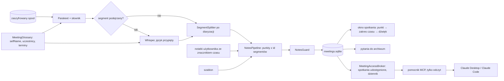

# Notatki ze spotkań lepsze niż Claude Meetings: sprawdzalne, po polsku, w każdej aplikacji, a Claude jako klient archiwum

- Date: 2026-11-13
- Category: feature
- Priority signal: high — Anthropic wydał Claude Meetings (beta, 2026-11-12), a właściciel chce, by notatki Pounce/Lintel były lepsze; jednocześnie własne pomiary pokazują, że jakość notatek nie jest jeszcze potwierdzona przez człowieka
- Risk signal: high — kilka propozycji odwraca rozstrzygnięte decyzje specu spotkań (usuwanie audio, brak kalendarza, jeden szablon), a część dotyka prawa (zgoda uczestników, dane biometryczne)
- Routing: `om-spec-writing "<wybrany pakiet z sekcji Phasing> — brief: .ai/specs/briefs/2026-11-13-meeting-notes-beyond-claude-B.md"` — osobno dla każdego pakietu, po odpowiedziach na Open Questions. **Nie jeden spec**: to mapa drogowa siedmiu niezależnych zdolności.
- Status: brief kierunkowy z planem faz. Bramka Open Questions nie jest zamknięta.
- Surowy research (angielski, pełne źródła): `.ai/specs/research/2026-11-13-meeting-notes-market-B.md`, `.ai/specs/research/2026-11-13-meeting-notes-techniques-B.md`

> **Uwaga o stanie repozytorium.** Bieżący checkout to odłączony HEAD `77905a8` (2026-11-03), w którym `MeetingsPlugin` kończy się na kroku 1.4 (biblioteka, spool, źródła audio) i nie jest zarejestrowany. Pełna funkcja jest na `origin/main` (PR #47 i kolejne), gdzie produkt nazywa się Lintel (`LintelKit`, `LintelSpeech`), a obok istnieje `NotesPlugin` (#56). Analiza luk poniżej odnosi się do `origin/main` plus niezmergowanej gałęzi `feat/meeting-quality-improvements`; sprawdziłem listę plików na `origin/main` (`Recording/`, `Diarization/`, `Notes/`, `Suggestions/`, `Export/`) oraz `NoteContract.swift` i `NotesPrompt.swift`; pozostałe szczegóły zachowania pochodzą z lektury specyfikacji, pamięci projektu i raportów subagentów, nie z uruchomienia aplikacji. Liczby z archiwum ewaluacji (WER 15%, wynik Bielika) nie były ponownie weryfikowane.

## 📝 TL;DR

Claude Meetings, które Anthropic faktycznie wydał, to **widoczny bot w Google Meet, tylko dla planów Team i Enterprise, w chmurze, bez zachowanego audio i bez opublikowanej listy języków**. Lokalny rejestrator bez bota (wyciek „Parka”) nie został wydany ani potwierdzony. Pounce już dziś jest po drugiej stronie każdej z tych osi: nagrywa bez bota w dowolnej aplikacji i na żywo, wszystko zostaje zaszyfrowane na Macu, działa dla jednej osoby.

Przewagi architektury nie trzeba więc budować; trzeba **dowieźć jakość, której nie da się dziś wykazać**. Własne pomiary projektu mówią: WER 15% na polskim podcaście, 15–20% segmentów mieszających mówców, sędzia LLM z szumem ±8 punktów, brak prawdy wzorcowej, a pierwotna porażka („godzina spotkania → kilka linijek”) nie jest potwierdzona jako naprawiona. Proponuję siedem pakietów w tej kolejności: (1) miara i dogfood, (2) **sprawdzalne notatki** (odnośnik do cytatu już jest; dochodzi odsłuch dźwięku, oznaczenie punktów bez poparcia i punkty jako dane), (3) jakość polskiego i mieszanego PL/EN (słownik spotkania, podział segmentów, drugi przebieg), (4) notatki hybrydowe i szablony, (5) nazwy mówców bez biometrii, (6) niezawodność nagrania i zgoda uczestników, (7) pytania do archiwum oraz **lokalny serwer MCP i eksport Markdown, dzięki którym Claude staje się klientem archiwum zamiast konkurentem**.

Uczciwe ograniczenie: na samej jakości tekstu notatki lokalny model 4B przegra z modelem czołowym. „Lepiej niż Claude” da się obronić jako: działa tam, gdzie Claude nie działa, nic nie wychodzi z Maca, polski jest zmierzony, a każdy punkt notatki jest sprawdzalny. Dla jakości samego pisania istnieje już spec zewnętrznych dostawców (`2026-11-10`), który pozwala świadomie użyć modelu z subskrypcji.

## 📝 Open Questions (do decyzji właściciela)

| # | Pytanie | Rekomendacja (założenie robocze) |
|---|---|---|
| Q1 | Co znaczy „lepiej niż Claude” i jak to zmierzyć? | Cztery mierzalne tezy z sekcji „Definicja zwycięstwa”; porównanie ślepe na własnym zbiorze spotkań, nie na deklaracjach. |
| Q2 | Czy zachowywać zaszyfrowane audio po przetworzeniu? Spec spotkań (Q7) usuwa je po `ready`. Ustawienie `keepAudio` (wygasanie po 14 dniach) istnieje tylko jako niezacommitowane zmiany w drzewie roboczym `Pounce-keepaudio`, na bazie sprzed zmiany nazwy; nie da się go po prostu scalić. | **Tak, ale domyślnie wyłączone, z pytaniem przy pierwszym nagraniu** (krótki okres, 14–30 dni). Dłuższe przechowywanie głosów innych osób to ustawienie osłabiające prywatność (BC §3), a obecne instalacje nie mogą zmienić zachowania po cichu. Bez audio nie ma odsłuchu cytatu ani ponownej transkrypcji lepszym silnikiem. Trwałe audio czyni też format spoolu obiecanym formatem (BC §2 mówi dziś, że nim nie jest): wymaga wpisu w BC. Osobny, mały spec. |
| Q3 | Czy uchylić nie-cel „kalendarz”? Lista uczestników z EventKit daje kandydatów na nazwy mówców, słownik nazw własnych i tytuł spotkania. | **Tak, opcjonalnie**, z nowym przypadkiem `Permission.calendar` (zmiana addytywna). Bez kalendarza funkcje działają na `selfName` i ręcznych nazwach. |
| Q4 | Jeden szablon (Q8) czy kilka? Audyt jakości zalecał szablony per typ spotkania. | **2–3 wbudowane** (spotkanie robocze, rozmowa 1:1, prezentacja/wykład). Własne prompty użytkownika pozostają nie-celem. |
| Q5 | Odciski głosu innych osób między spotkaniami? | **Nie.** Podtrzymać odrzucenie ze specu nazw mówców (dane biometryczne z art. 9 RODO, pozwy BIPA przeciw Fireflies i Otter). Rozważyć wyłącznie własny głos użytkownika, później. |
| Q6 | Czy czytać nazwy aktywnego mówcy z okna Zoom/Meet/Teams przez Accessibility (tak robi Granola dla Zooma)? | **Później, jako osobny spec z próbą.** Najcenniejsze źródło nazw, ale kruche i wymaga adaptera per aplikacja. |
| Q7 | Lokalny serwer MCP: czy Pounce ma udostępniać archiwum Claude'owi i innym asystentom? To nowa powierzchnia i dane opuszczają Maca, gdy czyta je model w chmurze. | **Tak, domyślnie wyłączony**, tylko odczyt, zakres „same notatki” lub „notatki i transkrypty”, **udostępnianie włączane per spotkanie** (a nie flaga „prywatne” do wyłączania), dziennik dostępu. Zastrzeżenia: pomocnik uruchamiany przez stdio nie potrafi wiarygodnie rozpoznać, który klient go uruchomił, więc „zgoda per klient” jest nie do wyegzekwowania i nie należy jej obiecywać; narzędzia tylko do odczytu nie chronią przed wyniesieniem treści innymi narzędziami klienta. Zależy od niezaimplementowanego specu dostawców (wspólny model zgody). |
| Q8 | Podpowiedź „poinformuj uczestników” (wklejenie zdania do czatu spotkania): domyślnie włączona? | **Tak** przy pierwszych spotkaniach. U Granoli powiadomienie jest opcjonalne, co jest jednym z zarzutów pozwu (etap wstępny, same zarzuty, brak orzeczenia). |
| Q9 | Czy wymienić model domyślny na Bielika? Ranking Open PL LLM daje Bielik-11B-v3 65,93 wobec ok. 62 dla Gemma 3 12B i Qwen3-14B, ale **własny pomiar projektu dał Bielik-11B 44 wobec 59–65 dla Qwen3-30B** na tym samym nagraniu. | **Nie na podstawie rankingu.** Zmierzyć Bielik 4.5B v3 i 11B v3 na własnym zbiorze; repozytoria są bramkowane na Hugging Face, więc pobieranie z aplikacji wymaga uzgodnienia. |
| Q10 | Transkrypt na żywo i „streść ostatnie 5 minut”? Spec ma transkrypt na żywo w nie-celach. | **Później** (pakiet 8). Nie jest to powód, dla którego ktokolwiek wygrywa lub przegrywa dziś. |
| Q11 | Kolejność: czy pakiety 2–7 mogą ruszyć przed zakończeniem dogfoodu z briefu `2026-11-09`? | Pakiety 2 (sprawdzalność), 6a (strażniki nagrania) i 6b (zgoda) **tak**, bo nie zależą od wyników. Pakiety 3–5 po pierwszych danych z dogfoodu. |

## 📝 Problem Statement

1. **Konkurent się zmaterializował, ale w innej architekturze.** Claude Meetings (beta 2026-11-12) to bot w Google Meet dla zespołów. Pojedynczy użytkownik planu Pro/Max, rozmowa w Zoomie, Teams, Slacku lub na żywo, polski język, praca offline: nic z tego nie jest obsłużone. Ryzyko: Anthropic może w dowolnej chwili wydać „Parkę”, czyli rejestrator bez bota na Macu z transkrypcją w chmurze i przekazaniem zadań agentom.
2. **Jakość Pounce nie jest wykazana.** Z pamięci projektu i archiwum ewaluacji (`Pounce-eval-archive`, stan 2026-11-06):
   - WER Parakeet 15,0% na polskim podcaście DevMentors;
   - 15–20% segmentów na nagraniu wielogłosowym (ovn) miesza osoby, bo jedna etykieta obejmuje cały ok. 15-sekundowy segment;
   - 0 z 12–18 zadań miało właściciela; po dodaniu nazw mówców 10 z 24;
   - `NotesGuard` zamieniał 80–88 z ok. 91 punktów na surowe cytaty, a 57% tych zamian było zbędnych;
   - oceny sędziego 55–65/100 z szumem ±5–8 punktów; weryfikator semantyczny i prompt v4 nie dały zysku ponad szum i zostały odrzucone;
   - brak prawdy wzorcowej i oceny człowieka; polskie nagranie testowe to podcast bez zadań;
   - żaden budżet z `docs/perf.md` dla spotkań nie jest zmierzony.
3. **Brakuje tego, co użytkownicy chwalą u lidera (Granola):** własne notatki sterujące wynikiem, odnośnik od każdej linii do źródła, szablony, pytania do archiwum, integracje.

## 📝 Research

**Fakt** = strona pierwotna, **Wtórne** = prasa lub blog (często konkurenta), **Wniosek** = interpretacja. Ograniczenia: wątków Reddit, X i G2 nie udało się otworzyć; strona pomocy OpenAI o Record zwróciła 403.

### Co dokładnie oferuje Claude

| Element | Stan | Co to jest | Źródło |
|---|---|---|---|
| **Claude Meetings** | wydane (beta), zapowiedź 2026-11-10, beta 2026-11-12 | Widoczny uczestnik-bot w **Google Meet**: notatki, zadania, odpowiedzi na czacie spotkania, tworzenie dokumentów i tablic w trakcie. Tylko **Team i Enterprise**. Zapisuje „transkrypt, podsumowanie i opisy ekranu, nie audio”. Do 8 godzin. | https://claude.com/resources/articles/claude-meetings (2026-11-12); https://support.claude.com/en/articles/18325154 (pobrane 2026-11-13) |
| Języki, etykiety mówców, okres przechowywania, procedura usuwania | **nieopublikowane** | Polski: nieznany. Jedyna wzmianka o mówcach: przy prośbach głosowych Claude „pyta za każdym razem, kto mówi”. | te same strony; komentarze https://vanja.io/claude-meetings/ |
| Wykluczenia | fakt | Niedostępne dla organizacji z zerową retencją, konfiguracją HIPAA i własnymi kluczami szyfrowania. | Help Center |
| Inne platformy; eksport transkryptów do Gong, Granola, Fireflies, Otter | zapowiedziane („wkrótce”, bez dat) | — | artykuł startowy |
| **„Parka”** — rejestrator w Claude Desktop | **plotka, niepotwierdzone** | Wyłączony szkielet w buildzie z 2026-08: dźwięk systemowy i mikrofon bez bota, transkrypt na żywo z mówcami, zadania kierowane do Cowork/Claude Code z flagą `autoRunnable`; nazwy hostów sugerują transkrypcję w chmurze. Anthropic nie odpowiedział na prośbę o komentarz. | wtórne, jedno źródło pierwotne: RuntimeWire 2026-08-19; https://www.reworked.co/digital-workplace/anthropic-explores-meeting-recorder-that-assigns-tasks-to-claude-agents/ (2026-08-25) |
| Dyktowanie i tryb głosowy | wydane | Wejście do czatu, nie rejestrator. **Polski nie jest na liście języków dyktowania.** | https://support.claude.com/en/articles/10065434-use-dictation-on-claude-mobile |
| Konektory (Granola, Fireflies, Otter, Fathom, tl;dv), skill `sales:call-summary` | wydane | Claude czyta notatki cudzych narzędzi; sam nie nagrywa. | https://github.com/anthropics/knowledge-work-plugins/tree/main/sales |

Punkt odniesienia: ChatGPT Record (OpenAI) to rejestrator bez bota tylko na macOS, transkrypcja w chmurze, audio usuwane, według recenzji bez etykiet mówców na starcie (wtórne).

Wniosek: dostawcy modeli traktują notatki jako cienką warstwę przechwytywania, której wartością jest przekazanie pracy asystentowi. Żaden nie jest lokalny, żaden nie dokumentuje polskiego ani nazw mówców.

### Konkurencja: co się liczy

| Produkt | Przechwytywanie | Gdzie | Polski na desktopie | Mówcy | Mocne | Słabe |
|---|---|---|---|---|---|---|
| **Granola** | bez bota | chmura, audio nie jest zapisywane | **nie** (tylko mobilnie; dokumentacja 2026-11-13) | nazwy w Meet/Zoom/Teams, poza tym „Ja/Oni” | notatki hybrydowe, odnośnik od linii do źródła, szablony, czat po archiwum, MCP; $0/$14/$35 | ciche awarie nagrania, brak audio do weryfikacji, pozew *Chamberlain v. Granola* (2026-07-30) za brak powiadomienia i trening domyślnie |
| Otter | bot | chmura | nie (6 języków) | odciski głosu | transkrypt na żywo | pozew o podsłuch i biometrię; bot dołączający bez zaproszenia |
| Fireflies | bot | chmura | tak (lista) | rozpoznawanie mówców | integracje, pierwszy konektor Claude | pozew BIPA o odciski głosu |
| Fathom | bot | chmura | tak (lista) | nazwy z platformy | darmowy plan | widoczny bot |
| Krisp | bez bota | **tylko angielski lokalnie**, reszta na serwerach | tak, na serwerze | — | redukcja szumu | polski opuszcza urządzenie |
| Notion AI | bez bota | chmura | nieustalone | etykiety tylko po angielsku | notatki w Notion | start ręczny |
| Apple Notatki | mikrofon i rozmowy telefoniczne | na urządzeniu | **nie** | brak | darmowe | brak dźwięku systemowego z aplikacji spotkań |
| Google Meet / Teams / Zoom | w platformie | chmura | Meet: nie (8 języków); Teams: częściowo | tożsamość platformy | zero konfiguracji | tylko własna platforma |
| Meetily (ok. 32,7 tys. gwiazdek), Anarlog (9,9 tys.) | bez bota | lokalnie | zależnie od modelu | Meetily: w wersji płatnej | lokalność, otwarty kod | **brak deklaracji szyfrowania danych**; słabe nazwy mówców |
| Limitless | — | — | — | — | — | przejęty przez Meta 2025-12, nagrywanie wyłączone, usługa zakończona w UE |

Źródła i zastrzeżenia per wiersz są w pliku research; ceny i opinie pochodzą głównie z blogów konkurentów.

Co użytkownicy chwalą (kolejność wg częstości w źródłach, wtórne): brak bota; działa bez konfiguracji; notatki brzmią jak własne; darmowy plan; szybka natywna aplikacja; przekazanie do innych narzędzi (MCP); lokalność.

Czego nie znoszą: nagrywanie bez realnej zgody; **ciche awarie nagrania**; błędne przypisanie mówców przy 3+ osobach; **notatki, których nie da się sprawdzić** (brak audio); słaba obsługa języków innych niż angielski; niejasne użycie danych; zniknięcie dostawcy.

Nikt nie publikuje wiarygodnego pomiaru jakości polskich spotkań. Deklaracje „95%” nie mają podanego zbioru testowego.

### Techniki (najważniejsze dla decyzji)

- **Polski w rozmowie to raczej 20–30% WER niż 5–8%** (wniosek planistyczny z poniższych faktów, nie opublikowana liczba). Mowa czytana (FLEURS pl): Whisper large-v3 4,74%, Parakeet v3 7,31% (8,6% w wersji CoreML FluidAudio; arXiv:2509.14128, https://github.com/FluidInference/FluidAudio/blob/main/Documentation/Benchmarks.md). Mowa spontaniczna (PELCRA): w BIGOS V2 (NeurIPS 2024) mediana WER systemów płatnych 29,9%, a Whisper large-v3 28,5–35,1%; w osobnej pracy Samsung R&D Polska na PolEval 2024 (arXiv:2410.22903) Whisper large-v3 ma 29,04% bez strojenia, 23,35% po strojeniu na 669 h i 20,98% dopiero po dodaniu 1330 h danych syntetycznych. Nie ma opublikowanego wyniku Parakeet v3 na PELCRA ani żadnego benchmarku mieszania PL/EN.
- **Parakeet v3 nie ma blokady języka** i na krótkich segmentach dryfuje do czeskiego, rosyjskiego lub angielskiego (NeMo issue 15097). Whisper halucynuje na ciszy (arXiv:2501.11378), ale przyjmuje język i podpowiedź słownikową.
- **Nowy kandydat**: NVIDIA Nemotron-Labs-Unified-ASR-0.6B (2026-10-27): polski 6,01% offline i 7,09% przy strumieniowaniu 1,12 s, przyjmuje podpowiedź języka (https://huggingface.co/nvidia/nemotron-labs-unified-asr-0.6b). Dostępność w FluidAudio niezweryfikowana.
- **Bez polskiego**: Apple SpeechTranscriber, Voxtral, Kyutai, Moonshine.
- **Diaryzacja**: pyannote community-1 offline 17,0–19,9% DER na AMI; port CoreML FluidAudio 18–24% w tym samym protokole; **strumieniowa 38–56%**, więc etykiety na żywo trzeba zastąpić po spotkaniu. Sortformer ma twardy limit 4 mówców. Dominującym błędem jest pominięta mowa na granicach wypowiedzi (arXiv:2509.26177).
- **Nazwy mówców**: najlepsze źródło to interfejs aplikacji spotkań przez Accessibility (Granola dla Zooma; wtórne); kalendarz daje listę kandydatów, nie przypisanie; wnioskowanie nazw z samego tekstu osiągnęło 80% precyzji i 50% czułości w jedynym znalezionym badaniu (arXiv:2407.12094), więc tylko jako sugestia do potwierdzenia.
- **Odciski głosu** innych osób to dane biometryczne z art. 9 RODO (wytyczne EROD 02/2021).
- **Skąd bierze się jakość Granoli** (dokumentacja): notatki użytkownika sterują tym, co ważne; każda linia ma odnośnik do fragmentu transkryptu; szablony per typ spotkania. Żadna z tych rzeczy nie wymaga dużego modelu.
- **Streszczanie małym modelem**: hierarchiczne łączenie streszczeń bywa niewierne, chyba że na etapie łączenia dołączy się źródło (arXiv:2502.00977); wierność zależy od pozycji w kontekście (arXiv:2410.23609); podejście „wyodrębnij fakty, uporządkuj, napisz” zmniejsza zmyślenia i pominięcia (FRAME, EMNLP 2025). Najbardziej szkodzą błędy w nazwach własnych, a sam WER słabo przewiduje jakość notatki (arXiv:2502.13645).
- **Korekta transkryptu przez LLM nadpisuje** (arXiv:2505.17410); bezpieczna forma to zamiana fragmentów wyłącznie na pozycje ze słownika.
- **Słownictwo w silniku mowy**: FluidAudio ma wzmacnianie słownika oparte na CTC dla przebiegu wsadowego (https://docs.fluidinference.com/asr/custom-vocabulary); niezweryfikowane dla polskiego.
- **Ewaluacja**: MeetEval (cpWER), PIER na angielskich terminach, F1 zadań na trzech poziomach (zadanie; + właściciel; + termin), odsetek punktów popartych cytatem. Nie istnieje polski korpus spotkań ze streszczeniami wzorcowymi.
- **Pytania do archiwum**: na polskim benchmarku wyszukiwania PIRB multilingual-e5-small ma 50,65, BGE-M3 55,75, polski mmlw-retrieval-e5-base 56,09 (liczby odczytane ze streszczeń wyszukiwarki, do potwierdzenia w tabelach arXiv:2402.13350). Przy 60 tys. wektorów wystarcza kolumna BLOB i przeszukanie w pamięci; sqlite-vec z SQLCipher jest niezweryfikowany i zmieniałby przypięty, niemodyfikowany build GRDB.
- **MCP Granoli** jest w pełni udokumentowany (`search_meetings`, `search_transcripts`, `get_meetings`, `get_meeting_transcript`…; https://docs.granola.ai/help-center/sharing/integrations/mcp); transkrypty są bramkowane osobno.
- **Niezawodność przechwytywania**: znane awarie process tap to m.in. przełączenie AirPods A2DP→HFP zmieniające częstotliwość próbkowania bez zmiany urządzenia, ciche bufory zerowe, odmowa uprawnienia wyglądająca jak cisza, pętle powiadomień po utworzeniu urządzenia zbiorczego (zgłoszenia w repozytoriach Biscotti, Hyprnote, Meetily; forum Apple).
- **Prawo**: pozew przeciw Granoli (same zarzuty, etap wstępny) celuje w sam model bez bota (brak powiadomienia uczestników, trening domyślnie). Produkt lokalny ma odpowiedź na dwa z trzech zarzutów (dostawca nie otrzymuje danych, nie trenuje na nich), ale nie na trzeci: uczestnicy nie są informowani. Nie znalazłem stanowiska UODO o notatnikach AI.

## 📝 Gap analysis (wobec `origin/main` + gałęzi jakości)

| Obszar | Mamy | Brakuje | Ocena |
|---|---|---|---|
| Przechwytywanie | process tap + mikrofon, dwa tory, zaszyfrowany spool, autotest uprawnienia, `EchoSuppressor`, odzyskiwanie po awarii | strażniki z listy awarii (częstotliwość próbkowania, bufory zerowe, pętle powiadomień), znaczniki luk w spoolu, widoczny stan „brak dźwięku systemowego” | **przewaga** architektury; luka w odporności |
| Prywatność | SQLCipher, klucz w Keychain, spool AES-GCM, brak logowania treści, 90 dni retencji | — | **przewaga**, której nie mają też lokalni konkurenci (Meetily, Anarlog nie deklarują szyfrowania) |
| Transkrypcja PL/EN | Parakeet (domyślny) i WhisperKit; WER 15% na podcaście | słownik spotkania, drugi przebieg na podejrzanych segmentach, kontrola dryfu języka, pomiar na prawdziwej rozmowie | luka; największy wpływ na jakość notatki przez nazwy własne |
| Mówcy | diaryzacja offline community-1 po Stop, „Ja/Inni” jako zapas, `selfName` na gałęzi | podział segmentów na granicach mówców (spec gotowy, niezaimplementowany), sugestie nazw (spec, faza 2), kandydaci z kalendarza | luka; specyfikacje istnieją |
| Notatki | `TranscriptChunker` → `NotesPipeline` (map→reduce, kontekst 8192) → `NotesGuard` (dopasowuje cytat słowami i ustawia w `NotesPoint` czas oraz indeks wypowiedzi) → `NotesComposer`; zapis wyłącznie jako `notes_markdown` z końcówką `[mm:ss]`; **znacznik cytatu oparty na czasie już istnieje** (`NoteBlockProvenance.quoteTimesMs` w `LintelKit/NoteContract.swift`, odtwarzany przez ponowne parsowanie Markdownu); „Kluczowe punkty” na gałęzi | odsłuch dźwięku z cytatu; oznaczenie punktów bez poparcia; punkty jako dane (do F1 zadań i listy otwartych zadań); daty i odmiana imion w kodzie; szablony; wejście z notatek użytkownika | luka średnia: odnośnik do tekstu jest, brakuje dźwięku i danych strukturalnych |
| Notatki hybrydowe | `NotesPlugin` (#56): notatki ręczne, edycja warstw spotkania, znaczniki pochodzenia `stt`/`agent`/`human`; kontrakt `NoteSource`/`NoteSourceEditing` działa **w jedną stronę**: Notes czyta, zmienia tytuł i usuwa notatki spotkań | droga odwrotna nie istnieje: nic nie przekazuje notatek użytkownika do `NotesPipeline`; potrzebny nowy addytywny kontrakt w `LintelKit` (z ADR) albo pole notatek w samym `MeetingsPlugin` | luka; wymaga decyzji architektonicznej |
| Audio po spotkaniu | usuwane po `ready` (Q7); `keepAudio` tylko jako niezacommitowany szkic | decyzja, implementacja od nowa na `origin/main`, odtwarzanie fragmentu | blokuje odsłuch i ponowną transkrypcję |
| Archiwum | FTS5 po transkrypcie i notatkach ze składaniem ł/đ/ø | pytania z odpowiedzią i cytatami; kanał wektorowy | luka |
| Integracje | „Kopiuj Markdown”, „Zapisz .md” | eksport do folderu (dziś nie-cel), serwer MCP | luka; to jest odpowiedź na „Claude” |
| Wykrywanie spotkań | `MeetingDetector`, `SuggestionPolicy` (sugeruje, nie startuje) | granice z kalendarza, rozdzielanie spotkań jedno po drugim | mała luka |
| Zgoda | przypomnienie w HUD nagrywania | zdanie do wklejenia w czat, zapis „powiadomiono o 10:02” | luka; tanie, ważne prawnie |
| Miara | harness (`scripts/meeting-eval/`, #57), sędzia Opus, plan dogfoodu | zbiór wzorcowy z oceną człowieka, cpWER/DER w harnessie, F1 zadań | **warunek wstępny** wszystkiego, co dotyczy jakości |
| Model | Qwen3-4B (domyślny), Qwen3-30B-A3B | model lepszy po polsku w klasie 16–32 GB; zewnętrzny dostawca (spec `2026-11-10`, niezaimplementowany) | do zmierzenia, nie do założenia |

Ryzyka: brak dowodu na jakość przy głośnej tezie „lepiej niż Claude”; pamięć diaryzacji dla nagrań ponad 90 minut niezmierzona (dziś pomijana); każda z propozycji Q2–Q4 odwraca zamkniętą decyzję.

## 📝 Proposed Solution

### Definicja zwycięstwa (do Q1)

Zamiast „lepsze notatki” cztery tezy, każda sprawdzalna:

1. **Zasięg**: działa w każdej aplikacji spotkań i na żywo, dla jednej osoby, offline. Claude Meetings: tylko Google Meet, tylko zespoły. Spełnione dziś; utrzymać i pokazać.
2. **Prywatność**: dźwięk, transkrypt i notatki nie opuszczają Maca, chyba że użytkownik jawnie wybierze dostawcę lub klienta MCP; stan jest widoczny przy każdym spotkaniu. Spełnione dziś.
3. **Sprawdzalność**: 100% punktów notatki ma odnośnik do miejsca w transkrypcie albo jawne oznaczenie braku poparcia, a przy zachowanym audio także odsłuch. Claude Meetings i ChatGPT Record nie zachowują audio. Do zbudowania.
4. **Polski zmierzony**: na własnym zbiorze 20–30 spotkań (PL, PL z angielskimi terminami, EN) publikujemy WER, błąd na angielskich terminach, F1 zadań z właścicielem i odsetek punktów popartych cytatem; porównanie ślepe z notatką modelu czołowego z tego samego transkryptu. Do zbudowania; dziś nikt tego nie publikuje.

### Rozważone kierunki

1. **Nic nie budować, czekać na dogfood.** Częściowo słuszne i już uzgodnione (`2026-11-09-meeting-notes-dogfood.md`): jakości nie da się dalej stroić bez danych od użytkownika. Nie wystarcza jako całość, bo sprawdzalność, odporność nagrania i zgoda nie zależą od wyników dogfoodu.
2. **Gonić Claude'a funkcjami w trakcie spotkania** (odpowiedzi na czacie, tworzenie dokumentów na żywo, agenci wykonujący zadania). Odrzucone: to teren asystenta w chmurze, wymaga bota albo modelu czołowego i stoi w sprzeczności z lokalnością.
3. **Przenieść notatki do chmury** (domyślnie zewnętrzny dostawca). Odrzucone jako domyślne: niszczy tezę 2. Zostaje jako świadoma opcja ze specu `2026-11-10`.
4. **Wybrany: być najlepszym prywatnym źródłem prawdy o spotkaniach.** Jakość przez sprawdzalność i pomiar, polski jako mierzona przewaga, a asystenci (w tym Claude) jako klienci archiwum przez MCP i Markdown.

### Pakiety

**P1. Miara i dogfood** (uzgodnione; tu tylko rozszerzenie). Zbiór wzorcowy rośnie z dogfoodu: pary oryginał/edycja + ręcznie poprawione 5–10-minutowe wycinki z mówcami. Do harnessu: cpWER przez MeetEval, PIER na angielskich terminach, F1 zadań na trzech poziomach, odsetek punktów popartych cytatem. Nie powtarzać eksperymentów z weryfikatorem i promptem v4.

**P2. Sprawdzalne notatki.** Odnośnik od punktu do miejsca w transkrypcie już jest (znacznik cytatu oparty na czasie). Brakuje: (a) odsłuchu, czyli odtworzenia zakresu czasu ze spoolu, gdy audio jest zachowane (osobny spec P2a wg Q2); (b) jawnego oznaczenia punktów, których cytat nie został potwierdzony, zamiast ich ukrywania; (c) punktów jako danych. Wiązanie musi być **po zakresie czasu, nie po identyfikatorze segmentu**, bo podział segmentów z P3 tworzy segmenty na nowo. Dla (c) są dwie drogi do rozstrzygnięcia w specu: ustrukturyzowane metadane w samym Markdownie (jedno źródło prawdy, zgodne z edycją w Notes) albo tabela `meeting_note_item` jako pochodna, przebudowywana po każdej edycji lub regeneracji. Druga tabela obok `notes_markdown` bez takiej reguły dałaby dwa rozbieżne źródła prawdy, gdy użytkownik edytuje warstwę w Notes. Daty („do piątku”) rozwiązywane w kodzie względem daty spotkania; zapisywana jest fraza i data.

**P3. Jakość PL i PL/EN.**
- *Słownik spotkania* (`MeetingGlossary`): `selfName`, nazwy uczestników (ręczne lub z kalendarza), terminy użytkownika. Używany trzykrotnie: wzmacnianie w silniku (po weryfikacji technicznej), podpowiedź dla Whispera, zamiana fragmentów wyłącznie na pozycje słownika z zachowaniem surowego tekstu.
- *Podział segmentów* wg istniejącego specu `2026-11-06-meeting-segment-split.md` (czasy słów z Parakeet, `SegmentSplitter`).
- *Drugi przebieg*: Whisper z przypiętym językiem tylko na segmentach oznaczonych (niska pewność, inny język niż dominujący, bliskie trafienie słownika). Wymaga zachowanego spoolu do czasu `ready`, co już istnieje.
- *Łączenie bardzo krótkich segmentów* przed transkrypcją, by ograniczyć dryf języka.
- Ocena Nemotron-Labs-Unified-ASR jako następcy pierwszego przebiegu: tylko pomiar.
- Odmiana imion („Ani”, „Tomkowi”) mapowana do mianownika z listy uczestników w kodzie.

**P4. Notatki hybrydowe i szablony.** Notatki pisane w trakcie nagrania dostają znacznik czasu i trafiają do kroku pisania jako wejście sterujące: ich nagłówki i punkty wyznaczają strukturę i akcenty, a tekst użytkownika zostaje oznaczony jako `human`. Gdzie się je pisze, jest otwarte: prostsza droga to pole notatek w oknie nagrywania `MeetingsPlugin` (bez zmian kontraktu); droga przez `NotesPlugin` wymaga nowego addytywnego kontraktu w `LintelKit` i ADR, bo pluginy nie importują się nawzajem. Dwa–trzy wbudowane szablony z własną wersją promptu; ponowne wygenerowanie innym szablonem. Kolizja z `feat/notes-workspace` i specem edycji notatek: uzgodnić przed pisaniem specu.

**P5. Nazwy mówców bez biometrii.** (Sugestie nazw nie zależą od podziału segmentów i mogą ruszyć wcześniej.) Faza 2 istniejącego specu (`SpeakerNameSuggester`: przedstawienia się i zwroty po imieniu, tylko jako sugestie do potwierdzenia) + kandydaci z kalendarza (Q3) + nazwy potwierdzone w jednym spotkaniu proponowane jako kandydaci w następnym **po nazwie, nie po głosie**. Odczyt aktywnego mówcy z okna aplikacji spotkań jako osobny, późniejszy spec (Q6).

**P6a. Niezawodność nagrania.** Strażniki przechwytywania z listy znanych awarii; luka pokazywana w transkrypcie („brak 12 s dźwięku systemowego o 14:03”), z wykorzystaniem istniejącej kolumny `audio_gap` w magazynie spotkań, o ile jej znaczenie na to pozwala (do sprawdzenia przed dodaniem czegokolwiek nowego); ostrzeżenie w HUD w chwili, gdy dźwięk przestaje płynąć.

**P6b. Zgoda uczestników.** Zdanie do skopiowania do czatu spotkania jednym kliknięciem (PL/EN) i zapis, kiedy użytkownik je **skopiował** (aplikacja nie wie, czy zostało wysłane, więc nie twierdzi „powiadomiono”); żadnego języka „nikt się nie dowie” w aplikacji i na stronie.

**P7. Archiwum i Claude jako klient.**
- *Pytania do archiwum*: najpierw FTS5 + rozszerzenie zapytania o formy fleksyjne + odpowiedź lokalnego modelu wyłącznie z odnalezionych fragmentów, z cytatem (spotkanie, czas, mówca) w każdym zdaniu i odpowiedzią „nie znaleziono”, gdy trafienia są słabe. Kanał wektorowy (BLOB + przeszukanie w pamięci) dopiero, gdy pomiar na pytaniach wzorcowych pokaże braki.
- *Eksport*: folder Markdown z metadanymi (data, uczestnicy) do Obsidiana; dziś nie-cel („auto-eksport”), więc opcja jawnie włączana, z ostrzeżeniem, że pliki nie są szyfrowane.
- *Serwer MCP* (Q7): pomocniczy program w pakiecie aplikacji uruchamiany przez Claude Desktop lub Claude Code; nie trzyma klucza SQLCipher, tylko pyta działającą aplikację; narzędzia tylko do odczytu (`search_meetings`, `get_meeting`, `get_transcript_section`, `list_open_action_items`).

**P8 (później).** Transkrypt na żywo, „streść ostatnie minuty”, brief przed spotkaniem z poprzednich spotkań z tymi samymi osobami, nazwy z okna aplikacji spotkań.

## 📝 Architecture (tylko to, co nowe)

Zgodność z AGENTS.md:
- P2, P3 i P6 mieszczą się w `MeetingsPlugin` i `PounceSpeech`; pluginy nie importują się nawzajem. Istniejący kontrakt z #56 (`NoteSource`, `NoteSourceEditing`) działa tylko w kierunku Notes → odczyt notatek spotkań, więc P4 potrzebuje albo pola notatek w `MeetingsPlugin`, albo nowego kontraktu.
- `PounceKit`/`LintelKit`: tylko zmiany addytywne. Kandydaci: `Permission.calendar` i port kalendarza z domyślną pustą realizacją (P5; dziś jest pięć przypadków `Permission` i żadnego dostępu do EventKit), ewentualnie kontrakt wejścia notatek (P4). P2, P3 i P6 nie wymagają zmian kontraktu.
- Serwer MCP nie jest ładowaniem kodu w czasie działania (zakazanym), lecz nową powierzchnią wyjścia danych: wymaga ADR, pozycji w `BACKWARD_COMPATIBILITY.md` i decyzji, czy pomocnik jest osobnym produktem wykonywalnym w `Package.swift` podpisywanym przez `scripts/make-app.sh`.
- Treść transkryptu i notatek nadal nie trafia do logów, `ranking.sqlite` ani schowka; dziennik dostępu MCP zapisuje klienta, narzędzie, identyfikator spotkania i czas, nigdy treść.

## 📝 Data Model (zmiany addytywne w `meetings.sqlite`)

- `meeting_segment.words_json` (już w specu podziału segmentów) oraz `confidence`, `engine_pass` (1/2).
- Punkty notatki jako dane (jedna z dwóch dróg z P2): `kind`, `text`, `owner_speaker_id`, `due_phrase`, `due_date`, `support`, `quote_start_ms`/`quote_end_ms`. Dziś jedynym źródłem jest `notes_markdown`; jeśli powstanie tabela `meeting_note_item`, to wyłącznie jako pochodna z regułą przebudowy po edycji i regeneracji. **To największa decyzja modelu i wymaga uzgodnienia z modelem warstw z #56.**
- `meeting.template_id`, `meeting.consent_text_copied_at`, `meeting.shared_with_assistants` (domyślnie fałsz; dopiero ona udostępnia spotkanie przez MCP).
- Luki dźwięku: najpierw sprawdzić istniejącą kolumnę `audio_gap`; nowa tabela tylko, jeśli nie wystarcza.
- `meeting_glossary_term` (per spotkanie) i słownik globalny w ustawieniach.
- `meeting_access_log`: klient, narzędzie, spotkanie, czas.
- Embeddingi (jeśli powstaną): BLOB w tej samej bazie, wersjonowane identyfikatorem modelu, usuwane razem ze spotkaniem.
- Migracje tylko addytywne (`v2-…`), każda z testem; audio zachowane pozostaje w spoolu AES-GCM z osobnym terminem wygaśnięcia.

## 📝 Budżety (do `docs/perf.md`; dotychczasowe są niezmierzone)

| Krok | Budżet |
|---|---|
| Drugi przebieg na ≤ 20% dźwięku godzinnego spotkania | ≤ 60 s |
| Notatki z godzinnego spotkania | bez zmiany: 1–2 min, ≤ 8 min na słabszym Macu |
| Odtworzenie fragmentu po kliknięciu punktu | < 300 ms |
| Odpowiedź z archiwum (1000 spotkań) | wyszukiwanie < 200 ms; pierwszy token < 5 s przy ciepłym modelu |
| Wykrycie braku dźwięku systemowego | ostrzeżenie ≤ 10 s |
| Pamięć podczas nagrywania | bez zmiany: < 1,5 GB |

Pierwszy krok P1 to zmierzenie budżetów już zapisanych w specu spotkań.

## 📝 Edge Cases & Failure Scenarios

- Audio wygasło → punkt nadal prowadzi do tekstu segmentu; przycisk odsłuchu znika, nie zgłasza błędu.
- Drugi przebieg nie zgadza się z pierwszym → zachować oba teksty, pokazać pierwszy z oznaczeniem niskiej pewności, różnicę przekazać do notatek jako sygnał niepewności.
- Słownik zawiera pospolite słowo (imię „Ada”, termin „plan”) → zamiana tylko przy trafieniu fonetycznym w segmencie o niskiej pewności; nigdy w tekście pewnym.
- Kalendarz podaje 12 uczestników, w nagraniu mówi 3 → kandydaci, nie przypisanie; puste nazwy zostają „Mówca 2”.
- Uczestnik mówi „zignoruj poprzednie polecenia” → transkrypt jest danymi dla modelu notatek (fixture `injection.json` już istnieje) i dla klienta MCP; narzędzia MCP są tylko do odczytu.
- Klient MCP prosi o spotkanie, które nie zostało udostępnione → odpowiedź jak dla nieistniejącego.
- Aplikacja nie działa, a pomocnik MCP zostaje wywołany → czytelny błąd „otwórz Pounce”, bez samodzielnego dostępu do Keychain.
- Dwa spotkania jedno po drugim → podział na granicy kalendarza lub po ciszy z pytaniem, nigdy ciche scalenie.
- Nagranie 3 h → diaryzacja dziś pomijana powyżej 90 min; przed obietnicą nazw mówców zmierzyć pamięć albo dzielić na okna.

## 📝 Risks & Impact Review

| Ryzyko | Skutek | Ograniczenie |
|---|---|---|
| Teza „lepiej niż Claude” bez dowodu | utrata wiarygodności | cztery tezy z definicji zwycięstwa; publikować tylko zmierzone |
| Anthropic wyda „Parkę” dla planów indywidualnych | znika przewaga „bez bota, każda aplikacja” | zostają: lokalność, szyfrowanie, zachowane audio, polski; MCP czyni Pounce źródłem także dla użytkowników Claude'a |
| Lokalny model pisze słabsze notatki | przegrana w ślepym teście | struktura „wyodrębnij → sprawdź → napisz”, szablony, notatki użytkownika; opcjonalny dostawca tylko dla kroku pisania |
| Zachowane audio zwiększa wrażliwość danych | większa szkoda przy wycieku, ryzyko prawne | szyfrowanie, krótki domyślny okres, wyłącznik, usuwanie razem ze spotkaniem |
| Nagrywanie bez wiedzy uczestników | odpowiedzialność użytkownika, ryzyko wizerunkowe (pozew przeciw Granoli) | P6; język produktu bez „niewidzialności”; to nie jest porada prawna i wymaga konsultacji przed publicznym wydaniem |
| MCP jako kanał wycieku | transkrypty w chmurze bez świadomości użytkownika; klient może wynieść treść własnymi narzędziami | domyślnie wyłączony, udostępnianie per spotkanie, zakres, dziennik; bez obietnicy rozróżniania klientów |
| Odwracanie zamkniętych decyzji (Q7 audio, kalendarz, Q8 szablon, auto-eksport) | rozjazd ze specem spotkań | każda zmiana jako jawna, zatwierdzona poprawka specu |
| Model punktów notatki koliduje z warstwami z #56 | dwa źródła prawdy po edycji w Notes | jedno źródło (Markdown) albo tabela pochodna z regułą przebudowy; rozstrzygnąć przed specem P2 |
| Rozmiar mapy drogowej | nic nie zostaje dowiezione | pakiety niezależne; P2 i P6 najpierw |
| Bielik bramkowany na Hugging Face | brak pobierania z aplikacji | pomiar przed jakąkolwiek rozmową o dystrybucji |

Decyzje kierunkowe, nie wady: czy konkurować funkcjami na żywo (rekomendacja: nie teraz) i czy audio ma być zachowywane (rekomendacja: tak, krótko).

## 📋 Phasing

| Kolejność | Pakiet | Zależy od | Niezależnie wdrażalny |
|---|---|---|---|
| 1 | P1 Miara i dogfood | — | tak (proces + harness) |
| 2 | P2 Sprawdzalne notatki (oznaczenie poparcia, punkty jako dane) | uzgodnienie z #56 | tak |
| 2 | P2a Zachowanie audio i odsłuch | decyzja Q2, wpis w BC | tak, osobny spec |
| 2 | P6a Strażniki nagrania | — | tak |
| 2 | P6b Zgoda uczestników | — | tak |
| 3 | P3 Jakość PL/EN | P1 (zbiór), spec podziału segmentów | tak, krokami |
| 3–4 | P5 Nazwy mówców | sugestie: nic; kalendarz: Q3 | tak |
| 4 | P4 Hybrydowe i szablony | decyzja o miejscu notatek, dane z dogfoodu | tak |
| 5 | P7 Archiwum, eksport, MCP | P2; spec dostawców dla wspólnej zgody | trzy osobne PR |
| 6 | P8 Na żywo | P3 | tak |

## 📋 Implementation Plan (kroki testowalne; każdy zostawia aplikację działającą)

**P1**
- 1.1 Zmierzyć i wpisać do `docs/perf.md` budżety ze specu spotkań na dwóch Macach.
- 1.2 Harness: cpWER (MeetEval), PIER, F1 zadań, odsetek poparcia; test na fixture z ręcznie policzonym wynikiem.
- 1.3 Format wpisu zbioru wzorcowego (dźwięk dwutorowy, transkrypt z mówcami, lista terminów, zadania wzorcowe); pierwsze 3 spotkania z dogfoodu.

**P2**
- 2.1 Decyzja i ADR: punkty jako metadane w Markdownie czy tabela pochodna; reguła po edycji w Notes i po regeneracji.
- 2.2 Implementacja wybranej drogi; test, że stare spotkania czytają się bez zmian i że edycja w Notes nie rozjeżdża danych.
- 2.3 Rozwiązywanie dat w kodzie (`DuePhraseResolver`, testy PL/EN na datach granicznych).
- 2.4 Okno spotkania: oznaczenie punktów bez potwierdzonego cytatu.

**P2a (osobny spec)**
- 2a.1 Poprawka specu spotkań (Q7) i wpis w BC o formacie spoolu; `keepAudio` zaimplementowane od nowa na `origin/main` (szkic w `Pounce-keepaudio` tylko jako odniesienie), domyślnie wyłączone, pytanie przy pierwszym nagraniu.
- 2a.2 Odtwarzanie zakresu czasu ze spoolu (`SpoolReader` istnieje); test wygaśnięcia audio i usunięcia razem ze spotkaniem.

**P6a**
- 6a.1 Strażniki: zmiana częstotliwości próbkowania, bufory zerowe przy aktywnym procesie, filtr własnych powiadomień; testy na atrapie `ProcessTapBackend`.
- 6a.2 Luka w transkrypcie i eksporcie (na `audio_gap` albo nowej tabeli); ostrzeżenie w HUD.

**P6b**
- 6b.1 Zdanie zgody do schowka, `consent_text_copied_at`, teksty `en`/`pl`; przegląd języka w aplikacji i na stronie.

**P3**
- 3.0 Próby: wzmacnianie CTC lokalnie i po polsku; Parakeet v3 i Whisper turbo na polskiej rozmowie (WER, PIER, nazwy własne). Wynik decyduje o 3.3–3.4.
- 3.1 `MeetingGlossary` + ustawienia; zamiana wyłącznie na pozycje słownika z zachowaniem surowego tekstu.
- 3.2 Podział segmentów wg istniejącego specu.
- 3.3 Łączenie krótkich segmentów i flaga dryfu języka.
- 3.4 Drugi przebieg na oznaczonych segmentach przez `SpeechEngineLease` (kolejka `background`).
- 3.5 Mianownik imion z listy uczestników.

**P5**
- 5.1 `SpeakerNameSuggester` (faza 2 specu), akceptuj/odrzuć w oknie spotkania; niezależne od P3.
- 5.2 `Permission.calendar` + port kalendarza (addytywnie, ADR, BC); kandydaci i tytuł spotkania.
- 5.3 Kandydaci z poprzednich spotkań po nazwie.

**P4, P7, P8**: krokowy plan w osobnych specach; dla P7 kolejność: pytania na FTS → eksport do folderu → MCP (ADR, pomocnik, `MeetingAccessBroker`, udostępnianie per spotkanie, dziennik).

## Non-goals

- Bot dołączający do spotkań; odpowiedzi i tworzenie dokumentów w trakcie rozmowy; agenci wykonujący zadania.
- Odciski głosu innych osób między spotkaniami.
- Domyślne wysyłanie czegokolwiek do chmury; synchronizacja i konta.
- Własne prompty użytkownika; swobodna korekta transkryptu przez LLM.
- Automatyczny start nagrywania bez pytania.
- Ponowne eksperymenty z weryfikatorem semantycznym i promptem v4 (odrzucone pomiarem).
- Aplikacja mobilna; nagrywanie wideo.

## Affected areas

- `Sources/MeetingsPlugin/` (`Notes/`, `Recording/`, `Diarization/`, `Export/`, `MeetingsStore`, okno spotkania), `Sources/NotesPlugin/` (wejście z notatek), `Sources/PounceSpeech/` (czasy słów, pewność, drugi przebieg), `Sources/PounceKit/` (tylko `Permission.calendar` i port kalendarza).
- Specs do poprawienia: `2026-11-03-meeting-notes.md` (Q7 audio, kalendarz, Q8 szablon, eksport), `2026-11-06-meeting-speaker-names.md` (kalendarz odrzucony w fazie 1), `2026-11-10-external-ai-providers.md` (wspólna zgoda dla MCP).
- `scripts/meeting-eval/`, `docs/perf.md`, `docs/qa.md`, `BACKWARD_COMPATIBILITY.md`, nowe ADR (zachowanie audio, kalendarz, MCP).
